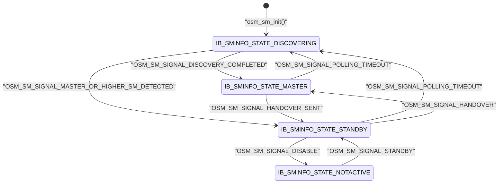
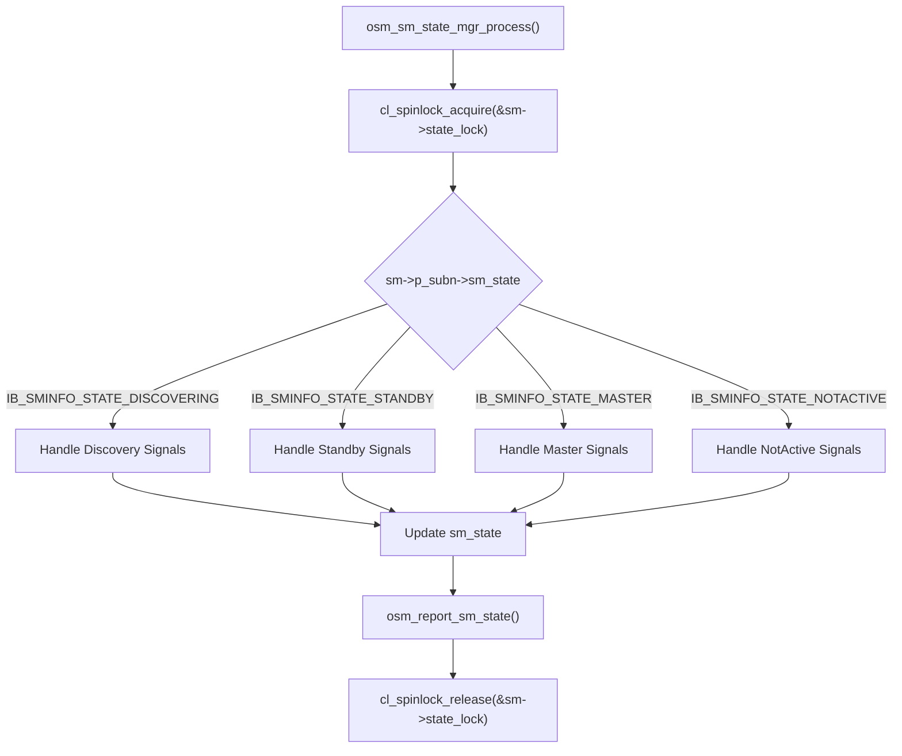
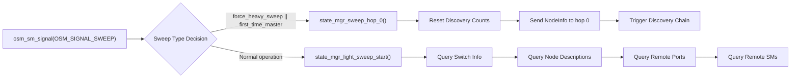
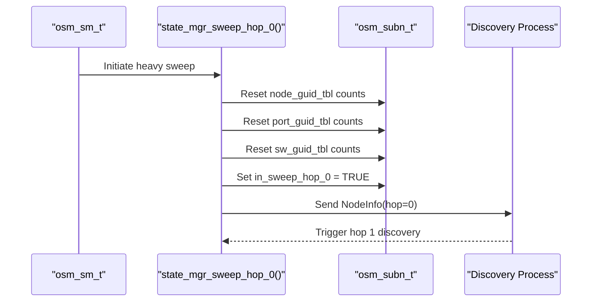
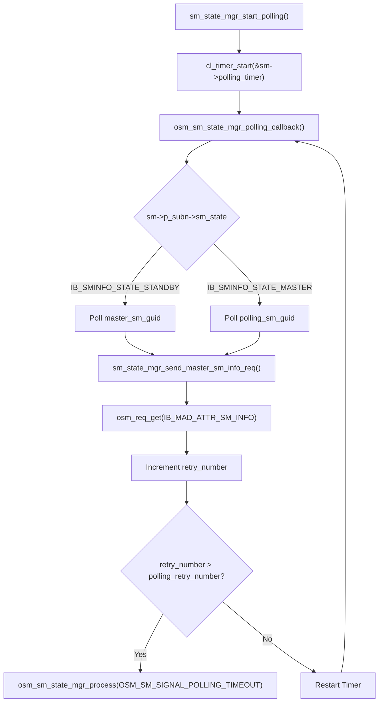
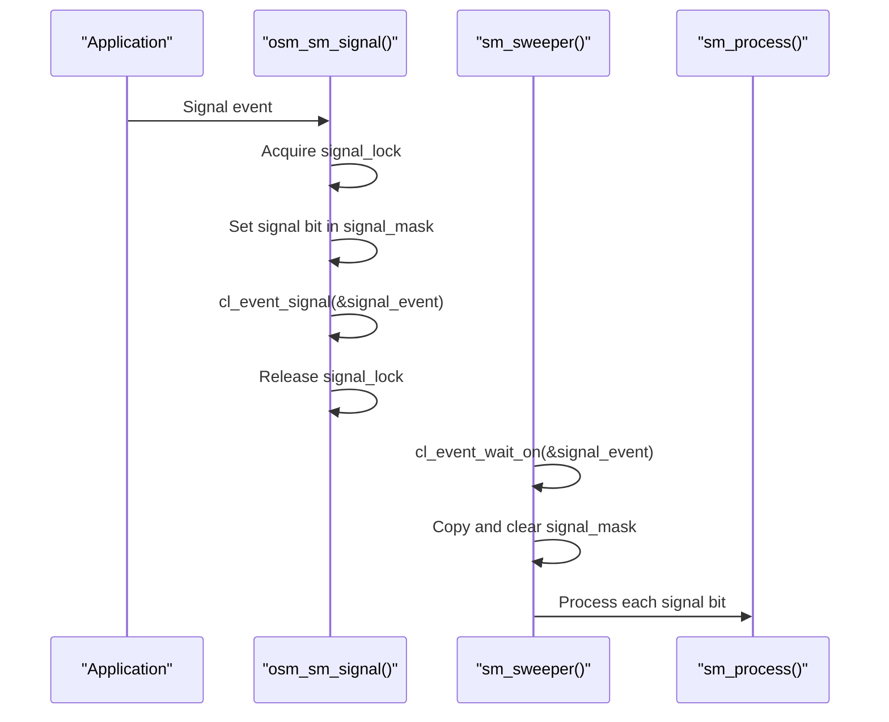
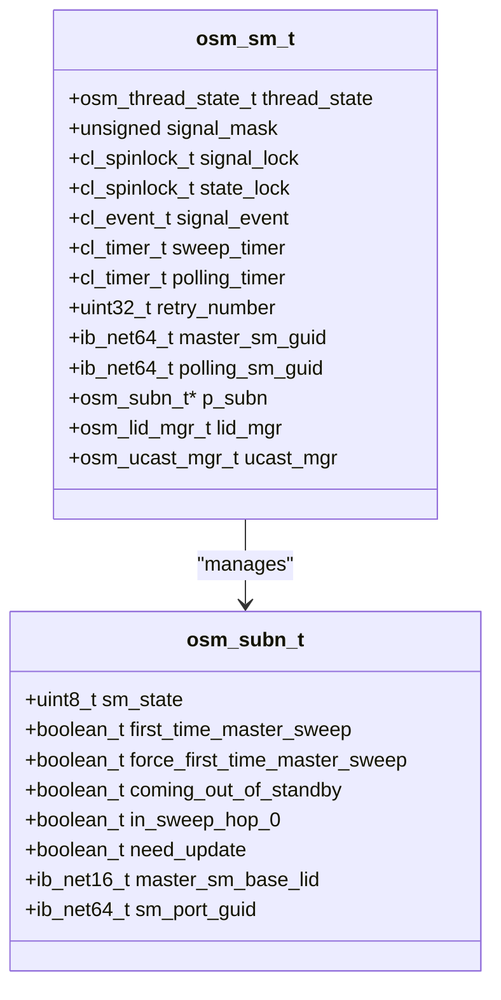
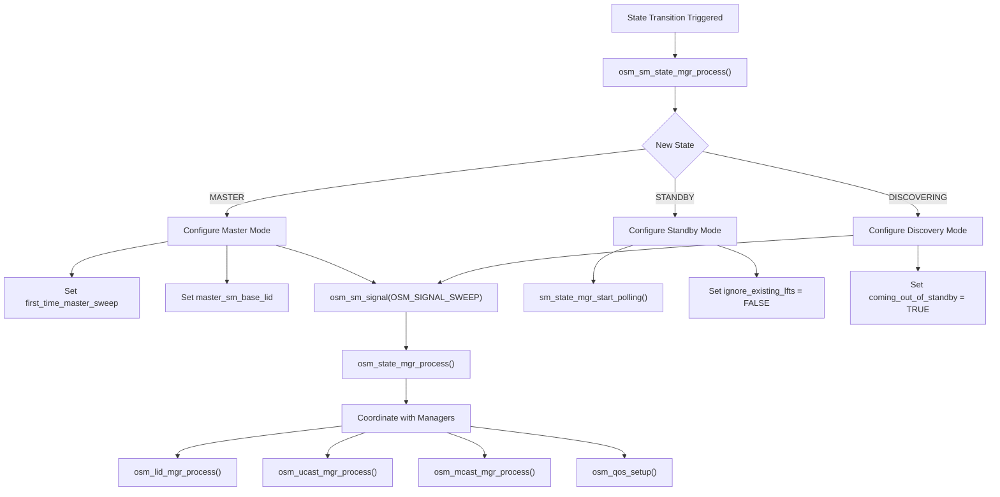

<!-- source: DeepWiki mcp.deepwiki.com · repo linux-rdma/opensm · page 2.2 State Management · fetched 2026-11-11 -->

# State Management

Relevant source files

The following files were used as context for generating this wiki page:

- [include/opensm/osm_sm.h](include/opensm/osm_sm.h)
- [include/opensm/osm_subnet.h](include/opensm/osm_subnet.h)
- [opensm/osm_qos.c](opensm/osm_qos.c)
- [opensm/osm_req.c](opensm/osm_req.c)
- [opensm/osm_sm.c](opensm/osm_sm.c)
- [opensm/osm_sm_state_mgr.c](opensm/osm_sm_state_mgr.c)
- [opensm/osm_state_mgr.c](opensm/osm_state_mgr.c)
- [opensm/osm_subnet.c](opensm/osm_subnet.c)

State Management in OpenSM coordinates the Subnet Manager (SM) state machine, subnet discovery sweeps, and monitoring of remote SMs. This system ensures proper failover between multiple SMs and maintains subnet configuration through periodic sweeps and event-driven updates.

For information about the central subnet data structures that state management operates on, see [Central Data Structures](#2.1).

## SM State Machine

The OpenSM state machine implements the InfiniBand specification's SM states and handles transitions between them based on network events and inter-SM communication.

### State Definitions

OpenSM maintains four primary SM states defined by the InfiniBand specification:

| State | Purpose | Behavior |
|-------|---------|----------|
| `IB_SMINFO_STATE_DISCOVERING` | Initial discovery phase | Performs heavy sweeps to discover topology |
| `IB_SMINFO_STATE_STANDBY` | Backup SM mode | Polls master SM, ready to take over |
| `IB_SMINFO_STATE_MASTER` | Active configuration mode | Configures subnet, manages routing |
| `IB_SMINFO_STATE_NOTACTIVE` | Inactive state | SM is disabled |

### State Machine Implementation

**State Machine Signal Processing**

The core state processing function `osm_sm_state_mgr_process()` handles state transitions:

Sources: [opensm/osm_sm_state_mgr.c:272-499](), [include/opensm/osm_sm.h:104-148]()

## Sweep Management

State management coordinates two types of subnet sweeps to discover and configure the InfiniBand fabric.

### Heavy vs Light Sweeps

**Heavy Sweep Process**

Heavy sweeps perform complete topology discovery starting from hop 0:

**Light Sweep Process**  

Light sweeps perform targeted queries on known topology:

- Query `osm_sw_guid_tbl` switches via `state_mgr_get_sw_info()`
- Update node descriptions via `state_mgr_get_node_desc()`
- Check disconnected ports via `state_mgr_get_remote_port_info()`
- Poll remote SMs via `query_sm_info()`

Sources: [opensm/osm_state_mgr.c:210-270](), [opensm/osm_state_mgr.c:790-862]()

## Polling and Monitoring

State management implements polling mechanisms to monitor remote SMs and detect failures.

### Polling Timer System

**Polling Configuration**

The polling system uses these key parameters from `osm_subn_opt_t`:

- `sminfo_polling_timeout`: Interval between polls (milliseconds)
- `polling_retry_number`: Maximum retries before timeout
- `master_sm_guid`: GUID of master SM to poll (STANDBY mode)
- `polling_sm_guid`: GUID of SM to poll (MASTER mode)

Sources: [opensm/osm_sm_state_mgr.c:145-176](), [opensm/osm_sm_state_mgr.c:178-255]()

## Signal Processing Framework

State management uses a signal-based architecture for event-driven state transitions.

### Signal Types and Handlers

```mermaid
graph TD
    subgraph "SM Signals"
        A["OSM_SM_SIGNAL_DISCOVERY_COMPLETED"]
        B["OSM_SM_SIGNAL_MASTER_OR_HIGHER_SM_DETECTED"] 
        C["OSM_SM_SIGNAL_HANDOVER"]
        D["OSM_SM_SIGNAL_HANDOVER_SENT"]
        E["OSM_SM_SIGNAL_POLLING_TIMEOUT"]
        F["OSM_SM_SIGNAL_DISABLE"]
        G["OSM_SM_SIGNAL_STANDBY"]
    end
    
    subgraph "General Signals"
        H["OSM_SIGNAL_SWEEP"]
        I["OSM_SIGNAL_IDLE_TIME_PROCESS_REQUEST"]
        J["OSM_SIGNAL_PERFMGR_SWEEP"]
    end
    
    A --> K["osm_sm_state_mgr_process()"]
    B --> K
    C --> K
    D --> K
    E --> K
    F --> K
    G --> K
    
    H --> L["osm_state_mgr_process()"]
    I --> L
    J --> L
```

**Signal Processing Implementation**

The `osm_sm_t` structure contains signal processing components:

- `signal_mask`: Bitmask of pending signals
- `signal_lock`: Spinlock protecting signal state
- `signal_event`: Event to wake signal processing thread
- `sweeper`: Thread running `sm_sweeper()` function

Sources: [opensm/osm_sm.c:409-415](), [opensm/osm_sm.c:94-135]()

## Key Data Structures

State management operates on several critical data structures that maintain SM state and coordination.

### Primary SM Structure

The `osm_sm_t` structure contains all state management components:

**Subnet State Flags**

Key boolean flags in `osm_subn_t` control sweep behavior:

| Flag | Purpose |
|------|---------|
| `first_time_master_sweep` | Triggers comprehensive initial configuration |
| `force_first_time_master_sweep` | Forces heavy sweep on next master transition |
| `coming_out_of_standby` | Indicates transition from STANDBY to active |
| `in_sweep_hop_0` | Limits sweep scope during hop 0 discovery |
| `need_update` | Forces configuration updates across managers |

Sources: [include/opensm/osm_sm.h:104-148](), [include/opensm/osm_subnet.h:777-835]()

## State Transition Coordination

State management coordinates with specialized managers during state transitions to ensure consistent subnet configuration.

### Manager Integration

**Cleanup and Reset Operations**

During state transitions, the system performs cleanup operations:

- `state_mgr_clean_known_lids()`: Clear LID assignments
- `state_mgr_sa_clean()`: Clean SA cache and multicast records  
- `state_mgr_reset_node_count()`: Reset discovery counters
- `state_mgr_reset_switch_count()`: Mark switches for update

Sources: [opensm/osm_sm_state_mgr.c:272-499](), [opensm/osm_state_mgr.c:275-393]()

---

