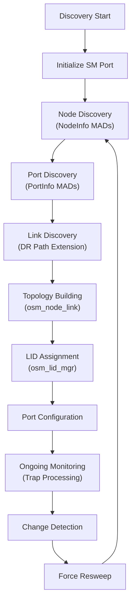
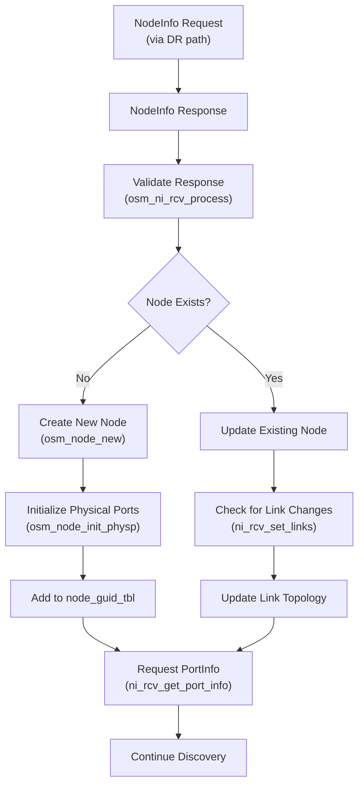
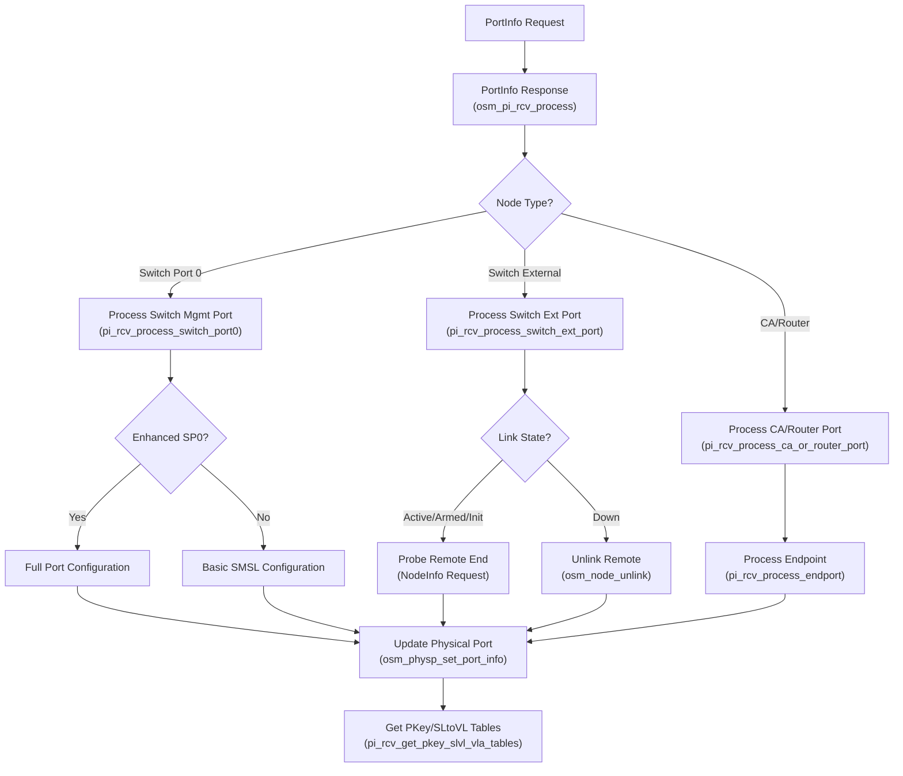
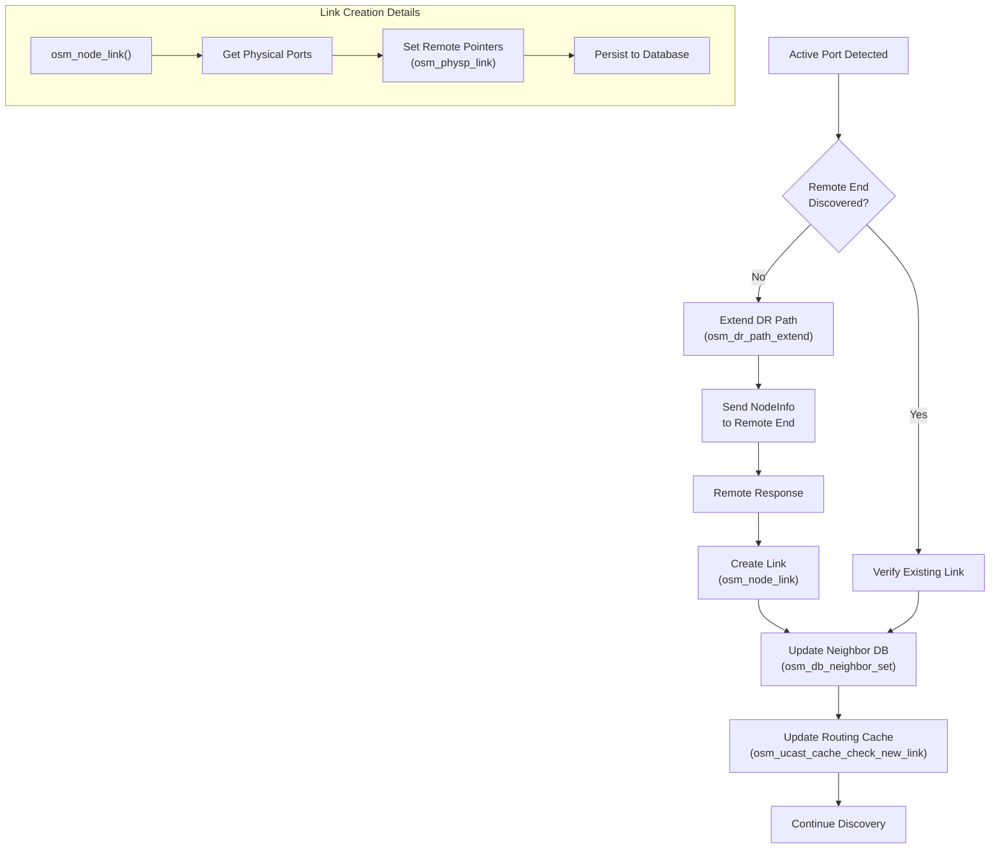
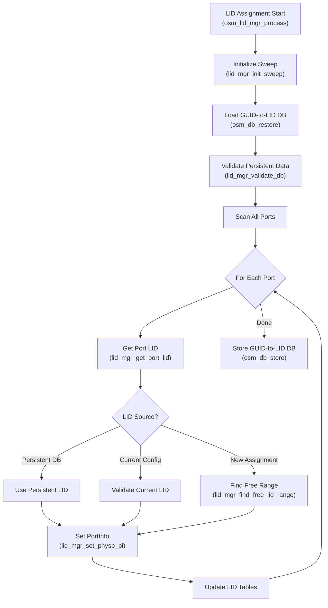
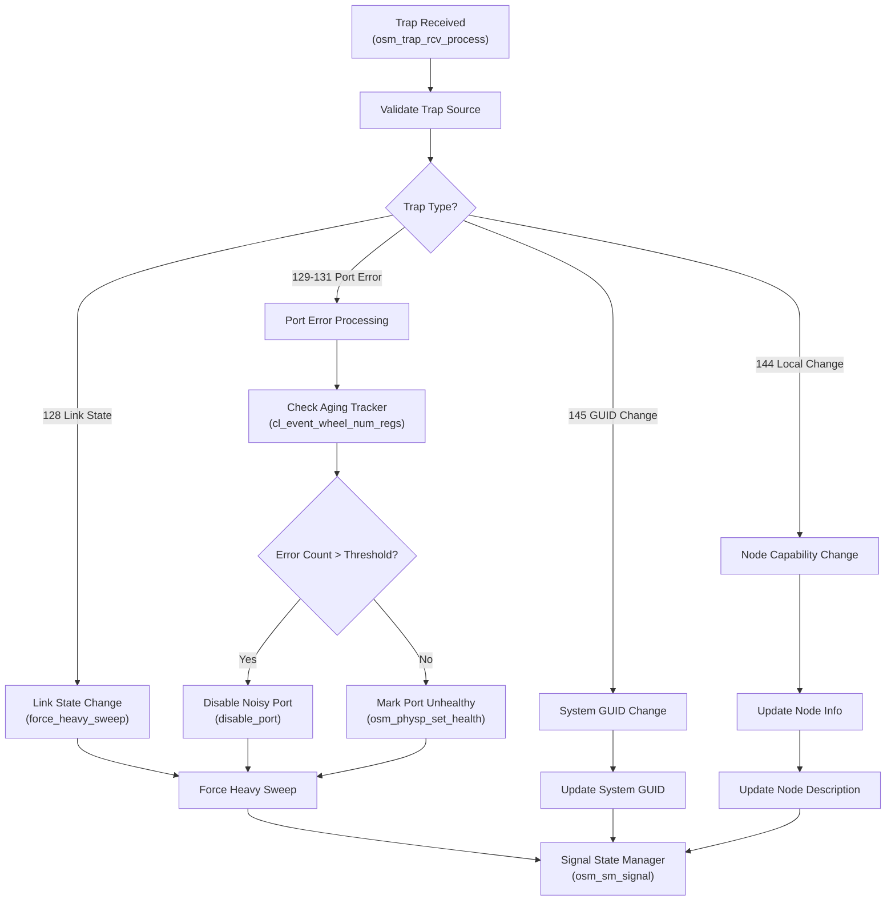
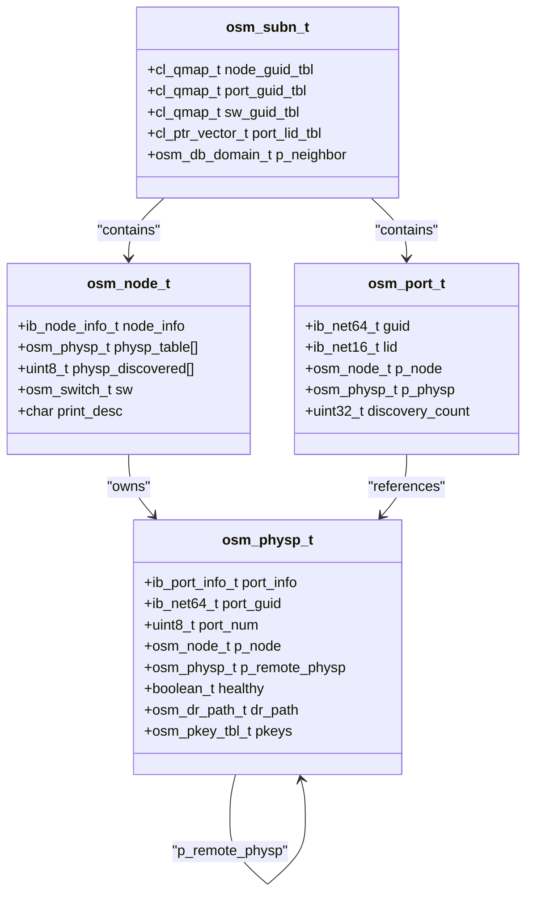

<!-- source: DeepWiki mcp.deepwiki.com · repo linux-rdma/opensm · page 3 Network Discovery and Topology · fetched 2026-11-11 -->

# Network Discovery and Topology

Relevant source files

The following files were used as context for generating this wiki page:

- [include/opensm/osm_node.h](include/opensm/osm_node.h)
- [include/opensm/osm_port.h](include/opensm/osm_port.h)
- [opensm/osm_lid_mgr.c](opensm/osm_lid_mgr.c)
- [opensm/osm_link_mgr.c](opensm/osm_link_mgr.c)
- [opensm/osm_node.c](opensm/osm_node.c)
- [opensm/osm_node_info_rcv.c](opensm/osm_node_info_rcv.c)
- [opensm/osm_port.c](opensm/osm_port.c)
- [opensm/osm_port_info_rcv.c](opensm/osm_port_info_rcv.c)
- [opensm/osm_sw_info_rcv.c](opensm/osm_sw_info_rcv.c)
- [opensm/osm_trap_rcv.c](opensm/osm_trap_rcv.c)

This document explains how OpenSM discovers the InfiniBand fabric topology, including the identification of nodes, ports, and links. The discovery process builds a complete representation of the subnet that enables proper subnet management and routing decisions.

For information about routing algorithms that operate on the discovered topology, see [Routing Algorithms](#4.2). For details about subnet administration services that query the discovered topology, see [Subnet Administration (SA)](#5).

## Discovery Process Overview

OpenSM uses a systematic approach to discover the InfiniBand fabric topology through Management Datagram (MAD) exchanges. The discovery process consists of several interconnected phases that build up the subnet representation:

Sources: [opensm/osm_node_info_rcv.c:1-825](), [opensm/osm_port_info_rcv.c:1-826](), [opensm/osm_trap_rcv.c:1-701]()

## Node Discovery Process

Node discovery begins when OpenSM sends `NodeInfo` MADs to discover devices in the fabric. The `osm_ni_rcv_process` function handles responses and builds the node representation:

Key functions in node discovery:

- `osm_ni_rcv_process()` - Main entry point for NodeInfo processing at [opensm/osm_node_info_rcv.c:821-825]()
- `ni_rcv_set_links()` - Establishes links between discovered nodes at [opensm/osm_node_info_rcv.c:141-312]()
- `osm_node_new()` - Creates new node objects at [opensm/osm_node.c:74-130]()

Sources: [opensm/osm_node_info_rcv.c:141-312](), [opensm/osm_node_info_rcv.c:821-825](), [opensm/osm_node.c:74-130]()

## Port Discovery and Configuration

Port discovery follows node discovery and involves querying `PortInfo` attributes for each physical port. The process differs based on the node type:

The port discovery process tracks several key attributes:

| Attribute | Purpose | Code Location |
|-----------|---------|---------------|
| Port State | Link status and configuration | [opensm/osm_port_info_rcv.c:292-402]() |
| MTU Capability | Maximum transmission unit | [opensm/osm_port_info_rcv.c:101-130]() |
| VL Capability | Virtual lane support | [opensm/osm_port_info_rcv.c:119-129]() |
| Speed/Width | Link physical characteristics | [opensm/osm_link_mgr.c:346-423]() |

Sources: [opensm/osm_port_info_rcv.c:642-825](), [opensm/osm_port_info_rcv.c:205-254](), [opensm/osm_port_info_rcv.c:259-443]()

## Link Discovery and Topology Building

Link discovery extends directed routes through active ports to discover the complete fabric topology. The process uses DR (Directed Route) path extension:

The topology building process maintains several key data structures:

- **Node Table** (`node_guid_tbl`) - Maps node GUIDs to `osm_node_t` objects
- **Port Table** (`port_guid_tbl`) - Maps port GUIDs to `osm_port_t` objects  
- **Switch Table** (`sw_guid_tbl`) - Maps switch GUIDs to `osm_switch_t` objects
- **Link Database** - Persistent neighbor relationships

Sources: [opensm/osm_port_info_rcv.c:358-393](), [opensm/osm_node_info_rcv.c:279-309](), [opensm/osm_node.c:158-173]()

## LID Assignment Process

LID (Local Identifier) assignment occurs after topology discovery and follows a sophisticated algorithm that balances persistence with fabric changes:

The LID manager maintains several data structures for efficient assignment:

| Structure | Purpose | File Location |
|-----------|---------|---------------|
| `used_lids[]` | Bitmap of assigned LIDs | [opensm/osm_lid_mgr.c:186-206]() |
| `free_ranges` | List of available LID ranges | [opensm/osm_lid_mgr.c:592-653]() |
| `port_lid_tbl` | Maps LIDs to ports | [opensm/osm_lid_mgr.c:779-781]() |
| GUID-to-LID DB | Persistent assignments | [opensm/osm_lid_mgr.c:774-777]() |

Sources: [opensm/osm_lid_mgr.c:290-571](), [opensm/osm_lid_mgr.c:680-785](), [opensm/osm_lid_mgr.c:802-1037]()

## Trap Handling and Dynamic Updates

OpenSM continuously monitors the fabric for changes through trap processing. Traps indicate dynamic events like link state changes, node additions/removals, and errors:

Key trap processing functions:

- `trap_rcv_process_request()` - Main trap processing logic at [opensm/osm_trap_rcv.c:372-681]()
- `shutup_noisy_port()` - Handles noisy port suppression at [opensm/osm_trap_rcv.c:331-370]()
- `aging_tracker_callback()` - Manages trap aging at [opensm/osm_trap_rcv.c:99-140]()

Sources: [opensm/osm_trap_rcv.c:372-681](), [opensm/osm_trap_rcv.c:331-370](), [opensm/osm_trap_rcv.c:99-140]()

## Key Data Structures

The discovery process builds and maintains several interconnected data structures that represent the fabric topology:

These structures form the core representation of the discovered topology, enabling efficient subnet management operations.

Sources: [include/opensm/osm_port.h:107-133](), [opensm/osm_node.c:94-129](), [opensm/osm_port.c:138-174]()

---

