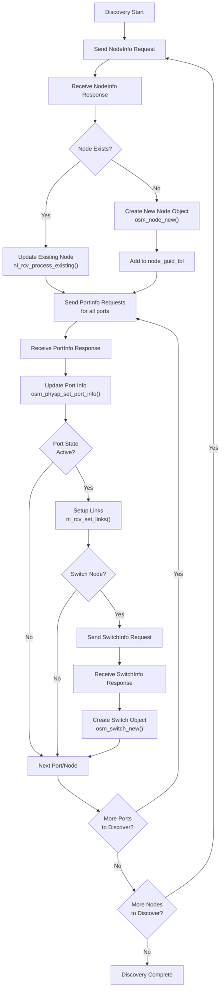
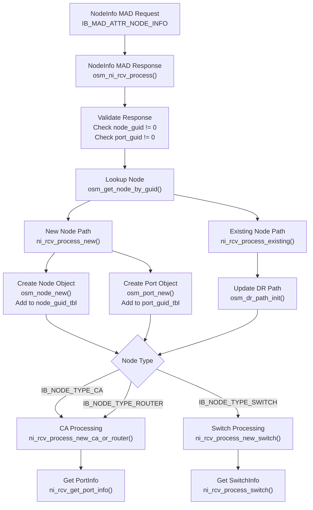
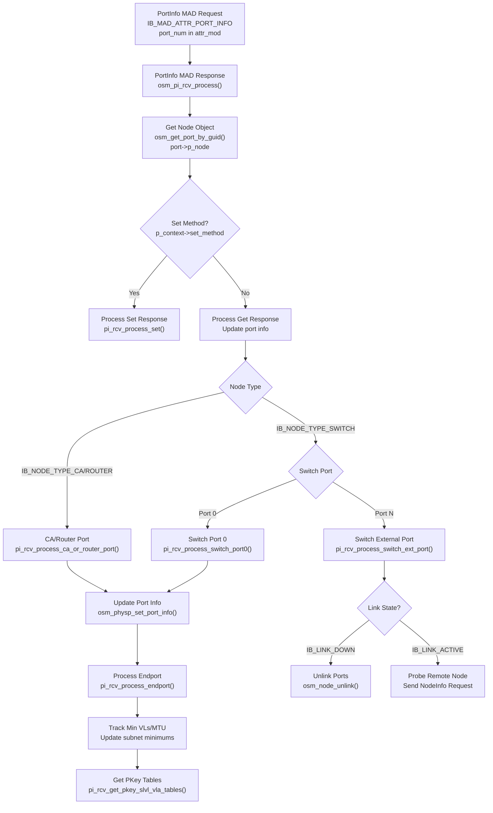
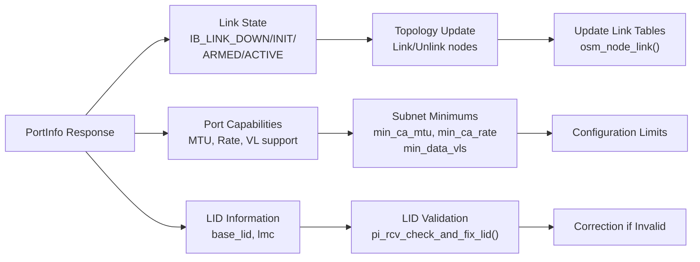
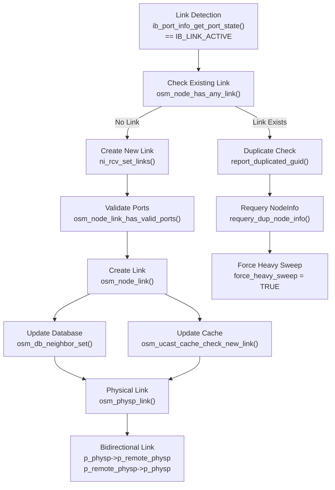
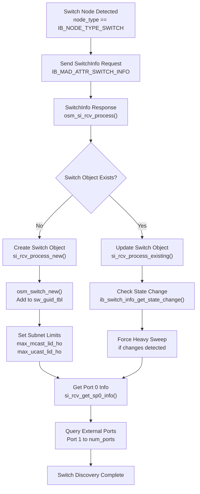

<!-- source: DeepWiki mcp.deepwiki.com · repo linux-rdma/opensm · page 3.1 Node and Port Discovery · fetched 2026-11-11 -->

# Node and Port Discovery

<details>
<summary>Relevant source files</summary>

The following files were used as context for generating this wiki page:

- [include/opensm/osm_node.h](include/opensm/osm_node.h)
- [opensm/osm_node.c](opensm/osm_node.c)
- [opensm/osm_node_info_rcv.c](opensm/osm_node_info_rcv.c)
- [opensm/osm_port_info_rcv.c](opensm/osm_port_info_rcv.c)
- [opensm/osm_sw_info_rcv.c](opensm/osm_sw_info_rcv.c)

</details>


This document describes how OpenSM discovers InfiniBand nodes and ports within the fabric to build the network topology. The discovery process involves exchanging Management Datagrams (MADs) with fabric devices to gather NodeInfo, PortInfo, and SwitchInfo attributes, then creating and linking the corresponding data structures.

For information about LID assignment and trap handling that occurs after discovery, see [LID Management and Trap Handling](#3.2). For details about routing calculations that use the discovered topology, see [Routing Management](#4).

## Discovery Process Overview

The node and port discovery process follows a systematic approach to map the entire InfiniBand fabric topology:



Sources: [opensm/osm_node_info_rcv.c:912-972](), [opensm/osm_port_info_rcv.c:642-825](), [opensm/osm_sw_info_rcv.c:381-454]()

## NodeInfo Discovery and Processing

NodeInfo discovery is the foundation of fabric topology discovery. The `osm_ni_rcv_process()` function handles NodeInfo MAD responses and manages node object lifecycle:



Sources: [opensm/osm_node_info_rcv.c:912-972](), [opensm/osm_node_info_rcv.c:657-838](), [opensm/osm_node_info_rcv.c:843-910]()

### Node Object Creation

The `osm_node_t` structure represents discovered nodes and contains arrays of physical ports:

| Field | Type | Purpose |
|-------|------|---------|
| `map_item` | `cl_map_item_t` | Linkage for `node_guid_tbl` |
| `sw` | `osm_switch_t*` | Switch object for switch nodes |
| `node_info` | `ib_node_info_t` | IBA NodeInfo attribute |
| `node_desc` | `ib_node_desc_t` | IBA NodeDescription |
| `discovery_count` | `uint32_t` | Times discovered this sweep |
| `physp_table` | `osm_physp_t[]` | Array of physical ports |
| `physp_discovered` | `uint8_t*` | Port discovery tracking |

Sources: [include/opensm/osm_node.h:97-107](), [opensm/osm_node.c:74-130]()

## PortInfo Discovery and Physical Topology

PortInfo discovery reveals the detailed characteristics of each port and establishes the physical link topology:



Sources: [opensm/osm_port_info_rcv.c:642-825](), [opensm/osm_port_info_rcv.c:205-254](), [opensm/osm_port_info_rcv.c:259-443](), [opensm/osm_port_info_rcv.c:445-461]()

### Port State Management

The PortInfo receiver tracks various port characteristics that affect subnet configuration:



Sources: [opensm/osm_port_info_rcv.c:82-131](), [opensm/osm_port_info_rcv.c:70-80](), [opensm/osm_port_info_rcv.c:292-439]()

## Link Establishment and Topology Building

The discovery process establishes bidirectional links between nodes when ports are in active states:



Sources: [opensm/osm_node_info_rcv.c:141-312](), [opensm/osm_node.c:158-173](), [opensm/osm_node_info_rcv.c:68-99](), [opensm/osm_node_info_rcv.c:101-136]()

## Switch Discovery and Processing

Switch nodes require additional processing to handle SwitchInfo attributes and establish the switch forwarding context:



Sources: [opensm/osm_sw_info_rcv.c:381-454](), [opensm/osm_sw_info_rcv.c:196-277](), [opensm/osm_sw_info_rcv.c:284-335](), [opensm/osm_sw_info_rcv.c:337-379]()

## Data Structure Relationships

The discovered topology is represented through interconnected data structures maintained in the subnet object:

```mermaid
classDiagram
    class osm_subn_t {
        +cl_qmap_t node_guid_tbl
        +cl_qmap_t port_guid_tbl  
        +cl_qmap_t sw_guid_tbl
        +cl_qmap_t alias_port_guid_tbl
    }
    
    class osm_node_t {
        +ib_node_info_t node_info
        +osm_switch_t* sw
        +uint32_t discovery_count
        +osm_physp_t physp_table[]
        +uint8_t* physp_discovered
    }
    
    class osm_physp_t {
        +ib_port_info_t port_info
        +osm_node_t* p_node
        +osm_physp_t* p_remote_physp
        +osm_dr_path_t dr_path
        +uint8_t port_num
    }
    
    class osm_port_t {
        +ib_net64_t guid
        +osm_physp_t* p_physp
        +osm_node_t* p_node
        +uint32_t discovery_count
    }
    
    class osm_switch_t {
        +osm_node_t* p_node
        +ib_switch_info_t switch_info
        +uint16_t max_lid_ho
        +osm_mcast_tbl_t mcast_tbl
    }
    
    osm_subn_t ||--o{ osm_node_t : "node_guid_tbl"
    osm_subn_t ||--o{ osm_port_t : "port_guid_tbl"
    osm_subn_t ||--o{ osm_switch_t : "sw_guid_tbl"
    
    osm_node_t ||--o{ osm_physp_t : "physp_table"
    osm_node_t ||--o| osm_switch_t : "sw (if switch)"
    osm_physp_t ||--|| osm_node_t : "p_node"
    osm_physp_t ||--o| osm_physp_t : "p_remote_physp"
    osm_port_t ||--|| osm_physp_t : "p_physp"
    osm_switch_t ||--|| osm_node_t : "p_node"
```

Sources: [include/opensm/osm_node.h:97-107](), [opensm/osm_node_info_rcv.c:698-742](), [opensm/osm_port_info_rcv.c:708-719](), [opensm/osm_sw_info_rcv.c:217-252]()

## Error Handling and Recovery

The discovery process includes robust error handling for various failure conditions:

| Error Condition | Detection | Recovery Action |
|-----------------|-----------|-----------------|
| Duplicate GUIDs | `osm_node_has_any_link()` check | `requery_dup_node_info()`, force heavy sweep |
| Invalid LIDs | `pi_rcv_check_and_fix_lid()` | Correct to valid LID range |
| Link state errors | PortInfo status check | Log error, continue discovery |
| Missing nodes | Node lookup failure | Log error, skip processing |
| MAD errors | SMP status check | Log error, continue with next request |

The system maintains discovery counts and implements retry mechanisms to handle transient network conditions and ensure complete topology discovery.

Sources: [opensm/osm_node_info_rcv.c:224-243](), [opensm/osm_port_info_rcv.c:70-80](), [opensm/osm_node_info_rcv.c:68-99](), [opensm/osm_port_info_rcv.c:587-601]()

---

