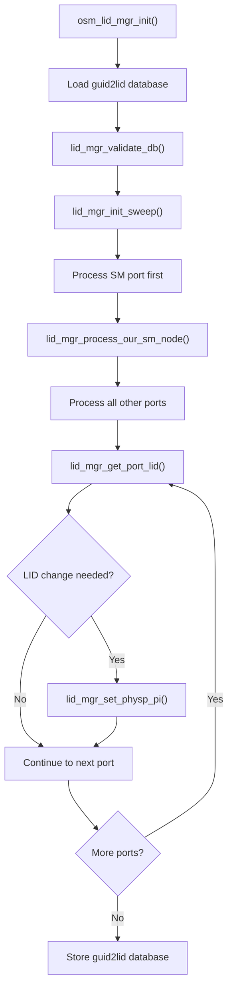
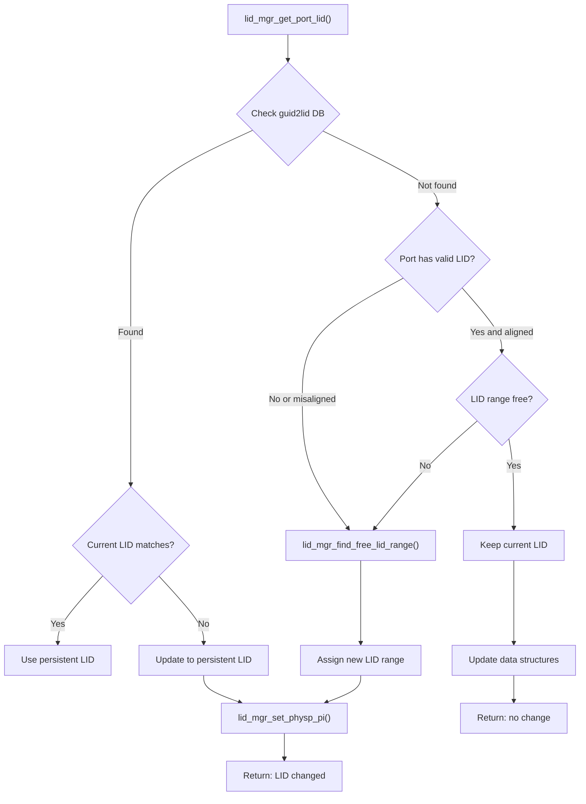
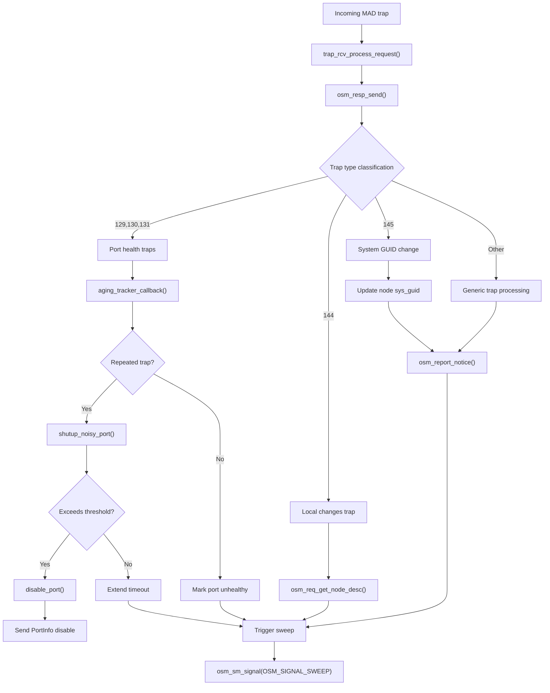
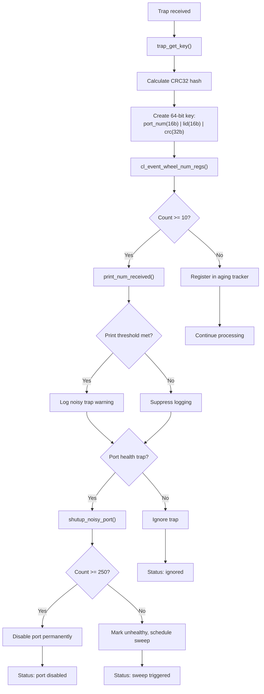
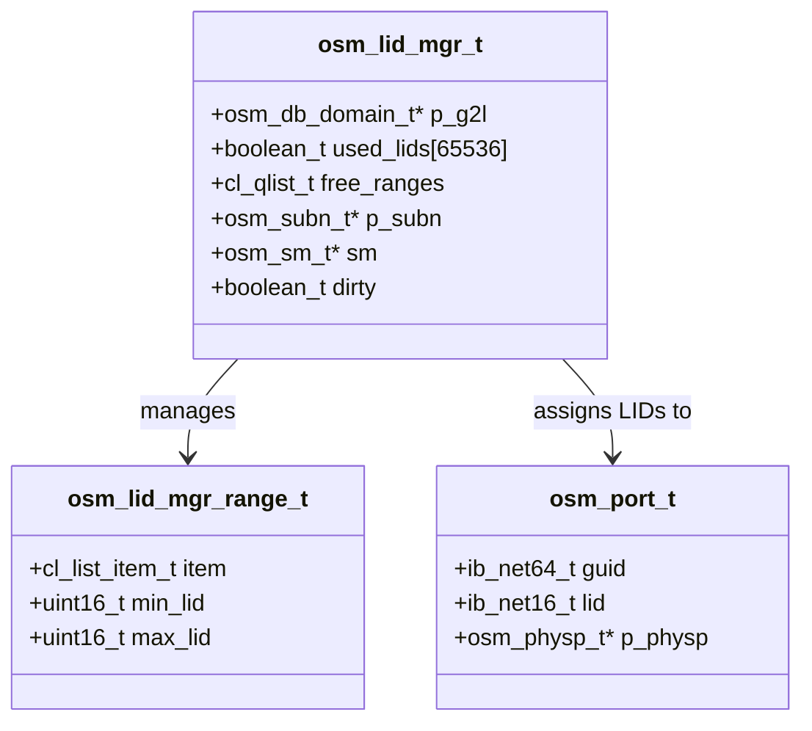
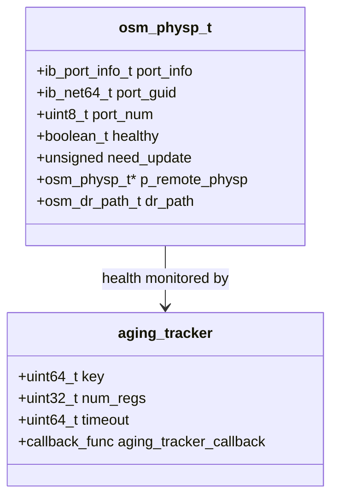
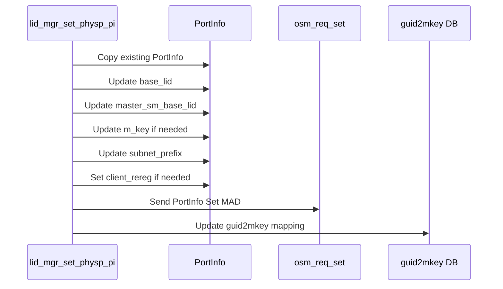
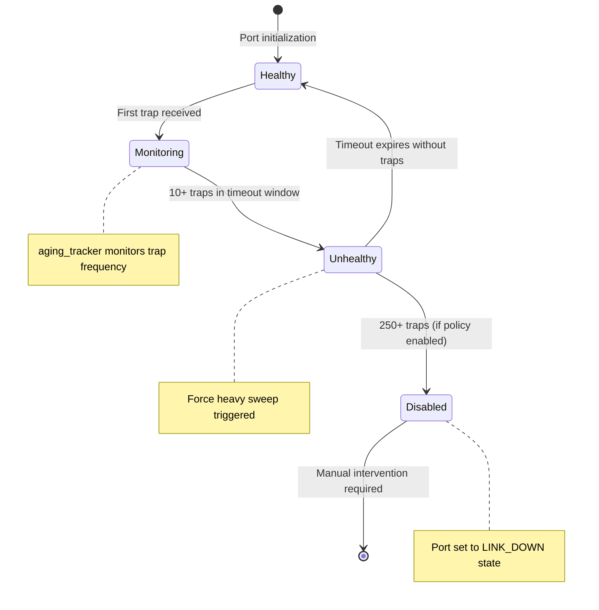
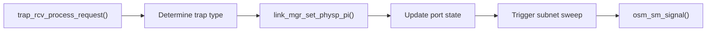

<!-- source: DeepWiki mcp.deepwiki.com · repo linux-rdma/opensm · page 3.2 LID Management and Trap Handling · fetched 2026-11-11 -->

# LID Management and Trap Handling

Relevant source files

The following files were used as context for generating this wiki page:

- [include/opensm/osm_port.h](include/opensm/osm_port.h)
- [opensm/osm_lid_mgr.c](opensm/osm_lid_mgr.c)
- [opensm/osm_link_mgr.c](opensm/osm_link_mgr.c)
- [opensm/osm_port.c](opensm/osm_port.c)
- [opensm/osm_trap_rcv.c](opensm/osm_trap_rcv.c)

This document covers OpenSM's Local Identifier (LID) assignment system and network event handling through trap processing. LID management ensures every port in the InfiniBand fabric receives appropriate LID ranges, while trap handling responds to network events and maintains fabric health. For information about the initial discovery of nodes and ports, see [Node and Port Discovery](#3.1). For details about routing table construction that uses the assigned LIDs, see [Unicast Routing](#4.1).

## LID Management Overview

The LID Manager (`osm_lid_mgr_t`) is responsible for assigning unique Local Identifiers to all ports in the subnet. LIDs are essential for packet routing in InfiniBand networks, with each port requiring a base LID and potentially additional LIDs based on the LMC (LID Mask Control) value.

### LID Assignment Algorithm

The LID manager implements a multi-phase algorithm that balances persistence with fabric changes:

**LID Assignment Decision Process**

Sources: [opensm/osm_lid_mgr.c:680-785]()

Sources: [opensm/osm_lid_mgr.c:680-785]()

## Trap Handling System

The trap receiver (`osm_trap_rcv_t`) processes network event notifications (traps) sent by nodes to report various conditions including link state changes, errors, and capability updates.

### Trap Processing Architecture

Sources: [opensm/osm_trap_rcv.c:372-681]()

### Trap Filtering and Aging

The system implements sophisticated trap filtering to prevent fabric instability from noisy ports:

Sources: [opensm/osm_trap_rcv.c:487-548]()

## Core Data Structures

### LID Manager Structure

The `osm_lid_mgr_t` maintains several key data structures for LID assignment:

| Field | Type | Purpose |
|-------|------|---------|
| `p_g2l` | `osm_db_domain_t*` | GUID-to-LID persistent database |
| `used_lids[]` | `boolean_t[65536]` | Bitmap of allocated LIDs |
| `free_ranges` | `cl_qlist_t` | List of available LID ranges |
| `p_subn` | `osm_subn_t*` | Subnet state reference |

Sources: [opensm/osm_lid_mgr.c:220-245]()

### LID Range Management

Sources: [opensm/osm_lid_mgr.c:103-107](), [include/opensm/osm_port.h:1221-1236]()

### Physical Port Health Tracking

Sources: [include/opensm/osm_port.h:107-133](), [opensm/osm_trap_rcv.c:99-140]()

## Key Algorithms

### LID Assignment Process

The LID assignment follows a three-phase approach defined in the algorithm comments:

1. **Initialization Phase**: Load persistent GUID-to-LID mappings and validate against current LMC settings
2. **SM Port Assignment**: Process the SM's own port first to establish the SM base LID
3. **General Port Assignment**: Process all other ports, attempting to preserve existing assignments

Sources: [opensm/osm_lid_mgr.c:47-77]()

### Port Information Update

When LID changes are required, the system updates port configuration through `lid_mgr_set_physp_pi()`:

Sources: [opensm/osm_lid_mgr.c:802-1094]()

### Trap-Based Port Health Management

The system uses trap 129, 130, and 131 to manage port health:

Sources: [opensm/osm_trap_rcv.c:331-370](), [opensm/osm_trap_rcv.c:214-278]()

## Integration with OpenSM Core

### Interaction with State Manager

The LID manager integrates with the SM state machine through several key interfaces:

- **Initialization**: Called during SM initialization to restore persistent state
- **Sweep Processing**: Invoked during subnet sweeps to assign/update LIDs  
- **Change Detection**: Marks subnet as requiring heavy sweep when LID changes occur

Sources: [opensm/osm_lid_mgr.c:220-275]()

### Relationship with Link Manager

The trap handler coordinates with the link manager for port state changes:

Sources: [opensm/osm_trap_rcv.c:612-631](), [opensm/osm_link_mgr.c:91-512]()

### Database Persistence

Both LID assignments and M_Key associations are persisted to handle SM restarts:

- **GUID-to-LID Database**: Maintains port LID assignments across reboots
- **GUID-to-M_Key Database**: Tracks management keys for security
- **Validation on Load**: Ensures persistent data remains valid with current fabric configuration

Sources: [opensm/osm_lid_mgr.c:131-218](), [opensm/osm_port.c:765-794]()

---

