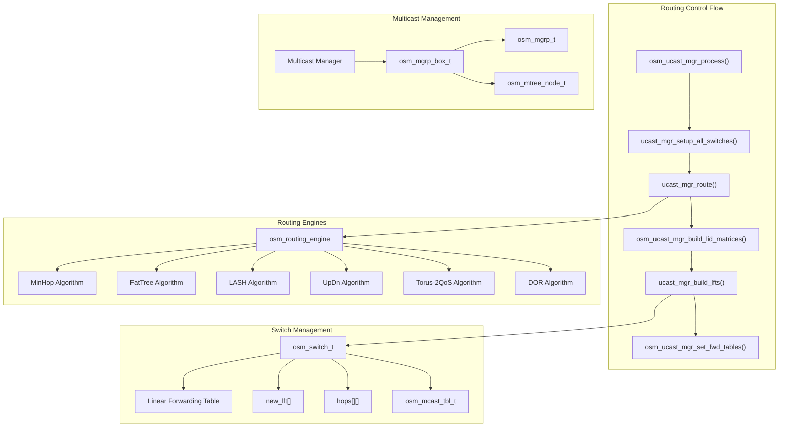
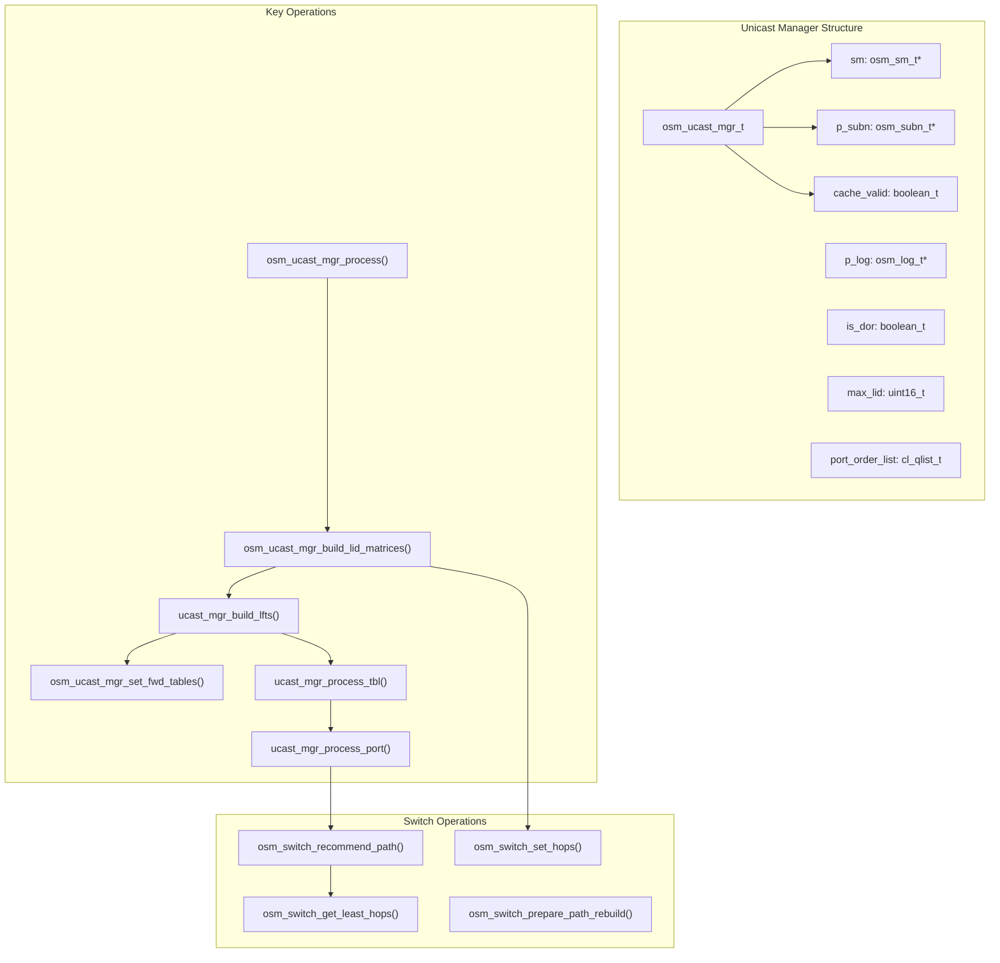
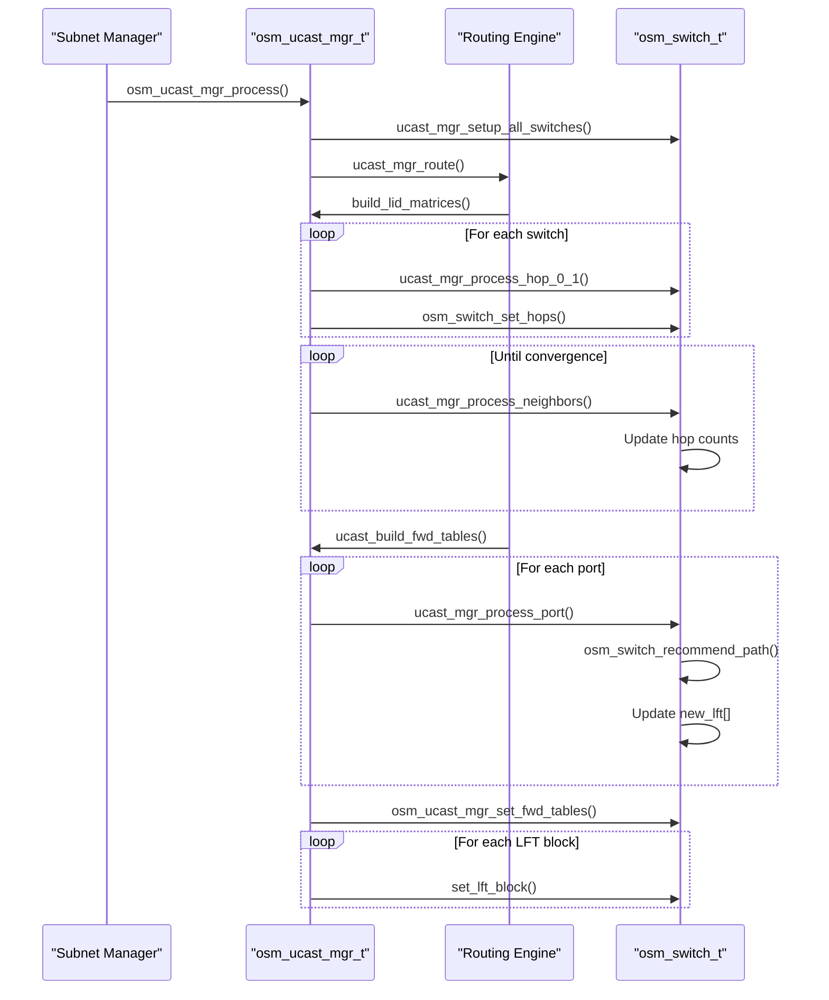
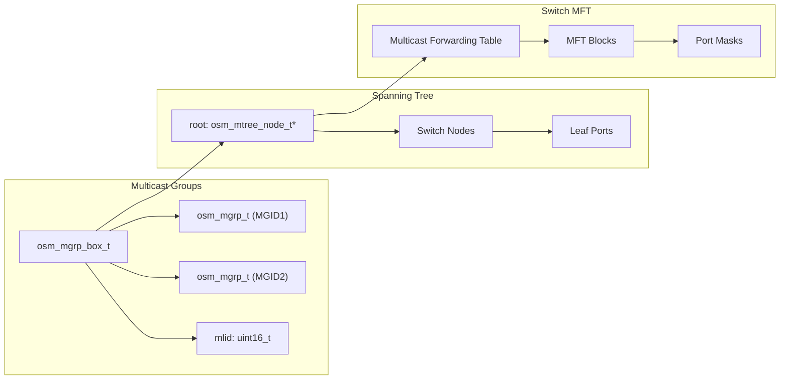
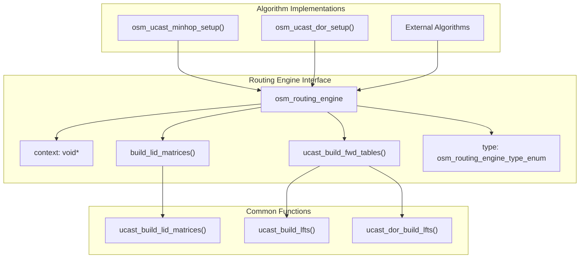

<!-- source: DeepWiki mcp.deepwiki.com · repo linux-rdma/opensm · page 4 Routing Management · fetched 2026-11-11 -->

# Routing Management

Relevant source files

The following files were used as context for generating this wiki page:

- [include/opensm/osm_mcm_port.h](include/opensm/osm_mcm_port.h)
- [include/opensm/osm_multicast.h](include/opensm/osm_multicast.h)
- [include/opensm/osm_switch.h](include/opensm/osm_switch.h)
- [opensm/osm_drop_mgr.c](opensm/osm_drop_mgr.c)
- [opensm/osm_dump.c](opensm/osm_dump.c)
- [opensm/osm_mcast_mgr.c](opensm/osm_mcast_mgr.c)
- [opensm/osm_mcm_port.c](opensm/osm_mcm_port.c)
- [opensm/osm_multicast.c](opensm/osm_multicast.c)
- [opensm/osm_switch.c](opensm/osm_switch.c)
- [opensm/osm_ucast_mgr.c](opensm/osm_ucast_mgr.c)

## Purpose and Scope

This page provides a comprehensive overview of routing management in OpenSM, covering both unicast and multicast routing mechanisms. OpenSM's routing management is responsible for calculating and configuring forwarding tables in InfiniBand switches to establish optimal paths between all nodes in the subnet.

For detailed information about specific routing aspects, see:
- Unicast routing and LFT construction: [Unicast Routing](#4.1)
- Specific routing algorithms (FatTree, LASH, UpDn, Torus): [Routing Algorithms](#4.2)  
- Multicast group management and spanning tree construction: [Multicast Management](#4.3)

## Routing Management Architecture

OpenSM's routing management operates through a coordinated system of managers and engines that handle different aspects of path calculation and forwarding table configuration:

Sources: [opensm/osm_ucast_mgr.c:1098-1153](), [opensm/osm_mcast_mgr.c:741-813](), [include/opensm/osm_switch.h:94-116]()

## Core Routing Components

### Unicast Manager (`osm_ucast_mgr_t`)

The unicast manager coordinates all unicast routing activities and serves as the central orchestrator for path calculation and forwarding table construction:

Sources: [opensm/osm_ucast_mgr.c:82-100](), [opensm/osm_ucast_mgr.c:596-675](), [opensm/osm_ucast_mgr.c:860-897]()

### Switch Routing State

Each InfiniBand switch maintains routing state through the `osm_switch_t` structure, which contains both current and calculated forwarding information:

| Component | Type | Purpose |
|-----------|------|---------|
| `lft` | `uint8_t*` | Current Linear Forwarding Table on switch |
| `new_lft` | `uint8_t*` | Newly calculated LFT to be programmed |
| `hops` | `uint8_t**` | Hop count matrix [lid][port] |
| `mcast_tbl` | `osm_mcast_tbl_t` | Multicast Forwarding Table |
| `p_prof` | `osm_port_profile_t*` | Port usage profiles for load balancing |
| `max_lid_ho` | `uint16_t` | Maximum LID accessible from this switch |

Sources: [include/opensm/osm_switch.h:94-116](), [opensm/osm_switch.c:604-663]()

## Routing Process Flow

The routing management process follows a structured sequence that builds hop count matrices, calculates optimal paths, and programs forwarding tables:

Sources: [opensm/osm_ucast_mgr.c:1098-1153](), [opensm/osm_ucast_mgr.c:1060-1096](), [opensm/osm_ucast_mgr.c:201-315]()

## Multicast Routing Integration

Multicast routing operates in parallel with unicast routing, managing multicast groups and constructing spanning trees for efficient multicast delivery:

Sources: [opensm/osm_mcast_mgr.c:741-813](), [include/opensm/osm_multicast.h:153-157](), [opensm/osm_multicast.c:118-148]()

## Path Recommendation Algorithm

The core path selection logic in `osm_switch_recommend_path()` considers multiple factors including hop counts, load balancing, and LMC (LID Mask Control) requirements:

| Factor | Implementation | Purpose |
|--------|----------------|---------|
| Least Hops | `osm_switch_get_least_hops()` | Minimize latency |
| Load Balancing | `osm_port_prof_path_count_get()` | Distribute traffic |
| LMC Support | Remote GUID tracking | Support multiple paths per destination |
| Port Health | `osm_physp_is_healthy()` | Avoid failed links |
| DOR Routing | `is_dor` flag | Dimension-ordered routing support |

Sources: [opensm/osm_switch.c:234-593](), [opensm/osm_ucast_mgr.c:201-315]()

## Routing Engine Interface

OpenSM supports multiple routing algorithms through a plugin-like routing engine interface. Each engine implements the standard interface while providing algorithm-specific optimizations:

Sources: [opensm/osm_ucast_mgr.c:1165-1191](), [opensm/osm_ucast_mgr.c:1155-1163](), [opensm/osm_ucast_mgr.c:1173-1183]()

---

