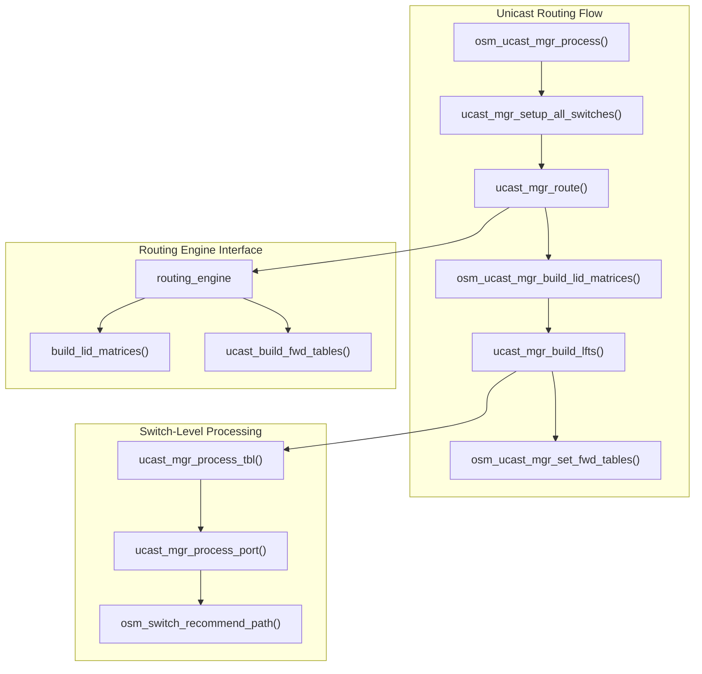
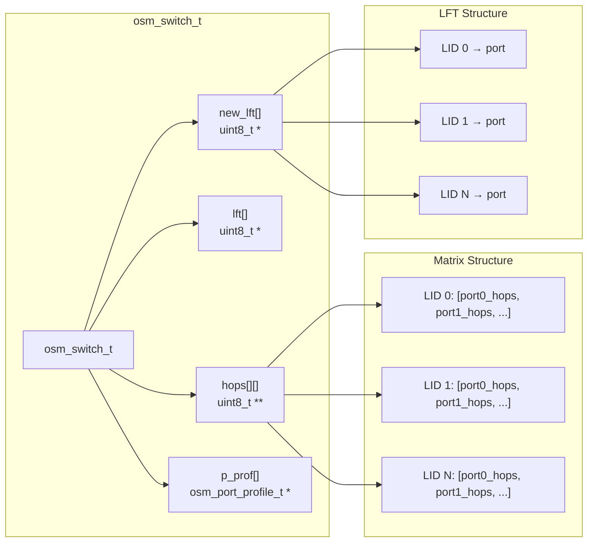
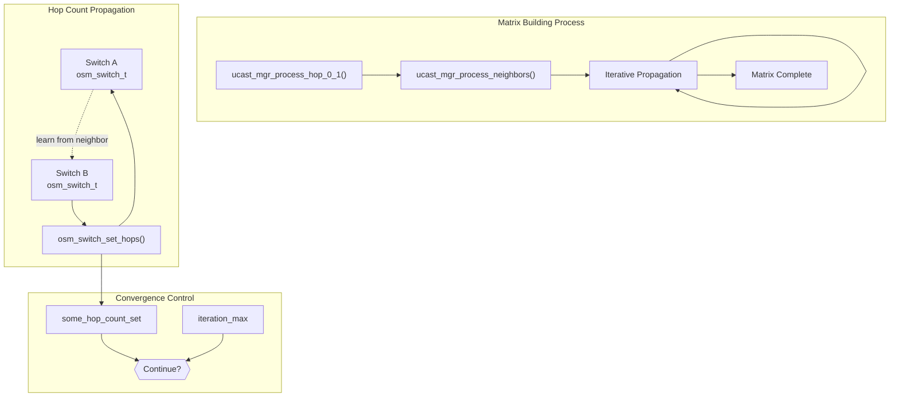
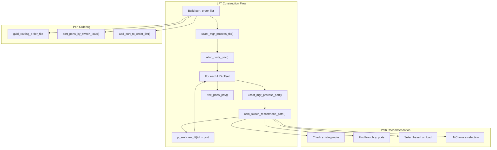
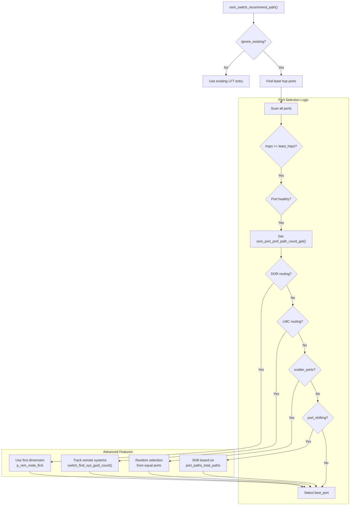
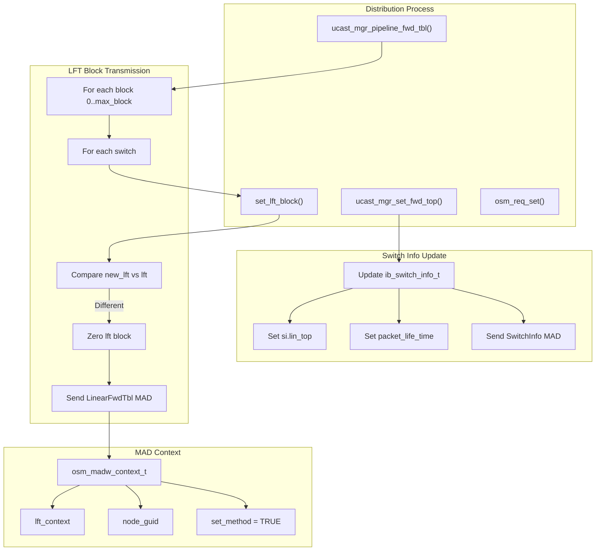

<!-- source: DeepWiki mcp.deepwiki.com · repo linux-rdma/opensm · page 4.1 Unicast Routing · fetched 2026-11-11 -->

# Unicast Routing

Relevant source files

The following files were used as context for generating this wiki page:

- [include/opensm/osm_switch.h](include/opensm/osm_switch.h)
- [opensm/osm_dump.c](opensm/osm_dump.c)
- [opensm/osm_switch.c](opensm/osm_switch.c)
- [opensm/osm_ucast_mgr.c](opensm/osm_ucast_mgr.c)

This document covers the unicast routing subsystem within OpenSM, which is responsible for calculating and distributing linear forwarding tables (LFTs) to InfiniBand switches. Unicast routing determines how packets with specific destination Local Identifiers (LIDs) are forwarded through the fabric topology.

For information about multicast routing, see [Multicast Management](#4.3). For details on the various routing algorithms, see [Routing Algorithms](#4.2).

## Overview

Unicast routing in OpenSM is managed by the `osm_ucast_mgr_t` component, which orchestrates the construction of shortest-path routing tables for the entire subnet. The process consists of building hop-count matrices for topology analysis, calculating linear forwarding tables using routing algorithms, and distributing these tables to physical switches.

Sources: [opensm/osm_ucast_mgr.c:1098-1152](), [opensm/osm_ucast_mgr.c:1060-1096]()

## Core Data Structures

The unicast routing system centers around two primary data structures maintained by each `osm_switch_t`: the hop-count matrix and linear forwarding tables.

| Data Structure | Purpose | Access Pattern |
|----------------|---------|----------------|
| `hops[lid][port]` | Stores hop count from each port to each LID | Read during path recommendation |
| `new_lft[lid]` | Maps LID to output port number | Written during LFT construction |
| `lft[lid]` | Current active forwarding table | Compared against `new_lft` for updates |
| `p_prof[port]` | Port load balancing statistics | Updated during path counting |

Sources: [include/opensm/osm_switch.h:94-116](), [opensm/osm_switch.c:64-83]()

## LID Matrix Construction

The LID matrix construction phase builds hop-count tables that represent the shortest path distances from each switch port to every destination LID in the subnet. This phase implements a distributed shortest-path algorithm.

The algorithm processes switches in three phases:

1. **Initialization**: Each switch learns hop counts to its own LID (hop count 0) and immediate neighbors (hop count 1 + weight factor)
2. **Propagation**: Switches iteratively learn routing information from neighbors, updating hop counts when shorter paths are discovered  
3. **Convergence**: The process continues until no switch updates its hop count matrix or maximum iterations are reached

Sources: [opensm/osm_ucast_mgr.c:596-675](), [opensm/osm_ucast_mgr.c:105-128](), [opensm/osm_ucast_mgr.c:130-176]()

## Linear Forwarding Table Construction

After hop matrices are built, the LFT construction phase populates the `new_lft` array for each switch by determining the optimal output port for every destination LID.

The LFT construction processes ports in a configurable order to optimize load distribution:

1. **Port Ordering**: Ports are ordered by user-defined GUID files, switch endpoint load, or default ordering
2. **LID Processing**: For each LID (including LMC-generated alternate LIDs), the system calls `ucast_mgr_process_port()`
3. **Path Selection**: `osm_switch_recommend_path()` selects the optimal output port based on hop count, load balancing, and LMC considerations

Sources: [opensm/osm_ucast_mgr.c:860-897](), [opensm/osm_ucast_mgr.c:357-395](), [opensm/osm_ucast_mgr.c:201-315]()

## Path Recommendation Algorithm

The `osm_switch_recommend_path()` function implements the core routing decision logic, selecting output ports based on shortest path, load balancing, and advanced LMC-aware routing.

The algorithm prioritizes ports using multiple criteria:

1. **Shortest Path**: Only considers ports with `hop_count == least_hops`
2. **Port Health**: Verifies physical port is active with `osm_physp_is_healthy()`
3. **Load Balancing**: Selects port with minimum `osm_port_prof_path_count_get()` value
4. **LMC Awareness**: For LMC > 0, tracks remote system/node usage to distribute alternate LIDs across different paths
5. **Randomization**: Optional scatter ports feature for additional load distribution

Sources: [opensm/osm_switch.c:234-593](), [opensm/osm_switch.c:176-232]()

## Forwarding Table Distribution

The final phase distributes calculated LFTs to physical switches using MAD (Management Datagram) transactions. The `osm_ucast_mgr_set_fwd_tables()` function coordinates this process.

The distribution process operates in two stages:

1. **Switch Info Update**: Sets the `lin_top` field in each switch's `ib_switch_info_t` to indicate the highest LID in use, enabling switches to optimize their forwarding table size
2. **LFT Block Distribution**: Sends forwarding table blocks (64 bytes each) using `IB_MAD_ATTR_LIN_FWD_TBL` MADs, with pipelining across all switches for efficiency

The system only sends blocks that differ from the current LFT, and zeros the stored LFT block before transmission to force retransmission if the MAD fails.

Sources: [opensm/osm_ucast_mgr.c:1050-1058](), [opensm/osm_ucast_mgr.c:899-972](), [opensm/osm_ucast_mgr.c:974-1048]()

---

