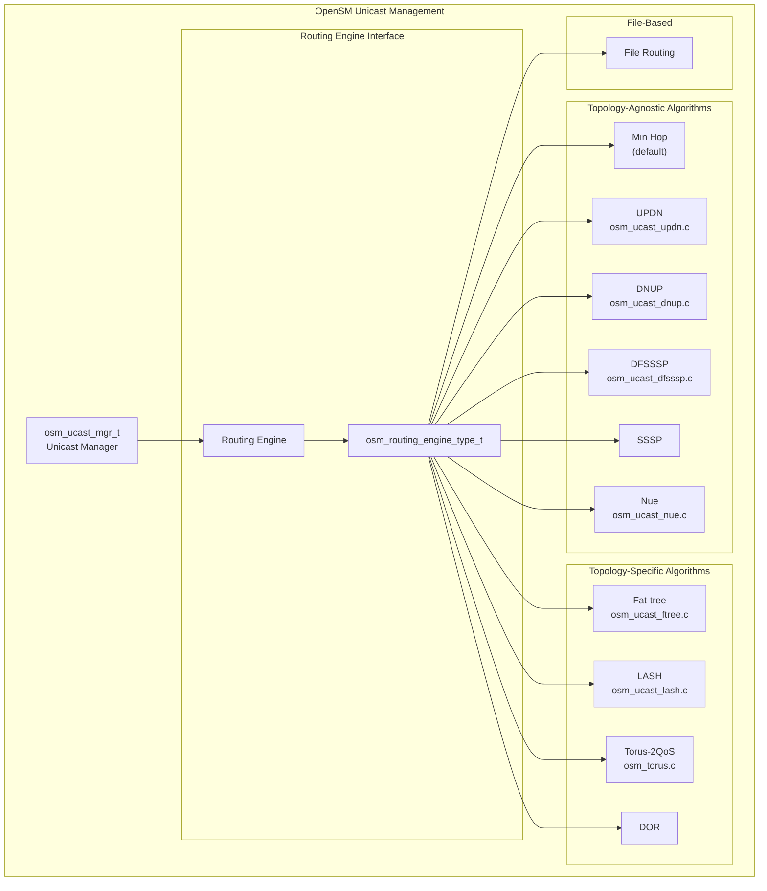
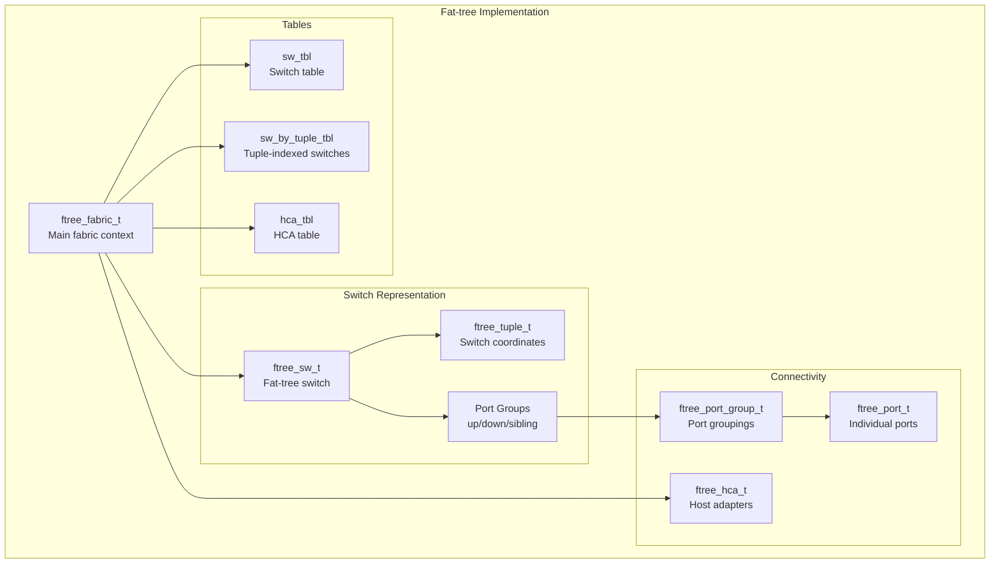
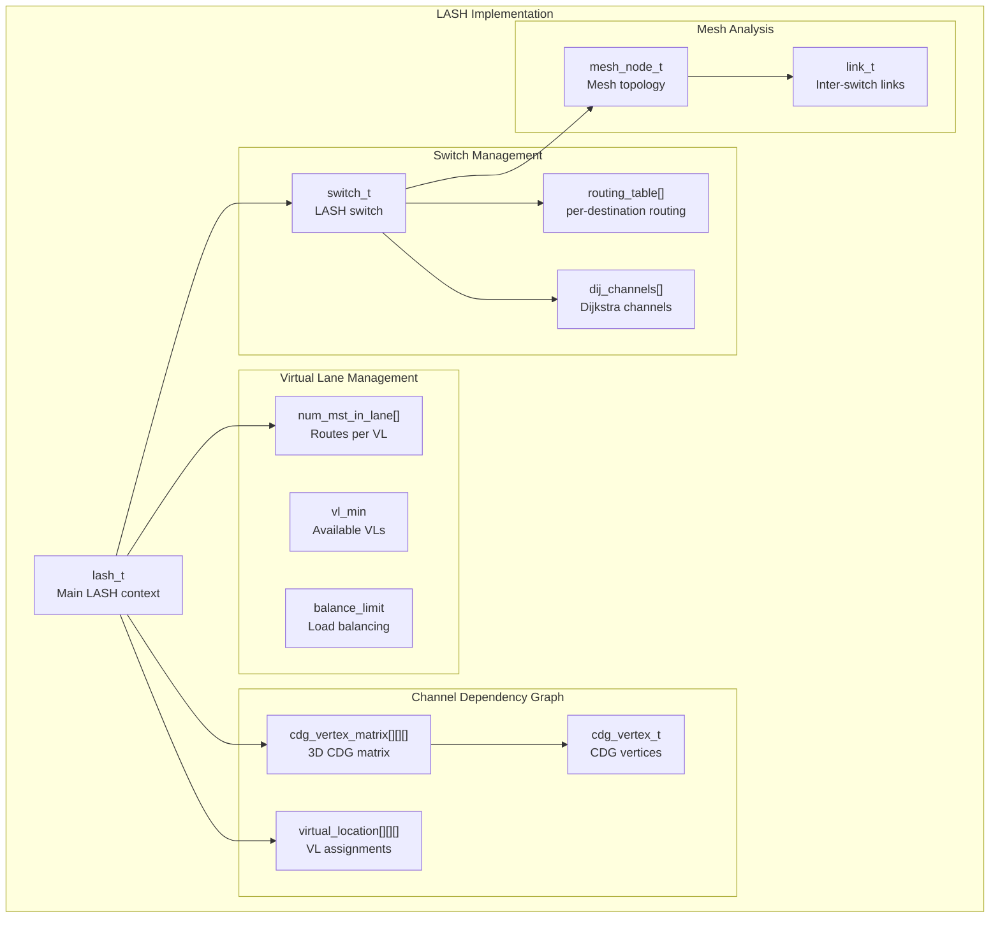
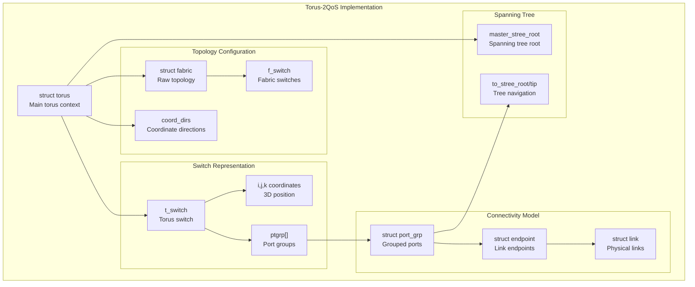
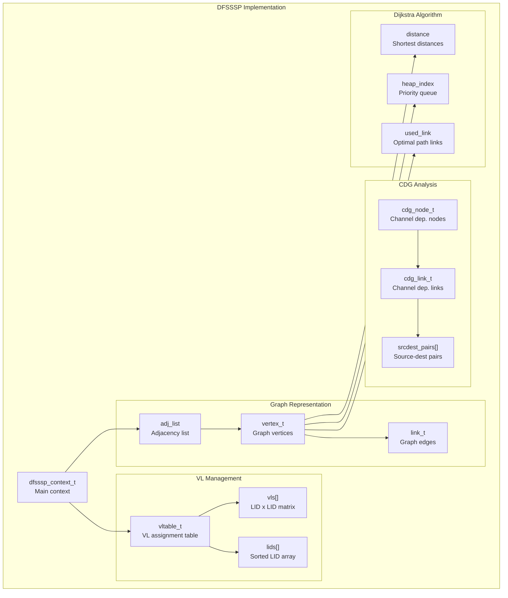
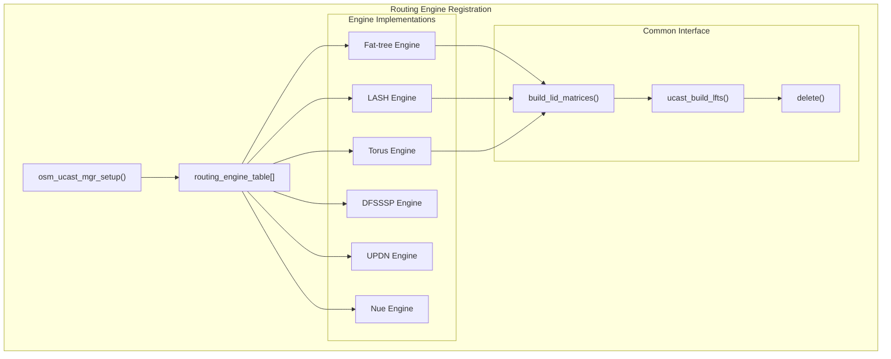

<!-- source: DeepWiki mcp.deepwiki.com · repo linux-rdma/opensm · page 4.2 Routing Algorithms · fetched 2026-11-11 -->

# Routing Algorithms

Relevant source files

The following files were used as context for generating this wiki page:

- [doc/current-routing.txt](doc/current-routing.txt)
- [include/opensm/osm_mesh.h](include/opensm/osm_mesh.h)
- [include/opensm/osm_ucast_lash.h](include/opensm/osm_ucast_lash.h)
- [man/osmtest.8](man/osmtest.8)
- [man/torus-2QoS.8.in](man/torus-2QoS.8.in)
- [man/torus-2QoS.conf.5.in](man/torus-2QoS.conf.5.in)
- [opensm/osm_mesh.c](opensm/osm_mesh.c)
- [opensm/osm_torus.c](opensm/osm_torus.c)
- [opensm/osm_ucast_dfsssp.c](opensm/osm_ucast_dfsssp.c)
- [opensm/osm_ucast_dnup.c](opensm/osm_ucast_dnup.c)
- [opensm/osm_ucast_ftree.c](opensm/osm_ucast_ftree.c)
- [opensm/osm_ucast_lash.c](opensm/osm_ucast_lash.c)
- [opensm/osm_ucast_nue.c](opensm/osm_ucast_nue.c)
- [opensm/osm_ucast_updn.c](opensm/osm_ucast_updn.c)

This document covers the various routing algorithms implemented in OpenSM for calculating unicast forwarding tables. These algorithms determine how traffic flows through InfiniBand fabric switches to reach destination endpoints. For multicast routing, see [Multicast Management](#4.3). For the overall unicast routing management system, see [Unicast Routing](#4.1).

## Overview

OpenSM provides ten distinct routing engines, each optimized for different fabric topologies and requirements. The routing algorithms can be categorized into several types:

- **Topology-agnostic algorithms**: Min Hop, UPDN, DNUP, DFSSSP, SSSP, Nue
- **Topology-specific algorithms**: Fat-tree, DOR, Torus-2QoS
- **File-based routing**: Loads routes from external configuration

Sources: [doc/current-routing.txt:1-71](), [opensm/osm_ucast_mgr.h](), [opensm/osm_ucast_ftree.c:1-50](), [opensm/osm_ucast_lash.c:1-50](), [opensm/osm_torus.c:1-50]()

## Fat-tree Routing Algorithm

The Fat-tree algorithm is optimized for symmetrical fat-tree topologies and provides congestion-free routing for "shift" communication patterns. It builds a hierarchical tree structure to represent the fabric topology.

### Core Data Structures

The fat-tree algorithm uses a ranking system where switches are assigned to ranks based on their position in the tree hierarchy:

- **Rank 0**: Root switches (top of tree)
- **Higher ranks**: Switches closer to leaf level
- **Leaf switches**: Highest rank, directly connected to endpoints

Key implementation functions include:
- `fabric_create()` - Initialize fabric representation [opensm/osm_ucast_ftree.c:953-969]()
- `sw_create()` - Create fat-tree switch structure [opensm/osm_ucast_ftree.c:548-610]()
- `ftree_fabric_t` structure manages the complete topology [opensm/osm_ucast_ftree.c:207-224]()

Sources: [opensm/osm_ucast_ftree.c:167-224](), [opensm/osm_ucast_ftree.c:548-610](), [opensm/osm_ucast_ftree.c:953-969]()

## LASH Routing Algorithm

LASH (Layered Shortest Path) uses InfiniBand Virtual Lanes to provide deadlock-free shortest-path routing. It creates a Channel Dependency Graph (CDG) to detect and eliminate cycles that could cause deadlocks.

### LASH Architecture

The LASH algorithm operates in phases:
1. **Mesh Analysis**: Analyze fabric topology using `osm_do_mesh_analysis()` [opensm/osm_ucast_lash.c:802-804]()
2. **Shortest Path Calculation**: Use Dijkstra algorithm via `shortest_path()` [opensm/osm_ucast_lash.c:262-285]()
3. **CDG Construction**: Build channel dependency graph to detect cycles [opensm/osm_ucast_lash.c:327-387]()
4. **VL Assignment**: Assign virtual lanes to break cycles via `balance_virtual_lanes()` [opensm/osm_ucast_lash.c:455-605]()

Sources: [opensm/osm_ucast_lash.c:68-96](), [opensm/osm_ucast_lash.c:783-964](), [include/opensm/osm_ucast_lash.h:57-96]()

## Torus-2QoS Routing Algorithm

Torus-2QoS is specialized for 2D/3D torus fabrics and provides deadlock-free routing with Quality of Service support. It uses Dimension Order Routing (DOR) with datelines to avoid credit loops.

### Torus Data Structures

Key torus concepts:
- **Datelines**: Virtual boundaries in each dimension to prevent credit loops [opensm/osm_torus.c:270-282]()
- **Port Groups**: Collections of endpoints with shared characteristics [opensm/osm_torus.c:172-182]()
- **Coordinate Directions**: Define torus orientation using seed links [opensm/osm_torus.c:252-265]()

The algorithm supports:
- **Mesh/Torus Configuration**: Via `X_MESH`, `Y_MESH`, `Z_MESH` flags [opensm/osm_torus.c:315-322]()
- **QoS Levels**: Two quality levels using SL/VL encoding
- **Fault Tolerance**: Route around failed switches and links

Sources: [opensm/osm_torus.c:197-220](), [opensm/osm_torus.c:284-310](), [opensm/osm_torus.c:315-322](), [man/torus-2QoS.8.in:44-86]()

## DFSSSP and Advanced Algorithms

The Deadlock-Free Single-Source Shortest Path (DFSSSP) algorithm uses Dijkstra's algorithm combined with Virtual Lane assignment to ensure deadlock freedom.

### DFSSSP Core Components

Other notable algorithms:

**Nue Algorithm**: Provides 100% applicable deadlock-free routing for arbitrary topologies:
- Uses `network_node_t` and `network_link_t` structures [opensm/osm_ucast_nue.c:112-122]()
- Implements sophisticated channel dependency analysis
- Supports any number of Virtual Lanes including zero VLs

**UPDN Algorithm**: Ranking-based deadlock avoidance:
- Uses `updn_node` with ranking system [opensm/osm_ucast_updn.c:73-80]()
- Implements `updn_get_dir()` for directional constraints [opensm/osm_ucast_updn.c:84-105]()
- Auto-detects root nodes via hop histogram analysis

Sources: [opensm/osm_ucast_dfsssp.c:127-135](), [opensm/osm_ucast_dfsssp.c:102-126](), [opensm/osm_ucast_nue.c:112-122](), [opensm/osm_ucast_updn.c:73-80]()

## Algorithm Selection and Configuration

Routing algorithms are selected via the OpenSM `-R` option and can be configured through various mechanisms:

| Algorithm | Selection Flag | Configuration File | Primary Use Case |
|-----------|---------------|-------------------|------------------|
| Min Hop | `-R minhop` (default) | N/A | General purpose |
| UPDN | `-R updn` | Root node files | Loop prevention |
| Fat-tree | `-R ftree` | N/A | Symmetric fat-trees |
| LASH | `-R lash` | N/A | Deadlock-free shortest paths |
| Torus-2QoS | `-R torus-2QoS` | torus-2QoS.conf | 2D/3D torus fabrics |
| DFSSSP | `-R dfsssp` | N/A | Balanced shortest paths |
| Nue | `-R nue` | N/A | Universal deadlock-free |

### Algorithm Architecture Integration

Each routing engine implements a common interface with standardized entry points for initialization, LFT calculation, and cleanup. The unicast manager (`osm_ucast_mgr_t`) coordinates between the selected routing engine and the broader OpenSM infrastructure to populate switch forwarding tables.

Sources: [doc/current-routing.txt:125-193](), [man/torus-2QoS.conf.5.in:18-38](), [opensm/osm_ucast_mgr.h]()

---

