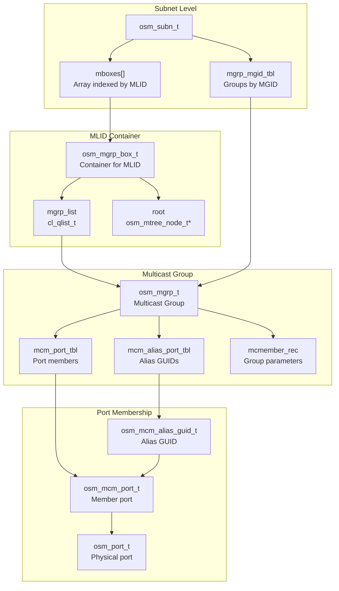
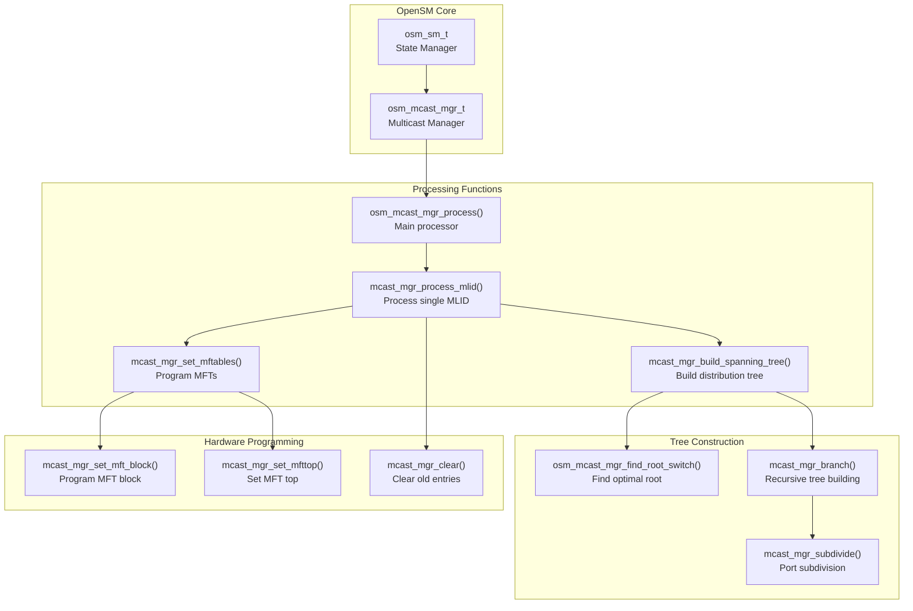
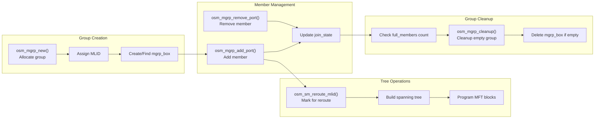
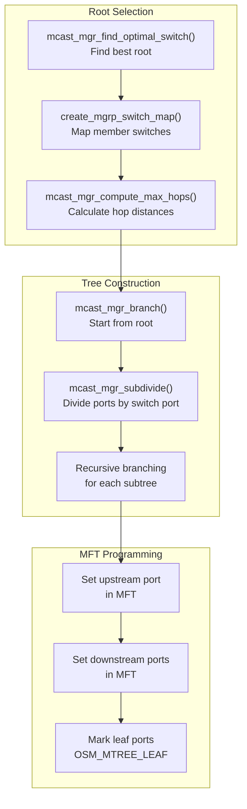
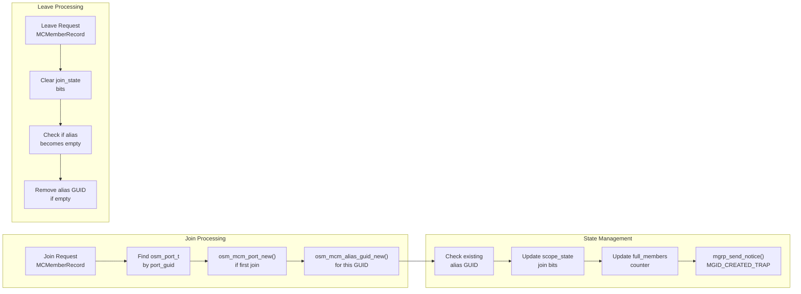
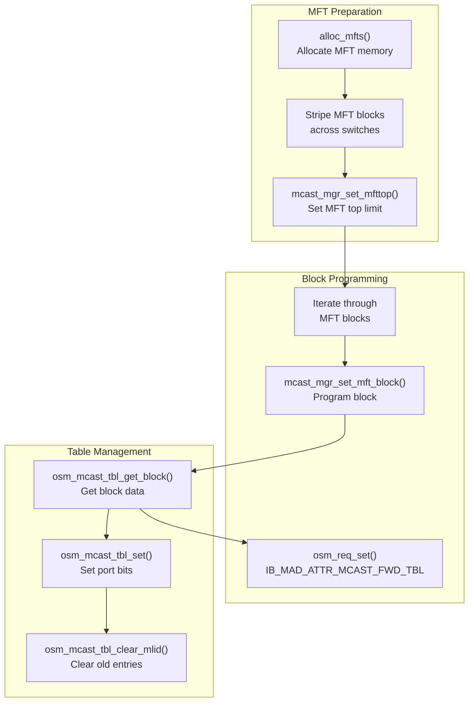
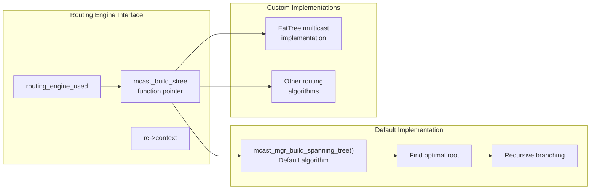

<!-- source: DeepWiki mcp.deepwiki.com · repo linux-rdma/opensm · page 4.3 Multicast Management · fetched 2026-11-11 -->

# Multicast Management

Relevant source files

The following files were used as context for generating this wiki page:

- [include/opensm/osm_mcm_port.h](include/opensm/osm_mcm_port.h)
- [include/opensm/osm_multicast.h](include/opensm/osm_multicast.h)
- [opensm/osm_drop_mgr.c](opensm/osm_drop_mgr.c)
- [opensm/osm_mcast_mgr.c](opensm/osm_mcast_mgr.c)
- [opensm/osm_mcm_port.c](opensm/osm_mcm_port.c)
- [opensm/osm_multicast.c](opensm/osm_multicast.c)

The multicast management subsystem handles InfiniBand multicast group creation, membership management, and spanning tree construction. It manages the assignment of Multicast LIDs (MLIDs), builds efficient multicast distribution trees, and programs switch multicast forwarding tables (MFTs) to enable efficient multicast traffic delivery across the fabric.

For unicast routing management, see [Unicast Routing](#4.1). For routing algorithm implementations, see [Routing Algorithms](#4.2).

## Core Multicast Data Structures

The multicast management system centers around several key data structures that represent multicast groups, member ports, and distribution trees.

**Sources:** [include/opensm/osm_multicast.h:99-173](), [include/opensm/osm_mcm_port.h:76-198](), [opensm/osm_multicast.c:57-68]()

| Structure | Purpose | Key Fields |
|-----------|---------|------------|
| `osm_mgrp_box_t` | Container for all multicast groups sharing an MLID | `mlid`, `mgrp_list`, `root` |
| `osm_mgrp_t` | Individual multicast group | `mlid`, `mcm_port_tbl`, `mcmember_rec`, `full_members` |
| `osm_mcm_port_t` | Port membership in a group | `port`, `mgrp` |
| `osm_mcm_alias_guid_t` | Alias GUID membership | `alias_guid`, `p_base_mcm_port`, `scope_state` |

## Multicast Manager Architecture

The multicast manager (`osm_mcast_mgr_t`) coordinates all multicast operations through a centralized processing model.

**Sources:** [opensm/osm_mcast_mgr.c:1181-1225](), [opensm/osm_mcast_mgr.c:1008-1039](), [opensm/osm_mcast_mgr.c:741-813]()

## Multicast Group Lifecycle

Multicast groups follow a well-defined lifecycle from creation through member management to eventual cleanup.

**Sources:** [opensm/osm_multicast.c:118-148](), [opensm/osm_multicast.c:271-343](), [opensm/osm_multicast.c:345-421](), [opensm/osm_multicast.c:150-187]()

## Spanning Tree Construction

The multicast manager builds spanning trees to efficiently distribute multicast traffic while avoiding loops. The process involves finding an optimal root switch and recursively constructing the tree.

**Sources:** [opensm/osm_mcast_mgr.c:260-308](), [opensm/osm_mcast_mgr.c:489-739](), [opensm/osm_mcast_mgr.c:400-464](), [opensm/osm_mcast_mgr.c:221-251]()

### Root Switch Selection Algorithm

The spanning tree construction begins by selecting an optimal root switch to minimize the maximum hop count to all group members:

| Algorithm Step | Function | Purpose |
|---------------|----------|---------|
| 1. Create switch map | `create_mgrp_switch_map()` | Map switches to member ports |
| 2. Evaluate candidates | `mcast_mgr_compute_max_hops()` | Calculate max hops for each switch |
| 3. Select optimal | `mcast_mgr_find_optimal_switch()` | Choose switch with minimum max hops |

**Sources:** [opensm/osm_mcast_mgr.c:142-180](), [opensm/osm_mcast_mgr.c:221-251](), [opensm/osm_mcast_mgr.c:260-308]()

## Port Membership Management

The system tracks multicast group membership through both base port GUIDs and alias GUIDs, supporting complex membership scenarios.

**Sources:** [opensm/osm_multicast.c:271-343](), [opensm/osm_multicast.c:345-421](), [opensm/osm_multicast.c:189-214]()

### Join State Management

The multicast subsystem tracks different types of membership through join state bits:

| Join State | Value | Description |
|------------|-------|-------------|
| `IB_JOIN_STATE_FULL` | 0x01 | Full member (can send and receive) |
| `IB_JOIN_STATE_NON` | 0x02 | Non-member (can only receive) |
| `IB_JOIN_STATE_SEND_ONLY` | 0x04 | Send-only member |
| `IB_JOIN_STATE_SEND_ONLY_FULL` | 0x08 | Send-only full member |

**Sources:** [opensm/osm_multicast.c:336-339](), [opensm/osm_multicast.c:407-416]()

## Multicast Forwarding Table Programming

After constructing the spanning tree, the multicast manager programs switch multicast forwarding tables (MFTs) to implement the computed routes.

**Sources:** [opensm/osm_mcast_mgr.c:1106-1150](), [opensm/osm_mcast_mgr.c:331-393](), [opensm/osm_mcast_mgr.c:1041-1104](), [opensm/osm_mcast_mgr.c:861-879]()

### MFT Block Structure

Each MFT block contains forwarding information for a range of MLIDs:

| Component | Size | Purpose |
|-----------|------|---------|
| Block number | 16 bits | Identifies MLID range |
| Position | 4 bits | Sub-block within range |
| Port mask | 16 x 16 bits | Output ports for each MLID |

**Sources:** [opensm/osm_mcast_mgr.c:366-390]()

## Integration with Routing Engines

The multicast manager supports pluggable routing engines that can override the default spanning tree construction:

**Sources:** [opensm/osm_mcast_mgr.c:1024-1035]()

The multicast management subsystem provides a comprehensive framework for efficient multicast communication in InfiniBand fabrics, handling everything from group membership to hardware programming while supporting extensible routing algorithms.

---

