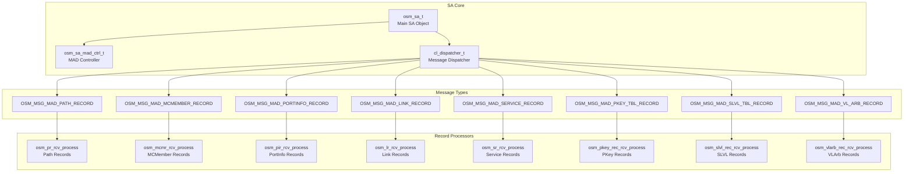
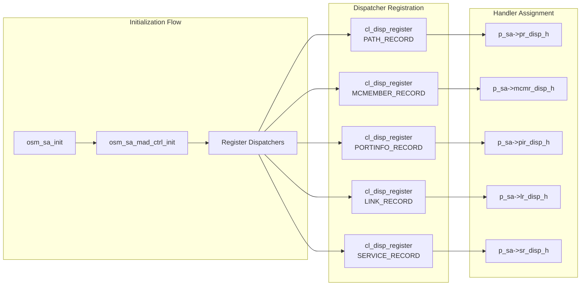
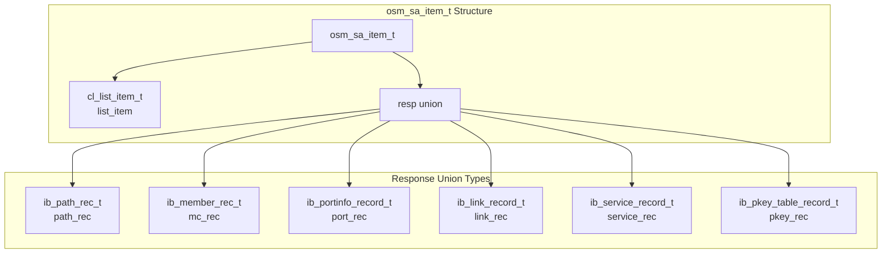
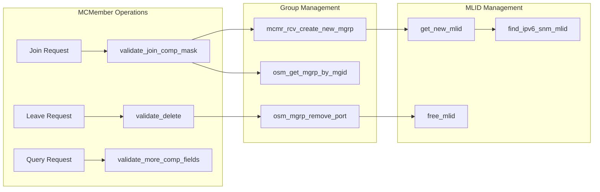
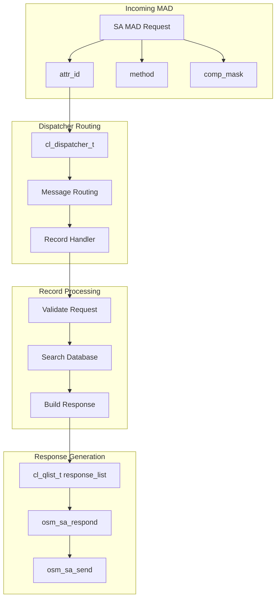
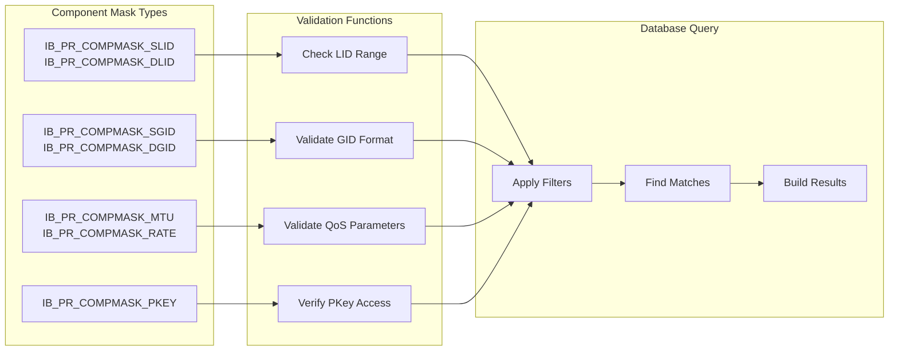

<!-- source: DeepWiki mcp.deepwiki.com · repo linux-rdma/opensm · page 5 Subnet Administration (SA) · fetched 2026-11-11 -->

# Subnet Administration (SA)

Relevant source files

The following files were used as context for generating this wiki page:

- [include/opensm/osm_sa.h](include/opensm/osm_sa.h)
- [opensm/osm_sa.c](opensm/osm_sa.c)
- [opensm/osm_sa_link_record.c](opensm/osm_sa_link_record.c)
- [opensm/osm_sa_mcmember_record.c](opensm/osm_sa_mcmember_record.c)
- [opensm/osm_sa_multipath_record.c](opensm/osm_sa_multipath_record.c)
- [opensm/osm_sa_path_record.c](opensm/osm_sa_path_record.c)
- [opensm/osm_sa_pkey_record.c](opensm/osm_sa_pkey_record.c)
- [opensm/osm_sa_portinfo_record.c](opensm/osm_sa_portinfo_record.c)
- [opensm/osm_sa_service_record.c](opensm/osm_sa_service_record.c)
- [opensm/osm_sa_slvl_record.c](opensm/osm_sa_slvl_record.c)
- [opensm/osm_sa_sminfo_record.c](opensm/osm_sa_sminfo_record.c)
- [opensm/osm_sa_vlarb_record.c](opensm/osm_sa_vlarb_record.c)

The Subnet Administration (SA) component provides a query and response service for InfiniBand subnet information. It processes client requests for various types of subnet records and returns appropriate responses, acting as the primary interface for subnet discovery and path resolution in the OpenSM subnet manager.

For information about subnet discovery and topology management, see [Network Discovery and Topology](#3). For details about routing path calculation, see [Routing Management](#4).

## Architecture Overview

The SA component is built around a central `osm_sa_t` structure that coordinates multiple specialized record processors. Each processor handles specific types of SA queries (PathRecord, MCMemberRecord, etc.) through a dispatcher-based architecture.

### SA Component Structure

**Sources:** [opensm/osm_sa.c:192-289](), [include/opensm/osm_sa.h:183-221]()

### SA Initialization and Registration

**Sources:** [opensm/osm_sa.c:159-325](), [opensm/osm_sa.c:218-289]()

## Core SA Data Structures

### Main SA Structure

The `osm_sa_t` structure serves as the central coordination point for all SA operations:

| Field | Type | Purpose |
|-------|------|---------|
| `state` | `osm_sa_state_t` | Current SA state (INIT/READY) |
| `p_subn` | `osm_subn_t*` | Pointer to subnet database |
| `mad_ctrl` | `osm_sa_mad_ctrl_t` | MAD communication controller |
| `p_disp` | `cl_dispatcher_t*` | Message dispatcher for GET requests |
| `p_set_disp` | `cl_dispatcher_t*` | Message dispatcher for SET requests |
| `sa_trans_id` | `atomic32_t` | Transaction ID counter |

**Sources:** [include/opensm/osm_sa.h:183-221]()

### SA Response Item Structure

The `osm_sa_item_t` structure provides a unified container for all SA response types:

**Sources:** [include/opensm/osm_sa.h:133-155]()

## Record Processors

### Path Record Processing

Path records provide routing information between source and destination ports. The path record processor calculates optimal paths considering MTU, rate, packet lifetime, and QoS constraints.

Key functions in path record processing:

| Function | Purpose |
|----------|---------|
| `osm_pr_rcv_process` | Main path record request handler |
| `pr_rcv_get_path_parms` | Calculate path parameters (MTU, rate, SL) |
| `pr_rcv_build_pr` | Build path record response |
| `osm_get_path_params` | Public API for path parameter calculation |

**Sources:** [opensm/osm_sa_path_record.c:145-849](), [opensm/osm_sa_path_record.c:875-884]()

### Multicast Member Record Processing

MCMember records manage multicast group membership and configuration:

**Sources:** [opensm/osm_sa_mcmember_record.c:156-183](), [opensm/osm_sa_mcmember_record.c:828-946](), [opensm/osm_sa_mcmember_record.c:970-1066]()

### Service Record Processing

Service records enable service discovery and registration in the subnet:

| Operation | Function | Description |
|-----------|----------|-------------|
| Register | `sr_rcv_new_sr` | Add new service record |
| Query | `sr_rcv_get_sr` | Retrieve matching service records |
| Delete | `sr_rcv_remove_sr` | Remove service record |
| Validate | `validate_sr` | Check PKey and name-key associations |

**Sources:** [opensm/osm_sa_service_record.c:161-195](), [opensm/osm_sa_service_record.c:197-214]()

## MAD Processing Flow

### Request Processing Pipeline

**Sources:** [opensm/osm_sa.c:422-534](), [opensm/osm_sa.c:345-359]()

### Response Building Pattern

All SA record processors follow a common pattern for building responses:

1. **Validation**: Check component mask and request parameters
2. **Database Search**: Query subnet database for matching records
3. **Response Building**: Create `osm_sa_item_t` objects for each match
4. **List Management**: Add items to response list
5. **Response Transmission**: Send response via `osm_sa_respond`

**Sources:** [opensm/osm_sa_path_record.c:875-884](), [opensm/osm_sa_portinfo_record.c:75-138]()

## Component Mask Processing

Component masks specify which fields in SA queries should be matched. Each record processor implements component mask validation:

**Sources:** [opensm/osm_sa_path_record.c:487-608](), [opensm/osm_sa_portinfo_record.c:184-295]()

## Communication and Threading

### MAD Controller Integration

The SA integrates with the OpenSM MAD handling system through `osm_sa_mad_ctrl_t`:

| Function | Purpose |
|----------|---------|
| `osm_sa_mad_ctrl_init` | Initialize MAD controller |
| `osm_sa_mad_ctrl_bind` | Bind to InfiniBand port |
| `osm_sa_send` | Send SA response MAD |
| `osm_sa_send_error` | Send error response |

**Sources:** [opensm/osm_sa.c:327-343](), [opensm/osm_sa.c:361-420]()

### Dispatcher-Based Processing

The SA uses OpenSM's dispatcher system for concurrent request processing:

- **GET Requests**: Processed through main dispatcher (`p_disp`)
- **SET Requests**: Processed through dedicated dispatcher (`p_set_disp`)  
- **Message Routing**: Based on SA attribute ID (`attr_id`)
- **Handler Registration**: Each record type registers specific handler function

**Sources:** [opensm/osm_sa.c:192-319]()

The SA component provides the primary interface for subnet information queries in OpenSM, coordinating multiple specialized processors to handle the full range of InfiniBand SA record types while maintaining consistency with subnet state and enforcing proper access controls.

---

