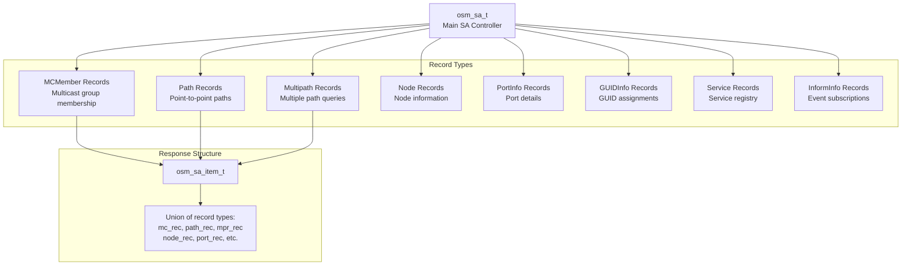
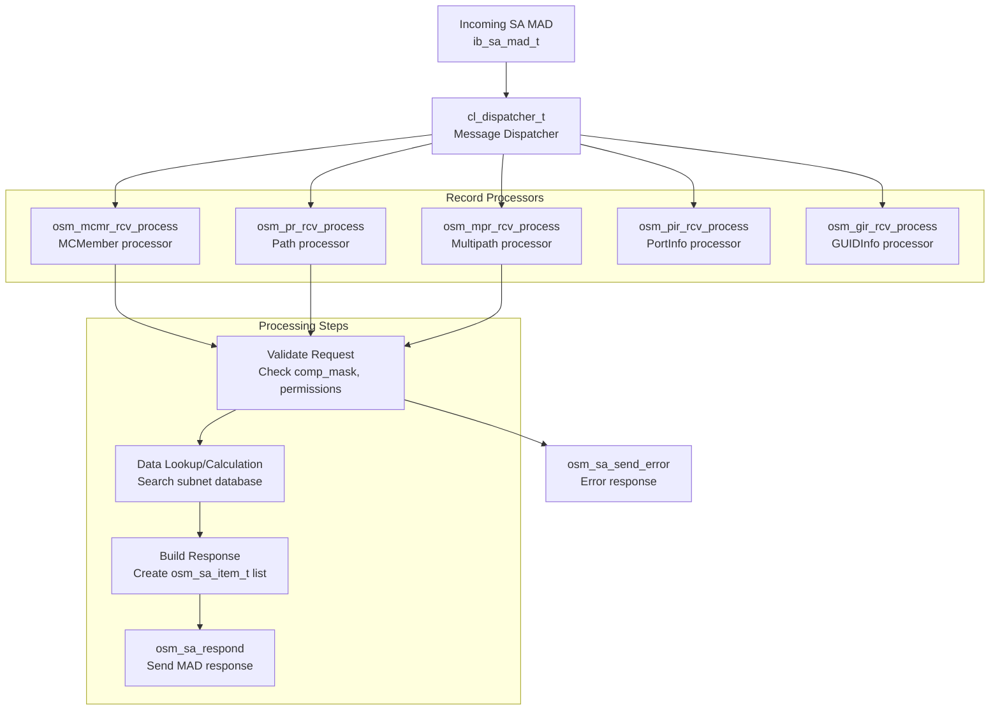
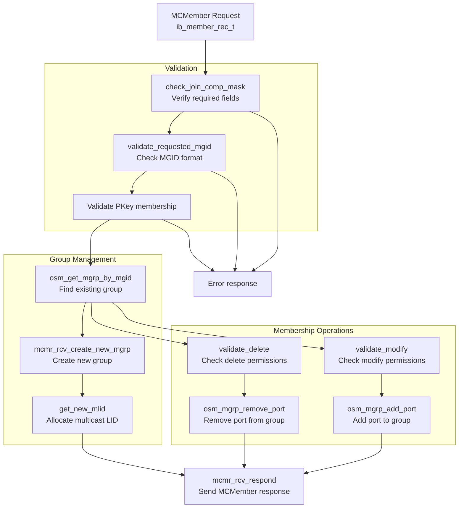
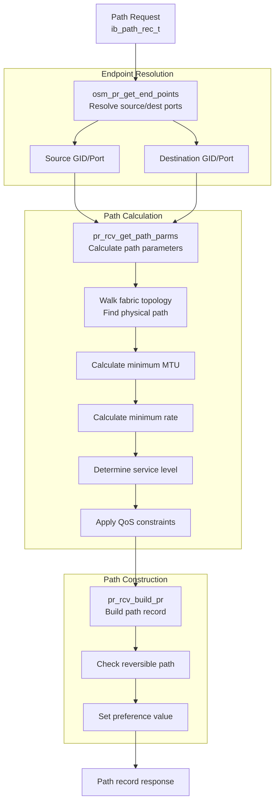
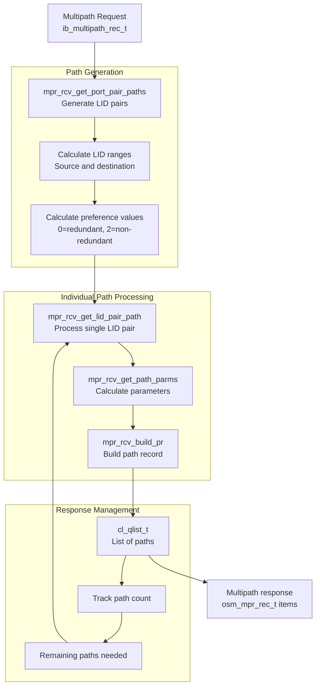

<!-- source: DeepWiki mcp.deepwiki.com · repo linux-rdma/opensm · page 5.1 SA Record Processing · fetched 2026-11-11 -->

# SA Record Processing

Relevant source files

The following files were used as context for generating this wiki page:

- [include/opensm/osm_sa.h](include/opensm/osm_sa.h)
- [opensm/osm_sa.c](opensm/osm_sa.c)
- [opensm/osm_sa_mcmember_record.c](opensm/osm_sa_mcmember_record.c)
- [opensm/osm_sa_multipath_record.c](opensm/osm_sa_multipath_record.c)
- [opensm/osm_sa_path_record.c](opensm/osm_sa_path_record.c)

## Purpose and Scope

This document describes the Subnet Administration (SA) record processing subsystem in OpenSM, which handles various types of InfiniBand subnet administration queries and updates. The SA processes client requests for information about network topology, services, multicast groups, and path calculations, returning appropriate record responses.

For information about the broader SA component architecture, see [Subnet Administration (SA)](#5). For details about specific SA record types and their schemas, see [SA Record Types](#5.2).

## SA Record Types Overview

The SA processes multiple types of records, each serving different administrative functions in the InfiniBand subnet. The system uses a unified response structure `osm_sa_item_t` that can hold different record types through a union.

Sources: [include/opensm/osm_sa.h:124-155](), [opensm/osm_sa.c:198-289]()

## Request Processing Flow

SA record processing follows a dispatcher-based architecture where different record types are handled by specialized processors. Each processor validates requests, performs lookups or calculations, and generates appropriate responses.

Sources: [opensm/osm_sa.c:183-320](), [opensm/osm_sa.c:422-534]()

## Core Data Structures

The SA uses several key data structures to represent records and manage processing state:

| Structure | Purpose | Key Fields |
|-----------|---------|------------|
| `osm_sa_t` | Main SA controller | `p_subn`, `mad_ctrl`, dispatcher handles |
| `osm_sa_item_t` | Response record container | Union of all record types |
| `osm_path_parms_t` | Path calculation parameters | `pkey`, `mtu`, `rate`, `sl`, `pkt_life` |
| `osm_mpr_rec_t` | Multipath record response | `path_rec`, `p_src_port`, `p_dest_port`, `hops` |

Sources: [include/opensm/osm_sa.h:183-221](), [include/opensm/osm_sa.h:576-584](), [include/opensm/osm_sa.h:116-122]()

## MCMember Record Processing

MCMember records manage multicast group membership, handling join/leave operations and group creation. The processor validates membership constraints and manages multicast LID (MLID) allocation.

Sources: [opensm/osm_sa_mcmember_record.c:970-1066](), [opensm/osm_sa_mcmember_record.c:828-946](), [opensm/osm_sa_mcmember_record.c:156-183]()

## Path Record Processing

Path records provide point-to-point path information including MTU, rate, packet lifetime, and service level. The processor calculates optimal paths through the fabric considering QoS constraints.

Sources: [opensm/osm_sa_path_record.c:145-849](), [opensm/osm_sa_path_record.c:875-972](), [opensm/osm_sa_path_record.c:1045-1330]()

## Multipath Record Processing

Multipath records extend path record functionality to handle queries for multiple paths between endpoints, supporting load balancing and redundancy requirements.

Sources: [opensm/osm_sa_multipath_record.c:969-1155](), [opensm/osm_sa_multipath_record.c:891-967](), [opensm/osm_sa_multipath_record.c:137-822]()

## Response Generation

All SA record processors use a common response mechanism through `osm_sa_respond()`, which handles MAD formatting, RMPP (Reliable Multi-Packet Protocol) segmentation, and error conditions.

Sources: [opensm/osm_sa.c:422-534](), [opensm/osm_sa.c:361-420]()

---

