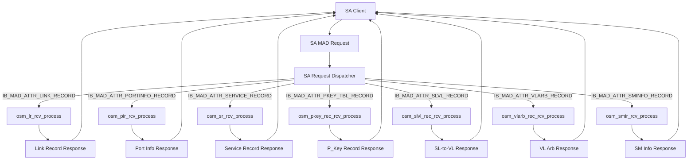
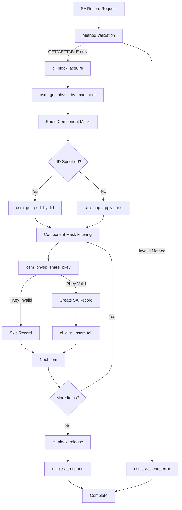
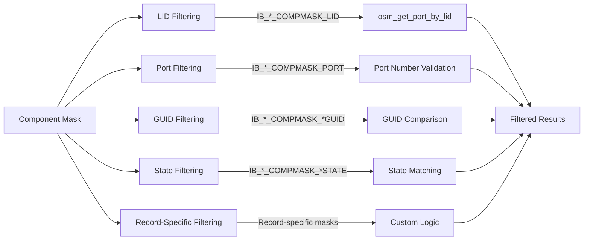

<!-- source: DeepWiki mcp.deepwiki.com · repo linux-rdma/opensm · page 5.2 SA Record Types · fetched 2026-11-11 -->

# SA Record Types

Relevant source files

The following files were used as context for generating this wiki page:

- [opensm/osm_sa_link_record.c](opensm/osm_sa_link_record.c)
- [opensm/osm_sa_pkey_record.c](opensm/osm_sa_pkey_record.c)
- [opensm/osm_sa_portinfo_record.c](opensm/osm_sa_portinfo_record.c)
- [opensm/osm_sa_service_record.c](opensm/osm_sa_service_record.c)
- [opensm/osm_sa_slvl_record.c](opensm/osm_sa_slvl_record.c)
- [opensm/osm_sa_sminfo_record.c](opensm/osm_sa_sminfo_record.c)
- [opensm/osm_sa_vlarb_record.c](opensm/osm_sa_vlarb_record.c)

This document describes the various types of Subnet Administration (SA) records supported by OpenSM and their implementation. SA records provide information about the InfiniBand fabric topology, configuration, and services to subnet administration clients through standardized query interfaces.

For information about SA record processing mechanisms, see [SA Record Processing](#5.1). For broader SA architecture details, see [Subnet Administration (SA)](#5).

## Overview

OpenSM implements seven primary SA record types, each handled by a dedicated processor module. These record types provide comprehensive visibility into different aspects of the InfiniBand fabric:

| Record Type | Attribute ID | Main Handler | Purpose |
|-------------|--------------|--------------|---------|
| Link Record | `IB_MAD_ATTR_LINK_RECORD` | `osm_lr_rcv_process` | Physical link connectivity information |
| Port Info Record | `IB_MAD_ATTR_PORTINFO_RECORD` | `osm_pir_rcv_process` | Port configuration and state details |
| Service Record | `IB_MAD_ATTR_SERVICE_RECORD` | `osm_sr_rcv_process` | Service registration and discovery |
| P_Key Record | `IB_MAD_ATTR_PKEY_TBL_RECORD` | `osm_pkey_rec_rcv_process` | Partition key table contents |
| SL-to-VL Record | `IB_MAD_ATTR_SLVL_RECORD` | `osm_slvl_rec_rcv_process` | Service Level to Virtual Lane mappings |
| VL Arbitration Record | `IB_MAD_ATTR_VLARB_RECORD` | `osm_vlarb_rec_rcv_process` | Virtual Lane arbitration tables |
| SM Info Record | `IB_MAD_ATTR_SMINFO_RECORD` | `osm_smir_rcv_process` | Subnet Manager information |

Sources: [opensm/osm_sa_link_record.c:434](), [opensm/osm_sa_portinfo_record.c:529](), [opensm/osm_sa_service_record.c:679](), [opensm/osm_sa_pkey_record.c:235](), [opensm/osm_sa_slvl_record.c:223](), [opensm/osm_sa_vlarb_record.c:230](), [opensm/osm_sa_sminfo_record.c:199]()

## SA Record Processing Architecture

Sources: [opensm/osm_sa_link_record.c:415-485](), [opensm/osm_sa_portinfo_record.c:506-608](), [opensm/osm_sa_service_record.c:666-722]()

## Common Processing Pattern

All SA record processors follow a standardized pattern for handling requests:

Sources: [opensm/osm_sa_portinfo_record.c:531-604](), [opensm/osm_sa_link_record.c:436-481](), [opensm/osm_sa_slvl_record.c:225-295]()

## Individual Record Types

### Link Records
**Purpose**: Provide information about physical links between ports in the fabric.
**Handler**: `osm_lr_rcv_process` in [opensm/osm_sa_link_record.c:415-485]()
**Key Functions**:
- `lr_rcv_build_physp_link` - constructs link record responses [opensm/osm_sa_link_record.c:63-87]()
- `lr_rcv_get_physp_link` - validates and filters link records [opensm/osm_sa_link_record.c:96-196]()

### Port Info Records  
**Purpose**: Expose port configuration, state, and capability information.
**Handler**: `osm_pir_rcv_process` in [opensm/osm_sa_portinfo_record.c:506-608]()
**Key Functions**:
- `pir_rcv_new_pir` - creates port info record responses [opensm/osm_sa_portinfo_record.c:75-138]()
- `sa_pir_check_physp` - performs detailed component mask filtering [opensm/osm_sa_portinfo_record.c:184-447]()

**Special Features**: Supports enhanced component mask for bitwise comparisons [opensm/osm_sa_portinfo_record.c:568-569]()

### Service Records
**Purpose**: Enable service registration, discovery, and lifecycle management.
**Handler**: `osm_sr_rcv_process` in [opensm/osm_sa_service_record.c:666-722]()
**Key Functions**:
- `sr_rcv_process_set_method` - handles service registration [opensm/osm_sa_service_record.c:509-605]()
- `sr_rcv_process_delete_method` - handles service deregistration [opensm/osm_sa_service_record.c:607-664]()
- `get_matching_sr` - filters services by component mask [opensm/osm_sa_service_record.c:218-442]()

**Special Features**: 
- Supports SET and DELETE methods in addition to GET/GETTABLE
- Implements service lease management with `osm_sr_rcv_lease_cb` [opensm/osm_sa_service_record.c:724-802]()

### P_Key Records
**Purpose**: Provide access to partition key table contents for security and partitioning.
**Handler**: `osm_pkey_rec_rcv_process` in [opensm/osm_sa_pkey_record.c:212-316]()
**Key Functions**:
- `sa_pkey_create` - builds P_Key table record responses [opensm/osm_sa_pkey_record.c:67-114]()

**Security**: Requires trusted requests with valid `sm_key` [opensm/osm_sa_pkey_record.c:252-260]()

### SL-to-VL Records
**Purpose**: Expose Service Level to Virtual Lane mapping tables.
**Handler**: `osm_slvl_rec_rcv_process` in [opensm/osm_sa_slvl_record.c:199-299]()
**Key Functions**:
- `sa_slvl_create` - constructs SL-to-VL mapping records [opensm/osm_sa_slvl_record.c:74-115]()

### VL Arbitration Records
**Purpose**: Provide Virtual Lane arbitration table information for QoS configuration.
**Handler**: `osm_vlarb_rec_rcv_process` in [opensm/osm_sa_vlarb_record.c:206-305]()
**Key Functions**:
- `sa_vl_arb_create` - builds VL arbitration records [opensm/osm_sa_vlarb_record.c:74-112]()

**Coverage**: Handles arbitration blocks 1-4 [opensm/osm_sa_vlarb_record.c:123-127]()

### SM Info Records
**Purpose**: Provide information about Subnet Managers in the fabric.
**Handler**: `osm_smir_rcv_process` in [opensm/osm_sa_sminfo_record.c:170-328]()
**Key Functions**:
- `smir_rcv_new_smir` - creates SM info record responses [opensm/osm_sa_sminfo_record.c:79-115]()

**Coverage**: Returns both local SM information and remote SM data from `sm_guid_tbl` [opensm/osm_sa_sminfo_record.c:316-318]()

Sources: [opensm/osm_sa_link_record.c](), [opensm/osm_sa_portinfo_record.c](), [opensm/osm_sa_service_record.c](), [opensm/osm_sa_pkey_record.c](), [opensm/osm_sa_slvl_record.c](), [opensm/osm_sa_vlarb_record.c](), [opensm/osm_sa_sminfo_record.c]()

## Component Mask Filtering

Each record type implements comprehensive filtering based on component masks that specify which fields should be matched:

**Common Component Masks**:
- `IB_*_COMPMASK_LID` - Filter by Local Identifier
- `IB_*_COMPMASK_PORT` - Filter by port number  
- `IB_*_COMPMASK_GUID` - Filter by port or node GUID
- Record-specific masks for detailed field filtering

Sources: [opensm/osm_sa_portinfo_record.c:207-443](), [opensm/osm_sa_service_record.c:227-413](), [opensm/osm_sa_link_record.c:162-182]()

## Security and Access Control

SA record access is controlled through several security mechanisms:

### P_Key Validation
All record types enforce P_Key sharing between the requesting port and target ports using `osm_physp_share_pkey` [opensm/osm_sa_portinfo_record.c:474-476](), [opensm/osm_sa_link_record.c:140-157]()

### Trusted Requests
Certain record types require trusted requests with valid SM keys:
- **P_Key Records**: Require `sm_key` validation [opensm/osm_sa_pkey_record.c:252-260]()
- **Port Info Records**: Clear `m_key` field for untrusted requests [opensm/osm_sa_portinfo_record.c:596-602]()
- **Service Records**: Clear `service_key` for untrusted requests [opensm/osm_sa_service_record.c:206-213]()

### Method Restrictions
Most record types only support read-only methods (`IB_MAD_METHOD_GET`, `IB_MAD_METHOD_GETTABLE`), while Service Records additionally support `IB_MAD_METHOD_SET` and `IB_MAD_METHOD_DELETE` for dynamic service management [opensm/osm_sa_service_record.c:681-717]()

Sources: [opensm/osm_sa_pkey_record.c:252-260](), [opensm/osm_sa_portinfo_record.c:596-602](), [opensm/osm_sa_service_record.c:206-213](), [opensm/osm_sa_link_record.c:140-157]()

---

