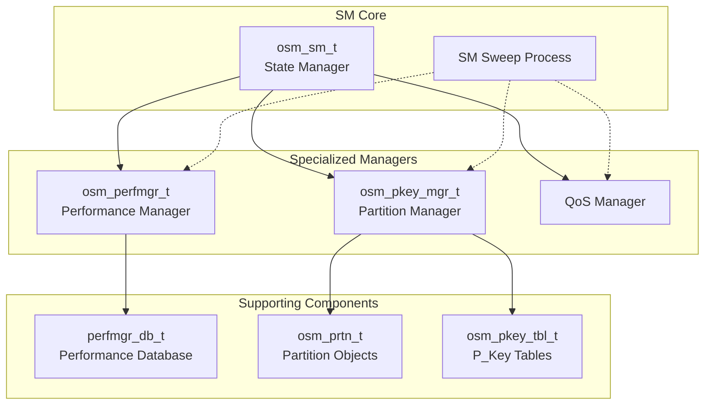
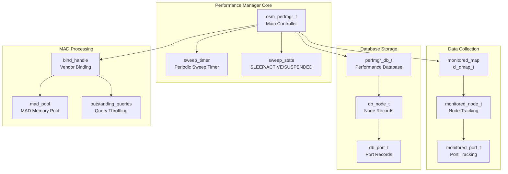
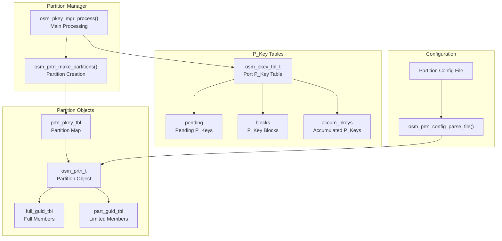
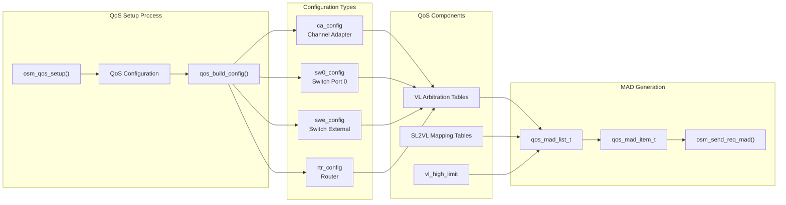
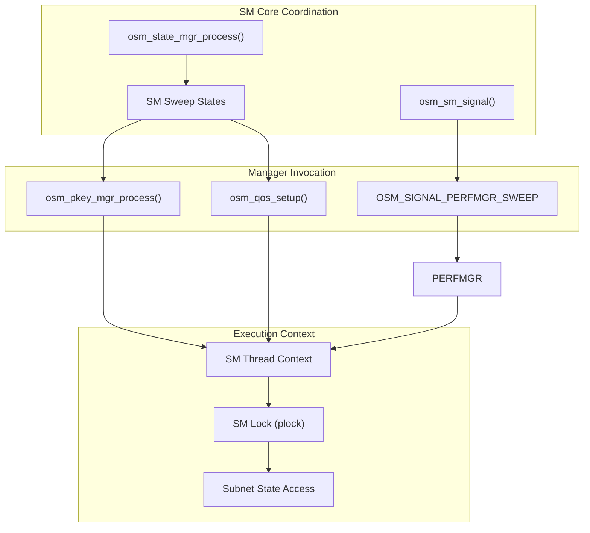

<!-- source: DeepWiki mcp.deepwiki.com · repo linux-rdma/opensm · page 6 Specialized Management Components · fetched 2026-11-11 -->

# Specialized Management Components

Relevant source files

The following files were used as context for generating this wiki page:

- [doc/partition-config.txt](doc/partition-config.txt)
- [include/opensm/osm_madw.h](include/opensm/osm_madw.h)
- [include/opensm/osm_partition.h](include/opensm/osm_partition.h)
- [include/opensm/osm_perfmgr.h](include/opensm/osm_perfmgr.h)
- [include/opensm/osm_perfmgr_db.h](include/opensm/osm_perfmgr_db.h)
- [include/opensm/osm_pkey.h](include/opensm/osm_pkey.h)
- [include/opensm/osm_sm.h](include/opensm/osm_sm.h)
- [opensm/osm_perfmgr.c](opensm/osm_perfmgr.c)
- [opensm/osm_perfmgr_db.c](opensm/osm_perfmgr_db.c)
- [opensm/osm_pkey.c](opensm/osm_pkey.c)
- [opensm/osm_pkey_mgr.c](opensm/osm_pkey_mgr.c)
- [opensm/osm_prtn.c](opensm/osm_prtn.c)
- [opensm/osm_prtn_config.c](opensm/osm_prtn_config.c)
- [opensm/osm_qos.c](opensm/osm_qos.c)
- [opensm/osm_req.c](opensm/osm_req.c)
- [opensm/osm_sm.c](opensm/osm_sm.c)
- [opensm/osm_sm_state_mgr.c](opensm/osm_sm_state_mgr.c)

This document covers the specialized management components in OpenSM that handle specific aspects of subnet management beyond basic fabric discovery and routing. These components focus on performance monitoring, partition management, and quality of service configuration.

For information about the core subnet management functionality, see [Core Architecture](#2). For routing-specific components, see [Routing Management](#4). For subnet administration queries, see [Subnet Administration (SA)](#5).

## Overview

OpenSM employs several specialized management components that operate alongside the core subnet manager to provide advanced fabric management capabilities. These components are coordinated by the main SM state machine but maintain their own specialized logic and data structures.

**Specialized Management Components Architecture**

Sources: [opensm/osm_perfmgr.h:133-161](), [opensm/osm_pkey_mgr.c:810-906](), [opensm/osm_qos.c:451-564]()

## Performance Manager

The Performance Manager (`osm_perfmgr_t`) provides fabric health monitoring and performance statistics collection. It operates as a separate subsystem that periodically queries port counters and maintains historical performance data.

**Performance Manager Structure**

The Performance Manager operates through several key phases:

### Discovery and Monitoring Setup
The Performance Manager discovers nodes to monitor during SM sweeps by examining the subnet's node table and building a map of monitored nodes.

Key functions:
- `collect_guids()` - Builds the monitored node map from subnet discovery
- `osm_perfmgr_bind()` - Establishes MAD communication binding
- `perfmgr_query_counters()` - Executes periodic counter queries

### Counter Collection and Processing
The manager sends periodic `PortCounters` and `PortCountersExtended` MADs to collect performance data:

- **Port Counters**: Basic error and data counters
- **Port Counters Extended**: Extended 64-bit counters for high-speed links
- **Class Port Info**: Capability and redirection information

### Database Management
Performance data is stored in a specialized database (`perfmgr_db_t`) that maintains:
- Current and previous counter readings
- Error rate calculations
- Data throughput statistics
- Historical trends

Sources: [opensm/osm_perfmgr.c:1048-1129](), [opensm/osm_perfmgr.h:133-161](), [opensm/osm_perfmgr_db.c:58-87]()

## Partition Management

Partition management in OpenSM handles P_Key (Partition Key) distribution and partition membership control. This system ensures proper isolation between different user groups or applications sharing the InfiniBand fabric.

**Partition Management Architecture**

### Partition Configuration Processing
The partition manager processes configuration from multiple sources:
1. **Configuration File**: `partitions.conf` parsed by `osm_prtn_config_parse_file()`
2. **Default Partition**: Automatically created with P_Key `0x7fff`
3. **Dynamic Creation**: Partitions created programmatically

### P_Key Distribution Process
The distribution process follows these steps:

1. **Partition Table Processing**: `pkey_mgr_process_partition_table()` iterates through each partition's member lists
2. **Pending P_Key Management**: `pkey_mgr_process_physical_port()` adds P_Keys to port pending lists
3. **P_Key Table Updates**: `pkey_mgr_update_port()` calculates final P_Key table layouts
4. **MAD Transmission**: P_Key table blocks sent via `pkey_mgr_update_pkey_entry()`

### Enforcement and Switch Configuration
For switch ports connected to end nodes, the manager:
- Copies P_Key tables to switch external ports
- Configures partition enforcement in switch `PortInfo`
- Handles inter-switch links (no enforcement)

Sources: [opensm/osm_pkey_mgr.c:810-906](), [opensm/osm_prtn.c:67-90](), [opensm/osm_prtn_config.c:216-267]()

## Quality of Service (QoS) Management

The QoS Manager configures Virtual Lane (VL) arbitration and Service Level to Virtual Lane (SL2VL) mappings to provide differentiated service levels across the fabric.

**QoS Configuration Flow**

### VL Arbitration Configuration
VL arbitration tables control bandwidth allocation between Virtual Lanes:
- **High Priority Table**: `vlarb_high[]` - Time-critical traffic
- **Low Priority Table**: `vlarb_low[]` - Best-effort traffic
- **VL High Limit**: Boundary between high/low priority VLs

### SL2VL Mapping
Service Level to Virtual Lane mapping determines which VL carries traffic for each SL:
- **Standard Mapping**: Per-port SL2VL tables
- **Optimized Mapping**: Switch-wide SL2VL for compatible ports
- **Routing Integration**: Routing engines can customize SL2VL per path

### Configuration Processing
The QoS manager processes different node types:
- `qos_endport_setup()` - End ports (HCAs, routers)
- `qos_extports_setup()` - Switch external ports
- Optimized vs. non-optimized switch configurations

Sources: [opensm/osm_qos.c:451-564](), [opensm/osm_qos.c:202-255](), [opensm/osm_qos.c:301-419]()

## Integration with SM Core

The specialized managers integrate with the SM core through well-defined interfaces and are coordinated during SM sweeps and state transitions.

**SM Integration Points**

### Execution Coordination
- **P_Key Manager**: Called during normal SM sweeps after topology discovery
- **QoS Manager**: Invoked during configuration phase of SM sweeps  
- **Performance Manager**: Operates on independent timer with separate thread signaling

### State Management
All managers respect SM state transitions:
- **MASTER State**: Full operation enabled
- **STANDBY State**: Limited or suspended operation
- **State Transitions**: Managers adapt to SM role changes

### Error Handling
Managers implement robust error handling:
- MAD transmission failures are logged and retried
- Database errors are contained within manager scope
- Configuration errors are reported but don't halt SM operation

Sources: [opensm/osm_sm.c:84-92](), [opensm/osm_sm_state_mgr.c:77-142](), [opensm/osm_perfmgr.c:1135-1141]()

---

