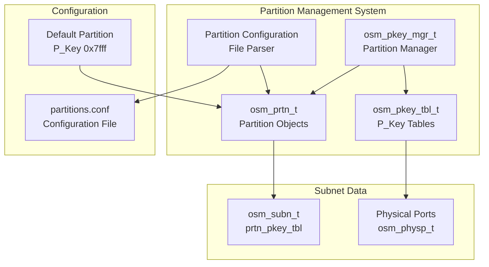
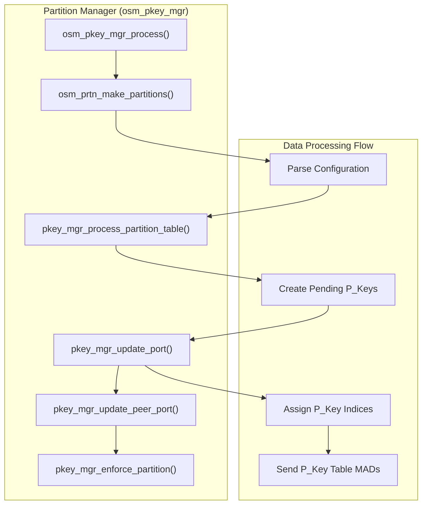
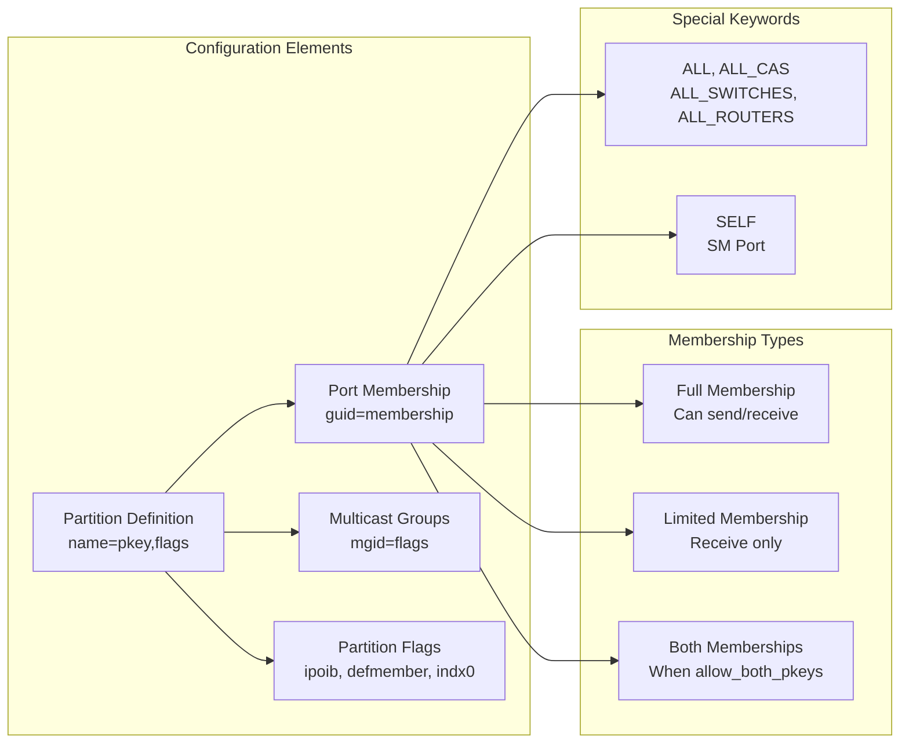
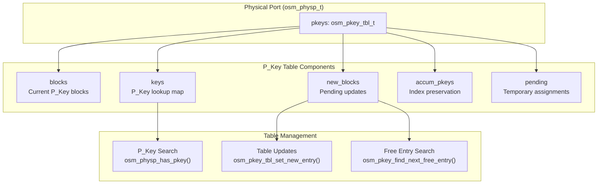
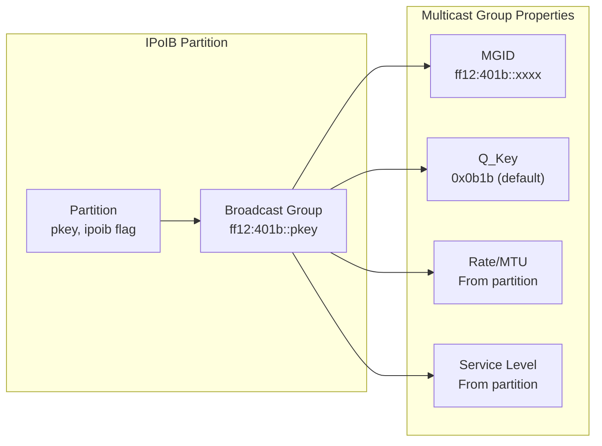

<!-- source: DeepWiki mcp.deepwiki.com · repo linux-rdma/opensm · page 6.1 Partition Management · fetched 2026-11-11 -->

# Partition Management

Relevant source files

The following files were used as context for generating this wiki page:

- [doc/partition-config.txt](doc/partition-config.txt)
- [include/opensm/osm_partition.h](include/opensm/osm_partition.h)
- [include/opensm/osm_pkey.h](include/opensm/osm_pkey.h)
- [opensm/osm_pkey.c](opensm/osm_pkey.c)
- [opensm/osm_pkey_mgr.c](opensm/osm_pkey_mgr.c)
- [opensm/osm_prtn.c](opensm/osm_prtn.c)
- [opensm/osm_prtn_config.c](opensm/osm_prtn_config.c)

Partition Management in OpenSM provides network isolation and access control through InfiniBand P_Keys (partition keys). This system controls which nodes can communicate with each other by managing partition membership and configuring P_Key tables on all ports in the subnet.

For information about Quality of Service configuration that works alongside partitions, see [Quality of Service (QoS)](#6.2). For SA record processing related to partitions, see [SA Record Processing](#5.1).

## Overview and Core Concepts

InfiniBand partitions provide network segmentation by restricting communication to nodes that share common P_Keys. The partition management system consists of several key components:

Sources: [opensm/osm_pkey_mgr.c:37-41](), [opensm/osm_prtn.c:35-40](), [include/opensm/osm_partition.h:81-136]()

### Partition Data Structures

The partition system uses several key data structures to represent and manage partitions:

| Structure | Purpose | Key Fields |
|-----------|---------|------------|
| `osm_prtn_t` | Represents a single partition | `pkey`, `full_guid_tbl`, `part_guid_tbl`, `name`, `sl` |
| `osm_pkey_tbl_t` | P_Key table for a physical port | `blocks`, `new_blocks`, `keys`, `pending` |
| `osm_pending_pkey_t` | Temporary P_Key assignment during processing | `pkey`, `block`, `index`, `is_new` |

Sources: [include/opensm/osm_partition.h:93-136](), [include/opensm/osm_pkey.h:84-95](), [include/opensm/osm_pkey.h:153-176]()

## Partition Manager Architecture

The partition manager (`osm_pkey_mgr`) is the central component responsible for processing partition configurations and updating P_Key tables on all ports.

Sources: [opensm/osm_pkey_mgr.c:810-906](), [opensm/osm_prtn.c:386-449]()

### Processing Flow

The partition manager follows a specific sequence when processing partitions:

1. **Partition Creation**: Parse configuration and create partition objects
2. **Pending P_Key Generation**: For each partition, create pending P_Key entries for member ports
3. **P_Key Table Updates**: Assign P_Keys to specific table positions on each port
4. **MAD Transmission**: Send P_Key table updates to devices
5. **Enforcement Configuration**: Set partition enforcement bits on switch ports

Sources: [opensm/osm_pkey_mgr.c:810-906]()

## Partition Configuration System

Partitions can be configured through a configuration file (typically `partitions.conf`) or use default settings. The configuration parser handles various membership types and multicast group specifications.

### Configuration File Format

The configuration system supports several key features:

Sources: [opensm/osm_prtn_config.c:59-96](), [doc/partition-config.txt:26-131]()

### Default Partition Behavior

OpenSM always creates a default partition with P_Key `0x7fff`. The behavior depends on configuration file availability:

- **No config file**: All ports get full membership
- **Config file exists**: All ports get limited membership unless explicitly configured
- **SM port**: Always gets full membership in default partition

Sources: [opensm/osm_prtn.c:358-384](), [doc/partition-config.txt:9-23]()

## P_Key Table Management

Each physical port maintains a P_Key table that lists the partitions it belongs to. The system manages these tables through a sophisticated indexing and update mechanism.

### P_Key Table Structure

Sources: [include/opensm/osm_pkey.h:84-141](), [opensm/osm_pkey.c:59-105]()

### P_Key Assignment Algorithm

The partition manager uses a sophisticated algorithm to assign P_Keys to specific table indices while preserving existing assignments when possible:

1. **Preserve Existing**: Keep P_Keys in their current positions if possible
2. **Index 0 Handling**: Special handling for default P_Key at index 0
3. **Free Space Search**: Find available indices for new P_Keys
4. **Block Management**: Manage multiple 32-entry P_Key blocks per port

Sources: [opensm/osm_pkey_mgr.c:373-605]()

## Multicast Group Integration

Partitions can have associated multicast groups, particularly for IPoIB (IP over InfiniBand) support. The system automatically creates broadcast groups and can be configured with additional multicast groups.

### IPoIB Broadcast Groups

When a partition is marked with the `ipoib` flag, the system automatically creates an IPoIB broadcast multicast group:

Sources: [opensm/osm_prtn_config.c:249-264](), [opensm/osm_prtn.c:244-292]()

## Partition Enforcement

The system can enforce partition isolation at the switch level by setting enforcement bits in port configuration. This prevents unauthorized access between partitions at the hardware level.

### Enforcement Types

| Type | Description | Implementation |
|------|-------------|----------------|
| `OSM_PARTITION_ENFORCE_TYPE_OFF` | No enforcement | Clear enforcement bits |
| `OSM_PARTITION_ENFORCE_TYPE_IN` | Inbound enforcement | Set inbound bit |
| `OSM_PARTITION_ENFORCE_TYPE_OUT` | Outbound enforcement | Set outbound bit |
| `OSM_PARTITION_ENFORCE_TYPE_BOTH` | Full enforcement | Set both bits |

Sources: [opensm/osm_pkey_mgr.c:254-330](), [opensm/osm_pkey_mgr.c:878-901]()

---

