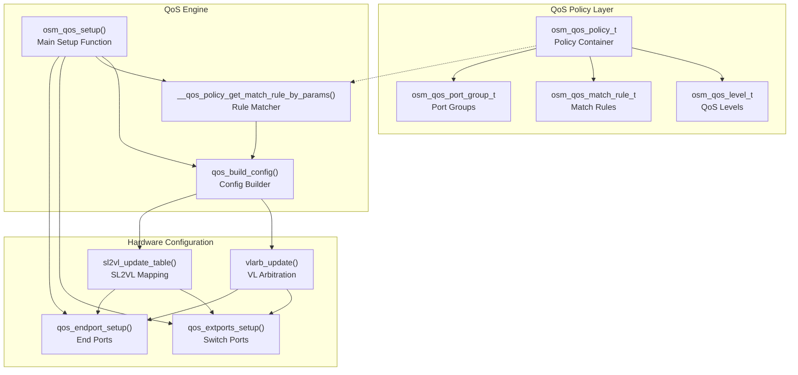
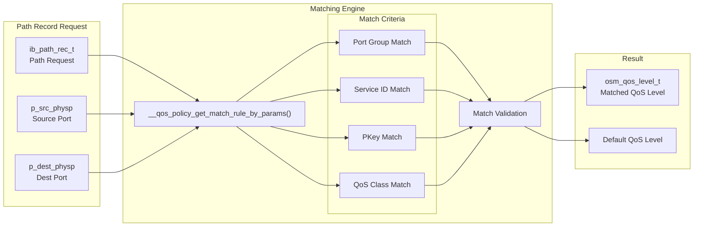
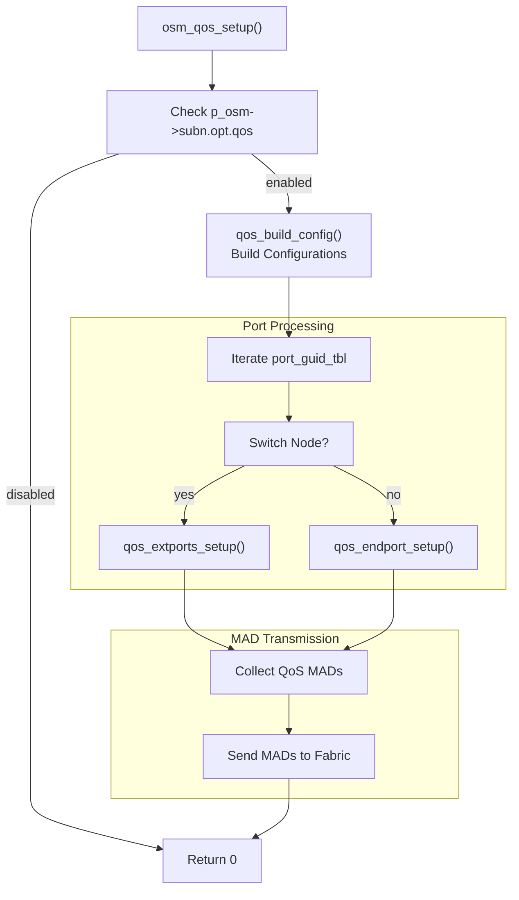
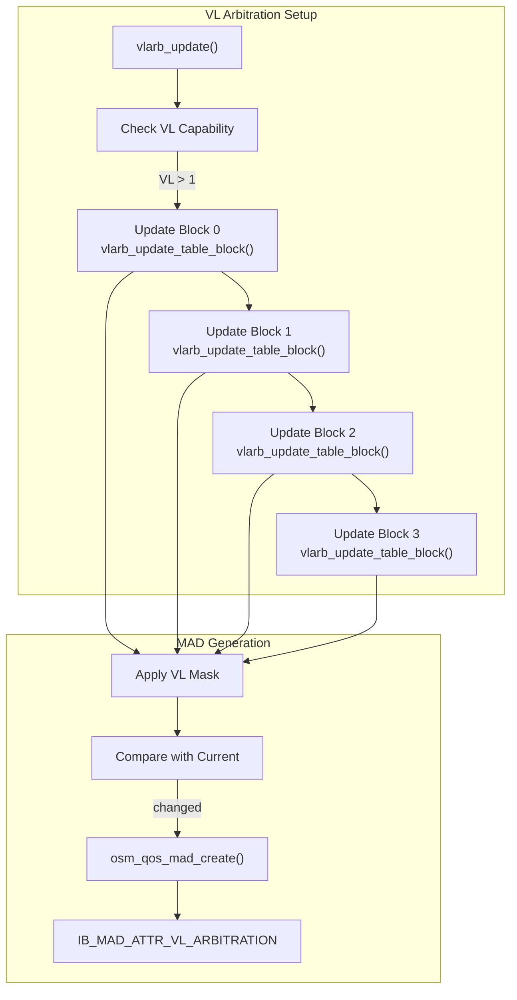
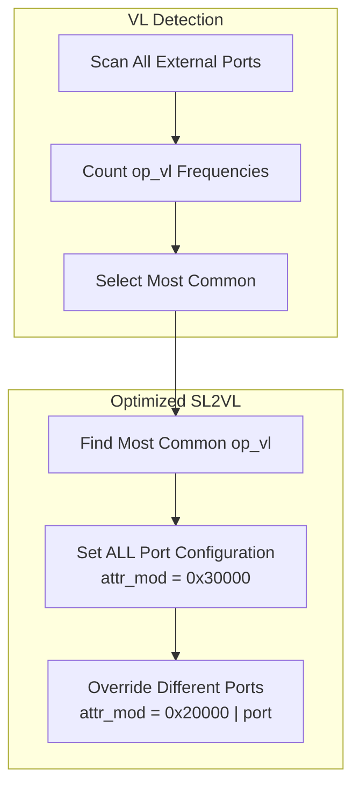
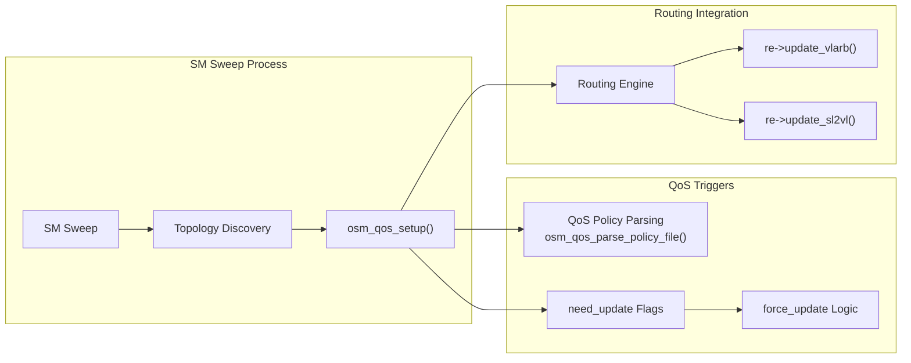

<!-- source: DeepWiki mcp.deepwiki.com · repo linux-rdma/opensm · page 6.2 Quality of Service (QoS) · fetched 2026-11-11 -->

# Quality of Service (QoS)

<details>
<summary>Relevant source files</summary>

The following files were used as context for generating this wiki page:

- [include/opensm/osm_qos_policy.h](include/opensm/osm_qos_policy.h)
- [include/opensm/osm_sm.h](include/opensm/osm_sm.h)
- [include/opensm/st.h](include/opensm/st.h)
- [opensm/osm_qos.c](opensm/osm_qos.c)
- [opensm/osm_qos_policy.c](opensm/osm_qos_policy.c)
- [opensm/osm_req.c](opensm/osm_req.c)
- [opensm/osm_sm.c](opensm/osm_sm.c)
- [opensm/osm_sm_state_mgr.c](opensm/osm_sm_state_mgr.c)

</details>


## Purpose and Scope

This document covers OpenSM's Quality of Service (QoS) implementation, which manages Virtual Lane (VL) arbitration and Service Level to Virtual Lane (SL2VL) mappings across the InfiniBand fabric. The QoS system enables differentiated service levels for different traffic classes by configuring hardware-level traffic prioritization mechanisms.

For partition management and PKey configuration, see [Partition Management](#6.1). For performance monitoring of QoS-related metrics, see [Performance Management](#6.3).

## QoS Architecture Overview

The OpenSM QoS system consists of three main components: policy definition, policy matching, and hardware configuration. The system translates high-level QoS policies into low-level hardware configurations on switches and HCAs.



Sources: [opensm/osm_qos.c:451-564](), [opensm/osm_qos_policy.c:415-440](), [include/opensm/osm_qos_policy.h:144-154]()

## QoS Policy Framework

The QoS policy framework defines traffic classification and service level assignments through a hierarchical structure of port groups, QoS levels, and match rules.

### Policy Data Structures

| Structure | Purpose | Key Fields |
|-----------|---------|------------|
| `osm_qos_policy_t` | Root policy container | `port_groups`, `qos_levels`, `qos_match_rules` |
| `osm_qos_level_t` | Service level definition | `sl`, `mtu_limit`, `rate_limit`, `pkey_range_arr` |
| `osm_qos_match_rule_t` | Traffic matching criteria | `source_group_list`, `service_id_range_arr`, `p_qos_level` |
| `osm_qos_port_group_t` | Port classification | `name`, `node_types`, `port_map` |

### Policy Matching Process



Sources: [opensm/osm_qos_policy.c:574-744](), [opensm/osm_qos_policy.c:990-1025]()

## QoS Configuration Setup

The QoS setup process applies policy-derived configurations to physical hardware through MAD (Management Datagram) operations.

### Main Setup Flow

The `osm_qos_setup()` function orchestrates the entire QoS configuration process:



### Configuration Types

The system builds separate configurations for different node types:

```c
struct qos_config ca_config, sw0_config, swe_config, rtr_config;
```

Each configuration contains:
- `max_vls`: Maximum Virtual Lanes
- `vl_high_limit`: High priority VL limit  
- `vlarb_high[2]`: High priority VL arbitration tables
- `vlarb_low[2]`: Low priority VL arbitration tables
- `sl2vl`: Service Level to Virtual Lane mapping

Sources: [opensm/osm_qos.c:451-564](), [opensm/osm_qos.c:57-63](), [opensm/osm_qos.c:469-477]()

## VL Arbitration Management

Virtual Lane arbitration controls bandwidth allocation among different VLs on each port. The system configures both high and low priority arbitration tables.

### VL Arbitration Update Process



The arbitration tables are organized in blocks, with each block containing up to 32 VL/weight pairs. The system supports separate high and low priority arbitration.

Sources: [opensm/osm_qos.c:202-255](), [opensm/osm_qos.c:150-200]()

## SL to VL Mapping

Service Level to Virtual Lane mapping translates the service level specified in packet headers to the virtual lane used for transmission.

### SL2VL Configuration Modes

OpenSM supports two SL2VL configuration modes:

#### Optimized Mode
For switches supporting optimized SL2VL mapping (`ib_switch_info_get_opt_sl2vlmapping()`):



#### Standard Mode
For standard switches, each input/output port combination is configured separately:

```c
for (out = start_port; out < num_ports; out++) {
    for (in = 0; in < num_ports; in++) {
        sl2vl_update_table(sm, p, in, in << 8 | out, 
                          force_update, port_sl2vl, port_mad_list);
    }
}
```

Sources: [opensm/osm_qos.c:338-388](), [opensm/osm_qos.c:392-418](), [opensm/osm_qos.c:257-299]()

## Integration with Subnet Manager

The QoS system integrates with the SM's sweep process and responds to network topology changes.

### SM Integration Points



### Configuration Validation

The system validates QoS policies against the current subnet state:

| Validation Check | Function | Purpose |
|------------------|----------|---------|
| QoS Level References | `__qos_policy_get_qos_level_by_name()` | Ensure match rules reference valid QoS levels |
| Port Group References | `__qos_policy_get_port_group_by_name()` | Validate port group references in match rules |
| PKey Consistency | `__qos_policy_validate_pkey()` | Check QoS level SL matches partition SL |
| Default Level | `osm_qos_policy_validate()` | Ensure default QoS level exists |

Sources: [opensm/osm_qos.c:483-484](), [opensm/osm_qos_policy.c:824-985](), [opensm/osm_qos.c:169-172](), [opensm/osm_qos.c:405-410]()

---

