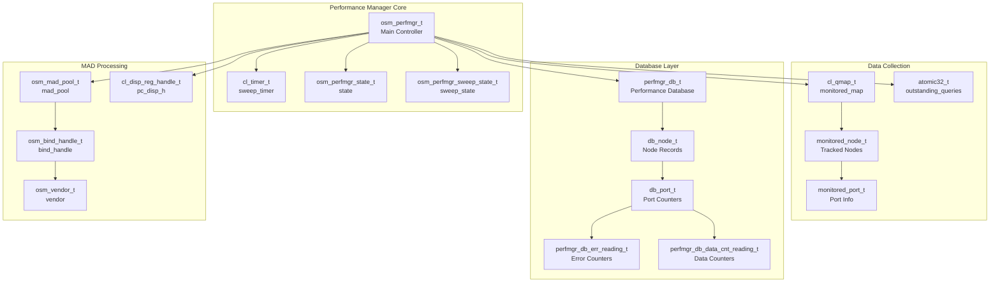
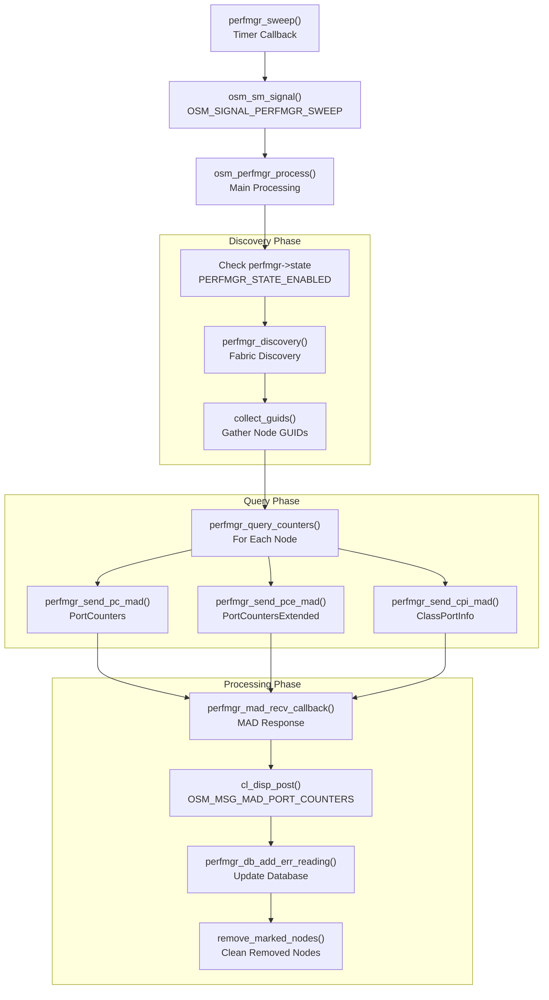
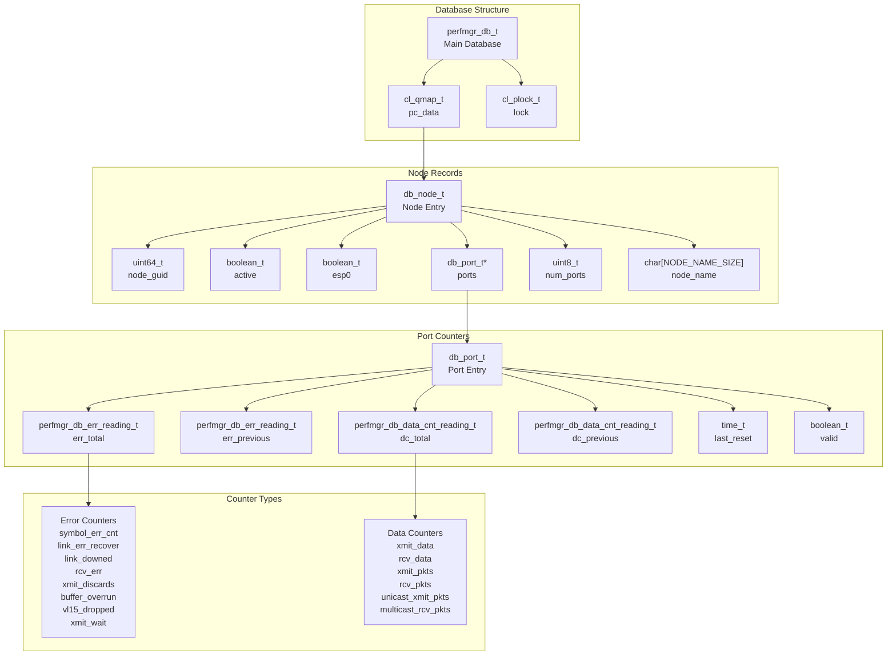

<!-- source: DeepWiki mcp.deepwiki.com · repo linux-rdma/opensm · page 6.3 Performance Management · fetched 2026-11-11 -->

# Performance Management

Relevant source files

The following files were used as context for generating this wiki page:

- [include/opensm/osm_madw.h](include/opensm/osm_madw.h)
- [include/opensm/osm_perfmgr.h](include/opensm/osm_perfmgr.h)
- [include/opensm/osm_perfmgr_db.h](include/opensm/osm_perfmgr_db.h)
- [opensm/osm_perfmgr.c](opensm/osm_perfmgr.c)
- [opensm/osm_perfmgr_db.c](opensm/osm_perfmgr_db.c)

The Performance Management component in OpenSM monitors InfiniBand fabric health and performance by periodically collecting port counters and performance statistics from nodes across the subnet. This system provides real-time visibility into fabric utilization, error rates, and potential performance bottlenecks.

For information about general subnet management, see [Core Architecture](#2). For details about Quality of Service management, see [Quality of Service (QoS)](#6.2).

## Overview and Architecture

The Performance Manager (`osm_perfmgr_t`) operates as a specialized manager within OpenSM that systematically queries performance counters from all monitored nodes in the fabric. It maintains a persistent database of performance statistics and provides interfaces for monitoring, alerting, and analysis.

Sources: [opensm/osm_perfmgr.c:133-161](), [include/opensm/osm_perfmgr.h:133-161](), [include/opensm/osm_perfmgr_db.h:150-154]()

## Performance Data Collection Process

The Performance Manager operates on a timer-driven sweep cycle, systematically collecting performance counters from all monitored nodes in the fabric. The collection process involves several key phases:

Sources: [opensm/osm_perfmgr.c:1135-1141](), [opensm/osm_perfmgr.c:1048-1129](), [opensm/osm_perfmgr.c:695-824]()

### Monitored Node Management

The Performance Manager maintains a map of monitored nodes using `monitored_node_t` structures that track essential information for each node:

| Field | Type | Purpose |
|-------|------|---------|
| `guid` | `uint64_t` | Node GUID identifier |
| `node_type` | `uint8_t` | Node type (CA, Switch, Router) |
| `esp0` | `boolean_t` | Enhanced Switch Port 0 support |
| `num_ports` | `uint32_t` | Number of ports on node |
| `port[]` | `monitored_port_t` | Array of port information |

Each `monitored_port_t` contains port-specific monitoring data including redirection information, capability masks, and remote connection details.

Sources: [include/opensm/osm_perfmgr.h:116-125](), [include/opensm/osm_perfmgr.h:95-113]()

## Database Management

The Performance Manager maintains a comprehensive database of performance statistics organized by node and port. The database tracks both current and historical performance data to enable trend analysis and change detection.

Sources: [include/opensm/osm_perfmgr_db.h:137-145](), [include/opensm/osm_perfmgr_db.h:124-131](), [include/opensm/osm_perfmgr_db.h:80-95](), [include/opensm/osm_perfmgr_db.h:100-110]()

### Counter Reset Detection

The Performance Manager implements sophisticated counter reset detection by comparing current readings with previous values. When counters decrease unexpectedly (indicating a reset), the system automatically adjusts its baseline calculations.

Key database operations include:

- `perfmgr_db_add_err_reading()` - Add new error counter reading
- `perfmgr_db_add_dc_reading()` - Add new data counter reading  
- `perfmgr_db_clear_prev_err()` - Clear previous error counters
- `perfmgr_db_mark_active()` - Mark node as actively monitored

Sources: [opensm/osm_perfmgr_db.c:353-432](), [opensm/osm_perfmgr_db.c:503-567](), [opensm/osm_perfmgr_db.c:1159-1199]()

## MAD Processing and Query Management

The Performance Manager uses InfiniBand Management Datagrams (MADs) to collect performance data from fabric nodes. It implements sophisticated query throttling and redirection support to ensure efficient fabric utilization.

```mermaid
graph LR
    subgraph "MAD Generation"
        BUILD["perfmgr_build_mad()<br/>Build PM MAD"]
        PC_MAD["perfmgr_send_pc_mad()<br/>PortCounters"]
        PCE_MAD["perfmgr_send_pce_mad()<br/>PortCountersExtended"] 
        CPI_MAD["perfmgr_send_cpi_mad()<br/>ClassPortInfo"]
    end
    
    subgraph "Query Throttling"
        OUTSTANDING["outstanding_queries<br/>Counter"]
        MAX_QUERIES["max_outstanding_queries<br/>Limit"]
        SIG_QUERY["cl_event_t<br/>sig_query"]
        THROTTLE["Query Throttling<br/>Logic"]
    end
    
    subgraph "MAD Processing"
        SEND["perfmgr_send_mad()<br/>Send to Fabric"]
        RECV_CB["perfmgr_mad_recv_callback()<br/>Response Handler"]
        ERR_CB["perfmgr_mad_send_err_callback()<br/>Error Handler"]
        DISPATCH["cl_disp_post()<br/>OSM_MSG_MAD_PORT_COUNTERS"]
    end
    
    subgraph "Data Processing"
        WIRE_READ["ib_port_counters_t<br/>Wire Format"]
        FILL_ERR["perfmgr_db_fill_err_read()<br/>Convert Errors"]
        FILL_DC["perfmgr_db_fill_data_cnt_read_pc()<br/>Convert Data"]
        DB_ADD["perfmgr_db_add_*_reading()<br/>Store in DB"]
    end
    
    BUILD --> PC_MAD
    BUILD --> PCE_MAD
    BUILD --> CPI_MAD
    
    PC_MAD --> OUTSTANDING
    OUTSTANDING --> MAX_QUERIES
    MAX_QUERIES --> SIG_QUERY
    SIG_QUERY --> THROTTLE
    THROTTLE --> SEND
    
    SEND --> RECV_CB
    SEND --> ERR_CB
    RECV_CB --> DISPATCH
    
    DISPATCH --> WIRE_READ
    WIRE_READ --> FILL_ERR
    WIRE_READ --> FILL_DC
    FILL_ERR --> DB_ADD
    FILL_DC --> DB_ADD
```

Sources: [opensm/osm_perfmgr.c:387-445](), [opensm/osm_perfmgr.c:450-482](), [opensm/osm_perfmgr.c:193-216](), [opensm/osm_perfmgr.c:221-279]()

### Redirection Support

The Performance Manager supports redirection through ClassPortInfo queries, allowing nodes to redirect performance queries to alternative LIDs, QPs, or PKeys for load balancing or security purposes.

Key redirection fields in `monitored_port_t`:
- `redirection` - Boolean indicating if redirection is active
- `lid` - Redirected LID for queries
- `qp` - Redirected Queue Pair number
- `pkey` - Redirected Partition Key

Sources: [include/opensm/osm_perfmgr.h:95-113](), [opensm/osm_perfmgr.c:598-623]()

## Configuration and Control Interface

The Performance Manager provides extensive configuration options and runtime control interfaces for managing monitoring behavior:

### State Management

| State | Description |
|-------|-------------|
| `PERFMGR_STATE_DISABLE` | Performance monitoring disabled |
| `PERFMGR_STATE_ENABLED` | Performance monitoring active |
| `PERFMGR_STATE_NO_DB` | Database unavailable |

### Sweep States

| Sweep State | Description |
|-------------|-------------|
| `PERFMGR_SWEEP_SLEEP` | Waiting for next sweep cycle |
| `PERFMGR_SWEEP_ACTIVE` | Currently collecting data |
| `PERFMGR_SWEEP_SUSPENDED` | Temporarily paused due to throttling |
| `PERFMGR_SWEEP_POST_PROCESSING` | Processing collected data |

### Configuration Parameters

- `sweep_time_s` - Interval between performance sweeps (default: 180 seconds)
- `max_outstanding_queries` - Maximum concurrent MAD queries (default: 500)
- `ignore_cas` - Whether to skip monitoring Channel Adapters
- `query_cpi` - Whether to query ClassPortInfo for capabilities
- `xmit_wait_threshold` - Threshold for XmitWait counter logging

Sources: [include/opensm/osm_perfmgr.h:75-93](), [include/opensm/osm_perfmgr.h:182-218](), [opensm/osm_perfmgr.c:75-78]()

### Data Export and Analysis

The Performance Manager provides multiple interfaces for exporting collected performance data:

- `osm_perfmgr_dump_counters()` - Export to file in human-readable or machine-readable format
- `osm_perfmgr_print_counters()` - Print specific node/port counters
- `osm_perfmgr_clear_counters()` - Reset all collected statistics
- `osm_perfmgr_delete_inactive()` - Remove inactive node records

These interfaces support both real-time monitoring and historical analysis of fabric performance trends.

Sources: [opensm/osm_perfmgr_db.c:1017-1032](), [opensm/osm_perfmgr_db.c:969-992](), [opensm/osm_perfmgr_db.c:650-659]()

---

