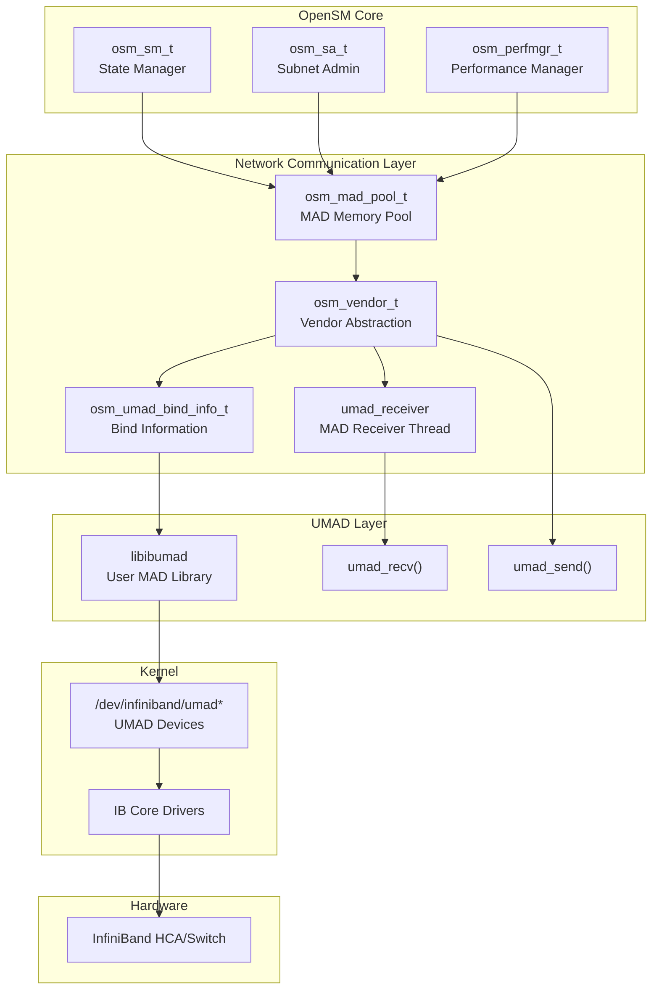
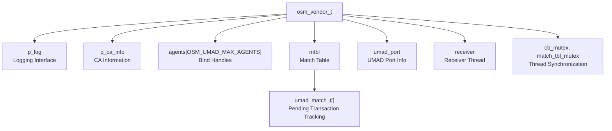
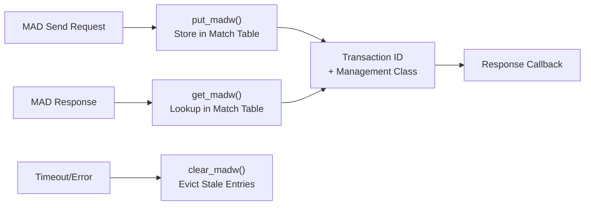
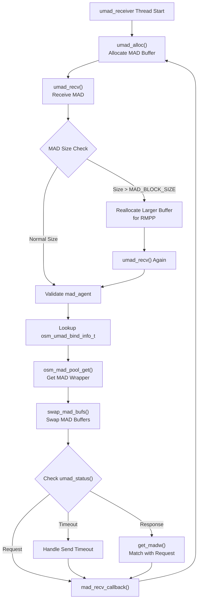
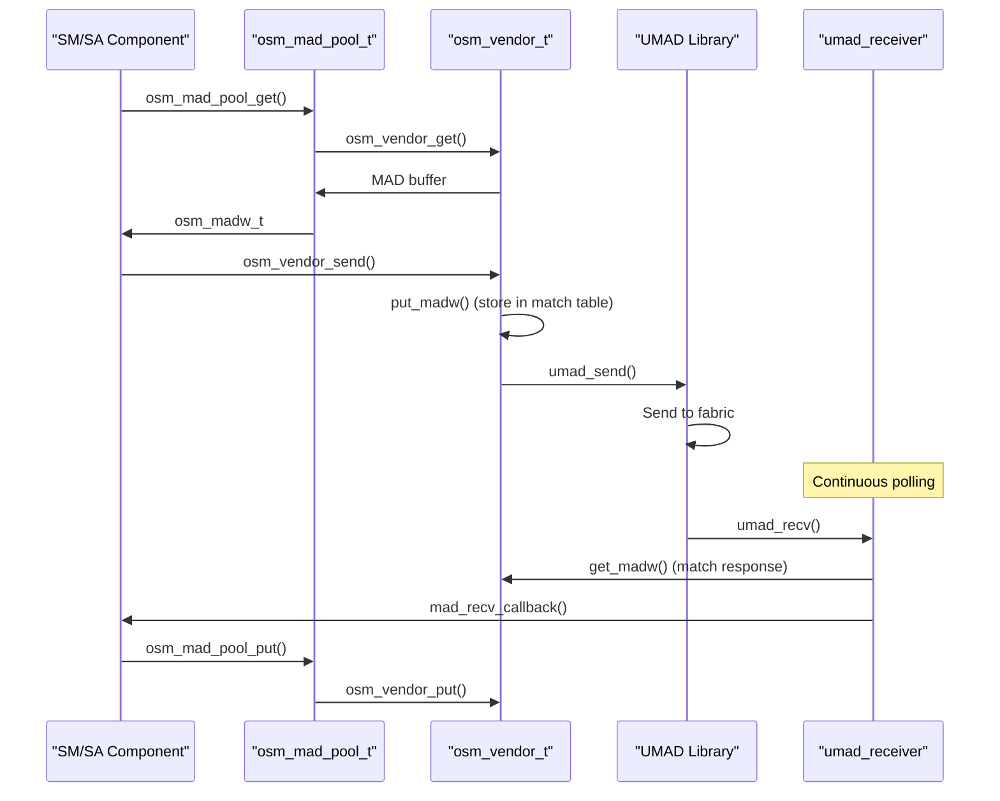

<!-- source: DeepWiki mcp.deepwiki.com · repo linux-rdma/opensm · page 7 Network Communication Layer · fetched 2026-11-11 -->

# Network Communication Layer

<details>
<summary>Relevant source files</summary>

The following files were used as context for generating this wiki page:

- [config/osmvsel.m4](config/osmvsel.m4)
- [include/iba/ib_types.h](include/iba/ib_types.h)
- [include/opensm/osm_base.h](include/opensm/osm_base.h)
- [include/opensm/osm_helper.h](include/opensm/osm_helper.h)
- [include/vendor/osm_vendor_ibumad.h](include/vendor/osm_vendor_ibumad.h)
- [libvendor/osm_mad_pool.c](libvendor/osm_mad_pool.c)
- [libvendor/osm_vendor_ibumad.c](libvendor/osm_vendor_ibumad.c)
- [opensm/osm_console.c](opensm/osm_console.c)
- [opensm/osm_sa_class_port_info.c](opensm/osm_sa_class_port_info.c)

</details>


The Network Communication Layer forms the foundation of OpenSM's communication with the InfiniBand fabric. This layer provides vendor-neutral abstractions for sending and receiving Management Datagrams (MADs), managing communication with different InfiniBand hardware implementations, and handling the low-level transport mechanisms that enable subnet management operations.

For information about higher-level subnet administration functionality, see [Subnet Administration (SA)](#5). For routing-specific communication, see [Routing Management](#4).

## Architecture Overview

The Network Communication Layer consists of several key components that work together to provide reliable MAD-based communication:



Sources: [libvendor/osm_vendor_ibumad.c:154-170](), [include/vendor/osm_vendor_ibumad.h:154-170](), [libvendor/osm_mad_pool.c:55-72]()

## Vendor Abstraction Layer

The vendor abstraction layer provides a hardware-independent interface for OpenSM to communicate with different InfiniBand implementations. The main abstraction is provided by the `osm_vendor_t` structure and associated functions.

### Vendor Interface Selection

OpenSM supports multiple vendor interfaces, selected at build time:

| Vendor Type | Constant | Description |
|-------------|----------|-------------|
| OpenIB | `OSM_VENDOR_INTF_OPENIB` | Modern UMAD-based interface (default) |
| Simulation | `OSM_VENDOR_INTF_SIM` | Simulation environment interface |
| Gen1 | `OSM_VENDOR_INTF_TS` | Legacy Tavor/InfiniHost interface |
| VAPI | `OSM_VENDOR_INTF_MTL` | Mellanox VAPI interface |

The vendor selection is configured through autotools macros and affects compilation flags and linked libraries.

Sources: [config/osmvsel.m4:65-118]()

### Vendor Structure and Initialization

The `osm_vendor_t` structure centralizes all vendor-specific state and provides the main interface:



Key vendor functions include:
- `osm_vendor_init()` - Initialize vendor interface
- `osm_vendor_bind()` - Bind to management classes
- `osm_vendor_send()` - Send MADs
- `osm_vendor_recv()` - Receive MADs (handled by receiver thread)

Sources: [include/vendor/osm_vendor_ibumad.h:154-170](), [libvendor/osm_vendor_ibumad.c:541-597]()

## MAD Processing and Communication

### InfiniBand MAD Types and Classes

The communication layer handles various types of Management Datagrams defined by InfiniBand specifications:

| Management Class | Constant | Description |
|------------------|----------|-------------|
| Subnet Management (LID) | `IB_MCLASS_SUBN_LID` | LID-routed subnet management |
| Subnet Management (Direct) | `IB_MCLASS_SUBN_DIR` | Directed-route subnet management |
| Subnet Administration | `IB_MCLASS_SUBN_ADM` | Subnet Administration queries |
| Performance Management | `IB_MCLASS_PERF` | Performance monitoring |

### MAD Methods and Attributes

Common MAD methods include:
- `IB_MAD_METHOD_GET` - Retrieve attribute information
- `IB_MAD_METHOD_SET` - Modify attribute information  
- `IB_MAD_METHOD_GETTABLE` - Retrieve table records
- `IB_MAD_METHOD_TRAP` - Asynchronous notifications

Key attributes processed include:
- `IB_MAD_ATTR_NODE_INFO` - Node information
- `IB_MAD_ATTR_PORT_INFO` - Port configuration
- `IB_MAD_ATTR_CLASS_PORT_INFO` - Class capabilities

Sources: [include/iba/ib_types.h:414-448](), [include/iba/ib_types.h:724-837](), [include/iba/ib_types.h:975-1175]()

### Transaction Matching and Tracking

OpenSM uses a match table to correlate MAD responses with their originating requests:



The match table implements LRU eviction when full, prioritizing GS (General Services) transactions over SMP (Subnet Management Packet) transactions for eviction.

Sources: [libvendor/osm_vendor_ibumad.c:200-273](), [libvendor/osm_vendor_ibumad.c:164-192]()

## UMAD Implementation Details

### UMAD Receiver Thread

The `umad_receiver` thread continuously polls for incoming MADs and dispatches them to appropriate handlers:



Sources: [libvendor/osm_vendor_ibumad.c:323-516]()

### UMAD Binding and Agents

OpenSM binds to specific management classes through UMAD agents. Each bind creates an `osm_umad_bind_info_t` structure:

```c
typedef struct _osm_umad_bind_info {
    osm_vendor_t *p_vend;
    void *client_context;
    osm_mad_pool_t *p_mad_pool;
    osm_vend_mad_recv_callback_t mad_recv_callback;
    osm_vend_mad_send_err_callback_t send_err_callback;
    ib_net64_t port_guid;
    int agent_id;
    int agent_id1;  /* SMI requires two agents */
    int timeout;
    int max_retries;
} osm_umad_bind_info_t;
```

SMI (Subnet Management Interface) requires two agents for handling both LID-routed and directed-route SMPs.

Sources: [libvendor/osm_vendor_ibumad.c:82-94]()

## MAD Pool Management

### Memory Management Strategy

The `osm_mad_pool_t` provides efficient memory management for MAD operations:

```mermaid
graph LR
    GET_REQ["MAD Request"] --> POOL_GET["osm_mad_pool_get()"]
    POOL_GET --> WRAPPER_ALLOC["malloc(osm_madw_t)"]
    WRAPPER_ALLOC --> VENDOR_GET["osm_vendor_get()<br/>Get Wire MAD"]
    VENDOR_GET --> MADW_INIT["osm_madw_init()"]
    
    MADW_INIT --> USAGE["MAD Usage"]
    USAGE --> POOL_PUT["osm_mad_pool_put()"]
    POOL_PUT --> VENDOR_PUT["osm_vendor_put()"]
    VENDOR_PUT --> WRAPPER_FREE["free(osm_madw_t)"]
```



### MAD Wrapper Structure

The `osm_madw_t` structure wraps MADs with metadata:
- `h_bind` - Bind handle for the MAD
- `mad_size` - Size of the MAD data
- `p_mad` - Pointer to the actual MAD
- `mad_addr` - Addressing information
- `vend_wrap` - Vendor-specific wrapper data
- `status` - MAD status (success, timeout, error)

Sources: [libvendor/osm_mad_pool.c:74-113](), [libvendor/osm_mad_pool.c:160-175]()

## Communication Flow

The complete communication flow demonstrates how MADs traverse the network communication layer:



This flow handles both request/response patterns and unsolicited messages like traps, with appropriate error handling and timeout management throughout.

Sources: [libvendor/osm_vendor_ibumad.c:323-516](), [libvendor/osm_vendor_ibumad.c:200-273](), [libvendor/osm_mad_pool.c:74-113]()

---

