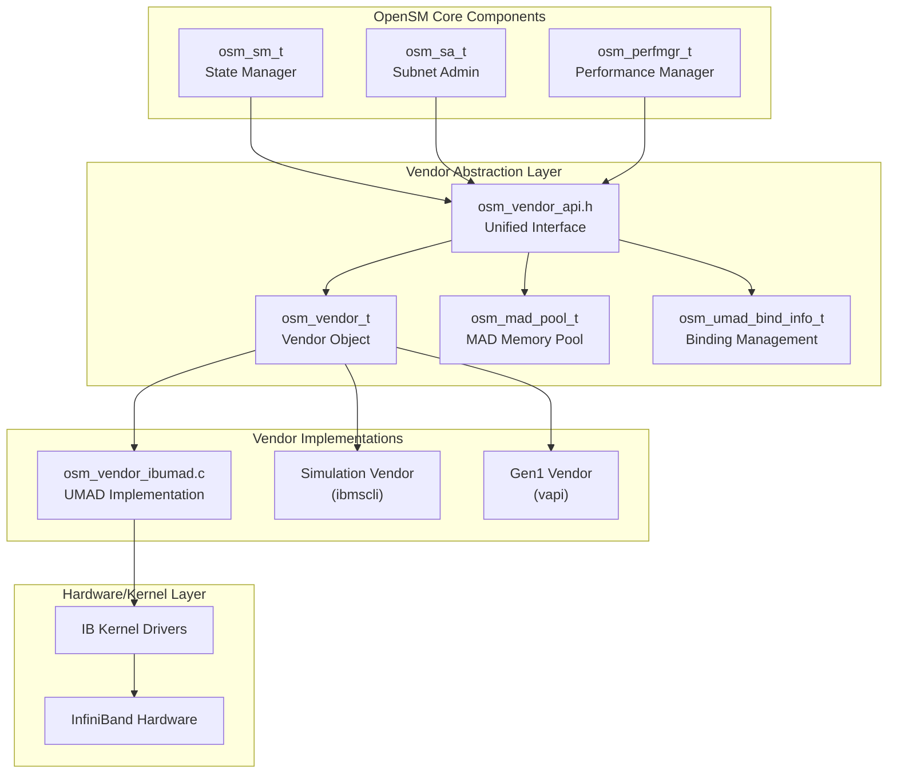
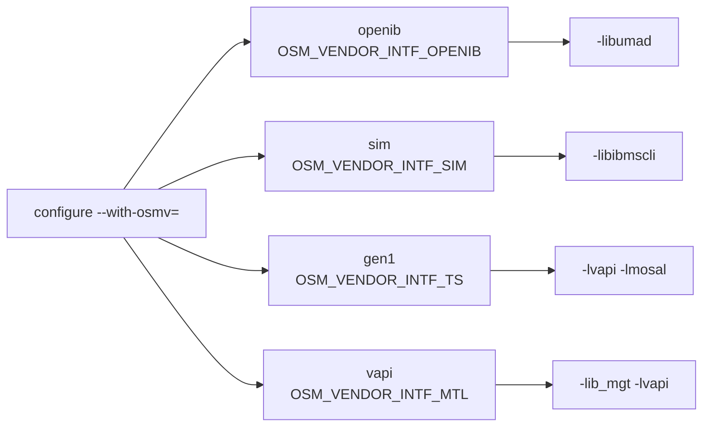
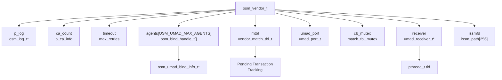
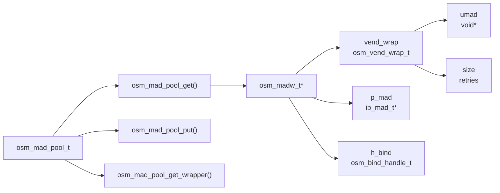
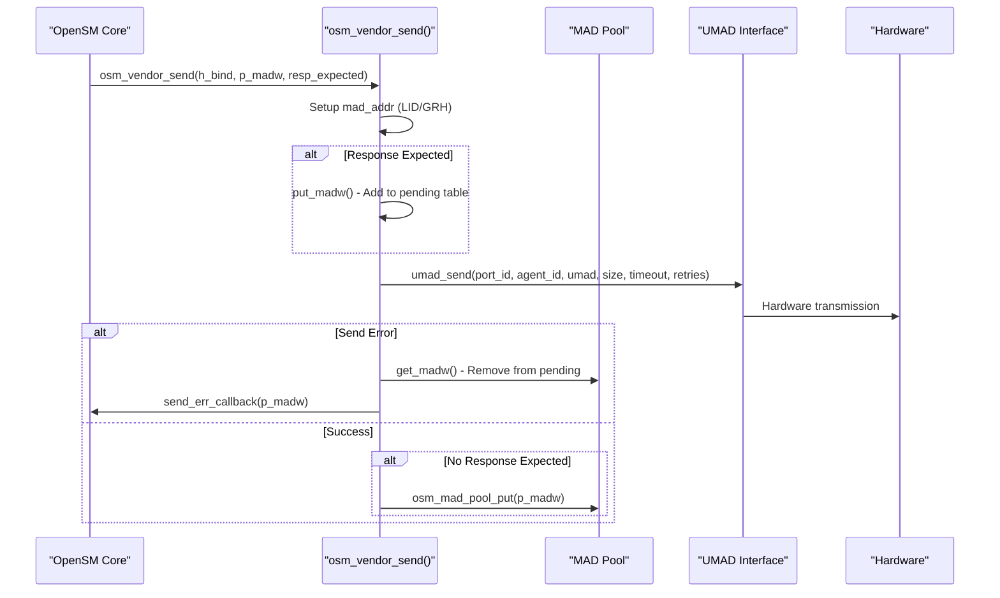
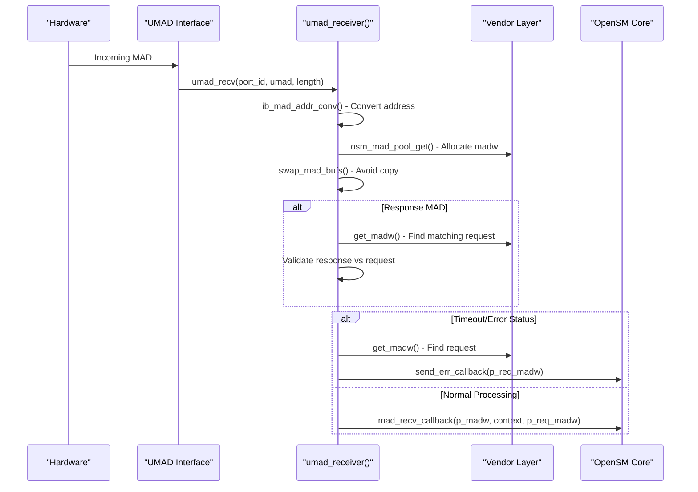
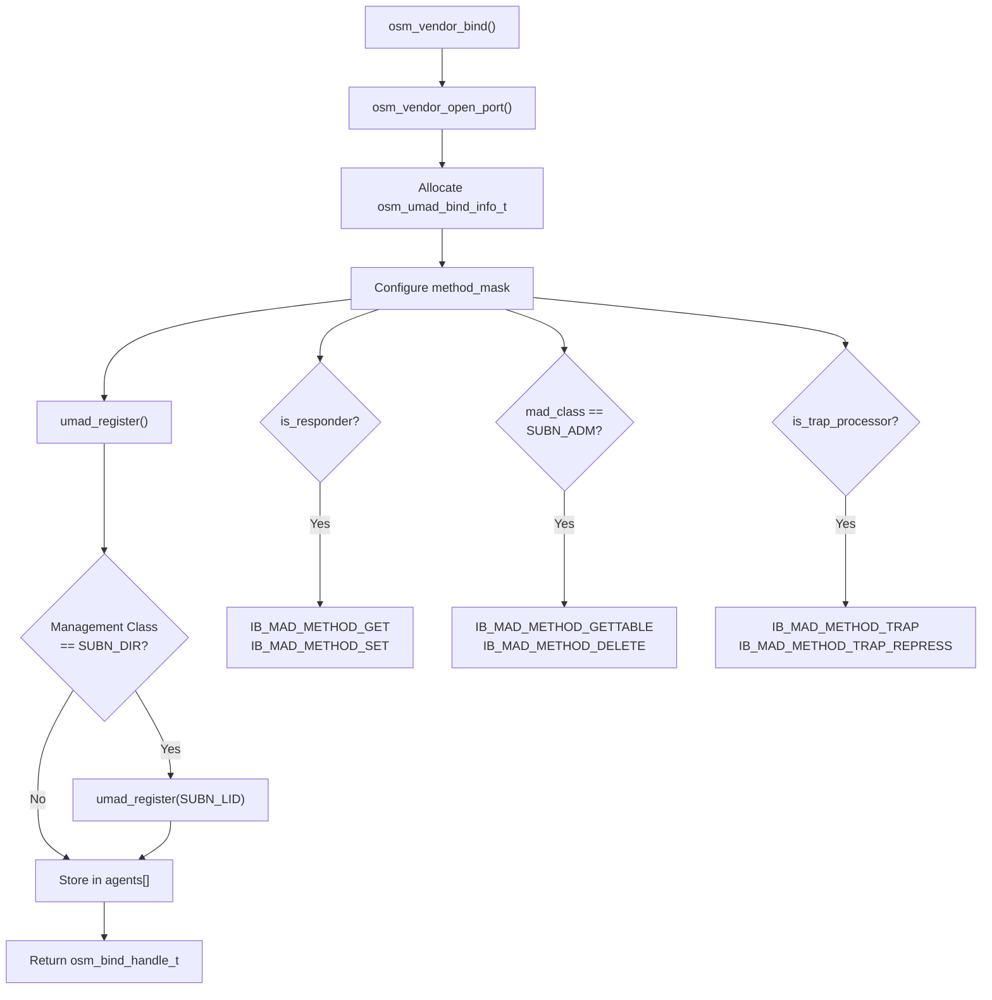
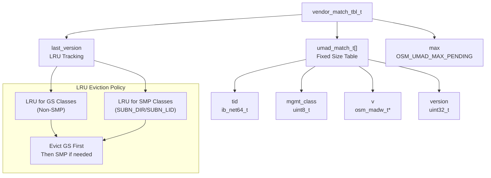
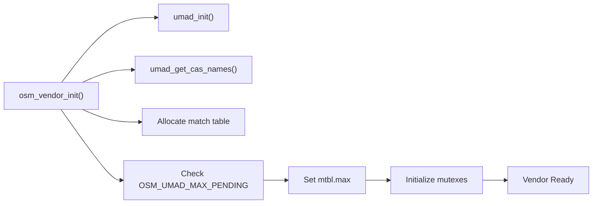

<!-- source: DeepWiki mcp.deepwiki.com · repo linux-rdma/opensm · page 7.1 Vendor Abstraction Layer · fetched 2026-11-11 -->

# Vendor Abstraction Layer

Relevant source files

The following files were used as context for generating this wiki page:

- [config/osmvsel.m4](config/osmvsel.m4)
- [include/vendor/osm_vendor_ibumad.h](include/vendor/osm_vendor_ibumad.h)
- [libvendor/osm_mad_pool.c](libvendor/osm_mad_pool.c)
- [libvendor/osm_vendor_ibumad.c](libvendor/osm_vendor_ibumad.c)

The Vendor Abstraction Layer provides a unified interface for OpenSM to communicate with different InfiniBand hardware implementations. It abstracts the underlying transport mechanisms and hardware-specific details, allowing OpenSM to work with various vendor implementations including UMAD (User MAD), simulation environments, and legacy hardware interfaces.

This layer handles Management Datagram (MAD) transmission and reception, memory management for MAD buffers, and vendor-specific initialization and configuration. For information about MAD processing at the application level, see [InfiniBand Types and MAD Processing](#7.2).

## Architecture Overview

The Vendor Abstraction Layer sits between OpenSM's core components and the underlying InfiniBand hardware or simulation interfaces. It provides a consistent API regardless of the underlying transport implementation.

Sources: [libvendor/osm_vendor_ibumad.c:1-1273](), [include/vendor/osm_vendor_ibumad.h:1-184](), [config/osmvsel.m4:9-130]()

## Vendor Types and Selection

OpenSM supports multiple vendor implementations that can be selected at build time through the autotools configuration system.

| Vendor Type | Description | Library Dependencies | Use Case |
|-------------|-------------|---------------------|----------|
| `openib` (default) | User MAD interface for OpenIB | `libibumad` | Production deployments |
| `sim` | Simulation environment | `libibmscli` | Testing and development |
| `gen1` | Legacy Gen1 hardware | `libvapi`, `libmosal` | Legacy Mellanox hardware |
| `vapi` | VAPI interface | `lib_mgt`, `libvapi` | Alternative Mellanox interface |

The vendor selection is configured using autotools macros:

Sources: [config/osmvsel.m4:65-118]()

## Core Data Structures

The vendor layer defines several key data structures that manage the abstraction and provide the interface to OpenSM components.

### osm_vendor_t Structure

The main vendor object that encapsulates all vendor-specific state and operations:

Sources: [include/vendor/osm_vendor_ibumad.h:154-170]()

### MAD Pool Management

The MAD pool provides memory management for Management Datagrams:

Sources: [libvendor/osm_mad_pool.c:74-176]()

## MAD Processing Flow

The vendor layer implements a complete MAD processing pipeline for sending and receiving Management Datagrams.

### Send Path

### Receive Path

Sources: [libvendor/osm_vendor_ibumad.c:323-516](), [libvendor/osm_vendor_ibumad.c:1105-1229]()

## Binding and Agent Management

The vendor layer manages multiple agents for different management classes and provides binding mechanisms for OpenSM components.

### Binding Process

### Agent Registration

Each management class requires registration with the UMAD interface:

| Management Class | Agent ID | Purpose |
|-----------------|----------|---------|
| `IB_MCLASS_SUBN_DIR` | `agent_id` | Direct Route SMPs |
| `IB_MCLASS_SUBN_LID` | `agent_id1` | LID Route SMPs (auto-registered with DR) |
| `IB_MCLASS_SUBN_ADM` | `agent_id` | Subnet Administration |
| `IB_MCLASS_PERF` | `agent_id` | Performance Management |

Sources: [libvendor/osm_vendor_ibumad.c:867-1016](), [libvendor/osm_vendor_ibumad.c:855-865]()

## Transaction Matching and Timeout Handling

The vendor layer implements a sophisticated transaction matching system to correlate requests with responses and handle timeouts.

Sources: [libvendor/osm_vendor_ibumad.c:194-273](), [include/vendor/osm_vendor_ibumad.h:148-152]()

## Configuration and Environment

The vendor layer can be configured through environment variables and build-time options:

| Configuration | Environment Variable | Default | Purpose |
|---------------|---------------------|---------|---------|
| Max Pending MADs | `OSM_UMAD_MAX_PENDING` | 1000 | Transaction table size |
| Vendor Type | `--with-osmv` | openib | Build-time vendor selection |
| UMAD Library Path | `--with-umad-libs` | System default | Custom UMAD library location |
| UMAD Headers | `--with-umad-includes` | System default | Custom UMAD header location |

### Runtime Initialization

Sources: [libvendor/osm_vendor_ibumad.c:541-600](), [config/osmvsel.m4:576-584]()

---

