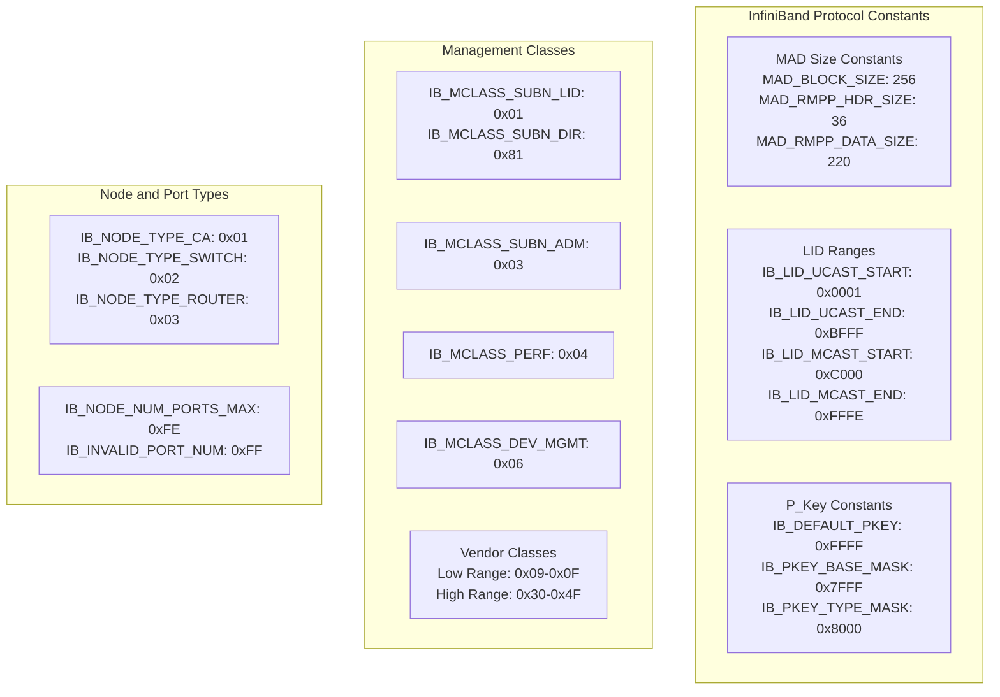
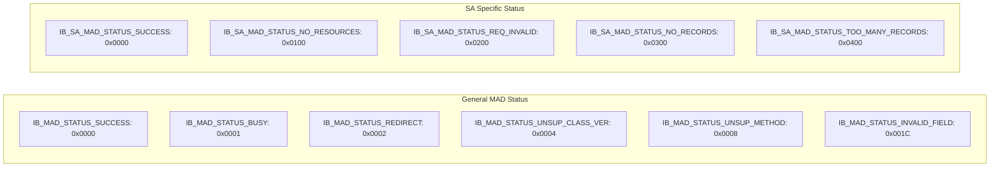
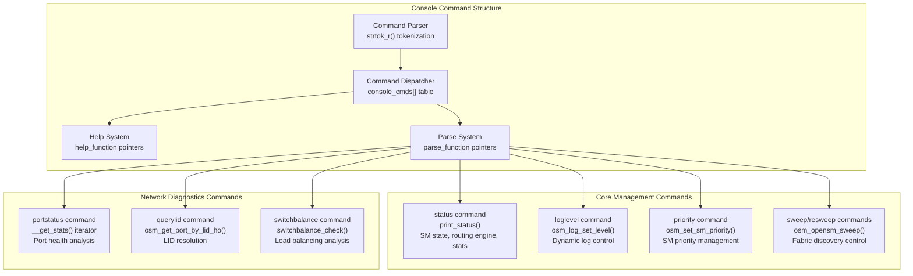
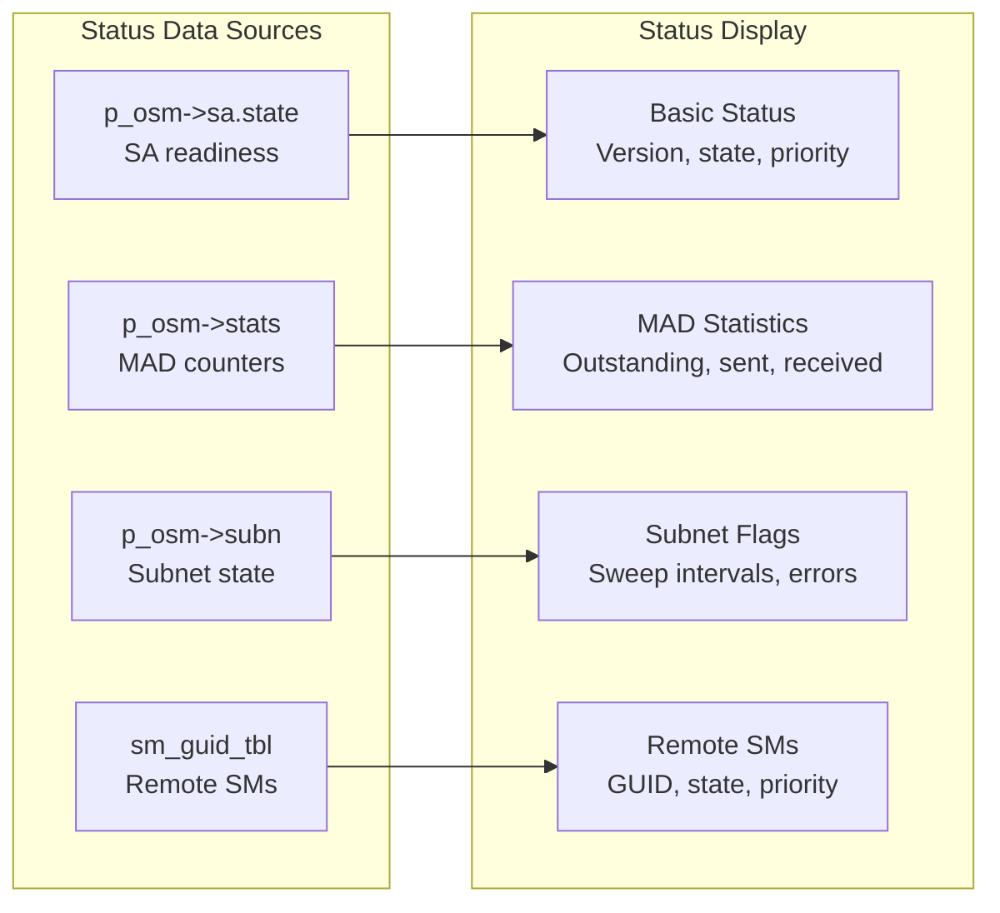
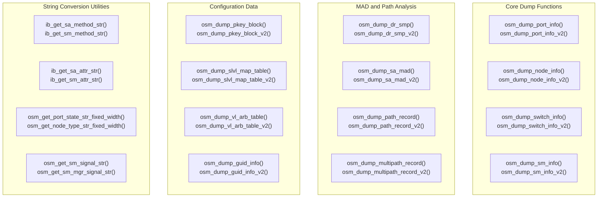
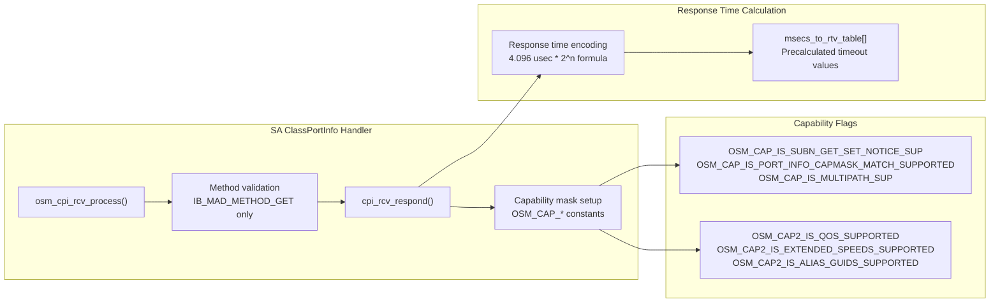

<!-- source: DeepWiki mcp.deepwiki.com · repo linux-rdma/opensm · page 7.2 InfiniBand Types and MAD Processing · fetched 2026-11-11 -->

# InfiniBand Types and MAD Processing

Relevant source files

The following files were used as context for generating this wiki page:

- [include/iba/ib_types.h](include/iba/ib_types.h)
- [include/opensm/osm_base.h](include/opensm/osm_base.h)
- [include/opensm/osm_helper.h](include/opensm/osm_helper.h)
- [opensm/osm_console.c](opensm/osm_console.c)
- [opensm/osm_sa_class_port_info.c](opensm/osm_sa_class_port_info.c)

This page covers the foundational InfiniBand data types, Management Datagram (MAD) processing infrastructure, and console interface that form the low-level communication layer of OpenSM. This includes type definitions, constants, MAD handling mechanisms, and the management console interface.

For information about the vendor abstraction layer that provides hardware-specific implementations, see [Vendor Abstraction Layer](#7.1). For details about subnet administration record processing, see [SA Record Processing](#5.1).

## InfiniBand Fundamental Types and Constants

OpenSM defines extensive InfiniBand types and constants that form the foundation for all fabric communication. These definitions are centralized in core header files and provide the building blocks for MAD processing.

### Core Data Type Definitions

Sources: [include/iba/ib_types.h:78-1664]()

### MAD Method and Attribute Constants

The InfiniBand specification defines standard methods and attributes for management operations:

| Method Constants | Value | Purpose |
|------------------|-------|---------|
| `IB_MAD_METHOD_GET` | 0x01 | Retrieve attribute |
| `IB_MAD_METHOD_SET` | 0x02 | Modify attribute |
| `IB_MAD_METHOD_GET_RESP` | 0x81 | Get response |
| `IB_MAD_METHOD_TRAP` | 0x05 | Trap notification |
| `IB_MAD_METHOD_GETTABLE` | 0x12 | SA table query |

| Attribute Constants | Value | Description |
|---------------------|-------|-------------|
| `IB_MAD_ATTR_NODE_INFO` | 0x0011 | Node information |
| `IB_MAD_ATTR_PORT_INFO` | 0x0015 | Port configuration |
| `IB_MAD_ATTR_SWITCH_INFO` | 0x0012 | Switch parameters |
| `IB_MAD_ATTR_SM_INFO` | 0x0020 | SM information |
| `IB_MAD_ATTR_CLASS_PORT_INFO` | 0x0001 | Class capabilities |

Sources: [include/iba/ib_types.h:724-1643]()

## MAD Processing Architecture

The MAD processing system handles the fundamental communication protocol for InfiniBand management. This includes message structure validation, method dispatch, and response generation.

### MAD Structure and Classification

```mermaid
graph TB
    subgraph "MAD Classification Functions"
        CLASS_CHECK["ib_class_is_vendor_specific()"]
        RMPP_CHECK["ib_class_is_rmpp()"]
        VENDOR_LOW["ib_class_is_vendor_specific_low()"]
        VENDOR_HIGH["ib_class_is_vendor_specific_high()"]
    end
    
    subgraph "Management Classes"
        SUBN_MGMT["Subnet Management<br/>Classes: 0x01, 0x81"]
        SUBN_ADM["Subnet Administration<br/>Class: 0x03<br/>RMPP Supported"]
        PERF_MGMT["Performance Management<br/>Class: 0x04"]
        VENDOR_SPEC["Vendor Specific<br/>Low: 0x09-0x0F<br/>High: 0x30-0x4F<br/>RMPP for High Range"]
    end
    
    CLASS_CHECK --> VENDOR_LOW
    CLASS_CHECK --> VENDOR_HIGH
    RMPP_CHECK --> SUBN_ADM
    RMPP_CHECK --> VENDOR_SPEC
    
    subgraph "MAD Processing Pipeline"
        MAD_RCV["MAD Reception"]
        CLASS_DISPATCH["Class-based Dispatch"]
        METHOD_VALIDATE["Method Validation"]
        ATTR_PROCESS["Attribute Processing"]
        RESPONSE_GEN["Response Generation"]
        
        MAD_RCV --> CLASS_DISPATCH
        CLASS_DISPATCH --> METHOD_VALIDATE
        METHOD_VALIDATE --> ATTR_PROCESS
        ATTR_PROCESS --> RESPONSE_GEN
    end
```

Sources: [include/iba/ib_types.h:570-681]()

### MAD Status Codes and Error Handling

OpenSM defines comprehensive status codes for MAD processing:

Sources: [include/iba/ib_types.h:851-934]()

## Console Interface and Management Commands

The OpenSM console provides an interactive interface for monitoring and managing the subnet manager. The console implements a command-driven architecture with real-time status reporting.

### Console Command Architecture

Sources: [opensm/osm_console.c:63-68](), [opensm/osm_console.c:444-526](), [opensm/osm_console.c:931-1043]()

### Real-time Status Monitoring

The console provides comprehensive status reporting with detailed statistics:

| Status Category | Information Provided | Key Functions |
|-----------------|---------------------|---------------|
| SM State | Master/Standby/Discovering | `sm_state_str()` |
| SA State | Init/Ready | `sa_state_str()` |
| MAD Statistics | QP0/QP1 sent/received/outstanding | `print_status()` |
| Subnet Flags | Sweeping enabled, intervals, errors | Built into status display |
| Remote SMs | Known SMs with priorities | `dump_sms()` |

Sources: [opensm/osm_console.c:418-442](), [opensm/osm_console.c:482-521]()

## Helper Functions and Utility Infrastructure

OpenSM provides extensive helper functions for processing and debugging InfiniBand data structures. These utilities support MAD analysis, data dumping, and string conversion.

### Data Dumping and Analysis Functions

Sources: [include/opensm/osm_helper.h:203-623]()

### SA Class Port Info Processing

The SA Class Port Info mechanism provides capability negotiation and response time configuration:

Sources: [opensm/osm_sa_class_port_info.c:72-188](), [opensm/osm_sa_class_port_info.c:193-222](), [include/opensm/osm_base.h:706-934]()

### Rate and MTU Validation

Helper functions provide validation and comparison for path parameters:

| Function | Purpose | Return Value |
|----------|---------|--------------|
| `ib_mtu_is_valid()` | Validates encoded MTU | 1 (valid) or 0 (invalid) |
| `ib_rate_is_valid()` | Validates encoded rate | 1 (valid) or 0 (invalid) |
| `ib_path_compare_rates()` | Compares two path rates | -1, 0, or 1 (less, equal, greater) |
| `ib_path_rate_get_prev()` | Gets previous rate | Encoded rate or 0 |
| `ib_path_rate_get_next()` | Gets next rate | Encoded rate or 0 |

Sources: [include/opensm/osm_helper.h:720-930]()

---

