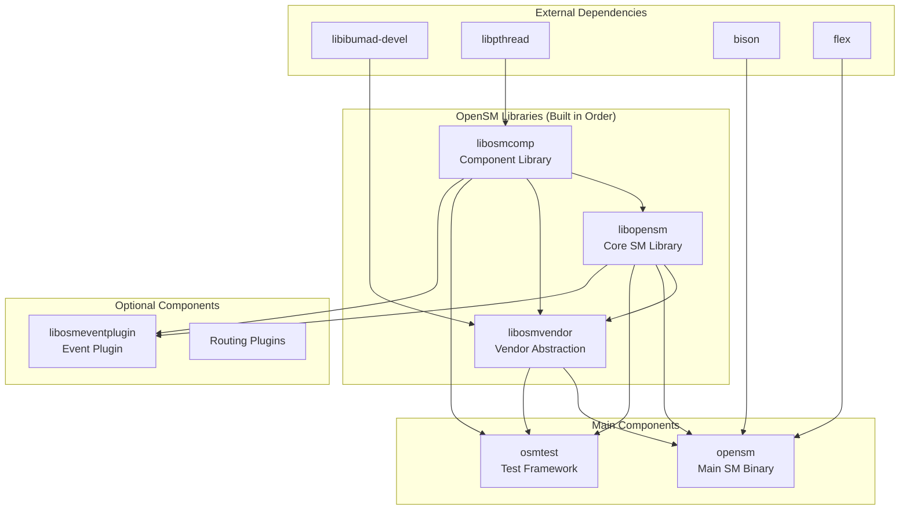
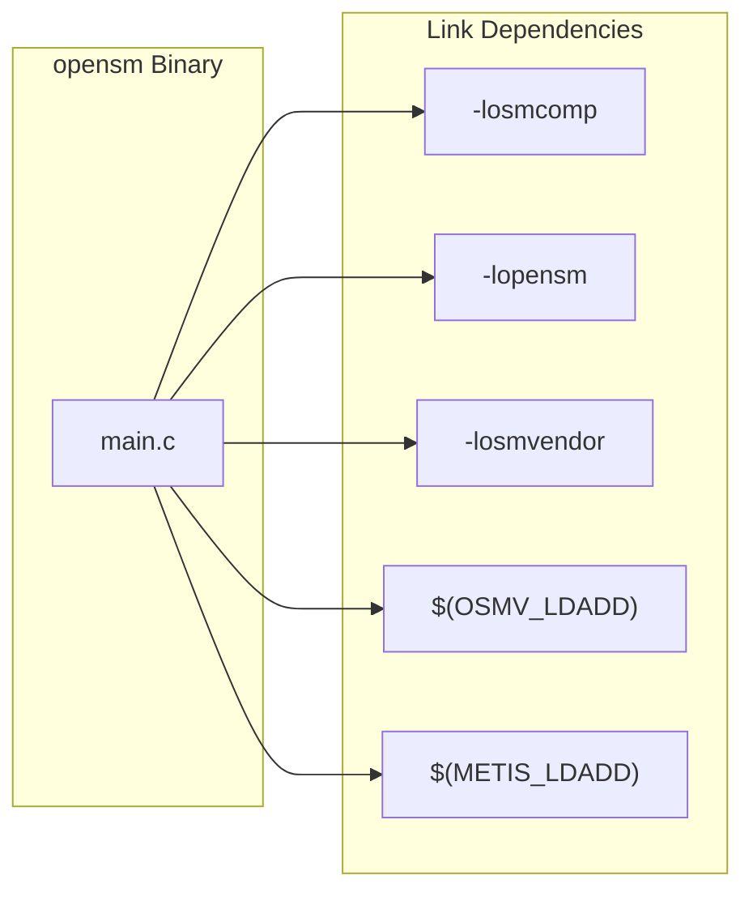
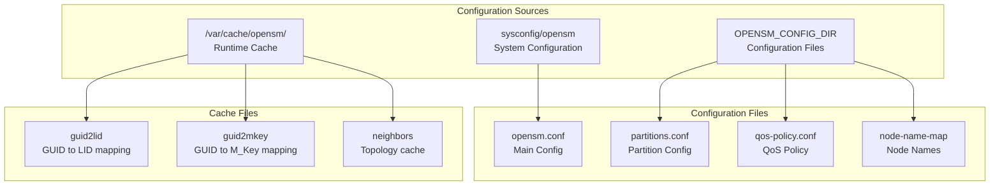
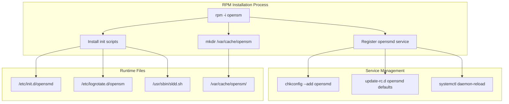
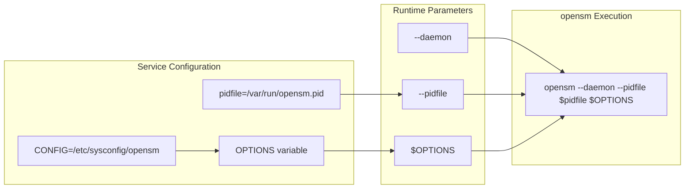
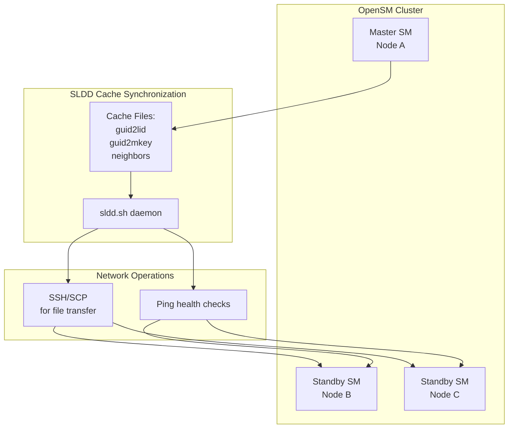
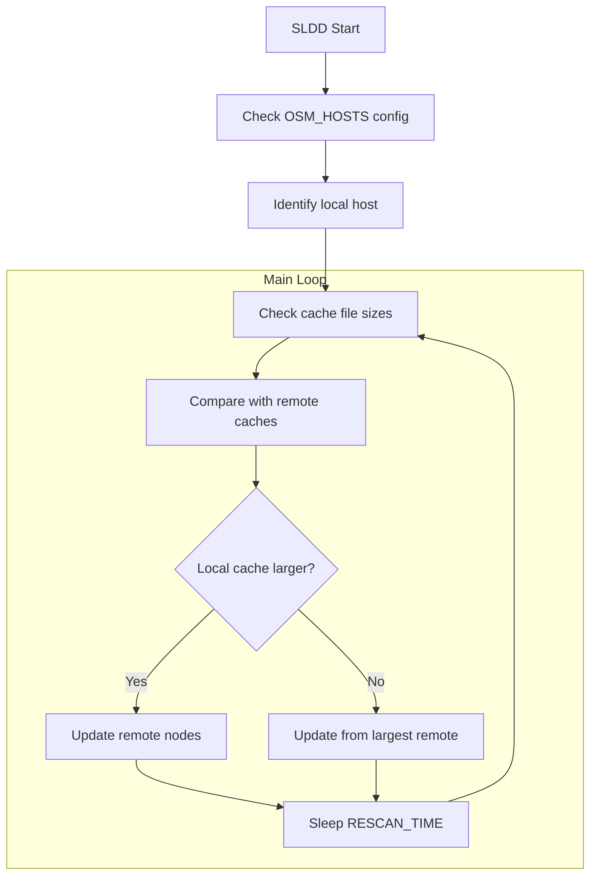

<!-- source: DeepWiki mcp.deepwiki.com · repo linux-rdma/opensm · page 8 Configuration and Deployment · fetched 2026-11-11 -->

# Configuration and Deployment

<details>
<summary>Relevant source files</summary>

The following files were used as context for generating this wiki page:

- [Makefile.am](Makefile.am)
- [complib/Makefile.am](complib/Makefile.am)
- [include/opensm/osm_config.h.in](include/opensm/osm_config.h.in)
- [libvendor/Makefile.am](libvendor/Makefile.am)
- [opensm.spec.in](opensm.spec.in)
- [opensm/Makefile.am](opensm/Makefile.am)
- [osmeventplugin/Makefile.am](osmeventplugin/Makefile.am)
- [osmtest/Makefile.am](osmtest/Makefile.am)
- [scripts/opensm.init.in](scripts/opensm.init.in)
- [scripts/opensm.sysconfig](scripts/opensm.sysconfig)
- [scripts/redhat-opensm.init.in](scripts/redhat-opensm.init.in)
- [scripts/sldd.sh.in](scripts/sldd.sh.in)

</details>


This document covers how OpenSM is built, configured, packaged, and deployed in production environments. It details the autotools-based build system, configuration options, RPM packaging, and various deployment scenarios including single-node and multi-node cluster configurations.

For information about the core OpenSM architecture and components, see [Core Architecture](#2). For management and monitoring tools, see [Testing and Management Tools](#9).

## Build System Overview

OpenSM uses a standard autotools-based build system with separate libraries and components built in dependency order. The build produces several shared libraries and the main OpenSM executable.

### Build Dependencies and Structure



The build system enforces proper dependency order through the `SUBDIRS` specification in [Makefile.am:3](), ensuring libraries are built before components that depend on them.

**Sources:** [Makefile.am:1-28](), [opensm/Makefile.am:51](), [complib/Makefile.am:4](), [libvendor/Makefile.am:12](), [osmtest/Makefile.am:17]()

### Library Linking Structure



**Sources:** [opensm/Makefile.am:51]()

## Configuration System

OpenSM supports both compile-time and runtime configuration options to customize behavior for different deployment scenarios.

### Compile-Time Configuration Options

The build system provides several configure-time options that affect OpenSM functionality:

| Option | Purpose | Config Symbol |
|--------|---------|---------------|
| `--enable-console-socket` | Enable network console interface | `ENABLE_OSM_CONSOLE_SOCKET` |
| `--enable-perf-mgr` | Enable performance monitoring | `ENABLE_OSM_PERF_MGR` |
| `--enable-default-event-plugin` | Enable event notification plugin | `ENABLE_OSM_DEFAULT_EVENT_PLUGIN` |
| `--with-node-name-map` | Specify default node name mapping file | `HAVE_DEFAULT_NODENAME_MAP` |

**Sources:** [opensm.spec.in:3-26](), [include/opensm/osm_config.h.in:13-68]()

### Runtime Configuration Hierarchy



**Sources:** [scripts/opensm.sysconfig:1-3](), [scripts/sldd.sh.in:52](), [include/opensm/osm_config.h.in:35-49]()

## RPM Packaging and Distribution

OpenSM is distributed as multiple RPM packages providing different components and development files.

### Package Structure

| Package | Contents | Purpose |
|---------|----------|---------|
| `opensm` | Main SM binary, man pages, init scripts | Core subnet manager functionality |
| `opensm-libs` | Shared libraries | Runtime libraries for SM and client applications |
| `opensm-devel` | Header files, .so symlinks | Development files for building SM plugins |
| `opensm-static` | Static libraries | Static linking support |

**Sources:** [opensm.spec.in:28-74]()

### Installation and Service Integration



**Sources:** [opensm.spec.in:89-122](), [opensm.spec.in:140-151]()

## Service Management and Init Scripts

OpenSM includes comprehensive init scripts for different Linux distributions with support for daemon mode operation.

### Service Control Interface

The init script provides standard service control operations:

| Command | Function | Implementation |
|---------|----------|----------------|
| `start` | Start OpenSM daemon | [scripts/opensm.init.in:76-90]() |
| `stop` | Stop OpenSM daemon | [scripts/opensm.init.in:92-102]() |
| `status` | Check service status | [scripts/opensm.init.in:104-112]() |
| `restart` | Restart service | [scripts/opensm.init.in:114-117]() |
| `resweep` | Trigger subnet resweep | [scripts/opensm.init.in:136-139]() |
| `rotatelog` | Rotate log files | [scripts/opensm.init.in:140-143]() |

**Sources:** [scripts/opensm.init.in:120-148]()

### Daemon Configuration



**Sources:** [scripts/opensm.init.in:66-82]()

## Cluster Deployment with SLDD

For multi-node OpenSM deployments, the Standby LID Distribution Daemon (SLDD) ensures consistent LID assignments across SM instances during failover scenarios.

### SLDD Architecture



**Sources:** [scripts/sldd.sh.in:31-41](), [scripts/sldd.sh.in:52-54]()

### SLDD Configuration Parameters

| Parameter | Default | Purpose |
|-----------|---------|---------|
| `OSM_HOSTS` | Empty | Space-separated list of SM nodes |
| `CACHE_FILE` | `/var/cache/opensm/guid2lid:/var/cache/opensm/guid2mkey:/var/cache/opensm/neighbors` | Cache files to synchronize |
| `RESCAN_TIME` | 60 seconds | Interval between sync operations |
| `RSH` | `/usr/bin/ssh` | Remote shell command |
| `RCP` | `/usr/bin/scp` | Remote copy command |

**Sources:** [scripts/sldd.sh.in:52-63](), [scripts/opensm.sysconfig:1-3]()

### SLDD Operation Flow



**Sources:** [scripts/sldd.sh.in:196-259]()

## Build Configuration Examples

### Debug Build Configuration

```bash
# Configure for debug build with all optional features
./configure \
    --enable-debug \
    --enable-console-socket \
    --enable-perf-mgr \
    --enable-default-event-plugin \
    --with-node-name-map=/etc/opensm/node-name-map
```

### Production Build Configuration

```bash
# Configure for production deployment
./configure \
    --disable-console-socket \
    --enable-perf-mgr \
    --disable-default-event-plugin \
    --with-opensm-config-dir=/etc/opensm
```

**Sources:** [opensm.spec.in:79-86]()

---

