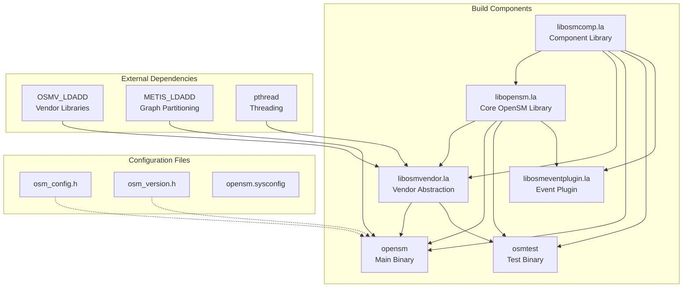
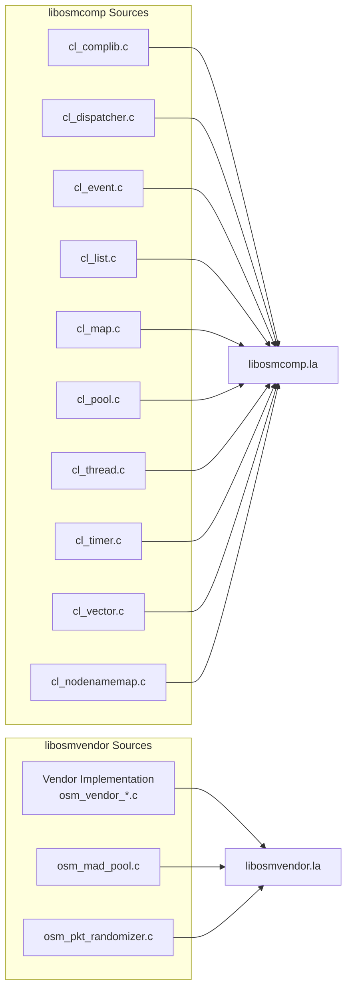
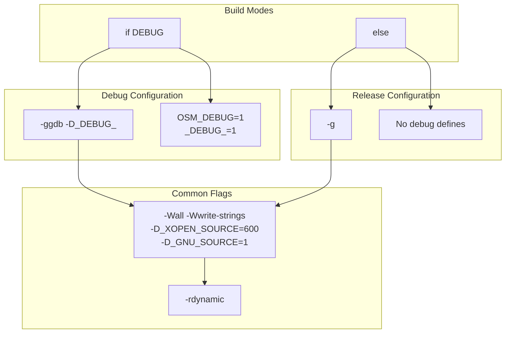

<!-- source: DeepWiki mcp.deepwiki.com · repo linux-rdma/opensm · page 8.1 Build System · fetched 2026-11-11 -->

# Build System

<details>
<summary>Relevant source files</summary>

The following files were used as context for generating this wiki page:

- [complib/Makefile.am](complib/Makefile.am)
- [include/opensm/osm_config.h.in](include/opensm/osm_config.h.in)
- [libvendor/Makefile.am](libvendor/Makefile.am)
- [opensm/Makefile.am](opensm/Makefile.am)
- [osmeventplugin/Makefile.am](osmeventplugin/Makefile.am)
- [osmtest/Makefile.am](osmtest/Makefile.am)
- [scripts/opensm.init.in](scripts/opensm.init.in)
- [scripts/opensm.sysconfig](scripts/opensm.sysconfig)
- [scripts/redhat-opensm.init.in](scripts/redhat-opensm.init.in)
- [scripts/sldd.sh.in](scripts/sldd.sh.in)

</details>


This document details OpenSM's autotools-based build system, including library dependencies, build targets, and configuration management. The build system produces the main `opensm` binary, supporting libraries, test programs, and deployment scripts.

For information about packaging and distribution, see [Packaging and Distribution](#8.2).

## Build System Architecture

OpenSM uses GNU Autotools (autoconf, automake) to manage its build process. The system is organized into multiple components that build libraries and executables with clearly defined dependencies.

### Component Hierarchy



Sources: [opensm/Makefile.am:51](), [complib/Makefile.am:22-30](), [libvendor/Makefile.am:80-82](), [osmeventplugin/Makefile.am:26]()

### Library Dependencies and Linking

The build system defines a clear dependency hierarchy where higher-level components depend on lower-level libraries:

| Component | Dependencies | Purpose |
|-----------|-------------|---------|
| `libosmcomp.la` | None | Base component library with utilities |
| `libopensm.la` | `libosmcomp` | Core OpenSM functionality |
| `libosmvendor.la` | `libosmcomp`, `libopensm`, `OSMV_LDADD` | Hardware abstraction layer |
| `opensm` binary | All above + `METIS_LDADD` | Main subnet manager executable |
| `osmtest` binary | `libosmcomp`, `libopensm`, `libosmvendor` | Testing framework |

Sources: [opensm/Makefile.am:51](), [libvendor/Makefile.am:80](), [osmtest/Makefile.am:17]()

## Build Targets and Source Organization

### OpenSM Main Binary

The `opensm` binary is built from extensive source files covering all major OpenSM functionality:

```mermaid
graph TB
    subgraph "Core Sources"
        MAIN["main.c"]
        OPENSM_C["osm_opensm.c"]
        SUBNET_C["osm_subnet.c"]
        SM_C["osm_sm.c"]
    end
    
    subgraph "Management Components"
        LID_MGR["osm_lid_mgr.c"]
        UCAST_MGR["osm_ucast_mgr.c"]
        MCAST_MGR["osm_mcast_mgr.c"]
        PKEY_MGR["osm_pkey_mgr.c"]
        PERFMGR["osm_perfmgr.c"]
    end
    
    subgraph "Routing Algorithms"
        UPDN["osm_ucast_updn.c"]
        LASH["osm_ucast_lash.c"]
        FTREE["osm_ucast_ftree.c"]
        TORUS["osm_torus.c"]
        DFSSSP["osm_ucast_dfsssp.c"]
    end
    
    subgraph "SA and Communication"
        SA_C["osm_sa.c"]
        SA_RECORDS["osm_sa_*_record.c"]
        MAD_CTRL["osm_sa_mad_ctrl.c"]
        CONSOLE["osm_console.c"]
    end
    
    subgraph "QoS and Configuration"
        QOS_C["osm_qos.c"]
        QOS_PARSER["osm_qos_parser_y.y<br/>osm_qos_parser_l.l"]
        QOS_POLICY["osm_qos_policy.c"]
    end
    
    MAIN --> OPENSM_BIN["opensm binary"]
    OPENSM_C --> OPENSM_BIN
    SUBNET_C --> OPENSM_BIN
    SM_C --> OPENSM_BIN
    LID_MGR --> OPENSM_BIN
    UCAST_MGR --> OPENSM_BIN
    MCAST_MGR --> OPENSM_BIN
    PKEY_MGR --> OPENSM_BIN
    PERFMGR --> OPENSM_BIN
    UPDN --> OPENSM_BIN
    LASH --> OPENSM_BIN
    FTREE --> OPENSM_BIN
    TORUS --> OPENSM_BIN
    DFSSSP --> OPENSM_BIN
    SA_C --> OPENSM_BIN
    SA_RECORDS --> OPENSM_BIN
    MAD_CTRL --> OPENSM_BIN
    CONSOLE --> OPENSM_BIN
    QOS_C --> OPENSM_BIN
    QOS_PARSER --> OPENSM_BIN
    QOS_POLICY --> OPENSM_BIN
```



Sources: [opensm/Makefile.am:14-45]()

The build includes special handling for generated sources through `BUILT_SOURCES` and yacc/lex processing:

- `osm_qos_parser_y.y` - Yacc grammar file for QoS policy parsing
- `osm_qos_parser_l.l` - Lex lexical analyzer for QoS policies  
- `osm_version` - Dynamic version generation target

Sources: [opensm/Makefile.am:108-118](), [opensm/Makefile.am:47]()

### Component Library Structure



Sources: [complib/Makefile.am:22-30](), [libvendor/Makefile.am:29-31](), [libvendor/Makefile.am:45]()

## Build Configuration and Compilation Flags

### Compiler and Debug Configuration

The build system supports debug and release configurations through conditional compilation:



Sources: [opensm/Makefile.am:6-10](), [opensm/Makefile.am:4](), [opensm/Makefile.am:13](), [include/opensm/osm_config.h.in:13-15]()

### Vendor-Specific Build Configuration

The vendor abstraction layer supports multiple InfiniBand hardware interfaces through conditional compilation:

| Vendor Interface | Configuration Flag | Sources Included |
|------------------|-------------------|------------------|
| OpenIB/UMAD | `OSMV_OPENIB` | `osm_vendor_ibumad.c`, `osm_vendor_ibumad_sa.c` |
| Simulation | `OSMV_SIM` | `osm_vendor_mlx_sim.c`, `osm_vendor_mlx_hca_sim.c` |
| Gen1 | `OSMV_GEN1` | `osm_vendor_mlx_hca.c`, `osm_vendor_mlx_ts.c` |
| VAPI | `OSMV_VAPI` | `osm_vendor_mlx_ibmgt.c` |

Sources: [libvendor/Makefile.am:28-78](), [include/opensm/osm_config.h.in:50-61]()

## Installation and Header Distribution

### Header File Installation

The build system installs headers to support external development:

```mermaid
graph TB
    subgraph "Header Installation Paths"
        OPENSM_HEADERS["$(includedir)/infiniband/opensm/"]
        COMPLIB_HEADERS["$(includedir)/infiniband/complib/"]
        VENDOR_HEADERS["$(includedir)/infiniband/vendor/"]
    end
    
    subgraph "OpenSM Headers"
        OSM_BASE_H["osm_base.h"]
        OSM_CONSOLE_H["osm_console.h"]
        OSM_SUBNET_H["osm_subnet.h"]
        OSM_VERSION_H["osm_version.h"]
        OSM_CONFIG_H["osm_config.h"]
    end
    
    subgraph "Component Library Headers"
        CL_ATOMIC_H["cl_atomic.h"]
        CL_LIST_H["cl_list.h"]
        CL_MAP_H["cl_map.h"]
        CL_THREAD_H["cl_thread.h"]
    end
    
    subgraph "Vendor Headers"
        VENDOR_API_H["osm_vendor_api.h"]
        VENDOR_H["osm_vendor.h"]
        VENDOR_SA_H["osm_vendor_sa_api.h"]
    end
    
    OSM_BASE_H --> OPENSM_HEADERS
    OSM_CONSOLE_H --> OPENSM_HEADERS
    OSM_SUBNET_H --> OPENSM_HEADERS
    OSM_VERSION_H --> OPENSM_HEADERS
    OSM_CONFIG_H --> OPENSM_HEADERS
    
    CL_ATOMIC_H --> COMPLIB_HEADERS
    CL_LIST_H --> COMPLIB_HEADERS
    CL_MAP_H --> COMPLIB_HEADERS
    CL_THREAD_H --> COMPLIB_HEADERS
    
    VENDOR_API_H --> VENDOR_HEADERS
    VENDOR_H --> VENDOR_HEADERS
    VENDOR_SA_H --> VENDOR_HEADERS
```



Sources: [opensm/Makefile.am:55-106](), [complib/Makefile.am:38-74](), [libvendor/Makefile.am:24-26]()

### Deployment Scripts and Configuration

The build system generates deployment-ready scripts and configuration files:

| File Type | Template | Generated Output | Purpose |
|-----------|----------|------------------|---------|
| Init Script | `scripts/opensm.init.in` | `opensm.init` | Generic init script |
| RedHat Init | `scripts/redhat-opensm.init.in` | `redhat-opensm.init` | RedHat/CentOS specific |
| SLDD Script | `scripts/sldd.sh.in` | `sldd.sh` | Cache distribution daemon |
| Config Header | `include/opensm/osm_config.h.in` | `osm_config.h` | Build-time configuration |
| Sysconfig | `scripts/opensm.sysconfig` | `opensm.sysconfig` | Runtime configuration |

Sources: [scripts/opensm.init.in:1-10](), [scripts/redhat-opensm.init.in:1-15](), [scripts/sldd.sh.in:1-30](), [include/opensm/osm_config.h.in:1-12](), [scripts/opensm.sysconfig:1-3]()

## Version Management and Dynamic Configuration

The build system includes dynamic version generation that updates version information based on the source repository state:

```bash
if [ -x $(top_srcdir)/gen_ver.sh ] ; then
    ver_file=$(top_builddir)/include/opensm/osm_version.h ;
    osm_ver=`cat $$ver_file | sed -ne '/#define OSM_VERSION /s/^.*\"OpenSM \(.*\)\"$$/\1/p'` ;
    ver=`$(top_srcdir)/gen_ver.sh $(PACKAGE)` ;
    if [ $$ver != $$osm_ver ] ; then
        cat $$ver_file | sed -e '/#define OSM_VERSION /s/\"OpenSM .*\"/\"OpenSM '$$ver'\"/' > tmp_new_version ;
        cat tmp_new_version > $$ver_file && rm -f tmp_new_version ;
    fi ;
fi
```

This mechanism ensures that the version string in `osm_version.h` reflects the current build state, supporting development and release version tracking.

Sources: [opensm/Makefile.am:109-118]()

---

