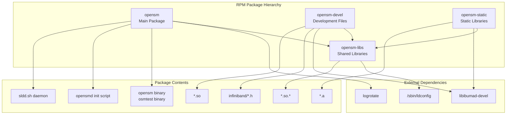
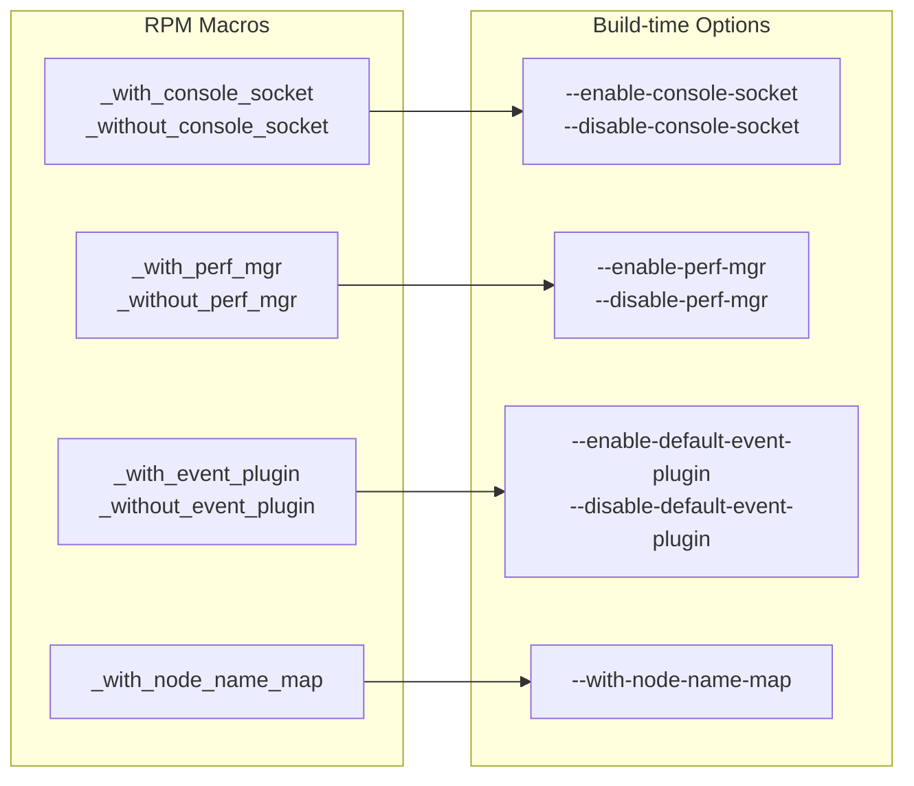
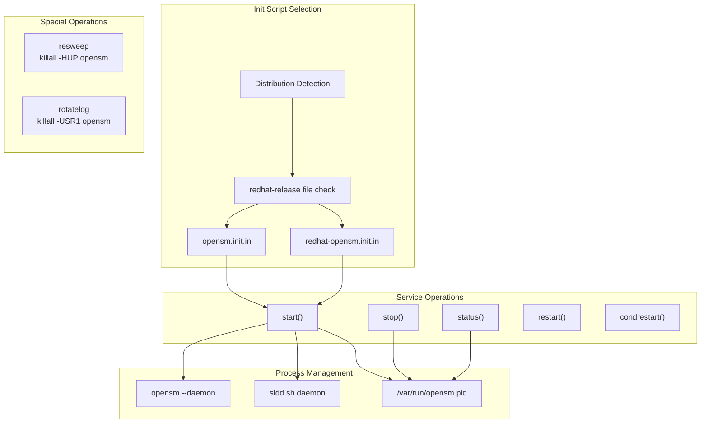
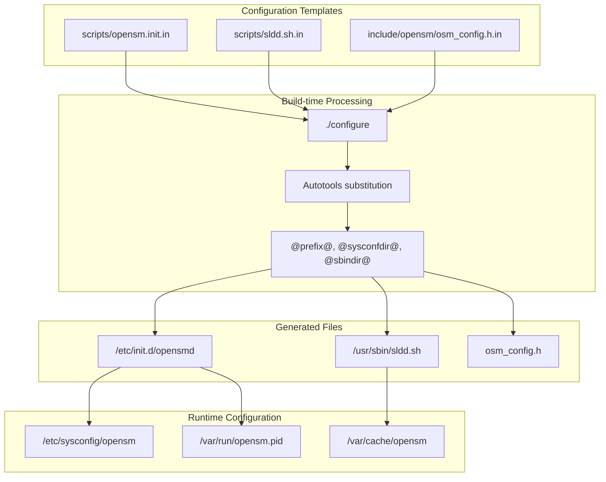
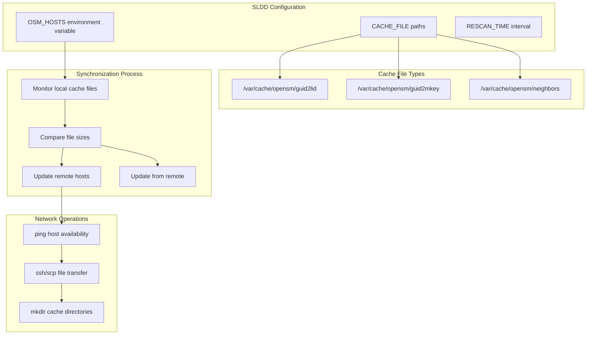
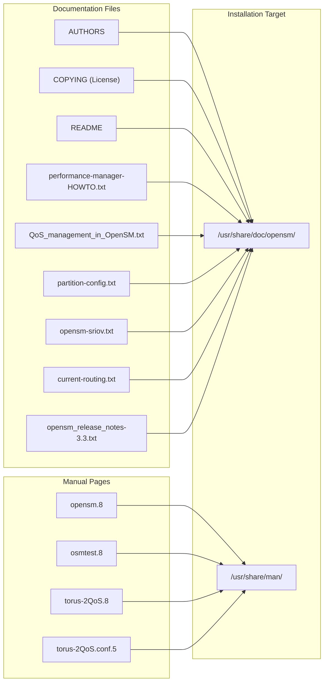
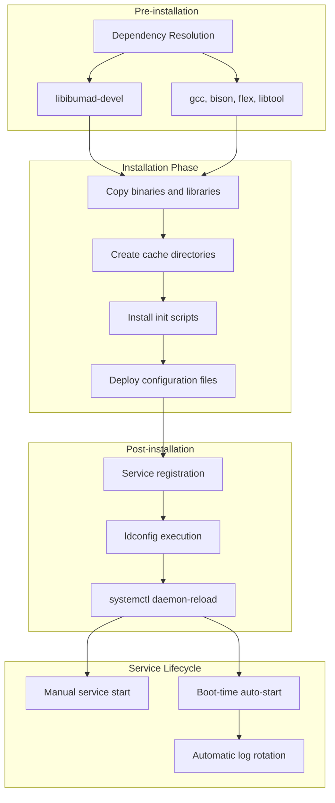

<!-- source: DeepWiki mcp.deepwiki.com · repo linux-rdma/opensm · page 8.2 Packaging and Distribution · fetched 2026-11-11 -->

# Packaging and Distribution

Relevant source files

The following files were used as context for generating this wiki page:

- [Makefile.am](Makefile.am)
- [include/opensm/osm_config.h.in](include/opensm/osm_config.h.in)
- [opensm.spec.in](opensm.spec.in)
- [scripts/opensm.init.in](scripts/opensm.init.in)
- [scripts/opensm.sysconfig](scripts/opensm.sysconfig)
- [scripts/redhat-opensm.init.in](scripts/redhat-opensm.init.in)
- [scripts/sldd.sh.in](scripts/sldd.sh.in)

This document explains how OpenSM is packaged for distribution and deployed as a system service. It covers the RPM packaging system, init scripts, service management, and configuration file deployment. For information about the build system that creates these packages, see [Build System](#8.1).

## RPM Packaging System

OpenSM uses RPM (Red Hat Package Manager) as its primary packaging format, defined through a spec file template that generates multiple sub-packages with specific dependencies and installation rules.

### Package Structure

The OpenSM distribution creates four distinct RPM packages:

| Package | Contents | Dependencies |
|---------|----------|--------------|
| `opensm` | Main daemon and utilities | `opensm-libs`, `logrotate` |
| `opensm-libs` | Shared libraries | System libraries |
| `opensm-devel` | Development headers | `opensm-libs`, `libibumad-devel` |
| `opensm-static` | Static libraries | `opensm-libs`, `libibumad-devel` |

Sources: [opensm.spec.in:28-74]()

### Build Configuration Options

The RPM spec supports conditional compilation features controlled through RPM build macros:

Sources: [opensm.spec.in:3-26]()

## Init Scripts and Service Management

OpenSM provides two init script variants for different Linux distributions, both implementing standard service management operations with distribution-specific adaptations.

### Init Script Architecture

Sources: [scripts/opensm.init.in:76-151](), [scripts/redhat-opensm.init.in:126-177](), [opensm.spec.in:95-103]()

### Service Installation Process

The RPM installation process integrates OpenSM with the system's service management:

```mermaid
graph LR
    subgraph "Installation Flow"
        INSTALL["RPM Install"]
        MKDIR["mkdir /var/cache/opensm"]
        SCRIPT_COPY["Copy init script to /etc/init.d/opensmd"]
        LOGROTATE_COPY["Install logrotate config"]
    end
    
    subgraph "Service Registration"
        CHKCONFIG["chkconfig --add opensmd"]
        UPDATE_RC["update-rc.d opensmd defaults"]
        LSB_INSTALL["/usr/lib/lsb/install_initd"]
        SYSTEMD["systemctl --system daemon-reload"]
    end
    
    subgraph "Post-install Actions"
        CONDRESTART["/etc/init.d/opensmd condrestart"]
    end
    
    INSTALL --> MKDIR
    MKDIR --> SCRIPT_COPY
    SCRIPT_COPY --> LOGROTATE_COPY
    LOGROTATE_COPY --> CHKCONFIG
    CHKCONFIG --> UPDATE_RC
    UPDATE_RC --> LSB_INSTALL
    LSB_INSTALL --> SYSTEMD
    SYSTEMD --> CONDRESTART
```

Sources: [opensm.spec.in:108-122](), [Makefile.am:9-12]()

## Configuration Management

OpenSM's configuration system involves multiple files deployed to standard system locations during package installation.

### Configuration File Deployment

| Configuration Type | Source File | Target Location | Purpose |
|-------------------|-------------|-----------------|---------|
| Init script | `scripts/opensm.init.in` | `/etc/init.d/opensmd` | Service control |
| Log rotation | `scripts/opensm.logrotate` | `/etc/logrotate.d/opensm` | Log management |
| System config | `scripts/opensm.sysconfig` | `/etc/sysconfig/opensm` | Runtime options |
| SLDD daemon | `scripts/sldd.sh.in` | `/usr/sbin/sldd.sh` | Cache synchronization |

Sources: [scripts/opensm.init.in:43-69](), [scripts/sldd.sh.in:42-48](), [include/opensm/osm_config.h.in:1-68]()

### SLDD Cache Synchronization

The SLDD (Subnet Manager LID Distribution Daemon) provides distributed cache synchronization for multi-SM deployments:

Sources: [scripts/sldd.sh.in:52-54](), [scripts/sldd.sh.in:105-141](), [scripts/sldd.sh.in:196-258]()

## Distribution Files

The packaging system includes comprehensive documentation and example configurations distributed with the software:

### Documentation Distribution

Sources: [opensm.spec.in:146](), [Makefile.am:15-21]()

### File Permissions and Ownership

The RPM package establishes appropriate file permissions and ownership for system security:

| File Type | Owner | Permissions | Location Pattern |
|-----------|-------|-------------|------------------|
| Executables | root:root | 755 | `/usr/sbin/*` |
| Libraries | root:root | 755 | `/usr/lib64/*.so.*` |
| Headers | root:root | 644 | `/usr/include/infiniband/*` |
| Config files | root:root | 644 (noreplace) | `/etc/logrotate.d/*` |
| Cache directory | root:root | 755 | `/var/cache/opensm/` |

Sources: [opensm.spec.in:141-164]()

## Installation Process

The complete installation process involves package installation, service registration, and initial configuration setup:

Sources: [opensm.spec.in:37-38](), [opensm.spec.in:89-104](), [opensm.spec.in:108-138]()

---

