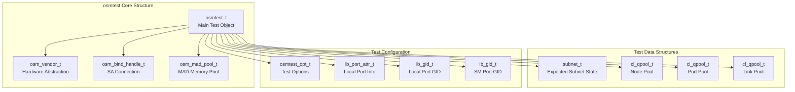
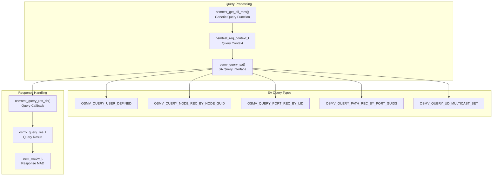
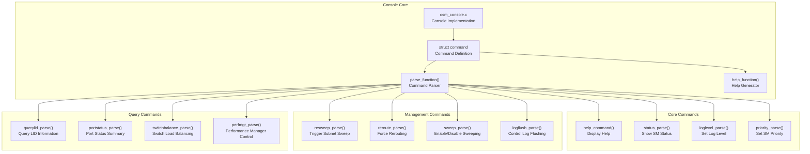
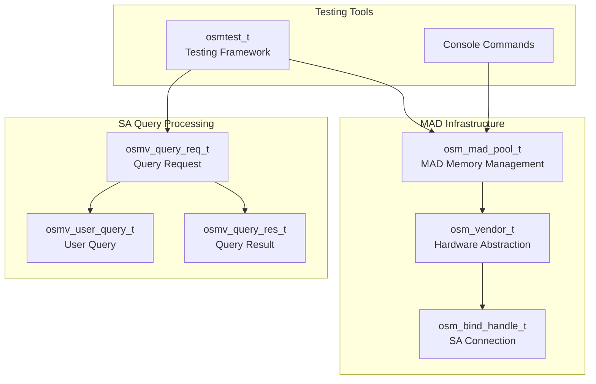

<!-- source: DeepWiki mcp.deepwiki.com · repo linux-rdma/opensm · page 9 Testing and Management Tools · fetched 2026-11-11 -->

# Testing and Management Tools

Relevant source files

The following files were used as context for generating this wiki page:

- [include/iba/ib_types.h](include/iba/ib_types.h)
- [include/opensm/osm_base.h](include/opensm/osm_base.h)
- [include/opensm/osm_helper.h](include/opensm/osm_helper.h)
- [include/vendor/osm_vendor_sa_api.h](include/vendor/osm_vendor_sa_api.h)
- [opensm/osm_console.c](opensm/osm_console.c)
- [opensm/osm_sa_class_port_info.c](opensm/osm_sa_class_port_info.c)
- [osmtest/include/osmtest.h](osmtest/include/osmtest.h)
- [osmtest/main.c](osmtest/main.c)
- [osmtest/osmt_inform.c](osmtest/osmt_inform.c)
- [osmtest/osmt_multicast.c](osmtest/osmt_multicast.c)
- [osmtest/osmt_service.c](osmtest/osmt_service.c)
- [osmtest/osmt_slvl_vl_arb.c](osmtest/osmt_slvl_vl_arb.c)
- [osmtest/osmtest.c](osmtest/osmtest.c)

This page covers the testing frameworks and management interfaces available for OpenSM, including the comprehensive osmtest testing suite and the interactive management console. These tools provide validation, monitoring, and control capabilities for InfiniBand subnet management operations.

For information about OpenSM's core routing and subnet management functionality, see the other architecture pages in this wiki.

## osmtest Testing Framework

The `osmtest` tool is OpenSM's primary testing framework that validates Subnet Manager (SM) and Subnet Administration (SA) functionality through comprehensive test flows. It operates by comparing expected subnet state against real-time SA queries.

### osmtest Architecture

Sources: [osmtest/include/osmtest.h:124-140](), [osmtest/osmtest.c:404-409]()

### Test Flow Types

osmtest supports multiple test flows controlled by the `OSMT_FLOWS` enumeration:

| Flow Type | Description | Command Flag |
|-----------|-------------|--------------|
| `OSMT_FLOW_CREATE_INVENTORY` | Create inventory file with all nodes, ports and paths | `-f c` |
| `OSMT_FLOW_VALIDATE_INVENTORY` | Validate existing inventory file | `-f v` |
| `OSMT_FLOW_SERVICE_REGISTRATION` | Test service registration/deregistration | `-f s` |
| `OSMT_FLOW_EVENT_FORWARDING` | Test event forwarding functionality | `-f e` |
| `OSMT_FLOW_STRESS_SA` | Flood SA with queries for stress testing | `-f f` |
| `OSMT_FLOW_MULTICAST` | Test multicast group operations | `-f m` |
| `OSMT_FLOW_QOS` | Dump VL arbitration and SL-to-VL tables | `-f q` |
| `OSMT_FLOW_TRAP` | Test trap 64/65 forwarding | `-f t` |

Sources: [osmtest/include/osmtest.h:55-65](), [osmtest/main.c:79-92]()

### Query and Response Architecture

Sources: [osmtest/osmtest.c:539-618](), [osmtest/osmtest.c:521-537](), [include/vendor/osm_vendor_sa_api.h:87-112]()

### Specific Test Implementations

#### Multicast Testing
The multicast test flow validates multicast group operations through the `osmt_multicast.c` module:

- **Group Creation/Deletion**: Tests `IB_MAD_METHOD_SET` and `IB_MAD_METHOD_DELETE` for multicast member records
- **Join State Validation**: Verifies different join states (FullMember, SendOnlyMember, etc.)
- **MGID Validation**: Ensures multicast GIDs follow proper formatting rules
- **Membership Management**: Tests adding/removing members from multicast groups

Sources: [osmtest/osmt_multicast.c:275-381](), [osmtest/osmt_multicast.c:409-498]()

#### Service Record Testing
Service registration testing validates SA service record functionality:

- **Service Registration**: Uses `osmt_register_service()` to create service records
- **Service Queries**: Tests retrieval by service name, ID, and other attributes  
- **Lease Management**: Validates service lease timeouts and renewals
- **Service Deletion**: Tests proper cleanup of service records

Sources: [osmtest/osmt_service.c:60-164](), [osmtest/osmt_service.c:166-245]()

#### QoS Information Testing
QoS testing dumps Virtual Lane arbitration and SL-to-VL mapping tables:

- **VL Arbitration Tables**: Retrieves and validates VL arbitration settings per port
- **SL-to-VL Mapping**: Tests service level to virtual lane mappings
- **Port-specific Queries**: Tests QoS settings on individual switch and HCA ports

Sources: [osmtest/osmt_slvl_vl_arb.c:93-185](), [osmtest/osmt_slvl_vl_arb.c:187-245]()

## Management Console

OpenSM provides an interactive console interface through `osm_console.c` for real-time management and monitoring.

### Console Command Architecture

Sources: [opensm/osm_console.c:63-68](), [opensm/osm_console.c:92-101](), [opensm/osm_console.c:315-390]()

### Key Console Commands

| Command | Function | Description |
|---------|----------|-------------|
| `status` | `status_parse()` | Display SM state, SA state, routing engine, and statistics |
| `loglevel` | `loglevel_parse()` | Get/set OpenSM log verbosity level |
| `priority` | `priority_parse()` | Get/set SM priority (0-15) |
| `resweep` | `resweep_parse()` | Trigger heavy or light subnet sweep |
| `reroute` | `reroute_parse()` | Force fabric rerouting |
| `sweep` | `sweep_parse()` | Enable or disable periodic sweeping |
| `querylid` | `querylid_parse()` | Query detailed information about a specific LID |
| `portstatus` | `portstatus_parse()` | Summarize port status across fabric |

Sources: [opensm/osm_console.c:538-555](), [opensm/osm_console.c:558-571](), [opensm/osm_console.c:574-577]()

### Status Information Display

The `print_status()` function provides comprehensive SM operational information:

```mermaid
graph TB
    subgraph "Status Information"
        VERSION["OpenSM Version"]
        SM_STATE["SM State<br/>(Discovering/Standby/NotActive/Master)"]
        SA_STATE["SA State<br/>(Init/Ready)"]
        ROUTING_ENGINE["Active Routing Engine"]
        PLUGINS["Loaded Event Plugins"]
        
        PRINT_STATUS["print_status()"] --> VERSION
        PRINT_STATUS --> SM_STATE
        PRINT_STATUS --> SA_STATE  
        PRINT_STATUS --> ROUTING_ENGINE
        PRINT_STATUS --> PLUGINS
    end
    
    subgraph "MAD Statistics"
        QP0_STATS["QP0 MAD Statistics<br/>Outstanding/Sent/Received"]
        SA_STATS["SA MAD Statistics<br/>Outstanding/Sent/Received"]
        UNKNOWN_STATS["Unknown MAD Counts"]
        
        PRINT_STATUS --> QP0_STATS
        PRINT_STATUS --> SA_STATS
        PRINT_STATUS --> UNKNOWN_STATS
    end
    
    subgraph "Subnet Flags"
        SWEEP_ENABLED["Sweeping Enabled"]
        SWEEP_INTERVAL["Sweep Interval"]
        SUBNET_ERRORS["Subnet Initialization Errors"]
        SWEEP_STATE["Current Sweep State"]
        
        PRINT_STATUS --> SWEEP_ENABLED
        PRINT_STATUS --> SWEEP_INTERVAL
        PRINT_STATUS --> SUBNET_ERRORS
        PRINT_STATUS --> SWEEP_STATE
    end
    
    subgraph "Known SMs"
        SM_LIST["dump_sms()<br/>List All Known SMs"]
        SM_GUID["SM Port GUID"]
        SM_PRIO["SM Priority"]
        SM_ST["SM State"]
        
        PRINT_STATUS --> SM_LIST
        SM_LIST --> SM_GUID
        SM_LIST --> SM_PRIO
        SM_LIST --> SM_ST
    end
```

Sources: [opensm/osm_console.c:444-525](), [opensm/osm_console.c:418-442]()

### Performance Manager Integration

The console integrates with OpenSM's performance manager when available:

- **Counter Management**: Clear, dump, and print performance counters
- **Error Reporting**: Display ports with error conditions
- **Sweep Control**: Control performance monitoring sweep intervals
- **Node Filtering**: Query counters for specific nodes or GUIDs

Sources: [opensm/osm_console.c:237-289]()

## Testing Infrastructure Integration

### MAD Pool and Vendor Interface

Both osmtest and the console rely on OpenSM's MAD infrastructure:

Sources: [osmtest/osmtest.c:511-514](), [include/vendor/osm_vendor_sa_api.h:220-280]()

### Error Handling and Validation

Both tools implement comprehensive error handling for subnet validation:

- **MAD Status Parsing**: Detailed interpretation of SA error responses
- **Timeout Handling**: Configurable transaction timeouts for unreliable networks  
- **Result Validation**: Verification of returned data against expected formats
- **Logging Integration**: Extensive logging at multiple verbosity levels

Sources: [osmtest/osmtest.c:250-377](), [opensm/osm_console.c:315-342]()

---

