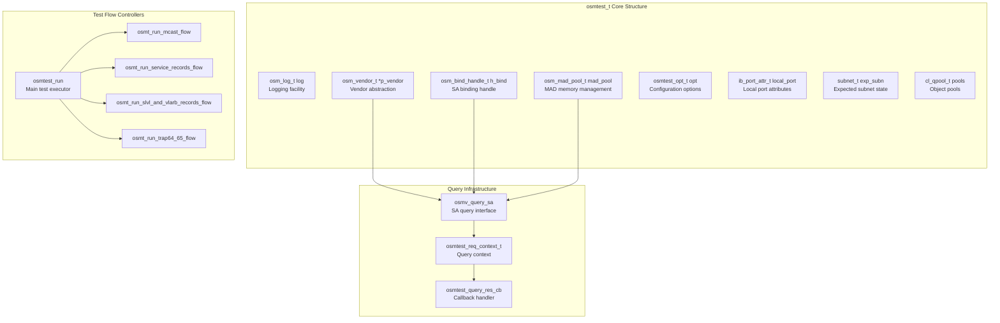
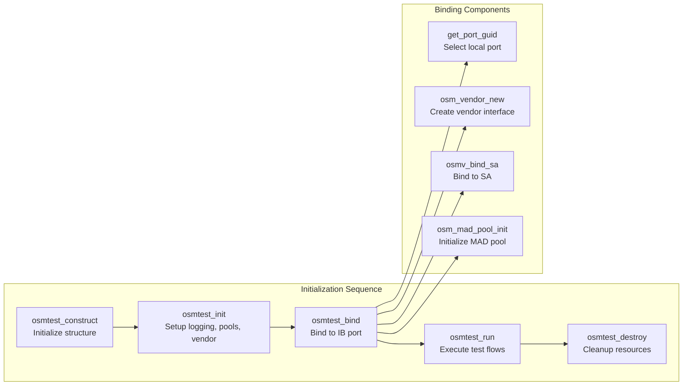
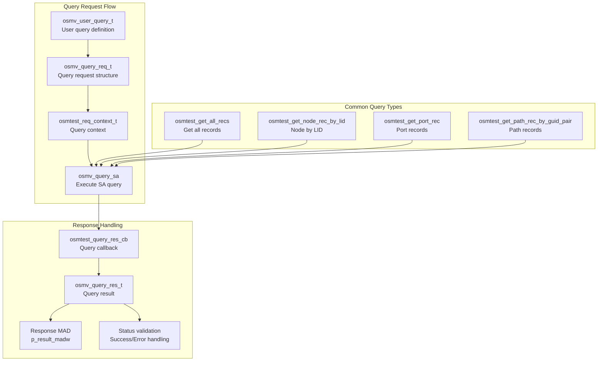
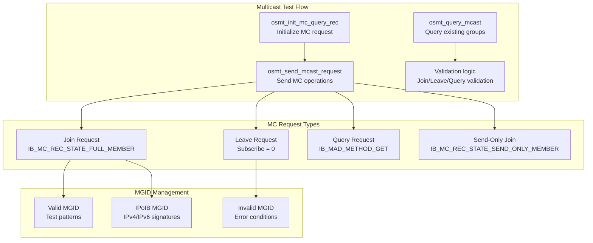
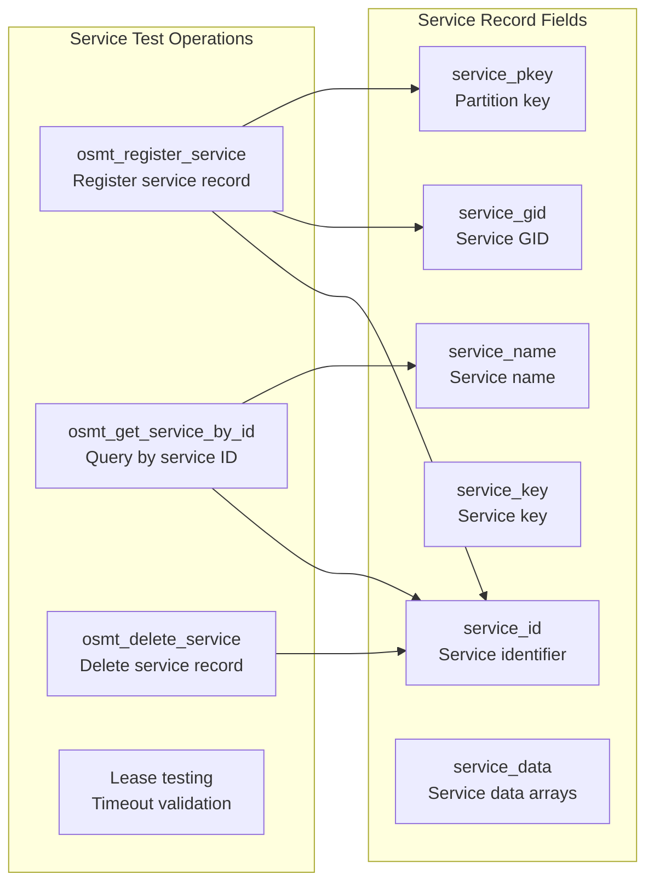
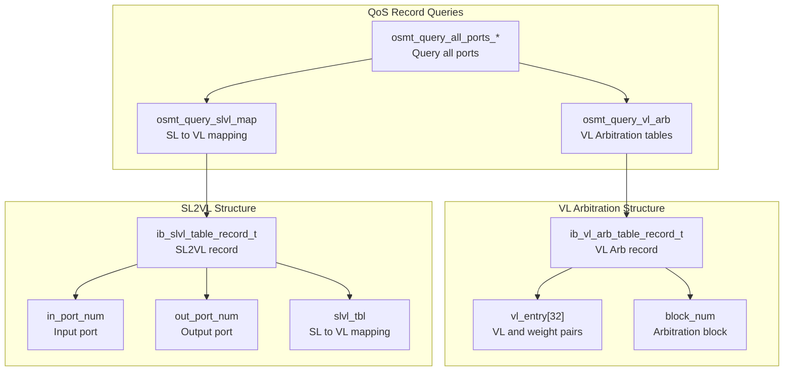
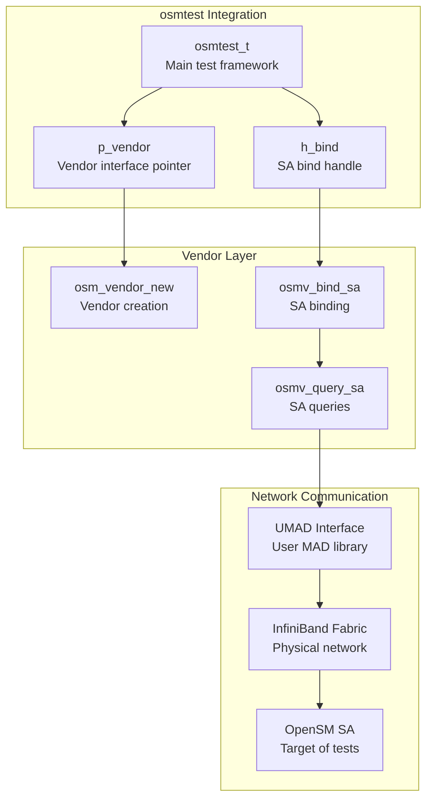

<!-- source: DeepWiki mcp.deepwiki.com · repo linux-rdma/opensm · page 9.1 osmtest Testing Framework · fetched 2026-11-11 -->

# osmtest Testing Framework

<details>
<summary>Relevant source files</summary>

The following files were used as context for generating this wiki page:

- [include/vendor/osm_vendor_sa_api.h](include/vendor/osm_vendor_sa_api.h)
- [osmtest/include/osmtest.h](osmtest/include/osmtest.h)
- [osmtest/main.c](osmtest/main.c)
- [osmtest/osmt_inform.c](osmtest/osmt_inform.c)
- [osmtest/osmt_multicast.c](osmtest/osmt_multicast.c)
- [osmtest/osmt_service.c](osmtest/osmt_service.c)
- [osmtest/osmt_slvl_vl_arb.c](osmtest/osmt_slvl_vl_arb.c)
- [osmtest/osmtest.c](osmtest/osmtest.c)

</details>


The osmtest testing framework is a comprehensive testing tool for validating InfiniBand Subnet Manager (SM) and Subnet Administration (SA) functionality within the OpenSM ecosystem. It provides automated testing capabilities to ensure SM/SA compliance and correct behavior across various InfiniBand network scenarios.

For information about the core SM and SA components being tested, see [Core Architecture](#2) and [Subnet Administration (SA)](#5).

## Overview and Purpose

osmtest serves as the primary validation tool for OpenSM's subnet management capabilities. It operates by creating an expected subnet topology inventory and then validating the real-time information received from the SA during testing operations. The framework supports both standalone testing and stress testing scenarios.

### Test Flow Categories

osmtest implements several distinct test flows, each targeting specific aspects of subnet management:

| Flow Type | Purpose | Key Components |
|-----------|---------|----------------|
| Inventory Creation | Build topology database | Node, port, and path discovery |
| Inventory Validation | Verify SA data accuracy | Record comparison and validation |
| Service Registration | Test service record operations | Registration, query, deletion |
| Event Forwarding | Validate trap/notice mechanisms | InformInfo and trap handling |
| Stress Testing | Load test SA with queries | High-volume query patterns |
| Multicast Testing | Validate MC group operations | Join, leave, and membership |
| QoS Testing | Verify VL arbitration and SL2VL | QoS table validation |
| Trap Testing | Test trap 64/65 flows | External tool coordination |

Sources: [osmtest/main.c:79-92](), [osmtest/include/osmtest.h:55-65]()

## Core Architecture

### Main osmtest Structure



Sources: [osmtest/include/osmtest.h:124-140](), [osmtest/osmtest.c:404-519]()

### Initialization and Binding Flow



Sources: [osmtest/main.c:591-620](), [osmtest/osmtest.c:468-519]()

## Query Infrastructure

### SA Query Processing

The framework implements a sophisticated query system for interacting with the Subnet Administration component:



Sources: [osmtest/osmtest.c:521-607](), [osmtest/osmtest.c:540-607]()

### MAD Status Handling

The framework provides comprehensive MAD status interpretation:

```c
const char *ib_get_mad_status_str(IN const ib_mad_t * const p_mad)
```

This function maps MAD status codes to human-readable error messages, including:
- `IB_MAD_STATUS_BUSY`
- `IB_MAD_STATUS_REDIRECT`
- `IB_SA_MAD_STATUS_NO_RECORDS`
- `IB_SA_MAD_STATUS_INVALID_GID`

Sources: [osmtest/osmtest.c:250-377]()

## Test Flow Implementations

### Multicast Testing Flow

The multicast testing framework validates MC group operations:



Sources: [osmtest/osmt_multicast.c:144-273](), [osmtest/osmt_multicast.c:470-498]()

### Service Registration Testing

Service record testing validates SA service operations:



Sources: [osmtest/osmt_service.c:60-164](), [osmtest/osmt_service.c:448-582]()

### QoS Testing Flow

QoS testing validates VL arbitration and SL2VL mapping tables:



Sources: [osmtest/osmt_slvl_vl_arb.c:94-185](), [osmtest/osmt_slvl_vl_arb.c:300-391]()

## Command Line Interface

### Available Test Flows

osmtest provides a comprehensive command-line interface for selecting test flows:

| Option | Flow | Description |
|--------|------|-------------|
| `-f c` | `OSMT_FLOW_CREATE_INVENTORY` | Create inventory file |
| `-f a` | `OSMT_FLOW_ALL` | All validation tests |
| `-f v` | `OSMT_FLOW_VALIDATE_INVENTORY` | Validate inventory |
| `-f s` | `OSMT_FLOW_SERVICE_REGISTRATION` | Service registration tests |
| `-f e` | `OSMT_FLOW_EVENT_FORWARDING` | Event forwarding tests |
| `-f f` | `OSMT_FLOW_STRESS_SA` | SA stress testing |
| `-f m` | `OSMT_FLOW_MULTICAST` | Multicast tests |
| `-f q` | `OSMT_FLOW_QOS` | QoS table validation |
| `-f t` | `OSMT_FLOW_TRAP` | Trap 64/65 testing |

### Configuration Options

Key configuration parameters include:

```c
typedef struct _osmtest_opt {
    uint32_t transaction_timeout;    // Query timeout
    uint32_t retry_count;           // Query retry count  
    uint32_t stress;                // Stress test mode
    uint32_t mmode;                 // Multicast test mode
    boolean_t with_grh;             // Use GRH in queries
    boolean_t ignore_path_records;  // Skip path record tests
    char file_name[OSMTEST_FILE_PATH_MAX]; // Inventory file
    uint8_t flow;                   // Selected test flow
} osmtest_opt_t;
```

Sources: [osmtest/main.c:342-408](), [osmtest/include/osmtest.h:77-91]()

## Integration with OpenSM

osmtest integrates with the broader OpenSM ecosystem through several key interfaces:

### Vendor Abstraction Layer

osmtest uses the vendor abstraction layer to communicate with InfiniBand hardware:



Sources: [osmtest/osmtest.c:500-519](), [osmtest/main.c:591-620]()

### Subnet Data Structures

osmtest maintains expected subnet state using the same data structures as OpenSM:

- `subnet_t exp_subn` - Expected subnet topology
- `cl_qmap_t` collections for nodes, ports, paths, and multicast groups
- `cl_qpool_t` object pools for efficient memory management

Sources: [osmtest/osmtest.c:379-402](), [osmtest/include/osmtest.h:134-137]()

---

