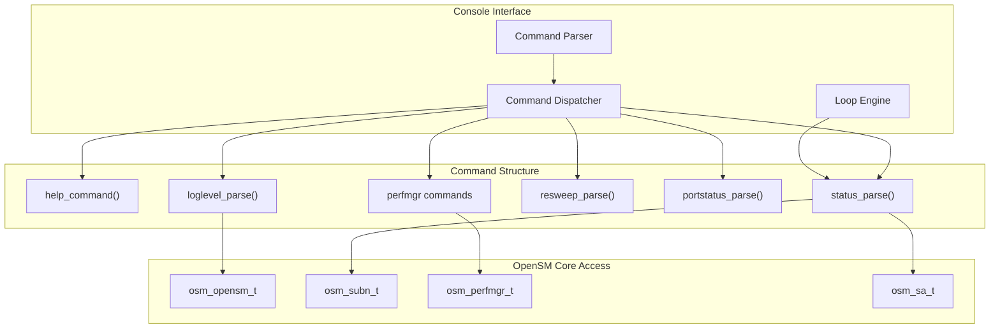
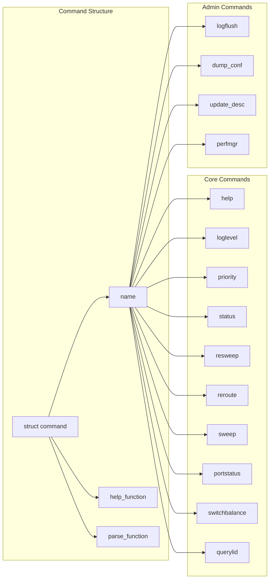
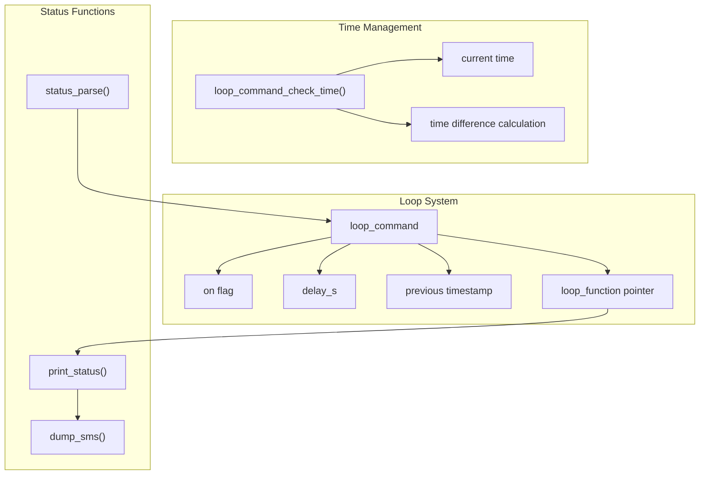
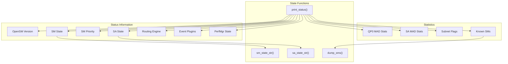
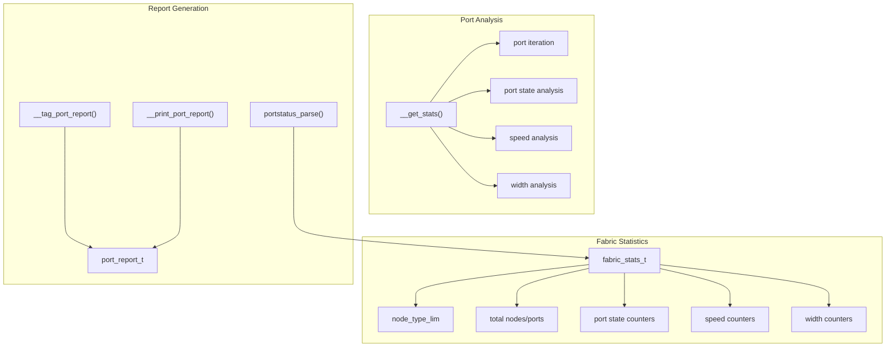
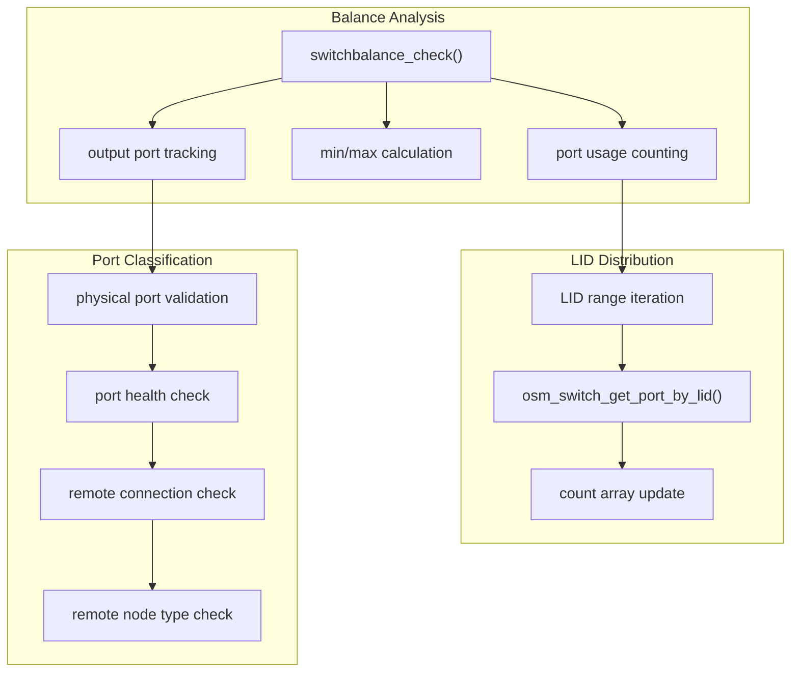
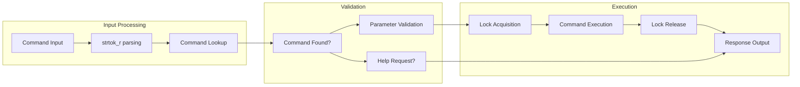

<!-- source: DeepWiki mcp.deepwiki.com · repo linux-rdma/opensm · page 9.2 Management Console · fetched 2026-11-11 -->

# Management Console

Relevant source files

The following files were used as context for generating this wiki page:

- [include/iba/ib_types.h](include/iba/ib_types.h)
- [include/opensm/osm_base.h](include/opensm/osm_base.h)
- [include/opensm/osm_helper.h](include/opensm/osm_helper.h)
- [opensm/osm_console.c](opensm/osm_console.c)
- [opensm/osm_sa_class_port_info.c](opensm/osm_sa_class_port_info.c)

The OpenSM Management Console provides an interactive command-line interface for real-time monitoring, configuration, and control of the OpenSM subnet manager. This console enables administrators to query subnet status, modify configuration parameters, trigger operations, and analyze fabric performance without restarting the OpenSM service.

## Console Architecture

The management console is implemented as a command-driven interface that can operate in both local and remote modes. The console supports socket-based connections for remote administration and direct console access for local management.

Sources: [opensm/osm_console.c:63-78](), [opensm/osm_console.c:293-314]()

## Command System

The console implements a structured command system where each command has associated help and parsing functions. Commands are organized in a `console_cmds` array with function pointers for help display and command execution.

Sources: [opensm/osm_console.c:63-68](), [opensm/osm_console.c:78]()

### Command Categories

| Category | Commands | Purpose |
|----------|----------|---------|
| **System Control** | `loglevel`, `priority`, `sweep`, `logflush` | Control logging, SM priority, and sweep behavior |
| **Operations** | `resweep`, `reroute`, `update_desc` | Trigger fabric operations |
| **Status/Monitoring** | `status`, `portstatus`, `querylid` | Display system and fabric status |
| **Analysis** | `switchbalance`, `lidbalance` | Analyze fabric load balancing |
| **Performance** | `perfmgr`, `pm` | Performance manager operations |
| **Configuration** | `dump_conf` | Display current configuration |

Sources: [opensm/osm_console.c:92-289]()

## Interactive Features

### Loop Command System

The console supports continuous monitoring through a loop command system that can repeatedly execute status commands at specified intervals.

Sources: [opensm/osm_console.c:70-76](), [opensm/osm_console.c:528-536](), [opensm/osm_console.c:538-556]()

### Token Parsing

Commands are parsed using a token-based system that extracts arguments from the input command line:

- `next_token()` - extracts space/tab delimited tokens
- `name_token()` - extracts tokens delimited by tabs/newlines only (for performance manager)

Sources: [opensm/osm_console.c:80-90]()

## Status and Monitoring

### System Status Display

The `status` command provides comprehensive system information including SM state, SA state, routing engine, loaded plugins, performance manager status, and MAD statistics.

Sources: [opensm/osm_console.c:444-526](), [opensm/osm_console.c:392-416](), [opensm/osm_console.c:418-442]()

### Port Status Analysis

The console provides detailed fabric port analysis through the `portstatus` command, which scans all nodes and generates comprehensive statistics about port states, speeds, and widths.

Sources: [opensm/osm_console.c:707-741](), [opensm/osm_console.c:745-929](), [opensm/osm_console.c:931-1043]()

## Performance Analysis Tools

### Switch Balance Analysis

The console includes sophisticated tools for analyzing switch load balancing through the `switchbalance` command, which examines LID distribution across switch ports.

Sources: [opensm/osm_console.c:1045-1139](), [opensm/osm_console.c:1141-1186]()

### LID Balance Analysis

The `lidbalance` command provides detailed analysis of LID distribution from the perspective of individual CA ports, showing how traffic is balanced across different paths.

Sources: [opensm/osm_console.c:1188-1340]()

## Performance Manager Integration

The console integrates with the OpenSM Performance Manager through dedicated commands that allow real-time performance monitoring and counter management.

### Performance Manager Commands

| Command | Function | Purpose |
|---------|----------|---------|
| `perfmgr enable/disable` | State control | Enable/disable performance monitoring |
| `perfmgr sweep` | Initiate sweep | Trigger performance counter collection |
| `perfmgr clear_counters` | Counter reset | Clear stored performance counters |
| `perfmgr print_counters` | Display counters | Show current counter values |
| `perfmgr print_errors` | Error analysis | Display ports with error conditions |
| `perfmgr dump_redir` | Redirection info | Show redirection table |

Sources: [opensm/osm_console.c:237-289]()

## Command Processing Pipeline

The console processes commands through a structured pipeline that handles parsing, validation, and execution:

Sources: [opensm/osm_console.c:293-314](), [opensm/osm_console.c:316-343]()

The management console provides a powerful interface for OpenSM administration, offering real-time monitoring, configuration management, and performance analysis capabilities essential for InfiniBand fabric management.