# Page: OpenSM Overview

# OpenSM Overview

<details>
<summary>Relevant source files</summary>

The following files were used as context for generating this wiki page:

- [include/iba/ib_types.h](include/iba/ib_types.h)
- [include/opensm/osm_base.h](include/opensm/osm_base.h)
- [include/opensm/osm_helper.h](include/opensm/osm_helper.h)
- [include/opensm/osm_opensm.h](include/opensm/osm_opensm.h)
- [include/opensm/osm_subnet.h](include/opensm/osm_subnet.h)
- [man/opensm.8.in](man/opensm.8.in)
- [opensm/main.c](opensm/main.c)
- [opensm/osm_console.c](opensm/osm_console.c)
- [opensm/osm_opensm.c](opensm/osm_opensm.c)
- [opensm/osm_sa_class_port_info.c](opensm/osm_sa_class_port_info.c)
- [opensm/osm_state_mgr.c](opensm/osm_state_mgr.c)
- [opensm/osm_subnet.c](opensm/osm_subnet.c)

</details>


## Purpose and Scope

OpenSM is an InfiniBand compliant Subnet Manager (SM) and Subnet Administration (SA) implementation that runs on top of OpenIB. This document provides an architectural overview of the OpenSM codebase, including its core components, data structures, and system interactions.

OpenSM serves as the central control entity for InfiniBand fabrics, responsible for subnet initialization, topology discovery, routing configuration, and ongoing fabric management. At least one SM instance must be running per InfiniBand subnet to initialize and manage the hardware.

For detailed information about specific subsystems, see:
- Core architecture and initialization: [Core Architecture](#2)
- Network discovery and topology management: [Network Discovery and Topology](#3) 
- Routing algorithms and forwarding tables: [Routing Management](#4)
- Client query handling: [Subnet Administration (SA)](#5)
- Configuration and deployment: [Configuration and Deployment](#8)

## OpenSM System Architecture

OpenSM follows a modular architecture centered around the main `osm_opensm_t` controller object, which coordinates specialized management components and routing engines.

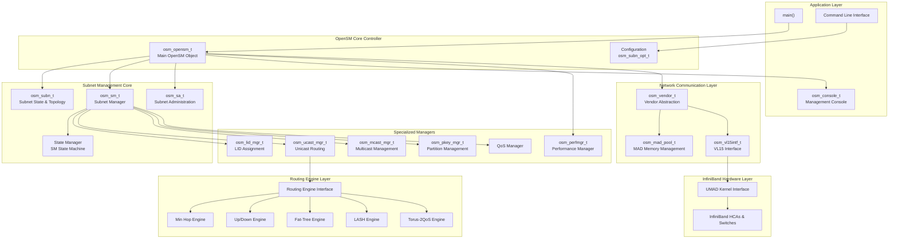

Sources: [opensm/main.c:1-700](), [include/opensm/osm_opensm.h:246-280](), [opensm/osm_opensm.c:1-300]()

## Core Data Structures and State Management

The `osm_subn_t` structure serves as the central repository for all subnet state information, containing topology maps, configuration options, and runtime data.

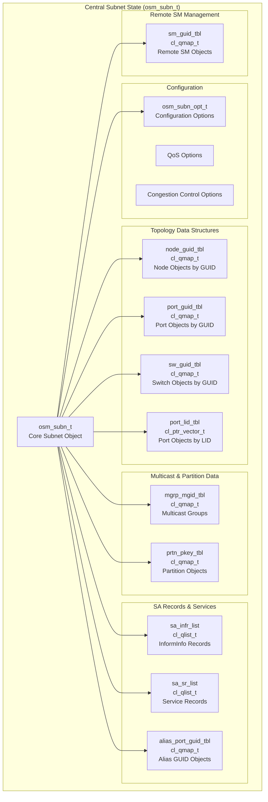

Sources: [include/opensm/osm_subnet.h:1100-1400](), [opensm/osm_subnet.c:1-500]()

## Initialization and Runtime Flow

OpenSM follows a structured initialization and operational flow, transitioning through well-defined SM states during subnet discovery and configuration.

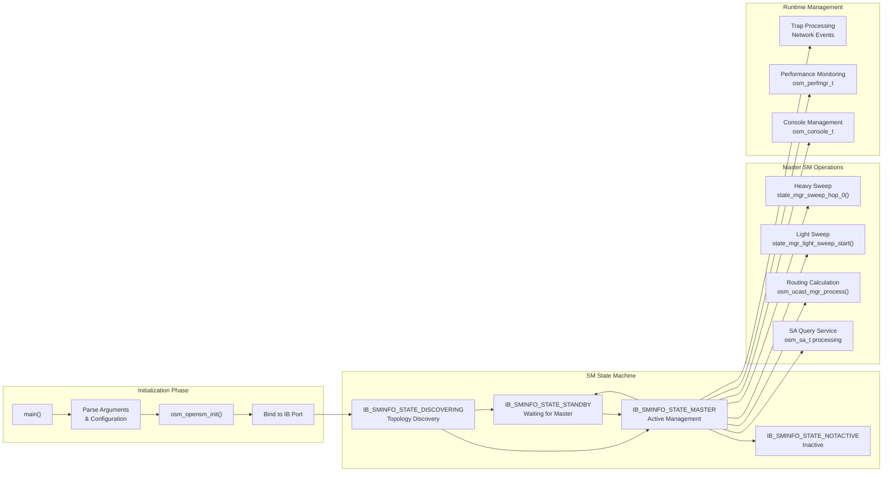

Sources: [opensm/main.c:600-1000](), [opensm/osm_state_mgr.c:82-300](), [opensm/osm_opensm.c:400-800]()

## InfiniBand Communication Stack

OpenSM communicates with the InfiniBand fabric through a layered communication stack that abstracts hardware-specific details while providing MAD (Management Datagram) processing capabilities.

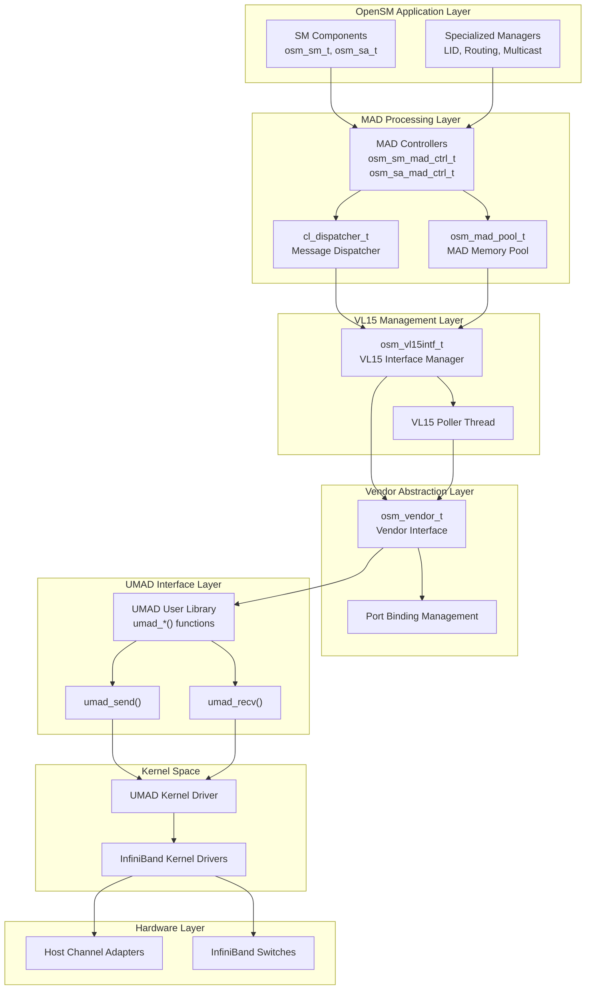

Sources: [include/opensm/osm_opensm.h:300-350](), [opensm/osm_vl15intf.c:1-200](), [vendor/osm_vendor_ibumad.c:1-300]()

## Routing Engine Architecture

OpenSM supports multiple routing algorithms through a pluggable routing engine interface, allowing selection of different routing strategies based on fabric topology and requirements.

```mermaid
graph TB
    subgraph "Routing Engine Interface"
        RE_IF["osm_routing_engine_t<br/>Common Interface"]
        RE_SETUP["setup() callback"]
        RE_BUILD["ucast_build_fwd_tables()"]
        RE_MATRICES["build_lid_matrices()"]
        RE_DESTROY["destroy() callback"]
    end
    
    subgraph "Built-in Routing Engines"
        MINHOP_RE["Min Hop Routing<br/>osm_ucast_minhop_setup()"]
        UPDN_RE["Up/Down Routing<br/>osm_ucast_updn_setup()"]
        FTREE_RE["Fat-Tree Routing<br/>osm_ucast_ftree_setup()"]
        LASH_RE["LASH Routing<br/>osm_ucast_lash_setup()"]
        TORUS_RE["Torus-2QoS Routing<br/>osm_ucast_torus2QoS_setup()"]
        FILE_RE["File-based Routing<br/>osm_ucast_file_setup()"]
        NUE_RE["Nue Routing<br/>osm_ucast_nue_setup()"]
        SSSP_RE["SSSP Routing<br/>osm_ucast_sssp_setup()"]
    end
    
    subgraph "External Routing Support"
        EXT_IF["external_routing_engine_module_t"]
        EXT_REG["osm_register_external_routing_engine()"]
    end
    
    subgraph "Routing Manager"
        UCAST_MGR["osm_ucast_mgr_t<br/>Unicast Manager"]
        ROUTE_CALC["Route Calculation Logic"]
        LFT_BUILD["Linear Forwarding Table Build"]
    end
    
    RE_IF --> RE_SETUP
    RE_IF --> RE_BUILD
    RE_IF --> RE_MATRICES
    RE_IF --> RE_DESTROY
    
    RE_IF --> MINHOP_RE
    RE_IF --> UPDN_RE
    RE_IF --> FTREE_RE
    RE_IF --> LASH_RE
    RE_IF --> TORUS_RE
    RE_IF --> FILE_RE
    RE_IF --> NUE_RE
    RE_IF --> SSSP_RE
    
    EXT_IF --> EXT_REG
    EXT_REG --> RE_IF
    
    UCAST_MGR --> ROUTE_CALC
    ROUTE_CALC --> RE_IF
    ROUTE_CALC --> LFT_BUILD
```

Sources: [include/opensm/osm_opensm.h:120-180](), [opensm/osm_opensm.c:72-200](), [opensm/osm_ucast_mgr.c:1-500]()

## Management and Configuration Interface

OpenSM provides multiple interfaces for configuration and runtime management, including configuration files, command-line options, and an interactive console.

| Interface Type | Component | Configuration Scope | Runtime Control |
|---|---|---|---|
| Command Line | `main.c` argument parsing | Initial configuration | Limited |
| Configuration File | `osm_subn_opt_t` loading | Complete configuration | Config reload |
| Interactive Console | `osm_console_t` | Runtime parameters | Full management |
| Performance Manager | `osm_perfmgr_t` | Performance monitoring | Statistics & control |
| Event Plugins | `osm_event_plugin_t` | Event handling | Custom extensions |

**Key Configuration Components:**

- **`osm_subn_opt_t`**: Central configuration structure containing all tunable parameters
- **`osm_console_t`**: Interactive management console with telnet/local access
- **`osm_perfmgr_t`**: Performance monitoring and statistics collection
- **Event Plugin Interface**: Extensibility for custom management logic

Sources: [opensm/main.c:129-600](), [include/opensm/osm_subnet.h:248-392](), [opensm/osm_console.c:60-150](), [opensm/osm_perfmgr.c:1-200]()

---

# Page: Core Architecture

# Core Architecture

<details>
<summary>Relevant source files</summary>

The following files were used as context for generating this wiki page:

- [include/opensm/osm_opensm.h](include/opensm/osm_opensm.h)
- [include/opensm/osm_subnet.h](include/opensm/osm_subnet.h)
- [man/opensm.8.in](man/opensm.8.in)
- [opensm/main.c](opensm/main.c)
- [opensm/osm_opensm.c](opensm/osm_opensm.c)
- [opensm/osm_state_mgr.c](opensm/osm_state_mgr.c)
- [opensm/osm_subnet.c](opensm/osm_subnet.c)

</details>


This document describes the fundamental architecture of OpenSM, focusing on the main system components, their relationships, and the initialization flow. It covers the central data structures, the main controller object, and how the various subsystems integrate together.

For information about specific subnet management functions, see [State Management](#2.2). For details about network discovery processes, see [Network Discovery and Topology](#3). For routing-specific architecture, see [Routing Management](#4).

## Overview

OpenSM's core architecture is built around a central controller object (`osm_opensm_t`) that coordinates multiple specialized subsystems. The architecture follows a layered approach with clear separation between the main controller, subnet state management, specialized managers, and the underlying network communication layer.

## Main Controller Architecture

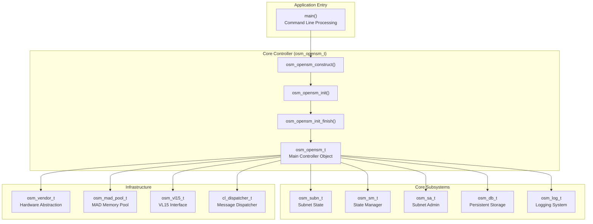

**OpenSM Main Controller Structure**

The `osm_opensm_t` structure serves as the central coordination point for all OpenSM functionality. It contains all major subsystems and provides the top-level interface for system operations.

Sources: [include/opensm/osm_opensm.h:246-274](), [opensm/osm_opensm.c:566-574](), [opensm/main.c:1-50]()

## Central Data Structures

```mermaid
graph TB
    subgraph "osm_opensm_t - Main Controller"
        OSM_VERSION["const char *osm_version"]
        SUBN_OBJ["osm_subn_t subn"]
        SM_OBJ["osm_sm_t sm"]
        SA_OBJ["osm_sa_t sa"]
        DB_OBJ["osm_db_t db"]
        VENDOR_PTR["osm_vendor_t *p_vendor"]
        LOG_OBJ["osm_log_t log"]
        LOCK["cl_plock_t lock"]
        ROUTING["routing_engine_list"]
    end
    
    subgraph "osm_subn_t - Subnet State"
        OSM_PTR["struct osm_opensm *p_osm"]
        SW_TBL["cl_qmap_t sw_guid_tbl"]
        NODE_TBL["cl_qmap_t node_guid_tbl"]
        PORT_TBL["cl_qmap_t port_guid_tbl"]
        ALIAS_TBL["cl_qmap_t alias_port_guid_tbl"]
        PRTN_TBL["cl_qmap_t prtn_pkey_tbl"]
        SM_TBL["cl_qmap_t sm_guid_tbl"]
        PORT_LID_TBL["cl_ptr_vector_t port_lid_tbl"]
        OPTIONS["osm_subn_opt_t opt"]
    end
    
    subgraph "osm_subn_opt_t - Configuration"
        GUID["ib_net64_t guid"]
        SUBNET_PREFIX["ib_net64_t subnet_prefix"]
        SM_KEY["ib_net64_t sm_key"]
        SWEEP_INTERVAL["uint32_t sweep_interval"]
        ROUTING_ENGINE["char *routing_engine_names"]
        LOG_FILE["char *log_file"]
        PRIORITY["uint8_t sm_priority"]
        LMC["uint8_t lmc"]
    end
    
    SUBN_OBJ --> SW_TBL
    SUBN_OBJ --> NODE_TBL
    SUBN_OBJ --> PORT_TBL
    SUBN_OBJ --> OPTIONS
    OPTIONS --> GUID
    OPTIONS --> ROUTING_ENGINE
    OSM_PTR --> OSM_VERSION
```

**Core Data Structure Relationships**

The architecture centers around three main data structures that hold the complete system state and configuration.

Sources: [include/opensm/osm_opensm.h:246-274](), [include/opensm/osm_subnet.h:777-814](), [include/opensm/osm_subnet.h:248-392]()

## Initialization Flow

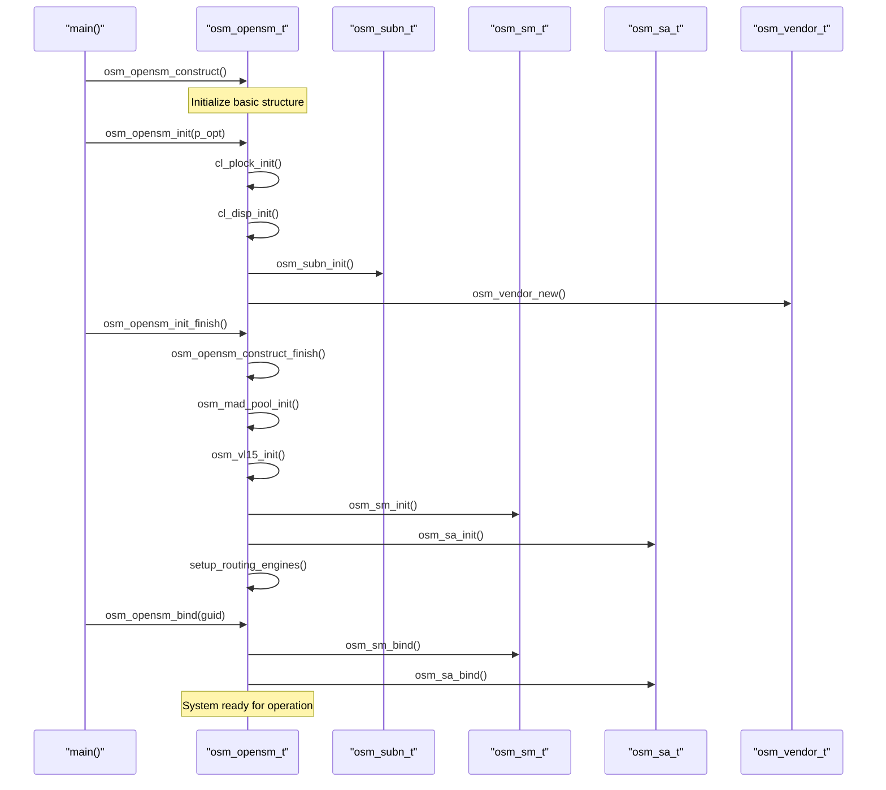

**OpenSM Initialization Sequence**

The initialization process follows a carefully orchestrated sequence to ensure all dependencies are satisfied before the system becomes operational.

Sources: [opensm/main.c:441-486](), [opensm/osm_opensm.c:724-806](), [opensm/osm_opensm.c:808-870]()

## State Management Architecture

The state management system coordinates subnet discovery, configuration, and monitoring through a centralized state machine and specialized managers.

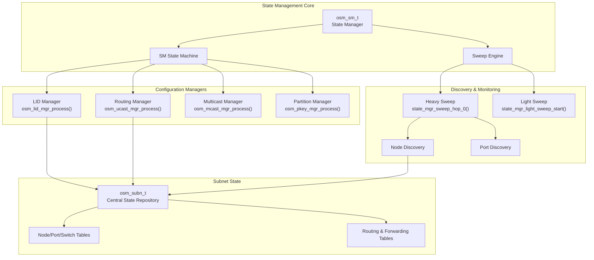

**State Management System Architecture**

The state management system orchestrates all subnet management activities through a coordinated set of specialized managers that operate on the central subnet state.

Sources: [opensm/osm_state_mgr.c:82-95](), [opensm/osm_state_mgr.c:210-270](), [opensm/osm_state_mgr.c:790-862]()

## Message Processing Architecture

OpenSM uses a sophisticated message processing system to handle InfiniBand Management Datagrams (MADs) and coordinate responses across multiple subsystems.

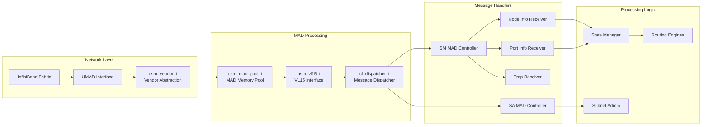

**Message Processing Flow**

The message processing architecture provides a scalable framework for handling high-volume MAD traffic while maintaining proper sequencing and state consistency.

Sources: [opensm/osm_opensm.c:817-827](), [include/opensm/osm_opensm.h:258-266](), [opensm/osm_state_mgr.c:162-204]()

## Configuration System

The configuration system manages both runtime options and persistent state across OpenSM restarts.

| Component | Purpose | Key Data Structures |
|-----------|---------|-------------------|
| **Command Line Parsing** | Process startup arguments | `main()` argument processing |
| **Configuration Options** | Store runtime settings | `osm_subn_opt_t` |
| **Persistent Database** | Store state across restarts | `osm_db_t`, guid2lid, neighbors |
| **Option Validation** | Validate and apply settings | Option parsing functions |

**Configuration Management Components**

The configuration system ensures consistent settings across restarts and provides validation for all user-configurable parameters.

Sources: [opensm/main.c:129-439](), [include/opensm/osm_subnet.h:248-392](), [opensm/osm_subnet.c:762-928]()

## Threading and Concurrency Model

OpenSM employs a sophisticated threading model to handle concurrent operations while maintaining data consistency.

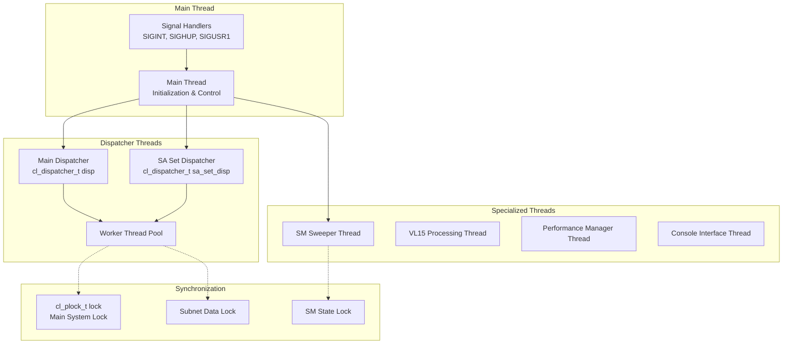

**OpenSM Threading Architecture**

The threading model provides scalable processing while maintaining strict consistency through carefully designed locking strategies.

Sources: [opensm/main.c:96-127](), [opensm/osm_opensm.c:764-787](), [include/opensm/osm_opensm.h:266]()

This core architecture provides the foundation for all OpenSM operations, ensuring reliable subnet management through well-defined component boundaries and clear data flow patterns.

---

# Page: Central Data Structures

# Central Data Structures

<details>
<summary>Relevant source files</summary>

The following files were used as context for generating this wiki page:

- [include/iba/ib_types.h](include/iba/ib_types.h)
- [include/opensm/osm_base.h](include/opensm/osm_base.h)
- [include/opensm/osm_helper.h](include/opensm/osm_helper.h)
- [include/opensm/osm_subnet.h](include/opensm/osm_subnet.h)
- [opensm/osm_console.c](opensm/osm_console.c)
- [opensm/osm_sa_class_port_info.c](opensm/osm_sa_class_port_info.c)
- [opensm/osm_state_mgr.c](opensm/osm_state_mgr.c)
- [opensm/osm_subnet.c](opensm/osm_subnet.c)

</details>


This document describes the central data structures that represent the InfiniBand subnet state within OpenSM. These structures form the core repository of topology information, configuration settings, and runtime state that drives subnet management decisions. For information about how these structures are populated during subnet discovery, see [Network Discovery and Topology](#3). For details on how routing algorithms use these structures, see [Routing Management](#4).

## Central Subnet Repository

The `osm_subn_t` structure serves as the primary data repository for all subnet information in OpenSM. This structure acts as the central hub containing hash tables for all network objects and their relationships.

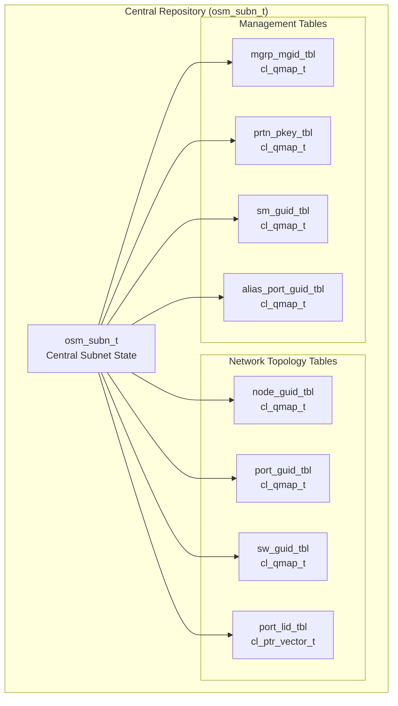

The `osm_subn_t` structure contains multiple hash tables implemented using the CompLib `cl_qmap_t` data structure, which provides O(log n) lookup performance. Each table is keyed by a specific identifier type (GUID, LID, etc.) and stores pointers to the corresponding network objects.

Sources: [include/opensm/osm_subnet.h:700-1000](), [opensm/osm_subnet.c:1-100]()

## Network Topology Maps

The core topology information is stored in four primary hash tables within `osm_subn_t`:

| Table Name | Key Type | Value Type | Purpose |
|------------|----------|------------|---------|
| `node_guid_tbl` | `ib_net64_t` (Node GUID) | `osm_node_t*` | All nodes in fabric |
| `port_guid_tbl` | `ib_net64_t` (Port GUID) | `osm_port_t*` | All ports in fabric |
| `sw_guid_tbl` | `ib_net64_t` (Switch GUID) | `osm_switch_t*` | Switch-specific data |
| `port_lid_tbl` | `uint16_t` (LID) | `osm_port_t*` | LID to port mapping |

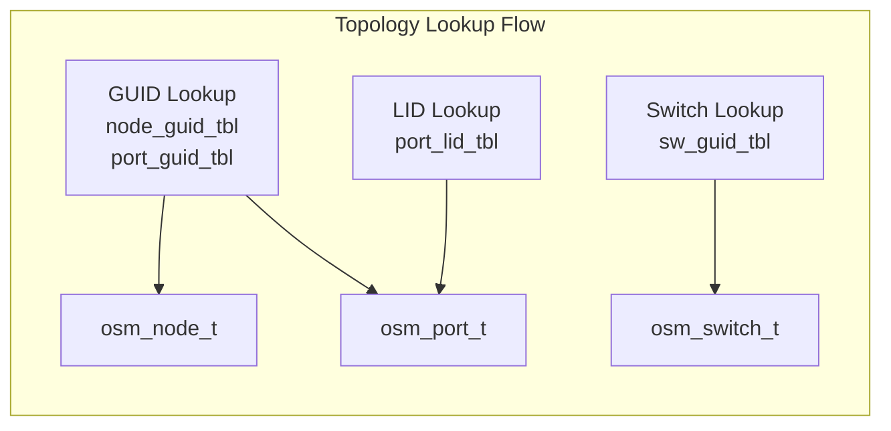

The `port_lid_tbl` uses a `cl_ptr_vector_t` instead of a `cl_qmap_t` because LID values are sequential integers, allowing for direct array indexing for O(1) lookup performance.

Sources: [include/opensm/osm_subnet.h:700-800](), [opensm/osm_subnet.c:275-300]()

## Management Data Structures

OpenSM maintains several additional hash tables for management functions:

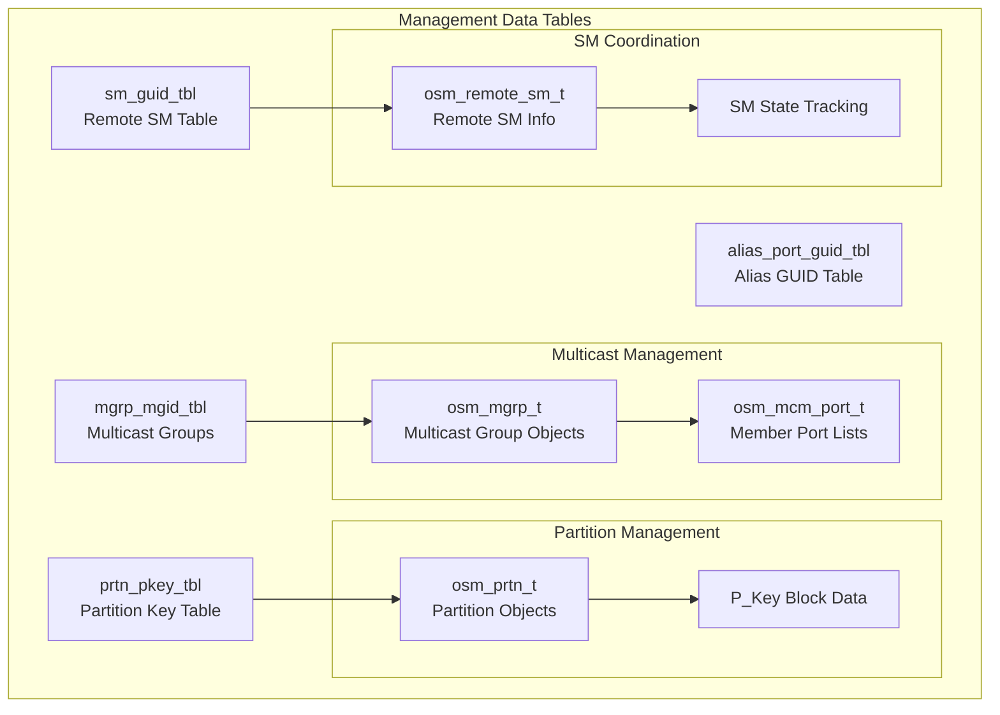

The `alias_port_guid_tbl` handles alias GUID assignments for ports that support multiple GUIDs, which is common in modern InfiniBand HCAs that expose multiple virtual ports per physical port.

Sources: [include/opensm/osm_subnet.h:800-900](), [opensm/osm_state_mgr.c:350-400]()

## Configuration Structure

The `osm_subn_opt_t` structure contains all configuration parameters for OpenSM operation:

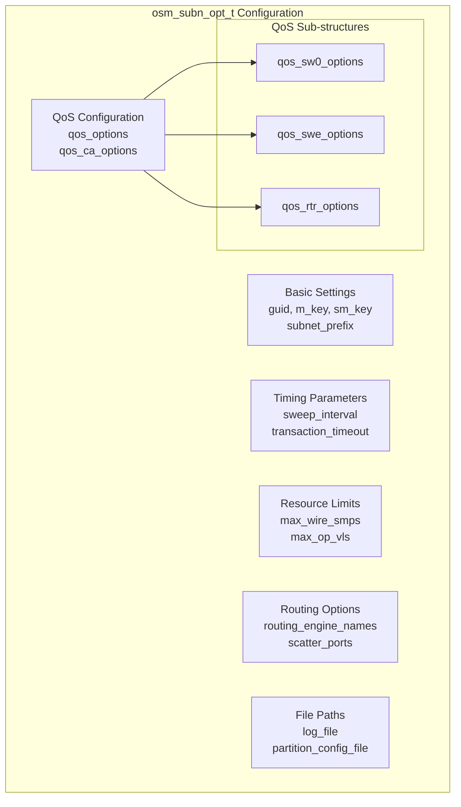

Key configuration categories include:

- **Network Identity**: `guid`, `m_key`, `sm_key`, `subnet_prefix`
- **Sweep Control**: `sweep_interval`, `max_wire_smps`, `transaction_timeout`
- **Routing Parameters**: `routing_engine_names`, `scatter_ports`, `use_ucast_cache`
- **QoS Settings**: Separate `osm_qos_options_t` structures for different device types

Sources: [include/opensm/osm_subnet.h:248-392](), [opensm/osm_subnet.c:762-928]()

## Data Structure Relationships

The central data structures maintain referential relationships that enable efficient traversal and lookup:

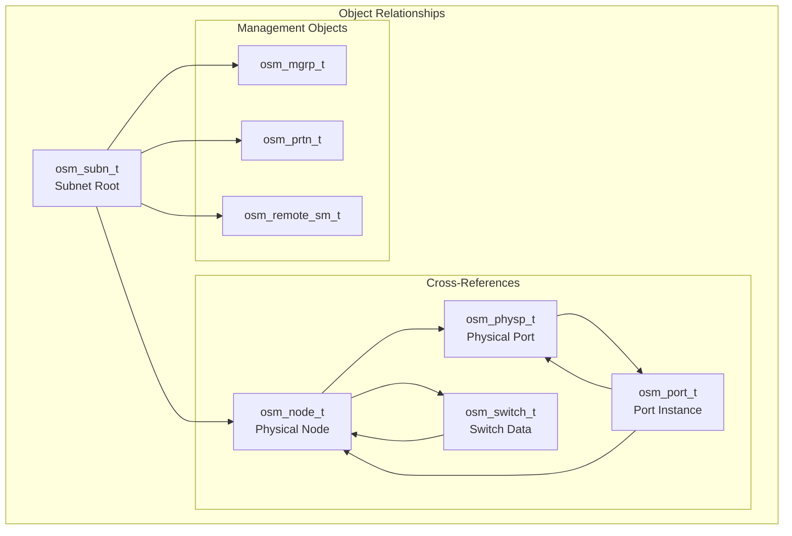

**Key Relationships:**
- Each `osm_node_t` contains an array of `osm_physp_t` structures representing its physical ports
- Each `osm_port_t` references a specific `osm_physp_t` and maintains back-references to its parent node
- Switch nodes have an associated `osm_switch_t` structure containing forwarding tables and switch-specific data
- The `osm_subn_t` root maintains hash tables for fast lookup while objects maintain cross-references for traversal

This design enables both efficient lookups (via hash tables) and efficient traversal (via object references) depending on the access pattern required.

Sources: [include/opensm/osm_subnet.h:700-1000](), [opensm/osm_subnet.c:1-300](), [opensm/osm_state_mgr.c:1-200]()

---

# Page: State Management

# State Management

<details>
<summary>Relevant source files</summary>

The following files were used as context for generating this wiki page:

- [include/opensm/osm_sm.h](include/opensm/osm_sm.h)
- [include/opensm/osm_subnet.h](include/opensm/osm_subnet.h)
- [opensm/osm_qos.c](opensm/osm_qos.c)
- [opensm/osm_req.c](opensm/osm_req.c)
- [opensm/osm_sm.c](opensm/osm_sm.c)
- [opensm/osm_sm_state_mgr.c](opensm/osm_sm_state_mgr.c)
- [opensm/osm_state_mgr.c](opensm/osm_state_mgr.c)
- [opensm/osm_subnet.c](opensm/osm_subnet.c)

</details>


State Management in OpenSM coordinates the Subnet Manager (SM) state machine, subnet discovery sweeps, and monitoring of remote SMs. This system ensures proper failover between multiple SMs and maintains subnet configuration through periodic sweeps and event-driven updates.

For information about the central subnet data structures that state management operates on, see [Central Data Structures](#2.1).

## SM State Machine

The OpenSM state machine implements the InfiniBand specification's SM states and handles transitions between them based on network events and inter-SM communication.

### State Definitions

OpenSM maintains four primary SM states defined by the InfiniBand specification:

| State | Purpose | Behavior |
|-------|---------|----------|
| `IB_SMINFO_STATE_DISCOVERING` | Initial discovery phase | Performs heavy sweeps to discover topology |
| `IB_SMINFO_STATE_STANDBY` | Backup SM mode | Polls master SM, ready to take over |
| `IB_SMINFO_STATE_MASTER` | Active configuration mode | Configures subnet, manages routing |
| `IB_SMINFO_STATE_NOTACTIVE` | Inactive state | SM is disabled |

### State Machine Implementation

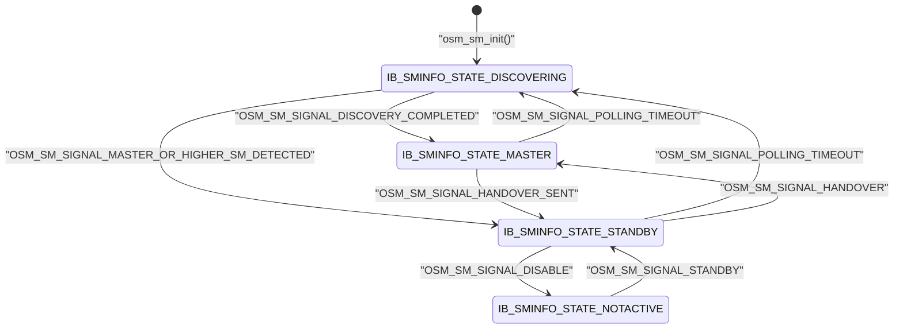

**State Machine Signal Processing**

The core state processing function `osm_sm_state_mgr_process()` handles state transitions:

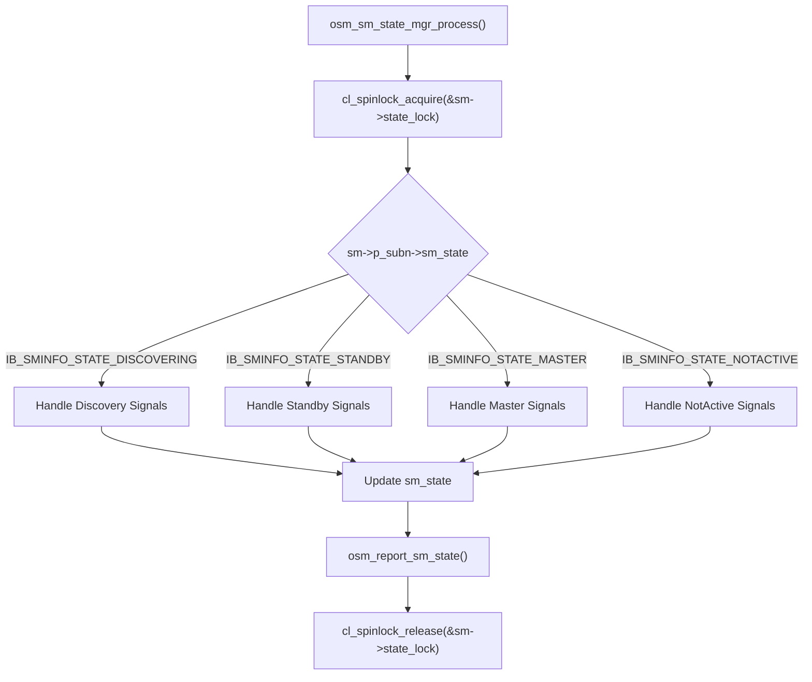

Sources: [opensm/osm_sm_state_mgr.c:272-499](), [include/opensm/osm_sm.h:104-148]()

## Sweep Management

State management coordinates two types of subnet sweeps to discover and configure the InfiniBand fabric.

### Heavy vs Light Sweeps

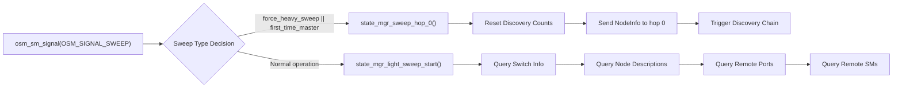

**Heavy Sweep Process**

Heavy sweeps perform complete topology discovery starting from hop 0:

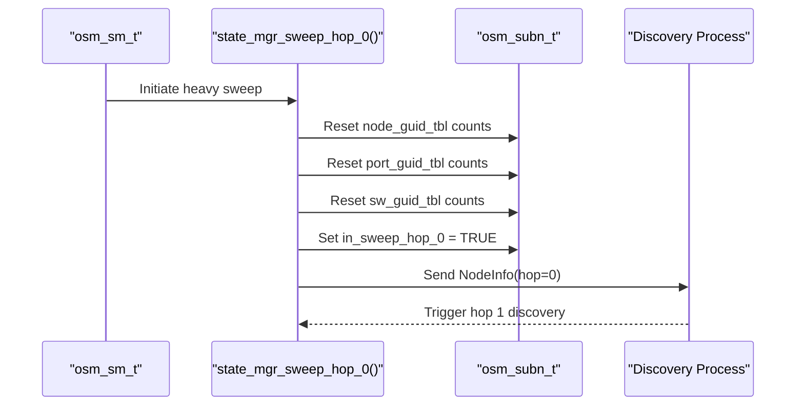

**Light Sweep Process**  

Light sweeps perform targeted queries on known topology:

- Query `osm_sw_guid_tbl` switches via `state_mgr_get_sw_info()`
- Update node descriptions via `state_mgr_get_node_desc()`
- Check disconnected ports via `state_mgr_get_remote_port_info()`
- Poll remote SMs via `query_sm_info()`

Sources: [opensm/osm_state_mgr.c:210-270](), [opensm/osm_state_mgr.c:790-862]()

## Polling and Monitoring

State management implements polling mechanisms to monitor remote SMs and detect failures.

### Polling Timer System

```mermaid
flowchart TD
    A["sm_state_mgr_start_polling()"] --> B["cl_timer_start(&sm->polling_timer)"]
    B --> C["osm_sm_state_mgr_polling_callback()"]
    
    C --> D{"sm->p_subn->sm_state"}
    D -->|"IB_SMINFO_STATE_STANDBY"| E["Poll master_sm_guid"]
    D -->|"IB_SMINFO_STATE_MASTER"| F["Poll polling_sm_guid"]
    
    E --> G["sm_state_mgr_send_master_sm_info_req()"]
    F --> G
    
    G --> H["osm_req_get(IB_MAD_ATTR_SM_INFO)"]
    H --> I["Increment retry_number"]
    I --> J{"retry_number > polling_retry_number?"}
    
    J -->|"Yes"| K["osm_sm_state_mgr_process(OSM_SM_SIGNAL_POLLING_TIMEOUT)"]
    J -->|"No"| L["Restart Timer"]
    L --> C
```

**Polling Configuration**

The polling system uses these key parameters from `osm_subn_opt_t`:

- `sminfo_polling_timeout`: Interval between polls (milliseconds)
- `polling_retry_number`: Maximum retries before timeout
- `master_sm_guid`: GUID of master SM to poll (STANDBY mode)
- `polling_sm_guid`: GUID of SM to poll (MASTER mode)

Sources: [opensm/osm_sm_state_mgr.c:145-176](), [opensm/osm_sm_state_mgr.c:178-255]()

## Signal Processing Framework

State management uses a signal-based architecture for event-driven state transitions.

### Signal Types and Handlers

```mermaid
graph TD
    subgraph "SM Signals"
        A["OSM_SM_SIGNAL_DISCOVERY_COMPLETED"]
        B["OSM_SM_SIGNAL_MASTER_OR_HIGHER_SM_DETECTED"] 
        C["OSM_SM_SIGNAL_HANDOVER"]
        D["OSM_SM_SIGNAL_HANDOVER_SENT"]
        E["OSM_SM_SIGNAL_POLLING_TIMEOUT"]
        F["OSM_SM_SIGNAL_DISABLE"]
        G["OSM_SM_SIGNAL_STANDBY"]
    end
    
    subgraph "General Signals"
        H["OSM_SIGNAL_SWEEP"]
        I["OSM_SIGNAL_IDLE_TIME_PROCESS_REQUEST"]
        J["OSM_SIGNAL_PERFMGR_SWEEP"]
    end
    
    A --> K["osm_sm_state_mgr_process()"]
    B --> K
    C --> K
    D --> K
    E --> K
    F --> K
    G --> K
    
    H --> L["osm_state_mgr_process()"]
    I --> L
    J --> L
```

**Signal Processing Implementation**

The `osm_sm_t` structure contains signal processing components:

- `signal_mask`: Bitmask of pending signals
- `signal_lock`: Spinlock protecting signal state
- `signal_event`: Event to wake signal processing thread
- `sweeper`: Thread running `sm_sweeper()` function

```mermaid
sequenceDiagram
    participant App as "Application"
    participant SM as "osm_sm_signal()"
    participant Sweeper as "sm_sweeper()"
    participant Processor as "sm_process()"
    
    App->>SM: Signal event
    SM->>SM: Acquire signal_lock
    SM->>SM: Set signal bit in signal_mask
    SM->>SM: cl_event_signal(&signal_event)
    SM->>SM: Release signal_lock
    
    Sweeper->>Sweeper: cl_event_wait_on(&signal_event)
    Sweeper->>Sweeper: Copy and clear signal_mask
    Sweeper->>Processor: Process each signal bit
```

Sources: [opensm/osm_sm.c:409-415](), [opensm/osm_sm.c:94-135]()

## Key Data Structures

State management operates on several critical data structures that maintain SM state and coordination.

### Primary SM Structure

The `osm_sm_t` structure contains all state management components:

```mermaid
classDiagram
    class osm_sm_t {
        +osm_thread_state_t thread_state
        +unsigned signal_mask
        +cl_spinlock_t signal_lock
        +cl_spinlock_t state_lock
        +cl_event_t signal_event
        +cl_timer_t sweep_timer
        +cl_timer_t polling_timer
        +uint32_t retry_number
        +ib_net64_t master_sm_guid
        +ib_net64_t polling_sm_guid
        +osm_subn_t* p_subn
        +osm_lid_mgr_t lid_mgr
        +osm_ucast_mgr_t ucast_mgr
    }
    
    class osm_subn_t {
        +uint8_t sm_state
        +boolean_t first_time_master_sweep
        +boolean_t force_first_time_master_sweep
        +boolean_t coming_out_of_standby
        +boolean_t in_sweep_hop_0
        +boolean_t need_update
        +ib_net16_t master_sm_base_lid
        +ib_net64_t sm_port_guid
    }
    
    osm_sm_t --> osm_subn_t : "manages"
```

**Subnet State Flags**

Key boolean flags in `osm_subn_t` control sweep behavior:

| Flag | Purpose |
|------|---------|
| `first_time_master_sweep` | Triggers comprehensive initial configuration |
| `force_first_time_master_sweep` | Forces heavy sweep on next master transition |
| `coming_out_of_standby` | Indicates transition from STANDBY to active |
| `in_sweep_hop_0` | Limits sweep scope during hop 0 discovery |
| `need_update` | Forces configuration updates across managers |

Sources: [include/opensm/osm_sm.h:104-148](), [include/opensm/osm_subnet.h:777-835]()

## State Transition Coordination

State management coordinates with specialized managers during state transitions to ensure consistent subnet configuration.

### Manager Integration

```mermaid
flowchart TD
    A["State Transition Triggered"] --> B["osm_sm_state_mgr_process()"]
    B --> C{"New State"}
    
    C -->|"MASTER"| D["Configure Master Mode"]
    C -->|"STANDBY"| E["Configure Standby Mode"]
    C -->|"DISCOVERING"| F["Configure Discovery Mode"]
    
    D --> G["Set first_time_master_sweep"]
    D --> H["Set master_sm_base_lid"]
    D --> I["osm_sm_signal(OSM_SIGNAL_SWEEP)"]
    
    E --> J["sm_state_mgr_start_polling()"]
    E --> K["Set ignore_existing_lfts = FALSE"]
    
    F --> L["Set coming_out_of_standby = TRUE"]
    F --> I
    
    I --> M["osm_state_mgr_process()"]
    M --> N["Coordinate with Managers"]
    
    N --> O["osm_lid_mgr_process()"]
    N --> P["osm_ucast_mgr_process()"] 
    N --> Q["osm_mcast_mgr_process()"]
    N --> R["osm_qos_setup()"]
```

**Cleanup and Reset Operations**

During state transitions, the system performs cleanup operations:

- `state_mgr_clean_known_lids()`: Clear LID assignments
- `state_mgr_sa_clean()`: Clean SA cache and multicast records  
- `state_mgr_reset_node_count()`: Reset discovery counters
- `state_mgr_reset_switch_count()`: Mark switches for update

Sources: [opensm/osm_sm_state_mgr.c:272-499](), [opensm/osm_state_mgr.c:275-393]()

---

# Page: Network Discovery and Topology

# Network Discovery and Topology

<details>
<summary>Relevant source files</summary>

The following files were used as context for generating this wiki page:

- [include/opensm/osm_node.h](include/opensm/osm_node.h)
- [include/opensm/osm_port.h](include/opensm/osm_port.h)
- [opensm/osm_lid_mgr.c](opensm/osm_lid_mgr.c)
- [opensm/osm_link_mgr.c](opensm/osm_link_mgr.c)
- [opensm/osm_node.c](opensm/osm_node.c)
- [opensm/osm_node_info_rcv.c](opensm/osm_node_info_rcv.c)
- [opensm/osm_port.c](opensm/osm_port.c)
- [opensm/osm_port_info_rcv.c](opensm/osm_port_info_rcv.c)
- [opensm/osm_sw_info_rcv.c](opensm/osm_sw_info_rcv.c)
- [opensm/osm_trap_rcv.c](opensm/osm_trap_rcv.c)

</details>


This document explains how OpenSM discovers the InfiniBand fabric topology, including the identification of nodes, ports, and links. The discovery process builds a complete representation of the subnet that enables proper subnet management and routing decisions.

For information about routing algorithms that operate on the discovered topology, see [Routing Algorithms](#4.2). For details about subnet administration services that query the discovered topology, see [Subnet Administration (SA)](#5).

## Discovery Process Overview

OpenSM uses a systematic approach to discover the InfiniBand fabric topology through Management Datagram (MAD) exchanges. The discovery process consists of several interconnected phases that build up the subnet representation:

```mermaid
flowchart TD
    START["Discovery Start"] --> INIT["Initialize SM Port"]
    INIT --> NODE_DISC["Node Discovery<br/>(NodeInfo MADs)"]
    NODE_DISC --> PORT_DISC["Port Discovery<br/>(PortInfo MADs)"]
    PORT_DISC --> LINK_DISC["Link Discovery<br/>(DR Path Extension)"]
    LINK_DISC --> TOPO_BUILD["Topology Building<br/>(osm_node_link)"]
    TOPO_BUILD --> LID_ASSIGN["LID Assignment<br/>(osm_lid_mgr)"]
    LID_ASSIGN --> CONFIG["Port Configuration"]
    CONFIG --> MONITOR["Ongoing Monitoring<br/>(Trap Processing)"]
    
    MONITOR --> CHANGE_DETECT["Change Detection"]
    CHANGE_DETECT --> RESWEEP["Force Resweep"]
    RESWEEP --> NODE_DISC
```

Sources: [opensm/osm_node_info_rcv.c:1-825](), [opensm/osm_port_info_rcv.c:1-826](), [opensm/osm_trap_rcv.c:1-701]()

## Node Discovery Process

Node discovery begins when OpenSM sends `NodeInfo` MADs to discover devices in the fabric. The `osm_ni_rcv_process` function handles responses and builds the node representation:

```mermaid
flowchart TD
    NI_REQ["NodeInfo Request<br/>(via DR path)"] --> NI_RESP["NodeInfo Response"]
    NI_RESP --> NI_VALIDATE["Validate Response<br/>(osm_ni_rcv_process)"]
    NI_VALIDATE --> NODE_CHECK{"Node Exists?"}
    
    NODE_CHECK -->|No| CREATE_NODE["Create New Node<br/>(osm_node_new)"]
    NODE_CHECK -->|Yes| UPDATE_NODE["Update Existing Node"]
    
    CREATE_NODE --> INIT_PHYSP["Initialize Physical Ports<br/>(osm_node_init_physp)"]
    UPDATE_NODE --> CHECK_LINKS["Check for Link Changes<br/>(ni_rcv_set_links)"]
    
    INIT_PHYSP --> ADD_TO_DB["Add to node_guid_tbl"]
    CHECK_LINKS --> LINK_UPDATE["Update Link Topology"]
    ADD_TO_DB --> REQ_PORTINFO["Request PortInfo<br/>(ni_rcv_get_port_info)"]
    LINK_UPDATE --> REQ_PORTINFO
    
    REQ_PORTINFO --> NEXT_DISCOVERY["Continue Discovery"]
```

Key functions in node discovery:

- `osm_ni_rcv_process()` - Main entry point for NodeInfo processing at [opensm/osm_node_info_rcv.c:821-825]()
- `ni_rcv_set_links()` - Establishes links between discovered nodes at [opensm/osm_node_info_rcv.c:141-312]()
- `osm_node_new()` - Creates new node objects at [opensm/osm_node.c:74-130]()

Sources: [opensm/osm_node_info_rcv.c:141-312](), [opensm/osm_node_info_rcv.c:821-825](), [opensm/osm_node.c:74-130]()

## Port Discovery and Configuration

Port discovery follows node discovery and involves querying `PortInfo` attributes for each physical port. The process differs based on the node type:

```mermaid
flowchart TD
    PI_REQ["PortInfo Request"] --> PI_RESP["PortInfo Response<br/>(osm_pi_rcv_process)"]
    PI_RESP --> NODE_TYPE{"Node Type?"}
    
    NODE_TYPE -->|Switch Port 0| SW_PORT0["Process Switch Mgmt Port<br/>(pi_rcv_process_switch_port0)"]
    NODE_TYPE -->|Switch External| SW_EXT["Process Switch Ext Port<br/>(pi_rcv_process_switch_ext_port)"]
    NODE_TYPE -->|CA/Router| CA_ROUTER["Process CA/Router Port<br/>(pi_rcv_process_ca_or_router_port)"]
    
    SW_PORT0 --> CHECK_ESP0{"Enhanced SP0?"}
    CHECK_ESP0 -->|Yes| FULL_CONFIG["Full Port Configuration"]
    CHECK_ESP0 -->|No| BASIC_CONFIG["Basic SMSL Configuration"]
    
    SW_EXT --> LINK_STATE{"Link State?"}
    LINK_STATE -->|Active/Armed/Init| PROBE_REMOTE["Probe Remote End<br/>(NodeInfo Request)"]
    LINK_STATE -->|Down| UNLINK["Unlink Remote<br/>(osm_node_unlink)"]
    
    CA_ROUTER --> ENDPORT_PROC["Process Endpoint<br/>(pi_rcv_process_endport)"]
    
    FULL_CONFIG --> UPDATE_PHYSP["Update Physical Port<br/>(osm_physp_set_port_info)"]
    BASIC_CONFIG --> UPDATE_PHYSP
    PROBE_REMOTE --> UPDATE_PHYSP
    UNLINK --> UPDATE_PHYSP
    ENDPORT_PROC --> UPDATE_PHYSP
    
    UPDATE_PHYSP --> GET_TABLES["Get PKey/SLtoVL Tables<br/>(pi_rcv_get_pkey_slvl_vla_tables)"]
```

The port discovery process tracks several key attributes:

| Attribute | Purpose | Code Location |
|-----------|---------|---------------|
| Port State | Link status and configuration | [opensm/osm_port_info_rcv.c:292-402]() |
| MTU Capability | Maximum transmission unit | [opensm/osm_port_info_rcv.c:101-130]() |
| VL Capability | Virtual lane support | [opensm/osm_port_info_rcv.c:119-129]() |
| Speed/Width | Link physical characteristics | [opensm/osm_link_mgr.c:346-423]() |

Sources: [opensm/osm_port_info_rcv.c:642-825](), [opensm/osm_port_info_rcv.c:205-254](), [opensm/osm_port_info_rcv.c:259-443]()

## Link Discovery and Topology Building

Link discovery extends directed routes through active ports to discover the complete fabric topology. The process uses DR (Directed Route) path extension:

```mermaid
flowchart TD
    ACTIVE_PORT["Active Port Detected"] --> CHECK_REMOTE{"Remote End<br/>Discovered?"}
    CHECK_REMOTE -->|No| EXTEND_PATH["Extend DR Path<br/>(osm_dr_path_extend)"]
    CHECK_REMOTE -->|Yes| VERIFY_LINK["Verify Existing Link"]
    
    EXTEND_PATH --> SEND_NI["Send NodeInfo<br/>to Remote End"]
    SEND_NI --> REMOTE_RESP["Remote Response"]
    REMOTE_RESP --> CREATE_LINK["Create Link<br/>(osm_node_link)"]
    
    CREATE_LINK --> UPDATE_DB["Update Neighbor DB<br/>(osm_db_neighbor_set)"]
    VERIFY_LINK --> UPDATE_DB
    
    UPDATE_DB --> CACHE_UPDATE["Update Routing Cache<br/>(osm_ucast_cache_check_new_link)"]
    CACHE_UPDATE --> CONTINUE["Continue Discovery"]
    
    subgraph "Link Creation Details"
        L_START["osm_node_link()"] --> L_GET_PHYSP["Get Physical Ports"]
        L_GET_PHYSP --> L_LINK["Set Remote Pointers<br/>(osm_physp_link)"]
        L_LINK --> L_PERSIST["Persist to Database"]
    end
```

The topology building process maintains several key data structures:

- **Node Table** (`node_guid_tbl`) - Maps node GUIDs to `osm_node_t` objects
- **Port Table** (`port_guid_tbl`) - Maps port GUIDs to `osm_port_t` objects  
- **Switch Table** (`sw_guid_tbl`) - Maps switch GUIDs to `osm_switch_t` objects
- **Link Database** - Persistent neighbor relationships

Sources: [opensm/osm_port_info_rcv.c:358-393](), [opensm/osm_node_info_rcv.c:279-309](), [opensm/osm_node.c:158-173]()

## LID Assignment Process

LID (Local Identifier) assignment occurs after topology discovery and follows a sophisticated algorithm that balances persistence with fabric changes:

```mermaid
flowchart TD
    LID_START["LID Assignment Start<br/>(osm_lid_mgr_process)"] --> INIT_SWEEP["Initialize Sweep<br/>(lid_mgr_init_sweep)"]
    INIT_SWEEP --> LOAD_PERSISTENT["Load GUID-to-LID DB<br/>(osm_db_restore)"]
    LOAD_PERSISTENT --> VALIDATE_DB["Validate Persistent Data<br/>(lid_mgr_validate_db)"]
    
    VALIDATE_DB --> SCAN_PORTS["Scan All Ports"]
    SCAN_PORTS --> PORT_LOOP{"For Each Port"}
    
    PORT_LOOP --> GET_LID["Get Port LID<br/>(lid_mgr_get_port_lid)"]
    GET_LID --> LID_SOURCE{"LID Source?"}
    
    LID_SOURCE -->|Persistent DB| USE_PERSISTENT["Use Persistent LID"]
    LID_SOURCE -->|Current Config| VALIDATE_CURRENT["Validate Current LID"]
    LID_SOURCE -->|New Assignment| FIND_FREE["Find Free Range<br/>(lid_mgr_find_free_lid_range)"]
    
    USE_PERSISTENT --> SET_PORTINFO["Set PortInfo<br/>(lid_mgr_set_physp_pi)"]
    VALIDATE_CURRENT --> SET_PORTINFO
    FIND_FREE --> SET_PORTINFO
    
    SET_PORTINFO --> UPDATE_TABLES["Update LID Tables"]
    UPDATE_TABLES --> PORT_LOOP
    
    PORT_LOOP -->|Done| STORE_DB["Store GUID-to-LID DB<br/>(osm_db_store)"]
```

The LID manager maintains several data structures for efficient assignment:

| Structure | Purpose | File Location |
|-----------|---------|---------------|
| `used_lids[]` | Bitmap of assigned LIDs | [opensm/osm_lid_mgr.c:186-206]() |
| `free_ranges` | List of available LID ranges | [opensm/osm_lid_mgr.c:592-653]() |
| `port_lid_tbl` | Maps LIDs to ports | [opensm/osm_lid_mgr.c:779-781]() |
| GUID-to-LID DB | Persistent assignments | [opensm/osm_lid_mgr.c:774-777]() |

Sources: [opensm/osm_lid_mgr.c:290-571](), [opensm/osm_lid_mgr.c:680-785](), [opensm/osm_lid_mgr.c:802-1037]()

## Trap Handling and Dynamic Updates

OpenSM continuously monitors the fabric for changes through trap processing. Traps indicate dynamic events like link state changes, node additions/removals, and errors:

```mermaid
flowchart TD
    TRAP_RCV["Trap Received<br/>(osm_trap_rcv_process)"] --> VALIDATE["Validate Trap Source"]
    VALIDATE --> TRAP_TYPE{"Trap Type?"}
    
    TRAP_TYPE -->|128 Link State| LINK_CHANGE["Link State Change<br/>(force_heavy_sweep)"]
    TRAP_TYPE -->|129-131 Port Error| PORT_ERROR["Port Error Processing"]
    TRAP_TYPE -->|144 Local Change| NODE_CHANGE["Node Capability Change"]
    TRAP_TYPE -->|145 GUID Change| GUID_CHANGE["System GUID Change"]
    
    PORT_ERROR --> AGING_CHECK["Check Aging Tracker<br/>(cl_event_wheel_num_regs)"]
    AGING_CHECK --> THRESHOLD{"Error Count > Threshold?"}
    THRESHOLD -->|Yes| DISABLE_PORT["Disable Noisy Port<br/>(disable_port)"]
    THRESHOLD -->|No| MARK_UNHEALTHY["Mark Port Unhealthy<br/>(osm_physp_set_health)"]
    
    LINK_CHANGE --> FORCE_SWEEP["Force Heavy Sweep"]
    NODE_CHANGE --> UPDATE_NODE["Update Node Info"]
    GUID_CHANGE --> UPDATE_GUID["Update System GUID"]
    DISABLE_PORT --> FORCE_SWEEP
    MARK_UNHEALTHY --> FORCE_SWEEP
    
    FORCE_SWEEP --> TRIGGER_SM["Signal State Manager<br/>(osm_sm_signal)"]
    UPDATE_NODE --> CHECK_DESC["Update Node Description"]
    UPDATE_GUID --> TRIGGER_SM
    CHECK_DESC --> TRIGGER_SM
```

Key trap processing functions:

- `trap_rcv_process_request()` - Main trap processing logic at [opensm/osm_trap_rcv.c:372-681]()
- `shutup_noisy_port()` - Handles noisy port suppression at [opensm/osm_trap_rcv.c:331-370]()
- `aging_tracker_callback()` - Manages trap aging at [opensm/osm_trap_rcv.c:99-140]()

Sources: [opensm/osm_trap_rcv.c:372-681](), [opensm/osm_trap_rcv.c:331-370](), [opensm/osm_trap_rcv.c:99-140]()

## Key Data Structures

The discovery process builds and maintains several interconnected data structures that represent the fabric topology:

```mermaid
classDiagram
    class osm_subn_t {
        +cl_qmap_t node_guid_tbl
        +cl_qmap_t port_guid_tbl
        +cl_qmap_t sw_guid_tbl
        +cl_ptr_vector_t port_lid_tbl
        +osm_db_domain_t p_neighbor
    }
    
    class osm_node_t {
        +ib_node_info_t node_info
        +osm_physp_t physp_table[]
        +uint8_t physp_discovered[]
        +osm_switch_t sw
        +char print_desc
    }
    
    class osm_physp_t {
        +ib_port_info_t port_info
        +ib_net64_t port_guid
        +uint8_t port_num
        +osm_node_t p_node
        +osm_physp_t p_remote_physp
        +boolean_t healthy
        +osm_dr_path_t dr_path
        +osm_pkey_tbl_t pkeys
    }
    
    class osm_port_t {
        +ib_net64_t guid
        +ib_net16_t lid
        +osm_node_t p_node
        +osm_physp_t p_physp
        +uint32_t discovery_count
    }
    
    osm_subn_t --> osm_node_t : "contains"
    osm_subn_t --> osm_port_t : "contains"
    osm_node_t --> osm_physp_t : "owns"
    osm_port_t --> osm_physp_t : "references"
    osm_physp_t --> osm_physp_t : "p_remote_physp"
```

These structures form the core representation of the discovered topology, enabling efficient subnet management operations.

Sources: [include/opensm/osm_port.h:107-133](), [opensm/osm_node.c:94-129](), [opensm/osm_port.c:138-174]()

---

# Page: Node and Port Discovery

# Node and Port Discovery

<details>
<summary>Relevant source files</summary>

The following files were used as context for generating this wiki page:

- [include/opensm/osm_node.h](include/opensm/osm_node.h)
- [opensm/osm_node.c](opensm/osm_node.c)
- [opensm/osm_node_info_rcv.c](opensm/osm_node_info_rcv.c)
- [opensm/osm_port_info_rcv.c](opensm/osm_port_info_rcv.c)
- [opensm/osm_sw_info_rcv.c](opensm/osm_sw_info_rcv.c)

</details>


This document describes how OpenSM discovers InfiniBand nodes and ports within the fabric to build the network topology. The discovery process involves exchanging Management Datagrams (MADs) with fabric devices to gather NodeInfo, PortInfo, and SwitchInfo attributes, then creating and linking the corresponding data structures.

For information about LID assignment and trap handling that occurs after discovery, see [LID Management and Trap Handling](#3.2). For details about routing calculations that use the discovered topology, see [Routing Management](#4).

## Discovery Process Overview

The node and port discovery process follows a systematic approach to map the entire InfiniBand fabric topology:

```mermaid
flowchart TD
    START["Discovery Start"] --> NODEREQ["Send NodeInfo Request"]
    NODEREQ --> NODERESPX["Receive NodeInfo Response"]
    NODERESPX --> CHECKNODE{"Node Exists?"}
    
    CHECKNODE -->|No| NEWNODE["Create New Node Object<br/>osm_node_new()"]
    CHECKNODE -->|Yes| EXISTNODE["Update Existing Node<br/>ni_rcv_process_existing()"]
    
    NEWNODE --> ADDNODE["Add to node_guid_tbl"]
    EXISTNODE --> PORTREQ
    ADDNODE --> PORTREQ["Send PortInfo Requests<br/>for all ports"]
    
    PORTREQ --> PORTRESP["Receive PortInfo Response"]
    PORTRESP --> UPDATEPORT["Update Port Info<br/>osm_physp_set_port_info()"]
    
    UPDATEPORT --> CHECKLINK{"Port State<br/>Active?"}
    CHECKLINK -->|Yes| LINKSETUP["Setup Links<br/>ni_rcv_set_links()"]
    CHECKLINK -->|No| NEXTPORT
    
    LINKSETUP --> CHECKSWITCH{"Switch Node?"}
    CHECKSWITCH -->|Yes| SWITCHINFO["Send SwitchInfo Request"]
    CHECKSWITCH -->|No| NEXTPORT
    
    SWITCHINFO --> SWRESP["Receive SwitchInfo Response"]
    SWRESP --> CREATESWITCH["Create Switch Object<br/>osm_switch_new()"]
    CREATESWITCH --> NEXTPORT["Next Port/Node"]
    
    NEXTPORT --> MOREPORTS{"More Ports<br/>to Discover?"}
    MOREPORTS -->|Yes| PORTREQ
    MOREPORTS -->|No| MORENODES{"More Nodes<br/>to Discover?"}
    MORENODES -->|Yes| NODEREQ
    MORENODES -->|No| COMPLETE["Discovery Complete"]
```

Sources: [opensm/osm_node_info_rcv.c:912-972](), [opensm/osm_port_info_rcv.c:642-825](), [opensm/osm_sw_info_rcv.c:381-454]()

## NodeInfo Discovery and Processing

NodeInfo discovery is the foundation of fabric topology discovery. The `osm_ni_rcv_process()` function handles NodeInfo MAD responses and manages node object lifecycle:

```mermaid
flowchart TD
    NIREQ["`NodeInfo MAD Request
    IB_MAD_ATTR_NODE_INFO`"] --> NIRESP["`NodeInfo MAD Response
    osm_ni_rcv_process()`"]
    
    NIRESP --> VALIDATE["`Validate Response
    Check node_guid != 0
    Check port_guid != 0`"]
    
    VALIDATE --> LOOKUP["`Lookup Node
    osm_get_node_by_guid()`"]
    
    LOOKUP --> NEWPATH["`New Node Path
    ni_rcv_process_new()`"]
    LOOKUP --> EXISTPATH["`Existing Node Path
    ni_rcv_process_existing()`"]
    
    NEWPATH --> CREATENODE["`Create Node Object
    osm_node_new()
    Add to node_guid_tbl`"]
    
    NEWPATH --> CREATEPORT["`Create Port Object
    osm_port_new()
    Add to port_guid_tbl`"]
    
    EXISTPATH --> UPDATEDR["`Update DR Path
    osm_dr_path_init()`"]
    
    CREATENODE --> NODETYPE{"`Node Type`"}
    CREATEPORT --> NODETYPE
    UPDATEDR --> NODETYPE
    
    NODETYPE -->|"IB_NODE_TYPE_CA"| CAPROCESS["`CA Processing
    ni_rcv_process_new_ca_or_router()`"]
    NODETYPE -->|"IB_NODE_TYPE_ROUTER"| CAPROCESS
    NODETYPE -->|"IB_NODE_TYPE_SWITCH"| SWPROCESS["`Switch Processing
    ni_rcv_process_new_switch()`"]
    
    CAPROCESS --> GETPORTINFO["`Get PortInfo
    ni_rcv_get_port_info()`"]
    SWPROCESS --> GETSWITCHINFO["`Get SwitchInfo
    ni_rcv_process_switch()`"]
```

Sources: [opensm/osm_node_info_rcv.c:912-972](), [opensm/osm_node_info_rcv.c:657-838](), [opensm/osm_node_info_rcv.c:843-910]()

### Node Object Creation

The `osm_node_t` structure represents discovered nodes and contains arrays of physical ports:

| Field | Type | Purpose |
|-------|------|---------|
| `map_item` | `cl_map_item_t` | Linkage for `node_guid_tbl` |
| `sw` | `osm_switch_t*` | Switch object for switch nodes |
| `node_info` | `ib_node_info_t` | IBA NodeInfo attribute |
| `node_desc` | `ib_node_desc_t` | IBA NodeDescription |
| `discovery_count` | `uint32_t` | Times discovered this sweep |
| `physp_table` | `osm_physp_t[]` | Array of physical ports |
| `physp_discovered` | `uint8_t*` | Port discovery tracking |

Sources: [include/opensm/osm_node.h:97-107](), [opensm/osm_node.c:74-130]()

## PortInfo Discovery and Physical Topology

PortInfo discovery reveals the detailed characteristics of each port and establishes the physical link topology:

```mermaid
flowchart TD
    PIREQ["`PortInfo MAD Request
    IB_MAD_ATTR_PORT_INFO
    port_num in attr_mod`"] --> PIRESP["`PortInfo MAD Response
    osm_pi_rcv_process()`"]
    
    PIRESP --> GETNODE["`Get Node Object
    osm_get_port_by_guid()
    port->p_node`"]
    
    GETNODE --> CHECKSET{"`Set Method?
    p_context->set_method`"}
    
    CHECKSET -->|Yes| SETPROCESS["`Process Set Response
    pi_rcv_process_set()`"]
    CHECKSET -->|No| GETPROCESS["`Process Get Response
    Update port info`"]
    
    GETPROCESS --> NODETYPE{"`Node Type`"}
    
    NODETYPE -->|"IB_NODE_TYPE_CA/ROUTER"| CAPORT["`CA/Router Port
    pi_rcv_process_ca_or_router_port()`"]
    NODETYPE -->|"IB_NODE_TYPE_SWITCH"| SWPORT{"`Switch Port`"}
    
    SWPORT -->|"Port 0"| SWPORT0["`Switch Port 0
    pi_rcv_process_switch_port0()`"]
    SWPORT -->|"Port N"| SWPORTN["`Switch External Port
    pi_rcv_process_switch_ext_port()`"]
    
    CAPORT --> UPDATEINFO["`Update Port Info
    osm_physp_set_port_info()`"]
    SWPORT0 --> UPDATEINFO
    SWPORTN --> LINKCHECK{"`Link State?`"}
    
    LINKCHECK -->|"IB_LINK_DOWN"| UNLINK["`Unlink Ports
    osm_node_unlink()`"]
    LINKCHECK -->|"IB_LINK_ACTIVE"| PROBE["`Probe Remote Node
    Send NodeInfo Request`"]
    
    UPDATEINFO --> ENDPORT["`Process Endport
    pi_rcv_process_endport()`"]
    
    ENDPORT --> TRACKVLS["`Track Min VLs/MTU
    Update subnet minimums`"]
    TRACKVLS --> CHECKPKEYS["`Get PKey Tables
    pi_rcv_get_pkey_slvl_vla_tables()`"]
```

Sources: [opensm/osm_port_info_rcv.c:642-825](), [opensm/osm_port_info_rcv.c:205-254](), [opensm/osm_port_info_rcv.c:259-443](), [opensm/osm_port_info_rcv.c:445-461]()

### Port State Management

The PortInfo receiver tracks various port characteristics that affect subnet configuration:

```mermaid
flowchart LR
    PORTINFO["`PortInfo Response`"] --> LINKSTATE["`Link State
    IB_LINK_DOWN/INIT/
    ARMED/ACTIVE`"]
    
    PORTINFO --> CAPABILITIES["`Port Capabilities
    MTU, Rate, VL support`"]
    
    PORTINFO --> LIDINFO["`LID Information
    base_lid, lmc`"]
    
    LINKSTATE --> TOPOLOGY["`Topology Update
    Link/Unlink nodes`"]
    CAPABILITIES --> SUBNET["`Subnet Minimums
    min_ca_mtu, min_ca_rate
    min_data_vls`"]
    LIDINFO --> VALIDATION["`LID Validation
    pi_rcv_check_and_fix_lid()`"]
    
    TOPOLOGY --> LINKTBL["`Update Link Tables
    osm_node_link()`"]
    SUBNET --> CONFIG["`Configuration Limits`"]
    VALIDATION --> CORRECT["`Correction if Invalid`"]
```

Sources: [opensm/osm_port_info_rcv.c:82-131](), [opensm/osm_port_info_rcv.c:70-80](), [opensm/osm_port_info_rcv.c:292-439]()

## Link Establishment and Topology Building

The discovery process establishes bidirectional links between nodes when ports are in active states:

```mermaid
flowchart TD
    LINKDET["`Link Detection
    ib_port_info_get_port_state()
    == IB_LINK_ACTIVE`"] --> CHECKEXIST["`Check Existing Link
    osm_node_has_any_link()`"]
    
    CHECKEXIST -->|"No Link"| NEWLINK["`Create New Link
    ni_rcv_set_links()`"]
    CHECKEXIST -->|"Link Exists"| DUPCHECK["`Duplicate Check
    report_duplicated_guid()`"]
    
    NEWLINK --> VALIDATE["`Validate Ports
    osm_node_link_has_valid_ports()`"]
    VALIDATE --> CREATELINK["`Create Link
    osm_node_link()`"]
    
    CREATELINK --> DBUPDATE["`Update Database
    osm_db_neighbor_set()`"]
    CREATELINK --> CACHEUPDATE["`Update Cache
    osm_ucast_cache_check_new_link()`"]
    
    DUPCHECK --> REQUERY["`Requery NodeInfo
    requery_dup_node_info()`"]
    REQUERY --> HEAVYSWEEP["`Force Heavy Sweep
    force_heavy_sweep = TRUE`"]
    
    DBUPDATE --> PHYSLINK["`Physical Link
    osm_physp_link()`"]
    CACHEUPDATE --> PHYSLINK
    
    PHYSLINK --> BIDIRECT["`Bidirectional Link
    p_physp->p_remote_physp
    p_remote_physp->p_physp`"]
```

Sources: [opensm/osm_node_info_rcv.c:141-312](), [opensm/osm_node.c:158-173](), [opensm/osm_node_info_rcv.c:68-99](), [opensm/osm_node_info_rcv.c:101-136]()

## Switch Discovery and Processing

Switch nodes require additional processing to handle SwitchInfo attributes and establish the switch forwarding context:

```mermaid
flowchart TD
    SWITCHNODE["`Switch Node Detected
    node_type == IB_NODE_TYPE_SWITCH`"] --> SWITCHREQ["`Send SwitchInfo Request
    IB_MAD_ATTR_SWITCH_INFO`"]
    
    SWITCHREQ --> SWITCHRESP["`SwitchInfo Response
    osm_si_rcv_process()`"]
    
    SWITCHRESP --> CHECKSWOBJ{"`Switch Object Exists?`"}
    
    CHECKSWOBJ -->|No| NEWSW["`Create Switch Object
    si_rcv_process_new()`"]
    CHECKSWOBJ -->|Yes| EXISTSW["`Update Switch Object
    si_rcv_process_existing()`"]
    
    NEWSW --> CREATESWOBJ["`osm_switch_new()
    Add to sw_guid_tbl`"]
    CREATESWOBJ --> SETLIMITS["`Set Subnet Limits
    max_mcast_lid_ho
    max_ucast_lid_ho`"]
    
    EXISTSW --> CHECKCHANGE["`Check State Change
    ib_switch_info_get_state_change()`"]
    CHECKCHANGE --> HEAVYSWEEP2["`Force Heavy Sweep
    if changes detected`"]
    
    SETLIMITS --> PORT0INFO["`Get Port 0 Info
    si_rcv_get_sp0_info()`"]
    HEAVYSWEEP2 --> PORT0INFO
    
    PORT0INFO --> EXTPORTS["`Query External Ports
    Port 1 to num_ports`"]
    
    EXTPORTS --> COMPLETE["`Switch Discovery Complete`"]
```

Sources: [opensm/osm_sw_info_rcv.c:381-454](), [opensm/osm_sw_info_rcv.c:196-277](), [opensm/osm_sw_info_rcv.c:284-335](), [opensm/osm_sw_info_rcv.c:337-379]()

## Data Structure Relationships

The discovered topology is represented through interconnected data structures maintained in the subnet object:

```mermaid
classDiagram
    class osm_subn_t {
        +cl_qmap_t node_guid_tbl
        +cl_qmap_t port_guid_tbl  
        +cl_qmap_t sw_guid_tbl
        +cl_qmap_t alias_port_guid_tbl
    }
    
    class osm_node_t {
        +ib_node_info_t node_info
        +osm_switch_t* sw
        +uint32_t discovery_count
        +osm_physp_t physp_table[]
        +uint8_t* physp_discovered
    }
    
    class osm_physp_t {
        +ib_port_info_t port_info
        +osm_node_t* p_node
        +osm_physp_t* p_remote_physp
        +osm_dr_path_t dr_path
        +uint8_t port_num
    }
    
    class osm_port_t {
        +ib_net64_t guid
        +osm_physp_t* p_physp
        +osm_node_t* p_node
        +uint32_t discovery_count
    }
    
    class osm_switch_t {
        +osm_node_t* p_node
        +ib_switch_info_t switch_info
        +uint16_t max_lid_ho
        +osm_mcast_tbl_t mcast_tbl
    }
    
    osm_subn_t ||--o{ osm_node_t : "node_guid_tbl"
    osm_subn_t ||--o{ osm_port_t : "port_guid_tbl"
    osm_subn_t ||--o{ osm_switch_t : "sw_guid_tbl"
    
    osm_node_t ||--o{ osm_physp_t : "physp_table"
    osm_node_t ||--o| osm_switch_t : "sw (if switch)"
    osm_physp_t ||--|| osm_node_t : "p_node"
    osm_physp_t ||--o| osm_physp_t : "p_remote_physp"
    osm_port_t ||--|| osm_physp_t : "p_physp"
    osm_switch_t ||--|| osm_node_t : "p_node"
```

Sources: [include/opensm/osm_node.h:97-107](), [opensm/osm_node_info_rcv.c:698-742](), [opensm/osm_port_info_rcv.c:708-719](), [opensm/osm_sw_info_rcv.c:217-252]()

## Error Handling and Recovery

The discovery process includes robust error handling for various failure conditions:

| Error Condition | Detection | Recovery Action |
|-----------------|-----------|-----------------|
| Duplicate GUIDs | `osm_node_has_any_link()` check | `requery_dup_node_info()`, force heavy sweep |
| Invalid LIDs | `pi_rcv_check_and_fix_lid()` | Correct to valid LID range |
| Link state errors | PortInfo status check | Log error, continue discovery |
| Missing nodes | Node lookup failure | Log error, skip processing |
| MAD errors | SMP status check | Log error, continue with next request |

The system maintains discovery counts and implements retry mechanisms to handle transient network conditions and ensure complete topology discovery.

Sources: [opensm/osm_node_info_rcv.c:224-243](), [opensm/osm_port_info_rcv.c:70-80](), [opensm/osm_node_info_rcv.c:68-99](), [opensm/osm_port_info_rcv.c:587-601]()

---

# Page: LID Management and Trap Handling

# LID Management and Trap Handling

<details>
<summary>Relevant source files</summary>

The following files were used as context for generating this wiki page:

- [include/opensm/osm_port.h](include/opensm/osm_port.h)
- [opensm/osm_lid_mgr.c](opensm/osm_lid_mgr.c)
- [opensm/osm_link_mgr.c](opensm/osm_link_mgr.c)
- [opensm/osm_port.c](opensm/osm_port.c)
- [opensm/osm_trap_rcv.c](opensm/osm_trap_rcv.c)

</details>


This document covers OpenSM's Local Identifier (LID) assignment system and network event handling through trap processing. LID management ensures every port in the InfiniBand fabric receives appropriate LID ranges, while trap handling responds to network events and maintains fabric health. For information about the initial discovery of nodes and ports, see [Node and Port Discovery](#3.1). For details about routing table construction that uses the assigned LIDs, see [Unicast Routing](#4.1).

## LID Management Overview

The LID Manager (`osm_lid_mgr_t`) is responsible for assigning unique Local Identifiers to all ports in the subnet. LIDs are essential for packet routing in InfiniBand networks, with each port requiring a base LID and potentially additional LIDs based on the LMC (LID Mask Control) value.

### LID Assignment Algorithm

The LID manager implements a multi-phase algorithm that balances persistence with fabric changes:

```mermaid
flowchart TD
    A["osm_lid_mgr_init()"] --> B["Load guid2lid database"]
    B --> C["lid_mgr_validate_db()"]
    C --> D["lid_mgr_init_sweep()"]
    D --> E["Process SM port first"]
    E --> F["lid_mgr_process_our_sm_node()"]
    F --> G["Process all other ports"]
    G --> H["lid_mgr_get_port_lid()"]
    H --> I{"LID change needed?"}
    I -->|Yes| J["lid_mgr_set_physp_pi()"]
    I -->|No| K["Continue to next port"]
    J --> K
    K --> L{"More ports?"}
    L -->|Yes| H
    L -->|No| M["Store guid2lid database"]
```

**LID Assignment Decision Process**

Sources: [opensm/osm_lid_mgr.c:680-785]()

```mermaid
flowchart TD
    A["lid_mgr_get_port_lid()"] --> B{"Check guid2lid DB"}
    B -->|Found| C{"Current LID matches?"}
    B -->|Not found| D{"Port has valid LID?"}
    C -->|Yes| E["Use persistent LID"]
    C -->|No| F["Update to persistent LID"]
    D -->|Yes and aligned| G{"LID range free?"}
    D -->|No or misaligned| H["lid_mgr_find_free_lid_range()"]
    G -->|Yes| I["Keep current LID"]
    G -->|No| H
    F --> J["lid_mgr_set_physp_pi()"]
    I --> K["Update data structures"]
    H --> L["Assign new LID range"]
    L --> J
    K --> M["Return: no change"]
    J --> N["Return: LID changed"]
```

Sources: [opensm/osm_lid_mgr.c:680-785]()

## Trap Handling System

The trap receiver (`osm_trap_rcv_t`) processes network event notifications (traps) sent by nodes to report various conditions including link state changes, errors, and capability updates.

### Trap Processing Architecture

```mermaid
flowchart TD
    A["Incoming MAD trap"] --> B["trap_rcv_process_request()"]
    B --> C["osm_resp_send()"]
    C --> D{"Trap type classification"}
    D -->|129,130,131| E["Port health traps"]
    D -->|144| F["Local changes trap"]
    D -->|145| G["System GUID change"]
    D -->|Other| H["Generic trap processing"]
    E --> I["aging_tracker_callback()"]
    I --> J{"Repeated trap?"}
    J -->|Yes| K["shutup_noisy_port()"]
    J -->|No| L["Mark port unhealthy"]
    K --> M{"Exceeds threshold?"}
    M -->|Yes| N["disable_port()"]
    M -->|No| O["Extend timeout"]
    F --> P["osm_req_get_node_desc()"]
    G --> Q["Update node sys_guid"]
    H --> R["osm_report_notice()"]
    L --> S["Trigger sweep"]
    N --> T["Send PortInfo disable"]
    O --> S
    P --> S
    Q --> R
    R --> S
    S --> U["osm_sm_signal(OSM_SIGNAL_SWEEP)"]
```

Sources: [opensm/osm_trap_rcv.c:372-681]()

### Trap Filtering and Aging

The system implements sophisticated trap filtering to prevent fabric instability from noisy ports:

```mermaid
flowchart TD
    A["Trap received"] --> B["trap_get_key()"]
    B --> C["Calculate CRC32 hash"]
    C --> D["Create 64-bit key:<br/>port_num(16b) | lid(16b) | crc(32b)"]
    D --> E["cl_event_wheel_num_regs()"]
    E --> F{"Count >= 10?"}
    F -->|No| G["Register in aging tracker"]
    F -->|Yes| H["print_num_received()"]
    H --> I{"Print threshold met?"}
    I -->|Yes| J["Log noisy trap warning"]
    I -->|No| K["Suppress logging"]
    J --> L{"Port health trap?"}
    K --> L
    L -->|Yes| M["shutup_noisy_port()"]
    L -->|No| N["Ignore trap"]
    M --> O{"Count >= 250?"}
    O -->|Yes| P["Disable port permanently"]
    O -->|No| Q["Mark unhealthy, schedule sweep"]
    G --> R["Continue processing"]
    P --> S["Status: port disabled"]
    Q --> T["Status: sweep triggered"]
    N --> U["Status: ignored"]
```

Sources: [opensm/osm_trap_rcv.c:487-548]()

## Core Data Structures

### LID Manager Structure

The `osm_lid_mgr_t` maintains several key data structures for LID assignment:

| Field | Type | Purpose |
|-------|------|---------|
| `p_g2l` | `osm_db_domain_t*` | GUID-to-LID persistent database |
| `used_lids[]` | `boolean_t[65536]` | Bitmap of allocated LIDs |
| `free_ranges` | `cl_qlist_t` | List of available LID ranges |
| `p_subn` | `osm_subn_t*` | Subnet state reference |

Sources: [opensm/osm_lid_mgr.c:220-245]()

### LID Range Management

```mermaid
classDiagram
    class osm_lid_mgr_range_t {
        +cl_list_item_t item
        +uint16_t min_lid
        +uint16_t max_lid
    }
    
    class osm_lid_mgr_t {
        +osm_db_domain_t* p_g2l
        +boolean_t used_lids[65536]
        +cl_qlist_t free_ranges
        +osm_subn_t* p_subn
        +osm_sm_t* sm
        +boolean_t dirty
    }
    
    class osm_port_t {
        +ib_net64_t guid
        +ib_net16_t lid
        +osm_physp_t* p_physp
    }
    
    osm_lid_mgr_t --> osm_lid_mgr_range_t : manages
    osm_lid_mgr_t --> osm_port_t : assigns LIDs to
```

Sources: [opensm/osm_lid_mgr.c:103-107](), [include/opensm/osm_port.h:1221-1236]()

### Physical Port Health Tracking

```mermaid
classDiagram
    class osm_physp_t {
        +ib_port_info_t port_info
        +ib_net64_t port_guid
        +uint8_t port_num
        +boolean_t healthy
        +unsigned need_update
        +osm_physp_t* p_remote_physp
        +osm_dr_path_t dr_path
    }
    
    class aging_tracker {
        +uint64_t key
        +uint32_t num_regs
        +uint64_t timeout
        +callback_func aging_tracker_callback
    }
    
    osm_physp_t --> aging_tracker : health monitored by
```

Sources: [include/opensm/osm_port.h:107-133](), [opensm/osm_trap_rcv.c:99-140]()

## Key Algorithms

### LID Assignment Process

The LID assignment follows a three-phase approach defined in the algorithm comments:

1. **Initialization Phase**: Load persistent GUID-to-LID mappings and validate against current LMC settings
2. **SM Port Assignment**: Process the SM's own port first to establish the SM base LID
3. **General Port Assignment**: Process all other ports, attempting to preserve existing assignments

Sources: [opensm/osm_lid_mgr.c:47-77]()

### Port Information Update

When LID changes are required, the system updates port configuration through `lid_mgr_set_physp_pi()`:

```mermaid
sequenceDiagram
    participant LM as lid_mgr_set_physp_pi
    participant PI as PortInfo
    participant REQ as osm_req_set
    participant DB as guid2mkey DB
    
    LM->>PI: Copy existing PortInfo
    LM->>PI: Update base_lid
    LM->>PI: Update master_sm_base_lid
    LM->>PI: Update m_key if needed
    LM->>PI: Update subnet_prefix
    LM->>PI: Set client_rereg if needed
    LM->>REQ: Send PortInfo Set MAD
    LM->>DB: Update guid2mkey mapping
```

Sources: [opensm/osm_lid_mgr.c:802-1094]()

### Trap-Based Port Health Management

The system uses trap 129, 130, and 131 to manage port health:

```mermaid
stateDiagram-v2
    [*] --> Healthy : Port initialization
    Healthy --> Monitoring : First trap received
    Monitoring --> Unhealthy : 10+ traps in timeout window
    Unhealthy --> Disabled : 250+ traps (if policy enabled)
    Unhealthy --> Healthy : Timeout expires without traps
    Disabled --> [*] : Manual intervention required
    
    note right of Monitoring : aging_tracker monitors trap frequency
    note right of Unhealthy : Force heavy sweep triggered
    note right of Disabled : Port set to LINK_DOWN state
```

Sources: [opensm/osm_trap_rcv.c:331-370](), [opensm/osm_trap_rcv.c:214-278]()

## Integration with OpenSM Core

### Interaction with State Manager

The LID manager integrates with the SM state machine through several key interfaces:

- **Initialization**: Called during SM initialization to restore persistent state
- **Sweep Processing**: Invoked during subnet sweeps to assign/update LIDs  
- **Change Detection**: Marks subnet as requiring heavy sweep when LID changes occur

Sources: [opensm/osm_lid_mgr.c:220-275]()

### Relationship with Link Manager

The trap handler coordinates with the link manager for port state changes:

```mermaid
flowchart LR
    A["trap_rcv_process_request()"] --> B["Determine trap type"]
    B --> C["link_mgr_set_physp_pi()"]
    C --> D["Update port state"]
    D --> E["Trigger subnet sweep"]
    E --> F["osm_sm_signal()"]
```

Sources: [opensm/osm_trap_rcv.c:612-631](), [opensm/osm_link_mgr.c:91-512]()

### Database Persistence

Both LID assignments and M_Key associations are persisted to handle SM restarts:

- **GUID-to-LID Database**: Maintains port LID assignments across reboots
- **GUID-to-M_Key Database**: Tracks management keys for security
- **Validation on Load**: Ensures persistent data remains valid with current fabric configuration

Sources: [opensm/osm_lid_mgr.c:131-218](), [opensm/osm_port.c:765-794]()

---

# Page: Routing Management

# Routing Management

<details>
<summary>Relevant source files</summary>

The following files were used as context for generating this wiki page:

- [include/opensm/osm_mcm_port.h](include/opensm/osm_mcm_port.h)
- [include/opensm/osm_multicast.h](include/opensm/osm_multicast.h)
- [include/opensm/osm_switch.h](include/opensm/osm_switch.h)
- [opensm/osm_drop_mgr.c](opensm/osm_drop_mgr.c)
- [opensm/osm_dump.c](opensm/osm_dump.c)
- [opensm/osm_mcast_mgr.c](opensm/osm_mcast_mgr.c)
- [opensm/osm_mcm_port.c](opensm/osm_mcm_port.c)
- [opensm/osm_multicast.c](opensm/osm_multicast.c)
- [opensm/osm_switch.c](opensm/osm_switch.c)
- [opensm/osm_ucast_mgr.c](opensm/osm_ucast_mgr.c)

</details>


## Purpose and Scope

This page provides a comprehensive overview of routing management in OpenSM, covering both unicast and multicast routing mechanisms. OpenSM's routing management is responsible for calculating and configuring forwarding tables in InfiniBand switches to establish optimal paths between all nodes in the subnet.

For detailed information about specific routing aspects, see:
- Unicast routing and LFT construction: [Unicast Routing](#4.1)
- Specific routing algorithms (FatTree, LASH, UpDn, Torus): [Routing Algorithms](#4.2)  
- Multicast group management and spanning tree construction: [Multicast Management](#4.3)

## Routing Management Architecture

OpenSM's routing management operates through a coordinated system of managers and engines that handle different aspects of path calculation and forwarding table configuration:

```mermaid
graph TB
    subgraph "Routing Control Flow"
        PROCESS["osm_ucast_mgr_process()"]
        SETUP["ucast_mgr_setup_all_switches()"]
        ROUTE["ucast_mgr_route()"]
        BUILD_LID["osm_ucast_mgr_build_lid_matrices()"]
        BUILD_LFT["ucast_mgr_build_lfts()"]
        SET_FWD["osm_ucast_mgr_set_fwd_tables()"]
    end
    
    subgraph "Routing Engines"
        ENGINE["osm_routing_engine"]
        MINHOP["MinHop Algorithm"]
        FTREE["FatTree Algorithm"]
        LASH["LASH Algorithm"]
        UPDN["UpDn Algorithm"]
        TORUS["Torus-2QoS Algorithm"]
        DOR["DOR Algorithm"]
    end
    
    subgraph "Switch Management"
        SWITCH["osm_switch_t"]
        LFT["Linear Forwarding Table"]
        NEW_LFT["new_lft[]"]
        HOPS["hops[][]"]
        MCAST_TBL["osm_mcast_tbl_t"]
    end
    
    subgraph "Multicast Management"
        MCAST_MGR["Multicast Manager"]
        MGRP_BOX["osm_mgrp_box_t"]
        MGRP["osm_mgrp_t"]
        MTREE["osm_mtree_node_t"]
    end
    
    PROCESS --> SETUP
    SETUP --> ROUTE
    ROUTE --> BUILD_LID
    BUILD_LID --> BUILD_LFT
    BUILD_LFT --> SET_FWD
    
    ROUTE --> ENGINE
    ENGINE --> MINHOP
    ENGINE --> FTREE
    ENGINE --> LASH
    ENGINE --> UPDN
    ENGINE --> TORUS
    ENGINE --> DOR
    
    BUILD_LFT --> SWITCH
    SWITCH --> LFT
    SWITCH --> NEW_LFT
    SWITCH --> HOPS
    SWITCH --> MCAST_TBL
    
    MCAST_MGR --> MGRP_BOX
    MGRP_BOX --> MGRP
    MGRP_BOX --> MTREE
```

Sources: [opensm/osm_ucast_mgr.c:1098-1153](), [opensm/osm_mcast_mgr.c:741-813](), [include/opensm/osm_switch.h:94-116]()

## Core Routing Components

### Unicast Manager (`osm_ucast_mgr_t`)

The unicast manager coordinates all unicast routing activities and serves as the central orchestrator for path calculation and forwarding table construction:

```mermaid
graph TB
    subgraph "Unicast Manager Structure"
        UCAST_MGR["osm_ucast_mgr_t"]
        SM_PTR["sm: osm_sm_t*"]
        SUBN_PTR["p_subn: osm_subn_t*"]
        LOG_PTR["p_log: osm_log_t*"]
        CACHE_VALID["cache_valid: boolean_t"]
        IS_DOR["is_dor: boolean_t"]
        MAX_LID["max_lid: uint16_t"]
        PORT_ORDER["port_order_list: cl_qlist_t"]
    end
    
    subgraph "Key Operations"
        PROCESS_FUNC["osm_ucast_mgr_process()"]
        BUILD_MATRICES["osm_ucast_mgr_build_lid_matrices()"]
        BUILD_LFTS["ucast_mgr_build_lfts()"]
        SET_FWD_TBLS["osm_ucast_mgr_set_fwd_tables()"]
        PROCESS_TBL["ucast_mgr_process_tbl()"]
        PROCESS_PORT["ucast_mgr_process_port()"]
    end
    
    subgraph "Switch Operations"
        RECOMMEND_PATH["osm_switch_recommend_path()"]
        SET_HOPS["osm_switch_set_hops()"]
        GET_LEAST_HOPS["osm_switch_get_least_hops()"]
        PREP_REBUILD["osm_switch_prepare_path_rebuild()"]
    end
    
    UCAST_MGR --> SM_PTR
    UCAST_MGR --> SUBN_PTR
    UCAST_MGR --> CACHE_VALID
    
    PROCESS_FUNC --> BUILD_MATRICES
    BUILD_MATRICES --> BUILD_LFTS
    BUILD_LFTS --> SET_FWD_TBLS
    
    BUILD_LFTS --> PROCESS_TBL
    PROCESS_TBL --> PROCESS_PORT
    PROCESS_PORT --> RECOMMEND_PATH
    
    BUILD_MATRICES --> SET_HOPS
    RECOMMEND_PATH --> GET_LEAST_HOPS
```

Sources: [opensm/osm_ucast_mgr.c:82-100](), [opensm/osm_ucast_mgr.c:596-675](), [opensm/osm_ucast_mgr.c:860-897]()

### Switch Routing State

Each InfiniBand switch maintains routing state through the `osm_switch_t` structure, which contains both current and calculated forwarding information:

| Component | Type | Purpose |
|-----------|------|---------|
| `lft` | `uint8_t*` | Current Linear Forwarding Table on switch |
| `new_lft` | `uint8_t*` | Newly calculated LFT to be programmed |
| `hops` | `uint8_t**` | Hop count matrix [lid][port] |
| `mcast_tbl` | `osm_mcast_tbl_t` | Multicast Forwarding Table |
| `p_prof` | `osm_port_profile_t*` | Port usage profiles for load balancing |
| `max_lid_ho` | `uint16_t` | Maximum LID accessible from this switch |

Sources: [include/opensm/osm_switch.h:94-116](), [opensm/osm_switch.c:604-663]()

## Routing Process Flow

The routing management process follows a structured sequence that builds hop count matrices, calculates optimal paths, and programs forwarding tables:

```mermaid
sequenceDiagram
    participant SM as "Subnet Manager"
    participant UMGR as "osm_ucast_mgr_t"
    participant ENGINE as "Routing Engine"
    participant SW as "osm_switch_t"
    
    SM->>UMGR: osm_ucast_mgr_process()
    UMGR->>SW: ucast_mgr_setup_all_switches()
    UMGR->>ENGINE: ucast_mgr_route()
    ENGINE->>UMGR: build_lid_matrices()
    
    loop For each switch
        UMGR->>SW: ucast_mgr_process_hop_0_1()
        UMGR->>SW: osm_switch_set_hops()
    end
    
    loop Until convergence
        UMGR->>SW: ucast_mgr_process_neighbors()
        SW->>SW: Update hop counts
    end
    
    ENGINE->>UMGR: ucast_build_fwd_tables()
    
    loop For each port
        UMGR->>SW: ucast_mgr_process_port()
        SW->>SW: osm_switch_recommend_path()
        SW->>SW: Update new_lft[]
    end
    
    UMGR->>SW: osm_ucast_mgr_set_fwd_tables()
    
    loop For each LFT block
        UMGR->>SW: set_lft_block()
    end
```

Sources: [opensm/osm_ucast_mgr.c:1098-1153](), [opensm/osm_ucast_mgr.c:1060-1096](), [opensm/osm_ucast_mgr.c:201-315]()

## Multicast Routing Integration

Multicast routing operates in parallel with unicast routing, managing multicast groups and constructing spanning trees for efficient multicast delivery:

```mermaid
graph LR
    subgraph "Multicast Groups"
        MBOX["osm_mgrp_box_t"]
        MGRP1["osm_mgrp_t (MGID1)"]
        MGRP2["osm_mgrp_t (MGID2)"]
        MLID["mlid: uint16_t"]
    end
    
    subgraph "Spanning Tree"
        ROOT["root: osm_mtree_node_t*"]
        SWITCH_NODES["Switch Nodes"]
        LEAF_PORTS["Leaf Ports"]
    end
    
    subgraph "Switch MFT"
        MFT["Multicast Forwarding Table"]
        MFT_BLOCKS["MFT Blocks"]
        PORT_MASK["Port Masks"]
    end
    
    MBOX --> MGRP1
    MBOX --> MGRP2
    MBOX --> MLID
    MBOX --> ROOT
    
    ROOT --> SWITCH_NODES
    SWITCH_NODES --> LEAF_PORTS
    
    ROOT --> MFT
    MFT --> MFT_BLOCKS
    MFT_BLOCKS --> PORT_MASK
```

Sources: [opensm/osm_mcast_mgr.c:741-813](), [include/opensm/osm_multicast.h:153-157](), [opensm/osm_multicast.c:118-148]()

## Path Recommendation Algorithm

The core path selection logic in `osm_switch_recommend_path()` considers multiple factors including hop counts, load balancing, and LMC (LID Mask Control) requirements:

| Factor | Implementation | Purpose |
|--------|----------------|---------|
| Least Hops | `osm_switch_get_least_hops()` | Minimize latency |
| Load Balancing | `osm_port_prof_path_count_get()` | Distribute traffic |
| LMC Support | Remote GUID tracking | Support multiple paths per destination |
| Port Health | `osm_physp_is_healthy()` | Avoid failed links |
| DOR Routing | `is_dor` flag | Dimension-ordered routing support |

Sources: [opensm/osm_switch.c:234-593](), [opensm/osm_ucast_mgr.c:201-315]()

## Routing Engine Interface

OpenSM supports multiple routing algorithms through a plugin-like routing engine interface. Each engine implements the standard interface while providing algorithm-specific optimizations:

```mermaid
graph TB
    subgraph "Routing Engine Interface"
        ENGINE_STRUCT["osm_routing_engine"]
        CONTEXT["context: void*"]
        BUILD_MATRICES["build_lid_matrices()"]
        BUILD_FWD_TABLES["ucast_build_fwd_tables()"]
        ENGINE_TYPE["type: osm_routing_engine_type_enum"]
    end
    
    subgraph "Algorithm Implementations"
        MINHOP_IMPL["osm_ucast_minhop_setup()"]
        DOR_IMPL["osm_ucast_dor_setup()"]
        EXTERNAL["External Algorithms"]
    end
    
    subgraph "Common Functions"
        BUILD_LID_COMMON["ucast_build_lid_matrices()"]
        BUILD_LFT_COMMON["ucast_build_lfts()"]
        BUILD_LFT_DOR["ucast_dor_build_lfts()"]
    end
    
    ENGINE_STRUCT --> CONTEXT
    ENGINE_STRUCT --> BUILD_MATRICES
    ENGINE_STRUCT --> BUILD_FWD_TABLES
    ENGINE_STRUCT --> ENGINE_TYPE
    
    BUILD_MATRICES --> BUILD_LID_COMMON
    BUILD_FWD_TABLES --> BUILD_LFT_COMMON
    BUILD_FWD_TABLES --> BUILD_LFT_DOR
    
    MINHOP_IMPL --> ENGINE_STRUCT
    DOR_IMPL --> ENGINE_STRUCT
    EXTERNAL --> ENGINE_STRUCT
```

Sources: [opensm/osm_ucast_mgr.c:1165-1191](), [opensm/osm_ucast_mgr.c:1155-1163](), [opensm/osm_ucast_mgr.c:1173-1183]()

---

# Page: Unicast Routing

# Unicast Routing

<details>
<summary>Relevant source files</summary>

The following files were used as context for generating this wiki page:

- [include/opensm/osm_switch.h](include/opensm/osm_switch.h)
- [opensm/osm_dump.c](opensm/osm_dump.c)
- [opensm/osm_switch.c](opensm/osm_switch.c)
- [opensm/osm_ucast_mgr.c](opensm/osm_ucast_mgr.c)

</details>


This document covers the unicast routing subsystem within OpenSM, which is responsible for calculating and distributing linear forwarding tables (LFTs) to InfiniBand switches. Unicast routing determines how packets with specific destination Local Identifiers (LIDs) are forwarded through the fabric topology.

For information about multicast routing, see [Multicast Management](#4.3). For details on the various routing algorithms, see [Routing Algorithms](#4.2).

## Overview

Unicast routing in OpenSM is managed by the `osm_ucast_mgr_t` component, which orchestrates the construction of shortest-path routing tables for the entire subnet. The process consists of building hop-count matrices for topology analysis, calculating linear forwarding tables using routing algorithms, and distributing these tables to physical switches.

```mermaid
graph TB
    subgraph "Unicast Routing Flow"
        START["osm_ucast_mgr_process()"]
        SETUP["ucast_mgr_setup_all_switches()"]
        ROUTE["ucast_mgr_route()"]
        MATRICES["osm_ucast_mgr_build_lid_matrices()"]
        LFTS["ucast_mgr_build_lfts()"]
        DISTRIBUTE["osm_ucast_mgr_set_fwd_tables()"]
        
        START --> SETUP
        SETUP --> ROUTE
        ROUTE --> MATRICES
        MATRICES --> LFTS
        LFTS --> DISTRIBUTE
    end
    
    subgraph "Routing Engine Interface"
        ENGINE["routing_engine"]
        BUILD_LID["build_lid_matrices()"]
        BUILD_FWD["ucast_build_fwd_tables()"]
        
        ROUTE --> ENGINE
        ENGINE --> BUILD_LID
        ENGINE --> BUILD_FWD
    end
    
    subgraph "Switch-Level Processing"
        PROC_TBL["ucast_mgr_process_tbl()"]
        PROC_PORT["ucast_mgr_process_port()"]
        RECOMMEND["osm_switch_recommend_path()"]
        
        LFTS --> PROC_TBL
        PROC_TBL --> PROC_PORT
        PROC_PORT --> RECOMMEND
    end
```

Sources: [opensm/osm_ucast_mgr.c:1098-1152](), [opensm/osm_ucast_mgr.c:1060-1096]()

## Core Data Structures

The unicast routing system centers around two primary data structures maintained by each `osm_switch_t`: the hop-count matrix and linear forwarding tables.

```mermaid
graph LR
    subgraph "osm_switch_t"
        SWITCH["osm_switch_t"]
        HOPS["hops[][]<br/>uint8_t **"]
        LFT["lft[]<br/>uint8_t *"]
        NEW_LFT["new_lft[]<br/>uint8_t *"]
        PROF["p_prof[]<br/>osm_port_profile_t *"]
        
        SWITCH --> HOPS
        SWITCH --> LFT
        SWITCH --> NEW_LFT
        SWITCH --> PROF
    end
    
    subgraph "Matrix Structure"
        HOPS --> LID_0["LID 0: [port0_hops, port1_hops, ...]"]
        HOPS --> LID_1["LID 1: [port0_hops, port1_hops, ...]"]
        HOPS --> LID_N["LID N: [port0_hops, port1_hops, ...]"]
    end
    
    subgraph "LFT Structure"
        NEW_LFT --> LFT_0["LID 0 → port"]
        NEW_LFT --> LFT_1["LID 1 → port"]
        NEW_LFT --> LFT_N["LID N → port"]
    end
```

| Data Structure | Purpose | Access Pattern |
|----------------|---------|----------------|
| `hops[lid][port]` | Stores hop count from each port to each LID | Read during path recommendation |
| `new_lft[lid]` | Maps LID to output port number | Written during LFT construction |
| `lft[lid]` | Current active forwarding table | Compared against `new_lft` for updates |
| `p_prof[port]` | Port load balancing statistics | Updated during path counting |

Sources: [include/opensm/osm_switch.h:94-116](), [opensm/osm_switch.c:64-83]()

## LID Matrix Construction

The LID matrix construction phase builds hop-count tables that represent the shortest path distances from each switch port to every destination LID in the subnet. This phase implements a distributed shortest-path algorithm.

```mermaid
graph TB
    subgraph "Matrix Building Process"
        INIT["ucast_mgr_process_hop_0_1()"]
        NEIGHBORS["ucast_mgr_process_neighbors()"]
        PROPAGATE["Iterative Propagation"]
        COMPLETE["Matrix Complete"]
        
        INIT --> NEIGHBORS
        NEIGHBORS --> PROPAGATE
        PROPAGATE --> PROPAGATE
        PROPAGATE --> COMPLETE
    end
    
    subgraph "Hop Count Propagation"
        SW_A["Switch A<br/>osm_switch_t"]
        SW_B["Switch B<br/>osm_switch_t"]
        UPDATE["osm_switch_set_hops()"]
        
        SW_A -.->|"learn from neighbor"| SW_B
        SW_B --> UPDATE
        UPDATE --> SW_A
    end
    
    subgraph "Convergence Control"
        CHECK["some_hop_count_set"]
        CONTINUE{{"Continue?"}}
        MAX_ITER["iteration_max"]
        
        UPDATE --> CHECK
        CHECK --> CONTINUE
        MAX_ITER --> CONTINUE
    end
```

The algorithm processes switches in three phases:

1. **Initialization**: Each switch learns hop counts to its own LID (hop count 0) and immediate neighbors (hop count 1 + weight factor)
2. **Propagation**: Switches iteratively learn routing information from neighbors, updating hop counts when shorter paths are discovered  
3. **Convergence**: The process continues until no switch updates its hop count matrix or maximum iterations are reached

Sources: [opensm/osm_ucast_mgr.c:596-675](), [opensm/osm_ucast_mgr.c:105-128](), [opensm/osm_ucast_mgr.c:130-176]()

## Linear Forwarding Table Construction

After hop matrices are built, the LFT construction phase populates the `new_lft` array for each switch by determining the optimal output port for every destination LID.

```mermaid
graph TB
    subgraph "LFT Construction Flow"
        ORDER["Build port_order_list"]
        PROCESS["ucast_mgr_process_tbl()"]
        ALLOC["alloc_ports_priv()"]
        ITERATE["For each LID offset"]
        PORT_PROC["ucast_mgr_process_port()"]
        RECOMMEND["osm_switch_recommend_path()"]
        ASSIGN["p_sw->new_lft[lid] = port"]
        FREE["free_ports_priv()"]
        
        ORDER --> PROCESS
        PROCESS --> ALLOC
        ALLOC --> ITERATE
        ITERATE --> PORT_PROC
        PORT_PROC --> RECOMMEND
        RECOMMEND --> ASSIGN
        ASSIGN --> ITERATE
        ITERATE --> FREE
    end
    
    subgraph "Port Ordering"
        GUID_FILE["guid_routing_order_file"]
        SWITCH_LOAD["sort_ports_by_switch_load()"]
        ADD_REMAINING["add_port_to_order_list()"]
        
        ORDER --> GUID_FILE
        ORDER --> SWITCH_LOAD  
        ORDER --> ADD_REMAINING
    end
    
    subgraph "Path Recommendation"
        EXISTING["Check existing route"]
        LEAST_HOPS["Find least hop ports"]
        LOAD_BALANCE["Select based on load"]
        LMC_AWARE["LMC-aware selection"]
        
        RECOMMEND --> EXISTING
        RECOMMEND --> LEAST_HOPS
        RECOMMEND --> LOAD_BALANCE
        RECOMMEND --> LMC_AWARE
    end
```

The LFT construction processes ports in a configurable order to optimize load distribution:

1. **Port Ordering**: Ports are ordered by user-defined GUID files, switch endpoint load, or default ordering
2. **LID Processing**: For each LID (including LMC-generated alternate LIDs), the system calls `ucast_mgr_process_port()`
3. **Path Selection**: `osm_switch_recommend_path()` selects the optimal output port based on hop count, load balancing, and LMC considerations

Sources: [opensm/osm_ucast_mgr.c:860-897](), [opensm/osm_ucast_mgr.c:357-395](), [opensm/osm_ucast_mgr.c:201-315]()

## Path Recommendation Algorithm

The `osm_switch_recommend_path()` function implements the core routing decision logic, selecting output ports based on shortest path, load balancing, and advanced LMC-aware routing.

```mermaid
flowchart TD
    START["osm_switch_recommend_path()"]
    CHECK_EXISTING{"ignore_existing?"}
    USE_EXISTING["Use existing LFT entry"]
    FIND_LEAST["Find least hop ports"]
    
    subgraph "Port Selection Logic"
        SCAN["Scan all ports"]
        HOP_CHECK{"hops == least_hops?"}
        HEALTH_CHECK{"Port healthy?"}
        LOAD_CHECK["Get osm_port_prof_path_count_get()"]
        
        DOR_MODE{"DOR routing?"}
        LMC_MODE{"LMC routing?"}
        
        SCATTER{"scatter_ports?"}
        PORT_SHIFT{"port_shifting?"}
        
        SELECT_BEST["Select best_port"]
    end
    
    subgraph "Advanced Features"
        DOR_LOGIC["Use first dimension<br/>p_rem_node_first"]
        LMC_LOGIC["Track remote systems<br/>switch_find_sys_guid_count()"]
        SCATTER_RANDOM["Random selection<br/>from equal ports"]
        SHIFT_ALGO["Shift based on<br/>port_paths_total_paths"]
    end
    
    START --> CHECK_EXISTING
    CHECK_EXISTING -->|No| USE_EXISTING
    CHECK_EXISTING -->|Yes| FIND_LEAST
    FIND_LEAST --> SCAN
    SCAN --> HOP_CHECK
    HOP_CHECK -->|Yes| HEALTH_CHECK
    HEALTH_CHECK -->|Yes| LOAD_CHECK
    LOAD_CHECK --> DOR_MODE
    DOR_MODE -->|Yes| DOR_LOGIC
    DOR_MODE -->|No| LMC_MODE
    LMC_MODE -->|Yes| LMC_LOGIC
    LMC_MODE -->|No| SCATTER
    SCATTER -->|Yes| SCATTER_RANDOM
    SCATTER -->|No| PORT_SHIFT
    PORT_SHIFT -->|Yes| SHIFT_ALGO
    PORT_SHIFT -->|No| SELECT_BEST
    
    DOR_LOGIC --> SELECT_BEST
    LMC_LOGIC --> SELECT_BEST
    SCATTER_RANDOM --> SELECT_BEST
    SHIFT_ALGO --> SELECT_BEST
```

The algorithm prioritizes ports using multiple criteria:

1. **Shortest Path**: Only considers ports with `hop_count == least_hops`
2. **Port Health**: Verifies physical port is active with `osm_physp_is_healthy()`
3. **Load Balancing**: Selects port with minimum `osm_port_prof_path_count_get()` value
4. **LMC Awareness**: For LMC > 0, tracks remote system/node usage to distribute alternate LIDs across different paths
5. **Randomization**: Optional scatter ports feature for additional load distribution

Sources: [opensm/osm_switch.c:234-593](), [opensm/osm_switch.c:176-232]()

## Forwarding Table Distribution

The final phase distributes calculated LFTs to physical switches using MAD (Management Datagram) transactions. The `osm_ucast_mgr_set_fwd_tables()` function coordinates this process.

```mermaid
graph TB
    subgraph "Distribution Process"
        SET_TOP["ucast_mgr_set_fwd_top()"]
        PIPELINE["ucast_mgr_pipeline_fwd_tbl()"]
        SET_BLOCK["set_lft_block()"]
        MAD_REQ["osm_req_set()"]
    end
    
    subgraph "Switch Info Update"
        SI_UPDATE["Update ib_switch_info_t"]
        LIN_TOP["Set si.lin_top"]
        LIFE_TIME["Set packet_life_time"]
        SI_MAD["Send SwitchInfo MAD"]
        
        SET_TOP --> SI_UPDATE
        SI_UPDATE --> LIN_TOP
        SI_UPDATE --> LIFE_TIME
        SI_UPDATE --> SI_MAD
    end
    
    subgraph "LFT Block Transmission"
        BLOCK_LOOP["For each block 0..max_block"]
        SWITCH_LOOP["For each switch"]
        COMPARE["Compare new_lft vs lft"]
        ZERO_OLD["Zero lft block"]
        SEND_MAD["Send LinearFwdTbl MAD"]
        
        PIPELINE --> BLOCK_LOOP
        BLOCK_LOOP --> SWITCH_LOOP
        SWITCH_LOOP --> SET_BLOCK
        SET_BLOCK --> COMPARE
        COMPARE -->|Different| ZERO_OLD
        ZERO_OLD --> SEND_MAD
    end
    
    subgraph "MAD Context"
        CTX["osm_madw_context_t"]
        LFT_CTX["lft_context"]
        NODE_GUID["node_guid"]
        SET_METHOD["set_method = TRUE"]
        
        SEND_MAD --> CTX
        CTX --> LFT_CTX
        CTX --> NODE_GUID
        CTX --> SET_METHOD
    end
```

The distribution process operates in two stages:

1. **Switch Info Update**: Sets the `lin_top` field in each switch's `ib_switch_info_t` to indicate the highest LID in use, enabling switches to optimize their forwarding table size
2. **LFT Block Distribution**: Sends forwarding table blocks (64 bytes each) using `IB_MAD_ATTR_LIN_FWD_TBL` MADs, with pipelining across all switches for efficiency

The system only sends blocks that differ from the current LFT, and zeros the stored LFT block before transmission to force retransmission if the MAD fails.

Sources: [opensm/osm_ucast_mgr.c:1050-1058](), [opensm/osm_ucast_mgr.c:899-972](), [opensm/osm_ucast_mgr.c:974-1048]()

---

# Page: Routing Algorithms

# Routing Algorithms

<details>
<summary>Relevant source files</summary>

The following files were used as context for generating this wiki page:

- [doc/current-routing.txt](doc/current-routing.txt)
- [include/opensm/osm_mesh.h](include/opensm/osm_mesh.h)
- [include/opensm/osm_ucast_lash.h](include/opensm/osm_ucast_lash.h)
- [man/osmtest.8](man/osmtest.8)
- [man/torus-2QoS.8.in](man/torus-2QoS.8.in)
- [man/torus-2QoS.conf.5.in](man/torus-2QoS.conf.5.in)
- [opensm/osm_mesh.c](opensm/osm_mesh.c)
- [opensm/osm_torus.c](opensm/osm_torus.c)
- [opensm/osm_ucast_dfsssp.c](opensm/osm_ucast_dfsssp.c)
- [opensm/osm_ucast_dnup.c](opensm/osm_ucast_dnup.c)
- [opensm/osm_ucast_ftree.c](opensm/osm_ucast_ftree.c)
- [opensm/osm_ucast_lash.c](opensm/osm_ucast_lash.c)
- [opensm/osm_ucast_nue.c](opensm/osm_ucast_nue.c)
- [opensm/osm_ucast_updn.c](opensm/osm_ucast_updn.c)

</details>


This document covers the various routing algorithms implemented in OpenSM for calculating unicast forwarding tables. These algorithms determine how traffic flows through InfiniBand fabric switches to reach destination endpoints. For multicast routing, see [Multicast Management](#4.3). For the overall unicast routing management system, see [Unicast Routing](#4.1).

## Overview

OpenSM provides ten distinct routing engines, each optimized for different fabric topologies and requirements. The routing algorithms can be categorized into several types:

- **Topology-agnostic algorithms**: Min Hop, UPDN, DNUP, DFSSSP, SSSP, Nue
- **Topology-specific algorithms**: Fat-tree, DOR, Torus-2QoS
- **File-based routing**: Loads routes from external configuration

```mermaid
graph TB
    subgraph "OpenSM Unicast Management"
        UMGR["osm_ucast_mgr_t<br/>Unicast Manager"]
        
        subgraph "Routing Engine Interface"
            RENG["Routing Engine"]
            RTYPE["osm_routing_engine_type_t"]
        end
        
        subgraph "Topology-Agnostic Algorithms"
            MINHOP["Min Hop<br/>(default)"]
            UPDN["UPDN<br/>osm_ucast_updn.c"]
            DNUP["DNUP<br/>osm_ucast_dnup.c"]
            DFSSSP["DFSSSP<br/>osm_ucast_dfsssp.c"]
            SSSP["SSSP"]
            NUE["Nue<br/>osm_ucast_nue.c"]
        end
        
        subgraph "Topology-Specific Algorithms"
            FTREE["Fat-tree<br/>osm_ucast_ftree.c"]
            LASH["LASH<br/>osm_ucast_lash.c"]
            TORUS["Torus-2QoS<br/>osm_torus.c"]
            DOR["DOR"]
        end
        
        subgraph "File-Based"
            FILE["File Routing"]
        end
    end
    
    UMGR --> RENG
    RENG --> RTYPE
    RTYPE --> MINHOP
    RTYPE --> UPDN
    RTYPE --> DNUP
    RTYPE --> DFSSSP
    RTYPE --> SSSP
    RTYPE --> NUE
    RTYPE --> FTREE
    RTYPE --> LASH
    RTYPE --> TORUS
    RTYPE --> DOR
    RTYPE --> FILE
```

Sources: [doc/current-routing.txt:1-71](), [opensm/osm_ucast_mgr.h](), [opensm/osm_ucast_ftree.c:1-50](), [opensm/osm_ucast_lash.c:1-50](), [opensm/osm_torus.c:1-50]()

## Fat-tree Routing Algorithm

The Fat-tree algorithm is optimized for symmetrical fat-tree topologies and provides congestion-free routing for "shift" communication patterns. It builds a hierarchical tree structure to represent the fabric topology.

### Core Data Structures

```mermaid
graph TB
    subgraph "Fat-tree Implementation"
        FABRIC["ftree_fabric_t<br/>Main fabric context"]
        
        subgraph "Switch Representation"
            FSW["ftree_sw_t<br/>Fat-tree switch"]
            TUPLE["ftree_tuple_t<br/>Switch coordinates"]
            PGROUPS["Port Groups<br/>up/down/sibling"]
        end
        
        subgraph "Connectivity"
            PORTGRP["ftree_port_group_t<br/>Port groupings"]
            PORT["ftree_port_t<br/>Individual ports"]
            HCA["ftree_hca_t<br/>Host adapters"]
        end
        
        subgraph "Tables"
            SW_TBL["sw_tbl<br/>Switch table"]
            SW_TUPLE_TBL["sw_by_tuple_tbl<br/>Tuple-indexed switches"]
            HCA_TBL["hca_tbl<br/>HCA table"]
        end
    end
    
    FABRIC --> FSW
    FABRIC --> SW_TBL
    FABRIC --> SW_TUPLE_TBL
    FABRIC --> HCA_TBL
    FSW --> TUPLE
    FSW --> PGROUPS
    PGROUPS --> PORTGRP
    PORTGRP --> PORT
    FABRIC --> HCA
```

The fat-tree algorithm uses a ranking system where switches are assigned to ranks based on their position in the tree hierarchy:

- **Rank 0**: Root switches (top of tree)
- **Higher ranks**: Switches closer to leaf level
- **Leaf switches**: Highest rank, directly connected to endpoints

Key implementation functions include:
- `fabric_create()` - Initialize fabric representation [opensm/osm_ucast_ftree.c:953-969]()
- `sw_create()` - Create fat-tree switch structure [opensm/osm_ucast_ftree.c:548-610]()
- `ftree_fabric_t` structure manages the complete topology [opensm/osm_ucast_ftree.c:207-224]()

Sources: [opensm/osm_ucast_ftree.c:167-224](), [opensm/osm_ucast_ftree.c:548-610](), [opensm/osm_ucast_ftree.c:953-969]()

## LASH Routing Algorithm

LASH (Layered Shortest Path) uses InfiniBand Virtual Lanes to provide deadlock-free shortest-path routing. It creates a Channel Dependency Graph (CDG) to detect and eliminate cycles that could cause deadlocks.

### LASH Architecture

```mermaid
graph TB
    subgraph "LASH Implementation"
        LASH_CTX["lash_t<br/>Main LASH context"]
        
        subgraph "Switch Management"
            SWITCH["switch_t<br/>LASH switch"]
            ROUTING_TBL["routing_table[]<br/>per-destination routing"]
            DIJ_CHAN["dij_channels[]<br/>Dijkstra channels"]
        end
        
        subgraph "Channel Dependency Graph"
            CDG_VERTEX["cdg_vertex_t<br/>CDG vertices"]
            CDG_MATRIX["cdg_vertex_matrix[][][]<br/>3D CDG matrix"]
            VL_LOCATION["virtual_location[][][]<br/>VL assignments"]
        end
        
        subgraph "Virtual Lane Management"
            VL_COUNT["num_mst_in_lane[]<br/>Routes per VL"]
            VL_MIN["vl_min<br/>Available VLs"]
            BALANCE["balance_limit<br/>Load balancing"]
        end
        
        subgraph "Mesh Analysis"
            MESH_NODE["mesh_node_t<br/>Mesh topology"]
            LINKS["link_t<br/>Inter-switch links"]
        end
    end
    
    LASH_CTX --> SWITCH
    LASH_CTX --> CDG_MATRIX
    LASH_CTX --> VL_COUNT
    SWITCH --> ROUTING_TBL
    SWITCH --> DIJ_CHAN
    SWITCH --> MESH_NODE
    CDG_MATRIX --> CDG_VERTEX
    LASH_CTX --> VL_LOCATION
    MESH_NODE --> LINKS
```

The LASH algorithm operates in phases:
1. **Mesh Analysis**: Analyze fabric topology using `osm_do_mesh_analysis()` [opensm/osm_ucast_lash.c:802-804]()
2. **Shortest Path Calculation**: Use Dijkstra algorithm via `shortest_path()` [opensm/osm_ucast_lash.c:262-285]()
3. **CDG Construction**: Build channel dependency graph to detect cycles [opensm/osm_ucast_lash.c:327-387]()
4. **VL Assignment**: Assign virtual lanes to break cycles via `balance_virtual_lanes()` [opensm/osm_ucast_lash.c:455-605]()

Sources: [opensm/osm_ucast_lash.c:68-96](), [opensm/osm_ucast_lash.c:783-964](), [include/opensm/osm_ucast_lash.h:57-96]()

## Torus-2QoS Routing Algorithm

Torus-2QoS is specialized for 2D/3D torus fabrics and provides deadlock-free routing with Quality of Service support. It uses Dimension Order Routing (DOR) with datelines to avoid credit loops.

### Torus Data Structures

```mermaid
graph TB
    subgraph "Torus-2QoS Implementation"
        TORUS["struct torus<br/>Main torus context"]
        
        subgraph "Switch Representation"
            TSW["t_switch<br/>Torus switch"]
            COORDS["i,j,k coordinates<br/>3D position"]
            PORTGRPS["ptgrp[]<br/>Port groups"]
        end
        
        subgraph "Connectivity Model"
            ENDPOINT["struct endpoint<br/>Link endpoints"]
            LINK["struct link<br/>Physical links"]
            PORTGRP["struct port_grp<br/>Grouped ports"]
        end
        
        subgraph "Topology Configuration"
            FABRIC["struct fabric<br/>Raw topology"]
            FSW["f_switch<br/>Fabric switches"]
            COORD_DIRS["coord_dirs<br/>Coordinate directions"]
        end
        
        subgraph "Spanning Tree"
            STREE_ROOT["master_stree_root<br/>Spanning tree root"]
            STREE_LINKS["to_stree_root/tip<br/>Tree navigation"]
        end
    end
    
    TORUS --> TSW
    TORUS --> FABRIC
    TORUS --> COORD_DIRS
    TORUS --> STREE_ROOT
    TSW --> COORDS
    TSW --> PORTGRPS
    PORTGRPS --> PORTGRP
    PORTGRP --> ENDPOINT
    ENDPOINT --> LINK
    FABRIC --> FSW
    PORTGRP --> STREE_LINKS
```

Key torus concepts:
- **Datelines**: Virtual boundaries in each dimension to prevent credit loops [opensm/osm_torus.c:270-282]()
- **Port Groups**: Collections of endpoints with shared characteristics [opensm/osm_torus.c:172-182]()
- **Coordinate Directions**: Define torus orientation using seed links [opensm/osm_torus.c:252-265]()

The algorithm supports:
- **Mesh/Torus Configuration**: Via `X_MESH`, `Y_MESH`, `Z_MESH` flags [opensm/osm_torus.c:315-322]()
- **QoS Levels**: Two quality levels using SL/VL encoding
- **Fault Tolerance**: Route around failed switches and links

Sources: [opensm/osm_torus.c:197-220](), [opensm/osm_torus.c:284-310](), [opensm/osm_torus.c:315-322](), [man/torus-2QoS.8.in:44-86]()

## DFSSSP and Advanced Algorithms

The Deadlock-Free Single-Source Shortest Path (DFSSSP) algorithm uses Dijkstra's algorithm combined with Virtual Lane assignment to ensure deadlock freedom.

### DFSSSP Core Components

```mermaid
graph TB
    subgraph "DFSSSP Implementation"
        DFSSSP_CTX["dfsssp_context_t<br/>Main context"]
        
        subgraph "Graph Representation"
            VERTEX["vertex_t<br/>Graph vertices"]
            LINK_T["link_t<br/>Graph edges"]
            ADJ_LIST["adj_list<br/>Adjacency list"]
        end
        
        subgraph "VL Management"
            VLTABLE["vltable_t<br/>VL assignment table"]
            VL_MATRIX["vls[]<br/>LID x LID matrix"]
            LID_ARRAY["lids[]<br/>Sorted LID array"]
        end
        
        subgraph "CDG Analysis"
            CDG_NODE["cdg_node_t<br/>Channel dep. nodes"]
            CDG_LINK["cdg_link_t<br/>Channel dep. links"]
            SRCDEST["srcdest_pairs[]<br/>Source-dest pairs"]
        end
        
        subgraph "Dijkstra Algorithm"
            DISTANCE["distance<br/>Shortest distances"]
            HEAP_IDX["heap_index<br/>Priority queue"]
            USED_LINK["used_link<br/>Optimal path links"]
        end
    end
    
    DFSSSP_CTX --> ADJ_LIST
    DFSSSP_CTX --> VLTABLE
    ADJ_LIST --> VERTEX
    VERTEX --> LINK_T
    VERTEX --> DISTANCE
    VERTEX --> HEAP_IDX
    VERTEX --> USED_LINK
    VLTABLE --> VL_MATRIX
    VLTABLE --> LID_ARRAY
    CDG_NODE --> CDG_LINK
    CDG_LINK --> SRCDEST
```

Other notable algorithms:

**Nue Algorithm**: Provides 100% applicable deadlock-free routing for arbitrary topologies:
- Uses `network_node_t` and `network_link_t` structures [opensm/osm_ucast_nue.c:112-122]()
- Implements sophisticated channel dependency analysis
- Supports any number of Virtual Lanes including zero VLs

**UPDN Algorithm**: Ranking-based deadlock avoidance:
- Uses `updn_node` with ranking system [opensm/osm_ucast_updn.c:73-80]()
- Implements `updn_get_dir()` for directional constraints [opensm/osm_ucast_updn.c:84-105]()
- Auto-detects root nodes via hop histogram analysis

Sources: [opensm/osm_ucast_dfsssp.c:127-135](), [opensm/osm_ucast_dfsssp.c:102-126](), [opensm/osm_ucast_nue.c:112-122](), [opensm/osm_ucast_updn.c:73-80]()

## Algorithm Selection and Configuration

Routing algorithms are selected via the OpenSM `-R` option and can be configured through various mechanisms:

| Algorithm | Selection Flag | Configuration File | Primary Use Case |
|-----------|---------------|-------------------|------------------|
| Min Hop | `-R minhop` (default) | N/A | General purpose |
| UPDN | `-R updn` | Root node files | Loop prevention |
| Fat-tree | `-R ftree` | N/A | Symmetric fat-trees |
| LASH | `-R lash` | N/A | Deadlock-free shortest paths |
| Torus-2QoS | `-R torus-2QoS` | torus-2QoS.conf | 2D/3D torus fabrics |
| DFSSSP | `-R dfsssp` | N/A | Balanced shortest paths |
| Nue | `-R nue` | N/A | Universal deadlock-free |

### Algorithm Architecture Integration

```mermaid
graph TB
    subgraph "Routing Engine Registration"
        REG_FUNC["osm_ucast_mgr_setup()"]
        ENG_TBL["routing_engine_table[]"]
        
        subgraph "Engine Implementations"
            FTREE_ENG["Fat-tree Engine"]
            LASH_ENG["LASH Engine"] 
            TORUS_ENG["Torus Engine"]
            DFSSSP_ENG["DFSSSP Engine"]
            UPDN_ENG["UPDN Engine"]
            NUE_ENG["Nue Engine"]
        end
        
        subgraph "Common Interface"
            BUILD_FUNC["build_lid_matrices()"]
            ROUTE_FUNC["ucast_build_lfts()"]
            DELETE_FUNC["delete()"]
        end
    end
    
    REG_FUNC --> ENG_TBL
    ENG_TBL --> FTREE_ENG
    ENG_TBL --> LASH_ENG
    ENG_TBL --> TORUS_ENG
    ENG_TBL --> DFSSSP_ENG
    ENG_TBL --> UPDN_ENG
    ENG_TBL --> NUE_ENG
    
    FTREE_ENG --> BUILD_FUNC
    LASH_ENG --> BUILD_FUNC
    TORUS_ENG --> BUILD_FUNC
    
    BUILD_FUNC --> ROUTE_FUNC
    ROUTE_FUNC --> DELETE_FUNC
```

Each routing engine implements a common interface with standardized entry points for initialization, LFT calculation, and cleanup. The unicast manager (`osm_ucast_mgr_t`) coordinates between the selected routing engine and the broader OpenSM infrastructure to populate switch forwarding tables.

Sources: [doc/current-routing.txt:125-193](), [man/torus-2QoS.conf.5.in:18-38](), [opensm/osm_ucast_mgr.h]()

---

# Page: Multicast Management

# Multicast Management

<details>
<summary>Relevant source files</summary>

The following files were used as context for generating this wiki page:

- [include/opensm/osm_mcm_port.h](include/opensm/osm_mcm_port.h)
- [include/opensm/osm_multicast.h](include/opensm/osm_multicast.h)
- [opensm/osm_drop_mgr.c](opensm/osm_drop_mgr.c)
- [opensm/osm_mcast_mgr.c](opensm/osm_mcast_mgr.c)
- [opensm/osm_mcm_port.c](opensm/osm_mcm_port.c)
- [opensm/osm_multicast.c](opensm/osm_multicast.c)

</details>


The multicast management subsystem handles InfiniBand multicast group creation, membership management, and spanning tree construction. It manages the assignment of Multicast LIDs (MLIDs), builds efficient multicast distribution trees, and programs switch multicast forwarding tables (MFTs) to enable efficient multicast traffic delivery across the fabric.

For unicast routing management, see [Unicast Routing](#4.1). For routing algorithm implementations, see [Routing Algorithms](#4.2).

## Core Multicast Data Structures

The multicast management system centers around several key data structures that represent multicast groups, member ports, and distribution trees.

```mermaid
graph TB
    subgraph "Subnet Level"
        SUBN["osm_subn_t"]
        MBOXES["mboxes[]<br/>Array indexed by MLID"]
        MGRP_MGID["mgrp_mgid_tbl<br/>Groups by MGID"]
    end
    
    subgraph "MLID Container"
        MBOX["osm_mgrp_box_t<br/>Container for MLID"]
        MGRP_LIST["mgrp_list<br/>cl_qlist_t"]
        MTREE_ROOT["root<br/>osm_mtree_node_t*"]
    end
    
    subgraph "Multicast Group"
        MGRP["osm_mgrp_t<br/>Multicast Group"]
        MCM_PORT_TBL["mcm_port_tbl<br/>Port members"]
        MCM_ALIAS_TBL["mcm_alias_port_tbl<br/>Alias GUIDs"]
        MCMEMBER_REC["mcmember_rec<br/>Group parameters"]
    end
    
    subgraph "Port Membership"
        MCM_PORT["osm_mcm_port_t<br/>Member port"]
        MCM_ALIAS["osm_mcm_alias_guid_t<br/>Alias GUID"]
        PORT["osm_port_t<br/>Physical port"]
    end
    
    SUBN --> MBOXES
    SUBN --> MGRP_MGID
    MBOXES --> MBOX
    MBOX --> MGRP_LIST
    MBOX --> MTREE_ROOT
    MGRP_LIST --> MGRP
    MGRP_MGID --> MGRP
    MGRP --> MCM_PORT_TBL
    MGRP --> MCM_ALIAS_TBL
    MGRP --> MCMEMBER_REC
    MCM_PORT_TBL --> MCM_PORT
    MCM_ALIAS_TBL --> MCM_ALIAS
    MCM_PORT --> PORT
    MCM_ALIAS --> MCM_PORT
```

**Sources:** [include/opensm/osm_multicast.h:99-173](), [include/opensm/osm_mcm_port.h:76-198](), [opensm/osm_multicast.c:57-68]()

| Structure | Purpose | Key Fields |
|-----------|---------|------------|
| `osm_mgrp_box_t` | Container for all multicast groups sharing an MLID | `mlid`, `mgrp_list`, `root` |
| `osm_mgrp_t` | Individual multicast group | `mlid`, `mcm_port_tbl`, `mcmember_rec`, `full_members` |
| `osm_mcm_port_t` | Port membership in a group | `port`, `mgrp` |
| `osm_mcm_alias_guid_t` | Alias GUID membership | `alias_guid`, `p_base_mcm_port`, `scope_state` |

## Multicast Manager Architecture

The multicast manager (`osm_mcast_mgr_t`) coordinates all multicast operations through a centralized processing model.

```mermaid
graph TB
    subgraph "OpenSM Core"
        SM["osm_sm_t<br/>State Manager"]
        MCAST_MGR["osm_mcast_mgr_t<br/>Multicast Manager"]
    end
    
    subgraph "Processing Functions"
        PROCESS["osm_mcast_mgr_process()<br/>Main processor"]
        PROCESS_MLID["mcast_mgr_process_mlid()<br/>Process single MLID"]
        BUILD_TREE["mcast_mgr_build_spanning_tree()<br/>Build distribution tree"]
        SET_MFTS["mcast_mgr_set_mftables()<br/>Program MFTs"]
    end
    
    subgraph "Tree Construction"
        FIND_ROOT["osm_mcast_mgr_find_root_switch()<br/>Find optimal root"]
        BRANCH["mcast_mgr_branch()<br/>Recursive tree building"]
        SUBDIVIDE["mcast_mgr_subdivide()<br/>Port subdivision"]
    end
    
    subgraph "Hardware Programming"
        SET_MFT_BLOCK["mcast_mgr_set_mft_block()<br/>Program MFT block"]
        SET_MFTTOP["mcast_mgr_set_mfttop()<br/>Set MFT top"]
        CLEAR["mcast_mgr_clear()<br/>Clear old entries"]
    end
    
    SM --> MCAST_MGR
    MCAST_MGR --> PROCESS
    PROCESS --> PROCESS_MLID
    PROCESS_MLID --> BUILD_TREE
    PROCESS_MLID --> SET_MFTS
    BUILD_TREE --> FIND_ROOT
    BUILD_TREE --> BRANCH
    BRANCH --> SUBDIVIDE
    SET_MFTS --> SET_MFT_BLOCK
    SET_MFTS --> SET_MFTTOP
    PROCESS_MLID --> CLEAR
```

**Sources:** [opensm/osm_mcast_mgr.c:1181-1225](), [opensm/osm_mcast_mgr.c:1008-1039](), [opensm/osm_mcast_mgr.c:741-813]()

## Multicast Group Lifecycle

Multicast groups follow a well-defined lifecycle from creation through member management to eventual cleanup.

```mermaid
graph LR
    subgraph "Group Creation"
        CREATE["osm_mgrp_new()<br/>Allocate group"]
        ASSIGN_MLID["Assign MLID"]
        CREATE_MBOX["Create/Find mgrp_box"]
    end
    
    subgraph "Member Management"
        ADD_PORT["osm_mgrp_add_port()<br/>Add member"]
        REMOVE_PORT["osm_mgrp_remove_port()<br/>Remove member"]
        UPDATE_STATE["Update join_state"]
    end
    
    subgraph "Tree Operations"
        MARK_REROUTE["osm_sm_reroute_mlid()<br/>Mark for reroute"]
        BUILD_SPANNING["Build spanning tree"]
        PROGRAM_MFT["Program MFT blocks"]
    end
    
    subgraph "Group Cleanup"
        CHECK_MEMBERS["Check full_members count"]
        CLEANUP["osm_mgrp_cleanup()<br/>Cleanup empty group"]
        DELETE_MBOX["Delete mgrp_box if empty"]
    end
    
    CREATE --> ASSIGN_MLID
    ASSIGN_MLID --> CREATE_MBOX
    CREATE_MBOX --> ADD_PORT
    ADD_PORT --> UPDATE_STATE
    ADD_PORT --> MARK_REROUTE
    REMOVE_PORT --> UPDATE_STATE
    UPDATE_STATE --> CHECK_MEMBERS
    MARK_REROUTE --> BUILD_SPANNING
    BUILD_SPANNING --> PROGRAM_MFT
    CHECK_MEMBERS --> CLEANUP
    CLEANUP --> DELETE_MBOX
```

**Sources:** [opensm/osm_multicast.c:118-148](), [opensm/osm_multicast.c:271-343](), [opensm/osm_multicast.c:345-421](), [opensm/osm_multicast.c:150-187]()

## Spanning Tree Construction

The multicast manager builds spanning trees to efficiently distribute multicast traffic while avoiding loops. The process involves finding an optimal root switch and recursively constructing the tree.

```mermaid
graph TB
    subgraph "Root Selection"
        FIND_OPT["mcast_mgr_find_optimal_switch()<br/>Find best root"]
        COMPUTE_HOPS["mcast_mgr_compute_max_hops()<br/>Calculate hop distances"]
        CREATE_SW_MAP["create_mgrp_switch_map()<br/>Map member switches"]
    end
    
    subgraph "Tree Construction"
        BRANCH_ROOT["mcast_mgr_branch()<br/>Start from root"]
        SUBDIVIDE_PORTS["mcast_mgr_subdivide()<br/>Divide ports by switch port"]
        RECURSIVE_BRANCH["Recursive branching<br/>for each subtree"]
    end
    
    subgraph "MFT Programming"
        SET_UPSTREAM["Set upstream port<br/>in MFT"]
        SET_DOWNSTREAM["Set downstream ports<br/>in MFT"]
        HANDLE_LEAVES["Mark leaf ports<br/>OSM_MTREE_LEAF"]
    end
    
    FIND_OPT --> CREATE_SW_MAP
    CREATE_SW_MAP --> COMPUTE_HOPS
    COMPUTE_HOPS --> BRANCH_ROOT
    BRANCH_ROOT --> SUBDIVIDE_PORTS
    SUBDIVIDE_PORTS --> RECURSIVE_BRANCH
    RECURSIVE_BRANCH --> SET_UPSTREAM
    SET_UPSTREAM --> SET_DOWNSTREAM
    SET_DOWNSTREAM --> HANDLE_LEAVES
```

**Sources:** [opensm/osm_mcast_mgr.c:260-308](), [opensm/osm_mcast_mgr.c:489-739](), [opensm/osm_mcast_mgr.c:400-464](), [opensm/osm_mcast_mgr.c:221-251]()

### Root Switch Selection Algorithm

The spanning tree construction begins by selecting an optimal root switch to minimize the maximum hop count to all group members:

| Algorithm Step | Function | Purpose |
|---------------|----------|---------|
| 1. Create switch map | `create_mgrp_switch_map()` | Map switches to member ports |
| 2. Evaluate candidates | `mcast_mgr_compute_max_hops()` | Calculate max hops for each switch |
| 3. Select optimal | `mcast_mgr_find_optimal_switch()` | Choose switch with minimum max hops |

**Sources:** [opensm/osm_mcast_mgr.c:142-180](), [opensm/osm_mcast_mgr.c:221-251](), [opensm/osm_mcast_mgr.c:260-308]()

## Port Membership Management

The system tracks multicast group membership through both base port GUIDs and alias GUIDs, supporting complex membership scenarios.

```mermaid
graph LR
    subgraph "Join Processing"
        JOIN_REQ["Join Request<br/>MCMemberRecord"]
        CHECK_PORT["Find osm_port_t<br/>by port_guid"]
        CREATE_MCM["osm_mcm_port_new()<br/>if first join"]
        CREATE_ALIAS["osm_mcm_alias_guid_new()<br/>for this GUID"]
    end
    
    subgraph "State Management"
        CHECK_EXISTING["Check existing<br/>alias GUID"]
        UPDATE_JOIN_STATE["Update scope_state<br/>join bits"]
        COUNT_FULL["Update full_members<br/>counter"]
        SEND_NOTICE["mgrp_send_notice()<br/>MGID_CREATED_TRAP"]
    end
    
    subgraph "Leave Processing"
        LEAVE_REQ["Leave Request<br/>MCMemberRecord"]
        REMOVE_JOIN_BITS["Clear join_state<br/>bits"]
        CHECK_EMPTY["Check if alias<br/>becomes empty"]
        REMOVE_ALIAS["Remove alias GUID<br/>if empty"]
    end
    
    JOIN_REQ --> CHECK_PORT
    CHECK_PORT --> CREATE_MCM
    CREATE_MCM --> CREATE_ALIAS
    CREATE_ALIAS --> CHECK_EXISTING
    CHECK_EXISTING --> UPDATE_JOIN_STATE
    UPDATE_JOIN_STATE --> COUNT_FULL
    COUNT_FULL --> SEND_NOTICE
    
    LEAVE_REQ --> REMOVE_JOIN_BITS
    REMOVE_JOIN_BITS --> CHECK_EMPTY
    CHECK_EMPTY --> REMOVE_ALIAS
```

**Sources:** [opensm/osm_multicast.c:271-343](), [opensm/osm_multicast.c:345-421](), [opensm/osm_multicast.c:189-214]()

### Join State Management

The multicast subsystem tracks different types of membership through join state bits:

| Join State | Value | Description |
|------------|-------|-------------|
| `IB_JOIN_STATE_FULL` | 0x01 | Full member (can send and receive) |
| `IB_JOIN_STATE_NON` | 0x02 | Non-member (can only receive) |
| `IB_JOIN_STATE_SEND_ONLY` | 0x04 | Send-only member |
| `IB_JOIN_STATE_SEND_ONLY_FULL` | 0x08 | Send-only full member |

**Sources:** [opensm/osm_multicast.c:336-339](), [opensm/osm_multicast.c:407-416]()

## Multicast Forwarding Table Programming

After constructing the spanning tree, the multicast manager programs switch multicast forwarding tables (MFTs) to implement the computed routes.

```mermaid
graph TB
    subgraph "MFT Preparation"
        ALLOC_MFTS["alloc_mfts()<br/>Allocate MFT memory"]
        STRIPE_BLOCKS["Stripe MFT blocks<br/>across switches"]
        SET_MFTTOP["mcast_mgr_set_mfttop()<br/>Set MFT top limit"]
    end
    
    subgraph "Block Programming"
        ITERATE_BLOCKS["Iterate through<br/>MFT blocks"]
        SET_BLOCK["mcast_mgr_set_mft_block()<br/>Program block"]
        SEND_MAD["osm_req_set()<br/>IB_MAD_ATTR_MCAST_FWD_TBL"]
    end
    
    subgraph "Table Management"
        GET_BLOCK["osm_mcast_tbl_get_block()<br/>Get block data"]
        SET_PORTS["osm_mcast_tbl_set()<br/>Set port bits"]
        CLEAR_MLID["osm_mcast_tbl_clear_mlid()<br/>Clear old entries"]
    end
    
    ALLOC_MFTS --> STRIPE_BLOCKS
    STRIPE_BLOCKS --> SET_MFTTOP
    SET_MFTTOP --> ITERATE_BLOCKS
    ITERATE_BLOCKS --> SET_BLOCK
    SET_BLOCK --> GET_BLOCK
    GET_BLOCK --> SEND_MAD
    
    GET_BLOCK --> SET_PORTS
    SET_PORTS --> CLEAR_MLID
```

**Sources:** [opensm/osm_mcast_mgr.c:1106-1150](), [opensm/osm_mcast_mgr.c:331-393](), [opensm/osm_mcast_mgr.c:1041-1104](), [opensm/osm_mcast_mgr.c:861-879]()

### MFT Block Structure

Each MFT block contains forwarding information for a range of MLIDs:

| Component | Size | Purpose |
|-----------|------|---------|
| Block number | 16 bits | Identifies MLID range |
| Position | 4 bits | Sub-block within range |
| Port mask | 16 x 16 bits | Output ports for each MLID |

**Sources:** [opensm/osm_mcast_mgr.c:366-390]()

## Integration with Routing Engines

The multicast manager supports pluggable routing engines that can override the default spanning tree construction:

```mermaid
graph LR
    subgraph "Routing Engine Interface"
        RE["routing_engine_used"]
        MCAST_BUILD["mcast_build_stree<br/>function pointer"]
        CONTEXT["re->context"]
    end
    
    subgraph "Default Implementation"
        DEFAULT["mcast_mgr_build_spanning_tree()<br/>Default algorithm"]
        OPTIMAL_ROOT["Find optimal root"]
        RECURSIVE_BRANCH["Recursive branching"]
    end
    
    subgraph "Custom Implementations"
        FTREE["FatTree multicast<br/>implementation"]
        CUSTOM["Other routing<br/>algorithms"]
    end
    
    RE --> MCAST_BUILD
    MCAST_BUILD --> DEFAULT
    MCAST_BUILD --> FTREE
    MCAST_BUILD --> CUSTOM
    
    DEFAULT --> OPTIMAL_ROOT
    OPTIMAL_ROOT --> RECURSIVE_BRANCH
```

**Sources:** [opensm/osm_mcast_mgr.c:1024-1035]()

The multicast management subsystem provides a comprehensive framework for efficient multicast communication in InfiniBand fabrics, handling everything from group membership to hardware programming while supporting extensible routing algorithms.

---

# Page: Subnet Administration (SA)

# Subnet Administration (SA)

<details>
<summary>Relevant source files</summary>

The following files were used as context for generating this wiki page:

- [include/opensm/osm_sa.h](include/opensm/osm_sa.h)
- [opensm/osm_sa.c](opensm/osm_sa.c)
- [opensm/osm_sa_link_record.c](opensm/osm_sa_link_record.c)
- [opensm/osm_sa_mcmember_record.c](opensm/osm_sa_mcmember_record.c)
- [opensm/osm_sa_multipath_record.c](opensm/osm_sa_multipath_record.c)
- [opensm/osm_sa_path_record.c](opensm/osm_sa_path_record.c)
- [opensm/osm_sa_pkey_record.c](opensm/osm_sa_pkey_record.c)
- [opensm/osm_sa_portinfo_record.c](opensm/osm_sa_portinfo_record.c)
- [opensm/osm_sa_service_record.c](opensm/osm_sa_service_record.c)
- [opensm/osm_sa_slvl_record.c](opensm/osm_sa_slvl_record.c)
- [opensm/osm_sa_sminfo_record.c](opensm/osm_sa_sminfo_record.c)
- [opensm/osm_sa_vlarb_record.c](opensm/osm_sa_vlarb_record.c)

</details>


The Subnet Administration (SA) component provides a query and response service for InfiniBand subnet information. It processes client requests for various types of subnet records and returns appropriate responses, acting as the primary interface for subnet discovery and path resolution in the OpenSM subnet manager.

For information about subnet discovery and topology management, see [Network Discovery and Topology](#3). For details about routing path calculation, see [Routing Management](#4).

## Architecture Overview

The SA component is built around a central `osm_sa_t` structure that coordinates multiple specialized record processors. Each processor handles specific types of SA queries (PathRecord, MCMemberRecord, etc.) through a dispatcher-based architecture.

### SA Component Structure

```mermaid
graph TB
    subgraph "SA Core"
        SA[osm_sa_t<br/>Main SA Object]
        MADCTRL[osm_sa_mad_ctrl_t<br/>MAD Controller]
        DISP[cl_dispatcher_t<br/>Message Dispatcher]
        
        SA --> MADCTRL
        SA --> DISP
    end
    
    subgraph "Record Processors"
        PR[osm_pr_rcv_process<br/>Path Records]
        MCMR[osm_mcmr_rcv_process<br/>MCMember Records]
        PIR[osm_pir_rcv_process<br/>PortInfo Records]
        LR[osm_lr_rcv_process<br/>Link Records]
        SR[osm_sr_rcv_process<br/>Service Records]
        PKEY[osm_pkey_rec_rcv_process<br/>PKey Records]
        SLVL[osm_slvl_rec_rcv_process<br/>SLVL Records]
        VLARB[osm_vlarb_rec_rcv_process<br/>VLArb Records]
    end
    
    subgraph "Message Types"
        PR_MSG[OSM_MSG_MAD_PATH_RECORD]
        MCMR_MSG[OSM_MSG_MAD_MCMEMBER_RECORD]
        PIR_MSG[OSM_MSG_MAD_PORTINFO_RECORD]
        LR_MSG[OSM_MSG_MAD_LINK_RECORD]
        SR_MSG[OSM_MSG_MAD_SERVICE_RECORD]
        PKEY_MSG[OSM_MSG_MAD_PKEY_TBL_RECORD]
        SLVL_MSG[OSM_MSG_MAD_SLVL_TBL_RECORD]
        VLARB_MSG[OSM_MSG_MAD_VL_ARB_RECORD]
    end
    
    DISP --> PR_MSG
    DISP --> MCMR_MSG
    DISP --> PIR_MSG
    DISP --> LR_MSG
    DISP --> SR_MSG
    DISP --> PKEY_MSG
    DISP --> SLVL_MSG
    DISP --> VLARB_MSG
    
    PR_MSG --> PR
    MCMR_MSG --> MCMR
    PIR_MSG --> PIR
    LR_MSG --> LR
    SR_MSG --> SR
    PKEY_MSG --> PKEY
    SLVL_MSG --> SLVL
    VLARB_MSG --> VLARB
```

**Sources:** [opensm/osm_sa.c:192-289](), [include/opensm/osm_sa.h:183-221]()

### SA Initialization and Registration

```mermaid
graph LR
    subgraph "Initialization Flow"
        INIT[osm_sa_init]
        MADCTRL_INIT[osm_sa_mad_ctrl_init]
        REG_START[Register Dispatchers]
        
        INIT --> MADCTRL_INIT
        MADCTRL_INIT --> REG_START
    end
    
    subgraph "Dispatcher Registration"
        REG_PR[cl_disp_register<br/>PATH_RECORD]
        REG_MCMR[cl_disp_register<br/>MCMEMBER_RECORD]
        REG_PIR[cl_disp_register<br/>PORTINFO_RECORD]
        REG_LR[cl_disp_register<br/>LINK_RECORD]
        REG_SR[cl_disp_register<br/>SERVICE_RECORD]
        
        REG_START --> REG_PR
        REG_START --> REG_MCMR
        REG_START --> REG_PIR
        REG_START --> REG_LR
        REG_START --> REG_SR
    end
    
    subgraph "Handler Assignment"
        HANDLE_PR[p_sa->pr_disp_h]
        HANDLE_MCMR[p_sa->mcmr_disp_h]
        HANDLE_PIR[p_sa->pir_disp_h]
        HANDLE_LR[p_sa->lr_disp_h]
        HANDLE_SR[p_sa->sr_disp_h]
        
        REG_PR --> HANDLE_PR
        REG_MCMR --> HANDLE_MCMR
        REG_PIR --> HANDLE_PIR
        REG_LR --> HANDLE_LR
        REG_SR --> HANDLE_SR
    end
```

**Sources:** [opensm/osm_sa.c:159-325](), [opensm/osm_sa.c:218-289]()

## Core SA Data Structures

### Main SA Structure

The `osm_sa_t` structure serves as the central coordination point for all SA operations:

| Field | Type | Purpose |
|-------|------|---------|
| `state` | `osm_sa_state_t` | Current SA state (INIT/READY) |
| `p_subn` | `osm_subn_t*` | Pointer to subnet database |
| `mad_ctrl` | `osm_sa_mad_ctrl_t` | MAD communication controller |
| `p_disp` | `cl_dispatcher_t*` | Message dispatcher for GET requests |
| `p_set_disp` | `cl_dispatcher_t*` | Message dispatcher for SET requests |
| `sa_trans_id` | `atomic32_t` | Transaction ID counter |

**Sources:** [include/opensm/osm_sa.h:183-221]()

### SA Response Item Structure

The `osm_sa_item_t` structure provides a unified container for all SA response types:

```mermaid
graph TB
    subgraph "osm_sa_item_t Structure"
        ITEM[osm_sa_item_t]
        LIST[cl_list_item_t<br/>list_item]
        RESP[resp union]
        
        ITEM --> LIST
        ITEM --> RESP
    end
    
    subgraph "Response Union Types"
        PATH[ib_path_rec_t<br/>path_rec]
        MC[ib_member_rec_t<br/>mc_rec]
        PORT[ib_portinfo_record_t<br/>port_rec]
        LINK[ib_link_record_t<br/>link_rec]
        SERVICE[ib_service_record_t<br/>service_rec]
        PKEY[ib_pkey_table_record_t<br/>pkey_rec]
        
        RESP --> PATH
        RESP --> MC
        RESP --> PORT
        RESP --> LINK
        RESP --> SERVICE
        RESP --> PKEY
    end
```

**Sources:** [include/opensm/osm_sa.h:133-155]()

## Record Processors

### Path Record Processing

Path records provide routing information between source and destination ports. The path record processor calculates optimal paths considering MTU, rate, packet lifetime, and QoS constraints.

Key functions in path record processing:

| Function | Purpose |
|----------|---------|
| `osm_pr_rcv_process` | Main path record request handler |
| `pr_rcv_get_path_parms` | Calculate path parameters (MTU, rate, SL) |
| `pr_rcv_build_pr` | Build path record response |
| `osm_get_path_params` | Public API for path parameter calculation |

**Sources:** [opensm/osm_sa_path_record.c:145-849](), [opensm/osm_sa_path_record.c:875-884]()

### Multicast Member Record Processing

MCMember records manage multicast group membership and configuration:

```mermaid
graph LR
    subgraph "MCMember Operations"
        JOIN[Join Request]
        LEAVE[Leave Request]
        QUERY[Query Request]
        
        JOIN --> VALIDATE[validate_join_comp_mask]
        LEAVE --> VALIDATE_DEL[validate_delete]
        QUERY --> VALIDATE_MORE[validate_more_comp_fields]
    end
    
    subgraph "Group Management"
        CREATE[mcmr_rcv_create_new_mgrp]
        FIND[osm_get_mgrp_by_mgid]
        REMOVE[osm_mgrp_remove_port]
        
        VALIDATE --> CREATE
        VALIDATE --> FIND
        VALIDATE_DEL --> REMOVE
    end
    
    subgraph "MLID Management"
        GET_MLID[get_new_mlid]
        FREE_MLID[free_mlid]
        IPV6_SNM[find_ipv6_snm_mlid]
        
        CREATE --> GET_MLID
        REMOVE --> FREE_MLID
        GET_MLID --> IPV6_SNM
    end
```

**Sources:** [opensm/osm_sa_mcmember_record.c:156-183](), [opensm/osm_sa_mcmember_record.c:828-946](), [opensm/osm_sa_mcmember_record.c:970-1066]()

### Service Record Processing

Service records enable service discovery and registration in the subnet:

| Operation | Function | Description |
|-----------|----------|-------------|
| Register | `sr_rcv_new_sr` | Add new service record |
| Query | `sr_rcv_get_sr` | Retrieve matching service records |
| Delete | `sr_rcv_remove_sr` | Remove service record |
| Validate | `validate_sr` | Check PKey and name-key associations |

**Sources:** [opensm/osm_sa_service_record.c:161-195](), [opensm/osm_sa_service_record.c:197-214]()

## MAD Processing Flow

### Request Processing Pipeline

```mermaid
graph TB
    subgraph "Incoming MAD"
        MAD[SA MAD Request]
        ATTR[attr_id]
        METHOD[method]
        COMP_MASK[comp_mask]
        
        MAD --> ATTR
        MAD --> METHOD
        MAD --> COMP_MASK
    end
    
    subgraph "Dispatcher Routing"
        DISP[cl_dispatcher_t]
        ROUTE[Message Routing]
        HANDLER[Record Handler]
        
        ATTR --> DISP
        DISP --> ROUTE
        ROUTE --> HANDLER
    end
    
    subgraph "Record Processing"
        VALIDATE[Validate Request]
        SEARCH[Search Database]
        BUILD_RESP[Build Response]
        
        HANDLER --> VALIDATE
        VALIDATE --> SEARCH
        SEARCH --> BUILD_RESP
    end
    
    subgraph "Response Generation"
        RESP_LIST[cl_qlist_t response_list]
        SA_RESPOND[osm_sa_respond]
        SEND[osm_sa_send]
        
        BUILD_RESP --> RESP_LIST
        RESP_LIST --> SA_RESPOND
        SA_RESPOND --> SEND
    end
```

**Sources:** [opensm/osm_sa.c:422-534](), [opensm/osm_sa.c:345-359]()

### Response Building Pattern

All SA record processors follow a common pattern for building responses:

1. **Validation**: Check component mask and request parameters
2. **Database Search**: Query subnet database for matching records
3. **Response Building**: Create `osm_sa_item_t` objects for each match
4. **List Management**: Add items to response list
5. **Response Transmission**: Send response via `osm_sa_respond`

**Sources:** [opensm/osm_sa_path_record.c:875-884](), [opensm/osm_sa_portinfo_record.c:75-138]()

## Component Mask Processing

Component masks specify which fields in SA queries should be matched. Each record processor implements component mask validation:

```mermaid
graph LR
    subgraph "Component Mask Types"
        LID_MASK[IB_PR_COMPMASK_SLID<br/>IB_PR_COMPMASK_DLID]
        GID_MASK[IB_PR_COMPMASK_SGID<br/>IB_PR_COMPMASK_DGID]
        QOS_MASK[IB_PR_COMPMASK_MTU<br/>IB_PR_COMPMASK_RATE]
        PKEY_MASK[IB_PR_COMPMASK_PKEY]
    end
    
    subgraph "Validation Functions"
        CHECK_LID[Check LID Range]
        CHECK_GID[Validate GID Format]
        CHECK_QOS[Validate QoS Parameters]
        CHECK_PKEY[Verify PKey Access]
        
        LID_MASK --> CHECK_LID
        GID_MASK --> CHECK_GID
        QOS_MASK --> CHECK_QOS
        PKEY_MASK --> CHECK_PKEY
    end
    
    subgraph "Database Query"
        FILTER[Apply Filters]
        MATCH[Find Matches]
        RESULT[Build Results]
        
        CHECK_LID --> FILTER
        CHECK_GID --> FILTER
        CHECK_QOS --> FILTER
        CHECK_PKEY --> FILTER
        FILTER --> MATCH
        MATCH --> RESULT
    end
```

**Sources:** [opensm/osm_sa_path_record.c:487-608](), [opensm/osm_sa_portinfo_record.c:184-295]()

## Communication and Threading

### MAD Controller Integration

The SA integrates with the OpenSM MAD handling system through `osm_sa_mad_ctrl_t`:

| Function | Purpose |
|----------|---------|
| `osm_sa_mad_ctrl_init` | Initialize MAD controller |
| `osm_sa_mad_ctrl_bind` | Bind to InfiniBand port |
| `osm_sa_send` | Send SA response MAD |
| `osm_sa_send_error` | Send error response |

**Sources:** [opensm/osm_sa.c:327-343](), [opensm/osm_sa.c:361-420]()

### Dispatcher-Based Processing

The SA uses OpenSM's dispatcher system for concurrent request processing:

- **GET Requests**: Processed through main dispatcher (`p_disp`)
- **SET Requests**: Processed through dedicated dispatcher (`p_set_disp`)  
- **Message Routing**: Based on SA attribute ID (`attr_id`)
- **Handler Registration**: Each record type registers specific handler function

**Sources:** [opensm/osm_sa.c:192-319]()

The SA component provides the primary interface for subnet information queries in OpenSM, coordinating multiple specialized processors to handle the full range of InfiniBand SA record types while maintaining consistency with subnet state and enforcing proper access controls.

---

# Page: SA Record Processing

# SA Record Processing

<details>
<summary>Relevant source files</summary>

The following files were used as context for generating this wiki page:

- [include/opensm/osm_sa.h](include/opensm/osm_sa.h)
- [opensm/osm_sa.c](opensm/osm_sa.c)
- [opensm/osm_sa_mcmember_record.c](opensm/osm_sa_mcmember_record.c)
- [opensm/osm_sa_multipath_record.c](opensm/osm_sa_multipath_record.c)
- [opensm/osm_sa_path_record.c](opensm/osm_sa_path_record.c)

</details>


## Purpose and Scope

This document describes the Subnet Administration (SA) record processing subsystem in OpenSM, which handles various types of InfiniBand subnet administration queries and updates. The SA processes client requests for information about network topology, services, multicast groups, and path calculations, returning appropriate record responses.

For information about the broader SA component architecture, see [Subnet Administration (SA)](#5). For details about specific SA record types and their schemas, see [SA Record Types](#5.2).

## SA Record Types Overview

The SA processes multiple types of records, each serving different administrative functions in the InfiniBand subnet. The system uses a unified response structure `osm_sa_item_t` that can hold different record types through a union.

```mermaid
graph TB
    SA["osm_sa_t<br/>Main SA Controller"]
    
    subgraph "Record Types"
        MCM["MCMember Records<br/>Multicast group membership"]
        PATH["Path Records<br/>Point-to-point paths"]
        MPATH["Multipath Records<br/>Multiple path queries"]
        NODE["Node Records<br/>Node information"]
        PORT["PortInfo Records<br/>Port details"]
        GUID["GUIDInfo Records<br/>GUID assignments"]
        SVC["Service Records<br/>Service registry"]
        INFORM["InformInfo Records<br/>Event subscriptions"]
    end
    
    subgraph "Response Structure"
        ITEM["osm_sa_item_t"]
        UNION["Union of record types:<br/>mc_rec, path_rec, mpr_rec<br/>node_rec, port_rec, etc."]
    end
    
    SA --> MCM
    SA --> PATH
    SA --> MPATH
    SA --> NODE
    SA --> PORT
    SA --> GUID
    SA --> SVC
    SA --> INFORM
    
    MCM --> ITEM
    PATH --> ITEM
    MPATH --> ITEM
    ITEM --> UNION
```

Sources: [include/opensm/osm_sa.h:124-155](), [opensm/osm_sa.c:198-289]()

## Request Processing Flow

SA record processing follows a dispatcher-based architecture where different record types are handled by specialized processors. Each processor validates requests, performs lookups or calculations, and generates appropriate responses.

```mermaid
graph TD
    MAD["Incoming SA MAD<br/>ib_sa_mad_t"]
    DISP["cl_dispatcher_t<br/>Message Dispatcher"]
    
    subgraph "Record Processors"
        MCMR["osm_mcmr_rcv_process<br/>MCMember processor"]
        PR["osm_pr_rcv_process<br/>Path processor"] 
        MPR["osm_mpr_rcv_process<br/>Multipath processor"]
        PIR["osm_pir_rcv_process<br/>PortInfo processor"]
        GIR["osm_gir_rcv_process<br/>GUIDInfo processor"]
    end
    
    subgraph "Processing Steps"
        VALIDATE["Validate Request<br/>Check comp_mask, permissions"]
        LOOKUP["Data Lookup/Calculation<br/>Search subnet database"]
        BUILD["Build Response<br/>Create osm_sa_item_t list"]
        RESPOND["osm_sa_respond<br/>Send MAD response"]
    end
    
    ERROR["osm_sa_send_error<br/>Error response"]
    
    MAD --> DISP
    DISP --> MCMR
    DISP --> PR
    DISP --> MPR
    DISP --> PIR
    DISP --> GIR
    
    MCMR --> VALIDATE
    PR --> VALIDATE
    MPR --> VALIDATE
    
    VALIDATE --> LOOKUP
    VALIDATE --> ERROR
    LOOKUP --> BUILD
    BUILD --> RESPOND
```

Sources: [opensm/osm_sa.c:183-320](), [opensm/osm_sa.c:422-534]()

## Core Data Structures

The SA uses several key data structures to represent records and manage processing state:

| Structure | Purpose | Key Fields |
|-----------|---------|------------|
| `osm_sa_t` | Main SA controller | `p_subn`, `mad_ctrl`, dispatcher handles |
| `osm_sa_item_t` | Response record container | Union of all record types |
| `osm_path_parms_t` | Path calculation parameters | `pkey`, `mtu`, `rate`, `sl`, `pkt_life` |
| `osm_mpr_rec_t` | Multipath record response | `path_rec`, `p_src_port`, `p_dest_port`, `hops` |

Sources: [include/opensm/osm_sa.h:183-221](), [include/opensm/osm_sa.h:576-584](), [include/opensm/osm_sa.h:116-122]()

## MCMember Record Processing

MCMember records manage multicast group membership, handling join/leave operations and group creation. The processor validates membership constraints and manages multicast LID (MLID) allocation.

```mermaid
graph TD
    MCMR_REQ["MCMember Request<br/>ib_member_rec_t"]
    
    subgraph "Validation"
        CHECK_MASK["check_join_comp_mask<br/>Verify required fields"]
        VALIDATE_MGID["validate_requested_mgid<br/>Check MGID format"]
        CHECK_PKEY["Validate PKey membership"]
    end
    
    subgraph "Group Management"
        FIND_MGRP["osm_get_mgrp_by_mgid<br/>Find existing group"]
        CREATE_MGRP["mcmr_rcv_create_new_mgrp<br/>Create new group"]
        GET_MLID["get_new_mlid<br/>Allocate multicast LID"]
    end
    
    subgraph "Membership Operations"
        JOIN["osm_mgrp_add_port<br/>Add port to group"]
        LEAVE["osm_mgrp_remove_port<br/>Remove port from group"]
        VALIDATE_MOD["validate_modify<br/>Check modify permissions"]
        VALIDATE_DEL["validate_delete<br/>Check delete permissions"]
    end
    
    RESPONSE["mcmr_rcv_respond<br/>Send MCMember response"]
    ERROR["Error response"]
    
    MCMR_REQ --> CHECK_MASK
    CHECK_MASK --> VALIDATE_MGID
    VALIDATE_MGID --> CHECK_PKEY
    CHECK_PKEY --> FIND_MGRP
    
    FIND_MGRP --> CREATE_MGRP
    CREATE_MGRP --> GET_MLID
    
    FIND_MGRP --> VALIDATE_MOD
    FIND_MGRP --> VALIDATE_DEL
    VALIDATE_MOD --> JOIN
    VALIDATE_DEL --> LEAVE
    
    JOIN --> RESPONSE
    LEAVE --> RESPONSE
    GET_MLID --> RESPONSE
    
    CHECK_MASK --> ERROR
    VALIDATE_MGID --> ERROR
    CHECK_PKEY --> ERROR
```

Sources: [opensm/osm_sa_mcmember_record.c:970-1066](), [opensm/osm_sa_mcmember_record.c:828-946](), [opensm/osm_sa_mcmember_record.c:156-183]()

## Path Record Processing

Path records provide point-to-point path information including MTU, rate, packet lifetime, and service level. The processor calculates optimal paths through the fabric considering QoS constraints.

```mermaid
graph TD
    PR_REQ["Path Request<br/>ib_path_rec_t"]
    
    subgraph "Endpoint Resolution"
        GET_ENDPOINTS["osm_pr_get_end_points<br/>Resolve source/dest ports"]
        SGID["Source GID/Port"]
        DGID["Destination GID/Port"]
    end
    
    subgraph "Path Calculation"
        GET_PARMS["pr_rcv_get_path_parms<br/>Calculate path parameters"]
        WALK_PATH["Walk fabric topology<br/>Find physical path"]
        CALC_MTU["Calculate minimum MTU"]
        CALC_RATE["Calculate minimum rate"]
        CALC_SL["Determine service level"]
        QOS_LEVEL["Apply QoS constraints"]
    end
    
    subgraph "Path Construction"
        BUILD_PR["pr_rcv_build_pr<br/>Build path record"]
        CHECK_REV["Check reversible path"]
        PREF["Set preference value"]
    end
    
    PR_RESP["Path record response"]
    
    PR_REQ --> GET_ENDPOINTS
    GET_ENDPOINTS --> SGID
    GET_ENDPOINTS --> DGID
    
    SGID --> GET_PARMS
    DGID --> GET_PARMS
    
    GET_PARMS --> WALK_PATH
    WALK_PATH --> CALC_MTU
    CALC_MTU --> CALC_RATE
    CALC_RATE --> CALC_SL
    CALC_SL --> QOS_LEVEL
    
    QOS_LEVEL --> BUILD_PR
    BUILD_PR --> CHECK_REV
    CHECK_REV --> PREF
    PREF --> PR_RESP
```

Sources: [opensm/osm_sa_path_record.c:145-849](), [opensm/osm_sa_path_record.c:875-972](), [opensm/osm_sa_path_record.c:1045-1330]()

## Multipath Record Processing

Multipath records extend path record functionality to handle queries for multiple paths between endpoints, supporting load balancing and redundancy requirements.

```mermaid
graph TD
    MPR_REQ["Multipath Request<br/>ib_multipath_rec_t"]
    
    subgraph "Path Generation"
        GET_PAIRS["mpr_rcv_get_port_pair_paths<br/>Generate LID pairs"]
        LID_RANGE["Calculate LID ranges<br/>Source and destination"]
        PREF_CALC["Calculate preference values<br/>0=redundant, 2=non-redundant"]
    end
    
    subgraph "Individual Path Processing"
        LID_PAIR["mpr_rcv_get_lid_pair_path<br/>Process single LID pair"]
        PATH_PARMS["mpr_rcv_get_path_parms<br/>Calculate parameters"]
        BUILD_MPR["mpr_rcv_build_pr<br/>Build path record"]
    end
    
    subgraph "Response Management"
        PATH_LIST["cl_qlist_t<br/>List of paths"]
        PATH_COUNT["Track path count"]
        REM_PATHS["Remaining paths needed"]
    end
    
    MPR_RESP["Multipath response<br/>osm_mpr_rec_t items"]
    
    MPR_REQ --> GET_PAIRS
    GET_PAIRS --> LID_RANGE
    LID_RANGE --> PREF_CALC
    
    PREF_CALC --> LID_PAIR
    LID_PAIR --> PATH_PARMS
    PATH_PARMS --> BUILD_MPR
    
    BUILD_MPR --> PATH_LIST
    PATH_LIST --> PATH_COUNT
    PATH_COUNT --> REM_PATHS
    
    REM_PATHS --> LID_PAIR
    PATH_LIST --> MPR_RESP
```

Sources: [opensm/osm_sa_multipath_record.c:969-1155](), [opensm/osm_sa_multipath_record.c:891-967](), [opensm/osm_sa_multipath_record.c:137-822]()

## Response Generation

All SA record processors use a common response mechanism through `osm_sa_respond()`, which handles MAD formatting, RMPP (Reliable Multi-Packet Protocol) segmentation, and error conditions.

Sources: [opensm/osm_sa.c:422-534](), [opensm/osm_sa.c:361-420]()

---

# Page: SA Record Types

# SA Record Types

<details>
<summary>Relevant source files</summary>

The following files were used as context for generating this wiki page:

- [opensm/osm_sa_link_record.c](opensm/osm_sa_link_record.c)
- [opensm/osm_sa_pkey_record.c](opensm/osm_sa_pkey_record.c)
- [opensm/osm_sa_portinfo_record.c](opensm/osm_sa_portinfo_record.c)
- [opensm/osm_sa_service_record.c](opensm/osm_sa_service_record.c)
- [opensm/osm_sa_slvl_record.c](opensm/osm_sa_slvl_record.c)
- [opensm/osm_sa_sminfo_record.c](opensm/osm_sa_sminfo_record.c)
- [opensm/osm_sa_vlarb_record.c](opensm/osm_sa_vlarb_record.c)

</details>


This document describes the various types of Subnet Administration (SA) records supported by OpenSM and their implementation. SA records provide information about the InfiniBand fabric topology, configuration, and services to subnet administration clients through standardized query interfaces.

For information about SA record processing mechanisms, see [SA Record Processing](#5.1). For broader SA architecture details, see [Subnet Administration (SA)](#5).

## Overview

OpenSM implements seven primary SA record types, each handled by a dedicated processor module. These record types provide comprehensive visibility into different aspects of the InfiniBand fabric:

| Record Type | Attribute ID | Main Handler | Purpose |
|-------------|--------------|--------------|---------|
| Link Record | `IB_MAD_ATTR_LINK_RECORD` | `osm_lr_rcv_process` | Physical link connectivity information |
| Port Info Record | `IB_MAD_ATTR_PORTINFO_RECORD` | `osm_pir_rcv_process` | Port configuration and state details |
| Service Record | `IB_MAD_ATTR_SERVICE_RECORD` | `osm_sr_rcv_process` | Service registration and discovery |
| P_Key Record | `IB_MAD_ATTR_PKEY_TBL_RECORD` | `osm_pkey_rec_rcv_process` | Partition key table contents |
| SL-to-VL Record | `IB_MAD_ATTR_SLVL_RECORD` | `osm_slvl_rec_rcv_process` | Service Level to Virtual Lane mappings |
| VL Arbitration Record | `IB_MAD_ATTR_VLARB_RECORD` | `osm_vlarb_rec_rcv_process` | Virtual Lane arbitration tables |
| SM Info Record | `IB_MAD_ATTR_SMINFO_RECORD` | `osm_smir_rcv_process` | Subnet Manager information |

Sources: [opensm/osm_sa_link_record.c:434](), [opensm/osm_sa_portinfo_record.c:529](), [opensm/osm_sa_service_record.c:679](), [opensm/osm_sa_pkey_record.c:235](), [opensm/osm_sa_slvl_record.c:223](), [opensm/osm_sa_vlarb_record.c:230](), [opensm/osm_sa_sminfo_record.c:199]()

## SA Record Processing Architecture

```mermaid
flowchart TD
    Client["SA Client"] --> MAD["SA MAD Request"]
    MAD --> Dispatcher["SA Request Dispatcher"]
    
    Dispatcher --> |"IB_MAD_ATTR_LINK_RECORD"| LR["osm_lr_rcv_process"]
    Dispatcher --> |"IB_MAD_ATTR_PORTINFO_RECORD"| PIR["osm_pir_rcv_process"]
    Dispatcher --> |"IB_MAD_ATTR_SERVICE_RECORD"| SR["osm_sr_rcv_process"]
    Dispatcher --> |"IB_MAD_ATTR_PKEY_TBL_RECORD"| PKR["osm_pkey_rec_rcv_process"]
    Dispatcher --> |"IB_MAD_ATTR_SLVL_RECORD"| SLVL["osm_slvl_rec_rcv_process"]
    Dispatcher --> |"IB_MAD_ATTR_VLARB_RECORD"| VLA["osm_vlarb_rec_rcv_process"]
    Dispatcher --> |"IB_MAD_ATTR_SMINFO_RECORD"| SMI["osm_smir_rcv_process"]
    
    LR --> LinkResp["Link Record Response"]
    PIR --> PortResp["Port Info Response"]
    SR --> ServiceResp["Service Record Response"]
    PKR --> PKeyResp["P_Key Record Response"]
    SLVL --> SLVLResp["SL-to-VL Response"]
    VLA --> VLArbResp["VL Arb Response"]
    SMI --> SMIResp["SM Info Response"]
    
    LinkResp --> Client
    PortResp --> Client
    ServiceResp --> Client
    PKeyResp --> Client
    SLVLResp --> Client
    VLArbResp --> Client
    SMIResp --> Client
```

Sources: [opensm/osm_sa_link_record.c:415-485](), [opensm/osm_sa_portinfo_record.c:506-608](), [opensm/osm_sa_service_record.c:666-722]()

## Common Processing Pattern

All SA record processors follow a standardized pattern for handling requests:

```mermaid
flowchart TD
    Start["SA Record Request"] --> Validate["Method Validation"]
    Validate --> |"GET/GETTABLE only"| Lock["cl_plock_acquire"]
    Validate --> |"Invalid Method"| Error["osm_sa_send_error"]
    
    Lock --> ReqPort["osm_get_physp_by_mad_addr"]
    ReqPort --> CompMask["Parse Component Mask"]
    
    CompMask --> LidFilter{"LID Specified?"}
    LidFilter --> |"Yes"| PortLookup["osm_get_port_by_lid"]
    LidFilter --> |"No"| FullSearch["cl_qmap_apply_func"]
    
    PortLookup --> FilterCheck["Component Mask Filtering"]
    FullSearch --> FilterCheck
    
    FilterCheck --> PKeyCheck["osm_physp_share_pkey"]
    PKeyCheck --> |"PKey Valid"| CreateRecord["Create SA Record"]
    PKeyCheck --> |"PKey Invalid"| Skip["Skip Record"]
    
    CreateRecord --> AddToList["cl_qlist_insert_tail"]
    Skip --> NextItem["Next Item"]
    AddToList --> NextItem
    
    NextItem --> AllDone{"More Items?"}
    AllDone --> |"Yes"| FilterCheck
    AllDone --> |"No"| Unlock["cl_plock_release"]
    
    Unlock --> Respond["osm_sa_respond"]
    Respond --> End["Complete"]
    
    Error --> End
```

Sources: [opensm/osm_sa_portinfo_record.c:531-604](), [opensm/osm_sa_link_record.c:436-481](), [opensm/osm_sa_slvl_record.c:225-295]()

## Individual Record Types

### Link Records
**Purpose**: Provide information about physical links between ports in the fabric.
**Handler**: `osm_lr_rcv_process` in [opensm/osm_sa_link_record.c:415-485]()
**Key Functions**:
- `lr_rcv_build_physp_link` - constructs link record responses [opensm/osm_sa_link_record.c:63-87]()
- `lr_rcv_get_physp_link` - validates and filters link records [opensm/osm_sa_link_record.c:96-196]()

### Port Info Records  
**Purpose**: Expose port configuration, state, and capability information.
**Handler**: `osm_pir_rcv_process` in [opensm/osm_sa_portinfo_record.c:506-608]()
**Key Functions**:
- `pir_rcv_new_pir` - creates port info record responses [opensm/osm_sa_portinfo_record.c:75-138]()
- `sa_pir_check_physp` - performs detailed component mask filtering [opensm/osm_sa_portinfo_record.c:184-447]()

**Special Features**: Supports enhanced component mask for bitwise comparisons [opensm/osm_sa_portinfo_record.c:568-569]()

### Service Records
**Purpose**: Enable service registration, discovery, and lifecycle management.
**Handler**: `osm_sr_rcv_process` in [opensm/osm_sa_service_record.c:666-722]()
**Key Functions**:
- `sr_rcv_process_set_method` - handles service registration [opensm/osm_sa_service_record.c:509-605]()
- `sr_rcv_process_delete_method` - handles service deregistration [opensm/osm_sa_service_record.c:607-664]()
- `get_matching_sr` - filters services by component mask [opensm/osm_sa_service_record.c:218-442]()

**Special Features**: 
- Supports SET and DELETE methods in addition to GET/GETTABLE
- Implements service lease management with `osm_sr_rcv_lease_cb` [opensm/osm_sa_service_record.c:724-802]()

### P_Key Records
**Purpose**: Provide access to partition key table contents for security and partitioning.
**Handler**: `osm_pkey_rec_rcv_process` in [opensm/osm_sa_pkey_record.c:212-316]()
**Key Functions**:
- `sa_pkey_create` - builds P_Key table record responses [opensm/osm_sa_pkey_record.c:67-114]()

**Security**: Requires trusted requests with valid `sm_key` [opensm/osm_sa_pkey_record.c:252-260]()

### SL-to-VL Records
**Purpose**: Expose Service Level to Virtual Lane mapping tables.
**Handler**: `osm_slvl_rec_rcv_process` in [opensm/osm_sa_slvl_record.c:199-299]()
**Key Functions**:
- `sa_slvl_create` - constructs SL-to-VL mapping records [opensm/osm_sa_slvl_record.c:74-115]()

### VL Arbitration Records
**Purpose**: Provide Virtual Lane arbitration table information for QoS configuration.
**Handler**: `osm_vlarb_rec_rcv_process` in [opensm/osm_sa_vlarb_record.c:206-305]()
**Key Functions**:
- `sa_vl_arb_create` - builds VL arbitration records [opensm/osm_sa_vlarb_record.c:74-112]()

**Coverage**: Handles arbitration blocks 1-4 [opensm/osm_sa_vlarb_record.c:123-127]()

### SM Info Records
**Purpose**: Provide information about Subnet Managers in the fabric.
**Handler**: `osm_smir_rcv_process` in [opensm/osm_sa_sminfo_record.c:170-328]()
**Key Functions**:
- `smir_rcv_new_smir` - creates SM info record responses [opensm/osm_sa_sminfo_record.c:79-115]()

**Coverage**: Returns both local SM information and remote SM data from `sm_guid_tbl` [opensm/osm_sa_sminfo_record.c:316-318]()

Sources: [opensm/osm_sa_link_record.c](), [opensm/osm_sa_portinfo_record.c](), [opensm/osm_sa_service_record.c](), [opensm/osm_sa_pkey_record.c](), [opensm/osm_sa_slvl_record.c](), [opensm/osm_sa_vlarb_record.c](), [opensm/osm_sa_sminfo_record.c]()

## Component Mask Filtering

Each record type implements comprehensive filtering based on component masks that specify which fields should be matched:

```mermaid
flowchart LR
    CompMask["Component Mask"] --> LID["LID Filtering"]
    CompMask --> Port["Port Filtering"]  
    CompMask --> GUID["GUID Filtering"]
    CompMask --> State["State Filtering"]
    CompMask --> Custom["Record-Specific Filtering"]
    
    LID --> |"IB_*_COMPMASK_LID"| PortLookup["osm_get_port_by_lid"]
    Port --> |"IB_*_COMPMASK_PORT"| PortCheck["Port Number Validation"]
    GUID --> |"IB_*_COMPMASK_*GUID"| GUIDCheck["GUID Comparison"]
    State --> |"IB_*_COMPMASK_*STATE"| StateCheck["State Matching"]
    Custom --> |"Record-specific masks"| RecordFilter["Custom Logic"]
    
    PortLookup --> FilterResult["Filtered Results"]
    PortCheck --> FilterResult
    GUIDCheck --> FilterResult
    StateCheck --> FilterResult
    RecordFilter --> FilterResult
```

**Common Component Masks**:
- `IB_*_COMPMASK_LID` - Filter by Local Identifier
- `IB_*_COMPMASK_PORT` - Filter by port number  
- `IB_*_COMPMASK_GUID` - Filter by port or node GUID
- Record-specific masks for detailed field filtering

Sources: [opensm/osm_sa_portinfo_record.c:207-443](), [opensm/osm_sa_service_record.c:227-413](), [opensm/osm_sa_link_record.c:162-182]()

## Security and Access Control

SA record access is controlled through several security mechanisms:

### P_Key Validation
All record types enforce P_Key sharing between the requesting port and target ports using `osm_physp_share_pkey` [opensm/osm_sa_portinfo_record.c:474-476](), [opensm/osm_sa_link_record.c:140-157]()

### Trusted Requests
Certain record types require trusted requests with valid SM keys:
- **P_Key Records**: Require `sm_key` validation [opensm/osm_sa_pkey_record.c:252-260]()
- **Port Info Records**: Clear `m_key` field for untrusted requests [opensm/osm_sa_portinfo_record.c:596-602]()
- **Service Records**: Clear `service_key` for untrusted requests [opensm/osm_sa_service_record.c:206-213]()

### Method Restrictions
Most record types only support read-only methods (`IB_MAD_METHOD_GET`, `IB_MAD_METHOD_GETTABLE`), while Service Records additionally support `IB_MAD_METHOD_SET` and `IB_MAD_METHOD_DELETE` for dynamic service management [opensm/osm_sa_service_record.c:681-717]()

Sources: [opensm/osm_sa_pkey_record.c:252-260](), [opensm/osm_sa_portinfo_record.c:596-602](), [opensm/osm_sa_service_record.c:206-213](), [opensm/osm_sa_link_record.c:140-157]()

---

# Page: Specialized Management Components

# Specialized Management Components

<details>
<summary>Relevant source files</summary>

The following files were used as context for generating this wiki page:

- [doc/partition-config.txt](doc/partition-config.txt)
- [include/opensm/osm_madw.h](include/opensm/osm_madw.h)
- [include/opensm/osm_partition.h](include/opensm/osm_partition.h)
- [include/opensm/osm_perfmgr.h](include/opensm/osm_perfmgr.h)
- [include/opensm/osm_perfmgr_db.h](include/opensm/osm_perfmgr_db.h)
- [include/opensm/osm_pkey.h](include/opensm/osm_pkey.h)
- [include/opensm/osm_sm.h](include/opensm/osm_sm.h)
- [opensm/osm_perfmgr.c](opensm/osm_perfmgr.c)
- [opensm/osm_perfmgr_db.c](opensm/osm_perfmgr_db.c)
- [opensm/osm_pkey.c](opensm/osm_pkey.c)
- [opensm/osm_pkey_mgr.c](opensm/osm_pkey_mgr.c)
- [opensm/osm_prtn.c](opensm/osm_prtn.c)
- [opensm/osm_prtn_config.c](opensm/osm_prtn_config.c)
- [opensm/osm_qos.c](opensm/osm_qos.c)
- [opensm/osm_req.c](opensm/osm_req.c)
- [opensm/osm_sm.c](opensm/osm_sm.c)
- [opensm/osm_sm_state_mgr.c](opensm/osm_sm_state_mgr.c)

</details>


This document covers the specialized management components in OpenSM that handle specific aspects of subnet management beyond basic fabric discovery and routing. These components focus on performance monitoring, partition management, and quality of service configuration.

For information about the core subnet management functionality, see [Core Architecture](#2). For routing-specific components, see [Routing Management](#4). For subnet administration queries, see [Subnet Administration (SA)](#5).

## Overview

OpenSM employs several specialized management components that operate alongside the core subnet manager to provide advanced fabric management capabilities. These components are coordinated by the main SM state machine but maintain their own specialized logic and data structures.

**Specialized Management Components Architecture**
```mermaid
graph TB
    subgraph "SM Core"
        SM["osm_sm_t<br/>State Manager"]
        SWEEP["SM Sweep Process"]
    end
    
    subgraph "Specialized Managers"
        PERFMGR["osm_perfmgr_t<br/>Performance Manager"]
        PKEY_MGR["osm_pkey_mgr_t<br/>Partition Manager"]
        QOS_MGR["QoS Manager"]
    end
    
    subgraph "Supporting Components"
        PERFDB["perfmgr_db_t<br/>Performance Database"]
        PRTN["osm_prtn_t<br/>Partition Objects"]
        PKEY_TBL["osm_pkey_tbl_t<br/>P_Key Tables"]
    end
    
    SM --> PERFMGR
    SM --> PKEY_MGR
    SM --> QOS_MGR
    
    PERFMGR --> PERFDB
    PKEY_MGR --> PRTN
    PKEY_MGR --> PKEY_TBL
    
    SWEEP -.-> PERFMGR
    SWEEP -.-> PKEY_MGR
    SWEEP -.-> QOS_MGR
```

Sources: [opensm/osm_perfmgr.h:133-161](), [opensm/osm_pkey_mgr.c:810-906](), [opensm/osm_qos.c:451-564]()

## Performance Manager

The Performance Manager (`osm_perfmgr_t`) provides fabric health monitoring and performance statistics collection. It operates as a separate subsystem that periodically queries port counters and maintains historical performance data.

**Performance Manager Structure**
```mermaid
graph TB
    subgraph "Performance Manager Core"
        PERFMGR["osm_perfmgr_t<br/>Main Controller"]
        TIMER["sweep_timer<br/>Periodic Sweep Timer"]
        STATE["sweep_state<br/>SLEEP/ACTIVE/SUSPENDED"]
    end
    
    subgraph "Data Collection"
        MONITORED["monitored_map<br/>cl_qmap_t"]
        MON_NODE["monitored_node_t<br/>Node Tracking"]
        MON_PORT["monitored_port_t<br/>Port Tracking"]
    end
    
    subgraph "Database Storage"
        PERFDB["perfmgr_db_t<br/>Performance Database"]
        DB_NODE["db_node_t<br/>Node Records"]
        DB_PORT["db_port_t<br/>Port Records"]
    end
    
    subgraph "MAD Processing"
        BIND["bind_handle<br/>Vendor Binding"]
        MAD_POOL["mad_pool<br/>MAD Memory Pool"]
        QUERIES["outstanding_queries<br/>Query Throttling"]
    end
    
    PERFMGR --> TIMER
    PERFMGR --> STATE
    PERFMGR --> MONITORED
    PERFMGR --> PERFDB
    PERFMGR --> BIND
    
    MONITORED --> MON_NODE
    MON_NODE --> MON_PORT
    
    PERFDB --> DB_NODE
    DB_NODE --> DB_PORT
    
    BIND --> MAD_POOL
    BIND --> QUERIES
```

The Performance Manager operates through several key phases:

### Discovery and Monitoring Setup
The Performance Manager discovers nodes to monitor during SM sweeps by examining the subnet's node table and building a map of monitored nodes.

Key functions:
- `collect_guids()` - Builds the monitored node map from subnet discovery
- `osm_perfmgr_bind()` - Establishes MAD communication binding
- `perfmgr_query_counters()` - Executes periodic counter queries

### Counter Collection and Processing
The manager sends periodic `PortCounters` and `PortCountersExtended` MADs to collect performance data:

- **Port Counters**: Basic error and data counters
- **Port Counters Extended**: Extended 64-bit counters for high-speed links
- **Class Port Info**: Capability and redirection information

### Database Management
Performance data is stored in a specialized database (`perfmgr_db_t`) that maintains:
- Current and previous counter readings
- Error rate calculations
- Data throughput statistics
- Historical trends

Sources: [opensm/osm_perfmgr.c:1048-1129](), [opensm/osm_perfmgr.h:133-161](), [opensm/osm_perfmgr_db.c:58-87]()

## Partition Management

Partition management in OpenSM handles P_Key (Partition Key) distribution and partition membership control. This system ensures proper isolation between different user groups or applications sharing the InfiniBand fabric.

**Partition Management Architecture**
```mermaid
graph TB
    subgraph "Partition Manager"
        PKEY_MGR["osm_pkey_mgr_process()<br/>Main Processing"]
        PRTN_MAKE["osm_prtn_make_partitions()<br/>Partition Creation"]
    end
    
    subgraph "Partition Objects"
        PRTN_MAP["prtn_pkey_tbl<br/>Partition Map"]
        PRTN_OBJ["osm_prtn_t<br/>Partition Object"]
        FULL_TBL["full_guid_tbl<br/>Full Members"]
        PART_TBL["part_guid_tbl<br/>Limited Members"]
    end
    
    subgraph "P_Key Tables"
        PKEY_TBL["osm_pkey_tbl_t<br/>Port P_Key Table"]
        PENDING["pending<br/>Pending P_Keys"]
        BLOCKS["blocks<br/>P_Key Blocks"]
        ACCUM["accum_pkeys<br/>Accumulated P_Keys"]
    end
    
    subgraph "Configuration"
        CONFIG["Partition Config File"]
        PARSER["osm_prtn_config_parse_file()"]
    end
    
    PKEY_MGR --> PRTN_MAKE
    PRTN_MAKE --> PRTN_MAP
    PRTN_MAP --> PRTN_OBJ
    PRTN_OBJ --> FULL_TBL
    PRTN_OBJ --> PART_TBL
    
    PKEY_MGR --> PKEY_TBL
    PKEY_TBL --> PENDING
    PKEY_TBL --> BLOCKS
    PKEY_TBL --> ACCUM
    
    CONFIG --> PARSER
    PARSER --> PRTN_OBJ
```

### Partition Configuration Processing
The partition manager processes configuration from multiple sources:
1. **Configuration File**: `partitions.conf` parsed by `osm_prtn_config_parse_file()`
2. **Default Partition**: Automatically created with P_Key `0x7fff`
3. **Dynamic Creation**: Partitions created programmatically

### P_Key Distribution Process
The distribution process follows these steps:

1. **Partition Table Processing**: `pkey_mgr_process_partition_table()` iterates through each partition's member lists
2. **Pending P_Key Management**: `pkey_mgr_process_physical_port()` adds P_Keys to port pending lists
3. **P_Key Table Updates**: `pkey_mgr_update_port()` calculates final P_Key table layouts
4. **MAD Transmission**: P_Key table blocks sent via `pkey_mgr_update_pkey_entry()`

### Enforcement and Switch Configuration
For switch ports connected to end nodes, the manager:
- Copies P_Key tables to switch external ports
- Configures partition enforcement in switch `PortInfo`
- Handles inter-switch links (no enforcement)

Sources: [opensm/osm_pkey_mgr.c:810-906](), [opensm/osm_prtn.c:67-90](), [opensm/osm_prtn_config.c:216-267]()

## Quality of Service (QoS) Management

The QoS Manager configures Virtual Lane (VL) arbitration and Service Level to Virtual Lane (SL2VL) mappings to provide differentiated service levels across the fabric.

**QoS Configuration Flow**
```mermaid
graph LR
    subgraph "QoS Setup Process"
        SETUP["osm_qos_setup()"]
        CONFIG["QoS Configuration"]
        BUILD["qos_build_config()"]
    end
    
    subgraph "Configuration Types"
        CA_CFG["ca_config<br/>Channel Adapter"]
        SW0_CFG["sw0_config<br/>Switch Port 0"]
        SWE_CFG["swe_config<br/>Switch External"]
        RTR_CFG["rtr_config<br/>Router"]
    end
    
    subgraph "QoS Components"
        VLARB["VL Arbitration Tables"]
        SL2VL["SL2VL Mapping Tables"]
        VL_LIMIT["vl_high_limit"]
    end
    
    subgraph "MAD Generation"
        MAD_LIST["qos_mad_list_t"]
        MAD_ITEM["qos_mad_item_t"]
        SEND["osm_send_req_mad()"]
    end
    
    SETUP --> CONFIG
    CONFIG --> BUILD
    BUILD --> CA_CFG
    BUILD --> SW0_CFG
    BUILD --> SWE_CFG
    BUILD --> RTR_CFG
    
    CA_CFG --> VLARB
    SW0_CFG --> VLARB
    SWE_CFG --> VLARB
    RTR_CFG --> VLARB
    
    VLARB --> MAD_LIST
    SL2VL --> MAD_LIST
    VL_LIMIT --> MAD_LIST
    
    MAD_LIST --> MAD_ITEM
    MAD_ITEM --> SEND
```

### VL Arbitration Configuration
VL arbitration tables control bandwidth allocation between Virtual Lanes:
- **High Priority Table**: `vlarb_high[]` - Time-critical traffic
- **Low Priority Table**: `vlarb_low[]` - Best-effort traffic
- **VL High Limit**: Boundary between high/low priority VLs

### SL2VL Mapping
Service Level to Virtual Lane mapping determines which VL carries traffic for each SL:
- **Standard Mapping**: Per-port SL2VL tables
- **Optimized Mapping**: Switch-wide SL2VL for compatible ports
- **Routing Integration**: Routing engines can customize SL2VL per path

### Configuration Processing
The QoS manager processes different node types:
- `qos_endport_setup()` - End ports (HCAs, routers)
- `qos_extports_setup()` - Switch external ports
- Optimized vs. non-optimized switch configurations

Sources: [opensm/osm_qos.c:451-564](), [opensm/osm_qos.c:202-255](), [opensm/osm_qos.c:301-419]()

## Integration with SM Core

The specialized managers integrate with the SM core through well-defined interfaces and are coordinated during SM sweeps and state transitions.

**SM Integration Points**
```mermaid
graph TB
    subgraph "SM Core Coordination"
        SM_PROCESS["osm_state_mgr_process()"]
        SWEEP["SM Sweep States"]
        SIGNAL["osm_sm_signal()"]
    end
    
    subgraph "Manager Invocation"
        PERF_SIGNAL["OSM_SIGNAL_PERFMGR_SWEEP"]
        PKEY_CALL["osm_pkey_mgr_process()"]
        QOS_CALL["osm_qos_setup()"]
    end
    
    subgraph "Execution Context"
        THREAD["SM Thread Context"]
        LOCK["SM Lock (plock)"]
        SUBNET["Subnet State Access"]
    end
    
    SM_PROCESS --> SWEEP
    SWEEP --> PKEY_CALL
    SWEEP --> QOS_CALL
    
    SIGNAL --> PERF_SIGNAL
    PERF_SIGNAL --> PERFMGR
    
    PKEY_CALL --> THREAD
    QOS_CALL --> THREAD
    PERFMGR --> THREAD
    
    THREAD --> LOCK
    LOCK --> SUBNET
```

### Execution Coordination
- **P_Key Manager**: Called during normal SM sweeps after topology discovery
- **QoS Manager**: Invoked during configuration phase of SM sweeps  
- **Performance Manager**: Operates on independent timer with separate thread signaling

### State Management
All managers respect SM state transitions:
- **MASTER State**: Full operation enabled
- **STANDBY State**: Limited or suspended operation
- **State Transitions**: Managers adapt to SM role changes

### Error Handling
Managers implement robust error handling:
- MAD transmission failures are logged and retried
- Database errors are contained within manager scope
- Configuration errors are reported but don't halt SM operation

Sources: [opensm/osm_sm.c:84-92](), [opensm/osm_sm_state_mgr.c:77-142](), [opensm/osm_perfmgr.c:1135-1141]()

---

# Page: Partition Management

# Partition Management

<details>
<summary>Relevant source files</summary>

The following files were used as context for generating this wiki page:

- [doc/partition-config.txt](doc/partition-config.txt)
- [include/opensm/osm_partition.h](include/opensm/osm_partition.h)
- [include/opensm/osm_pkey.h](include/opensm/osm_pkey.h)
- [opensm/osm_pkey.c](opensm/osm_pkey.c)
- [opensm/osm_pkey_mgr.c](opensm/osm_pkey_mgr.c)
- [opensm/osm_prtn.c](opensm/osm_prtn.c)
- [opensm/osm_prtn_config.c](opensm/osm_prtn_config.c)

</details>


Partition Management in OpenSM provides network isolation and access control through InfiniBand P_Keys (partition keys). This system controls which nodes can communicate with each other by managing partition membership and configuring P_Key tables on all ports in the subnet.

For information about Quality of Service configuration that works alongside partitions, see [Quality of Service (QoS)](#6.2). For SA record processing related to partitions, see [SA Record Processing](#5.1).

## Overview and Core Concepts

InfiniBand partitions provide network segmentation by restricting communication to nodes that share common P_Keys. The partition management system consists of several key components:

```mermaid
graph TB
    subgraph "Partition Management System"
        PKEY_MGR["osm_pkey_mgr_t<br/>Partition Manager"]
        PRTN_OBJ["osm_prtn_t<br/>Partition Objects"]
        PKEY_TBL["osm_pkey_tbl_t<br/>P_Key Tables"]
        CONFIG["Partition Configuration<br/>File Parser"]
    end
    
    subgraph "Subnet Data"
        SUBN["osm_subn_t<br/>prtn_pkey_tbl"]
        PORTS["Physical Ports<br/>osm_physp_t"]
    end
    
    subgraph "Configuration"
        CONF_FILE["partitions.conf<br/>Configuration File"]
        DEFAULT["Default Partition<br/>P_Key 0x7fff"]
    end
    
    CONFIG --> CONF_FILE
    CONFIG --> PRTN_OBJ
    PKEY_MGR --> PRTN_OBJ
    PKEY_MGR --> PKEY_TBL
    PRTN_OBJ --> SUBN
    PKEY_TBL --> PORTS
    DEFAULT --> PRTN_OBJ
```

Sources: [opensm/osm_pkey_mgr.c:37-41](), [opensm/osm_prtn.c:35-40](), [include/opensm/osm_partition.h:81-136]()

### Partition Data Structures

The partition system uses several key data structures to represent and manage partitions:

| Structure | Purpose | Key Fields |
|-----------|---------|------------|
| `osm_prtn_t` | Represents a single partition | `pkey`, `full_guid_tbl`, `part_guid_tbl`, `name`, `sl` |
| `osm_pkey_tbl_t` | P_Key table for a physical port | `blocks`, `new_blocks`, `keys`, `pending` |
| `osm_pending_pkey_t` | Temporary P_Key assignment during processing | `pkey`, `block`, `index`, `is_new` |

Sources: [include/opensm/osm_partition.h:93-136](), [include/opensm/osm_pkey.h:84-95](), [include/opensm/osm_pkey.h:153-176]()

## Partition Manager Architecture

The partition manager (`osm_pkey_mgr`) is the central component responsible for processing partition configurations and updating P_Key tables on all ports.

```mermaid
graph TD
    subgraph "Partition Manager (osm_pkey_mgr)"
        PROCESS["osm_pkey_mgr_process()"]
        MAKE_PRTN["osm_prtn_make_partitions()"]
        PROC_PRTN["pkey_mgr_process_partition_table()"]
        UPDATE_PORT["pkey_mgr_update_port()"]
        UPDATE_PEER["pkey_mgr_update_peer_port()"]
        ENFORCE["pkey_mgr_enforce_partition()"]
    end
    
    subgraph "Data Processing Flow"
        CONFIG_PARSE["Parse Configuration"]
        PENDING["Create Pending P_Keys"]
        ASSIGN["Assign P_Key Indices"]
        SEND_MADS["Send P_Key Table MADs"]
    end
    
    PROCESS --> MAKE_PRTN
    MAKE_PRTN --> CONFIG_PARSE
    CONFIG_PARSE --> PROC_PRTN
    PROC_PRTN --> PENDING
    PENDING --> UPDATE_PORT
    UPDATE_PORT --> ASSIGN
    ASSIGN --> SEND_MADS
    UPDATE_PORT --> UPDATE_PEER
    UPDATE_PEER --> ENFORCE
```

Sources: [opensm/osm_pkey_mgr.c:810-906](), [opensm/osm_prtn.c:386-449]()

### Processing Flow

The partition manager follows a specific sequence when processing partitions:

1. **Partition Creation**: Parse configuration and create partition objects
2. **Pending P_Key Generation**: For each partition, create pending P_Key entries for member ports
3. **P_Key Table Updates**: Assign P_Keys to specific table positions on each port
4. **MAD Transmission**: Send P_Key table updates to devices
5. **Enforcement Configuration**: Set partition enforcement bits on switch ports

Sources: [opensm/osm_pkey_mgr.c:810-906]()

## Partition Configuration System

Partitions can be configured through a configuration file (typically `partitions.conf`) or use default settings. The configuration parser handles various membership types and multicast group specifications.

### Configuration File Format

The configuration system supports several key features:

```mermaid
graph LR
    subgraph "Configuration Elements"
        PRTN_DEF["Partition Definition<br/>name=pkey,flags"]
        PORT_LIST["Port Membership<br/>guid=membership"]
        MCAST["Multicast Groups<br/>mgid=flags"]
        FLAGS["Partition Flags<br/>ipoib, defmember, indx0"]
    end
    
    subgraph "Membership Types"
        FULL["Full Membership<br/>Can send/receive"]
        LIMITED["Limited Membership<br/>Receive only"]
        BOTH["Both Memberships<br/>When allow_both_pkeys"]
    end
    
    subgraph "Special Keywords"
        ALL_PORTS["ALL, ALL_CAS<br/>ALL_SWITCHES, ALL_ROUTERS"]
        SELF["SELF<br/>SM Port"]
    end
    
    PRTN_DEF --> PORT_LIST
    PORT_LIST --> FULL
    PORT_LIST --> LIMITED
    PORT_LIST --> BOTH
    PORT_LIST --> ALL_PORTS
    PORT_LIST --> SELF
    PRTN_DEF --> MCAST
    PRTN_DEF --> FLAGS
```

Sources: [opensm/osm_prtn_config.c:59-96](), [doc/partition-config.txt:26-131]()

### Default Partition Behavior

OpenSM always creates a default partition with P_Key `0x7fff`. The behavior depends on configuration file availability:

- **No config file**: All ports get full membership
- **Config file exists**: All ports get limited membership unless explicitly configured
- **SM port**: Always gets full membership in default partition

Sources: [opensm/osm_prtn.c:358-384](), [doc/partition-config.txt:9-23]()

## P_Key Table Management

Each physical port maintains a P_Key table that lists the partitions it belongs to. The system manages these tables through a sophisticated indexing and update mechanism.

### P_Key Table Structure

```mermaid
graph TB
    subgraph "Physical Port (osm_physp_t)"
        PKEY_TBL["pkeys: osm_pkey_tbl_t"]
    end
    
    subgraph "P_Key Table Components"
        BLOCKS["blocks<br/>Current P_Key blocks"]
        NEW_BLOCKS["new_blocks<br/>Pending updates"]
        KEYS_MAP["keys<br/>P_Key lookup map"]
        ACCUM["accum_pkeys<br/>Index preservation"]
        PENDING["pending<br/>Temporary assignments"]
    end
    
    subgraph "Table Management"
        SEARCH["P_Key Search<br/>osm_physp_has_pkey()"]
        UPDATE["Table Updates<br/>osm_pkey_tbl_set_new_entry()"]
        FIND_FREE["Free Entry Search<br/>osm_pkey_find_next_free_entry()"]
    end
    
    PKEY_TBL --> BLOCKS
    PKEY_TBL --> NEW_BLOCKS
    PKEY_TBL --> KEYS_MAP
    PKEY_TBL --> ACCUM
    PKEY_TBL --> PENDING
    
    KEYS_MAP --> SEARCH
    NEW_BLOCKS --> UPDATE
    NEW_BLOCKS --> FIND_FREE
```

Sources: [include/opensm/osm_pkey.h:84-141](), [opensm/osm_pkey.c:59-105]()

### P_Key Assignment Algorithm

The partition manager uses a sophisticated algorithm to assign P_Keys to specific table indices while preserving existing assignments when possible:

1. **Preserve Existing**: Keep P_Keys in their current positions if possible
2. **Index 0 Handling**: Special handling for default P_Key at index 0
3. **Free Space Search**: Find available indices for new P_Keys
4. **Block Management**: Manage multiple 32-entry P_Key blocks per port

Sources: [opensm/osm_pkey_mgr.c:373-605]()

## Multicast Group Integration

Partitions can have associated multicast groups, particularly for IPoIB (IP over InfiniBand) support. The system automatically creates broadcast groups and can be configured with additional multicast groups.

### IPoIB Broadcast Groups

When a partition is marked with the `ipoib` flag, the system automatically creates an IPoIB broadcast multicast group:

```mermaid
graph LR
    subgraph "IPoIB Partition"
        PRTN["Partition<br/>pkey, ipoib flag"]
        BCAST["Broadcast Group<br/>ff12:401b::pkey"]
    end
    
    subgraph "Multicast Group Properties"
        MGID["MGID<br/>ff12:401b::xxxx"]
        QKEY["Q_Key<br/>0x0b1b (default)"]
        RATE_MTU["Rate/MTU<br/>From partition"]
        SL["Service Level<br/>From partition"]
    end
    
    PRTN --> BCAST
    BCAST --> MGID
    BCAST --> QKEY
    BCAST --> RATE_MTU
    BCAST --> SL
```

Sources: [opensm/osm_prtn_config.c:249-264](), [opensm/osm_prtn.c:244-292]()

## Partition Enforcement

The system can enforce partition isolation at the switch level by setting enforcement bits in port configuration. This prevents unauthorized access between partitions at the hardware level.

### Enforcement Types

| Type | Description | Implementation |
|------|-------------|----------------|
| `OSM_PARTITION_ENFORCE_TYPE_OFF` | No enforcement | Clear enforcement bits |
| `OSM_PARTITION_ENFORCE_TYPE_IN` | Inbound enforcement | Set inbound bit |
| `OSM_PARTITION_ENFORCE_TYPE_OUT` | Outbound enforcement | Set outbound bit |
| `OSM_PARTITION_ENFORCE_TYPE_BOTH` | Full enforcement | Set both bits |

Sources: [opensm/osm_pkey_mgr.c:254-330](), [opensm/osm_pkey_mgr.c:878-901]()

---

# Page: Quality of Service (QoS)

# Quality of Service (QoS)

<details>
<summary>Relevant source files</summary>

The following files were used as context for generating this wiki page:

- [include/opensm/osm_qos_policy.h](include/opensm/osm_qos_policy.h)
- [include/opensm/osm_sm.h](include/opensm/osm_sm.h)
- [include/opensm/st.h](include/opensm/st.h)
- [opensm/osm_qos.c](opensm/osm_qos.c)
- [opensm/osm_qos_policy.c](opensm/osm_qos_policy.c)
- [opensm/osm_req.c](opensm/osm_req.c)
- [opensm/osm_sm.c](opensm/osm_sm.c)
- [opensm/osm_sm_state_mgr.c](opensm/osm_sm_state_mgr.c)

</details>


## Purpose and Scope

This document covers OpenSM's Quality of Service (QoS) implementation, which manages Virtual Lane (VL) arbitration and Service Level to Virtual Lane (SL2VL) mappings across the InfiniBand fabric. The QoS system enables differentiated service levels for different traffic classes by configuring hardware-level traffic prioritization mechanisms.

For partition management and PKey configuration, see [Partition Management](#6.1). For performance monitoring of QoS-related metrics, see [Performance Management](#6.3).

## QoS Architecture Overview

The OpenSM QoS system consists of three main components: policy definition, policy matching, and hardware configuration. The system translates high-level QoS policies into low-level hardware configurations on switches and HCAs.

```mermaid
graph TB
    subgraph "QoS Policy Layer"
        POLICY["osm_qos_policy_t<br/>Policy Container"]
        LEVELS["osm_qos_level_t<br/>QoS Levels"]
        RULES["osm_qos_match_rule_t<br/>Match Rules"]
        GROUPS["osm_qos_port_group_t<br/>Port Groups"]
        
        POLICY --> LEVELS
        POLICY --> RULES
        POLICY --> GROUPS
    end
    
    subgraph "QoS Engine"
        SETUP["osm_qos_setup()<br/>Main Setup Function"]
        CONFIG["qos_build_config()<br/>Config Builder"]
        MATCH["__qos_policy_get_match_rule_by_params()<br/>Rule Matcher"]
        
        SETUP --> CONFIG
        SETUP --> MATCH
    end
    
    subgraph "Hardware Configuration"
        VLARB["vlarb_update()<br/>VL Arbitration"]
        SL2VL["sl2vl_update_table()<br/>SL2VL Mapping"]
        EXTPORTS["qos_extports_setup()<br/>Switch Ports"]
        ENDPORTS["qos_endport_setup()<br/>End Ports"]
        
        CONFIG --> VLARB
        CONFIG --> SL2VL
        SETUP --> EXTPORTS
        SETUP --> ENDPORTS
    end
    
    POLICY -.-> MATCH
    MATCH --> CONFIG
    VLARB --> EXTPORTS
    VLARB --> ENDPORTS
    SL2VL --> EXTPORTS
    SL2VL --> ENDPORTS
```

Sources: [opensm/osm_qos.c:451-564](), [opensm/osm_qos_policy.c:415-440](), [include/opensm/osm_qos_policy.h:144-154]()

## QoS Policy Framework

The QoS policy framework defines traffic classification and service level assignments through a hierarchical structure of port groups, QoS levels, and match rules.

### Policy Data Structures

| Structure | Purpose | Key Fields |
|-----------|---------|------------|
| `osm_qos_policy_t` | Root policy container | `port_groups`, `qos_levels`, `qos_match_rules` |
| `osm_qos_level_t` | Service level definition | `sl`, `mtu_limit`, `rate_limit`, `pkey_range_arr` |
| `osm_qos_match_rule_t` | Traffic matching criteria | `source_group_list`, `service_id_range_arr`, `p_qos_level` |
| `osm_qos_port_group_t` | Port classification | `name`, `node_types`, `port_map` |

### Policy Matching Process

```mermaid
graph LR
    subgraph "Path Record Request"
        PR["ib_path_rec_t<br/>Path Request"]
        SRC["p_src_physp<br/>Source Port"]
        DEST["p_dest_physp<br/>Dest Port"]
    end
    
    subgraph "Matching Engine"
        MATCHER["__qos_policy_get_match_rule_by_params()"]
        VALIDATE["Match Validation"]
        
        subgraph "Match Criteria"
            PGROUP["Port Group Match"]
            SID["Service ID Match"]
            PKEY["PKey Match"]
            QCLASS["QoS Class Match"]
        end
    end
    
    subgraph "Result"
        LEVEL["osm_qos_level_t<br/>Matched QoS Level"]
        DEFAULT["Default QoS Level"]
    end
    
    PR --> MATCHER
    SRC --> MATCHER
    DEST --> MATCHER
    
    MATCHER --> PGROUP
    MATCHER --> SID
    MATCHER --> PKEY
    MATCHER --> QCLASS
    
    PGROUP --> VALIDATE
    SID --> VALIDATE
    PKEY --> VALIDATE
    QCLASS --> VALIDATE
    
    VALIDATE --> LEVEL
    VALIDATE --> DEFAULT
```

Sources: [opensm/osm_qos_policy.c:574-744](), [opensm/osm_qos_policy.c:990-1025]()

## QoS Configuration Setup

The QoS setup process applies policy-derived configurations to physical hardware through MAD (Management Datagram) operations.

### Main Setup Flow

The `osm_qos_setup()` function orchestrates the entire QoS configuration process:

```mermaid
graph TD
    START["osm_qos_setup()"]
    CHECK["Check p_osm->subn.opt.qos"]
    BUILD["qos_build_config()<br/>Build Configurations"]
    
    subgraph "Port Processing"
        ITERATE["Iterate port_guid_tbl"]
        SWITCH["Switch Node?"]
        EXTSETUP["qos_extports_setup()"]
        ENDSETUP["qos_endport_setup()"]
    end
    
    subgraph "MAD Transmission"
        MADLIST["Collect QoS MADs"]
        SEND["Send MADs to Fabric"]
    end
    
    START --> CHECK
    CHECK -->|enabled| BUILD
    CHECK -->|disabled| END["Return 0"]
    
    BUILD --> ITERATE
    ITERATE --> SWITCH
    SWITCH -->|yes| EXTSETUP
    SWITCH -->|no| ENDSETUP
    
    EXTSETUP --> MADLIST
    ENDSETUP --> MADLIST
    MADLIST --> SEND
    SEND --> END
```

### Configuration Types

The system builds separate configurations for different node types:

```c
struct qos_config ca_config, sw0_config, swe_config, rtr_config;
```

Each configuration contains:
- `max_vls`: Maximum Virtual Lanes
- `vl_high_limit`: High priority VL limit  
- `vlarb_high[2]`: High priority VL arbitration tables
- `vlarb_low[2]`: Low priority VL arbitration tables
- `sl2vl`: Service Level to Virtual Lane mapping

Sources: [opensm/osm_qos.c:451-564](), [opensm/osm_qos.c:57-63](), [opensm/osm_qos.c:469-477]()

## VL Arbitration Management

Virtual Lane arbitration controls bandwidth allocation among different VLs on each port. The system configures both high and low priority arbitration tables.

### VL Arbitration Update Process

```mermaid
graph TD
    subgraph "VL Arbitration Setup"
        VLARB["vlarb_update()"]
        CHECKVL["Check VL Capability"]
        BLOCK0["Update Block 0<br/>vlarb_update_table_block()"]
        BLOCK1["Update Block 1<br/>vlarb_update_table_block()"]
        BLOCK2["Update Block 2<br/>vlarb_update_table_block()"]
        BLOCK3["Update Block 3<br/>vlarb_update_table_block()"]
    end
    
    subgraph "MAD Generation"
        MASK["Apply VL Mask"]
        COMPARE["Compare with Current"]
        MADCREATE["osm_qos_mad_create()"]
        ATTR["IB_MAD_ATTR_VL_ARBITRATION"]
    end
    
    VLARB --> CHECKVL
    CHECKVL -->|VL > 1| BLOCK0
    BLOCK0 --> BLOCK1
    BLOCK1 --> BLOCK2
    BLOCK2 --> BLOCK3
    
    BLOCK0 --> MASK
    BLOCK1 --> MASK
    BLOCK2 --> MASK
    BLOCK3 --> MASK
    
    MASK --> COMPARE
    COMPARE -->|changed| MADCREATE
    MADCREATE --> ATTR
```

The arbitration tables are organized in blocks, with each block containing up to 32 VL/weight pairs. The system supports separate high and low priority arbitration.

Sources: [opensm/osm_qos.c:202-255](), [opensm/osm_qos.c:150-200]()

## SL to VL Mapping

Service Level to Virtual Lane mapping translates the service level specified in packet headers to the virtual lane used for transmission.

### SL2VL Configuration Modes

OpenSM supports two SL2VL configuration modes:

#### Optimized Mode
For switches supporting optimized SL2VL mapping (`ib_switch_info_get_opt_sl2vlmapping()`):

```mermaid
graph TD
    subgraph "Optimized SL2VL"
        FINDCOMMON["Find Most Common op_vl"]
        SETALL["Set ALL Port Configuration<br/>attr_mod = 0x30000"]
        OVERRIDE["Override Different Ports<br/>attr_mod = 0x20000 | port"]
    end
    
    subgraph "VL Detection"
        SCAN["Scan All External Ports"]
        COUNT["Count op_vl Frequencies"]
        SELECT["Select Most Common"]
    end
    
    SCAN --> COUNT
    COUNT --> SELECT
    SELECT --> FINDCOMMON
    
    FINDCOMMON --> SETALL
    SETALL --> OVERRIDE
```

#### Standard Mode
For standard switches, each input/output port combination is configured separately:

```c
for (out = start_port; out < num_ports; out++) {
    for (in = 0; in < num_ports; in++) {
        sl2vl_update_table(sm, p, in, in << 8 | out, 
                          force_update, port_sl2vl, port_mad_list);
    }
}
```

Sources: [opensm/osm_qos.c:338-388](), [opensm/osm_qos.c:392-418](), [opensm/osm_qos.c:257-299]()

## Integration with Subnet Manager

The QoS system integrates with the SM's sweep process and responds to network topology changes.

### SM Integration Points

```mermaid
graph LR
    subgraph "SM Sweep Process"
        SWEEP["SM Sweep"]
        TOPO["Topology Discovery"]
        QOS["osm_qos_setup()"]
    end
    
    subgraph "QoS Triggers"
        POLICY["QoS Policy Parsing<br/>osm_qos_parse_policy_file()"]
        NEED["need_update Flags"]
        FORCE["force_update Logic"]
    end
    
    subgraph "Routing Integration"
        ROUTING["Routing Engine"]
        UPDATEVL["re->update_vlarb()"]
        UPDATESL["re->update_sl2vl()"]
    end
    
    SWEEP --> TOPO
    TOPO --> QOS
    QOS --> POLICY
    
    QOS --> NEED
    NEED --> FORCE
    
    QOS --> ROUTING
    ROUTING --> UPDATEVL
    ROUTING --> UPDATESL
```

### Configuration Validation

The system validates QoS policies against the current subnet state:

| Validation Check | Function | Purpose |
|------------------|----------|---------|
| QoS Level References | `__qos_policy_get_qos_level_by_name()` | Ensure match rules reference valid QoS levels |
| Port Group References | `__qos_policy_get_port_group_by_name()` | Validate port group references in match rules |
| PKey Consistency | `__qos_policy_validate_pkey()` | Check QoS level SL matches partition SL |
| Default Level | `osm_qos_policy_validate()` | Ensure default QoS level exists |

Sources: [opensm/osm_qos.c:483-484](), [opensm/osm_qos_policy.c:824-985](), [opensm/osm_qos.c:169-172](), [opensm/osm_qos.c:405-410]()

---

# Page: Performance Management

# Performance Management

<details>
<summary>Relevant source files</summary>

The following files were used as context for generating this wiki page:

- [include/opensm/osm_madw.h](include/opensm/osm_madw.h)
- [include/opensm/osm_perfmgr.h](include/opensm/osm_perfmgr.h)
- [include/opensm/osm_perfmgr_db.h](include/opensm/osm_perfmgr_db.h)
- [opensm/osm_perfmgr.c](opensm/osm_perfmgr.c)
- [opensm/osm_perfmgr_db.c](opensm/osm_perfmgr_db.c)

</details>


The Performance Management component in OpenSM monitors InfiniBand fabric health and performance by periodically collecting port counters and performance statistics from nodes across the subnet. This system provides real-time visibility into fabric utilization, error rates, and potential performance bottlenecks.

For information about general subnet management, see [Core Architecture](#2). For details about Quality of Service management, see [Quality of Service (QoS)](#6.2).

## Overview and Architecture

The Performance Manager (`osm_perfmgr_t`) operates as a specialized manager within OpenSM that systematically queries performance counters from all monitored nodes in the fabric. It maintains a persistent database of performance statistics and provides interfaces for monitoring, alerting, and analysis.

```mermaid
graph TB
    subgraph "Performance Manager Core"
        PERFMGR["osm_perfmgr_t<br/>Main Controller"]
        TIMER["cl_timer_t<br/>sweep_timer"]
        STATE["osm_perfmgr_state_t<br/>state"]
        SWEEP_STATE["osm_perfmgr_sweep_state_t<br/>sweep_state"]
    end
    
    subgraph "Data Collection"
        MONITORED["cl_qmap_t<br/>monitored_map"]
        MON_NODE["monitored_node_t<br/>Tracked Nodes"]
        MON_PORT["monitored_port_t<br/>Port Info"]
        OUTSTANDING["atomic32_t<br/>outstanding_queries"]
    end
    
    subgraph "Database Layer"
        DB["perfmgr_db_t<br/>Performance Database"]
        DB_NODE["db_node_t<br/>Node Records"]
        DB_PORT["db_port_t<br/>Port Counters"]
        ERR_READ["perfmgr_db_err_reading_t<br/>Error Counters"]
        DC_READ["perfmgr_db_data_cnt_reading_t<br/>Data Counters"]
    end
    
    subgraph "MAD Processing"
        MAD_POOL["osm_mad_pool_t<br/>mad_pool"]
        BIND_HANDLE["osm_bind_handle_t<br/>bind_handle"]
        VENDOR["osm_vendor_t<br/>vendor"]
        DISP["cl_disp_reg_handle_t<br/>pc_disp_h"]
    end
    
    PERFMGR --> TIMER
    PERFMGR --> STATE
    PERFMGR --> SWEEP_STATE
    PERFMGR --> MONITORED
    PERFMGR --> DB
    PERFMGR --> MAD_POOL
    
    MONITORED --> MON_NODE
    MON_NODE --> MON_PORT
    
    DB --> DB_NODE
    DB_NODE --> DB_PORT
    DB_PORT --> ERR_READ
    DB_PORT --> DC_READ
    
    MAD_POOL --> BIND_HANDLE
    BIND_HANDLE --> VENDOR
    PERFMGR --> DISP
    PERFMGR --> OUTSTANDING
```

Sources: [opensm/osm_perfmgr.c:133-161](), [include/opensm/osm_perfmgr.h:133-161](), [include/opensm/osm_perfmgr_db.h:150-154]()

## Performance Data Collection Process

The Performance Manager operates on a timer-driven sweep cycle, systematically collecting performance counters from all monitored nodes in the fabric. The collection process involves several key phases:

```mermaid
graph TD
    START["perfmgr_sweep()<br/>Timer Callback"]
    SIGNAL["osm_sm_signal()<br/>OSM_SIGNAL_PERFMGR_SWEEP"]
    PROCESS["osm_perfmgr_process()<br/>Main Processing"]
    
    subgraph "Discovery Phase"
        CHECK_STATE["Check perfmgr->state<br/>PERFMGR_STATE_ENABLED"]
        DISCOVERY["perfmgr_discovery()<br/>Fabric Discovery"]
        COLLECT["collect_guids()<br/>Gather Node GUIDs"]
    end
    
    subgraph "Query Phase"
        QUERY_LOOP["perfmgr_query_counters()<br/>For Each Node"]
        CPI_QUERY["perfmgr_send_cpi_mad()<br/>ClassPortInfo"]
        PC_QUERY["perfmgr_send_pc_mad()<br/>PortCounters"]
        PCE_QUERY["perfmgr_send_pce_mad()<br/>PortCountersExtended"]
    end
    
    subgraph "Processing Phase"
        MAD_RECV["perfmgr_mad_recv_callback()<br/>MAD Response"]
        DISPATCH["cl_disp_post()<br/>OSM_MSG_MAD_PORT_COUNTERS"]
        DB_UPDATE["perfmgr_db_add_err_reading()<br/>Update Database"]
        CLEANUP["remove_marked_nodes()<br/>Clean Removed Nodes"]
    end
    
    START --> SIGNAL
    SIGNAL --> PROCESS
    PROCESS --> CHECK_STATE
    CHECK_STATE --> DISCOVERY
    DISCOVERY --> COLLECT
    COLLECT --> QUERY_LOOP
    QUERY_LOOP --> CPI_QUERY
    QUERY_LOOP --> PC_QUERY
    QUERY_LOOP --> PCE_QUERY
    
    PC_QUERY --> MAD_RECV
    PCE_QUERY --> MAD_RECV
    CPI_QUERY --> MAD_RECV
    
    MAD_RECV --> DISPATCH
    DISPATCH --> DB_UPDATE
    DB_UPDATE --> CLEANUP
```

Sources: [opensm/osm_perfmgr.c:1135-1141](), [opensm/osm_perfmgr.c:1048-1129](), [opensm/osm_perfmgr.c:695-824]()

### Monitored Node Management

The Performance Manager maintains a map of monitored nodes using `monitored_node_t` structures that track essential information for each node:

| Field | Type | Purpose |
|-------|------|---------|
| `guid` | `uint64_t` | Node GUID identifier |
| `node_type` | `uint8_t` | Node type (CA, Switch, Router) |
| `esp0` | `boolean_t` | Enhanced Switch Port 0 support |
| `num_ports` | `uint32_t` | Number of ports on node |
| `port[]` | `monitored_port_t` | Array of port information |

Each `monitored_port_t` contains port-specific monitoring data including redirection information, capability masks, and remote connection details.

Sources: [include/opensm/osm_perfmgr.h:116-125](), [include/opensm/osm_perfmgr.h:95-113]()

## Database Management

The Performance Manager maintains a comprehensive database of performance statistics organized by node and port. The database tracks both current and historical performance data to enable trend analysis and change detection.

```mermaid
graph TB
    subgraph "Database Structure"
        PERFDB["perfmgr_db_t<br/>Main Database"]
        PC_DATA["cl_qmap_t<br/>pc_data"]
        LOCK["cl_plock_t<br/>lock"]
    end
    
    subgraph "Node Records"
        DB_NODE["db_node_t<br/>Node Entry"]
        NODE_GUID["uint64_t<br/>node_guid"]
        ACTIVE["boolean_t<br/>active"]
        ESP0["boolean_t<br/>esp0"]
        PORTS_PTR["db_port_t*<br/>ports"]
        NUM_PORTS["uint8_t<br/>num_ports"]
        NODE_NAME["char[NODE_NAME_SIZE]<br/>node_name"]
    end
    
    subgraph "Port Counters"
        DB_PORT["db_port_t<br/>Port Entry"]
        ERR_TOTAL["perfmgr_db_err_reading_t<br/>err_total"]
        ERR_PREV["perfmgr_db_err_reading_t<br/>err_previous"]
        DC_TOTAL["perfmgr_db_data_cnt_reading_t<br/>dc_total"]
        DC_PREV["perfmgr_db_data_cnt_reading_t<br/>dc_previous"]
        LAST_RESET["time_t<br/>last_reset"]
        VALID["boolean_t<br/>valid"]
    end
    
    subgraph "Counter Types"
        ERR_COUNTERS["Error Counters<br/>symbol_err_cnt<br/>link_err_recover<br/>link_downed<br/>rcv_err<br/>xmit_discards<br/>buffer_overrun<br/>vl15_dropped<br/>xmit_wait"]
        DATA_COUNTERS["Data Counters<br/>xmit_data<br/>rcv_data<br/>xmit_pkts<br/>rcv_pkts<br/>unicast_xmit_pkts<br/>multicast_rcv_pkts"]
    end
    
    PERFDB --> PC_DATA
    PERFDB --> LOCK
    PC_DATA --> DB_NODE
    
    DB_NODE --> NODE_GUID
    DB_NODE --> ACTIVE
    DB_NODE --> ESP0
    DB_NODE --> PORTS_PTR
    DB_NODE --> NUM_PORTS
    DB_NODE --> NODE_NAME
    
    PORTS_PTR --> DB_PORT
    DB_PORT --> ERR_TOTAL
    DB_PORT --> ERR_PREV
    DB_PORT --> DC_TOTAL
    DB_PORT --> DC_PREV
    DB_PORT --> LAST_RESET
    DB_PORT --> VALID
    
    ERR_TOTAL --> ERR_COUNTERS
    DC_TOTAL --> DATA_COUNTERS
```

Sources: [include/opensm/osm_perfmgr_db.h:137-145](), [include/opensm/osm_perfmgr_db.h:124-131](), [include/opensm/osm_perfmgr_db.h:80-95](), [include/opensm/osm_perfmgr_db.h:100-110]()

### Counter Reset Detection

The Performance Manager implements sophisticated counter reset detection by comparing current readings with previous values. When counters decrease unexpectedly (indicating a reset), the system automatically adjusts its baseline calculations.

Key database operations include:

- `perfmgr_db_add_err_reading()` - Add new error counter reading
- `perfmgr_db_add_dc_reading()` - Add new data counter reading  
- `perfmgr_db_clear_prev_err()` - Clear previous error counters
- `perfmgr_db_mark_active()` - Mark node as actively monitored

Sources: [opensm/osm_perfmgr_db.c:353-432](), [opensm/osm_perfmgr_db.c:503-567](), [opensm/osm_perfmgr_db.c:1159-1199]()

## MAD Processing and Query Management

The Performance Manager uses InfiniBand Management Datagrams (MADs) to collect performance data from fabric nodes. It implements sophisticated query throttling and redirection support to ensure efficient fabric utilization.

```mermaid
graph LR
    subgraph "MAD Generation"
        BUILD["perfmgr_build_mad()<br/>Build PM MAD"]
        PC_MAD["perfmgr_send_pc_mad()<br/>PortCounters"]
        PCE_MAD["perfmgr_send_pce_mad()<br/>PortCountersExtended"] 
        CPI_MAD["perfmgr_send_cpi_mad()<br/>ClassPortInfo"]
    end
    
    subgraph "Query Throttling"
        OUTSTANDING["outstanding_queries<br/>Counter"]
        MAX_QUERIES["max_outstanding_queries<br/>Limit"]
        SIG_QUERY["cl_event_t<br/>sig_query"]
        THROTTLE["Query Throttling<br/>Logic"]
    end
    
    subgraph "MAD Processing"
        SEND["perfmgr_send_mad()<br/>Send to Fabric"]
        RECV_CB["perfmgr_mad_recv_callback()<br/>Response Handler"]
        ERR_CB["perfmgr_mad_send_err_callback()<br/>Error Handler"]
        DISPATCH["cl_disp_post()<br/>OSM_MSG_MAD_PORT_COUNTERS"]
    end
    
    subgraph "Data Processing"
        WIRE_READ["ib_port_counters_t<br/>Wire Format"]
        FILL_ERR["perfmgr_db_fill_err_read()<br/>Convert Errors"]
        FILL_DC["perfmgr_db_fill_data_cnt_read_pc()<br/>Convert Data"]
        DB_ADD["perfmgr_db_add_*_reading()<br/>Store in DB"]
    end
    
    BUILD --> PC_MAD
    BUILD --> PCE_MAD
    BUILD --> CPI_MAD
    
    PC_MAD --> OUTSTANDING
    OUTSTANDING --> MAX_QUERIES
    MAX_QUERIES --> SIG_QUERY
    SIG_QUERY --> THROTTLE
    THROTTLE --> SEND
    
    SEND --> RECV_CB
    SEND --> ERR_CB
    RECV_CB --> DISPATCH
    
    DISPATCH --> WIRE_READ
    WIRE_READ --> FILL_ERR
    WIRE_READ --> FILL_DC
    FILL_ERR --> DB_ADD
    FILL_DC --> DB_ADD
```

Sources: [opensm/osm_perfmgr.c:387-445](), [opensm/osm_perfmgr.c:450-482](), [opensm/osm_perfmgr.c:193-216](), [opensm/osm_perfmgr.c:221-279]()

### Redirection Support

The Performance Manager supports redirection through ClassPortInfo queries, allowing nodes to redirect performance queries to alternative LIDs, QPs, or PKeys for load balancing or security purposes.

Key redirection fields in `monitored_port_t`:
- `redirection` - Boolean indicating if redirection is active
- `lid` - Redirected LID for queries
- `qp` - Redirected Queue Pair number
- `pkey` - Redirected Partition Key

Sources: [include/opensm/osm_perfmgr.h:95-113](), [opensm/osm_perfmgr.c:598-623]()

## Configuration and Control Interface

The Performance Manager provides extensive configuration options and runtime control interfaces for managing monitoring behavior:

### State Management

| State | Description |
|-------|-------------|
| `PERFMGR_STATE_DISABLE` | Performance monitoring disabled |
| `PERFMGR_STATE_ENABLED` | Performance monitoring active |
| `PERFMGR_STATE_NO_DB` | Database unavailable |

### Sweep States

| Sweep State | Description |
|-------------|-------------|
| `PERFMGR_SWEEP_SLEEP` | Waiting for next sweep cycle |
| `PERFMGR_SWEEP_ACTIVE` | Currently collecting data |
| `PERFMGR_SWEEP_SUSPENDED` | Temporarily paused due to throttling |
| `PERFMGR_SWEEP_POST_PROCESSING` | Processing collected data |

### Configuration Parameters

- `sweep_time_s` - Interval between performance sweeps (default: 180 seconds)
- `max_outstanding_queries` - Maximum concurrent MAD queries (default: 500)
- `ignore_cas` - Whether to skip monitoring Channel Adapters
- `query_cpi` - Whether to query ClassPortInfo for capabilities
- `xmit_wait_threshold` - Threshold for XmitWait counter logging

Sources: [include/opensm/osm_perfmgr.h:75-93](), [include/opensm/osm_perfmgr.h:182-218](), [opensm/osm_perfmgr.c:75-78]()

### Data Export and Analysis

The Performance Manager provides multiple interfaces for exporting collected performance data:

- `osm_perfmgr_dump_counters()` - Export to file in human-readable or machine-readable format
- `osm_perfmgr_print_counters()` - Print specific node/port counters
- `osm_perfmgr_clear_counters()` - Reset all collected statistics
- `osm_perfmgr_delete_inactive()` - Remove inactive node records

These interfaces support both real-time monitoring and historical analysis of fabric performance trends.

Sources: [opensm/osm_perfmgr_db.c:1017-1032](), [opensm/osm_perfmgr_db.c:969-992](), [opensm/osm_perfmgr_db.c:650-659]()

---

# Page: Network Communication Layer

# Network Communication Layer

<details>
<summary>Relevant source files</summary>

The following files were used as context for generating this wiki page:

- [config/osmvsel.m4](config/osmvsel.m4)
- [include/iba/ib_types.h](include/iba/ib_types.h)
- [include/opensm/osm_base.h](include/opensm/osm_base.h)
- [include/opensm/osm_helper.h](include/opensm/osm_helper.h)
- [include/vendor/osm_vendor_ibumad.h](include/vendor/osm_vendor_ibumad.h)
- [libvendor/osm_mad_pool.c](libvendor/osm_mad_pool.c)
- [libvendor/osm_vendor_ibumad.c](libvendor/osm_vendor_ibumad.c)
- [opensm/osm_console.c](opensm/osm_console.c)
- [opensm/osm_sa_class_port_info.c](opensm/osm_sa_class_port_info.c)

</details>


The Network Communication Layer forms the foundation of OpenSM's communication with the InfiniBand fabric. This layer provides vendor-neutral abstractions for sending and receiving Management Datagrams (MADs), managing communication with different InfiniBand hardware implementations, and handling the low-level transport mechanisms that enable subnet management operations.

For information about higher-level subnet administration functionality, see [Subnet Administration (SA)](#5). For routing-specific communication, see [Routing Management](#4).

## Architecture Overview

The Network Communication Layer consists of several key components that work together to provide reliable MAD-based communication:

```mermaid
graph TB
    subgraph "OpenSM Core"
        SM["osm_sm_t<br/>State Manager"]
        SA["osm_sa_t<br/>Subnet Admin"]
        PERFMGR["osm_perfmgr_t<br/>Performance Manager"]
    end
    
    subgraph "Network Communication Layer"
        MADPOOL["osm_mad_pool_t<br/>MAD Memory Pool"]
        VENDOR["osm_vendor_t<br/>Vendor Abstraction"]
        BIND["osm_umad_bind_info_t<br/>Bind Information"]
        RECEIVER["umad_receiver<br/>MAD Receiver Thread"]
    end
    
    subgraph "UMAD Layer"
        UMAD_LIB["libibumad<br/>User MAD Library"]
        UMAD_RECV["umad_recv()"]
        UMAD_SEND["umad_send()"]
    end
    
    subgraph "Kernel"
        UMAD_DEV["/dev/infiniband/umad*<br/>UMAD Devices"]
        IB_CORE["IB Core Drivers"]
    end
    
    subgraph "Hardware"
        HCA["InfiniBand HCA/Switch"]
    end
    
    SM --> MADPOOL
    SA --> MADPOOL
    PERFMGR --> MADPOOL
    
    MADPOOL --> VENDOR
    VENDOR --> BIND
    VENDOR --> RECEIVER
    
    BIND --> UMAD_LIB
    RECEIVER --> UMAD_RECV
    VENDOR --> UMAD_SEND
    
    UMAD_LIB --> UMAD_DEV
    UMAD_DEV --> IB_CORE
    IB_CORE --> HCA
```

Sources: [libvendor/osm_vendor_ibumad.c:154-170](), [include/vendor/osm_vendor_ibumad.h:154-170](), [libvendor/osm_mad_pool.c:55-72]()

## Vendor Abstraction Layer

The vendor abstraction layer provides a hardware-independent interface for OpenSM to communicate with different InfiniBand implementations. The main abstraction is provided by the `osm_vendor_t` structure and associated functions.

### Vendor Interface Selection

OpenSM supports multiple vendor interfaces, selected at build time:

| Vendor Type | Constant | Description |
|-------------|----------|-------------|
| OpenIB | `OSM_VENDOR_INTF_OPENIB` | Modern UMAD-based interface (default) |
| Simulation | `OSM_VENDOR_INTF_SIM` | Simulation environment interface |
| Gen1 | `OSM_VENDOR_INTF_TS` | Legacy Tavor/InfiniHost interface |
| VAPI | `OSM_VENDOR_INTF_MTL` | Mellanox VAPI interface |

The vendor selection is configured through autotools macros and affects compilation flags and linked libraries.

Sources: [config/osmvsel.m4:65-118]()

### Vendor Structure and Initialization

The `osm_vendor_t` structure centralizes all vendor-specific state and provides the main interface:

```mermaid
graph TB
    VENDOR["osm_vendor_t"]
    VENDOR --> LOG["p_log<br/>Logging Interface"]
    VENDOR --> CAINFO["p_ca_info<br/>CA Information"]
    VENDOR --> AGENTS["agents[OSM_UMAD_MAX_AGENTS]<br/>Bind Handles"]
    VENDOR --> MTBL["mtbl<br/>Match Table"]
    VENDOR --> PORT["umad_port<br/>UMAD Port Info"]
    VENDOR --> RECV["receiver<br/>Receiver Thread"]
    VENDOR --> MUTEX["cb_mutex, match_tbl_mutex<br/>Thread Synchronization"]
    
    MTBL --> MATCH["umad_match_t[]<br/>Pending Transaction Tracking"]
```

Key vendor functions include:
- `osm_vendor_init()` - Initialize vendor interface
- `osm_vendor_bind()` - Bind to management classes
- `osm_vendor_send()` - Send MADs
- `osm_vendor_recv()` - Receive MADs (handled by receiver thread)

Sources: [include/vendor/osm_vendor_ibumad.h:154-170](), [libvendor/osm_vendor_ibumad.c:541-597]()

## MAD Processing and Communication

### InfiniBand MAD Types and Classes

The communication layer handles various types of Management Datagrams defined by InfiniBand specifications:

| Management Class | Constant | Description |
|------------------|----------|-------------|
| Subnet Management (LID) | `IB_MCLASS_SUBN_LID` | LID-routed subnet management |
| Subnet Management (Direct) | `IB_MCLASS_SUBN_DIR` | Directed-route subnet management |
| Subnet Administration | `IB_MCLASS_SUBN_ADM` | Subnet Administration queries |
| Performance Management | `IB_MCLASS_PERF` | Performance monitoring |

### MAD Methods and Attributes

Common MAD methods include:
- `IB_MAD_METHOD_GET` - Retrieve attribute information
- `IB_MAD_METHOD_SET` - Modify attribute information  
- `IB_MAD_METHOD_GETTABLE` - Retrieve table records
- `IB_MAD_METHOD_TRAP` - Asynchronous notifications

Key attributes processed include:
- `IB_MAD_ATTR_NODE_INFO` - Node information
- `IB_MAD_ATTR_PORT_INFO` - Port configuration
- `IB_MAD_ATTR_CLASS_PORT_INFO` - Class capabilities

Sources: [include/iba/ib_types.h:414-448](), [include/iba/ib_types.h:724-837](), [include/iba/ib_types.h:975-1175]()

### Transaction Matching and Tracking

OpenSM uses a match table to correlate MAD responses with their originating requests:

```mermaid
graph LR
    SEND["MAD Send Request"] --> MATCH_PUT["put_madw()<br/>Store in Match Table"]
    MATCH_PUT --> TID["Transaction ID<br/>+ Management Class"]
    
    RECV["MAD Response"] --> MATCH_GET["get_madw()<br/>Lookup in Match Table"]
    MATCH_GET --> TID
    TID --> CALLBACK["Response Callback"]
    
    TIMEOUT["Timeout/Error"] --> EVICT["clear_madw()<br/>Evict Stale Entries"]
```

The match table implements LRU eviction when full, prioritizing GS (General Services) transactions over SMP (Subnet Management Packet) transactions for eviction.

Sources: [libvendor/osm_vendor_ibumad.c:200-273](), [libvendor/osm_vendor_ibumad.c:164-192]()

## UMAD Implementation Details

### UMAD Receiver Thread

The `umad_receiver` thread continuously polls for incoming MADs and dispatches them to appropriate handlers:

```mermaid
graph TB
    START["umad_receiver Thread Start"] --> ALLOC["umad_alloc()<br/>Allocate MAD Buffer"]
    ALLOC --> RECV["umad_recv()<br/>Receive MAD"]
    RECV --> SIZE_CHECK{"MAD Size Check"}
    
    SIZE_CHECK -->|"Size > MAD_BLOCK_SIZE"| REALLOC["Reallocate Larger Buffer<br/>for RMPP"]
    SIZE_CHECK -->|"Normal Size"| AGENT_CHECK["Validate mad_agent"]
    REALLOC --> RECV2["umad_recv() Again"]
    RECV2 --> AGENT_CHECK
    
    AGENT_CHECK --> BIND_LOOKUP["Lookup osm_umad_bind_info_t"]
    BIND_LOOKUP --> MAD_POOL["osm_mad_pool_get()<br/>Get MAD Wrapper"]
    MAD_POOL --> SWAP["swap_mad_bufs()<br/>Swap MAD Buffers"]
    SWAP --> STATUS_CHECK{"Check umad_status()"}
    
    STATUS_CHECK -->|"Timeout"| TIMEOUT_HANDLE["Handle Send Timeout"]
    STATUS_CHECK -->|"Response"| RESPONSE_MATCH["get_madw()<br/>Match with Request"]
    STATUS_CHECK -->|"Request"| CALLBACK["mad_recv_callback()"]
    
    TIMEOUT_HANDLE --> CALLBACK
    RESPONSE_MATCH --> CALLBACK
    CALLBACK --> ALLOC
```

Sources: [libvendor/osm_vendor_ibumad.c:323-516]()

### UMAD Binding and Agents

OpenSM binds to specific management classes through UMAD agents. Each bind creates an `osm_umad_bind_info_t` structure:

```c
typedef struct _osm_umad_bind_info {
    osm_vendor_t *p_vend;
    void *client_context;
    osm_mad_pool_t *p_mad_pool;
    osm_vend_mad_recv_callback_t mad_recv_callback;
    osm_vend_mad_send_err_callback_t send_err_callback;
    ib_net64_t port_guid;
    int agent_id;
    int agent_id1;  /* SMI requires two agents */
    int timeout;
    int max_retries;
} osm_umad_bind_info_t;
```

SMI (Subnet Management Interface) requires two agents for handling both LID-routed and directed-route SMPs.

Sources: [libvendor/osm_vendor_ibumad.c:82-94]()

## MAD Pool Management

### Memory Management Strategy

The `osm_mad_pool_t` provides efficient memory management for MAD operations:

```mermaid
graph LR
    GET_REQ["MAD Request"] --> POOL_GET["osm_mad_pool_get()"]
    POOL_GET --> WRAPPER_ALLOC["malloc(osm_madw_t)"]
    WRAPPER_ALLOC --> VENDOR_GET["osm_vendor_get()<br/>Get Wire MAD"]
    VENDOR_GET --> MADW_INIT["osm_madw_init()"]
    
    MADW_INIT --> USAGE["MAD Usage"]
    USAGE --> POOL_PUT["osm_mad_pool_put()"]
    POOL_PUT --> VENDOR_PUT["osm_vendor_put()"]
    VENDOR_PUT --> WRAPPER_FREE["free(osm_madw_t)"]
```

### MAD Wrapper Structure

The `osm_madw_t` structure wraps MADs with metadata:
- `h_bind` - Bind handle for the MAD
- `mad_size` - Size of the MAD data
- `p_mad` - Pointer to the actual MAD
- `mad_addr` - Addressing information
- `vend_wrap` - Vendor-specific wrapper data
- `status` - MAD status (success, timeout, error)

Sources: [libvendor/osm_mad_pool.c:74-113](), [libvendor/osm_mad_pool.c:160-175]()

## Communication Flow

The complete communication flow demonstrates how MADs traverse the network communication layer:

```mermaid
sequenceDiagram
    participant SM as "SM/SA Component"
    participant Pool as "osm_mad_pool_t"
    participant Vendor as "osm_vendor_t"
    participant UMAD as "UMAD Library"
    participant Receiver as "umad_receiver"
    
    SM->>Pool: osm_mad_pool_get()
    Pool->>Vendor: osm_vendor_get()
    Vendor->>Pool: MAD buffer
    Pool->>SM: osm_madw_t
    
    SM->>Vendor: osm_vendor_send()
    Vendor->>Vendor: put_madw() (store in match table)
    Vendor->>UMAD: umad_send()
    UMAD->>UMAD: Send to fabric
    
    Note over Receiver: Continuous polling
    UMAD->>Receiver: umad_recv()
    Receiver->>Vendor: get_madw() (match response)
    Receiver->>SM: mad_recv_callback()
    
    SM->>Pool: osm_mad_pool_put()
    Pool->>Vendor: osm_vendor_put()
```

This flow handles both request/response patterns and unsolicited messages like traps, with appropriate error handling and timeout management throughout.

Sources: [libvendor/osm_vendor_ibumad.c:323-516](), [libvendor/osm_vendor_ibumad.c:200-273](), [libvendor/osm_mad_pool.c:74-113]()

---

# Page: Vendor Abstraction Layer

# Vendor Abstraction Layer

<details>
<summary>Relevant source files</summary>

The following files were used as context for generating this wiki page:

- [config/osmvsel.m4](config/osmvsel.m4)
- [include/vendor/osm_vendor_ibumad.h](include/vendor/osm_vendor_ibumad.h)
- [libvendor/osm_mad_pool.c](libvendor/osm_mad_pool.c)
- [libvendor/osm_vendor_ibumad.c](libvendor/osm_vendor_ibumad.c)

</details>


The Vendor Abstraction Layer provides a unified interface for OpenSM to communicate with different InfiniBand hardware implementations. It abstracts the underlying transport mechanisms and hardware-specific details, allowing OpenSM to work with various vendor implementations including UMAD (User MAD), simulation environments, and legacy hardware interfaces.

This layer handles Management Datagram (MAD) transmission and reception, memory management for MAD buffers, and vendor-specific initialization and configuration. For information about MAD processing at the application level, see [InfiniBand Types and MAD Processing](#7.2).

## Architecture Overview

The Vendor Abstraction Layer sits between OpenSM's core components and the underlying InfiniBand hardware or simulation interfaces. It provides a consistent API regardless of the underlying transport implementation.

```mermaid
graph TB
    subgraph "OpenSM Core Components"
        SM["osm_sm_t<br/>State Manager"]
        SA["osm_sa_t<br/>Subnet Admin"]
        PERFMGR["osm_perfmgr_t<br/>Performance Manager"]
    end
    
    subgraph "Vendor Abstraction Layer"
        VENDOR_API["osm_vendor_api.h<br/>Unified Interface"]
        VENDOR_OBJ["osm_vendor_t<br/>Vendor Object"]
        MAD_POOL["osm_mad_pool_t<br/>MAD Memory Pool"]
        BIND_MGR["osm_umad_bind_info_t<br/>Binding Management"]
    end
    
    subgraph "Vendor Implementations"
        UMAD["osm_vendor_ibumad.c<br/>UMAD Implementation"]
        SIM["Simulation Vendor<br/>(ibmscli)"]
        GEN1["Gen1 Vendor<br/>(vapi)"]
    end
    
    subgraph "Hardware/Kernel Layer"
        KERNEL["IB Kernel Drivers"]
        HW["InfiniBand Hardware"]
    end
    
    SM --> VENDOR_API
    SA --> VENDOR_API
    PERFMGR --> VENDOR_API
    
    VENDOR_API --> VENDOR_OBJ
    VENDOR_API --> MAD_POOL
    VENDOR_API --> BIND_MGR
    
    VENDOR_OBJ --> UMAD
    VENDOR_OBJ --> SIM
    VENDOR_OBJ --> GEN1
    
    UMAD --> KERNEL
    KERNEL --> HW
```

Sources: [libvendor/osm_vendor_ibumad.c:1-1273](), [include/vendor/osm_vendor_ibumad.h:1-184](), [config/osmvsel.m4:9-130]()

## Vendor Types and Selection

OpenSM supports multiple vendor implementations that can be selected at build time through the autotools configuration system.

| Vendor Type | Description | Library Dependencies | Use Case |
|-------------|-------------|---------------------|----------|
| `openib` (default) | User MAD interface for OpenIB | `libibumad` | Production deployments |
| `sim` | Simulation environment | `libibmscli` | Testing and development |
| `gen1` | Legacy Gen1 hardware | `libvapi`, `libmosal` | Legacy Mellanox hardware |
| `vapi` | VAPI interface | `lib_mgt`, `libvapi` | Alternative Mellanox interface |

The vendor selection is configured using autotools macros:

```mermaid
graph LR
    CONFIG["configure --with-osmv=<type>"]
    
    CONFIG --> OPENIB["openib<br/>OSM_VENDOR_INTF_OPENIB"]
    CONFIG --> SIM["sim<br/>OSM_VENDOR_INTF_SIM"] 
    CONFIG --> GEN1["gen1<br/>OSM_VENDOR_INTF_TS"]
    CONFIG --> VAPI["vapi<br/>OSM_VENDOR_INTF_MTL"]
    
    OPENIB --> UMAD_LIB["-libumad"]
    SIM --> IBMS_LIB["-libibmscli"]
    GEN1 --> VAPI_LIB["-lvapi -lmosal"]
    VAPI --> VMGT_LIB["-lib_mgt -lvapi"]
```

Sources: [config/osmvsel.m4:65-118]()

## Core Data Structures

The vendor layer defines several key data structures that manage the abstraction and provide the interface to OpenSM components.

### osm_vendor_t Structure

The main vendor object that encapsulates all vendor-specific state and operations:

```mermaid
graph TB
    VENDOR["osm_vendor_t"]
    
    VENDOR --> LOG["p_log<br/>osm_log_t*"]
    VENDOR --> CA_INFO["ca_count<br/>p_ca_info"]
    VENDOR --> TIMEOUT["timeout<br/>max_retries"]
    VENDOR --> AGENTS["agents[OSM_UMAD_MAX_AGENTS]<br/>osm_bind_handle_t[]"]
    VENDOR --> MATCH_TBL["mtbl<br/>vendor_match_tbl_t"]
    VENDOR --> UMAD_PORT["umad_port<br/>umad_port_t"]
    VENDOR --> MUTEX["cb_mutex<br/>match_tbl_mutex"]
    VENDOR --> RECEIVER["receiver<br/>umad_receiver_t*"]
    VENDOR --> ISSM["issmfd<br/>issm_path[256]"]
    
    MATCH_TBL --> PENDING["Pending Transaction<br/>Tracking"]
    AGENTS --> BIND_INFO["osm_umad_bind_info_t*"]
    RECEIVER --> THREAD["pthread_t tid"]
```

Sources: [include/vendor/osm_vendor_ibumad.h:154-170]()

### MAD Pool Management

The MAD pool provides memory management for Management Datagrams:

```mermaid
graph LR
    MAD_POOL["osm_mad_pool_t"]
    
    MAD_POOL --> GET["osm_mad_pool_get()"]
    MAD_POOL --> PUT["osm_mad_pool_put()"]
    MAD_POOL --> WRAPPER["osm_mad_pool_get_wrapper()"]
    
    GET --> MADW["osm_madw_t*"]
    MADW --> VEND_WRAP["vend_wrap<br/>osm_vend_wrap_t"]
    MADW --> MAD_PTR["p_mad<br/>ib_mad_t*"]
    MADW --> BIND_HANDLE["h_bind<br/>osm_bind_handle_t"]
    
    VEND_WRAP --> UMAD_BUF["umad<br/>void*"]
    VEND_WRAP --> SIZE["size<br/>retries"]
```

Sources: [libvendor/osm_mad_pool.c:74-176]()

## MAD Processing Flow

The vendor layer implements a complete MAD processing pipeline for sending and receiving Management Datagrams.

### Send Path

```mermaid
sequenceDiagram
    participant Core as "OpenSM Core"
    participant Vendor as "osm_vendor_send()"
    participant Pool as "MAD Pool"
    participant UMAD as "UMAD Interface"
    participant HW as "Hardware"
    
    Core->>Vendor: osm_vendor_send(h_bind, p_madw, resp_expected)
    Vendor->>Vendor: Setup mad_addr (LID/GRH)
    
    alt Response Expected
        Vendor->>Vendor: put_madw() - Add to pending table
    end
    
    Vendor->>UMAD: umad_send(port_id, agent_id, umad, size, timeout, retries)
    UMAD->>HW: Hardware transmission
    
    alt Send Error
        Vendor->>Pool: get_madw() - Remove from pending
        Vendor->>Core: send_err_callback(p_madw)
    else Success
        alt No Response Expected
            Vendor->>Pool: osm_mad_pool_put(p_madw)
        end
    end
```

### Receive Path

```mermaid
sequenceDiagram
    participant HW as "Hardware"
    participant UMAD as "UMAD Interface" 
    participant Receiver as "umad_receiver()"
    participant Vendor as "Vendor Layer"
    participant Core as "OpenSM Core"
    
    HW->>UMAD: Incoming MAD
    UMAD->>Receiver: umad_recv(port_id, umad, length)
    Receiver->>Receiver: ib_mad_addr_conv() - Convert address
    Receiver->>Vendor: osm_mad_pool_get() - Allocate madw
    Receiver->>Receiver: swap_mad_bufs() - Avoid copy
    
    alt Response MAD
        Receiver->>Vendor: get_madw() - Find matching request
        Receiver->>Receiver: Validate response vs request
    end
    
    alt Timeout/Error Status
        Receiver->>Vendor: get_madw() - Find request
        Receiver->>Core: send_err_callback(p_req_madw)
    else Normal Processing
        Receiver->>Core: mad_recv_callback(p_madw, context, p_req_madw)
    end
```

Sources: [libvendor/osm_vendor_ibumad.c:323-516](), [libvendor/osm_vendor_ibumad.c:1105-1229]()

## Binding and Agent Management

The vendor layer manages multiple agents for different management classes and provides binding mechanisms for OpenSM components.

### Binding Process

```mermaid
graph TB
    BIND_START["osm_vendor_bind()"]
    
    BIND_START --> OPEN_PORT["osm_vendor_open_port()"]
    OPEN_PORT --> ALLOC_BIND["Allocate osm_umad_bind_info_t"]
    ALLOC_BIND --> SET_METHODS["Configure method_mask"]
    SET_METHODS --> REGISTER["umad_register()"]
    
    REGISTER --> SMI_CHECK{"Management Class<br/>== SUBN_DIR?"}
    SMI_CHECK -->|Yes| REGISTER_LID["umad_register(SUBN_LID)"]
    SMI_CHECK -->|No| STORE_AGENT["Store in agents[]"]
    REGISTER_LID --> STORE_AGENT
    
    STORE_AGENT --> BIND_HANDLE["Return osm_bind_handle_t"]
    
    SET_METHODS --> RESPONDER{"is_responder?"}
    RESPONDER -->|Yes| GET_SET["IB_MAD_METHOD_GET<br/>IB_MAD_METHOD_SET"]
    
    SET_METHODS --> SA_CLASS{"mad_class ==<br/>SUBN_ADM?"}
    SA_CLASS -->|Yes| SA_METHODS["IB_MAD_METHOD_GETTABLE<br/>IB_MAD_METHOD_DELETE"]
    
    SET_METHODS --> TRAP_PROC{"is_trap_processor?"}
    TRAP_PROC -->|Yes| TRAP_METHODS["IB_MAD_METHOD_TRAP<br/>IB_MAD_METHOD_TRAP_REPRESS"]
```

### Agent Registration

Each management class requires registration with the UMAD interface:

| Management Class | Agent ID | Purpose |
|-----------------|----------|---------|
| `IB_MCLASS_SUBN_DIR` | `agent_id` | Direct Route SMPs |
| `IB_MCLASS_SUBN_LID` | `agent_id1` | LID Route SMPs (auto-registered with DR) |
| `IB_MCLASS_SUBN_ADM` | `agent_id` | Subnet Administration |
| `IB_MCLASS_PERF` | `agent_id` | Performance Management |

Sources: [libvendor/osm_vendor_ibumad.c:867-1016](), [libvendor/osm_vendor_ibumad.c:855-865]()

## Transaction Matching and Timeout Handling

The vendor layer implements a sophisticated transaction matching system to correlate requests with responses and handle timeouts.

```mermaid
graph TB
    MATCH_TBL["vendor_match_tbl_t"]
    
    MATCH_TBL --> ENTRIES["umad_match_t[]<br/>Fixed Size Table"]
    MATCH_TBL --> VERSION["last_version<br/>LRU Tracking"]
    MATCH_TBL --> MAX_SIZE["max<br/>OSM_UMAD_MAX_PENDING"]
    
    ENTRIES --> TID["tid<br/>ib_net64_t"]
    ENTRIES --> CLASS["mgmt_class<br/>uint8_t"]
    ENTRIES --> MADW_PTR["v<br/>osm_madw_t*"]
    ENTRIES --> LRU_VER["version<br/>uint32_t"]
    
    subgraph "LRU Eviction Policy"
        LRU_GS["LRU for GS Classes<br/>(Non-SMP)"]
        LRU_SMP["LRU for SMP Classes<br/>(SUBN_DIR/SUBN_LID)"]
        EVICT_ORDER["Evict GS First<br/>Then SMP if needed"]
    end
    
    VERSION --> LRU_GS
    VERSION --> LRU_SMP
    LRU_GS --> EVICT_ORDER
    LRU_SMP --> EVICT_ORDER
```

Sources: [libvendor/osm_vendor_ibumad.c:194-273](), [include/vendor/osm_vendor_ibumad.h:148-152]()

## Configuration and Environment

The vendor layer can be configured through environment variables and build-time options:

| Configuration | Environment Variable | Default | Purpose |
|---------------|---------------------|---------|---------|
| Max Pending MADs | `OSM_UMAD_MAX_PENDING` | 1000 | Transaction table size |
| Vendor Type | `--with-osmv` | openib | Build-time vendor selection |
| UMAD Library Path | `--with-umad-libs` | System default | Custom UMAD library location |
| UMAD Headers | `--with-umad-includes` | System default | Custom UMAD header location |

### Runtime Initialization

```mermaid
graph LR
    INIT["osm_vendor_init()"]
    
    INIT --> UMAD_INIT["umad_init()"]
    INIT --> GET_CAS["umad_get_cas_names()"]
    INIT --> ALLOC_TABLE["Allocate match table"]
    INIT --> ENV_CHECK["Check OSM_UMAD_MAX_PENDING"]
    
    ENV_CHECK --> TABLE_SIZE["Set mtbl.max"]
    TABLE_SIZE --> MUTEX_INIT["Initialize mutexes"]
    MUTEX_INIT --> READY["Vendor Ready"]
```

Sources: [libvendor/osm_vendor_ibumad.c:541-600](), [config/osmvsel.m4:576-584]()

---

# Page: InfiniBand Types and MAD Processing

# InfiniBand Types and MAD Processing

<details>
<summary>Relevant source files</summary>

The following files were used as context for generating this wiki page:

- [include/iba/ib_types.h](include/iba/ib_types.h)
- [include/opensm/osm_base.h](include/opensm/osm_base.h)
- [include/opensm/osm_helper.h](include/opensm/osm_helper.h)
- [opensm/osm_console.c](opensm/osm_console.c)
- [opensm/osm_sa_class_port_info.c](opensm/osm_sa_class_port_info.c)

</details>


This page covers the foundational InfiniBand data types, Management Datagram (MAD) processing infrastructure, and console interface that form the low-level communication layer of OpenSM. This includes type definitions, constants, MAD handling mechanisms, and the management console interface.

For information about the vendor abstraction layer that provides hardware-specific implementations, see [Vendor Abstraction Layer](#7.1). For details about subnet administration record processing, see [SA Record Processing](#5.1).

## InfiniBand Fundamental Types and Constants

OpenSM defines extensive InfiniBand types and constants that form the foundation for all fabric communication. These definitions are centralized in core header files and provide the building blocks for MAD processing.

### Core Data Type Definitions

```mermaid
graph TB
    subgraph "InfiniBand Protocol Constants"
        MAD_SIZES["MAD Size Constants<br/>MAD_BLOCK_SIZE: 256<br/>MAD_RMPP_HDR_SIZE: 36<br/>MAD_RMPP_DATA_SIZE: 220"]
        LID_RANGES["LID Ranges<br/>IB_LID_UCAST_START: 0x0001<br/>IB_LID_UCAST_END: 0xBFFF<br/>IB_LID_MCAST_START: 0xC000<br/>IB_LID_MCAST_END: 0xFFFE"]
        PKEY_CONSTS["P_Key Constants<br/>IB_DEFAULT_PKEY: 0xFFFF<br/>IB_PKEY_BASE_MASK: 0x7FFF<br/>IB_PKEY_TYPE_MASK: 0x8000"]
    end
    
    subgraph "Management Classes"
        MCLASS_SUBN["IB_MCLASS_SUBN_LID: 0x01<br/>IB_MCLASS_SUBN_DIR: 0x81"]
        MCLASS_SA["IB_MCLASS_SUBN_ADM: 0x03"]
        MCLASS_PERF["IB_MCLASS_PERF: 0x04"]
        MCLASS_DEV["IB_MCLASS_DEV_MGMT: 0x06"]
        VENDOR_CLASSES["Vendor Classes<br/>Low Range: 0x09-0x0F<br/>High Range: 0x30-0x4F"]
    end
    
    subgraph "Node and Port Types"
        NODE_TYPES["IB_NODE_TYPE_CA: 0x01<br/>IB_NODE_TYPE_SWITCH: 0x02<br/>IB_NODE_TYPE_ROUTER: 0x03"]
        PORT_LIMITS["IB_NODE_NUM_PORTS_MAX: 0xFE<br/>IB_INVALID_PORT_NUM: 0xFF"]
    end
```

Sources: [include/iba/ib_types.h:78-1664]()

### MAD Method and Attribute Constants

The InfiniBand specification defines standard methods and attributes for management operations:

| Method Constants | Value | Purpose |
|------------------|-------|---------|
| `IB_MAD_METHOD_GET` | 0x01 | Retrieve attribute |
| `IB_MAD_METHOD_SET` | 0x02 | Modify attribute |
| `IB_MAD_METHOD_GET_RESP` | 0x81 | Get response |
| `IB_MAD_METHOD_TRAP` | 0x05 | Trap notification |
| `IB_MAD_METHOD_GETTABLE` | 0x12 | SA table query |

| Attribute Constants | Value | Description |
|---------------------|-------|-------------|
| `IB_MAD_ATTR_NODE_INFO` | 0x0011 | Node information |
| `IB_MAD_ATTR_PORT_INFO` | 0x0015 | Port configuration |
| `IB_MAD_ATTR_SWITCH_INFO` | 0x0012 | Switch parameters |
| `IB_MAD_ATTR_SM_INFO` | 0x0020 | SM information |
| `IB_MAD_ATTR_CLASS_PORT_INFO` | 0x0001 | Class capabilities |

Sources: [include/iba/ib_types.h:724-1643]()

## MAD Processing Architecture

The MAD processing system handles the fundamental communication protocol for InfiniBand management. This includes message structure validation, method dispatch, and response generation.

### MAD Structure and Classification

```mermaid
graph TB
    subgraph "MAD Classification Functions"
        CLASS_CHECK["ib_class_is_vendor_specific()"]
        RMPP_CHECK["ib_class_is_rmpp()"]
        VENDOR_LOW["ib_class_is_vendor_specific_low()"]
        VENDOR_HIGH["ib_class_is_vendor_specific_high()"]
    end
    
    subgraph "Management Classes"
        SUBN_MGMT["Subnet Management<br/>Classes: 0x01, 0x81"]
        SUBN_ADM["Subnet Administration<br/>Class: 0x03<br/>RMPP Supported"]
        PERF_MGMT["Performance Management<br/>Class: 0x04"]
        VENDOR_SPEC["Vendor Specific<br/>Low: 0x09-0x0F<br/>High: 0x30-0x4F<br/>RMPP for High Range"]
    end
    
    CLASS_CHECK --> VENDOR_LOW
    CLASS_CHECK --> VENDOR_HIGH
    RMPP_CHECK --> SUBN_ADM
    RMPP_CHECK --> VENDOR_SPEC
    
    subgraph "MAD Processing Pipeline"
        MAD_RCV["MAD Reception"]
        CLASS_DISPATCH["Class-based Dispatch"]
        METHOD_VALIDATE["Method Validation"]
        ATTR_PROCESS["Attribute Processing"]
        RESPONSE_GEN["Response Generation"]
        
        MAD_RCV --> CLASS_DISPATCH
        CLASS_DISPATCH --> METHOD_VALIDATE
        METHOD_VALIDATE --> ATTR_PROCESS
        ATTR_PROCESS --> RESPONSE_GEN
    end
```

Sources: [include/iba/ib_types.h:570-681]()

### MAD Status Codes and Error Handling

OpenSM defines comprehensive status codes for MAD processing:

```mermaid
graph LR
    subgraph "General MAD Status"
        SUCCESS["IB_MAD_STATUS_SUCCESS: 0x0000"]
        BUSY["IB_MAD_STATUS_BUSY: 0x0001"]
        REDIRECT["IB_MAD_STATUS_REDIRECT: 0x0002"]
        UNSUP_CLASS["IB_MAD_STATUS_UNSUP_CLASS_VER: 0x0004"]
        UNSUP_METHOD["IB_MAD_STATUS_UNSUP_METHOD: 0x0008"]
        INVALID_FIELD["IB_MAD_STATUS_INVALID_FIELD: 0x001C"]
    end
    
    subgraph "SA Specific Status"
        SA_SUCCESS["IB_SA_MAD_STATUS_SUCCESS: 0x0000"]
        SA_NO_RESOURCES["IB_SA_MAD_STATUS_NO_RESOURCES: 0x0100"]
        SA_INVALID_REQ["IB_SA_MAD_STATUS_REQ_INVALID: 0x0200"]
        SA_NO_RECORDS["IB_SA_MAD_STATUS_NO_RECORDS: 0x0300"]
        SA_TOO_MANY["IB_SA_MAD_STATUS_TOO_MANY_RECORDS: 0x0400"]
    end
```

Sources: [include/iba/ib_types.h:851-934]()

## Console Interface and Management Commands

The OpenSM console provides an interactive interface for monitoring and managing the subnet manager. The console implements a command-driven architecture with real-time status reporting.

### Console Command Architecture

```mermaid
graph TB
    subgraph "Console Command Structure"
        CMD_PARSER["Command Parser<br/>strtok_r() tokenization"]
        CMD_DISPATCH["Command Dispatcher<br/>console_cmds[] table"]
        HELP_SYS["Help System<br/>help_function pointers"]
        PARSE_SYS["Parse System<br/>parse_function pointers"]
    end
    
    subgraph "Core Management Commands"
        STATUS_CMD["status command<br/>print_status()<br/>SM state, routing engine, stats"]
        LOGLEVEL_CMD["loglevel command<br/>osm_log_set_level()<br/>Dynamic log control"]
        PRIORITY_CMD["priority command<br/>osm_set_sm_priority()<br/>SM priority management"]
        SWEEP_CMD["sweep/resweep commands<br/>osm_opensm_sweep()<br/>Fabric discovery control"]
    end
    
    subgraph "Network Diagnostics Commands"
        PORTSTATUS_CMD["portstatus command<br/>__get_stats() iterator<br/>Port health analysis"]
        QUERYLID_CMD["querylid command<br/>osm_get_port_by_lid_ho()<br/>LID resolution"]
        SWITCHBALANCE_CMD["switchbalance command<br/>switchbalance_check()<br/>Load balancing analysis"]
    end
    
    CMD_PARSER --> CMD_DISPATCH
    CMD_DISPATCH --> HELP_SYS
    CMD_DISPATCH --> PARSE_SYS
    PARSE_SYS --> STATUS_CMD
    PARSE_SYS --> LOGLEVEL_CMD
    PARSE_SYS --> PRIORITY_CMD
    PARSE_SYS --> SWEEP_CMD
    PARSE_SYS --> PORTSTATUS_CMD
    PARSE_SYS --> QUERYLID_CMD
    PARSE_SYS --> SWITCHBALANCE_CMD
```

Sources: [opensm/osm_console.c:63-68](), [opensm/osm_console.c:444-526](), [opensm/osm_console.c:931-1043]()

### Real-time Status Monitoring

The console provides comprehensive status reporting with detailed statistics:

| Status Category | Information Provided | Key Functions |
|-----------------|---------------------|---------------|
| SM State | Master/Standby/Discovering | `sm_state_str()` |
| SA State | Init/Ready | `sa_state_str()` |
| MAD Statistics | QP0/QP1 sent/received/outstanding | `print_status()` |
| Subnet Flags | Sweeping enabled, intervals, errors | Built into status display |
| Remote SMs | Known SMs with priorities | `dump_sms()` |

```mermaid
graph LR
    subgraph "Status Data Sources"
        OSM_STATS["p_osm->stats<br/>MAD counters"]
        SUBN_STATE["p_osm->subn<br/>Subnet state"]
        SA_STATE["p_osm->sa.state<br/>SA readiness"]
        SM_GUID_TBL["sm_guid_tbl<br/>Remote SMs"]
    end
    
    subgraph "Status Display"
        BASIC_STATUS["Basic Status<br/>Version, state, priority"]
        MAD_STATS["MAD Statistics<br/>Outstanding, sent, received"]
        SUBNET_FLAGS["Subnet Flags<br/>Sweep intervals, errors"]
        REMOTE_SMS["Remote SMs<br/>GUID, state, priority"]
    end
    
    OSM_STATS --> MAD_STATS
    SUBN_STATE --> SUBNET_FLAGS
    SA_STATE --> BASIC_STATUS
    SM_GUID_TBL --> REMOTE_SMS
```

Sources: [opensm/osm_console.c:418-442](), [opensm/osm_console.c:482-521]()

## Helper Functions and Utility Infrastructure

OpenSM provides extensive helper functions for processing and debugging InfiniBand data structures. These utilities support MAD analysis, data dumping, and string conversion.

### Data Dumping and Analysis Functions

```mermaid
graph TB
    subgraph "Core Dump Functions"
        DUMP_PORT["osm_dump_port_info()<br/>osm_dump_port_info_v2()"]
        DUMP_NODE["osm_dump_node_info()<br/>osm_dump_node_info_v2()"]
        DUMP_SWITCH["osm_dump_switch_info()<br/>osm_dump_switch_info_v2()"]
        DUMP_SM["osm_dump_sm_info()<br/>osm_dump_sm_info_v2()"]
    end
    
    subgraph "MAD and Path Analysis"
        DUMP_DR_SMP["osm_dump_dr_smp()<br/>osm_dump_dr_smp_v2()"]
        DUMP_SA_MAD["osm_dump_sa_mad()<br/>osm_dump_sa_mad_v2()"]
        DUMP_PATH["osm_dump_path_record()<br/>osm_dump_path_record_v2()"]
        DUMP_MULTIPATH["osm_dump_multipath_record()<br/>osm_dump_multipath_record_v2()"]
    end
    
    subgraph "Configuration Data"
        DUMP_PKEY["osm_dump_pkey_block()<br/>osm_dump_pkey_block_v2()"]
        DUMP_SLVL["osm_dump_slvl_map_table()<br/>osm_dump_slvl_map_table_v2()"]
        DUMP_VLARB["osm_dump_vl_arb_table()<br/>osm_dump_vl_arb_table_v2()"]
        DUMP_GUID["osm_dump_guid_info()<br/>osm_dump_guid_info_v2()"]
    end
    
    subgraph "String Conversion Utilities"
        METHOD_STR["ib_get_sa_method_str()<br/>ib_get_sm_method_str()"]
        ATTR_STR["ib_get_sa_attr_str()<br/>ib_get_sm_attr_str()"]
        STATE_STR["osm_get_port_state_str_fixed_width()<br/>osm_get_node_type_str_fixed_width()"]
        SIGNAL_STR["osm_get_sm_signal_str()<br/>osm_get_sm_mgr_signal_str()"]
    end
```

Sources: [include/opensm/osm_helper.h:203-623]()

### SA Class Port Info Processing

The SA Class Port Info mechanism provides capability negotiation and response time configuration:

```mermaid
graph LR
    subgraph "SA ClassPortInfo Handler"
        CPI_RCV["osm_cpi_rcv_process()"]
        CPI_RESPOND["cpi_rcv_respond()"]
        METHOD_CHECK["Method validation<br/>IB_MAD_METHOD_GET only"]
        CAP_MASK_SET["Capability mask setup<br/>OSM_CAP_* constants"]
    end
    
    subgraph "Capability Flags"
        CAP1["OSM_CAP_IS_SUBN_GET_SET_NOTICE_SUP<br/>OSM_CAP_IS_PORT_INFO_CAPMASK_MATCH_SUPPORTED<br/>OSM_CAP_IS_MULTIPATH_SUP"]
        CAP2["OSM_CAP2_IS_QOS_SUPPORTED<br/>OSM_CAP2_IS_EXTENDED_SPEEDS_SUPPORTED<br/>OSM_CAP2_IS_ALIAS_GUIDS_SUPPORTED"]
    end
    
    subgraph "Response Time Calculation"
        RTV_TABLE["msecs_to_rtv_table[]<br/>Precalculated timeout values"]
        RTV_CALC["Response time encoding<br/>4.096 usec * 2^n formula"]
    end
    
    CPI_RCV --> METHOD_CHECK
    METHOD_CHECK --> CPI_RESPOND
    CPI_RESPOND --> CAP_MASK_SET
    CAP_MASK_SET --> CAP1
    CAP_MASK_SET --> CAP2
    CPI_RESPOND --> RTV_CALC
    RTV_CALC --> RTV_TABLE
```

Sources: [opensm/osm_sa_class_port_info.c:72-188](), [opensm/osm_sa_class_port_info.c:193-222](), [include/opensm/osm_base.h:706-934]()

### Rate and MTU Validation

Helper functions provide validation and comparison for path parameters:

| Function | Purpose | Return Value |
|----------|---------|--------------|
| `ib_mtu_is_valid()` | Validates encoded MTU | 1 (valid) or 0 (invalid) |
| `ib_rate_is_valid()` | Validates encoded rate | 1 (valid) or 0 (invalid) |
| `ib_path_compare_rates()` | Compares two path rates | -1, 0, or 1 (less, equal, greater) |
| `ib_path_rate_get_prev()` | Gets previous rate | Encoded rate or 0 |
| `ib_path_rate_get_next()` | Gets next rate | Encoded rate or 0 |

Sources: [include/opensm/osm_helper.h:720-930]()

---

# Page: Configuration and Deployment

# Configuration and Deployment

<details>
<summary>Relevant source files</summary>

The following files were used as context for generating this wiki page:

- [Makefile.am](Makefile.am)
- [complib/Makefile.am](complib/Makefile.am)
- [include/opensm/osm_config.h.in](include/opensm/osm_config.h.in)
- [libvendor/Makefile.am](libvendor/Makefile.am)
- [opensm.spec.in](opensm.spec.in)
- [opensm/Makefile.am](opensm/Makefile.am)
- [osmeventplugin/Makefile.am](osmeventplugin/Makefile.am)
- [osmtest/Makefile.am](osmtest/Makefile.am)
- [scripts/opensm.init.in](scripts/opensm.init.in)
- [scripts/opensm.sysconfig](scripts/opensm.sysconfig)
- [scripts/redhat-opensm.init.in](scripts/redhat-opensm.init.in)
- [scripts/sldd.sh.in](scripts/sldd.sh.in)

</details>


This document covers how OpenSM is built, configured, packaged, and deployed in production environments. It details the autotools-based build system, configuration options, RPM packaging, and various deployment scenarios including single-node and multi-node cluster configurations.

For information about the core OpenSM architecture and components, see [Core Architecture](#2). For management and monitoring tools, see [Testing and Management Tools](#9).

## Build System Overview

OpenSM uses a standard autotools-based build system with separate libraries and components built in dependency order. The build produces several shared libraries and the main OpenSM executable.

### Build Dependencies and Structure

```mermaid
graph TB
    subgraph "External Dependencies"
        UMAD["libibumad-devel"]
        PTHREAD["libpthread"]
        BISON["bison"]
        FLEX["flex"] 
    end
    
    subgraph "OpenSM Libraries (Built in Order)"
        COMPLIB["libosmcomp<br/>Component Library"]
        LIBOPENSM["libopensm<br/>Core SM Library"]
        LIBVENDOR["libosmvendor<br/>Vendor Abstraction"]
    end
    
    subgraph "Main Components"
        OPENSM_BIN["opensm<br/>Main SM Binary"]
        OSMTEST["osmtest<br/>Test Framework"]
    end
    
    subgraph "Optional Components"
        EVENT_PLUGIN["libosmeventplugin<br/>Event Plugin"]
        ROUTING_PLUGIN["Routing Plugins"]
    end
    
    UMAD --> LIBVENDOR
    PTHREAD --> COMPLIB
    BISON --> OPENSM_BIN
    FLEX --> OPENSM_BIN
    
    COMPLIB --> LIBOPENSM
    COMPLIB --> LIBVENDOR
    LIBOPENSM --> LIBVENDOR
    LIBOPENSM --> OPENSM_BIN
    LIBVENDOR --> OPENSM_BIN
    COMPLIB --> OSMTEST
    LIBOPENSM --> OSMTEST
    LIBVENDOR --> OSMTEST
    
    COMPLIB --> EVENT_PLUGIN
    LIBOPENSM --> EVENT_PLUGIN
```

The build system enforces proper dependency order through the `SUBDIRS` specification in [Makefile.am:3](), ensuring libraries are built before components that depend on them.

**Sources:** [Makefile.am:1-28](), [opensm/Makefile.am:51](), [complib/Makefile.am:4](), [libvendor/Makefile.am:12](), [osmtest/Makefile.am:17]()

### Library Linking Structure

```mermaid
graph LR
    subgraph "opensm Binary"
        OPENSM_MAIN["main.c"]
    end
    
    subgraph "Link Dependencies"
        LOSMCOMP["-losmcomp"]
        LOPENSM["-lopensm"]  
        LOSMVENDOR["-losmvendor"]
        OSMV_LDADD["$(OSMV_LDADD)"]
        METIS_LDADD["$(METIS_LDADD)"]
    end
    
    OPENSM_MAIN --> LOSMCOMP
    OPENSM_MAIN --> LOPENSM
    OPENSM_MAIN --> LOSMVENDOR
    OPENSM_MAIN --> OSMV_LDADD
    OPENSM_MAIN --> METIS_LDADD
```

**Sources:** [opensm/Makefile.am:51]()

## Configuration System

OpenSM supports both compile-time and runtime configuration options to customize behavior for different deployment scenarios.

### Compile-Time Configuration Options

The build system provides several configure-time options that affect OpenSM functionality:

| Option | Purpose | Config Symbol |
|--------|---------|---------------|
| `--enable-console-socket` | Enable network console interface | `ENABLE_OSM_CONSOLE_SOCKET` |
| `--enable-perf-mgr` | Enable performance monitoring | `ENABLE_OSM_PERF_MGR` |
| `--enable-default-event-plugin` | Enable event notification plugin | `ENABLE_OSM_DEFAULT_EVENT_PLUGIN` |
| `--with-node-name-map` | Specify default node name mapping file | `HAVE_DEFAULT_NODENAME_MAP` |

**Sources:** [opensm.spec.in:3-26](), [include/opensm/osm_config.h.in:13-68]()

### Runtime Configuration Hierarchy

```mermaid
graph TB
    subgraph "Configuration Sources"
        SYSCONFIG["sysconfig/opensm<br/>System Configuration"]
        CACHE_DIR["/var/cache/opensm/<br/>Runtime Cache"]
        CONFIG_DIR["OPENSM_CONFIG_DIR<br/>Configuration Files"]
    end
    
    subgraph "Configuration Files"
        OPENSM_CONF["opensm.conf<br/>Main Config"]
        PARTITION_CONF["partitions.conf<br/>Partition Config"]
        QOS_POLICY["qos-policy.conf<br/>QoS Policy"]
        NODE_NAME_MAP["node-name-map<br/>Node Names"]
    end
    
    subgraph "Cache Files"
        GUID2LID["guid2lid<br/>GUID to LID mapping"]
        GUID2MKEY["guid2mkey<br/>GUID to M_Key mapping"]  
        NEIGHBORS["neighbors<br/>Topology cache"]
    end
    
    SYSCONFIG --> OPENSM_CONF
    CONFIG_DIR --> PARTITION_CONF
    CONFIG_DIR --> QOS_POLICY
    CONFIG_DIR --> NODE_NAME_MAP
    CACHE_DIR --> GUID2LID
    CACHE_DIR --> GUID2MKEY
    CACHE_DIR --> NEIGHBORS
```

**Sources:** [scripts/opensm.sysconfig:1-3](), [scripts/sldd.sh.in:52](), [include/opensm/osm_config.h.in:35-49]()

## RPM Packaging and Distribution

OpenSM is distributed as multiple RPM packages providing different components and development files.

### Package Structure

| Package | Contents | Purpose |
|---------|----------|---------|
| `opensm` | Main SM binary, man pages, init scripts | Core subnet manager functionality |
| `opensm-libs` | Shared libraries | Runtime libraries for SM and client applications |
| `opensm-devel` | Header files, .so symlinks | Development files for building SM plugins |
| `opensm-static` | Static libraries | Static linking support |

**Sources:** [opensm.spec.in:28-74]()

### Installation and Service Integration

```mermaid
graph TB
    subgraph "RPM Installation Process"
        RPM_INSTALL["rpm -i opensm"]
        CREATE_DIRS["mkdir /var/cache/opensm"]
        INSTALL_SCRIPTS["Install init scripts"]
        REGISTER_SERVICE["Register opensmd service"]
    end
    
    subgraph "Service Management"
        CHKCONFIG["chkconfig --add opensmd"]
        UPDATE_RC["update-rc.d opensmd defaults"]
        SYSTEMCTL["systemctl daemon-reload"]
    end
    
    subgraph "Runtime Files"
        INIT_SCRIPT["/etc/init.d/opensmd"]
        LOGROTATE["/etc/logrotate.d/opensm"]
        SLDD_SCRIPT["/usr/sbin/sldd.sh"]
        CACHE_DIR["/var/cache/opensm/"]
    end
    
    RPM_INSTALL --> CREATE_DIRS
    RPM_INSTALL --> INSTALL_SCRIPTS
    RPM_INSTALL --> REGISTER_SERVICE
    
    REGISTER_SERVICE --> CHKCONFIG
    REGISTER_SERVICE --> UPDATE_RC
    REGISTER_SERVICE --> SYSTEMCTL
    
    INSTALL_SCRIPTS --> INIT_SCRIPT
    INSTALL_SCRIPTS --> LOGROTATE
    INSTALL_SCRIPTS --> SLDD_SCRIPT
    CREATE_DIRS --> CACHE_DIR
```

**Sources:** [opensm.spec.in:89-122](), [opensm.spec.in:140-151]()

## Service Management and Init Scripts

OpenSM includes comprehensive init scripts for different Linux distributions with support for daemon mode operation.

### Service Control Interface

The init script provides standard service control operations:

| Command | Function | Implementation |
|---------|----------|----------------|
| `start` | Start OpenSM daemon | [scripts/opensm.init.in:76-90]() |
| `stop` | Stop OpenSM daemon | [scripts/opensm.init.in:92-102]() |
| `status` | Check service status | [scripts/opensm.init.in:104-112]() |
| `restart` | Restart service | [scripts/opensm.init.in:114-117]() |
| `resweep` | Trigger subnet resweep | [scripts/opensm.init.in:136-139]() |
| `rotatelog` | Rotate log files | [scripts/opensm.init.in:140-143]() |

**Sources:** [scripts/opensm.init.in:120-148]()

### Daemon Configuration

```mermaid
graph LR
    subgraph "Service Configuration"
        CONFIG_FILE["CONFIG=/etc/sysconfig/opensm"]
        OPTIONS["OPTIONS variable"]
        PIDFILE["pidfile=/var/run/opensm.pid"]
    end
    
    subgraph "Runtime Parameters"
        DAEMON_FLAG["--daemon"]
        PIDFILE_FLAG["--pidfile"]
        USER_OPTIONS["$OPTIONS"]
    end
    
    CONFIG_FILE --> OPTIONS
    OPTIONS --> USER_OPTIONS
    PIDFILE --> PIDFILE_FLAG
    
    subgraph "opensm Execution"
        OPENSM_CMD["opensm --daemon --pidfile $pidfile $OPTIONS"]
    end
    
    DAEMON_FLAG --> OPENSM_CMD
    PIDFILE_FLAG --> OPENSM_CMD
    USER_OPTIONS --> OPENSM_CMD
```

**Sources:** [scripts/opensm.init.in:66-82]()

## Cluster Deployment with SLDD

For multi-node OpenSM deployments, the Standby LID Distribution Daemon (SLDD) ensures consistent LID assignments across SM instances during failover scenarios.

### SLDD Architecture

```mermaid
graph TB
    subgraph "OpenSM Cluster"
        MASTER_SM["Master SM<br/>Node A"]
        STANDBY_SM1["Standby SM<br/>Node B"] 
        STANDBY_SM2["Standby SM<br/>Node C"]
    end
    
    subgraph "SLDD Cache Synchronization"
        CACHE_FILES["Cache Files:<br/>guid2lid<br/>guid2mkey<br/>neighbors"]
        SYNC_DAEMON["sldd.sh daemon"]
    end
    
    subgraph "Network Operations"
        SSH_SCP["SSH/SCP<br/>for file transfer"]
        PING_CHECK["Ping health checks"]
    end
    
    MASTER_SM --> CACHE_FILES
    CACHE_FILES --> SYNC_DAEMON
    SYNC_DAEMON --> SSH_SCP
    SYNC_DAEMON --> PING_CHECK
    
    SSH_SCP --> STANDBY_SM1
    SSH_SCP --> STANDBY_SM2
    PING_CHECK --> STANDBY_SM1
    PING_CHECK --> STANDBY_SM2
```

**Sources:** [scripts/sldd.sh.in:31-41](), [scripts/sldd.sh.in:52-54]()

### SLDD Configuration Parameters

| Parameter | Default | Purpose |
|-----------|---------|---------|
| `OSM_HOSTS` | Empty | Space-separated list of SM nodes |
| `CACHE_FILE` | `/var/cache/opensm/guid2lid:/var/cache/opensm/guid2mkey:/var/cache/opensm/neighbors` | Cache files to synchronize |
| `RESCAN_TIME` | 60 seconds | Interval between sync operations |
| `RSH` | `/usr/bin/ssh` | Remote shell command |
| `RCP` | `/usr/bin/scp` | Remote copy command |

**Sources:** [scripts/sldd.sh.in:52-63](), [scripts/opensm.sysconfig:1-3]()

### SLDD Operation Flow

```mermaid
graph TB
    START["SLDD Start"]
    CHECK_HOSTS["Check OSM_HOSTS config"]
    LOCAL_HOST["Identify local host"]
    
    subgraph "Main Loop"
        CHECK_CACHE["Check cache file sizes"]
        COMPARE_REMOTE["Compare with remote caches"]
        UPDATE_DECISION{"Local cache larger?"}
        UPDATE_REMOTE["Update remote nodes"]
        UPDATE_LOCAL["Update from largest remote"]
        SLEEP["Sleep RESCAN_TIME"]
    end
    
    START --> CHECK_HOSTS
    CHECK_HOSTS --> LOCAL_HOST
    LOCAL_HOST --> CHECK_CACHE
    CHECK_CACHE --> COMPARE_REMOTE
    COMPARE_REMOTE --> UPDATE_DECISION
    UPDATE_DECISION -->|Yes| UPDATE_REMOTE
    UPDATE_DECISION -->|No| UPDATE_LOCAL
    UPDATE_REMOTE --> SLEEP
    UPDATE_LOCAL --> SLEEP
    SLEEP --> CHECK_CACHE
```

**Sources:** [scripts/sldd.sh.in:196-259]()

## Build Configuration Examples

### Debug Build Configuration

```bash
# Configure for debug build with all optional features
./configure \
    --enable-debug \
    --enable-console-socket \
    --enable-perf-mgr \
    --enable-default-event-plugin \
    --with-node-name-map=/etc/opensm/node-name-map
```

### Production Build Configuration

```bash
# Configure for production deployment
./configure \
    --disable-console-socket \
    --enable-perf-mgr \
    --disable-default-event-plugin \
    --with-opensm-config-dir=/etc/opensm
```

**Sources:** [opensm.spec.in:79-86]()

---

# Page: Build System

# Build System

<details>
<summary>Relevant source files</summary>

The following files were used as context for generating this wiki page:

- [complib/Makefile.am](complib/Makefile.am)
- [include/opensm/osm_config.h.in](include/opensm/osm_config.h.in)
- [libvendor/Makefile.am](libvendor/Makefile.am)
- [opensm/Makefile.am](opensm/Makefile.am)
- [osmeventplugin/Makefile.am](osmeventplugin/Makefile.am)
- [osmtest/Makefile.am](osmtest/Makefile.am)
- [scripts/opensm.init.in](scripts/opensm.init.in)
- [scripts/opensm.sysconfig](scripts/opensm.sysconfig)
- [scripts/redhat-opensm.init.in](scripts/redhat-opensm.init.in)
- [scripts/sldd.sh.in](scripts/sldd.sh.in)

</details>


This document details OpenSM's autotools-based build system, including library dependencies, build targets, and configuration management. The build system produces the main `opensm` binary, supporting libraries, test programs, and deployment scripts.

For information about packaging and distribution, see [Packaging and Distribution](#8.2).

## Build System Architecture

OpenSM uses GNU Autotools (autoconf, automake) to manage its build process. The system is organized into multiple components that build libraries and executables with clearly defined dependencies.

### Component Hierarchy

```mermaid
graph TB
    subgraph "Build Components"
        COMPLIB["libosmcomp.la<br/>Component Library"]
        LIBOPENSM["libopensm.la<br/>Core OpenSM Library"]
        LIBVENDOR["libosmvendor.la<br/>Vendor Abstraction"]
        LIBEVENT["libosmeventplugin.la<br/>Event Plugin"]
        
        OPENSM_BIN["opensm<br/>Main Binary"]
        OSMTEST_BIN["osmtest<br/>Test Binary"]
    end
    
    subgraph "External Dependencies"
        OSMV_LDADD["OSMV_LDADD<br/>Vendor Libraries"]
        METIS_LDADD["METIS_LDADD<br/>Graph Partitioning"]
        PTHREAD["pthread<br/>Threading"]
    end
    
    subgraph "Configuration Files"
        CONFIG_H["osm_config.h"]
        VERSION_H["osm_version.h"]
        SYSCONFIG["opensm.sysconfig"]
    end
    
    COMPLIB --> LIBOPENSM
    COMPLIB --> LIBVENDOR
    LIBOPENSM --> LIBVENDOR
    LIBOPENSM --> OPENSM_BIN
    LIBVENDOR --> OPENSM_BIN
    COMPLIB --> OPENSM_BIN
    
    LIBOPENSM --> OSMTEST_BIN
    LIBVENDOR --> OSMTEST_BIN
    COMPLIB --> OSMTEST_BIN
    
    LIBOPENSM --> LIBEVENT
    COMPLIB --> LIBEVENT
    
    OSMV_LDADD --> LIBVENDOR
    METIS_LDADD --> OPENSM_BIN
    PTHREAD --> LIBVENDOR
    
    CONFIG_H -.-> OPENSM_BIN
    VERSION_H -.-> OPENSM_BIN
```

Sources: [opensm/Makefile.am:51](), [complib/Makefile.am:22-30](), [libvendor/Makefile.am:80-82](), [osmeventplugin/Makefile.am:26]()

### Library Dependencies and Linking

The build system defines a clear dependency hierarchy where higher-level components depend on lower-level libraries:

| Component | Dependencies | Purpose |
|-----------|-------------|---------|
| `libosmcomp.la` | None | Base component library with utilities |
| `libopensm.la` | `libosmcomp` | Core OpenSM functionality |
| `libosmvendor.la` | `libosmcomp`, `libopensm`, `OSMV_LDADD` | Hardware abstraction layer |
| `opensm` binary | All above + `METIS_LDADD` | Main subnet manager executable |
| `osmtest` binary | `libosmcomp`, `libopensm`, `libosmvendor` | Testing framework |

Sources: [opensm/Makefile.am:51](), [libvendor/Makefile.am:80](), [osmtest/Makefile.am:17]()

## Build Targets and Source Organization

### OpenSM Main Binary

The `opensm` binary is built from extensive source files covering all major OpenSM functionality:

```mermaid
graph TB
    subgraph "Core Sources"
        MAIN["main.c"]
        OPENSM_C["osm_opensm.c"]
        SUBNET_C["osm_subnet.c"]
        SM_C["osm_sm.c"]
    end
    
    subgraph "Management Components"
        LID_MGR["osm_lid_mgr.c"]
        UCAST_MGR["osm_ucast_mgr.c"]
        MCAST_MGR["osm_mcast_mgr.c"]
        PKEY_MGR["osm_pkey_mgr.c"]
        PERFMGR["osm_perfmgr.c"]
    end
    
    subgraph "Routing Algorithms"
        UPDN["osm_ucast_updn.c"]
        LASH["osm_ucast_lash.c"]
        FTREE["osm_ucast_ftree.c"]
        TORUS["osm_torus.c"]
        DFSSSP["osm_ucast_dfsssp.c"]
    end
    
    subgraph "SA and Communication"
        SA_C["osm_sa.c"]
        SA_RECORDS["osm_sa_*_record.c"]
        MAD_CTRL["osm_sa_mad_ctrl.c"]
        CONSOLE["osm_console.c"]
    end
    
    subgraph "QoS and Configuration"
        QOS_C["osm_qos.c"]
        QOS_PARSER["osm_qos_parser_y.y<br/>osm_qos_parser_l.l"]
        QOS_POLICY["osm_qos_policy.c"]
    end
    
    MAIN --> OPENSM_BIN["opensm binary"]
    OPENSM_C --> OPENSM_BIN
    SUBNET_C --> OPENSM_BIN
    SM_C --> OPENSM_BIN
    LID_MGR --> OPENSM_BIN
    UCAST_MGR --> OPENSM_BIN
    MCAST_MGR --> OPENSM_BIN
    PKEY_MGR --> OPENSM_BIN
    PERFMGR --> OPENSM_BIN
    UPDN --> OPENSM_BIN
    LASH --> OPENSM_BIN
    FTREE --> OPENSM_BIN
    TORUS --> OPENSM_BIN
    DFSSSP --> OPENSM_BIN
    SA_C --> OPENSM_BIN
    SA_RECORDS --> OPENSM_BIN
    MAD_CTRL --> OPENSM_BIN
    CONSOLE --> OPENSM_BIN
    QOS_C --> OPENSM_BIN
    QOS_PARSER --> OPENSM_BIN
    QOS_POLICY --> OPENSM_BIN
```

Sources: [opensm/Makefile.am:14-45]()

The build includes special handling for generated sources through `BUILT_SOURCES` and yacc/lex processing:

- `osm_qos_parser_y.y` - Yacc grammar file for QoS policy parsing
- `osm_qos_parser_l.l` - Lex lexical analyzer for QoS policies  
- `osm_version` - Dynamic version generation target

Sources: [opensm/Makefile.am:108-118](), [opensm/Makefile.am:47]()

### Component Library Structure

```mermaid
graph LR
    subgraph "libosmcomp Sources"
        CL_COMPLIB["cl_complib.c"]
        CL_DISPATCHER["cl_dispatcher.c"] 
        CL_EVENT["cl_event.c"]
        CL_LIST["cl_list.c"]
        CL_MAP["cl_map.c"]
        CL_POOL["cl_pool.c"]
        CL_THREAD["cl_thread.c"]
        CL_TIMER["cl_timer.c"]
        CL_VECTOR["cl_vector.c"]
        CL_NODENAMEMAP["cl_nodenamemap.c"]
    end
    
    subgraph "libosmvendor Sources"
        VENDOR_IMPL["Vendor Implementation<br/>osm_vendor_*.c"]
        MAD_POOL["osm_mad_pool.c"]
        PKT_RANDOMIZER["osm_pkt_randomizer.c"]
    end
    
    CL_COMPLIB --> LIBOSMCOMP["libosmcomp.la"]
    CL_DISPATCHER --> LIBOSMCOMP
    CL_EVENT --> LIBOSMCOMP
    CL_LIST --> LIBOSMCOMP
    CL_MAP --> LIBOSMCOMP
    CL_POOL --> LIBOSMCOMP
    CL_THREAD --> LIBOSMCOMP
    CL_TIMER --> LIBOSMCOMP
    CL_VECTOR --> LIBOSMCOMP
    CL_NODENAMEMAP --> LIBOSMCOMP
    
    VENDOR_IMPL --> LIBOSMVENDOR["libosmvendor.la"]
    MAD_POOL --> LIBOSMVENDOR
    PKT_RANDOMIZER --> LIBOSMVENDOR
```

Sources: [complib/Makefile.am:22-30](), [libvendor/Makefile.am:29-31](), [libvendor/Makefile.am:45]()

## Build Configuration and Compilation Flags

### Compiler and Debug Configuration

The build system supports debug and release configurations through conditional compilation:

```mermaid
graph TB
    subgraph "Build Modes"
        DEBUG_FLAG["if DEBUG"]
        RELEASE_FLAG["else"]
    end
    
    subgraph "Debug Configuration"
        DEBUG_CFLAGS["-ggdb -D_DEBUG_"]
        DEBUG_CONFIG["OSM_DEBUG=1<br/>_DEBUG_=1"]
    end
    
    subgraph "Release Configuration"  
        RELEASE_CFLAGS["-g"]
        RELEASE_CONFIG["No debug defines"]
    end
    
    subgraph "Common Flags"
        COMMON_CFLAGS["-Wall -Wwrite-strings<br/>-D_XOPEN_SOURCE=600<br/>-D_GNU_SOURCE=1"]
        RDYNAMIC["-rdynamic"]
    end
    
    DEBUG_FLAG --> DEBUG_CFLAGS
    DEBUG_FLAG --> DEBUG_CONFIG
    RELEASE_FLAG --> RELEASE_CFLAGS
    RELEASE_FLAG --> RELEASE_CONFIG
    
    DEBUG_CFLAGS --> COMMON_CFLAGS
    RELEASE_CFLAGS --> COMMON_CFLAGS
    COMMON_CFLAGS --> RDYNAMIC
```

Sources: [opensm/Makefile.am:6-10](), [opensm/Makefile.am:4](), [opensm/Makefile.am:13](), [include/opensm/osm_config.h.in:13-15]()

### Vendor-Specific Build Configuration

The vendor abstraction layer supports multiple InfiniBand hardware interfaces through conditional compilation:

| Vendor Interface | Configuration Flag | Sources Included |
|------------------|-------------------|------------------|
| OpenIB/UMAD | `OSMV_OPENIB` | `osm_vendor_ibumad.c`, `osm_vendor_ibumad_sa.c` |
| Simulation | `OSMV_SIM` | `osm_vendor_mlx_sim.c`, `osm_vendor_mlx_hca_sim.c` |
| Gen1 | `OSMV_GEN1` | `osm_vendor_mlx_hca.c`, `osm_vendor_mlx_ts.c` |
| VAPI | `OSMV_VAPI` | `osm_vendor_mlx_ibmgt.c` |

Sources: [libvendor/Makefile.am:28-78](), [include/opensm/osm_config.h.in:50-61]()

## Installation and Header Distribution

### Header File Installation

The build system installs headers to support external development:

```mermaid
graph TB
    subgraph "Header Installation Paths"
        OPENSM_HEADERS["$(includedir)/infiniband/opensm/"]
        COMPLIB_HEADERS["$(includedir)/infiniband/complib/"]
        VENDOR_HEADERS["$(includedir)/infiniband/vendor/"]
    end
    
    subgraph "OpenSM Headers"
        OSM_BASE_H["osm_base.h"]
        OSM_CONSOLE_H["osm_console.h"]
        OSM_SUBNET_H["osm_subnet.h"]
        OSM_VERSION_H["osm_version.h"]
        OSM_CONFIG_H["osm_config.h"]
    end
    
    subgraph "Component Library Headers"
        CL_ATOMIC_H["cl_atomic.h"]
        CL_LIST_H["cl_list.h"]
        CL_MAP_H["cl_map.h"]
        CL_THREAD_H["cl_thread.h"]
    end
    
    subgraph "Vendor Headers"
        VENDOR_API_H["osm_vendor_api.h"]
        VENDOR_H["osm_vendor.h"]
        VENDOR_SA_H["osm_vendor_sa_api.h"]
    end
    
    OSM_BASE_H --> OPENSM_HEADERS
    OSM_CONSOLE_H --> OPENSM_HEADERS
    OSM_SUBNET_H --> OPENSM_HEADERS
    OSM_VERSION_H --> OPENSM_HEADERS
    OSM_CONFIG_H --> OPENSM_HEADERS
    
    CL_ATOMIC_H --> COMPLIB_HEADERS
    CL_LIST_H --> COMPLIB_HEADERS
    CL_MAP_H --> COMPLIB_HEADERS
    CL_THREAD_H --> COMPLIB_HEADERS
    
    VENDOR_API_H --> VENDOR_HEADERS
    VENDOR_H --> VENDOR_HEADERS
    VENDOR_SA_H --> VENDOR_HEADERS
```

Sources: [opensm/Makefile.am:55-106](), [complib/Makefile.am:38-74](), [libvendor/Makefile.am:24-26]()

### Deployment Scripts and Configuration

The build system generates deployment-ready scripts and configuration files:

| File Type | Template | Generated Output | Purpose |
|-----------|----------|------------------|---------|
| Init Script | `scripts/opensm.init.in` | `opensm.init` | Generic init script |
| RedHat Init | `scripts/redhat-opensm.init.in` | `redhat-opensm.init` | RedHat/CentOS specific |
| SLDD Script | `scripts/sldd.sh.in` | `sldd.sh` | Cache distribution daemon |
| Config Header | `include/opensm/osm_config.h.in` | `osm_config.h` | Build-time configuration |
| Sysconfig | `scripts/opensm.sysconfig` | `opensm.sysconfig` | Runtime configuration |

Sources: [scripts/opensm.init.in:1-10](), [scripts/redhat-opensm.init.in:1-15](), [scripts/sldd.sh.in:1-30](), [include/opensm/osm_config.h.in:1-12](), [scripts/opensm.sysconfig:1-3]()

## Version Management and Dynamic Configuration

The build system includes dynamic version generation that updates version information based on the source repository state:

```bash
if [ -x $(top_srcdir)/gen_ver.sh ] ; then
    ver_file=$(top_builddir)/include/opensm/osm_version.h ;
    osm_ver=`cat $$ver_file | sed -ne '/#define OSM_VERSION /s/^.*\"OpenSM \(.*\)\"$$/\1/p'` ;
    ver=`$(top_srcdir)/gen_ver.sh $(PACKAGE)` ;
    if [ $$ver != $$osm_ver ] ; then
        cat $$ver_file | sed -e '/#define OSM_VERSION /s/\"OpenSM .*\"/\"OpenSM '$$ver'\"/' > tmp_new_version ;
        cat tmp_new_version > $$ver_file && rm -f tmp_new_version ;
    fi ;
fi
```

This mechanism ensures that the version string in `osm_version.h` reflects the current build state, supporting development and release version tracking.

Sources: [opensm/Makefile.am:109-118]()

---

# Page: Packaging and Distribution

# Packaging and Distribution

<details>
<summary>Relevant source files</summary>

The following files were used as context for generating this wiki page:

- [Makefile.am](Makefile.am)
- [include/opensm/osm_config.h.in](include/opensm/osm_config.h.in)
- [opensm.spec.in](opensm.spec.in)
- [scripts/opensm.init.in](scripts/opensm.init.in)
- [scripts/opensm.sysconfig](scripts/opensm.sysconfig)
- [scripts/redhat-opensm.init.in](scripts/redhat-opensm.init.in)
- [scripts/sldd.sh.in](scripts/sldd.sh.in)

</details>


This document explains how OpenSM is packaged for distribution and deployed as a system service. It covers the RPM packaging system, init scripts, service management, and configuration file deployment. For information about the build system that creates these packages, see [Build System](#8.1).

## RPM Packaging System

OpenSM uses RPM (Red Hat Package Manager) as its primary packaging format, defined through a spec file template that generates multiple sub-packages with specific dependencies and installation rules.

### Package Structure

The OpenSM distribution creates four distinct RPM packages:

| Package | Contents | Dependencies |
|---------|----------|--------------|
| `opensm` | Main daemon and utilities | `opensm-libs`, `logrotate` |
| `opensm-libs` | Shared libraries | System libraries |
| `opensm-devel` | Development headers | `opensm-libs`, `libibumad-devel` |
| `opensm-static` | Static libraries | `opensm-libs`, `libibumad-devel` |

```mermaid
graph TB
    subgraph "RPM Package Hierarchy"
        MAIN["opensm<br/>Main Package"]
        LIBS["opensm-libs<br/>Shared Libraries"]
        DEVEL["opensm-devel<br/>Development Files"]
        STATIC["opensm-static<br/>Static Libraries"]
    end
    
    subgraph "External Dependencies"
        UMAD["libibumad-devel"]
        LOGROTATE["logrotate"]
        LDCONFIG["/sbin/ldconfig"]
    end
    
    subgraph "Package Contents"
        BIN["opensm binary<br/>osmtest binary"]
        INITD["opensmd init script"]
        SLDD["sldd.sh daemon"]
        HEADERS["infiniband/*.h"]
        SHARELIBS["*.so.*"]
        DEVLIBS["*.so"]
        STATICLIBS["*.a"]
    end
    
    MAIN --> LIBS
    DEVEL --> LIBS
    DEVEL --> UMAD
    STATIC --> LIBS
    STATIC --> UMAD
    MAIN --> LOGROTATE
    
    LIBS --> LDCONFIG
    
    MAIN --> BIN
    MAIN --> INITD
    MAIN --> SLDD
    DEVEL --> HEADERS
    LIBS --> SHARELIBS
    DEVEL --> DEVLIBS
    STATIC --> STATICLIBS
```

Sources: [opensm.spec.in:28-74]()

### Build Configuration Options

The RPM spec supports conditional compilation features controlled through RPM build macros:

```mermaid
graph LR
    subgraph "Build-time Options"
        CONSOLE["--enable-console-socket<br/>--disable-console-socket"]
        PERFMGR["--enable-perf-mgr<br/>--disable-perf-mgr"]
        EVENT["--enable-default-event-plugin<br/>--disable-default-event-plugin"]
        NODEMAP["--with-node-name-map"]
    end
    
    subgraph "RPM Macros"
        WITH_CONSOLE["_with_console_socket<br/>_without_console_socket"]
        WITH_PERF["_with_perf_mgr<br/>_without_perf_mgr"]
        WITH_EVENT["_with_event_plugin<br/>_without_event_plugin"]
        WITH_MAP["_with_node_name_map"]
    end
    
    WITH_CONSOLE --> CONSOLE
    WITH_PERF --> PERFMGR
    WITH_EVENT --> EVENT
    WITH_MAP --> NODEMAP
```

Sources: [opensm.spec.in:3-26]()

## Init Scripts and Service Management

OpenSM provides two init script variants for different Linux distributions, both implementing standard service management operations with distribution-specific adaptations.

### Init Script Architecture

```mermaid
graph TB
    subgraph "Init Script Selection"
        DETECT["Distribution Detection"]
        REDHAT_CHECK["redhat-release file check"]
        GENERIC["opensm.init.in"]
        REDHAT["redhat-opensm.init.in"]
    end
    
    subgraph "Service Operations"
        START["start()"]
        STOP["stop()"]
        STATUS["status()"]
        RESTART["restart()"]
        CONDRESTART["condrestart()"]
    end
    
    subgraph "Special Operations"
        RESWEEP["resweep<br/>killall -HUP opensm"]
        ROTATELOG["rotatelog<br/>killall -USR1 opensm"]
    end
    
    subgraph "Process Management"
        PIDFILE["/var/run/opensm.pid"]
        DAEMON["opensm --daemon"]
        SLDD_DAEMON["sldd.sh daemon"]
    end
    
    DETECT --> REDHAT_CHECK
    REDHAT_CHECK --> GENERIC
    REDHAT_CHECK --> REDHAT
    
    GENERIC --> START
    REDHAT --> START
    START --> DAEMON
    START --> SLDD_DAEMON
    START --> PIDFILE
    
    STOP --> PIDFILE
    STATUS --> PIDFILE
```

Sources: [scripts/opensm.init.in:76-151](), [scripts/redhat-opensm.init.in:126-177](), [opensm.spec.in:95-103]()

### Service Installation Process

The RPM installation process integrates OpenSM with the system's service management:

```mermaid
graph LR
    subgraph "Installation Flow"
        INSTALL["RPM Install"]
        MKDIR["mkdir /var/cache/opensm"]
        SCRIPT_COPY["Copy init script to /etc/init.d/opensmd"]
        LOGROTATE_COPY["Install logrotate config"]
    end
    
    subgraph "Service Registration"
        CHKCONFIG["chkconfig --add opensmd"]
        UPDATE_RC["update-rc.d opensmd defaults"]
        LSB_INSTALL["/usr/lib/lsb/install_initd"]
        SYSTEMD["systemctl --system daemon-reload"]
    end
    
    subgraph "Post-install Actions"
        CONDRESTART["/etc/init.d/opensmd condrestart"]
    end
    
    INSTALL --> MKDIR
    MKDIR --> SCRIPT_COPY
    SCRIPT_COPY --> LOGROTATE_COPY
    LOGROTATE_COPY --> CHKCONFIG
    CHKCONFIG --> UPDATE_RC
    UPDATE_RC --> LSB_INSTALL
    LSB_INSTALL --> SYSTEMD
    SYSTEMD --> CONDRESTART
```

Sources: [opensm.spec.in:108-122](), [Makefile.am:9-12]()

## Configuration Management

OpenSM's configuration system involves multiple files deployed to standard system locations during package installation.

### Configuration File Deployment

| Configuration Type | Source File | Target Location | Purpose |
|-------------------|-------------|-----------------|---------|
| Init script | `scripts/opensm.init.in` | `/etc/init.d/opensmd` | Service control |
| Log rotation | `scripts/opensm.logrotate` | `/etc/logrotate.d/opensm` | Log management |
| System config | `scripts/opensm.sysconfig` | `/etc/sysconfig/opensm` | Runtime options |
| SLDD daemon | `scripts/sldd.sh.in` | `/usr/sbin/sldd.sh` | Cache synchronization |

```mermaid
graph TB
    subgraph "Configuration Templates"
        INIT_TEMPLATE["scripts/opensm.init.in"]
        SLDD_TEMPLATE["scripts/sldd.sh.in"]
        CONFIG_HEADER["include/opensm/osm_config.h.in"]
    end
    
    subgraph "Build-time Processing"
        CONFIGURE["./configure"]
        AUTOTOOLS["Autotools substitution"]
        VARIABLES["@prefix@, @sysconfdir@, @sbindir@"]
    end
    
    subgraph "Generated Files"
        INIT_SCRIPT["/etc/init.d/opensmd"]
        SLDD_SCRIPT["/usr/sbin/sldd.sh"]
        CONFIG_H["osm_config.h"]
    end
    
    subgraph "Runtime Configuration"
        SYSCONFIG["/etc/sysconfig/opensm"]
        CACHE_DIR["/var/cache/opensm"]
        PIDFILE["/var/run/opensm.pid"]
    end
    
    INIT_TEMPLATE --> CONFIGURE
    SLDD_TEMPLATE --> CONFIGURE
    CONFIG_HEADER --> CONFIGURE
    CONFIGURE --> AUTOTOOLS
    AUTOTOOLS --> VARIABLES
    VARIABLES --> INIT_SCRIPT
    VARIABLES --> SLDD_SCRIPT
    VARIABLES --> CONFIG_H
    
    INIT_SCRIPT --> SYSCONFIG
    SLDD_SCRIPT --> CACHE_DIR
    INIT_SCRIPT --> PIDFILE
```

Sources: [scripts/opensm.init.in:43-69](), [scripts/sldd.sh.in:42-48](), [include/opensm/osm_config.h.in:1-68]()

### SLDD Cache Synchronization

The SLDD (Subnet Manager LID Distribution Daemon) provides distributed cache synchronization for multi-SM deployments:

```mermaid
graph TB
    subgraph "SLDD Configuration"
        OSM_HOSTS["OSM_HOSTS environment variable"]
        CACHE_FILES["CACHE_FILE paths"]
        RESCAN_TIME["RESCAN_TIME interval"]
    end
    
    subgraph "Cache File Types"
        GUID2LID["/var/cache/opensm/guid2lid"]
        GUID2MKEY["/var/cache/opensm/guid2mkey"]
        NEIGHBORS["/var/cache/opensm/neighbors"]
    end
    
    subgraph "Synchronization Process"
        LOCAL_CHECK["Monitor local cache files"]
        SIZE_COMPARE["Compare file sizes"]
        REMOTE_UPDATE["Update remote hosts"]
        LOCAL_UPDATE["Update from remote"]
    end
    
    subgraph "Network Operations"
        PING_CHECK["ping host availability"]
        SSH_COPY["ssh/scp file transfer"]
        REMOTE_MKDIR["mkdir cache directories"]
    end
    
    OSM_HOSTS --> LOCAL_CHECK
    CACHE_FILES --> GUID2LID
    CACHE_FILES --> GUID2MKEY
    CACHE_FILES --> NEIGHBORS
    
    LOCAL_CHECK --> SIZE_COMPARE
    SIZE_COMPARE --> REMOTE_UPDATE
    SIZE_COMPARE --> LOCAL_UPDATE
    
    REMOTE_UPDATE --> PING_CHECK
    PING_CHECK --> SSH_COPY
    SSH_COPY --> REMOTE_MKDIR
```

Sources: [scripts/sldd.sh.in:52-54](), [scripts/sldd.sh.in:105-141](), [scripts/sldd.sh.in:196-258]()

## Distribution Files

The packaging system includes comprehensive documentation and example configurations distributed with the software:

### Documentation Distribution

```mermaid
graph LR
    subgraph "Documentation Files"
        AUTHORS["AUTHORS"]
        COPYING["COPYING (License)"]
        README["README"]
        PERF_HOWTO["performance-manager-HOWTO.txt"]
        QOS_DOC["QoS_management_in_OpenSM.txt"]
        PARTITION_DOC["partition-config.txt"]
        SRIOV_DOC["opensm-sriov.txt"]
        ROUTING_DOC["current-routing.txt"]
        RELEASE_NOTES["opensm_release_notes-3.3.txt"]
    end
    
    subgraph "Manual Pages"
        OPENSM_MAN["opensm.8"]
        OSMTEST_MAN["osmtest.8"]
        TORUS_MAN["torus-2QoS.8"]
        TORUS_CONF_MAN["torus-2QoS.conf.5"]
    end
    
    subgraph "Installation Target"
        DOC_DIR["/usr/share/doc/opensm/"]
        MAN_DIR["/usr/share/man/"]
    end
    
    AUTHORS --> DOC_DIR
    COPYING --> DOC_DIR
    README --> DOC_DIR
    PERF_HOWTO --> DOC_DIR
    QOS_DOC --> DOC_DIR
    PARTITION_DOC --> DOC_DIR
    SRIOV_DOC --> DOC_DIR
    ROUTING_DOC --> DOC_DIR
    RELEASE_NOTES --> DOC_DIR
    
    OPENSM_MAN --> MAN_DIR
    OSMTEST_MAN --> MAN_DIR
    TORUS_MAN --> MAN_DIR
    TORUS_CONF_MAN --> MAN_DIR
```

Sources: [opensm.spec.in:146](), [Makefile.am:15-21]()

### File Permissions and Ownership

The RPM package establishes appropriate file permissions and ownership for system security:

| File Type | Owner | Permissions | Location Pattern |
|-----------|-------|-------------|------------------|
| Executables | root:root | 755 | `/usr/sbin/*` |
| Libraries | root:root | 755 | `/usr/lib64/*.so.*` |
| Headers | root:root | 644 | `/usr/include/infiniband/*` |
| Config files | root:root | 644 (noreplace) | `/etc/logrotate.d/*` |
| Cache directory | root:root | 755 | `/var/cache/opensm/` |

Sources: [opensm.spec.in:141-164]()

## Installation Process

The complete installation process involves package installation, service registration, and initial configuration setup:

```mermaid
graph TB
    subgraph "Pre-installation"
        DEPS_CHECK["Dependency Resolution"]
        UMAD_DEP["libibumad-devel"]
        BUILD_TOOLS["gcc, bison, flex, libtool"]
    end
    
    subgraph "Installation Phase"
        FILES_COPY["Copy binaries and libraries"]
        DIRS_CREATE["Create cache directories"]
        SCRIPTS_INSTALL["Install init scripts"]
        CONFIG_DEPLOY["Deploy configuration files"]
    end
    
    subgraph "Post-installation"
        SERVICE_REG["Service registration"]
        LDCONFIG_RUN["ldconfig execution"]
        SYSTEMD_RELOAD["systemctl daemon-reload"]
    end
    
    subgraph "Service Lifecycle"
        MANUAL_START["Manual service start"]
        AUTO_START["Boot-time auto-start"]
        LOG_ROTATION["Automatic log rotation"]
    end
    
    DEPS_CHECK --> UMAD_DEP
    DEPS_CHECK --> BUILD_TOOLS
    UMAD_DEP --> FILES_COPY
    BUILD_TOOLS --> FILES_COPY
    
    FILES_COPY --> DIRS_CREATE
    DIRS_CREATE --> SCRIPTS_INSTALL
    SCRIPTS_INSTALL --> CONFIG_DEPLOY
    
    CONFIG_DEPLOY --> SERVICE_REG
    SERVICE_REG --> LDCONFIG_RUN
    LDCONFIG_RUN --> SYSTEMD_RELOAD
    
    SYSTEMD_RELOAD --> MANUAL_START
    SYSTEMD_RELOAD --> AUTO_START
    AUTO_START --> LOG_ROTATION
```

Sources: [opensm.spec.in:37-38](), [opensm.spec.in:89-104](), [opensm.spec.in:108-138]()

---

# Page: Testing and Management Tools

# Testing and Management Tools

<details>
<summary>Relevant source files</summary>

The following files were used as context for generating this wiki page:

- [include/iba/ib_types.h](include/iba/ib_types.h)
- [include/opensm/osm_base.h](include/opensm/osm_base.h)
- [include/opensm/osm_helper.h](include/opensm/osm_helper.h)
- [include/vendor/osm_vendor_sa_api.h](include/vendor/osm_vendor_sa_api.h)
- [opensm/osm_console.c](opensm/osm_console.c)
- [opensm/osm_sa_class_port_info.c](opensm/osm_sa_class_port_info.c)
- [osmtest/include/osmtest.h](osmtest/include/osmtest.h)
- [osmtest/main.c](osmtest/main.c)
- [osmtest/osmt_inform.c](osmtest/osmt_inform.c)
- [osmtest/osmt_multicast.c](osmtest/osmt_multicast.c)
- [osmtest/osmt_service.c](osmtest/osmt_service.c)
- [osmtest/osmt_slvl_vl_arb.c](osmtest/osmt_slvl_vl_arb.c)
- [osmtest/osmtest.c](osmtest/osmtest.c)

</details>


This page covers the testing frameworks and management interfaces available for OpenSM, including the comprehensive osmtest testing suite and the interactive management console. These tools provide validation, monitoring, and control capabilities for InfiniBand subnet management operations.

For information about OpenSM's core routing and subnet management functionality, see the other architecture pages in this wiki.

## osmtest Testing Framework

The `osmtest` tool is OpenSM's primary testing framework that validates Subnet Manager (SM) and Subnet Administration (SA) functionality through comprehensive test flows. It operates by comparing expected subnet state against real-time SA queries.

### osmtest Architecture

```mermaid
graph TB
    subgraph "osmtest Core Structure"
        OSMTEST["osmtest_t<br/>Main Test Object"]
        VENDOR["osm_vendor_t<br/>Hardware Abstraction"]
        BIND["osm_bind_handle_t<br/>SA Connection"]
        MADPOOL["osm_mad_pool_t<br/>MAD Memory Pool"]
        
        OSMTEST --> VENDOR
        OSMTEST --> BIND  
        OSMTEST --> MADPOOL
    end
    
    subgraph "Test Data Structures"
        SUBNET["subnet_t<br/>Expected Subnet State"]
        NODEPOOL["cl_qpool_t<br/>Node Pool"]
        PORTPOOL["cl_qpool_t<br/>Port Pool"] 
        LINKPOOL["cl_qpool_t<br/>Link Pool"]
        
        OSMTEST --> SUBNET
        OSMTEST --> NODEPOOL
        OSMTEST --> PORTPOOL
        OSMTEST --> LINKPOOL
    end
    
    subgraph "Test Configuration"
        OPT["osmtest_opt_t<br/>Test Options"]
        LOCAL_PORT["ib_port_attr_t<br/>Local Port Info"]
        LOCAL_GID["ib_gid_t<br/>Local Port GID"]
        SM_GID["ib_gid_t<br/>SM Port GID"]
        
        OSMTEST --> OPT
        OSMTEST --> LOCAL_PORT
        OSMTEST --> LOCAL_GID
        OSMTEST --> SM_GID
    end
```

Sources: [osmtest/include/osmtest.h:124-140](), [osmtest/osmtest.c:404-409]()

### Test Flow Types

osmtest supports multiple test flows controlled by the `OSMT_FLOWS` enumeration:

| Flow Type | Description | Command Flag |
|-----------|-------------|--------------|
| `OSMT_FLOW_CREATE_INVENTORY` | Create inventory file with all nodes, ports and paths | `-f c` |
| `OSMT_FLOW_VALIDATE_INVENTORY` | Validate existing inventory file | `-f v` |
| `OSMT_FLOW_SERVICE_REGISTRATION` | Test service registration/deregistration | `-f s` |
| `OSMT_FLOW_EVENT_FORWARDING` | Test event forwarding functionality | `-f e` |
| `OSMT_FLOW_STRESS_SA` | Flood SA with queries for stress testing | `-f f` |
| `OSMT_FLOW_MULTICAST` | Test multicast group operations | `-f m` |
| `OSMT_FLOW_QOS` | Dump VL arbitration and SL-to-VL tables | `-f q` |
| `OSMT_FLOW_TRAP` | Test trap 64/65 forwarding | `-f t` |

Sources: [osmtest/include/osmtest.h:55-65](), [osmtest/main.c:79-92]()

### Query and Response Architecture

```mermaid
graph TB
    subgraph "Query Processing"
        OSMTEST_QUERY["osmtest_get_all_recs()<br/>Generic Query Function"]
        REQ_CONTEXT["osmtest_req_context_t<br/>Query Context"]
        OSMV_QUERY["osmv_query_sa()<br/>SA Query Interface"]
        
        OSMTEST_QUERY --> REQ_CONTEXT
        REQ_CONTEXT --> OSMV_QUERY
    end
    
    subgraph "SA Query Types"
        USER_QUERY["OSMV_QUERY_USER_DEFINED"]
        NODE_QUERY["OSMV_QUERY_NODE_REC_BY_NODE_GUID"]
        PORT_QUERY["OSMV_QUERY_PORT_REC_BY_LID"]
        PATH_QUERY["OSMV_QUERY_PATH_REC_BY_PORT_GUIDS"]
        MCAST_QUERY["OSMV_QUERY_UD_MULTICAST_SET"]
        
        OSMV_QUERY --> USER_QUERY
        OSMV_QUERY --> NODE_QUERY
        OSMV_QUERY --> PORT_QUERY
        OSMV_QUERY --> PATH_QUERY
        OSMV_QUERY --> MCAST_QUERY
    end
    
    subgraph "Response Handling"
        CALLBACK["osmtest_query_res_cb()<br/>Query Callback"]
        RESULT["osmv_query_res_t<br/>Query Result"]
        MAD_WRAPPER["osm_madw_t<br/>Response MAD"]
        
        OSMV_QUERY --> CALLBACK
        CALLBACK --> RESULT
        RESULT --> MAD_WRAPPER
    end
```

Sources: [osmtest/osmtest.c:539-618](), [osmtest/osmtest.c:521-537](), [include/vendor/osm_vendor_sa_api.h:87-112]()

### Specific Test Implementations

#### Multicast Testing
The multicast test flow validates multicast group operations through the `osmt_multicast.c` module:

- **Group Creation/Deletion**: Tests `IB_MAD_METHOD_SET` and `IB_MAD_METHOD_DELETE` for multicast member records
- **Join State Validation**: Verifies different join states (FullMember, SendOnlyMember, etc.)
- **MGID Validation**: Ensures multicast GIDs follow proper formatting rules
- **Membership Management**: Tests adding/removing members from multicast groups

Sources: [osmtest/osmt_multicast.c:275-381](), [osmtest/osmt_multicast.c:409-498]()

#### Service Record Testing
Service registration testing validates SA service record functionality:

- **Service Registration**: Uses `osmt_register_service()` to create service records
- **Service Queries**: Tests retrieval by service name, ID, and other attributes  
- **Lease Management**: Validates service lease timeouts and renewals
- **Service Deletion**: Tests proper cleanup of service records

Sources: [osmtest/osmt_service.c:60-164](), [osmtest/osmt_service.c:166-245]()

#### QoS Information Testing
QoS testing dumps Virtual Lane arbitration and SL-to-VL mapping tables:

- **VL Arbitration Tables**: Retrieves and validates VL arbitration settings per port
- **SL-to-VL Mapping**: Tests service level to virtual lane mappings
- **Port-specific Queries**: Tests QoS settings on individual switch and HCA ports

Sources: [osmtest/osmt_slvl_vl_arb.c:93-185](), [osmtest/osmt_slvl_vl_arb.c:187-245]()

## Management Console

OpenSM provides an interactive console interface through `osm_console.c` for real-time management and monitoring.

### Console Command Architecture

```mermaid
graph TB
    subgraph "Console Core"
        CONSOLE_MAIN["osm_console.c<br/>Console Implementation"]
        COMMAND_STRUCT["struct command<br/>Command Definition"]
        PARSE_FUNC["parse_function()<br/>Command Parser"]
        HELP_FUNC["help_function()<br/>Help Generator"]
        
        CONSOLE_MAIN --> COMMAND_STRUCT
        COMMAND_STRUCT --> PARSE_FUNC
        COMMAND_STRUCT --> HELP_FUNC
    end
    
    subgraph "Core Commands"
        HELP["help_command()<br/>Display Help"]
        STATUS["status_parse()<br/>Show SM Status"]
        LOGLEVEL["loglevel_parse()<br/>Set Log Level"]
        PRIORITY["priority_parse()<br/>Set SM Priority"]
        
        PARSE_FUNC --> HELP
        PARSE_FUNC --> STATUS
        PARSE_FUNC --> LOGLEVEL
        PARSE_FUNC --> PRIORITY
    end
    
    subgraph "Management Commands"
        RESWEEP["resweep_parse()<br/>Trigger Subnet Sweep"]
        REROUTE["reroute_parse()<br/>Force Rerouting"]
        SWEEP_CTRL["sweep_parse()<br/>Enable/Disable Sweeping"]
        LOGFLUSH["logflush_parse()<br/>Control Log Flushing"]
        
        PARSE_FUNC --> RESWEEP
        PARSE_FUNC --> REROUTE  
        PARSE_FUNC --> SWEEP_CTRL
        PARSE_FUNC --> LOGFLUSH
    end
    
    subgraph "Query Commands"
        QUERYLID["querylid_parse()<br/>Query LID Information"]
        PORTSTATUS["portstatus_parse()<br/>Port Status Summary"]
        SWITCHBALANCE["switchbalance_parse()<br/>Switch Load Balancing"]
        PERFMGR["perfmgr_parse()<br/>Performance Manager Control"]
        
        PARSE_FUNC --> QUERYLID
        PARSE_FUNC --> PORTSTATUS
        PARSE_FUNC --> SWITCHBALANCE
        PARSE_FUNC --> PERFMGR
    end
```

Sources: [opensm/osm_console.c:63-68](), [opensm/osm_console.c:92-101](), [opensm/osm_console.c:315-390]()

### Key Console Commands

| Command | Function | Description |
|---------|----------|-------------|
| `status` | `status_parse()` | Display SM state, SA state, routing engine, and statistics |
| `loglevel` | `loglevel_parse()` | Get/set OpenSM log verbosity level |
| `priority` | `priority_parse()` | Get/set SM priority (0-15) |
| `resweep` | `resweep_parse()` | Trigger heavy or light subnet sweep |
| `reroute` | `reroute_parse()` | Force fabric rerouting |
| `sweep` | `sweep_parse()` | Enable or disable periodic sweeping |
| `querylid` | `querylid_parse()` | Query detailed information about a specific LID |
| `portstatus` | `portstatus_parse()` | Summarize port status across fabric |

Sources: [opensm/osm_console.c:538-555](), [opensm/osm_console.c:558-571](), [opensm/osm_console.c:574-577]()

### Status Information Display

The `print_status()` function provides comprehensive SM operational information:

```mermaid
graph TB
    subgraph "Status Information"
        VERSION["OpenSM Version"]
        SM_STATE["SM State<br/>(Discovering/Standby/NotActive/Master)"]
        SA_STATE["SA State<br/>(Init/Ready)"]
        ROUTING_ENGINE["Active Routing Engine"]
        PLUGINS["Loaded Event Plugins"]
        
        PRINT_STATUS["print_status()"] --> VERSION
        PRINT_STATUS --> SM_STATE
        PRINT_STATUS --> SA_STATE  
        PRINT_STATUS --> ROUTING_ENGINE
        PRINT_STATUS --> PLUGINS
    end
    
    subgraph "MAD Statistics"
        QP0_STATS["QP0 MAD Statistics<br/>Outstanding/Sent/Received"]
        SA_STATS["SA MAD Statistics<br/>Outstanding/Sent/Received"]
        UNKNOWN_STATS["Unknown MAD Counts"]
        
        PRINT_STATUS --> QP0_STATS
        PRINT_STATUS --> SA_STATS
        PRINT_STATUS --> UNKNOWN_STATS
    end
    
    subgraph "Subnet Flags"
        SWEEP_ENABLED["Sweeping Enabled"]
        SWEEP_INTERVAL["Sweep Interval"]
        SUBNET_ERRORS["Subnet Initialization Errors"]
        SWEEP_STATE["Current Sweep State"]
        
        PRINT_STATUS --> SWEEP_ENABLED
        PRINT_STATUS --> SWEEP_INTERVAL
        PRINT_STATUS --> SUBNET_ERRORS
        PRINT_STATUS --> SWEEP_STATE
    end
    
    subgraph "Known SMs"
        SM_LIST["dump_sms()<br/>List All Known SMs"]
        SM_GUID["SM Port GUID"]
        SM_PRIO["SM Priority"]
        SM_ST["SM State"]
        
        PRINT_STATUS --> SM_LIST
        SM_LIST --> SM_GUID
        SM_LIST --> SM_PRIO
        SM_LIST --> SM_ST
    end
```

Sources: [opensm/osm_console.c:444-525](), [opensm/osm_console.c:418-442]()

### Performance Manager Integration

The console integrates with OpenSM's performance manager when available:

- **Counter Management**: Clear, dump, and print performance counters
- **Error Reporting**: Display ports with error conditions
- **Sweep Control**: Control performance monitoring sweep intervals
- **Node Filtering**: Query counters for specific nodes or GUIDs

Sources: [opensm/osm_console.c:237-289]()

## Testing Infrastructure Integration

### MAD Pool and Vendor Interface

Both osmtest and the console rely on OpenSM's MAD infrastructure:

```mermaid
graph TB
    subgraph "MAD Infrastructure"
        MAD_POOL["osm_mad_pool_t<br/>MAD Memory Management"]
        VENDOR["osm_vendor_t<br/>Hardware Abstraction"]
        BIND_HANDLE["osm_bind_handle_t<br/>SA Connection"]
        
        MAD_POOL --> VENDOR
        VENDOR --> BIND_HANDLE
    end
    
    subgraph "Testing Tools"
        OSMTEST["osmtest_t<br/>Testing Framework"]
        CONSOLE["Console Commands"]
        
        OSMTEST --> MAD_POOL
        CONSOLE --> MAD_POOL
    end
    
    subgraph "SA Query Processing"
        QUERY_REQ["osmv_query_req_t<br/>Query Request"]
        USER_QUERY["osmv_user_query_t<br/>User Query"]
        QUERY_RES["osmv_query_res_t<br/>Query Result"]
        
        OSMTEST --> QUERY_REQ
        QUERY_REQ --> USER_QUERY
        QUERY_REQ --> QUERY_RES
    end
```

Sources: [osmtest/osmtest.c:511-514](), [include/vendor/osm_vendor_sa_api.h:220-280]()

### Error Handling and Validation

Both tools implement comprehensive error handling for subnet validation:

- **MAD Status Parsing**: Detailed interpretation of SA error responses
- **Timeout Handling**: Configurable transaction timeouts for unreliable networks  
- **Result Validation**: Verification of returned data against expected formats
- **Logging Integration**: Extensive logging at multiple verbosity levels

Sources: [osmtest/osmtest.c:250-377](), [opensm/osm_console.c:315-342]()

---

# Page: osmtest Testing Framework

# osmtest Testing Framework

<details>
<summary>Relevant source files</summary>

The following files were used as context for generating this wiki page:

- [include/vendor/osm_vendor_sa_api.h](include/vendor/osm_vendor_sa_api.h)
- [osmtest/include/osmtest.h](osmtest/include/osmtest.h)
- [osmtest/main.c](osmtest/main.c)
- [osmtest/osmt_inform.c](osmtest/osmt_inform.c)
- [osmtest/osmt_multicast.c](osmtest/osmt_multicast.c)
- [osmtest/osmt_service.c](osmtest/osmt_service.c)
- [osmtest/osmt_slvl_vl_arb.c](osmtest/osmt_slvl_vl_arb.c)
- [osmtest/osmtest.c](osmtest/osmtest.c)

</details>


The osmtest testing framework is a comprehensive testing tool for validating InfiniBand Subnet Manager (SM) and Subnet Administration (SA) functionality within the OpenSM ecosystem. It provides automated testing capabilities to ensure SM/SA compliance and correct behavior across various InfiniBand network scenarios.

For information about the core SM and SA components being tested, see [Core Architecture](#2) and [Subnet Administration (SA)](#5).

## Overview and Purpose

osmtest serves as the primary validation tool for OpenSM's subnet management capabilities. It operates by creating an expected subnet topology inventory and then validating the real-time information received from the SA during testing operations. The framework supports both standalone testing and stress testing scenarios.

### Test Flow Categories

osmtest implements several distinct test flows, each targeting specific aspects of subnet management:

| Flow Type | Purpose | Key Components |
|-----------|---------|----------------|
| Inventory Creation | Build topology database | Node, port, and path discovery |
| Inventory Validation | Verify SA data accuracy | Record comparison and validation |
| Service Registration | Test service record operations | Registration, query, deletion |
| Event Forwarding | Validate trap/notice mechanisms | InformInfo and trap handling |
| Stress Testing | Load test SA with queries | High-volume query patterns |
| Multicast Testing | Validate MC group operations | Join, leave, and membership |
| QoS Testing | Verify VL arbitration and SL2VL | QoS table validation |
| Trap Testing | Test trap 64/65 flows | External tool coordination |

Sources: [osmtest/main.c:79-92](), [osmtest/include/osmtest.h:55-65]()

## Core Architecture

### Main osmtest Structure

```mermaid
graph TB
    subgraph "osmtest_t Core Structure"
        OSM_LOG["osm_log_t log<br/>Logging facility"]
        VENDOR["osm_vendor_t *p_vendor<br/>Vendor abstraction"]
        BIND["osm_bind_handle_t h_bind<br/>SA binding handle"]
        MAD_POOL["osm_mad_pool_t mad_pool<br/>MAD memory management"]
        OPT["osmtest_opt_t opt<br/>Configuration options"]
        LOCAL_PORT["ib_port_attr_t local_port<br/>Local port attributes"]
        SUBNET["subnet_t exp_subn<br/>Expected subnet state"]
        POOLS["cl_qpool_t pools<br/>Object pools"]
    end
    
    subgraph "Query Infrastructure"
        REQ_CTX["osmtest_req_context_t<br/>Query context"]
        QUERY_CB["osmtest_query_res_cb<br/>Callback handler"]
        SA_QUERY["osmv_query_sa<br/>SA query interface"]
    end
    
    subgraph "Test Flow Controllers"
        MAIN_RUNNER["osmtest_run<br/>Main test executor"]
        FLOW_MCAST["osmt_run_mcast_flow"]
        FLOW_SERVICE["osmt_run_service_records_flow"]
        FLOW_QOS["osmt_run_slvl_and_vlarb_records_flow"]
        FLOW_TRAP["osmt_run_trap64_65_flow"]
    end
    
    VENDOR --> SA_QUERY
    BIND --> SA_QUERY
    MAD_POOL --> SA_QUERY
    SA_QUERY --> REQ_CTX
    REQ_CTX --> QUERY_CB
    MAIN_RUNNER --> FLOW_MCAST
    MAIN_RUNNER --> FLOW_SERVICE
    MAIN_RUNNER --> FLOW_QOS
    MAIN_RUNNER --> FLOW_TRAP
```

Sources: [osmtest/include/osmtest.h:124-140](), [osmtest/osmtest.c:404-519]()

### Initialization and Binding Flow

```mermaid
graph LR
    subgraph "Initialization Sequence"
        CONSTRUCT["osmtest_construct<br/>Initialize structure"]
        INIT["osmtest_init<br/>Setup logging, pools, vendor"]
        BIND["osmtest_bind<br/>Bind to IB port"]
        RUN["osmtest_run<br/>Execute test flows"]
        DESTROY["osmtest_destroy<br/>Cleanup resources"]
    end
    
    CONSTRUCT --> INIT
    INIT --> BIND
    BIND --> RUN
    RUN --> DESTROY
    
    subgraph "Binding Components"
        GET_GUID["get_port_guid<br/>Select local port"]
        VENDOR_BIND["osm_vendor_new<br/>Create vendor interface"]
        SA_BIND["osmv_bind_sa<br/>Bind to SA"]
        MAD_INIT["osm_mad_pool_init<br/>Initialize MAD pool"]
    end
    
    BIND --> GET_GUID
    BIND --> VENDOR_BIND
    BIND --> SA_BIND
    BIND --> MAD_INIT
```

Sources: [osmtest/main.c:591-620](), [osmtest/osmtest.c:468-519]()

## Query Infrastructure

### SA Query Processing

The framework implements a sophisticated query system for interacting with the Subnet Administration component:

```mermaid
graph TB
    subgraph "Query Request Flow"
        USER_QUERY["osmv_user_query_t<br/>User query definition"]
        QUERY_REQ["osmv_query_req_t<br/>Query request structure"]
        QUERY_EXEC["osmv_query_sa<br/>Execute SA query"]
        CONTEXT["osmtest_req_context_t<br/>Query context"]
    end
    
    subgraph "Response Handling"
        CALLBACK["osmtest_query_res_cb<br/>Query callback"]
        RESULT["osmv_query_res_t<br/>Query result"]
        MAD_RESP["Response MAD<br/>p_result_madw"]
        STATUS["Status validation<br/>Success/Error handling"]
    end
    
    subgraph "Common Query Types"
        GET_ALL["osmtest_get_all_recs<br/>Get all records"]
        GET_NODE["osmtest_get_node_rec_by_lid<br/>Node by LID"]
        GET_PORT["osmtest_get_port_rec<br/>Port records"]
        GET_PATH["osmtest_get_path_rec_by_guid_pair<br/>Path records"]
    end
    
    USER_QUERY --> QUERY_REQ
    QUERY_REQ --> CONTEXT
    CONTEXT --> QUERY_EXEC
    QUERY_EXEC --> CALLBACK
    CALLBACK --> RESULT
    RESULT --> MAD_RESP
    RESULT --> STATUS
    
    GET_ALL --> QUERY_EXEC
    GET_NODE --> QUERY_EXEC
    GET_PORT --> QUERY_EXEC
    GET_PATH --> QUERY_EXEC
```

Sources: [osmtest/osmtest.c:521-607](), [osmtest/osmtest.c:540-607]()

### MAD Status Handling

The framework provides comprehensive MAD status interpretation:

```c
const char *ib_get_mad_status_str(IN const ib_mad_t * const p_mad)
```

This function maps MAD status codes to human-readable error messages, including:
- `IB_MAD_STATUS_BUSY`
- `IB_MAD_STATUS_REDIRECT`
- `IB_SA_MAD_STATUS_NO_RECORDS`
- `IB_SA_MAD_STATUS_INVALID_GID`

Sources: [osmtest/osmtest.c:250-377]()

## Test Flow Implementations

### Multicast Testing Flow

The multicast testing framework validates MC group operations:

```mermaid
graph TB
    subgraph "Multicast Test Flow"
        MC_INIT["osmt_init_mc_query_rec<br/>Initialize MC request"]
        MC_QUERY["osmt_query_mcast<br/>Query existing groups"]
        MC_SEND["osmt_send_mcast_request<br/>Send MC operations"]
        MC_VALIDATE["Validation logic<br/>Join/Leave/Query validation"]
    end
    
    subgraph "MC Request Types"
        JOIN["Join Request<br/>IB_MC_REC_STATE_FULL_MEMBER"]
        LEAVE["Leave Request<br/>Subscribe = 0"]
        QUERY["Query Request<br/>IB_MAD_METHOD_GET"]
        SEND_ONLY["Send-Only Join<br/>IB_MC_REC_STATE_SEND_ONLY_MEMBER"]
    end
    
    subgraph "MGID Management"
        GOOD_MGID["Valid MGID<br/>Test patterns"]
        IPOIB_MGID["IPoIB MGID<br/>IPv4/IPv6 signatures"]
        INVALID_MGID["Invalid MGID<br/>Error conditions"]
    end
    
    MC_INIT --> MC_SEND
    MC_QUERY --> MC_VALIDATE
    MC_SEND --> JOIN
    MC_SEND --> LEAVE
    MC_SEND --> QUERY
    MC_SEND --> SEND_ONLY
    
    JOIN --> GOOD_MGID
    JOIN --> IPOIB_MGID
    LEAVE --> INVALID_MGID
```

Sources: [osmtest/osmt_multicast.c:144-273](), [osmtest/osmt_multicast.c:470-498]()

### Service Registration Testing

Service record testing validates SA service operations:

```mermaid
graph LR
    subgraph "Service Test Operations"
        REG["osmt_register_service<br/>Register service record"]
        QUERY["osmt_get_service_by_id<br/>Query by service ID"]
        DELETE["osmt_delete_service<br/>Delete service record"]
        LEASE["Lease testing<br/>Timeout validation"]
    end
    
    subgraph "Service Record Fields"
        SID["service_id<br/>Service identifier"]
        SGID["service_gid<br/>Service GID"]
        SPKEY["service_pkey<br/>Partition key"]
        SKEY["service_key<br/>Service key"]
        SNAME["service_name<br/>Service name"]
        SDATA["service_data<br/>Service data arrays"]
    end
    
    REG --> SID
    REG --> SGID
    REG --> SPKEY
    QUERY --> SID
    QUERY --> SNAME
    DELETE --> SID
```

Sources: [osmtest/osmt_service.c:60-164](), [osmtest/osmt_service.c:448-582]()

### QoS Testing Flow

QoS testing validates VL arbitration and SL2VL mapping tables:

```mermaid
graph TB
    subgraph "QoS Record Queries"
        VL_ARB["osmt_query_vl_arb<br/>VL Arbitration tables"]
        SLVL_MAP["osmt_query_slvl_map<br/>SL to VL mapping"]
        ALL_PORTS["osmt_query_all_ports_*<br/>Query all ports"]
    end
    
    subgraph "VL Arbitration Structure"
        VL_REC["ib_vl_arb_table_record_t<br/>VL Arb record"]
        VL_ENTRY["vl_entry[32]<br/>VL and weight pairs"]
        BLOCK_NUM["block_num<br/>Arbitration block"]
    end
    
    subgraph "SL2VL Structure"
        SLVL_REC["ib_slvl_table_record_t<br/>SL2VL record"]
        IN_PORT["in_port_num<br/>Input port"]
        OUT_PORT["out_port_num<br/>Output port"]
        SLVL_TBL["slvl_tbl<br/>SL to VL mapping"]
    end
    
    ALL_PORTS --> VL_ARB
    ALL_PORTS --> SLVL_MAP
    VL_ARB --> VL_REC
    VL_REC --> VL_ENTRY
    VL_REC --> BLOCK_NUM
    SLVL_MAP --> SLVL_REC
    SLVL_REC --> IN_PORT
    SLVL_REC --> OUT_PORT
    SLVL_REC --> SLVL_TBL
```

Sources: [osmtest/osmt_slvl_vl_arb.c:94-185](), [osmtest/osmt_slvl_vl_arb.c:300-391]()

## Command Line Interface

### Available Test Flows

osmtest provides a comprehensive command-line interface for selecting test flows:

| Option | Flow | Description |
|--------|------|-------------|
| `-f c` | `OSMT_FLOW_CREATE_INVENTORY` | Create inventory file |
| `-f a` | `OSMT_FLOW_ALL` | All validation tests |
| `-f v` | `OSMT_FLOW_VALIDATE_INVENTORY` | Validate inventory |
| `-f s` | `OSMT_FLOW_SERVICE_REGISTRATION` | Service registration tests |
| `-f e` | `OSMT_FLOW_EVENT_FORWARDING` | Event forwarding tests |
| `-f f` | `OSMT_FLOW_STRESS_SA` | SA stress testing |
| `-f m` | `OSMT_FLOW_MULTICAST` | Multicast tests |
| `-f q` | `OSMT_FLOW_QOS` | QoS table validation |
| `-f t` | `OSMT_FLOW_TRAP` | Trap 64/65 testing |

### Configuration Options

Key configuration parameters include:

```c
typedef struct _osmtest_opt {
    uint32_t transaction_timeout;    // Query timeout
    uint32_t retry_count;           // Query retry count  
    uint32_t stress;                // Stress test mode
    uint32_t mmode;                 // Multicast test mode
    boolean_t with_grh;             // Use GRH in queries
    boolean_t ignore_path_records;  // Skip path record tests
    char file_name[OSMTEST_FILE_PATH_MAX]; // Inventory file
    uint8_t flow;                   // Selected test flow
} osmtest_opt_t;
```

Sources: [osmtest/main.c:342-408](), [osmtest/include/osmtest.h:77-91]()

## Integration with OpenSM

osmtest integrates with the broader OpenSM ecosystem through several key interfaces:

### Vendor Abstraction Layer

osmtest uses the vendor abstraction layer to communicate with InfiniBand hardware:

```mermaid
graph TB
    subgraph "osmtest Integration"
        OSMTEST["osmtest_t<br/>Main test framework"]
        VENDOR_PTR["p_vendor<br/>Vendor interface pointer"]
        BIND_HANDLE["h_bind<br/>SA bind handle"]
    end
    
    subgraph "Vendor Layer"
        OSM_VENDOR["osm_vendor_new<br/>Vendor creation"]
        OSMV_BIND["osmv_bind_sa<br/>SA binding"]
        OSMV_QUERY["osmv_query_sa<br/>SA queries"]
    end
    
    subgraph "Network Communication"
        UMAD["UMAD Interface<br/>User MAD library"]
        IB_FABRIC["InfiniBand Fabric<br/>Physical network"]
        SM_SA["OpenSM SA<br/>Target of tests"]
    end
    
    OSMTEST --> VENDOR_PTR
    OSMTEST --> BIND_HANDLE
    VENDOR_PTR --> OSM_VENDOR
    BIND_HANDLE --> OSMV_BIND
    OSMV_BIND --> OSMV_QUERY
    OSMV_QUERY --> UMAD
    UMAD --> IB_FABRIC
    IB_FABRIC --> SM_SA
```

Sources: [osmtest/osmtest.c:500-519](), [osmtest/main.c:591-620]()

### Subnet Data Structures

osmtest maintains expected subnet state using the same data structures as OpenSM:

- `subnet_t exp_subn` - Expected subnet topology
- `cl_qmap_t` collections for nodes, ports, paths, and multicast groups
- `cl_qpool_t` object pools for efficient memory management

Sources: [osmtest/osmtest.c:379-402](), [osmtest/include/osmtest.h:134-137]()

---

# Page: Management Console

# Management Console

<details>
<summary>Relevant source files</summary>

The following files were used as context for generating this wiki page:

- [include/iba/ib_types.h](include/iba/ib_types.h)
- [include/opensm/osm_base.h](include/opensm/osm_base.h)
- [include/opensm/osm_helper.h](include/opensm/osm_helper.h)
- [opensm/osm_console.c](opensm/osm_console.c)
- [opensm/osm_sa_class_port_info.c](opensm/osm_sa_class_port_info.c)

</details>


The OpenSM Management Console provides an interactive command-line interface for real-time monitoring, configuration, and control of the OpenSM subnet manager. This console enables administrators to query subnet status, modify configuration parameters, trigger operations, and analyze fabric performance without restarting the OpenSM service.

## Console Architecture

The management console is implemented as a command-driven interface that can operate in both local and remote modes. The console supports socket-based connections for remote administration and direct console access for local management.

```mermaid
graph TB
    subgraph "Console Interface"
        CMD_PARSER["Command Parser"]
        CMD_DISPATCH["Command Dispatcher"] 
        LOOP_ENGINE["Loop Engine"]
    end
    
    subgraph "Command Structure"
        HELP_CMD["help_command()"]
        LOG_CMD["loglevel_parse()"]
        STAT_CMD["status_parse()"]
        SWEEP_CMD["resweep_parse()"]
        PORT_CMD["portstatus_parse()"]
        PERF_CMD["perfmgr commands"]
    end
    
    subgraph "OpenSM Core Access"
        OSM_OPENSM["osm_opensm_t"]
        SUBNET["osm_subn_t"] 
        PERFMGR["osm_perfmgr_t"]
        SA["osm_sa_t"]
    end
    
    CMD_PARSER --> CMD_DISPATCH
    CMD_DISPATCH --> HELP_CMD
    CMD_DISPATCH --> LOG_CMD
    CMD_DISPATCH --> STAT_CMD
    CMD_DISPATCH --> SWEEP_CMD
    CMD_DISPATCH --> PORT_CMD
    CMD_DISPATCH --> PERF_CMD
    
    LOG_CMD --> OSM_OPENSM
    STAT_CMD --> SUBNET
    PERF_CMD --> PERFMGR
    STAT_CMD --> SA
    
    LOOP_ENGINE --> STAT_CMD
```

Sources: [opensm/osm_console.c:63-78](), [opensm/osm_console.c:293-314]()

## Command System

The console implements a structured command system where each command has associated help and parsing functions. Commands are organized in a `console_cmds` array with function pointers for help display and command execution.

```mermaid
graph LR
    subgraph "Command Structure"
        COMMAND["struct command"]
        NAME["name"]
        HELP_FUNC["help_function"]
        PARSE_FUNC["parse_function"]
    end
    
    subgraph "Core Commands"
        HELP["help"]
        LOGLEVEL["loglevel"]
        PRIORITY["priority"] 
        STATUS["status"]
        RESWEEP["resweep"]
        REROUTE["reroute"]
        SWEEP["sweep"]
        PORTSTATUS["portstatus"]
        SWITCHBALANCE["switchbalance"]
        QUERYLID["querylid"]
    end
    
    subgraph "Admin Commands"
        LOGFLUSH["logflush"]
        DUMP_CONF["dump_conf"]
        UPDATE_DESC["update_desc"]
        PERFMGR_CMD["perfmgr"]
    end
    
    COMMAND --> NAME
    COMMAND --> HELP_FUNC  
    COMMAND --> PARSE_FUNC
    
    NAME --> HELP
    NAME --> LOGLEVEL
    NAME --> PRIORITY
    NAME --> STATUS
    NAME --> RESWEEP
    NAME --> REROUTE
    NAME --> SWEEP
    NAME --> PORTSTATUS
    NAME --> SWITCHBALANCE
    NAME --> QUERYLID
    NAME --> LOGFLUSH
    NAME --> DUMP_CONF
    NAME --> UPDATE_DESC
    NAME --> PERFMGR_CMD
```

Sources: [opensm/osm_console.c:63-68](), [opensm/osm_console.c:78]()

### Command Categories

| Category | Commands | Purpose |
|----------|----------|---------|
| **System Control** | `loglevel`, `priority`, `sweep`, `logflush` | Control logging, SM priority, and sweep behavior |
| **Operations** | `resweep`, `reroute`, `update_desc` | Trigger fabric operations |
| **Status/Monitoring** | `status`, `portstatus`, `querylid` | Display system and fabric status |
| **Analysis** | `switchbalance`, `lidbalance` | Analyze fabric load balancing |
| **Performance** | `perfmgr`, `pm` | Performance manager operations |
| **Configuration** | `dump_conf` | Display current configuration |

Sources: [opensm/osm_console.c:92-289]()

## Interactive Features

### Loop Command System

The console supports continuous monitoring through a loop command system that can repeatedly execute status commands at specified intervals.

```mermaid
graph TB
    subgraph "Loop System"
        LOOP_CMD["loop_command"]
        LOOP_ON["on flag"]
        DELAY["delay_s"]
        PREV_TIME["previous timestamp"]
        LOOP_FUNC["loop_function pointer"]
    end
    
    subgraph "Time Management"
        CHECK_TIME["loop_command_check_time()"]
        CUR_TIME["current time"]
        CALC_DIFF["time difference calculation"]
    end
    
    subgraph "Status Functions"
        PRINT_STATUS["print_status()"]
        DUMP_SMS["dump_sms()"]
        STATUS_PARSE["status_parse()"]
    end
    
    LOOP_CMD --> LOOP_ON
    LOOP_CMD --> DELAY
    LOOP_CMD --> PREV_TIME
    LOOP_CMD --> LOOP_FUNC
    
    CHECK_TIME --> CUR_TIME
    CHECK_TIME --> CALC_DIFF
    
    LOOP_FUNC --> PRINT_STATUS
    PRINT_STATUS --> DUMP_SMS
    STATUS_PARSE --> LOOP_CMD
```

Sources: [opensm/osm_console.c:70-76](), [opensm/osm_console.c:528-536](), [opensm/osm_console.c:538-556]()

### Token Parsing

Commands are parsed using a token-based system that extracts arguments from the input command line:

- `next_token()` - extracts space/tab delimited tokens
- `name_token()` - extracts tokens delimited by tabs/newlines only (for performance manager)

Sources: [opensm/osm_console.c:80-90]()

## Status and Monitoring

### System Status Display

The `status` command provides comprehensive system information including SM state, SA state, routing engine, loaded plugins, performance manager status, and MAD statistics.

```mermaid
graph TB
    subgraph "Status Information"
        OSM_VER["OpenSM Version"]
        SM_STATE["SM State"]
        SM_PRIO["SM Priority"] 
        SA_STATE["SA State"]
        ROUTING["Routing Engine"]
        PLUGINS["Event Plugins"]
        PERF_STATE["PerfMgr State"]
    end
    
    subgraph "Statistics"
        QP0_STATS["QP0 MAD Stats"]
        SA_STATS["SA MAD Stats"]
        SUBNET_FLAGS["Subnet Flags"]
        SM_LIST["Known SMs"]
    end
    
    subgraph "State Functions"
        SM_STATE_STR["sm_state_str()"]
        SA_STATE_STR["sa_state_str()"]
        PRINT_STATUS["print_status()"]
        DUMP_SMS["dump_sms()"]
    end
    
    PRINT_STATUS --> OSM_VER
    PRINT_STATUS --> SM_STATE
    PRINT_STATUS --> SM_PRIO
    PRINT_STATUS --> SA_STATE
    PRINT_STATUS --> ROUTING
    PRINT_STATUS --> PLUGINS
    PRINT_STATUS --> PERF_STATE
    PRINT_STATUS --> QP0_STATS
    PRINT_STATUS --> SA_STATS
    PRINT_STATUS --> SUBNET_FLAGS
    PRINT_STATUS --> SM_LIST
    
    SM_STATE --> SM_STATE_STR
    SA_STATE --> SA_STATE_STR
    SM_LIST --> DUMP_SMS
```

Sources: [opensm/osm_console.c:444-526](), [opensm/osm_console.c:392-416](), [opensm/osm_console.c:418-442]()

### Port Status Analysis

The console provides detailed fabric port analysis through the `portstatus` command, which scans all nodes and generates comprehensive statistics about port states, speeds, and widths.

```mermaid
graph TB
    subgraph "Fabric Statistics"
        FABRIC_STATS["fabric_stats_t"]
        NODE_TYPE_LIM["node_type_lim"]
        TOTAL_COUNTS["total nodes/ports"]
        PORT_STATES["port state counters"]
        SPEED_COUNTS["speed counters"]
        WIDTH_COUNTS["width counters"]
    end
    
    subgraph "Port Analysis"
        GET_STATS["__get_stats()"]
        PORT_ITER["port iteration"]
        STATE_CHECK["port state analysis"]
        SPEED_CHECK["speed analysis"]
        WIDTH_CHECK["width analysis"]
    end
    
    subgraph "Report Generation"
        PORT_REPORT["port_report_t"]
        TAG_REPORT["__tag_port_report()"]
        PRINT_REPORT["__print_port_report()"]
        PORTSTATUS_PARSE["portstatus_parse()"]
    end
    
    PORTSTATUS_PARSE --> FABRIC_STATS
    FABRIC_STATS --> NODE_TYPE_LIM
    FABRIC_STATS --> TOTAL_COUNTS
    FABRIC_STATS --> PORT_STATES
    FABRIC_STATS --> SPEED_COUNTS
    FABRIC_STATS --> WIDTH_COUNTS
    
    GET_STATS --> PORT_ITER
    GET_STATS --> STATE_CHECK
    GET_STATS --> SPEED_CHECK
    GET_STATS --> WIDTH_CHECK
    
    TAG_REPORT --> PORT_REPORT
    PRINT_REPORT --> PORT_REPORT
```

Sources: [opensm/osm_console.c:707-741](), [opensm/osm_console.c:745-929](), [opensm/osm_console.c:931-1043]()

## Performance Analysis Tools

### Switch Balance Analysis

The console includes sophisticated tools for analyzing switch load balancing through the `switchbalance` command, which examines LID distribution across switch ports.

```mermaid
graph TB
    subgraph "Balance Analysis"
        SWITCH_BAL["switchbalance_check()"]
        PORT_COUNT["port usage counting"]
        MIN_MAX["min/max calculation"]
        OUTPUT_PORTS["output port tracking"]
    end
    
    subgraph "LID Distribution"
        LID_RANGE["LID range iteration"]
        SWITCH_GET["osm_switch_get_port_by_lid()"]
        COUNT_UPDATE["count array update"]
    end
    
    subgraph "Port Classification"
        PHYSP_CHECK["physical port validation"]
        HEALTH_CHECK["port health check"] 
        REMOTE_CHECK["remote connection check"]
        NODE_TYPE["remote node type check"]
    end
    
    SWITCH_BAL --> PORT_COUNT
    SWITCH_BAL --> MIN_MAX
    SWITCH_BAL --> OUTPUT_PORTS
    
    PORT_COUNT --> LID_RANGE
    LID_RANGE --> SWITCH_GET
    SWITCH_GET --> COUNT_UPDATE
    
    OUTPUT_PORTS --> PHYSP_CHECK
    PHYSP_CHECK --> HEALTH_CHECK
    HEALTH_CHECK --> REMOTE_CHECK
    REMOTE_CHECK --> NODE_TYPE
```

Sources: [opensm/osm_console.c:1045-1139](), [opensm/osm_console.c:1141-1186]()

### LID Balance Analysis

The `lidbalance` command provides detailed analysis of LID distribution from the perspective of individual CA ports, showing how traffic is balanced across different paths.

Sources: [opensm/osm_console.c:1188-1340]()

## Performance Manager Integration

The console integrates with the OpenSM Performance Manager through dedicated commands that allow real-time performance monitoring and counter management.

### Performance Manager Commands

| Command | Function | Purpose |
|---------|----------|---------|
| `perfmgr enable/disable` | State control | Enable/disable performance monitoring |
| `perfmgr sweep` | Initiate sweep | Trigger performance counter collection |
| `perfmgr clear_counters` | Counter reset | Clear stored performance counters |
| `perfmgr print_counters` | Display counters | Show current counter values |
| `perfmgr print_errors` | Error analysis | Display ports with error conditions |
| `perfmgr dump_redir` | Redirection info | Show redirection table |

Sources: [opensm/osm_console.c:237-289]()

## Command Processing Pipeline

The console processes commands through a structured pipeline that handles parsing, validation, and execution:

```mermaid
graph LR
    subgraph "Input Processing"
        CMD_INPUT["Command Input"]
        TOKEN_PARSE["strtok_r parsing"]
        CMD_LOOKUP["Command Lookup"]
    end
    
    subgraph "Validation"
        CMD_FOUND["Command Found?"]
        HELP_CHECK["Help Request?"]
        PARAM_VALID["Parameter Validation"]
    end
    
    subgraph "Execution"
        LOCK_ACQ["Lock Acquisition"]
        CMD_EXEC["Command Execution"]
        LOCK_REL["Lock Release"]
        RESPONSE["Response Output"]
    end
    
    CMD_INPUT --> TOKEN_PARSE
    TOKEN_PARSE --> CMD_LOOKUP
    CMD_LOOKUP --> CMD_FOUND
    CMD_FOUND --> HELP_CHECK
    CMD_FOUND --> PARAM_VALID
    PARAM_VALID --> LOCK_ACQ
    LOCK_ACQ --> CMD_EXEC
    CMD_EXEC --> LOCK_REL
    LOCK_REL --> RESPONSE
    
    HELP_CHECK --> RESPONSE
```

Sources: [opensm/osm_console.c:293-314](), [opensm/osm_console.c:316-343]()

The management console provides a powerful interface for OpenSM administration, offering real-time monitoring, configuration management, and performance analysis capabilities essential for InfiniBand fabric management.