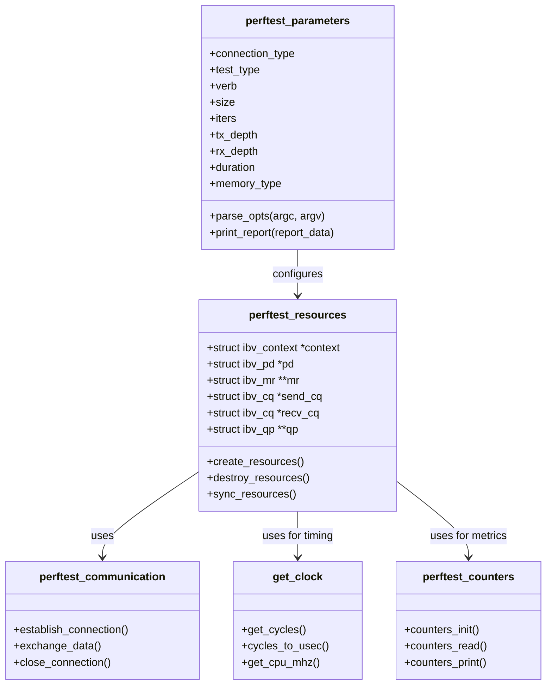
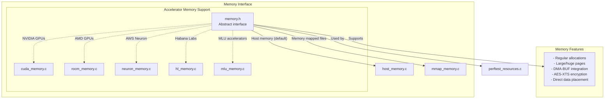
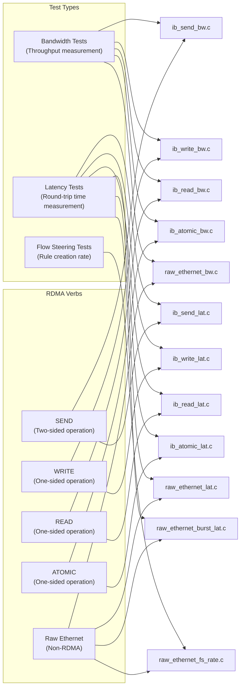
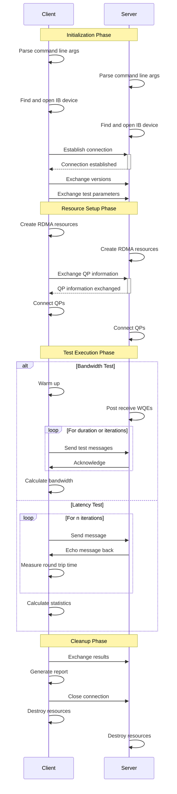

<!-- source: DeepWiki mcp.deepwiki.com · repo linux-rdma/perftest · page 1 Overview · fetched 2026-11-11 -->

# Overview

Relevant source files

The following files were used as context for generating this wiki page:

- [Makefile.am](Makefile.am)
- [README](README)
- [configure.ac](configure.ac)
- [debian/changelog](debian/changelog)
- [man/perftest.1](man/perftest.1)
- [perftest.spec](perftest.spec)

The perftest suite is a comprehensive collection of micro-benchmarks designed to measure and analyze the performance of RDMA (Remote Direct Memory Access) operations and related technologies. This toolkit enables precise performance testing of InfiniBand, RoCE (RDMA over Converged Ethernet), and other RDMA-capable networks, providing insights into bandwidth, latency, and message rates under various conditions.

This page introduces the overall architecture and components of the perftest suite. For specific test types and their usage, see [Test Types](#1.1). For details on supported connection types, see [Connection Types](#1.2).

## Purpose and Scope

The perftest suite generates synthetic workloads that exercise specific RDMA verbs and operations, allowing users to:

- Measure raw performance metrics like bandwidth, latency, and message rates
- Compare different RDMA verbs (Send, RDMA Write, RDMA Read, Atomics)
- Test various connection types (RC, UC, UD, XRC, DC, SRD)
- Evaluate performance across different message sizes
- Benchmark with various memory types (host memory, GPUs, accelerators)

These tools are primarily meant for hardware and software benchmarking and analysis, not for emulating real application traffic.

Sources: [README:13-21](), [README:102-110]()

## System Architecture

The perftest architecture consists of four main components:

1. **Core Library Components**: Provide foundational functionality for all tests
2. **Memory Subsystem**: Abstracts different memory types (host, GPU, etc.)
3. **Test Programs**: Implement various benchmark types (bandwidth, latency)
4. **Communication Layer**: Enables client-server interaction for testing

The following diagram illustrates these components and their relationships:

```mermaid
graph TD
    subgraph "Core Library Components"
        resources["perftest_resources.c
        Manages RDMA resources"]
        parameters["perftest_parameters.c
        Handles test configuration"]
        communication["perftest_communication.c
        Client-server communication"]
        clock["get_clock.c
        Timing facilities"]
        counters["perftest_counters.c
        Performance metrics"]
    end
    
    subgraph "Memory Subsystem"
        memory["memory.h
        Memory interface"]
        host_memory["host_memory.c
        System memory"]
        mmap_memory["mmap_memory.c
        Memory-mapped files"]
        
        subgraph "Accelerator Memory"
            cuda_memory["cuda_memory.c
            NVIDIA GPU memory"]
            rocm_memory["rocm_memory.c
            AMD GPU memory"]
            neuron_memory["neuron_memory.c
            AWS Neuron"]
            hl_memory["hl_memory.c
            Habana Labs"]
            mlu_memory["mlu_memory.c
            MLU accelerators"]
        end
        
        memory --> host_memory & mmap_memory
        memory -.-> cuda_memory & rocm_memory & neuron_memory & hl_memory & mlu_memory
    end
    
    subgraph "Test Programs"
        bw_tests["Bandwidth Tests"]
        lat_tests["Latency Tests"]
        raw_ethernet["Raw Ethernet Tests"]
        
        bw_tests --> send_bw["ib_send_bw.c"]
        bw_tests --> write_bw["ib_write_bw.c"]
        bw_tests --> read_bw["ib_read_bw.c"]
        bw_tests --> atomic_bw["ib_atomic_bw.c"]
        bw_tests --> raw_eth_bw["raw_ethernet_bw.c"]
        
        lat_tests --> send_lat["ib_send_lat.c"]
        lat_tests --> write_lat["ib_write_lat.c"]
        lat_tests --> read_lat["ib_read_lat.c"]
        lat_tests --> atomic_lat["ib_atomic_lat.c"]
        lat_tests --> raw_eth_lat["raw_ethernet_lat.c"]
        lat_tests --> raw_eth_burst["raw_ethernet_burst_lat.c"]
        
        raw_ethernet --> raw_eth_fs["raw_ethernet_fs_rate.c"]
    end
    
    resources --> memory
    parameters --> resources
    communication --> resources
    clock --> resources
    counters --> resources
    
    resources --> bw_tests & lat_tests & raw_ethernet
```

Sources: [Makefile.am:36-58](), [Makefile.am:60-146]()

## Core Components

The perftest suite's core library provides the foundation for all test programs, implemented as a static library (`libperftest.a`). This library contains the following key components:

1. **perftest_resources**: Manages RDMA resources such as queue pairs (QPs), completion queues (CQs), and memory regions (MRs).

2. **perftest_parameters**: Handles command-line parameters and test configuration, providing a unified interface for all test programs.

3. **perftest_communication**: Implements the client-server communication protocol used for test coordination.

4. **get_clock**: Provides high-resolution timing facilities for accurate performance measurements.

5. **perftest_counters**: Collects and reports performance metrics.

The following diagram shows how these components interact:

Sources: [Makefile.am:36-38]()

## Memory Subsystem

The memory subsystem provides a unified interface for different memory types, allowing tests to work with various memory sources without changing the test code. This abstraction is critical for testing specialized hardware like GPUs and accelerators.

The memory abstraction layer is implemented through a common interface defined in `memory.h`, with specialized implementations for each memory type:

| Memory Type | Implementation | Description | Conditional Compilation |
|-------------|----------------|-------------|--------------------------|
| Host memory | host_memory.c | Standard system memory allocations | Always included |
| Memory-mapped | mmap_memory.c | Memory-mapped file access | Always included |
| CUDA | cuda_memory.c | NVIDIA GPU memory | Requires CUDA headers |
| ROCm | rocm_memory.c | AMD GPU memory | Requires --enable-rocm |
| Neuron | neuron_memory.c | AWS Neuron accelerators | Requires --enable-neuron |
| Habana Labs | hl_memory.c | Habana Labs accelerators | Requires --enable-hl |
| MLU | mlu_memory.c | MLU accelerators | Requires --enable-mlu |

Sources: [Makefile.am:36-58](), [configure.ac:243-412]()

## Test Programs

The perftest suite includes multiple test programs, each targeting a specific RDMA operation or scenario:

### Bandwidth Tests
- **ib_send_bw**: Measures bandwidth using RDMA Send operations
- **ib_write_bw**: Measures bandwidth using RDMA Write operations
- **ib_read_bw**: Measures bandwidth using RDMA Read operations
- **ib_atomic_bw**: Measures bandwidth using RDMA Atomic operations
- **raw_ethernet_bw**: Measures bandwidth using raw Ethernet

### Latency Tests
- **ib_send_lat**: Measures latency using RDMA Send operations
- **ib_write_lat**: Measures latency using RDMA Write operations
- **ib_read_lat**: Measures latency using RDMA Read operations
- **ib_atomic_lat**: Measures latency using RDMA Atomic operations
- **raw_ethernet_lat**: Measures latency using raw Ethernet
- **raw_ethernet_burst_lat**: Measures latency for bursts of raw Ethernet packets

### Flow Steering Rate Tests
- **raw_ethernet_fs_rate**: Measures flow steering rules creation rate

Sources: [Makefile.am:60-146](), [README:23-29](), [README:112-124]()

## Test Execution Flow

Perftest operates in a client-server model, where one instance acts as a server waiting for connections, and the other acts as a client initiating the test. The test execution follows a standardized flow:

Sources: [README:57-85](), [README:137-146]()

## Supported Connection and Memory Types

The perftest suite supports various RDMA connection types and memory options, providing flexibility for different testing scenarios:

### Connection Types

| Connection Type | Description | Support in Tests |
|-----------------|-------------|------------------|
| RC (Reliable Connection) | Point-to-point reliable connection | All tests |
| UC (Unreliable Connection) | Point-to-point connection without reliability guarantees | Send, Write tests |
| UD (Unreliable Datagram) | Multicast-capable connection without reliability guarantees | Send tests only |
| XRC (Extended Reliable Connection) | Shared receive queues across multiple QPs | All tests (requires hardware support) |
| DC (Dynamically Connected) | On-demand connection establishment | All tests (requires hardware support) |
| SRD (Shared Receive Queue Datagram) | Unreliable datagram with shared receive queues | Send, Read, Write tests |
| Raw Ethernet | Non-RDMA Ethernet packets | Raw Ethernet tests only |

### Memory Types

| Memory Type | Description | Flag |
|-------------|-------------|------|
| Host Memory | Standard system memory | Default |
| Memory-mapped Files | File-backed memory | --mmap |
| CUDA Memory | NVIDIA GPU memory | --use_cuda |
| ROCm Memory | AMD GPU memory | --use_rocm |
| Neuron Memory | AWS Neuron accelerator memory | --use_neuron |
| Habana Labs Memory | Habana Labs accelerator memory | --use_hl |
| MLU Memory | MLU accelerator memory | --use_mlu |
| Huge Pages | Large page allocations | --use_hugepages |

Sources: [man/perftest.1:52-57](), [configure.ac:243-412](), [man/perftest.1:347-389]()

## Version and Compatibility

The perftest suite is actively maintained, with the current version being 6.24 as indicated in the configure script. Different versions of perftest may not be compatible with each other, so it's important to use the same version on both the client and server sides when conducting tests.

The suite is available under dual licensing: GPL v2 and OpenIB.org BSD license.

Sources: [configure.ac:32](), [README:352-355](), [configure.ac:1-29]()

---

