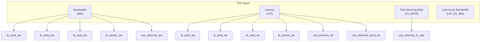
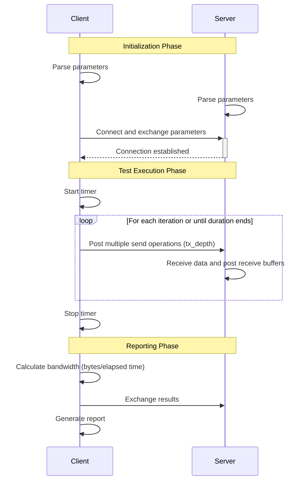
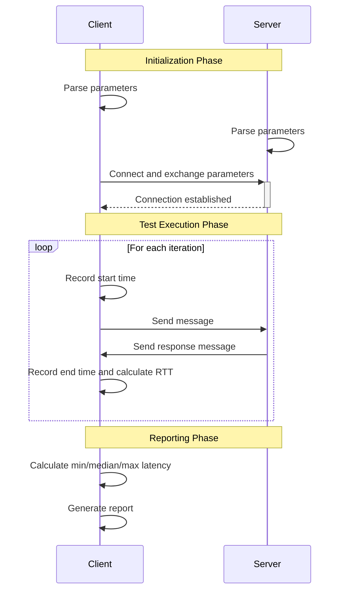
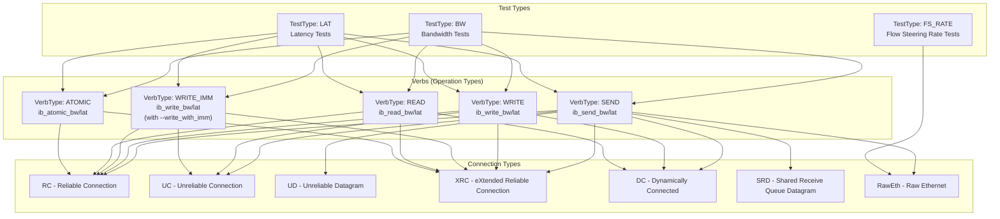
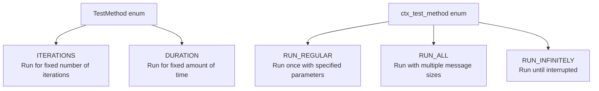

<!-- source: DeepWiki mcp.deepwiki.com · repo linux-rdma/perftest · page 1.1 Test Types · fetched 2026-11-11 -->

# Test Types

<details>
<summary>Relevant source files</summary>

The following files were used as context for generating this wiki page:

- [README](README)
- [man/perftest.1](man/perftest.1)
- [src/perftest_parameters.h](src/perftest_parameters.h)

</details>


This page documents the different test types available in the perftest suite and their purposes. Understanding these test types is essential for effectively benchmarking RDMA (Remote Direct Memory Access) performance. For information about connection types (RC, UC, UD, etc.), see [Connection Types](#1.2).

## Overview of Test Types

The perftest suite provides three primary test types:

1. **Bandwidth Tests** - Measure the maximum data throughput
2. **Latency Tests** - Measure the round-trip time for operations
3. **Flow Steering Rate Tests** - Measure flow creation rate in Raw Ethernet mode

Each test type serves a specific purpose in evaluating different aspects of RDMA performance.



Sources: [src/perftest_parameters.h:330](), [README:23-30]()

## Bandwidth Tests

Bandwidth tests measure the maximum throughput (in terms of Megabytes per second or Gigabits per second) that can be achieved for a specific operation type.

### Available Bandwidth Tests

| Test Name | Operation Type | Description |
|-----------|----------------|-------------|
| `ib_send_bw` | Send | Measures bandwidth using standard SEND operations |
| `ib_write_bw` | RDMA Write | Measures bandwidth using RDMA WRITE operations |
| `ib_read_bw` | RDMA Read | Measures bandwidth using RDMA READ operations |
| `ib_atomic_bw` | RDMA Atomic | Measures bandwidth using RDMA ATOMIC operations |
| `raw_ethernet_bw` | Raw Ethernet | Measures bandwidth using Raw Ethernet operations |

### Key Characteristics

- **Default message size**: 65536 bytes (configurable with `-s` option)
- **Default iterations**: 5000 for write, 1000 for others (configurable with `-n` option)
- **Measurement method**: Client measures the bandwidth in unidirectional mode
- **Bidirectional option**: Both client and server measure bandwidth of traffic they initiate
- **Multiple QPs**: Can run with multiple Queue Pairs to increase parallelism
- **Duration-based**: Can run for a fixed duration instead of iterations using `-D` option
- **Default transmit depth**: 128 (configurable with `-t` option)

### Bandwidth Test Flow



Sources: [README:67-70](), [src/perftest_parameters.h:102-104](), [README:127-147]()

### When to Use Bandwidth Tests

- To measure maximum achievable throughput of a system
- To evaluate performance of different RDMA operations under high-load conditions
- To benchmark network equipment capabilities
- To test scaling across multiple connections/QPs
- When optimizing for throughput rather than latency

## Latency Tests

Latency tests measure the time it takes for an operation to complete a round trip. They report minimum, median, and maximum latency results.

### Available Latency Tests

| Test Name | Operation Type | Description |
|-----------|----------------|-------------|
| `ib_send_lat` | Send | Measures latency using standard SEND operations |
| `ib_write_lat` | RDMA Write | Measures latency using RDMA WRITE operations |
| `ib_read_lat` | RDMA Read | Measures latency using RDMA READ operations |
| `ib_atomic_lat` | RDMA Atomic | Measures latency using RDMA ATOMIC operations |
| `raw_ethernet_lat` | Raw Ethernet | Measures latency using Raw Ethernet operations |
| `raw_ethernet_burst_lat` | Raw Ethernet Burst | Measures latency for bursts of Raw Ethernet operations |

### Key Characteristics

- **Default message size**: 2 bytes (configurable with `-s` option)
- **Default iterations**: 1000 (configurable with `-n` option)
- **Measurement method**: Reports half of the round-trip time as one-way latency
- **Statistics**: Reports minimum, median, and maximum latency values
- **Histogram**: Can produce histogram of latency results with `-H` option
- **Default transmit depth**: 1 (operations are serialized)

### Latency Test Flow



Sources: [README:64-66](), [src/perftest_parameters.h:102-103](), [README:72-76]()

### When to Use Latency Tests

- To measure responsiveness of a system
- To evaluate performance of different RDMA operations for time-sensitive applications
- When optimizing for response time rather than throughput
- To analyze the distribution of response times (using histogram option)
- To identify inconsistencies in network performance

## Flow Steering Rate Tests

Flow Steering Rate tests measure how quickly flow steering rules can be created in Raw Ethernet mode.

### Available Flow Steering Rate Tests

| Test Name | Description |
|-----------|-------------|
| `raw_ethernet_fs_rate` | Measures the rate at which flow steering rules can be created |

### Key Characteristics

- Specific to Raw Ethernet mode
- Evaluates a different aspect of performance than bandwidth or latency
- Measures flow creation performance rather than data transfer performance

### When to Use Flow Steering Rate Tests

- When evaluating the performance of flow rule creation mechanisms
- To benchmark network interface capabilities for rapidly changing traffic patterns
- When using advanced flow steering features
- To test the limitations of your networking hardware's flow table capacity

Sources: [src/perftest_parameters.h:330](), [man/perftest.1:125-126]()

## Relationship Between Test Types and Verbs

The following diagram illustrates the relationship between the test types, verbs (operation types), and connection types available in the perftest suite:



Sources: [src/perftest_parameters.h:72-78](), [src/perftest_parameters.h:327-330]()

## Common Test Parameters

All test types share a set of common parameters, though some parameters are only applicable to specific test types. Here are some key parameters:

| Parameter | Description | Default | Applicable To |
|-----------|-------------|---------|--------------|
| `-s, --size` | Message size in bytes | 65536 (BW), 2 (LAT) | All tests |
| `-n, --iters` | Number of iterations | 1000 (5000 for write BW) | All tests |
| `-t, --tx-depth` | Size of transmit queue | 128 (BW), 1 (LAT) | BW tests |
| `-c, --connection` | Connection type (RC/UC/UD/XRC/DC/SRD) | RC | All except RAW |
| `-b, --bidirectional` | Measure bidirectional bandwidth | Off | BW tests |
| `-D, --duration` | Run test for specified duration | Off | All tests |
| `-H, --report-histogram` | Print histogram of results | Off | LAT tests |
| `-q, --qp` | Number of QPs to use | 1 | BW tests |
| `-I, --inline_size` | Max size for inline sends | Off | All except READ, ATOMIC |
| `-a, --all` | Run sizes from 2 to 2^23 | Off | All except ATOMIC, RawEth |

Sources: [README:147-190](), [man/perftest.1:35-210]()

## Test Method Enumeration

The test method enumeration in the code determines how tests run in terms of iterations:



Sources: [src/perftest_parameters.h:341-342](), [src/perftest_parameters.h:350-351]()

## Test Type Implementation Details

The `TestType` is defined as an enumeration in the perftest_parameters.h file:

```
typedef enum { LAT , BW , LAT_BY_BW, FS_RATE } TestType;
```

This enumeration is stored in the `tst` field of the `perftest_parameters` structure, which holds all the test configuration parameters. The test type, along with the verb type and connection type, determines which specific test is being run.

Sources: [src/perftest_parameters.h:330](), [src/perftest_parameters.h:550]()

---

