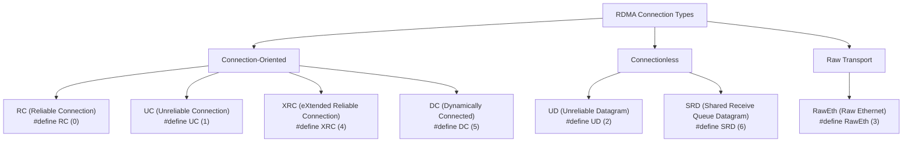
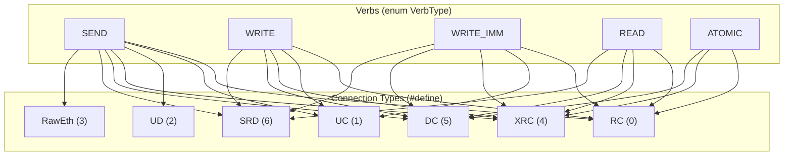
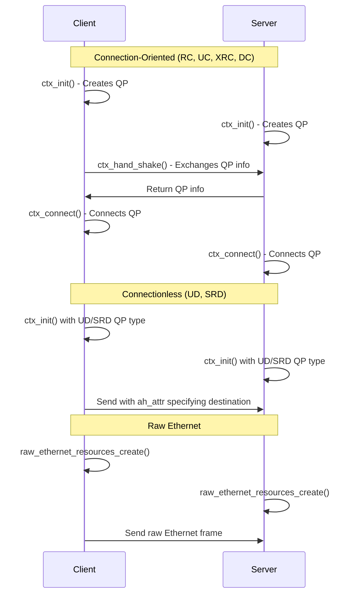

<!-- source: DeepWiki mcp.deepwiki.com · repo linux-rdma/perftest · page 1.2 Connection Types · fetched 2026-11-11 -->

# Connection Types

<details>
<summary>Relevant source files</summary>

The following files were used as context for generating this wiki page:

- [README](README)
- [man/perftest.1](man/perftest.1)
- [src/perftest_parameters.c](src/perftest_parameters.c)
- [src/perftest_parameters.h](src/perftest_parameters.h)

</details>


## Purpose and Scope
This page describes the different connection types supported in the perftest suite, their characteristics, and how they are used for RDMA (Remote Direct Memory Access) performance testing. For information about different test categories (bandwidth, latency, etc.), see [Test Types](#1.1).

## Connection Type Overview

Connection types define how RDMA communications are established and maintained between endpoints. The perftest suite supports multiple connection types, each with different reliability guarantees, performance characteristics, and operation support.

### Connection Type Hierarchy



Sources: [src/perftest_parameters.h:71-78](), [src/perftest_parameters.c:32]()

## Connection Types in Detail

### RC (Reliable Connection)
- **Description**: Connection-oriented transport that guarantees reliable, in-order delivery of messages
- **Features**: 
  - Supports all RDMA verbs (Send, Write, Read, Atomic)
  - Default connection type for all tests
  - Provides highest reliability but with some overhead for reliability guarantees
- **Use Cases**: Most general-purpose applications where reliability is important

### UC (Unreliable Connection)
- **Description**: Connection-oriented transport that does not guarantee reliable delivery
- **Features**: 
  - Messages may be dropped if there are errors
  - Supports Send and Write verbs, but not Read or Atomic
  - Often provides better performance than RC for applications that can handle occasional packet loss
- **Use Cases**: Applications that prioritize performance over reliability

### UD (Unreliable Datagram)
- **Description**: Connectionless transport that allows sending messages to multiple destinations
- **Features**: 
  - No guarantee of delivery or ordering
  - Supports only Send verb
  - Has a message size limitation and adds a 40-byte header to each message
  - Provides the lowest latency but with limited features
- **Use Cases**: Low-latency applications with simple messaging needs

### RawEth (Raw Ethernet)
- **Description**: Allows sending raw Ethernet packets without using RDMA verbs
- **Features**: 
  - Bypasses the RDMA stack entirely
  - Useful for testing the raw networking capabilities of the hardware
  - Requires specifying source and destination MAC addresses
- **Use Cases**: Network protocol development, baseline performance testing

### XRC (eXtended Reliable Connection)
- **Description**: Extension of RC that allows a single Receive Queue to be shared by multiple Queue Pairs
- **Features**: 
  - Reduces memory consumption for applications with many connections
  - Requires hardware support for XRC feature
  - Forces the use of Shared Receive Queues (SRQ)
- **Use Cases**: Applications with many connections where memory efficiency is important

### DC (Dynamically Connected)
- **Description**: Hybrid between connection-oriented and connectionless transports
- **Features**: 
  - Allows a single QP to communicate with multiple remote QPs
  - Requires hardware support for DC feature
  - Can use stream channels with the `--log_dci_streams` option
- **Use Cases**: High-scale applications with many connections

### SRD (Shared Receive Queue Datagram)
- **Description**: Variant of UD that uses Shared Receive Queues
- **Features**: 
  - Requires hardware support for SRD feature
  - More efficient resource usage compared to regular UD
- **Use Cases**: High-scale messaging applications

## Compatibility with Verbs

Not all connection types can be used with all RDMA verbs. The following diagram and table show the compatibility between connection types and verbs:



| Connection Type | Send | RDMA Write | RDMA Write with IMM | RDMA Read | Atomic |
|----------------|------|------------|---------------------|-----------|---------|
| RC             | ✓    | ✓          | ✓                   | ✓         | ✓       |
| UC             | ✓    | ✓          | ✓                   | ✗         | ✗       |
| UD             | ✓    | ✗          | ✗                   | ✗         | ✗       |
| RawEth         | ✓*   | ✗          | ✗                   | ✗         | ✗       |
| XRC            | ✓    | ✓          | ✓                   | ✓         | ✓       |
| DC             | ✓    | ✓          | ✓                   | ✓         | ✓       |
| SRD            | ✓    | ✓          | ✓                   | ✓         | ✗       |

\* RawEth uses its own sending mechanism, not standard RDMA Send

Sources: [src/perftest_parameters.c:1009-1062]()

These compatibility restrictions are enforced in the code. If you try to use an incompatible combination (like UD with RDMA Write), the program will exit with an error message.

## Connection Establishment

The connection establishment process differs between connection types:



### Connection-Oriented Types (RC, UC, XRC, DC)
1. Both client and server create their QPs using `ctx_init()`
2. They exchange QP attributes using `ctx_hand_shake()`
3. They connect their QPs using `ctx_connect()`
4. The connection is now established and ready for data transfer

### Connectionless Types (UD, SRD)
1. Both client and server create their QPs using `ctx_init()`
2. No explicit connection establishment is needed
3. When sending, the sender specifies the destination in the address handle (`ah_attr`)

### Raw Ethernet
1. Both client and server create their resources using `raw_ethernet_resources_create()`
2. No RDMA connection is established
3. Data is sent as raw Ethernet frames

## Performance Characteristics

The choice of connection type can significantly impact performance:

| Connection Type | Reliability | Latency | Bandwidth | Resource Usage | Features |
|-----------------|-------------|---------|-----------|----------------|----------|
| RC              | High        | Good    | High      | Moderate       | All verbs supported |
| UC              | Medium      | Better  | High      | Moderate       | No Read/Atomic |
| UD              | Low         | Best    | Limited   | Low            | Send only, small messages |
| RawEth          | None        | Best    | Varies    | Low            | Raw packet access |
| XRC             | High        | Good    | High      | Efficient      | All verbs, shared RQ |
| DC              | High        | Good    | High      | Efficient      | Dynamic connections |
| SRD             | Low         | Good    | Limited   | Efficient      | Shared RQ |

For maximum bandwidth, RC is generally preferred due to its support for RDMA operations. For minimum latency, UD or RawEth might be better options, but with feature limitations.

## Usage in perftest

To specify a connection type in perftest, use the `-c` or `--connection` option followed by the connection type name:

```
./ib_send_bw -c RC <server_ip>  # Use RC connection type
./ib_send_bw -c UC <server_ip>  # Use UC connection type
./ib_send_bw -c UD <server_ip>  # Use UD connection type
./ib_send_bw -c XRC <server_ip> # Use XRC connection type
./ib_send_bw -c DC <server_ip>  # Use DC connection type
./ib_send_bw -c SRD <server_ip> # Use SRD connection type
```

Sources: [src/perftest_parameters.c:1009-1062](), [src/perftest_parameters.h:509]()

### Special Considerations

When using certain connection types, there are additional considerations:

#### XRC (eXtended Reliable Connection)
- Forces the use of Shared Receive Queues (SRQ) as set in [src/perftest_parameters.c:1279-1280]()
- Requires hardware support for XRCD
- Provides better memory efficiency for applications with many connections

#### UD (Unreliable Datagram)
- Adds a 40-byte header to each message as defined in [src/perftest_parameters.h:93]()
- Has a maximum message size limitation
- Can be used with multicast groups using the `-g` and `-M` options

#### DC (Dynamically Connected)
- Requires hardware support for DC
- Can use stream channels with the `--log_dci_streams` option
- Good for scenarios with many connections

#### SRD (Shared Receive Queue Datagram)
- Requires hardware support for SRD
- Combines the advantages of UD and SRQ

#### RawEth (Raw Ethernet)
- Requires specifying source and destination MAC addresses using the `-B` and `-E` options
- Can be used with or without IP/TCP/UDP headers
- Special commands like `raw_ethernet_bw` and `raw_ethernet_lat` are provided for raw Ethernet testing

### Hardware and Software Requirements

Some connection types require specific hardware and software support:

- **XRC**: Requires XRCD support in the hardware and driver, checked in [src/perftest_parameters.c:1034-1039]()
- **DC**: Requires MLX5DV support in the driver, checked in [src/perftest_parameters.c:1041-1046]()
- **SRD**: Requires SRD support in the hardware and driver, checked in [src/perftest_parameters.c:1048-1057]()

If your hardware or software doesn't support a specific connection type, perftest will exit with an appropriate error message.

## Selecting the Right Connection Type

Guidelines for choosing the appropriate connection type:

1. For general-purpose testing with maximum feature support, use **RC**
2. For higher performance with slightly lower reliability, use **UC**
3. For minimum latency but limited features, use **UD**
4. For testing raw network capabilities without RDMA, use **RawEth**
5. For testing with many connections with memory efficiency, use **XRC** or **DC**
6. For specific shared receive queue testing, use **SRD**

Always ensure the connection type is compatible with the verb you want to test, as shown in the compatibility table above.

Sources: [README:154-155](), [man/perftest.1:52-57]()

---

