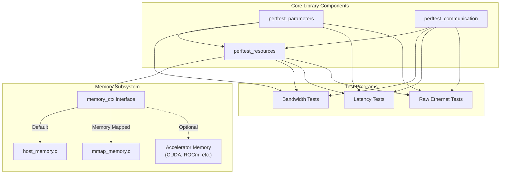
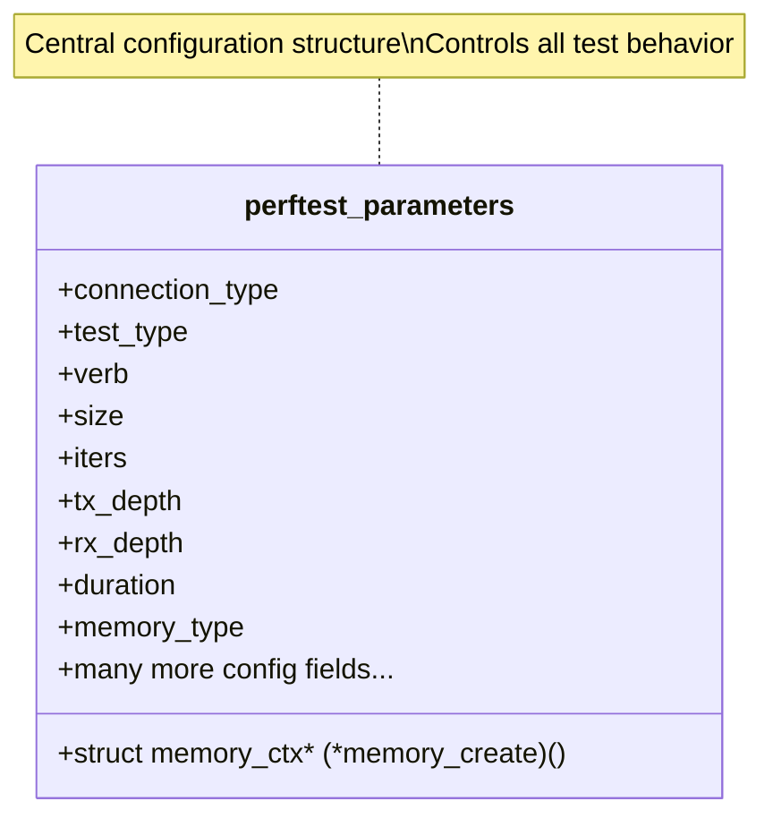
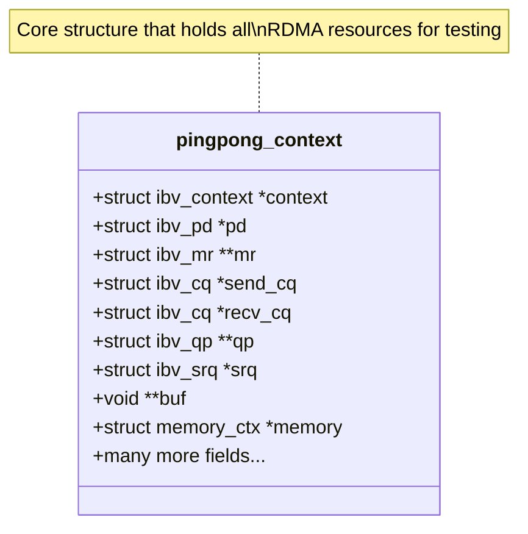
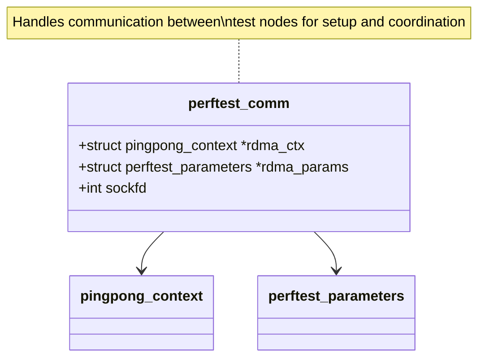
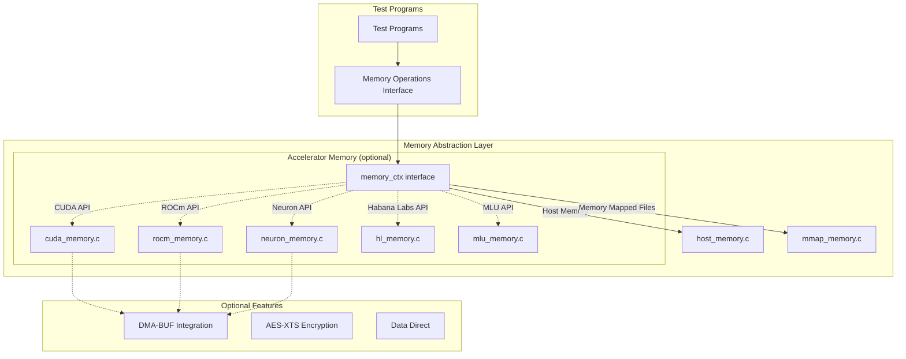
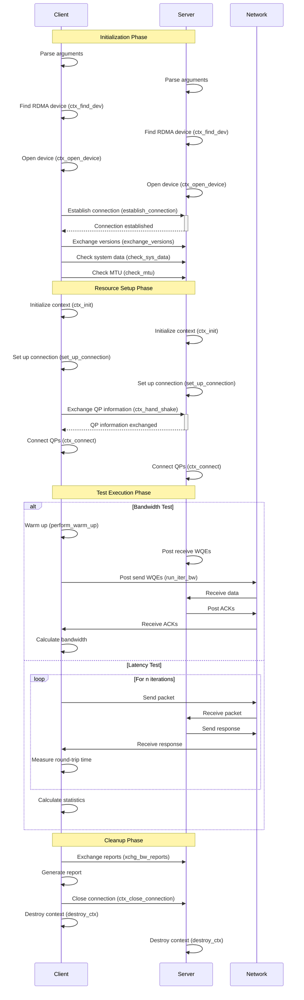
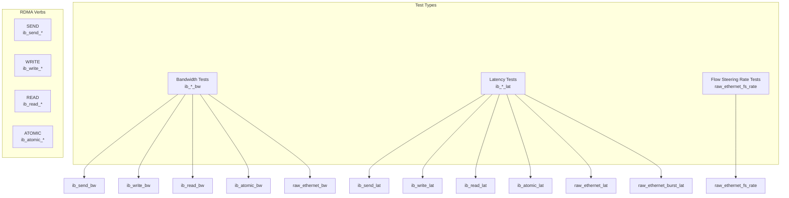
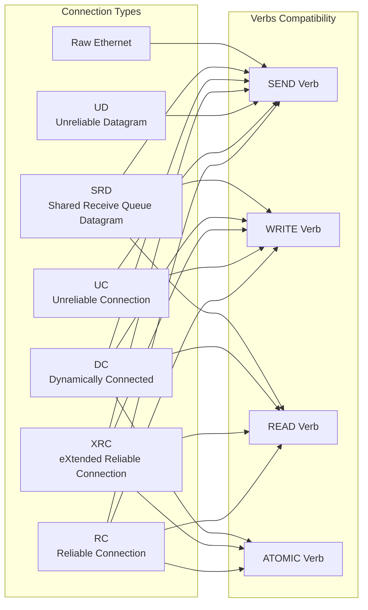

<!-- source: DeepWiki mcp.deepwiki.com · repo linux-rdma/perftest · page 2 Architecture · fetched 2026-11-11 -->

# Architecture

Relevant source files

The following files were used as context for generating this wiki page:

- [src/perftest_communication.c](src/perftest_communication.c)
- [src/perftest_communication.h](src/perftest_communication.h)
- [src/perftest_parameters.c](src/perftest_parameters.c)
- [src/perftest_resources.c](src/perftest_resources.c)

This document describes the overall system architecture of perftest, a comprehensive toolkit for measuring and benchmarking RDMA (Remote Direct Memory Access) performance. The architecture is designed to support multiple RDMA verbs, connection types, and memory backends while maintaining a clean separation of concerns.

For information about specific test types, see [Test Types](#1.1). For details on building and installing perftest, see [Building and Installation](#6).

## Core Components Overview

The perftest toolkit is built around a modular architecture with several key components that work together to provide flexible and comprehensive RDMA performance measurement capabilities.

Sources: 
- [src/perftest_resources.c:1-45]()
- [src/perftest_parameters.c:1-22]()
- [src/perftest_communication.c:1-25]()

### Parameters System

The parameters system handles configuration of all test aspects, including RDMA operations, connection types, test duration, message sizes, and more. It's implemented primarily in `perftest_parameters.c` with the central data structure `struct perftest_parameters`.

Key aspects of the parameters system:
- Provides command-line argument parsing
- Sets default values for all test parameters
- Validates parameter combinations for compatibility
- Forces dependencies between related parameters

Sources:
- [src/perftest_parameters.c:817-966]() - `init_perftest_params` function initializes default values
- [src/perftest_parameters.c:1181-1403]() - `force_dependecies` function ensures parameter compatibility

### Resources Management

The resources management component handles creation, configuration, and destruction of all RDMA resources needed for testing. It's implemented in `perftest_resources.c` and organized around the `struct pingpong_context` structure.

Key aspects of the resources management:
- Allocating and deallocating RDMA resources (QPs, CQs, MRs)
- Device discovery and configuration
- Memory management for send/receive buffers
- Support for different QP types (RC, UC, UD, etc.)
- Handling special resources (XRC domains, address handles, etc.)

Sources:
- [src/perftest_resources.c:942-979]() - `ctx_find_dev` function discovers RDMA devices
- [src/perftest_resources.c:1030-1128]() - `alloc_ctx` function allocates context resources
- [src/perftest_resources.c:1132-1222]() - `dealloc_ctx` function deallocates context resources
- [src/perftest_resources.c:1228-1451]() - `destroy_ctx` function destroys RDMA resources

### Communication System

The communication system manages the connection establishment and data exchange between test nodes. It's implemented in `perftest_communication.c` and supports both socket-based (Ethernet) and RDMA-CM based connection methods.

Key aspects of the communication system:
- Connection establishment (socket or RDMA CM)
- QP handshaking and address exchange
- Test parameter synchronization
- Version compatibility checking
- MTU negotiation

Sources:
- [src/perftest_communication.c:827-865]() - `set_up_connection` function prepares connection info
- [src/perftest_communication.c:958-1156]() - `rdma_client_connect` function implements RDMA CM client connection
- [src/perftest_communication.c:1189-1315]() - `rdma_server_connect` function implements RDMA CM server connection
- [src/perftest_communication.c:1455-1480]() - `establish_connection` function creates connection
- [src/perftest_communication.c:1487-1527]() - `ctx_hand_shake` function exchanges QP information

## Memory Subsystem

The memory subsystem provides an abstraction layer for different memory allocation mechanisms, supporting host memory, memory-mapped files, and various accelerator memories (CUDA, ROCm, etc.). This modular design allows tests to use different memory types without changing the test code.

The memory subsystem utilizes a common interface defined by `struct memory_ctx` that all memory implementations must implement. This interface includes the following key operations:

- `init()`: Initialize the memory subsystem
- `destroy()`: Clean up the memory subsystem
- `allocate_buffer()`: Allocate memory of a specified size
- `free_buffer()`: Free previously allocated memory
- `copy_buffer_to_host()`: Copy from device/accelerator memory to host memory
- `copy_host_to_buffer()`: Copy from host memory to device/accelerator memory
- `copy_buffer_to_buffer()`: Copy between two device/accelerator memory locations

Sources:
- [src/perftest_resources.c:1108-1128]() - Memory allocation in context creation
- [src/perftest_parameters.c:886-896]() - Memory type initialization
- [src/perftest_communication.c:1368-1370]() - Memory context creation for communication

## Test Execution Flow

The following diagram illustrates the execution flow of a typical perftest run, from initialization through test execution to cleanup.

Sources:
- [src/perftest_resources.c:897-921]() - `create_rdma_resources` function
- [src/perftest_resources.c:926-937]() - `destroy_rdma_resources` function
- [src/perftest_resources.c:1228-1451]() - `destroy_ctx` function for cleanup
- [src/perftest_communication.c:1455-1480]() - `establish_connection` function
- [src/perftest_communication.c:1487-1527]() - `ctx_hand_shake` function

## Test Types

Perftest includes three primary test types, each designed to measure different aspects of RDMA performance.

### Bandwidth Tests

Bandwidth tests measure the throughput of RDMA operations, expressed in terms of gigabits per second (Gbps) or bytes per second. These tests focus on maximum transfer rates achievable with different RDMA operations.

Key features of bandwidth tests:
- Support for all RDMA verbs (SEND, WRITE, READ, ATOMIC)
- Support for multiple outstanding operations (controlled by tx_depth)
- Bidirectional bandwidth measurement
- Post lists for efficient work request submission
- Support for various connection types (RC, UC, UD, etc.)

Sources:
- [src/perftest_parameters.c:849-850]() - Bandwidth test default settings
- [src/perftest_parameters.c:1359-1386]() - Post list configuration for bandwidth tests

### Latency Tests

Latency tests measure the round-trip time of RDMA operations, typically expressed in microseconds. These tests focus on the time it takes for a single operation to complete.

Key features of latency tests:
- Support for all RDMA verbs (SEND, WRITE, READ, ATOMIC)
- Histogram generation for detailed latency distribution analysis
- Cycle-based timing for high-precision measurement
- Support for various connection types (RC, UC, UD, etc.)

Sources:
- [src/perftest_parameters.c:312-315]() - Latency test command-line options
- [src/perftest_parameters.c:345-349]() - Latency histogram options

### Raw Ethernet Tests

Raw Ethernet tests operate at the Ethernet layer, bypassing the traditional IB/RDMA stack. These tests are useful for measuring raw network performance and special features like flow steering.

Key features of Raw Ethernet tests:
- Raw Ethernet bandwidth and latency measurements
- Flow steering rate testing
- Support for multi-flow traffic patterns
- MAC forwarding capabilities
- VLAN and QoS support

Sources:
- [src/perftest_parameters.c:725-813]() - Raw Ethernet command-line options
- [src/perftest_parameters.c:1145-1176]() - Flow rule dependencies

## Connection Types and Transport Modes

Perftest supports multiple connection types, allowing it to test various aspects of RDMA performance across different transport mechanisms.

### Connection Types

- **RC (Reliable Connection)**: A connected transport providing reliable, in-order delivery with error checking. Supports all RDMA verbs.
- **UC (Unreliable Connection)**: A connected transport without guarantees of reliable delivery. Supports SEND and WRITE verbs.
- **UD (Unreliable Datagram)**: A connectionless transport allowing communication with multiple peers. Only supports SEND verb.
- **XRC (eXtended Reliable Connection)**: Similar to RC but with shared receive queues, optimized for many-to-one communication patterns.
- **DC (Dynamically Connected)**: Combines aspects of connected and connectionless transports, allowing dynamic connections to multiple peers.
- **SRD (Shared Receive Queue Datagram)**: Similar to UD but with shared receive queues.
- **Raw Ethernet**: Bypasses the RDMA stack entirely, operating directly at the Ethernet layer.

Sources:
- [src/perftest_parameters.c:1014-1061]() - Connection type selection and validation
- [src/perftest_parameters.c:1272-1285]() - XRC-specific configuration
- [src/perftest_parameters.c:1283-1285]() - DC-specific configuration

### RDMA Operations (Verbs)

- **SEND/RECV**: Requires coordination between sender and receiver, with explicit receive buffers posted by the receiver.
- **WRITE**: One-sided operation where the initiator writes data directly to a remote memory region.
- **READ**: One-sided operation where the initiator reads data directly from a remote memory region.
- **ATOMIC**: One-sided operation performing atomic operations (compare-and-swap, fetch-and-add) on remote memory.

The compatibility between verbs and connection types is enforced by validation checks in the parameters system.

Sources:
- [src/perftest_parameters.c:1014-1061]() - Validation of verb and connection type compatibility
- [src/perftest_parameters.c:1245-1246]() - READ and ATOMIC-specific handling

## Integration Points

Perftest includes several integration points with other systems and features:

1. **RDMA CM**: Support for RDMA Connection Manager for connection establishment instead of using sockets.
2. **Accelerator Memory**: Integration with GPU and other accelerator memory through the memory abstraction layer.
3. **DMA-BUF**: Support for sharing memory between devices using Linux DMA-BUF.
4. **Performance Counters**: Integration with IB performance counters for detailed performance analysis.
5. **Hardware Rate Limiting**: Support for QoS and rate limiting features of RDMA hardware.
6. **AES-XTS Encryption**: Support for hardware-accelerated encryption of RDMA traffic.

These integration points make perftest a comprehensive tool for testing RDMA performance in various environments and configurations.

Sources:
- [src/perftest_parameters.c:423-443]() - RDMA CM options
- [src/perftest_parameters.c:622-666]() - Accelerator memory options
- [src/perftest_communication.c:1381-1396]() - Performance counter setup

---

