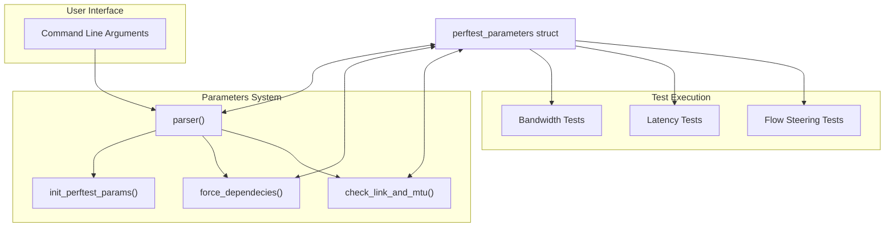
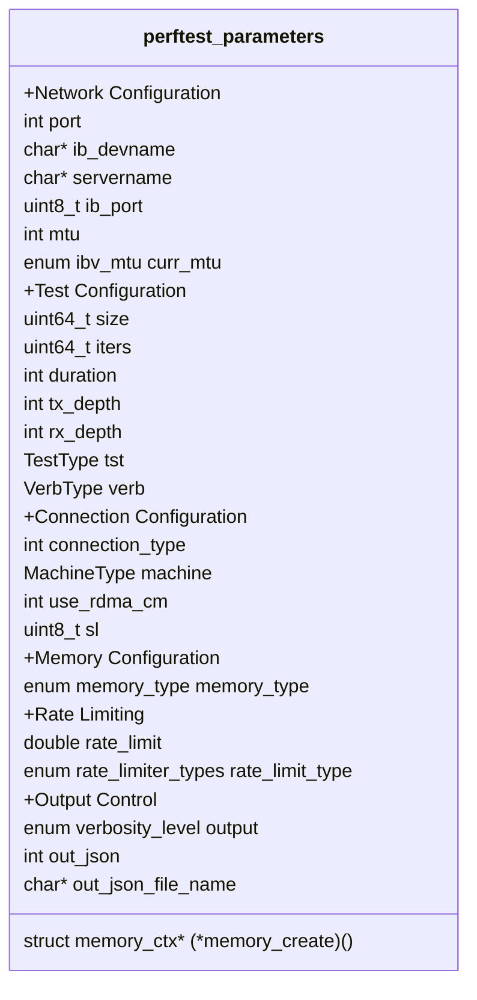
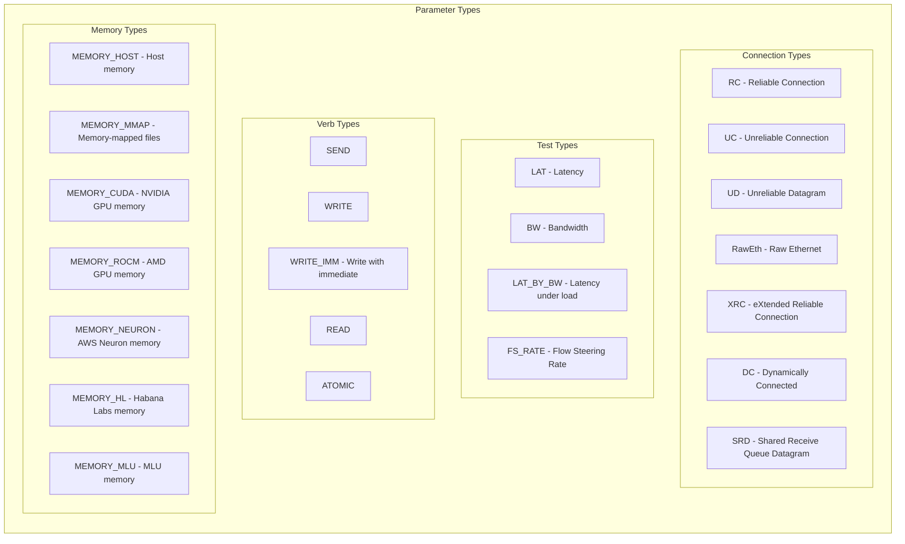
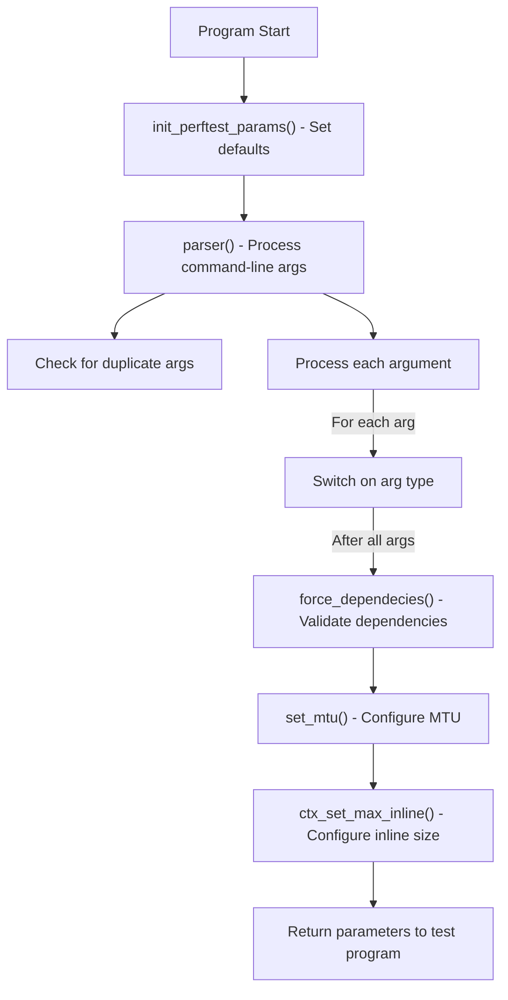
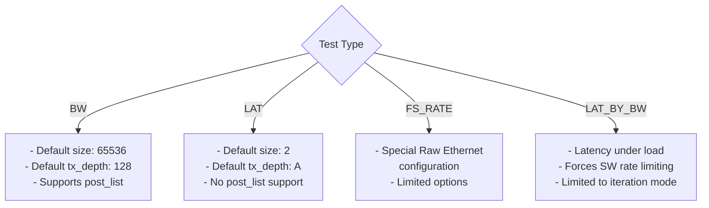
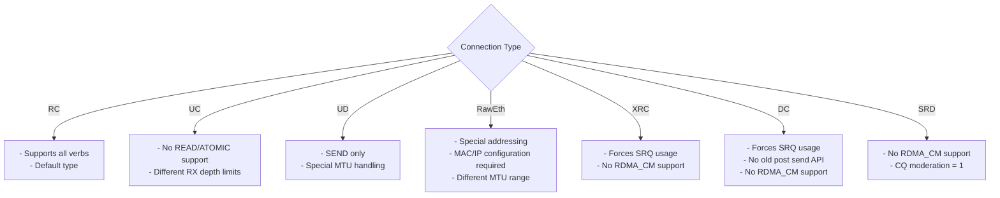
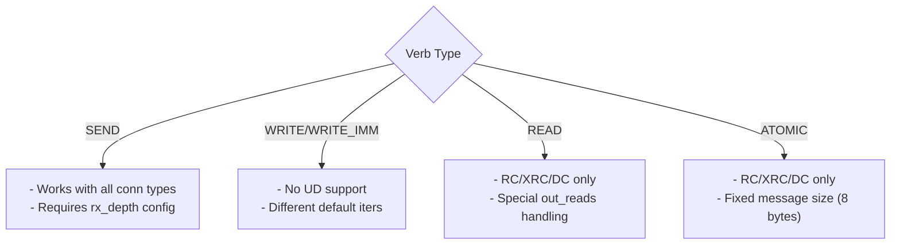
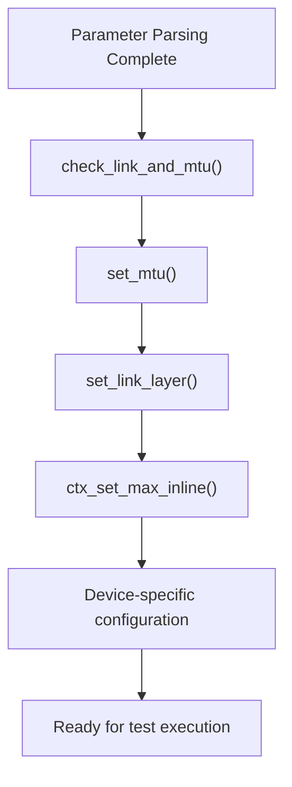
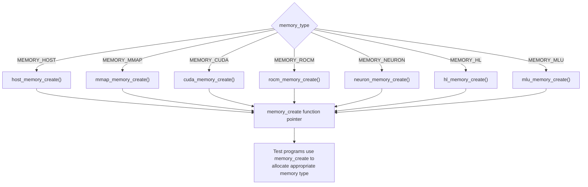
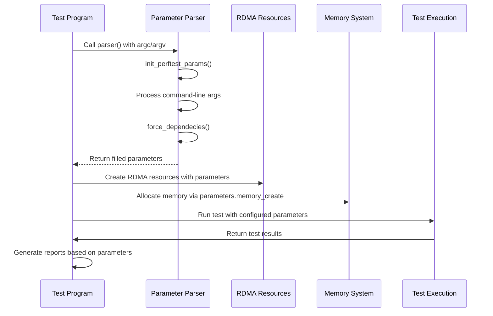

<!-- source: DeepWiki mcp.deepwiki.com · repo linux-rdma/perftest · page 2.1 Core Parameters System · fetched 2026-11-11 -->

# Core Parameters System

Relevant source files

The following files were used as context for generating this wiki page:

- [src/perftest_parameters.c](src/perftest_parameters.c)
- [src/perftest_parameters.h](src/perftest_parameters.h)

The Core Parameters System is responsible for managing and validating all test parameters within the perftest suite. It provides the infrastructure for defining default values, parsing command-line arguments, validating parameter combinations, and enforcing dependencies between parameters. This system is the foundation upon which all test programs operate, ensuring consistent behavior across the entire test suite.

For information about how these parameters are used in the context of RDMA resources, see [RDMA Resources Management](#2.2).

## Overview

The parameters system plays a central role in the perftest architecture, providing a unified way to configure all test programs. It handles everything from network configuration (ports, devices, MTU) to test properties (iterations, data size) to operational modes (connection types, verbs).

Sources: [src/perftest_parameters.c:373-1942](), [src/perftest_parameters.h:449-651]()

## Parameter Structure

The core of the parameter system is the `struct perftest_parameters` defined in [src/perftest_parameters.h:449-651](). This comprehensive structure contains over 200 fields that control all aspects of test execution. The structure includes:

Sources: [src/perftest_parameters.h:449-651]()

## Parameter Types

The parameters system defines several enumerations to represent different types of tests, connection methods, and operational modes:

### Connection Types
Available connection types (defined in [src/perftest_parameters.h:72-79]()):
- RC (Reliable Connection)
- UC (Unreliable Connection)
- UD (Unreliable Datagram)
- RawEth (Raw Ethernet)
- XRC (eXtended Reliable Connection)
- DC (Dynamically Connected)
- SRD (Shared Receive Queue Datagram)

### Test Types
Available test types (defined in [src/perftest_parameters.h:330]()):
- LAT (Latency)
- BW (Bandwidth)
- LAT_BY_BW (Latency under load)
- FS_RATE (Flow Steering Rate)

### Verb Types
Available RDMA operations (defined in [src/perftest_parameters.h:327]()):
- SEND
- WRITE
- WRITE_IMM (Write with immediate data)
- READ
- ATOMIC

### Memory Types
Available memory types (defined in [src/perftest_parameters.h:439-447]()):
- MEMORY_HOST (Standard host memory)
- MEMORY_MMAP (Memory-mapped files)
- MEMORY_CUDA (NVIDIA CUDA memory)
- MEMORY_ROCM (AMD ROCm memory)
- MEMORY_NEURON (AWS Neuron memory)
- MEMORY_HL (Habana Labs memory)
- MEMORY_MLU (MLU memory)

Sources: [src/perftest_parameters.h:72-79](), [src/perftest_parameters.h:327-330](), [src/perftest_parameters.h:439-447]()

## Parameter Initialization

The `init_perftest_params()` function (defined in [src/perftest_parameters.c:817-965]()) sets default values for all parameters. This ensures that all tests have a consistent baseline configuration. Key defaults include:

| Parameter | Default Value | Description |
|-----------|---------------|-------------|
| port | 18515 | TCP port for communication |
| ib_port | 1 | InfiniBand port number |
| size | 65536 (BW) / 2 (LAT) | Message size in bytes |
| iters | 1000 (most tests) / 5000 (WRITE BW) | Number of iterations |
| tx_depth | 128 (BW) / 1 (LAT) | Send queue depth |
| rx_depth | 512 (SEND) / 1 (RDMA) | Receive queue depth |
| connection_type | RC | Default connection type |
| qp_timeout | 14 | QP timeout (4 μs * 2^timeout) |
| sl | 0 | Service level |
| gid_index | -1 | GID index (-1 means not used) |
| inline_size | -1 | Max inline size (-1 means auto-detect) |
| cq_mod | 100 | CQ moderation |

Sources: [src/perftest_parameters.c:817-965]()

## Parameter Parsing Flow

The parameter parsing system uses the standard getopt_long() function to process command-line arguments. The function `parser()` in [src/perftest_parameters.c:2373-7153]() is the entry point for parameter processing.

Sources: [src/perftest_parameters.c:2373-7153](), [src/perftest_parameters.c:817-965](), [src/perftest_parameters.c:1181-1941]()

## Command-Line Options

The parameters system supports a comprehensive set of command-line options that control all aspects of test execution. These options are documented in the `usage()` function in [src/perftest_parameters.c:253-720]().

Key option categories include:

1. **Test Configuration**
   - `-n, --iters=<iters>`: Number of iterations
   - `-s, --size=<size>`: Message size
   - `-D, --duration`: Run test for specified time period
   - `-a, --all`: Run with multiple message sizes

2. **Connection Configuration**
   - `-c, --connection=<type>`: Connection type (RC/UC/UD/RawEth/XRC/DC/SRD)
   - `-R, --rdma_cm`: Use RDMA CM for connection
   - `-z, --comm_rdma_cm`: Use RDMA CM for data exchange

3. **Device Configuration**
   - `-d, --ib-dev=<dev>`: InfiniBand device to use
   - `-i, --ib-port=<port>`: Port number to use
   - `-m, --mtu=<mtu>`: MTU size

4. **Performance Options**
   - `-t, --tx-depth=<dep>`: Send queue depth
   - `-r, --rx-depth=<dep>`: Receive queue depth
   - `-Q, --cq-mod`: Completion queue moderation
   - `-l, --post_list=<list size>`: Number of WQEs to post at once

5. **Memory Options**
   - `--use_cuda=<dev_id>`: Use CUDA memory
   - `--use_rocm=<dev_id>`: Use ROCm memory
   - `--mmap=<file>`: Use memory-mapped file

Sources: [src/perftest_parameters.c:253-720]()

## Parameter Validation and Dependencies

The `force_dependecies()` function in [src/perftest_parameters.c:1181-1941]() enforces relationships between parameters and validates parameter combinations. This function ensures that:

1. Parameters are compatible with each other
2. Invalid combinations are rejected
3. Dependent parameters are automatically adjusted

Key dependency types include:

### Test Type Dependencies

### Connection Type Dependencies

### Verb Type Dependencies

Common validation and adjustments include:

1. Limiting tx_depth to the number of iterations
2. Adjusting rx_depth based on connection type
3. Disabling CQ moderation for large messages
4. Enforcing verb availability for connection types
5. Adjusting parameters for Raw Ethernet tests
6. Configuring MTU to valid values for the device

Sources: [src/perftest_parameters.c:1181-1941]()

## Resource Configuration

After parameter parsing, additional configuration is applied to match the parameters to available hardware capabilities:

### MTU Configuration

The `set_mtu()` function in [src/perftest_parameters.c:2121-2162]() configures MTU based on:
1. User-specified value (if provided)
2. Device capabilities
3. Hardware-specific limitations

For Raw Ethernet tests, `set_eth_mtu()` in [src/perftest_parameters.c:1085-1102]() is used instead, with a different valid range (64-9600 bytes).

### Link Layer Configuration

The `set_link_layer()` function in [src/perftest_parameters.c:2173-2224]() determines and validates the link layer (InfiniBand or Ethernet) based on the device port configuration.

### Inline Size Configuration

The `ctx_set_max_inline()` function in [src/perftest_parameters.c:2288-2338]() sets the maximum inline data size based on:
1. User-specified value (if provided)
2. Test type (latency tests use inline, bandwidth tests don't)
3. Device and connection type-specific limitations

Sources: [src/perftest_parameters.c:2121-2162](), [src/perftest_parameters.c:2173-2224](), [src/perftest_parameters.c:2288-2338]()

## Memory Type Management

The parameters system includes support for different memory types through a memory abstraction layer:

The `memory_type` parameter and `memory_create` function pointer in `struct perftest_parameters` allow tests to abstract memory allocation, supporting regular host memory, memory-mapped files, and various accelerator memories (CUDA, ROCm, etc.).

Sources: [src/perftest_parameters.h:440-447](), [src/perftest_parameters.h:571-572](), [src/perftest_parameters.c:887-895]()

## Parameter System Integration

The parameters system integrates with the rest of the perftest suite through a standard flow:

This standardized flow ensures consistent behavior across all test programs, with the parameters system providing the configuration foundation for the entire test execution process.

Sources: [src/perftest_parameters.c:373-1942](), [src/perftest_parameters.c:2373-7153]()

## Summary

The Core Parameters System is a fundamental component of the perftest suite, providing:

1. A unified way to configure all test programs
2. Comprehensive parameter validation and dependency management
3. Adaptation to hardware capabilities and limitations
4. Support for a wide range of test configurations and memory types

This system enables the perftest suite to maintain consistent behavior across a diverse range of hardware, connection types, and test scenarios, while providing users with fine-grained control over test execution.

---

