<!-- source: DeepWiki mcp.deepwiki.com · repo linux-rdma/perftest · page 2.2 RDMA Resources Management · fetched 2026-11-11 -->

# RDMA Resources Management

<details>
<summary>Relevant source files</summary>

The following files were used as context for generating this wiki page:

- [src/perftest_resources.c](src/perftest_resources.c)
- [src/perftest_resources.h](src/perftest_resources.h)

</details>


This document explains how RDMA resources are created, managed, and destroyed during test execution in the perftest suite. It covers the lifecycle of RDMA resources such as Queue Pairs (QPs), Memory Regions (MRs), Completion Queues (CQs), and how they are initialized, configured, and cleaned up.

For information on the parameters that configure these resources, see [Core Parameters System](#2.1). For details on how memory is allocated and managed, see [Memory Management](#2.4).

## Resource Overview

The main structure for managing RDMA resources is the `pingpong_context` defined in [src/perftest_resources.h:171-237](), which contains all the RDMA resources needed during tests.

### RDMA Resource Hierarchy

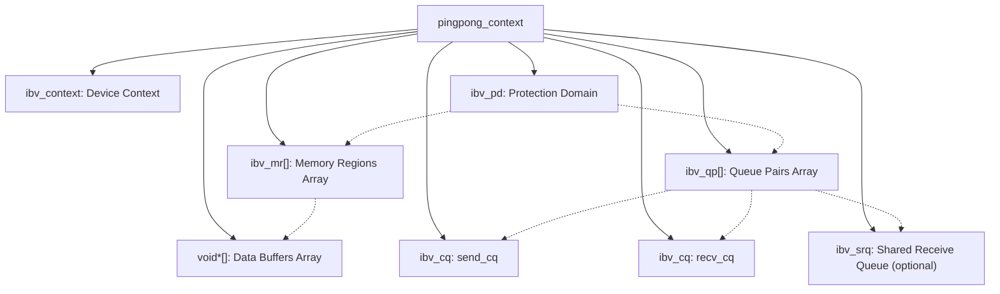

Sources:
- [src/perftest_resources.h:171-237]()

The `pingpong_dest` structure is used to exchange QP connection information between endpoints:

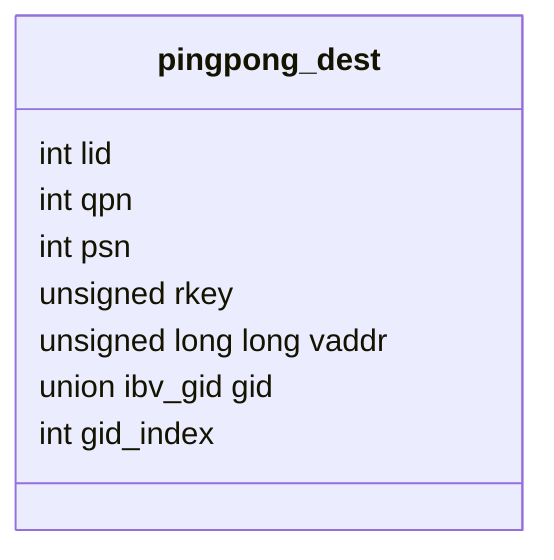

Sources:
- [src/perftest_resources.h:239-249]()

## Resource Lifecycle

The lifecycle of RDMA resources follows this sequence:

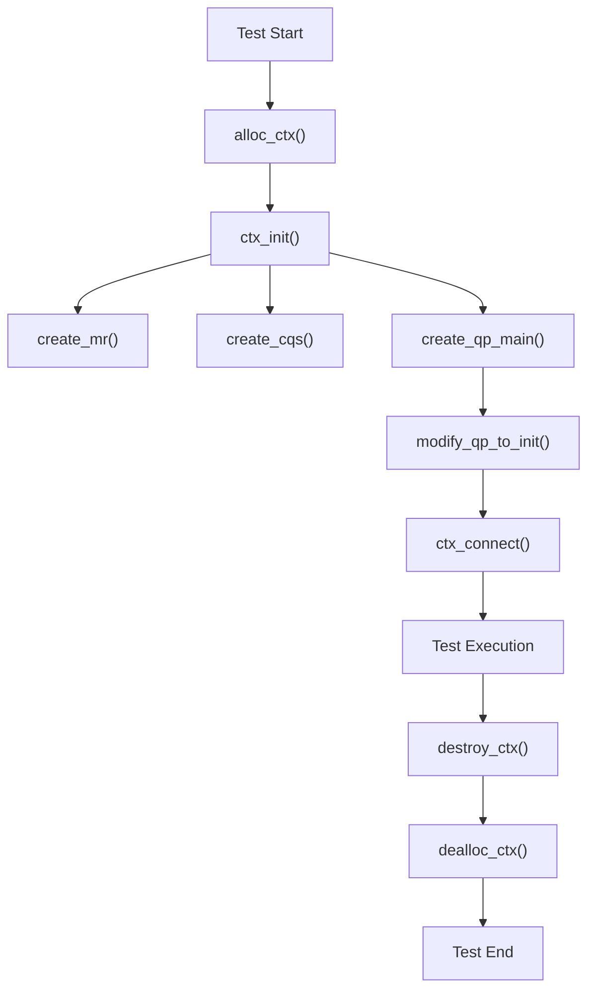

Sources:
- [src/perftest_resources.c:1030-1128]() - alloc_ctx
- [src/perftest_resources.c:1992-2258]() - ctx_init
- [src/perftest_resources.c:1227-1451]() - destroy_ctx
- [src/perftest_resources.c:1132-1222]() - dealloc_ctx

## Resource Allocation

Resource allocation begins with the `alloc_ctx` function, which allocates memory for various RDMA resources based on test parameters.

Key allocations include:
- Arrays for timing data (`user_param->tposted`, `user_param->tcompleted`)
- Arrays for QPs (`ctx->qp`)
- Arrays for Memory Regions (`ctx->mr`)
- Arrays for data buffers (`ctx->buf`)
- Work requests and scatter-gather elements
- Test-specific counters and data structures

The buffer size is calculated based on the message size, cycle buffer size, and other parameters:

```c
ctx->buff_size = INC(BUFF_SIZE(ctx->size, ctx->cycle_buffer),
             ctx->cache_line_size) * 2 * num_of_qps_factor * user_param->flows;
```

Sources:
- [src/perftest_resources.c:1030-1128]()

## Resource Initialization

The `ctx_init` function initializes all RDMA resources in the following sequence:

### 1. Device Context and Event Channels

First, if event-based completion is requested, event channels are created:

```c
if (user_param->use_event) {
    ctx->send_channel = ibv_create_comp_channel(ctx->context);
    ctx->recv_channel = ibv_create_comp_channel(ctx->context);
}
```

### 2. Protection Domain

A Protection Domain (PD) is created to isolate and secure RDMA resources:

```c
ctx->pd = ibv_alloc_pd(ctx->context);
```

### 3. Memory Registration

Memory regions are registered for data transfer:

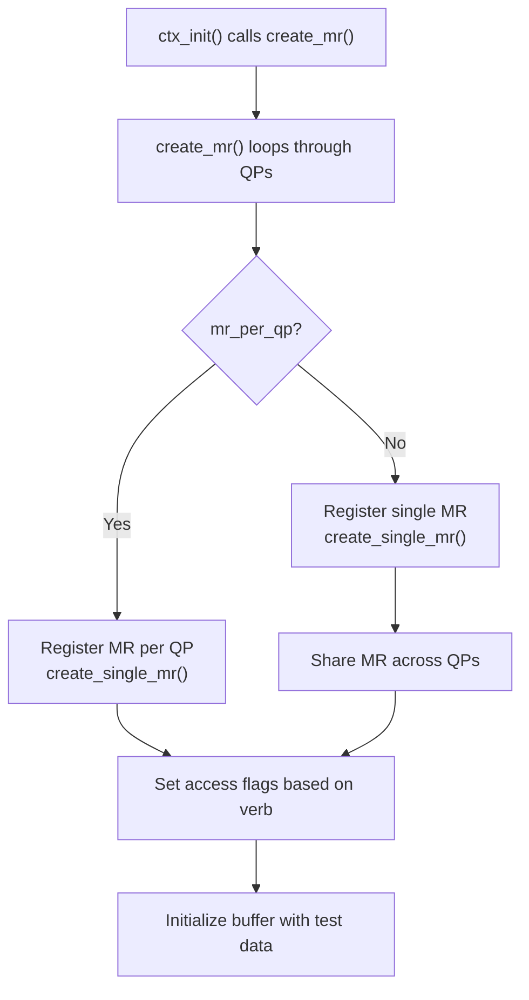

The `create_single_mr` function:
1. Allocates memory buffer
2. Sets access flags based on the verb (SEND, WRITE, READ, ATOMIC)
3. Registers the buffer with the PD
4. Initializes the buffer with test data

Access flags are determined by the operation:
```c
if (user_param->verb == WRITE || user_param->verb == WRITE_IMM) {
    flags |= IBV_ACCESS_REMOTE_WRITE;
} else if (user_param->verb == READ) {
    flags |= IBV_ACCESS_REMOTE_READ;
} else if (user_param->verb == ATOMIC) {
    flags |= IBV_ACCESS_REMOTE_ATOMIC;
}
```

### 4. Completion Queues

Completion Queues (CQs) are created for completion notification:

```c
int create_cqs(struct pingpong_context *ctx, struct perftest_parameters *user_param)
{
    // Determine depths based on test type
    tx_buffer_depth = user_param->tx_depth;
    
    // Create send CQ
    ctx->send_cq = ibv_create_cq(ctx->context, tx_buffer_depth *
                    user_param->num_of_qps, NULL, ctx->send_channel, user_param->eq_num);
    
    // Create receive CQ if needed
    if (need_recv_cq) {
        ctx->recv_cq = ibv_create_cq(ctx->context, user_param->rx_depth *
                        user_param->num_of_qps, NULL, ctx->recv_channel, user_param->eq_num);
    }
}
```

### 5. Shared Receive Queue (Optional)

If specified, a Shared Receive Queue (SRQ) is created:

```c
if (user_param->use_srq && !user_param->use_xrc) {
    struct ibv_srq_init_attr attr = {
        .attr = {
            .max_wr  = user_param->rx_depth,
            .max_sge = 1
        }
    };
    ctx->srq = ibv_create_srq(ctx->pd, &attr);
}
```

### 6. Queue Pairs

Queue Pairs (QPs) are created based on test parameters:

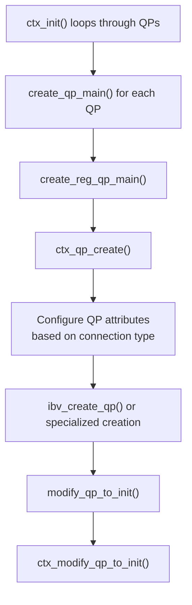

Sources:
- [src/perftest_resources.c:1992-2258]() - ctx_init
- [src/perftest_resources.c:1860-1900]() - create_mr
- [src/perftest_resources.c:1654-1774]() - create_single_mr
- [src/perftest_resources.c:1630-1649]() - create_cqs

## Queue Pair Management

### QP Creation

The `ctx_qp_create` function creates QPs with attributes set based on:
- Connection type (RC, UC, UD, DC, XRC, etc.)
- Test verb (SEND, WRITE, READ, ATOMIC)
- Other test parameters (inline size, tx_depth, rx_depth)

```c
struct ibv_qp* ctx_qp_create(struct pingpong_context *ctx,
        struct perftest_parameters *user_param, int qp_index)
{
    // Set up QP attributes
    attr.send_cq = ctx->send_cq;
    attr.recv_cq = ctx->recv_cq;
    attr.qp_type = <based on connection_type>;
    attr.cap.max_send_wr = user_param->tx_depth;
    attr.cap.max_send_sge = MAX_SEND_SGE;
    attr.cap.max_inline_data = user_param->inline_size;
    
    // Create QP using appropriate method
    qp = ibv_create_qp(ctx->pd, &attr);
    
    return qp;
}
```

### QP State Transitions

QPs go through several state transitions:

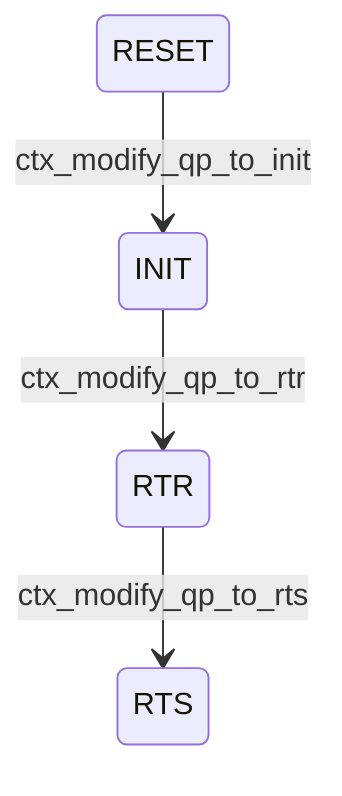

1. **RESET to INIT**: The `ctx_modify_qp_to_init` function transitions QPs to INIT state:

```c
int ctx_modify_qp_to_init(struct ibv_qp *qp, struct perftest_parameters *user_param, int qp_index)
{
    struct ibv_qp_attr attr;
    int flags = IBV_QP_STATE | IBV_QP_PKEY_INDEX | IBV_QP_PORT;
    
    attr.qp_state = IBV_QPS_INIT;
    attr.pkey_index = user_param->pkey_index;
    attr.port_num = user_param->ib_port;
    
    // Set access flags based on verb
    if (user_param->verb != SEND) {
        attr.qp_access_flags = <appropriate flags>;
        flags |= IBV_QP_ACCESS_FLAGS;
    }
    
    return ibv_modify_qp(qp, &attr, flags);
}
```

2. **INIT to RTR to RTS**: The `ctx_connect` function establishes connections:

```c
int ctx_connect(struct pingpong_context *ctx, struct pingpong_dest *dest,
        struct perftest_parameters *user_param, struct pingpong_dest *my_dest)
{
    for (i=0; i < user_param->num_of_qps; i++) {
        // Modify QP to RTR
        ctx_modify_qp_to_rtr(ctx->qp[i], &attr, user_param, &dest[i], &my_dest[i], i);
        
        // Modify QP to RTS
        ctx_modify_qp_to_rts(ctx->qp[i], &attr, user_param, &dest[i], &my_dest[i]);
        
        // Create Address Handle for UD/DC
        if (user_param->connection_type == UD || user_param->connection_type == DC) {
            ctx->ah[i] = ibv_create_ah(ctx->pd, &(attr.ah_attr));
        }
    }
}
```

### Connection Establishment Sequence

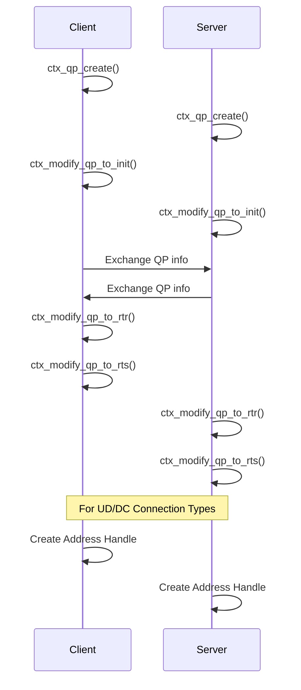

Sources:
- [src/perftest_resources.c:2319-2583]() - ctx_qp_create
- [src/perftest_resources.c:2588-2653]() - ctx_modify_qp_to_init
- [src/perftest_resources.c:2799-2896]() - ctx_connect
- [src/perftest_resources.c:2658-2754]() - ctx_modify_qp_to_rtr
- [src/perftest_resources.c:2759-2794]() - ctx_modify_qp_to_rts

## Work Request Setup

After QPs are connected, the test sets up work requests for sending and receiving data:

### Send Work Requests

The `ctx_set_send_wqes` function prepares send work requests based on the test parameters:

```c
void ctx_set_send_wqes(struct pingpong_context *ctx,
        struct perftest_parameters *user_param,
        struct pingpong_dest *rem_dest)
{
    // For each QP
    for (i = 0; i < user_param->num_of_qps; i++) {
        // For each post_list (batch size)
        for (j = 0; j < user_param->post_list; j++) {
            // Set up send work request
            wr = &ctx->wr[i*user_param->post_list + j];
            wr->wr_id = PINGPONG_SEND_WRID;
            wr->sg_list = &ctx->sge_list[i*user_param->post_list + j];
            wr->num_sge = 1;
            
            // Set operation type
            if (user_param->verb == SEND)
                wr->opcode = IBV_WR_SEND;
            else if (user_param->verb == WRITE)
                wr->opcode = IBV_WR_RDMA_WRITE;
            // ...etc for other operations
            
            // Set remote information for RDMA operations
            if (user_param->verb != SEND) {
                wr->wr.rdma.remote_addr = rem_dest[i].vaddr;
                wr->wr.rdma.rkey = rem_dest[i].rkey;
            }
        }
    }
}
```

### Receive Work Requests

For tests that require receives (SEND, WRITE_IMM), the `ctx_set_recv_wqes` function posts receive work requests:

```c
int ctx_set_recv_wqes(struct pingpong_context *ctx, struct perftest_parameters *user_param)
{
    // For each QP
    for (i = 0; i < user_param->num_of_qps; i++) {
        // For each receive depth
        for (j = 0; j < user_param->rx_depth; j++) {
            // Set up receive work request
            rwr = &ctx->rwr[i*user_param->rx_depth + j];
            rwr->wr_id = i;
            rwr->sg_list = &ctx->recv_sge_list[i*user_param->rx_depth + j];
            rwr->num_sge = 1;
            
            // Post receive work request
            if (user_param->use_srq)
                ret = ibv_post_srq_recv(ctx->srq, rwr, &bad_wr);
            else
                ret = ibv_post_recv(ctx->qp[i], rwr, &bad_wr);
        }
    }
}
```

Sources:
- [src/perftest_resources.c:2901-2906]() - ctx_set_send_wqes

## Resource Cleanup

Resource cleanup is handled by the `destroy_ctx` function. The cleanup process follows this sequence:

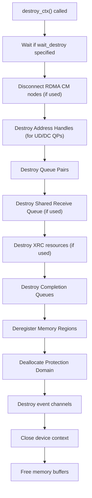

The `dealloc_ctx` function deallocates the arrays allocated in `alloc_ctx`.

Sources:
- [src/perftest_resources.c:1227-1451]() - destroy_ctx
- [src/perftest_resources.c:1132-1222]() - dealloc_ctx

## Special Resource Types

### XRC (Extended Reliable Connection)

For XRC tests, additional resources are created:

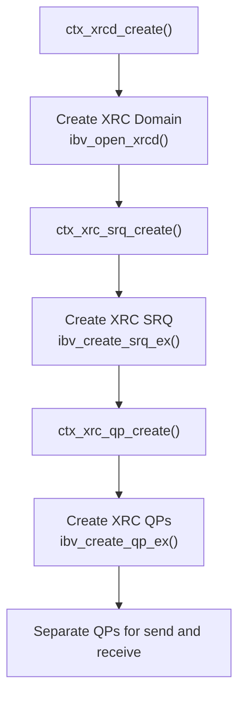

Sources:
- [src/perftest_resources.c:720-745]() - ctx_xrcd_create
- [src/perftest_resources.c:750-776]() - ctx_xrc_srq_create
- [src/perftest_resources.c:781-848]() - ctx_xrc_qp_create

### DC (Dynamically Connected Transport)

For DC tests, the QP creation process handles:

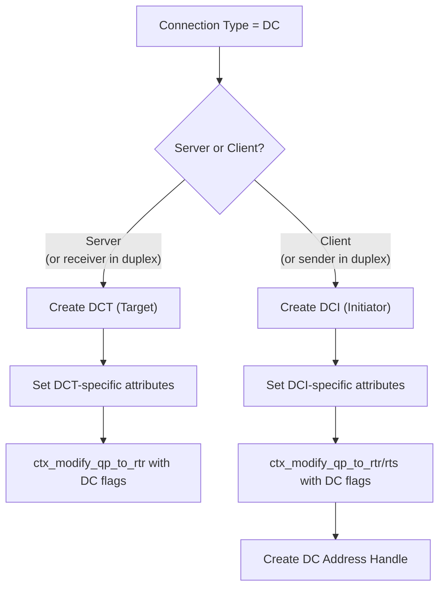

### ODP (On-Demand Paging)

When ODP is enabled (`use_odp`):
- Memory registration includes the `IBV_ACCESS_ON_DEMAND` flag
- The system checks for ODP support using `check_odp_support`, which verifies device capabilities and transport compatibility

```c
if (user_param->use_odp) {
    if (!check_odp_support(ctx, user_param))
        return FAILURE;
    flags |= IBV_ACCESS_ON_DEMAND;
}
```

Sources:
- [src/perftest_resources.c:1457-1554]() - check_odp_support

### AES-XTS Encryption

When AES-XTS encryption is enabled (`aes_xts`):

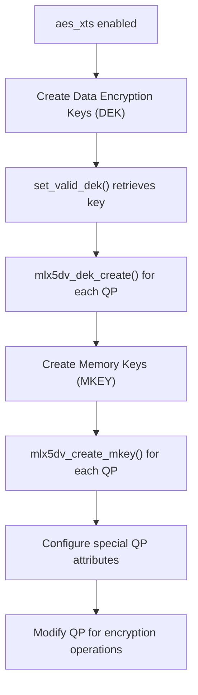

Sources:
- [src/perftest_resources.c:47-116]() - set_valid_dek/set_valid_cred for AES-XTS
- [src/perftest_resources.c:2057-2099]() - AES-XTS resource creation in ctx_init

## Conclusion

The RDMA resources management in perftest follows a systematic approach:

1. **Allocation**: Memory is allocated for various RDMA resources
2. **Initialization**: Resources are created and initialized (PD, MR, CQ, QP, etc.)  
3. **Configuration**: QPs are configured and moved through state transitions
4. **Connection**: QPs are connected between endpoints
5. **Work Setup**: Work requests are prepared for data transfer
6. **Cleanup**: Resources are properly destroyed and memory is deallocated

This framework supports various connection types (RC, UC, UD, DC, XRC) and operations (SEND, WRITE, READ, ATOMIC), as well as advanced features like ODP and AES-XTS encryption.

Sources:
- [src/perftest_resources.h]()
- [src/perftest_resources.c]()

---

