<!-- source: DeepWiki mcp.deepwiki.com · repo linux-rdma/perftest · page 2.3 Communication System · fetched 2026-11-11 -->

# Communication System

Relevant source files

The following files were used as context for generating this wiki page:

- [src/perftest_communication.c](src/perftest_communication.c)
- [src/perftest_communication.h](src/perftest_communication.h)

## Purpose and Scope

The Communication System in perftest is responsible for establishing, managing, and terminating connections between test endpoints. It provides a unified interface for both socket-based (Ethernet) and RDMA CM-based communication, allowing the various performance tests to exchange control information and coordinate test operations. This module is a foundational component used by all test programs to establish the necessary connections before performance measurements begin.

For information about the actual RDMA resources management, see [RDMA Resources Management](#2.2). For information about memory transfers during tests, see [Memory Management](#2.4).

## Architecture Overview

The Communication System serves as a bridge between test endpoints, providing mechanisms for both connection setup and data exchange during test execution.

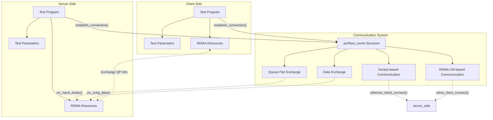

Sources: [src/perftest_communication.c:1454-1480](), [src/perftest_communication.h:104-108](), [src/perftest_communication.h:132-145]()

## Communication Structures

The Communication System is built around a few key structures that manage the connection state and data exchange.

### The `perftest_comm` Structure

This is the central structure that encapsulates all communication-related resources:

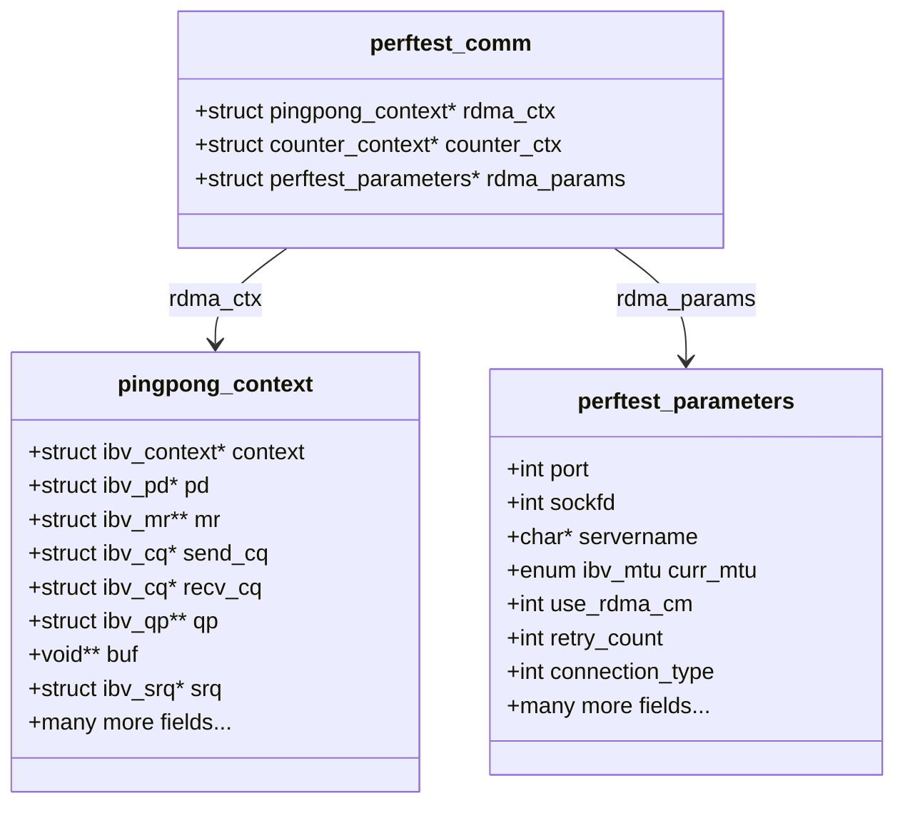

Sources: [src/perftest_communication.h:104-108](), [src/perftest_communication.c:1320-1423]()

### The `pingpong_dest` Structure

This structure is used to exchange Queue Pair information between endpoints:

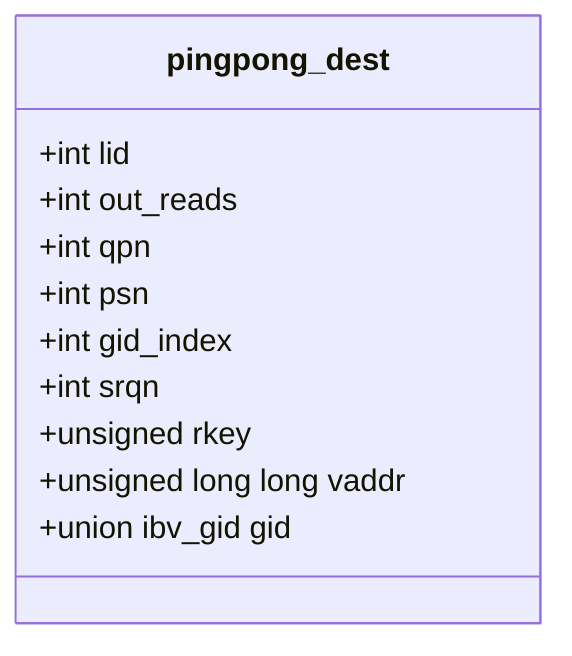

Sources: [src/perftest_communication.c:827-953](), [src/perftest_communication.c:1485-1527]()

## Connection Establishment Flow

The system supports two connection methods:
1. Socket-based (Ethernet) connections
2. RDMA CM-based connections

The connection establishment follows a specific sequence of operations:

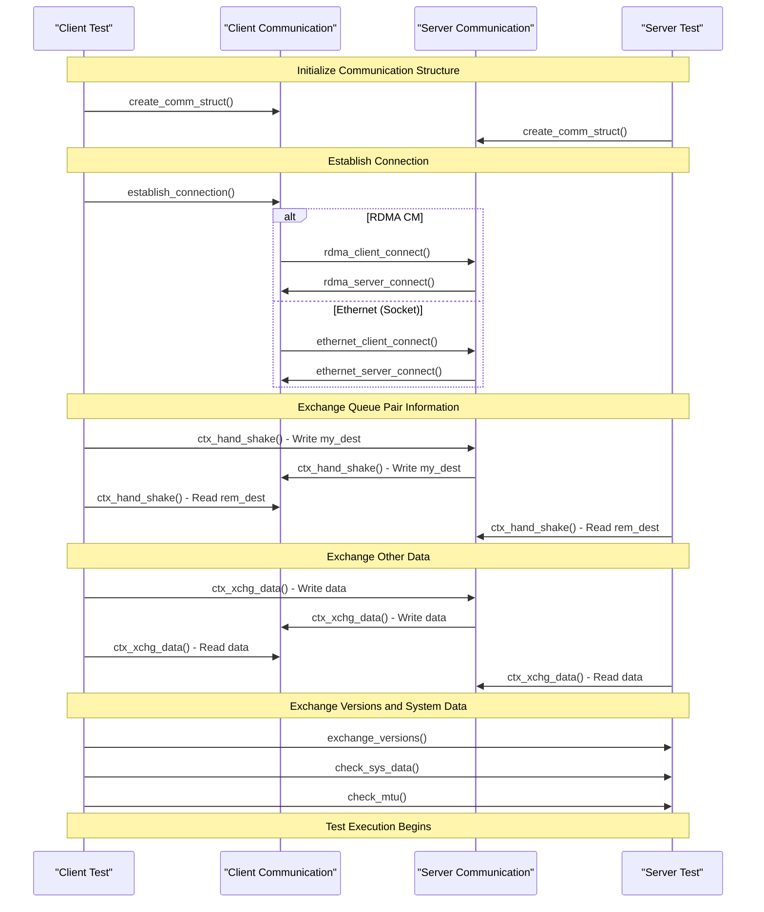

Sources: [src/perftest_communication.c:1454-1480](), [src/perftest_communication.c:1485-1527](), [src/perftest_communication.c:1886-1903](), [src/perftest_communication.c:1911-1946](), [src/perftest_communication.c:1952-2082]()

## Socket-Based Communication

When `use_rdma_cm` is set to OFF, the system uses traditional socket-based communication for control operations.

### Client-Server Connection

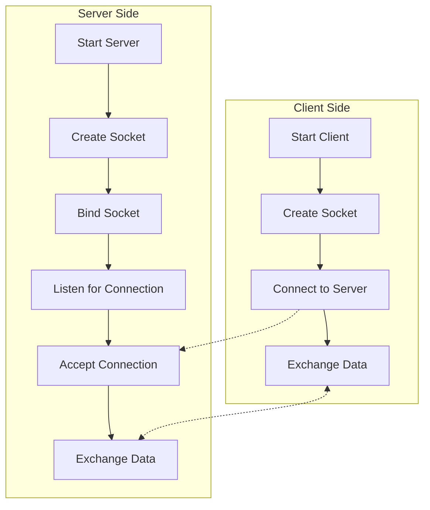

Sources: [src/perftest_communication.c:698-763](), [src/perftest_communication.c:768-822](), [src/perftest_communication.c:1676-1698]()

### Key Functions for Socket Communication

- `ethernet_client_connect()`: Establishes a socket connection from the client side.
- `ethernet_server_connect()`: Sets up a listening socket and accepts client connections.
- `ethernet_write_data()`: Sends data over an established socket connection.
- `ethernet_read_data()`: Receives data from an established socket connection.
- `ctx_xchg_data_ethernet()`: Coordinates data exchange over socket connections.

Sources: [src/perftest_communication.c:698-822](), [src/perftest_communication.c:1676-1698](), [src/perftest_communication.c:1536-1565]()

## RDMA CM-Based Communication

When `use_rdma_cm` is set to ON, the system uses the RDMA Connection Manager for control operations.

### RDMA CM Connection Flow

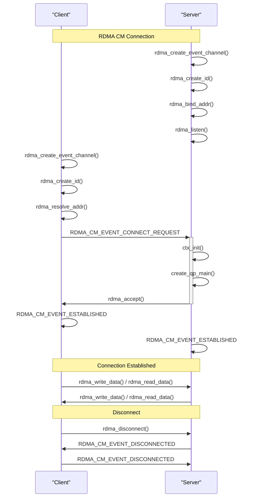

Sources: [src/perftest_communication.c:958-1156](), [src/perftest_communication.c:1185-1314](), [src/perftest_communication.c:1570-1717](), [src/perftest_communication.c:2611-2957]()

### Key Functions for RDMA CM Communication

- `rdma_client_connect()`: Establishes an RDMA CM connection from the client side.
- `rdma_server_connect()`: Sets up a listening RDMA CM endpoint and accepts client connections.
- `rdma_write_data()`: Sends data over an established RDMA CM connection using RDMA Send operations.
- `rdma_read_data()`: Receives data from an established RDMA CM connection.
- `ctx_xchg_data_rdma()`: Coordinates data exchange over RDMA CM connections.

Sources: [src/perftest_communication.c:958-1156](), [src/perftest_communication.c:1185-1314](), [src/perftest_communication.c:1603-1671](), [src/perftest_communication.c:1570-1599]()

## Queue Pair Exchange Protocol

An essential step in RDMA communication is exchanging Queue Pair (QP) information between endpoints. This is done through the `ctx_hand_shake()` function.

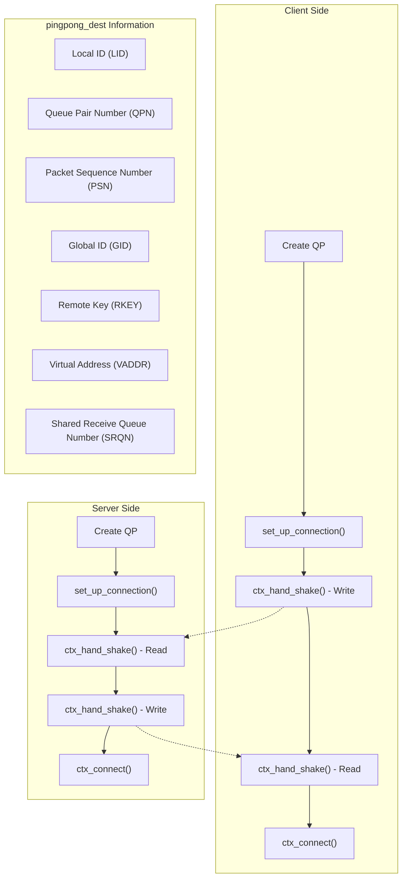

Sources: [src/perftest_communication.c:1485-1527](), [src/perftest_communication.c:827-953](), [src/perftest_communication.c:436-494](), [src/perftest_communication.c:499-538]()

## Data Exchange Methods

The Communication System provides several methods for exchanging data between endpoints:

### Basic Data Exchange Flow

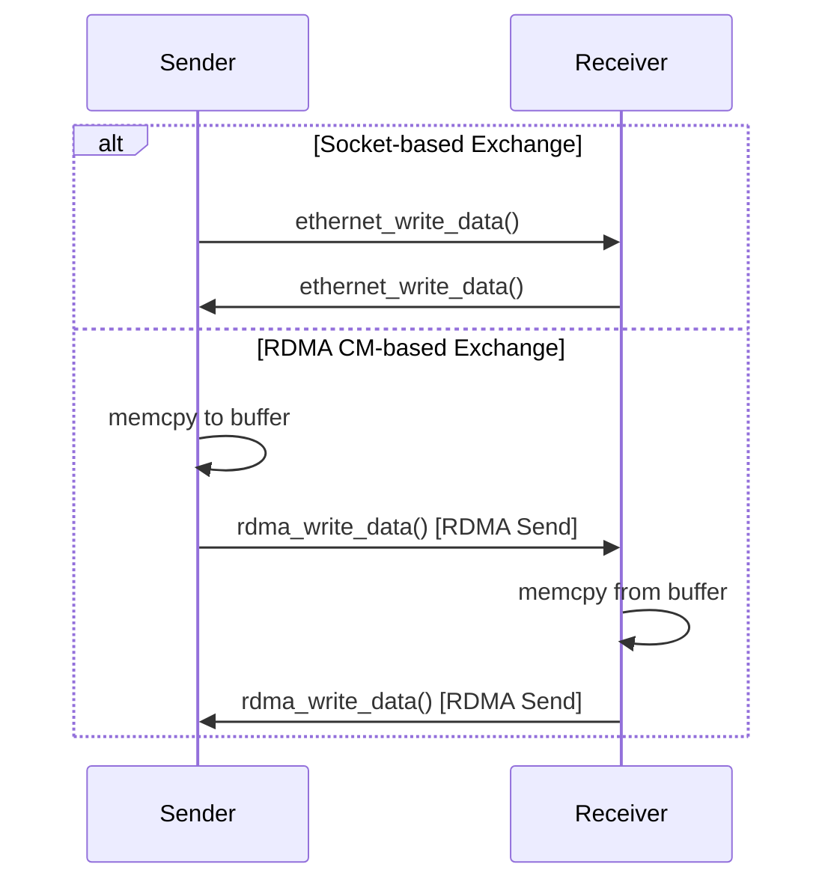

Sources: [src/perftest_communication.c:1704-1717](), [src/perftest_communication.c:1536-1599](), [src/perftest_communication.c:1603-1671](), [src/perftest_communication.c:1676-1698]()

### Exchanging Test Reports

For bandwidth tests, the communication system facilitates the exchange of performance reports between endpoints using the `xchg_bw_reports()` function.

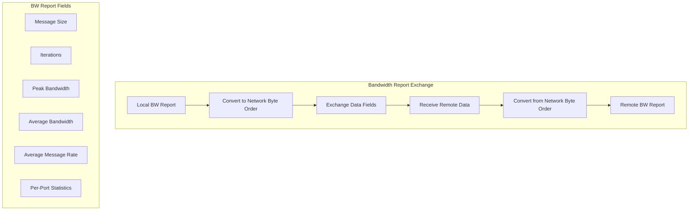

Sources: [src/perftest_communication.c:1722-1812]()

## Version and System Data Exchange

Before test execution, the endpoints exchange version information and system characteristics to ensure compatibility:

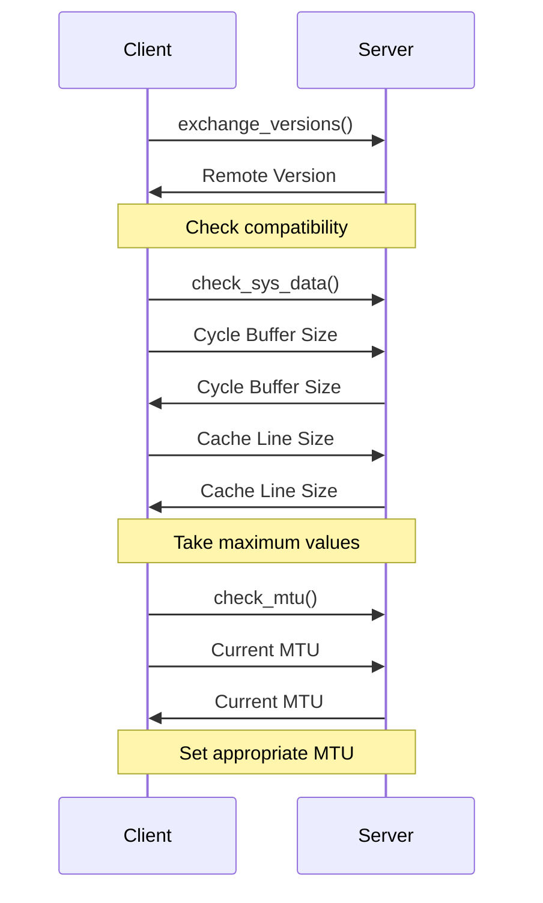

Sources: [src/perftest_communication.c:1886-1903](), [src/perftest_communication.c:1911-1946](), [src/perftest_communication.c:1952-2082]()

## Connection Closure

When a test completes, the Communication System provides methods to properly close connections:

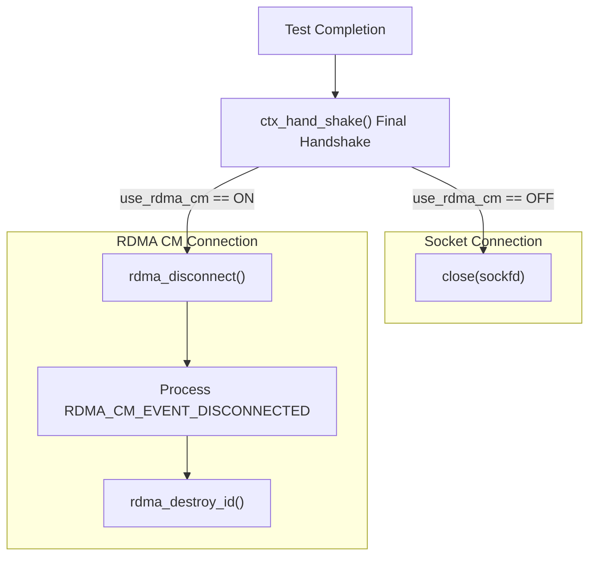

Sources: [src/perftest_communication.c:1863-1881](), [src/perftest_communication.c:2614-2751]()

## Advanced Features

### Source IP Binding

The Communication System supports binding to a specific source IP address for both socket-based and RDMA CM-based communication:

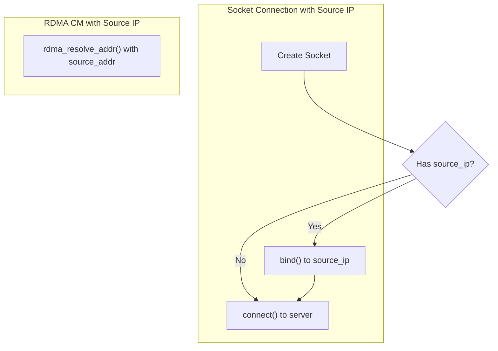

Sources: [src/perftest_communication.c:663-694](), [src/perftest_communication.c:698-763](), [src/perftest_communication.c:991-1008]()

### GID Index Selection

For RoCE (RDMA over Converged Ethernet) environments, the Communication System includes logic to select the optimal GID (Global ID) index based on IP version and RoCE version:

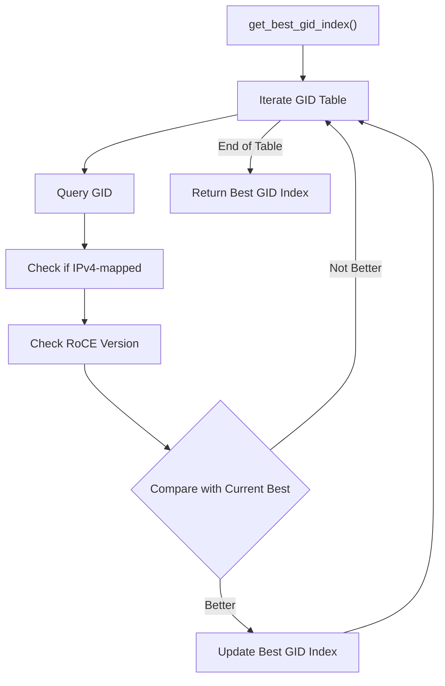

Sources: [src/perftest_communication.c:601-658](), [src/perftest_communication.c:874-879]()

## Integration with Test Programs

The Communication System integrates with the test programs through a standard initialization and usage pattern:

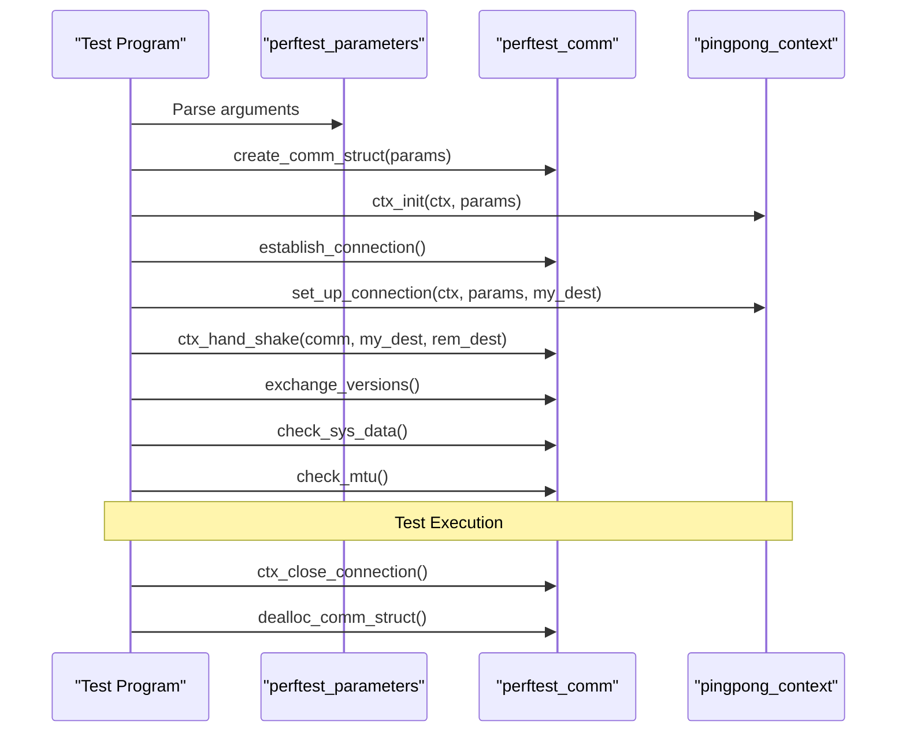

Sources: [src/perftest_communication.c:1320-1423](), [src/perftest_communication.c:1427-1450](), [src/perftest_communication.c:1454-1480](), [src/perftest_communication.c:1485-1527]()

## Summary

The Communication System in perftest provides a flexible and robust infrastructure for establishing connections and exchanging data between test endpoints. It supports both socket-based and RDMA CM-based communication methods, allowing tests to run in various network environments. The system handles:

1. Connection establishment and teardown
2. Exchange of Queue Pair information
3. General data exchange between endpoints
4. Version compatibility checks
5. System parameters negotiation

These capabilities enable the various performance tests to focus on their core measurement tasks, rather than on the details of endpoint communication and coordination.

---

