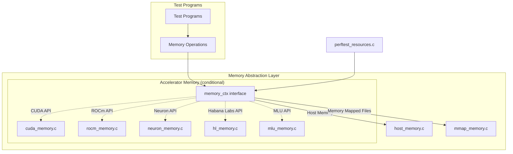
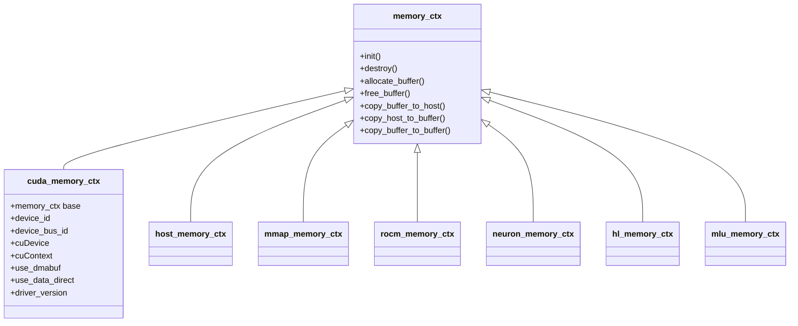
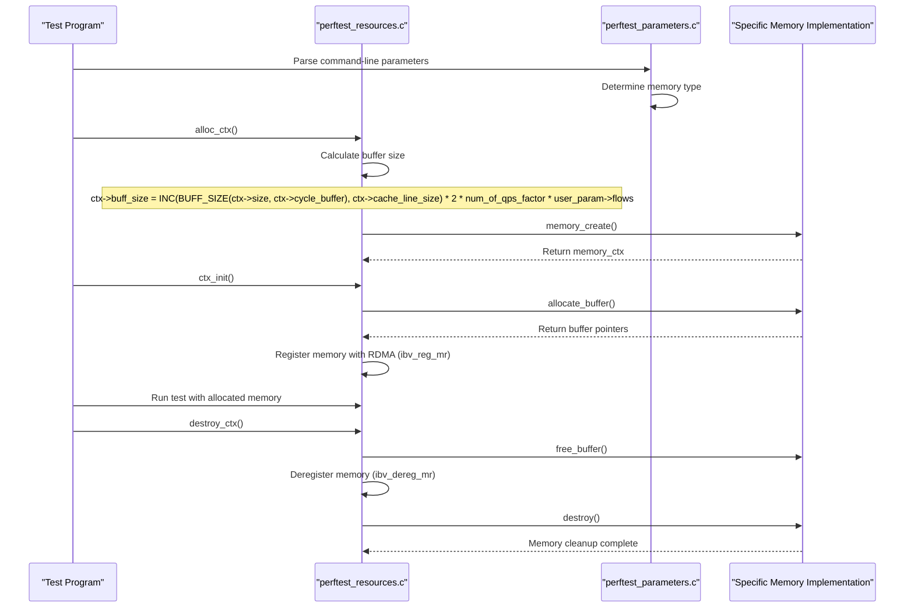

<!-- source: DeepWiki mcp.deepwiki.com · repo linux-rdma/perftest · page 2.4 Memory Management · fetched 2026-11-11 -->

# Memory Management

<details>
<summary>Relevant source files</summary>

The following files were used as context for generating this wiki page:

- [src/cuda_memory.c](src/cuda_memory.c)
- [src/cuda_memory.h](src/cuda_memory.h)
- [src/perftest_parameters.c](src/perftest_parameters.c)
- [src/perftest_resources.c](src/perftest_resources.c)

</details>


This document describes the memory subsystem of the perftest toolkit which provides a unified interface for allocating, accessing, and managing memory for RDMA performance tests. It abstracts away the details of different memory types (host memory, GPU memory, etc.) to allow tests to work with various memory types without changing the test code.

## Architecture Overview

The memory management system in perftest is built as an abstraction layer that provides a common interface for working with different types of memory. This enables test programs to work with various memory types like host memory, memory-mapped files, and accelerator memory (CUDA, ROCm, etc.) through a consistent API.



Sources: [src/perftest_resources.c:1125-1127](), [src/perftest_parameters.c:886-896]()

## Memory Context Interface

The foundation of the memory subsystem is the `memory_ctx` structure, which defines a common interface that all memory implementations must provide. This interface allows the rest of the system to work with different memory types through a consistent set of operations.



Sources: [src/cuda_memory.h:9-21](), [src/cuda_memory.c:22-31]()

### Core Interface Functions

The `memory_ctx` interface defines the following key operations:

| Function | Description |
|----------|-------------|
| `init` | Initialize the memory context |
| `destroy` | Clean up the memory context and release resources |
| `allocate_buffer` | Allocate a memory buffer of specified size |
| `free_buffer` | Free a previously allocated memory buffer |
| `copy_buffer_to_host` | Copy data from device memory to host memory |
| `copy_host_to_buffer` | Copy data from host memory to device memory |
| `copy_buffer_to_buffer` | Copy data between device memory buffers |

Sources: [src/cuda_memory.c:294-307]()

## Memory Types

The perftest toolkit supports several types of memory, each implemented through the common `memory_ctx` interface:

1. **Host Memory** - Regular system memory allocated through standard mechanisms like `malloc` or `memalign`. This is the default memory type.

2. **Memory-Mapped Files** - Memory mapped from files using the `mmap` system call. This is useful for testing P2P transfers or providing shared memory access.

3. **Accelerator Memory Types**:
   - **CUDA Memory** - Memory on NVIDIA GPUs, for testing GPUDirect RDMA
   - **ROCm Memory** - Memory on AMD GPUs
   - **Neuron Memory** - Memory on AWS Neuron devices
   - **Habana Labs Memory** - Memory on Habana Labs AI accelerators
   - **MLU Memory** - Memory on Cambricon MLU AI accelerators

Sources: [src/perftest_parameters.c:15-21](), [src/perftest_parameters.c:886-896]()

## Memory Lifecycle

The sequence diagram below illustrates how memory is managed throughout the lifecycle of a test:



Sources: [src/perftest_resources.c:1030-1128](), [src/perftest_resources.c:1132-1222](), [src/perftest_resources.c:1228-1450]()

## Buffer Size Calculation

The memory subsystem calculates the size of memory buffers based on several factors:

1. **Message Size** - The size of each message to be sent
2. **Cycle Buffer** - Buffer size for cyclic operations
3. **Cache Line Size** - For proper memory alignment
4. **Number of QPs** - Quality of Service Pairs used in the test
5. **Number of Flows** - For multi-flow tests

The buffer size calculation occurs in the `alloc_ctx` function:

```
ctx->buff_size = INC(BUFF_SIZE(ctx->size, ctx->cycle_buffer),
             ctx->cache_line_size) * 2 * num_of_qps_factor * user_param->flows;
ctx->send_qp_buff_size = ctx->buff_size / num_of_qps_factor / 2;
ctx->flow_buff_size = ctx->send_qp_buff_size / user_param->flows;
```

Sources: [src/perftest_resources.c:1117-1121]()

## CUDA Memory Implementation

The CUDA memory implementation (`cuda_memory.c`) provides a concrete example of how a specific memory type is implemented. It uses the CUDA API to allocate and manage memory on NVIDIA GPUs.

### Initialization

The CUDA memory context is initialized by:
1. Selecting a CUDA device
2. Creating a CUDA context
3. Setting up device properties

```c
int cuda_memory_init(struct memory_ctx *ctx) {
    struct cuda_memory_ctx *cuda_ctx = container_of(ctx, struct cuda_memory_ctx, base);
    // Initialize CUDA device and context
    // Check for DMA-BUF support if needed
    return SUCCESS;
}
```

Sources: [src/cuda_memory.c:107-149]()

### Buffer Allocation

Buffer allocation in CUDA memory depends on whether the GPU is discrete or integrated:

- For integrated GPUs, it uses `cuMemAllocHost` to allocate pinned host memory
- For discrete GPUs, it uses `cuMemAlloc` to allocate device memory

```c
int cuda_memory_allocate_buffer(struct memory_ctx *ctx, int alignment, uint64_t size, int *dmabuf_fd,
                              uint64_t *dmabuf_offset, void **addr, bool *can_init) {
    // Check if integrated or discrete GPU
    // Allocate appropriate memory
    // Set up DMA-BUF if needed
    return SUCCESS;
}
```

Sources: [src/cuda_memory.c:159-241]()

### DMA-BUF Support

For GPUDirect RDMA applications, the CUDA memory implementation supports DMA-BUF, which allows sharing memory between the GPU and other devices without copying:

```c
if (cuda_ctx->use_dmabuf) {
    // Create DMA-BUF from GPU memory
    error = cuMemGetHandleForAddressRange((void *)dmabuf_fd, aligned_ptr, aligned_size, 
                                         cuda_handle_type, cu_flags);
    *dmabuf_offset = offset;
}
```

Sources: [src/cuda_memory.c:197-236]()

## Memory Registration with RDMA

After memory buffers are allocated, they must be registered with RDMA to be used in RDMA operations. This occurs in the `ctx_init` function:

```c
ctx->mr[i] = ibv_reg_mr(ctx->pd, ctx->buf[i], ctx->buff_size,
                        (use_odp ? IBV_ACCESS_ON_DEMAND : 0) |
                        IBV_ACCESS_LOCAL_WRITE | IBV_ACCESS_REMOTE_WRITE | 
                        IBV_ACCESS_REMOTE_READ);
```

This creates an `ibv_mr` (memory region) object that is used in RDMA operations. The permissions specified (LOCAL_WRITE, REMOTE_WRITE, REMOTE_READ) enable various RDMA operations on the buffer.

## Advanced Features

### AES-XTS Encryption

The memory management system supports AES-XTS encryption for secure data transfers. This is implemented in `perftest_resources.c` with functions like `set_valid_dek` and `set_valid_cred` for key management.

Sources: [src/perftest_resources.c:47-153]()

### Data Direct

The CUDA memory implementation supports Data Direct, which provides optimized data paths for specific hardware combinations. This is enabled through the `use_data_direct` flag in the CUDA memory context.

```c
if (cuda_ctx->use_data_direct) {
    #ifdef HAVE_DMABUF_MAPPING_TYPE_PCIE
    cu_flags = CU_MEM_RANGE_FLAG_DMA_BUF_MAPPING_TYPE_PCIE;
    // Check driver version compatibility
    #else
    // Error if not supported
    #endif
}
```

Sources: [src/cuda_memory.c:213-226]()

## Memory Cleanup

When a test completes, the memory resources are cleaned up in the `destroy_ctx` function:

1. Memory buffers are deregistered with RDMA using `ibv_dereg_mr`
2. Memory buffers are freed using the memory context's `free_buffer` function
3. The memory context is destroyed using its `destroy` function

Sources: [src/perftest_resources.c:1319-1323](), [src/perftest_resources.c:1390-1392](), [src/perftest_resources.c:1445-1448]()

## Integration with Test Programs

The memory management system integrates with the rest of the perftest toolkit through the following key components:

1. **perftest_parameters** - Defines memory type and parameters
2. **perftest_resources** - Creates and manages memory resources
3. **Test Programs** - Use the allocated memory for RDMA operations

The memory type to use is selected based on user parameters when a test is initiated:

```c
if (cuda_memory_supported() && params->cuda_device_id) {
    params->memory_type = MEMORY_CUDA;
    params->memory_create = cuda_memory_create;
}
```

Sources: [src/perftest_parameters.c:886-896]()

## Conclusion

The memory management subsystem in perftest provides a flexible abstraction layer that enables RDMA performance testing with different memory types. By defining a common interface and implementing it for various memory types, the system allows tests to work with host memory, memory-mapped files, and various accelerator memories through a consistent API.

---

