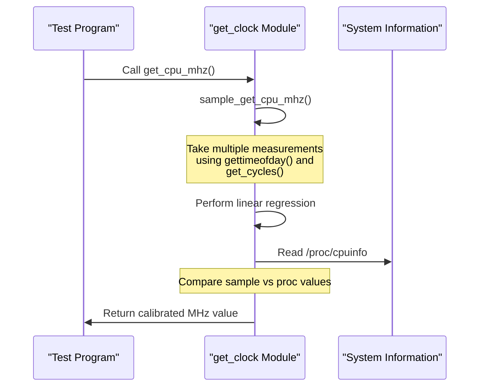
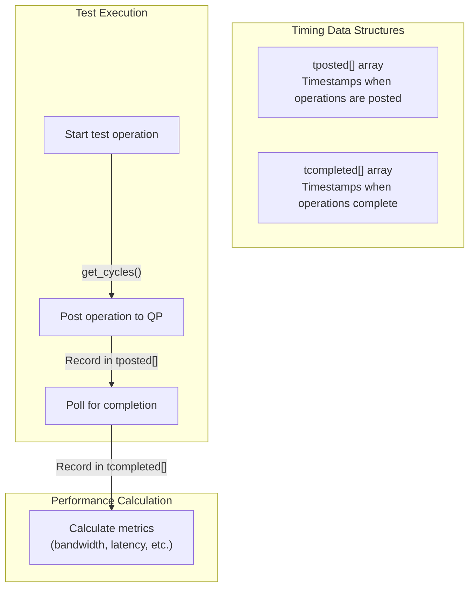
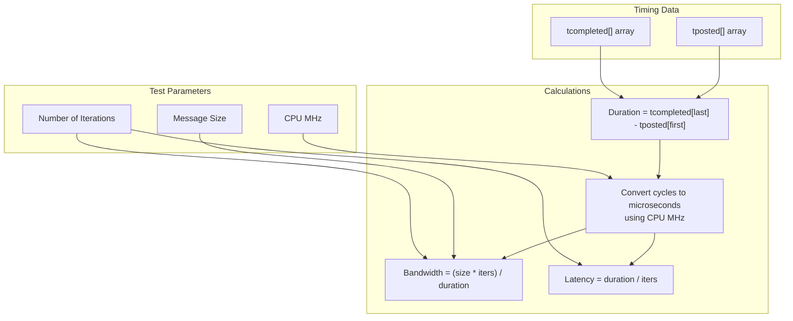
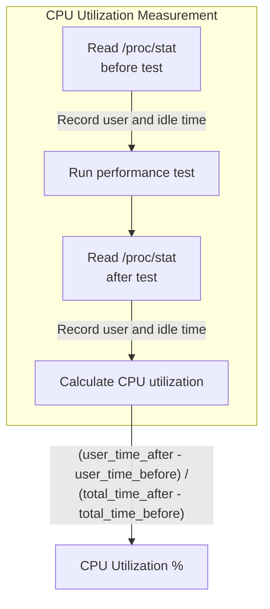
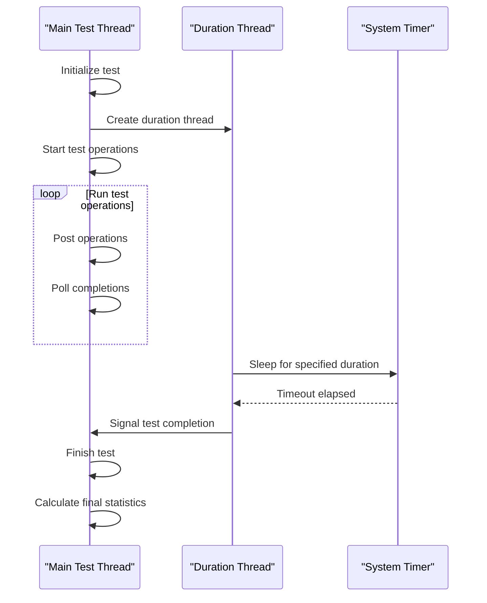

<!-- source: DeepWiki mcp.deepwiki.com · repo linux-rdma/perftest · page 2.5 Timing and Measurement · fetched 2026-11-11 -->

# Timing and Measurement

<details>
<summary>Relevant source files</summary>

The following files were used as context for generating this wiki page:

- [README_sparc](README_sparc)
- [src/clock_test.c](src/clock_test.c)
- [src/get_clock.c](src/get_clock.c)
- [src/get_clock.h](src/get_clock.h)
- [src/perftest_resources.c](src/perftest_resources.c)

</details>


This page documents the timing and measurement subsystems used in the perftest suite to accurately measure RDMA network performance metrics. It explains how the perftest suite measures time at high precision, converts cycles to human-readable time units, and calculates performance statistics like bandwidth, latency, and message rates.

For information about specific test implementations that use these measurement facilities, see [Bandwidth Tests](#3) and [Latency Tests](#4).

## Core Timing Mechanism

The perftest suite uses CPU cycle counting for high-precision timing measurements. This approach provides much finer granularity than using standard system calls like `gettimeofday()`.

### Architecture-Specific Cycle Counting

The perftest suite implements cycle counting in an architecture-agnostic way by providing different implementations for various CPU architectures:

```mermaid
graph TD
    get_cycles["get_cycles() function"]
    x86["x86/x86_64: rdtsc instruction"]
    ppc["PPC/PPC64: mftb instruction"]
    ia64["IA64: ar.itc register"]
    arm7["ARMv7: Performance Monitor"]
    s390["s390/s390x: stck instruction"]
    sparc["SPARC64: %tick register"]
    aarch64["AArch64: cntvct_el0 register"]
    loongarch["LoongArch: rdtime.d instruction"]
    riscv["RISC-V: perf_event subsystem"]
    hppa["HPPA: cr16 register"]
    
    get_cycles --> x86
    get_cycles --> ppc
    get_cycles --> ia64
    get_cycles --> arm7
    get_cycles --> s390
    get_cycles --> sparc
    get_cycles --> aarch64
    get_cycles --> loongarch
    get_cycles --> riscv
    get_cycles --> hppa
```



Sources: [src/get_clock.h:40-138]()

The `get_cycles()` function is defined in `get_clock.h` and provides an architecture-specific implementation for retrieving the current CPU cycle count. Each implementation uses the most precise and efficient method available for that architecture, typically using processor-specific instructions or registers.

### CPU Frequency Calibration

To convert cycle counts to actual time (in seconds or microseconds), the system needs to know the CPU frequency. The perftest suite uses a two-fold approach to determine the CPU frequency:

1. **Sampling Method**: Measures the relationship between elapsed time and CPU cycles using linear regression
2. **System Information Method**: Reads the CPU frequency from system information (e.g., `/proc/cpuinfo`)



Sources: [src/get_clock.c:65-132](), [src/get_clock.c:135-211](), [src/get_clock.c:214-240]()

The CPU frequency calibration happens at the beginning of a test run. The `sample_get_cpu_mhz()` function performs multiple measurements, calling both `gettimeofday()` and `get_cycles()` to establish a relationship between elapsed real time and CPU cycles. It then uses linear regression to calculate the CPU frequency in MHz.

Most architectures also check this calculated value against the advertised CPU frequency from system information. If the values differ significantly, the test issues a warning about potential frequency scaling effects.

## Performance Measurement

The perftest suite uses the timing mechanism to measure various performance metrics, including bandwidth, latency, and message rates.

### Timing Data Structures

For each test operation, the perftest suite records timestamps at specific points:



Sources: [src/perftest_resources.c:1039-1045](), [src/perftest_resources.c:1065-1067](), [src/perftest_resources.c:1079-1083]()

The key data structures for timing measurements are:

- `tposted`: Array that stores the timestamp (in cycles) when operations are posted to the queue pair
- `tcompleted`: Array that stores the timestamp (in cycles) when operations complete

These arrays are allocated based on the test parameters:
- For peak performance tests (`noPeak == 0`), the size is `iters * num_of_qps`
- For average performance tests (`noPeak == 1`), only a single timestamp is needed

## Bandwidth and Latency Calculation

The perftest suite calculates bandwidth and latency using the recorded timing information:



Sources: [src/get_clock.c:214-240]()

### Bandwidth Calculation

Bandwidth is calculated as:

```
Bandwidth = (bytes transferred) / (time elapsed)
```

Where:
- Bytes transferred = message size × number of iterations
- Time elapsed = (tcompleted[last] - tposted[first]) converted to seconds

### Latency Calculation

Latency is calculated as:

```
Latency = (time elapsed) / (number of iterations)
```

Where:
- Time elapsed = (tcompleted[last] - tposted[first]) converted to microseconds or nanoseconds
- Number of iterations = the number of round-trip message exchanges

## CPU Utilization Measurement

The perftest suite can also measure CPU utilization during tests to provide a more comprehensive performance analysis:



Sources: [src/perftest_resources.c:223-244]()

CPU utilization is measured by:

1. Reading CPU statistics from `/proc/stat` before the test begins
2. Reading CPU statistics again after the test completes 
3. Calculating the percentage of CPU time spent in user mode versus idle mode

This information helps users understand the computational overhead of different RDMA operations and identify potential bottlenecks.

## Test Duration Control

The perftest suite supports two types of test duration control:

1. **Iteration-based**: Runs a fixed number of operations
2. **Time-based**: Runs operations for a specified duration

For time-based tests, a separate monitoring mechanism is used:



Sources: [src/perftest_resources.c:38-39]()

For time-based tests, a global variable `duration_param` and a data structure `check_alive_data` are used to coordinate between the main test thread and the duration control thread.

## Measurement Precision and Reliability

The precision of performance measurements depends on several factors:

1. **Cycle Counter Precision**: Modern CPUs provide high-resolution cycle counters (typically sub-nanosecond precision)
2. **CPU Frequency Stability**: Frequency scaling can affect measurement accuracy
3. **System Noise**: Other system activities can introduce jitter

The perftest suite includes mechanisms to detect potential measurement issues:

- Warning when detected CPU frequency differs from the expected frequency
- Coefficient of determination (r²) check during calibration to ensure reliability
- Option to perform multiple iterations and report statistics (min/max/average)

These features help ensure that the reported performance metrics accurately reflect the true performance of the RDMA subsystem.

---

