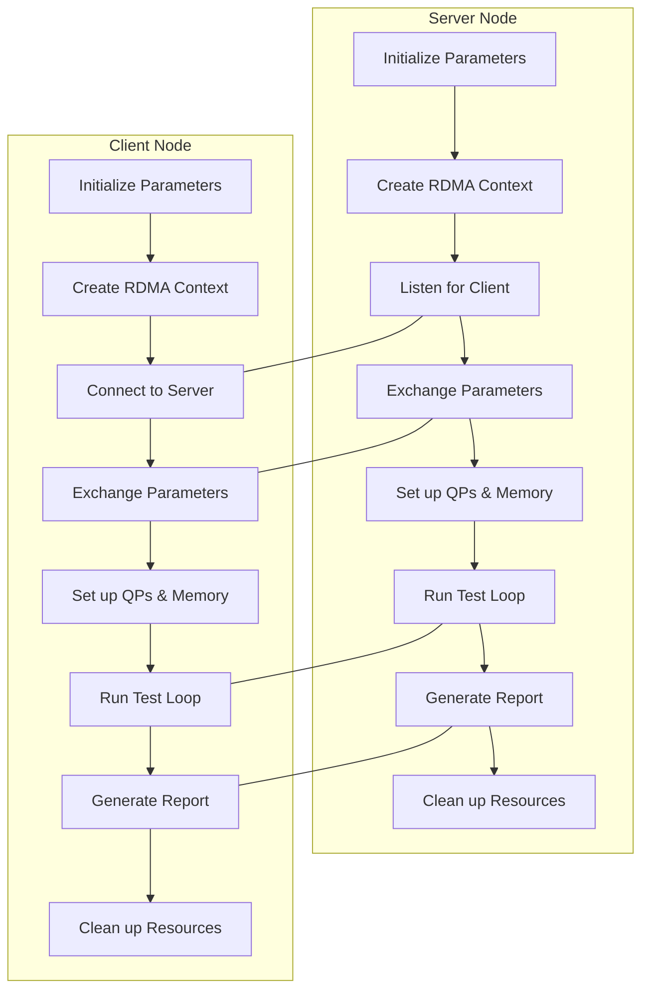
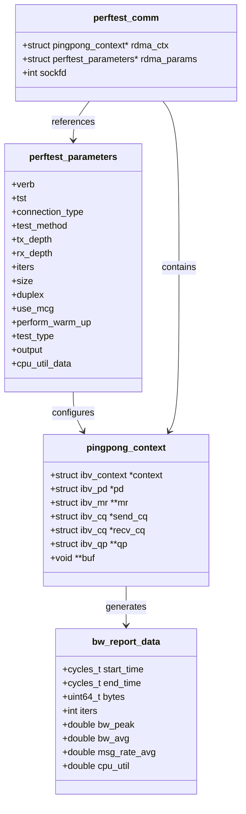
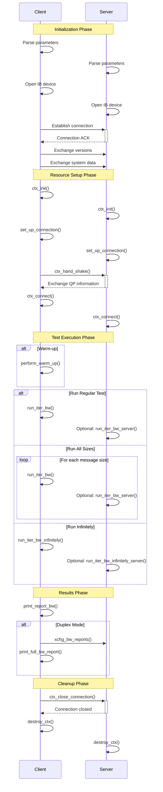
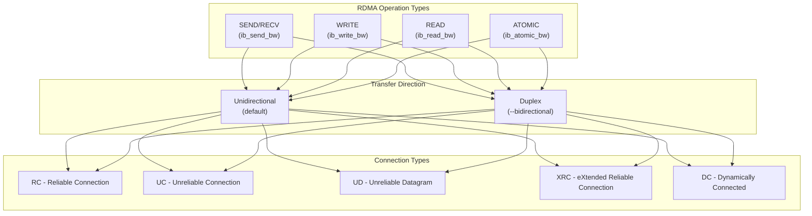
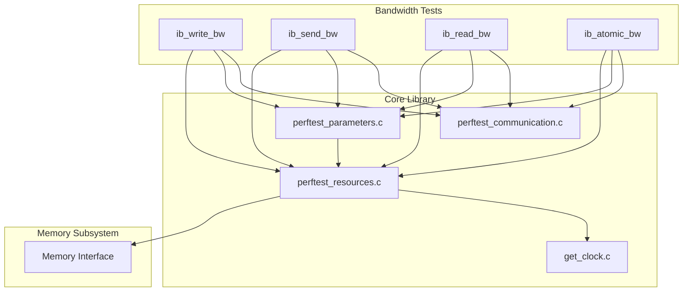

<!-- source: DeepWiki mcp.deepwiki.com · repo linux-rdma/perftest · page 3 Bandwidth Tests · fetched 2026-11-11 -->

# Bandwidth Tests

<details>
<summary>Relevant source files</summary>

The following files were used as context for generating this wiki page:

- [src/atomic_bw.c](src/atomic_bw.c)
- [src/read_bw.c](src/read_bw.c)
- [src/send_bw.c](src/send_bw.c)
- [src/write_bw.c](src/write_bw.c)

</details>


## Purpose and Overview

The bandwidth tests within the perftest suite measure the maximum throughput achievable over RDMA connections. These tests are essential for evaluating network performance, particularly for high-performance computing and datacenter applications where data transfer rates are critical.

This page documents the bandwidth test components in the perftest toolkit, covering their functionality, execution flow, and configuration options. For information about latency tests, see [Latency Tests](#4).

Sources: [src/write_bw.c:64-65](), [src/send_bw.c:177-178](), [src/read_bw.c:65-66](), [src/atomic_bw.c:65-66]()

## Available Bandwidth Tests

The perftest suite provides four bandwidth test programs, each measuring throughput for a different RDMA operation:

| Test Program | RDMA Operation | Description |
| ------------ | -------------- | ----------- |
| `ib_send_bw` | SEND | Measures bandwidth using SEND/RECV operations |
| `ib_write_bw` | WRITE | Measures bandwidth using RDMA WRITE operations |
| `ib_read_bw` | READ | Measures bandwidth using RDMA READ operations |
| `ib_atomic_bw` | ATOMIC | Measures bandwidth using atomic operations (CMP&SWP or FETCH&ADD) |

All bandwidth tests follow a similar structure and share core functionality, with each specializing in a particular RDMA operation.

Sources: [src/write_bw.c:64-65](), [src/send_bw.c:177-178](), [src/read_bw.c:65-66](), [src/atomic_bw.c:65-66]()

## Bandwidth Test Architecture

### Client-Server Model

Bandwidth tests operate using a client-server model where:

1. The server starts first and listens for incoming connections
2. The client initiates connection to the server
3. Both sides exchange setup parameters
4. The client initiates the test sequence
5. Both sides report results

This model allows for accurate measurement of one-way and bidirectional bandwidth.

#### Bandwidth Test Architecture Diagram



Sources: [src/write_bw.c:114-122](), [src/send_bw.c:231-244](), [src/read_bw.c:109-121](), [src/atomic_bw.c:111-123]()

### Core Components

The bandwidth tests rely on several core components in the perftest suite:



Sources: [src/write_bw.c:52-56](), [src/send_bw.c:159-165](), [src/read_bw.c:52-57](), [src/atomic_bw.c:51-57]()

## Test Execution Flow

### Test Initialization

The test initialization follows these steps:

1. Parse command-line arguments to configure test parameters
2. Find and open the specified InfiniBand device
3. Create communication structures for socket/RDMA CM connection
4. Establish connection between client and server
5. Exchange version information and system parameters
6. Allocate resources for the test (buffers, queue pairs, etc.)
7. Create RDMA resources (PD, MR, CQ, QP)
8. Set up the connection (post receive buffers, etc.)
9. Exchange connection parameters (QP numbers, etc.)
10. Move QPs to Ready-to-Send (RTS) state

Sources: [src/write_bw.c:69-97](), [src/send_bw.c:182-210](), [src/read_bw.c:69-101](), [src/atomic_bw.c:69-103]()

### Test Execution Flow Diagram



Sources: [src/write_bw.c:296-476](), [src/send_bw.c:414-569](), [src/read_bw.c:302-395](), [src/atomic_bw.c:296-346]()

## Test Methods

The bandwidth tests support three test methods:

| Test Method | Description |
| ----------- | ----------- |
| `RUN_REGULAR` | Performs a single test with the specified message size |
| `RUN_ALL` | Runs tests with message sizes from 2^1 to 2^23 bytes |
| `RUN_INFINITELY` | Runs the test continuously until manually stopped |

Sources: [src/write_bw.c:302-447](), [src/send_bw.c:414-568](), [src/read_bw.c:302-394](), [src/atomic_bw.c:298-346]()

### Test Execution Process

The actual bandwidth measurement process follows these steps:

1. **Optional warm-up phase**: Performs initial operations to warm up the connection
2. **Test execution**: Performs the actual bandwidth measurement
   - For client: `run_iter_bw()` or `run_iter_bw_infinitely()`
   - For server (in some modes): `run_iter_bw_server()` or `run_iter_bw_infinitely_server()`
3. **Result calculation**: Calculates bandwidth based on the amount of data transferred and elapsed time
4. **Result reporting**: Generates and exchanges bandwidth reports

For duplex tests, both sides perform data transfers simultaneously.

Sources: [src/write_bw.c:319-357](), [src/send_bw.c:439-462](), [src/read_bw.c:346-365](), [src/atomic_bw.c:300-323]()

## Operation Types and Connection Modes

### RDMA Operations

Each bandwidth test focuses on a specific RDMA operation:



Sources: [src/write_bw.c:64](), [src/send_bw.c:177](), [src/read_bw.c:65](), [src/atomic_bw.c:65]()

### Connection Types

Bandwidth tests support multiple connection types with different characteristics:

| Connection Type | Description | Supported Operations |
| --------------- | ----------- | ------------------- |
| RC (Reliable Connection) | Provides reliable, connection-oriented transport | SEND, WRITE, READ, ATOMIC |
| UC (Unreliable Connection) | Connection-oriented but without reliability guarantees | SEND, WRITE |
| UD (Unreliable Datagram) | Connectionless, datagram-based transport | SEND only |
| XRC (eXtended Reliable Connection) | Allows sharing receive resources among connections | SEND, WRITE, READ, ATOMIC |
| DC (Dynamically Connected) | Provides dynamic connections to multiple destinations | SEND, WRITE, READ, ATOMIC |

Sources: [src/write_bw.c:76-78](), [src/send_bw.c:188-190](), [src/read_bw.c:76-78](), [src/atomic_bw.c:76-78]()

## Performance Measurement Details

### Bandwidth Calculation

Bandwidth is calculated using the following formula:

```
Bandwidth = (Total bytes transferred) / (Elapsed time)
```

The test reports multiple metrics:

1. **Bandwidth (MB/s or GB/s)**: Data transfer rate
2. **Message Rate (Msg/s)**: Number of messages per second
3. **CPU Utilization (%)**: Optional CPU usage measurement during the test

Sources: [src/write_bw.c:365-366](), [src/send_bw.c:464-516](), [src/read_bw.c:335-365](), [src/atomic_bw.c:319]()

### Result Reporting

Results are reported in a structured format:

```
------------------------------------------------------------------
                    RDMA_Write BW Test
 Dual-port       : OFF		Device         : mlx5_0
 Number of qps   : 1		Transport type : IB
 Connection type : RC		Using SRQ      : OFF
 TX depth        : 128
 CQ Moderation   : 100
 Mtu             : 4096[B]
 Link type       : IB
 GID index       : 3
 Max inline data : 0[B]
 rdma_cm QPs	 : OFF
 Data ex. method : Ethernet
------------------------------------------------------------------
 local address: LID 0x00 QPN 0x0137 PSN 0x3b5c1d RKey 0x00370f VAddr 0x007fe8286ed000
 remote address: LID 0x00 QPN 0x0136 PSN 0x475031 RKey 0x002c23 VAddr 0x007f146e7a5000
------------------------------------------------------------------
 #bytes     #iterations    BW peak[MB/s]    BW average[MB/s]   MsgRate[Mpps]
 65536      5000           6481.10          6477.45            0.103639      
------------------------------------------------------------------
```

For duplex tests, results from both sides are reported.

Sources: [src/write_bw.c:231-242](), [src/send_bw.c:402-412](), [src/read_bw.c:226-236](), [src/atomic_bw.c:291-294]()

## Special Considerations

### Warm-Up Phase

Bandwidth tests can include an optional warm-up phase to eliminate initialization effects from measurements. This helps obtain more accurate and consistent results.

Sources: [src/write_bw.c:319-328](), [src/send_bw.c:387-393](), [src/read_bw.c:346-351](), [src/atomic_bw.c:300-304]()

### Multicast Support

The `ib_send_bw` test supports multicast operations (`--use_mcg`) for testing group communication performance.

Sources: [src/send_bw.c:99-120]()

### RDMA CM Support

All bandwidth tests can use RDMA Connection Manager (RDMA CM) instead of the traditional IB verbs connection setup, which is useful for environments like RoCE.

Sources: [src/write_bw.c:150-166](), [src/send_bw.c:272-288](), [src/read_bw.c:145-161](), [src/atomic_bw.c:146-162]()

## Relationship to Other Components

Bandwidth tests utilize several core components from the perftest suite:



Sources: [src/write_bw.c:41-44](), [src/send_bw.c:41-44](), [src/read_bw.c:41-43](), [src/atomic_bw.c:41-43]()

## Summary

Bandwidth tests in the perftest suite provide a comprehensive way to measure RDMA performance across different operation types and connection modes. They offer flexible configuration options and detailed performance metrics to help users evaluate and optimize their RDMA networks.

For specific test options and usage examples, refer to the [Command Line Interface](#7) page.

---

