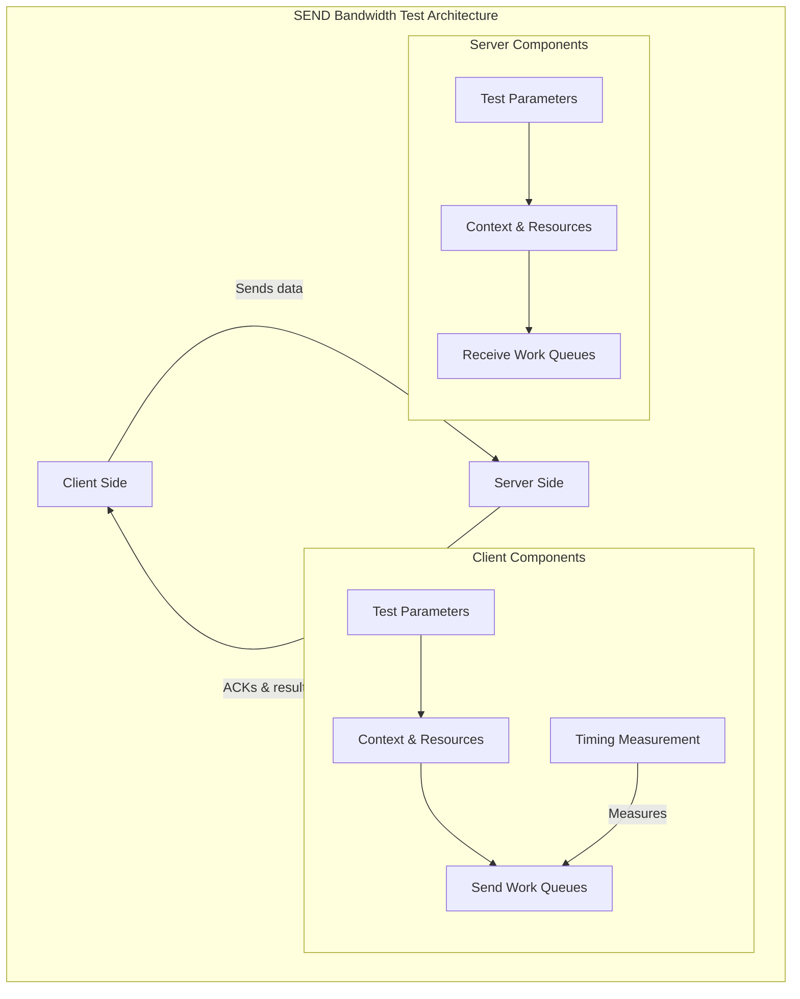
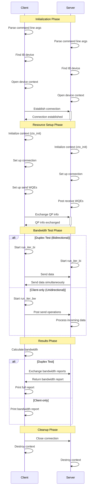
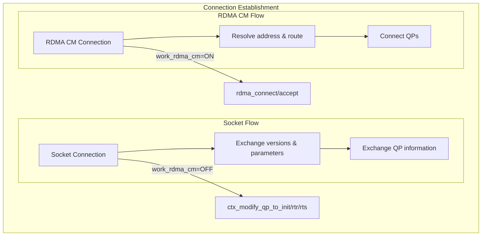

<!-- source: DeepWiki mcp.deepwiki.com · repo linux-rdma/perftest · page 3.1 SEND Bandwidth Test · fetched 2026-11-11 -->

# SEND Bandwidth Test

<details>
<summary>Relevant source files</summary>

The following files were used as context for generating this wiki page:

- [src/perftest_resources.c](src/perftest_resources.c)
- [src/send_bw.c](src/send_bw.c)

</details>


## Introduction

The SEND Bandwidth Test (`ib_send_bw`) is a performance benchmarking tool that measures the maximum bandwidth achievable using RDMA SEND operations. This test provides reliable measurements of an RDMA device's bandwidth capabilities using the SEND verb across different message sizes, QP types, and transport protocols.

For other bandwidth tests using different RDMA verbs, see [WRITE Bandwidth Test](#3.2), [READ Bandwidth Test](#3.3), and [ATOMIC Bandwidth Test](#3.4).

## Overview

The SEND Bandwidth Test operates in a client-server model where:

- The server posts receive work requests (WRs) to its receive queue
- The client posts send work requests to its send queue
- The client measures the time taken to transfer a specific amount of data
- Bandwidth is calculated based on the total data transferred and elapsed time

The test supports multiple connection types (RC, UC, UD, DC, XRC), various QP configurations, and can operate in different test modes including iterations-based, duration-based, or message size sweep.



Sources: [src/send_bw.c:156-649]()

## Test Execution Flow

The SEND Bandwidth Test follows a structured execution flow from initialization to completion:



Sources: [src/send_bw.c:156-649](), [src/perftest_resources.c:42-2897]()

## Command Line Interface

The SEND Bandwidth Test supports numerous command-line parameters to configure test behavior:

| Parameter | Description | Default |
|-----------|-------------|---------|
| -d, --ib-dev | RDMA device to use | First available device |
| -i, --ib-port | Port number of the RDMA device | 1 |
| -c, --connection | Connection type (RC/UC/UD/XRC/DC) | RC |
| -m, --mtu | MTU size | 1024 |
| -s, --size | Message size in bytes | 65536 |
| -a, --all | Run for all message sizes | Off |
| -t, --tx-depth | Size of the send queue | 128 |
| -r, --rx-depth | Size of the receive queue | 600 |
| -n, --iters | Number of iterations | 1000 |
| -D, --duration | Test duration in seconds | N/A |
| -F, --CPU-freq | Do not show CPU frequency | Off |
| -l, --inline_size | Max size of message to be sent inline | 0 |

Sources: [src/perftest_parameters.c](), [src/send_bw.c:156-183]()

## Key Data Structures

The test uses several key data structures to manage its operation:

### Pingpong Context

The `pingpong_context` structure holds all RDMA resources needed for the test:

```
struct pingpong_context {
    struct ibv_context *context;  // Device context
    struct ibv_pd *pd;            // Protection domain
    struct ibv_mr **mr;           // Memory regions
    struct ibv_cq *send_cq;       // Send completion queue
    struct ibv_cq *recv_cq;       // Receive completion queue
    struct ibv_qp **qp;           // Queue pairs
    void **buf;                   // Data buffers
    /* Plus many more fields */
}
```

### Performance Test Parameters

The `perftest_parameters` structure holds all test configuration parameters:

```
struct perftest_parameters {
    int connection_type;          // RC, UC, UD, etc.
    int verb;                     // SEND, WRITE, READ, ATOMIC
    uint64_t size;                // Message size
    int tx_depth;                 // Send queue depth
    int rx_depth;                 // Receive queue depth
    int port;                     // IB port number
    int iters;                    // Number of iterations
    int num_of_qps;               // Number of QPs to use
    int inline_size;              // Max inline data size
    int machine;                  // CLIENT or SERVER
    int duplex;                   // Bidirectional test
    enum test_type tst;           // BW or LAT test
    /* Plus many more fields */
}
```

Sources: [src/perftest_resources.c:30-1122]()

## Implementation Details

### Setting Up Send WQEs

Before running the bandwidth test, the client sets up send work queue elements (WQEs):

```
ctx_set_send_wqes(&ctx, &user_param, rem_dest);
```

This function prepares the send side for the test by configuring work requests based on test parameters:

1. It sets up send work request parameters (opcode, flags, etc.)
2. Configures inline data if requested
3. Sets up SGEs (Scatter/Gather Elements) for data buffers
4. Prepares multiple work requests if post_list > 1

Sources: [src/perftest_resources.c:2902-2906](), [src/send_bw.c:425-425](), [src/send_bw.c:484-485]()

### Posting Receive WQEs

The server posts receive WQEs to its receive queue:

```
ctx_set_recv_wqes(&ctx, &user_param);
```

This function prepares the receive side by:

1. Setting up receive work requests
2. Configuring SGEs for receive buffers
3. Posting the work requests to the receive queue

Sources: [src/send_bw.c:427-431](), [src/send_bw.c:486-490]()

### Bandwidth Measurement

The bandwidth test is performed through one of three main test methods:

1. `run_iter_bw` - Client-side function that posts send operations and measures time
2. `run_iter_bw_server` - Server-side function that processes incoming data
3. `run_iter_bi` - Function for bidirectional (duplex) tests

The client measures the total time taken to complete all iterations and calculates:

- Message Rate (messages per second)
- Bandwidth (bytes per second)
- Total bytes transferred

Sources: [src/send_bw.c:446-497]()

## Test Modes

The SEND Bandwidth Test supports three main test methods:

### 1. RUN_REGULAR

Runs the test once with a fixed message size specified by the user.

Sources: [src/send_bw.c:483-537]()

### 2. RUN_ALL

Runs the test for multiple message sizes, starting from 2 bytes and doubling until reaching the maximum size.

Sources: [src/send_bw.c:415-480]()

### 3. RUN_INFINITELY

Runs the test indefinitely until manually stopped. Useful for stability testing.

Sources: [src/send_bw.c:538-569]()

## Performance Report

After the test completes, a performance report is generated showing:

- Message size used
- Number of iterations
- Total bytes transferred
- Bandwidth in MB/s or GB/s
- Message rate in messages/second
- CPU utilization (if enabled)

For duplex tests, both local and remote results are shown.

Sources: [src/send_bw.c:516-521](), [src/send_bw.c:523-536]()

## RDMA Connection Management

The test can establish connections between endpoints in two ways:

### Socket-Based Connection

Uses TCP sockets to exchange QP information between client and server.

### RDMA CM-Based Connection

Uses the RDMA Connection Manager (RDMA CM) to establish connections, which is useful for RoCE networks.



Sources: [src/send_bw.c:222-248](), [src/send_bw.c:272-288]()

## Multicast Support

The SEND Bandwidth Test also supports IP multicast:

1. The server creates a multicast group
2. The client joins the multicast group
3. The server sends data to the multicast group
4. Multiple clients can receive the same data

Sources: [src/send_bw.c:49-82](), [src/send_bw.c:328-345]()

## Example Usage

Basic client usage:
```
ib_send_bw -d mlx5_0 -i 1 -s 65536 -n 5000 --CPU-freq
```

Basic server usage:
```
ib_send_bw -d mlx5_0 -i 1
```

Run with different connection type:
```
ib_send_bw -d mlx5_0 -i 1 -c RC
```

Run for all message sizes:
```
ib_send_bw -d mlx5_0 -i 1 -a
```

## Conclusion

The SEND Bandwidth Test is a comprehensive benchmarking tool for measuring RDMA SEND performance across various configurations. It provides detailed performance metrics that help users understand the capabilities of their RDMA hardware and optimize application settings for maximum bandwidth.

---

