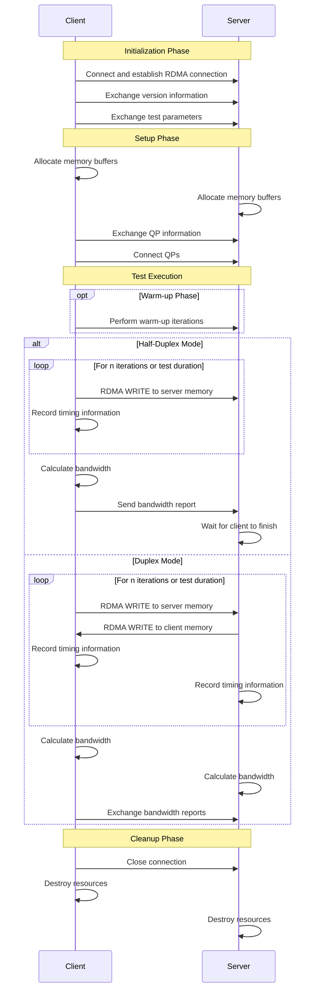
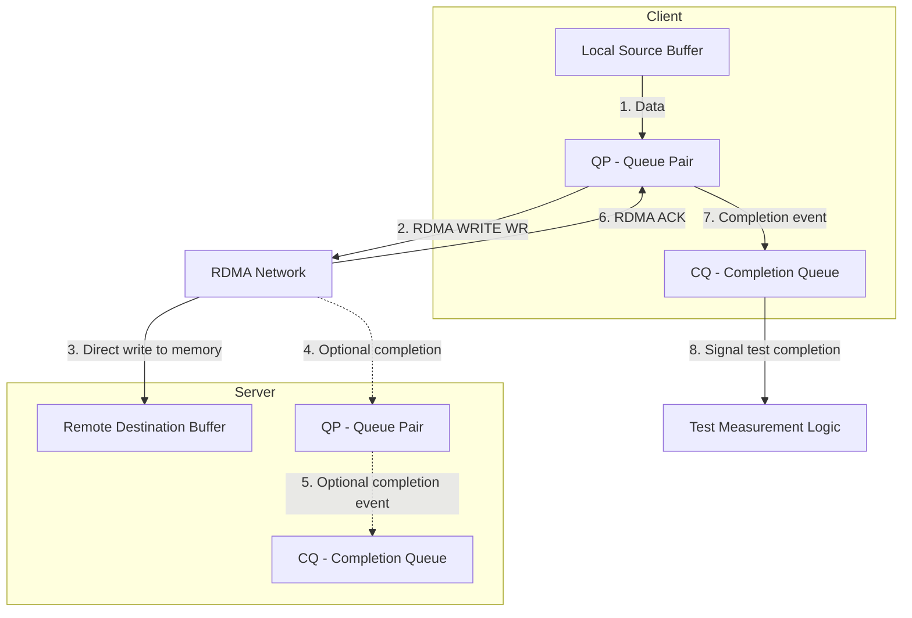
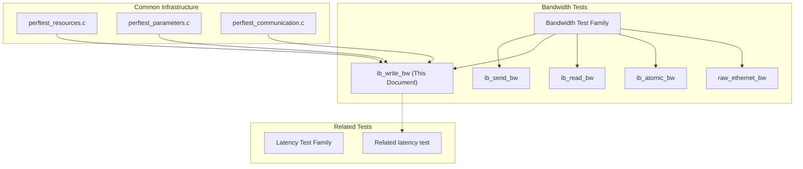

<!-- source: DeepWiki mcp.deepwiki.com · repo linux-rdma/perftest · page 3.2 WRITE Bandwidth Test · fetched 2026-11-11 -->

# WRITE Bandwidth Test

<details>
<summary>Relevant source files</summary>

The following files were used as context for generating this wiki page:

- [src/perftest_resources.c](src/perftest_resources.c)
- [src/write_bw.c](src/write_bw.c)

</details>


## Overview

The WRITE Bandwidth Test (`ib_write_bw`) measures the bandwidth of RDMA WRITE operations between a client and server over an RDMA fabric. This test is part of the perftest suite, which provides performance benchmarking tools for RDMA verbs. Unlike other bandwidth tests in the suite, such as SEND Bandwidth Test ([SEND Bandwidth Test](#3.1)) or READ Bandwidth Test ([READ Bandwidth Test](#3.3)), this test specifically uses RDMA WRITE operations to transfer data.

Sources: [src/write_bw.c:64-65]()

## Architecture and Operation

The WRITE Bandwidth Test follows the client-server model where the client initiates RDMA WRITE operations to a memory region on the server. The server allocates and registers memory regions that the client can access remotely. The client then performs RDMA WRITE operations to this remote memory and measures the achieved bandwidth.

### Test Flow Diagram



Sources: [src/write_bw.c:49-567](), [src/perftest_resources.c:3047-3052]()

### Data Flow in RDMA WRITE Operation



Sources: [src/perftest_resources.c:347-352](), [src/perftest_resources.c:536-552]()

## Implementation Details

The WRITE Bandwidth Test is implemented in `write_bw.c` and uses the common infrastructure provided by `perftest_resources.c`, `perftest_parameters.c`, and `perftest_communication.c`.

### Core Components

| Component | Description |
|-----------|-------------|
| `main()` function | Entry point that initializes parameters, sets up connections, runs the test, and cleans up resources |
| `run_iter_bw()` | Executes the main test loop for client/active side, posting WRITE work requests |
| `run_iter_bw_server()` | Executes the main test loop for server/passive side, receiving WRITE operations |
| `run_iter_bi()` | Executes the bidirectional test loop when in duplex mode |
| `ctx_set_send_wqes()` | Sets up the send work queue elements with the WRITE operation |
| `print_report_bw()` | Calculates and prints the bandwidth results |

Sources: [src/write_bw.c:48-568]()

### Key Data Structures

The test uses several key data structures:

1. **Test Parameters**: `struct perftest_parameters` contains all configuration parameters for the test.
2. **Connection Context**: `struct pingpong_context` holds the RDMA resources like queue pairs, completion queues, and memory regions.
3. **Endpoint Information**: `struct pingpong_dest` contains information about the remote endpoint, including QP number, LID, GID, and memory keys.

Sources: [src/perftest_resources.c:53-54](), [src/write_bw.c:53-54]()

## Test Methods

The WRITE Bandwidth Test supports three main test methods:

### 1. RUN_REGULAR

Runs the test once with the specified message size and parameters.

```
$ ib_write_bw -s 65536 -n 1000
```

Sources: [src/write_bw.c:374-431]()

### 2. RUN_ALL

Runs the test multiple times with different message sizes (powers of 2, from 2 bytes to 8MB).

```
$ ib_write_bw -a
```

Sources: [src/write_bw.c:302-372]()

### 3. RUN_INFINITELY

Runs the test continuously until manually stopped. This is useful for observing long-term performance or for catching timing-related issues.

```
$ ib_write_bw -D 0
```

Sources: [src/write_bw.c:447-477]()

## WRITE-Specific Operations

The WRITE Bandwidth Test specifically uses RDMA WRITE operations, which have unique characteristics:

1. **One-sided operation**: RDMA WRITE operations transfer data directly to the remote node's memory without involving the remote CPU.
2. **Remote Memory Registration**: The server must register its memory with appropriate remote write permissions.
3. **Memory Keys**: The client must know the remote memory key (rkey) to perform WRITE operations.
4. **Completion Notifications**: By default, only the initiator (client) receives completion notifications.

Sources: [src/perftest_resources.c:347-352](), [src/perftest_resources.c:536-552]()

## Test Parameters

The WRITE Bandwidth Test supports numerous parameters to configure the test behavior:

### Essential Parameters

| Parameter | Description | Default |
|-----------|-------------|---------|
| `-s, --size=<size>` | Size of the message in bytes | 65536 |
| `-n, --iters=<iters>` | Number of iterations | 1000 |
| `-t, --tx-depth=<dep>` | Size of send queue | 128 |
| `-c, --connection=<type>` | Connection type: RC, UC, DC, XRC | RC |
| `-d, --ib-dev=<dev>` | RDMA device to use | First available |
| `-i, --ib-port=<port>` | Port number of the RDMA device | 1 |
| `-D, --duration=<sec>` | Duration of test in seconds (0 = infinite) | 0 for infinite |
| `--dualport` | Use two ports for the test | Disabled |
| `--CPU-freq` | Show results in CPU cycle frequency | Disabled |

### Advanced Parameters

| Parameter | Description | Default |
|-----------|-------------|---------|
| `-I, --inline_size=<size>` | Max size of message to inline | 0 |
| `-u, --qp-timeout=<timeout>` | QP timeout | 14 |
| `-R, --rdma_cm` | Use RDMA CM for connection setup | Disabled |
| `-m, --mtu=<mtu>` | MTU size | 1024 |
| `--report_gbits` | Report in Gbit/sec instead of MB/sec | Disabled |
| `--duplex` | Run test in duplex mode | Disabled |

Sources: [src/write_bw.c:69-70]()

## Running Different Modes

### Half-Duplex Mode (Default)

In half-duplex mode, only the client performs RDMA WRITE operations to the server. The server allocates a memory region and waits for the client to complete the test.

```
Server: $ ib_write_bw
Client: $ ib_write_bw <server_ip>
```

Sources: [src/write_bw.c:245-299](), [src/write_bw.c:487-494]()

### Full-Duplex Mode

In full-duplex mode, both client and server perform RDMA WRITE operations simultaneously. This measures the bidirectional bandwidth capability of the connection.

```
Server: $ ib_write_bw --duplex
Client: $ ib_write_bw <server_ip> --duplex
```

Sources: [src/write_bw.c:337-343](), [src/write_bw.c:367-371](), [src/write_bw.c:403-408](), [src/write_bw.c:427-430]()

## Performance Considerations

1. **Inline Data**: Using inline data (`-I` option) can improve performance for small messages by embedding data in the work request instead of using a separate DMA operation.
2. **Queue Depth**: A larger send queue depth (`-t` option) can improve performance by allowing more operations to be in flight.
3. **Connection Type**: Different connection types (RC, UC, DC, XRC) have different performance characteristics.
4. **Message Size**: The optimal message size depends on the specific network and hardware.

Sources: [src/perftest_resources.c:2577-2580](), [src/perftest_resources.c:2358-2359]()

## Relationship to Other Tests

The WRITE Bandwidth Test is one of several bandwidth tests in the perftest suite:



Sources: [src/write_bw.c:37-45]()

## Conclusion

The WRITE Bandwidth Test is a powerful tool for measuring the bandwidth of RDMA WRITE operations across various configurations. By understanding and utilizing the different options, users can benchmark their RDMA network's performance for this specific operation type and optimize their applications accordingly.

---

