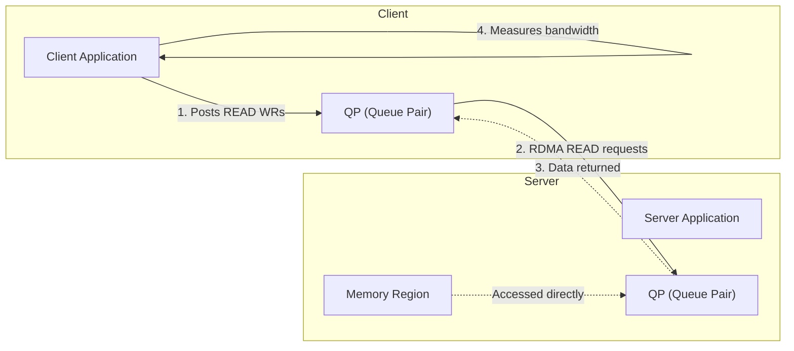
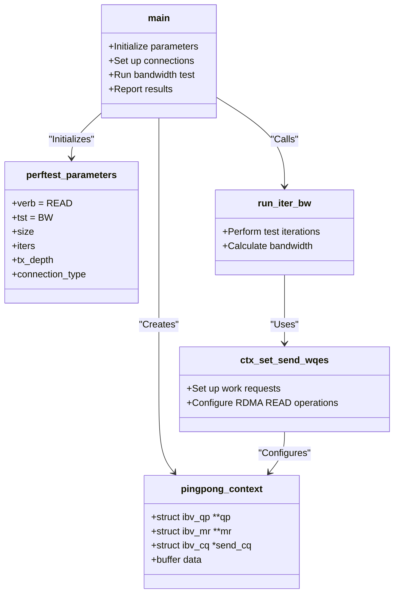
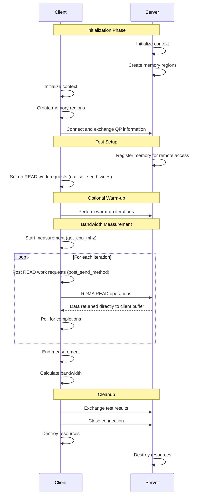
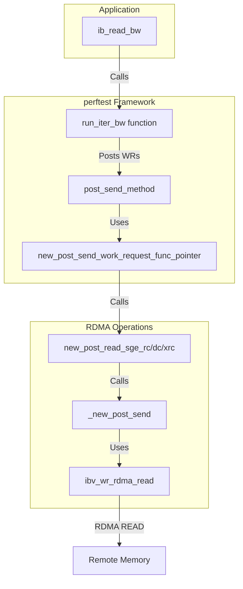
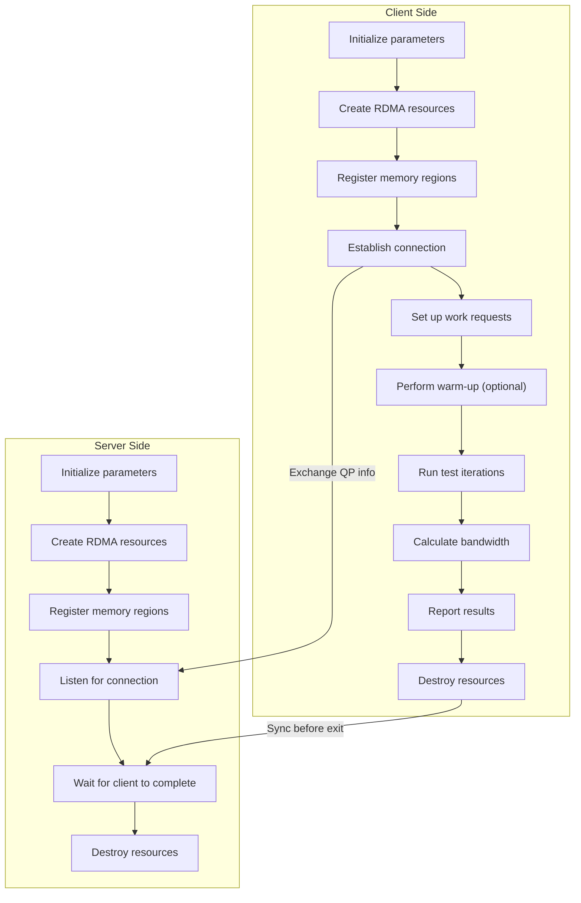
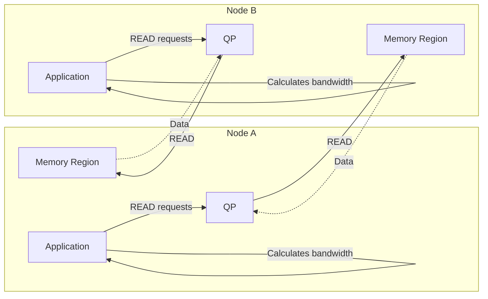

<!-- source: DeepWiki mcp.deepwiki.com · repo linux-rdma/perftest · page 3.3 READ Bandwidth Test · fetched 2026-11-11 -->

# READ Bandwidth Test

<details>
<summary>Relevant source files</summary>

The following files were used as context for generating this wiki page:

- [src/perftest_resources.c](src/perftest_resources.c)
- [src/read_bw.c](src/read_bw.c)

</details>


## Purpose and Scope

The READ Bandwidth Test (ib_read_bw) is a performance measurement tool that evaluates the bandwidth of RDMA READ operations across a network fabric. RDMA READ operations allow a system to directly read data from the memory of a remote system without involving the remote CPU, making them particularly efficient for certain workloads. This test measures how quickly data can be retrieved from a remote node's memory using these one-sided operations.

For information about WRITE bandwidth testing, see [WRITE Bandwidth Test](#3.2). For information about SEND bandwidth testing, see [SEND Bandwidth Test](#3.1).

Sources: [src/read_bw.c:45-67]()

## Test Overview

The READ Bandwidth Test operates in a client-server model where:

1. The server registers memory and makes it accessible for remote reads
2. The client performs RDMA READ operations to access the server's memory
3. The test measures the total throughput (bandwidth) achieved during these operations

Unlike two-sided operations (such as SEND/RECEIVE), READ operations do not require the remote side to post receive work requests, as they directly access the remote memory. This makes them particularly useful for scenarios where minimizing remote CPU involvement is important.



Sources: [src/read_bw.c:45-67](), [src/perftest_resources.c:1690-1691]()

## Implementation Architecture

The READ Bandwidth Test is implemented using several key components of the perftest suite:



The test uses a specific opcode (`IBV_WR_RDMA_READ`) for the READ operation, which is defined in `perftest_resources.c`. The access flags for READ operations include `IBV_ACCESS_REMOTE_READ` to enable remote reading of registered memory.

Sources: [src/read_bw.c:48-429](), [src/perftest_resources.c:356-364]()

## Execution Flow

The READ Bandwidth Test follows this general execution flow:



For half-duplex tests (default), only the client performs READ operations on the server's memory. In duplex mode, both sides perform READ operations simultaneously.

Sources: [src/read_bw.c:295-422](), [src/perftest_resources.c:703-714]()

## RDMA READ Operation

The RDMA READ operation is performed by posting work requests to the QP (Queue Pair) with the specific READ opcode:



The key structures and functions involved in this operation are:

1. `ctx_set_send_wqes` - Sets up work requests (WRs) for the test
2. `post_send_method` - Posts send work requests to the queue pair
3. `_new_post_send` - Low-level function to post the READ operation
4. `ibv_wr_rdma_read` - Actual RDMA READ operation (when using the new API)

Each READ operation contains the remote memory address and key (rkey) needed to access the remote memory region.

Sources: [src/perftest_resources.c:356-364](), [src/perftest_resources.c:703-714]()

## Test Methods

The READ Bandwidth Test supports three test methods:

| Test Method | Description | Implementation |
|-------------|-------------|----------------|
| RUN_REGULAR | Measures bandwidth using a single message size | Runs the test once with the configured message size |
| RUN_ALL | Tests with multiple message sizes (powers of 2) | Runs the test 23 times with message sizes from 2¹ to 2²³ |
| RUN_INFINITELY | Runs continuously until interrupted | Continues testing without stopping |

The test method can be specified via command-line parameters, with RUN_REGULAR being the default.

Sources: [src/read_bw.c:302-394]()

## Connection Types

The READ Bandwidth Test supports various connection types:

| Connection Type | Description |
|-----------------|-------------|
| RC (Reliable Connection) | Default connection type, provides reliable delivery |
| XRC (Extended Reliable Connection) | Shared receive queues for multiple connections |
| DC (Dynamic Connected) | Combines aspects of connected and unconnected transport |
| UC (Unreliable Connection) | Connected transport without reliability guarantees |

READ operations are primarily used with RC connections as they require the reliable delivery semantics.

Sources: [src/perftest_resources.c:1690-1691](), [src/perftest_resources.c:2383-2398]()

## Configuration Options

The READ Bandwidth Test includes numerous configuration options, including:

| Parameter | Description | Default |
|-----------|-------------|---------|
| --size, -s | Size of messages in bytes | 65536 |
| --iters, -n | Number of iterations | 1000 |
| --tx-depth | Size of send queue | 128 |
| --qp, -q | Number of queue pairs | 1 |
| --connection | Connection type (RC/XRC/DC/UC) | RC |
| --inline_size | Max size for inline send | 0 |
| --duration | Test duration in seconds | 0 (use iterations) |
| --cpu-freq | CPU frequency in MHz (for CPU util) | 0 (auto-detect) |
| --dualport | Use two ports | Off |
| --use-event | Use event-based completion | Off |

For a complete list of options, run the program with the `--help` parameter.

Sources: [src/read_bw.c:61-75]()

## Bandwidth Calculation

The bandwidth is calculated based on the total amount of data transferred and the time taken:

```
Bandwidth (Bytes/sec) = (message_size * iterations) / time_in_seconds
```

For reporting purposes, this can be converted to different units:

- Mb/s (Megabits per second) = Bandwidth * 8 / 10^6
- GB/s (Gigabytes per second) = Bandwidth / 10^9

The test can also report message rate (messages per second) which is calculated as:

```
Message Rate = iterations / time_in_seconds
```

Sources: [src/perftest_resources.c:1056-1073]()

## Client-Server Interaction

The communication between client and server follows this pattern:



The key aspect of this interaction is that after the connection setup, the server primarily waits while the client performs the READ operations and measures the bandwidth.

Sources: [src/read_bw.c:109-221](), [src/read_bw.c:238-292]()

## Example Output

The test outputs bandwidth results in a tabular format. For the RUN_REGULAR method with a single message size:

```
------------------------------------------------------------------
                    RDMA_Read BW Test
 Dual-port       : OFF
 Number of qps   : 1
 Connection type : RC
 TX depth        : 128
 Connection type : RC
 Size            : 65536 Bytes
 Transport type  : IB
 Using SRQ       : OFF
 Machine         : Client
------------------------------------------------------------------
 local address: LID 0x01 QPN 0x0100 PSN 0x277d25
 remote address: LID 0x02 QPN 0x0101 PSN 0x872f77
------------------------------------------------------------------
 #bytes     #iterations    BW peak[MB/sec]    BW average[MB/sec]   MsgRate[Mpps]
 65536      1000           3231.88            3231.29              0.051700
------------------------------------------------------------------
```

For the RUN_ALL method with multiple message sizes, each size is reported on a separate line.

Sources: [src/read_bw.c:226-236](), [src/read_bw.c:366-370]()

## Duplex Mode

When running in duplex mode (`--bidirectional` flag), both sides perform READ operations simultaneously:



In duplex mode, the test reports both the local and remote bandwidth measurements, as well as the aggregate bandwidth if requested.

Sources: [src/read_bw.c:316-340](), [src/read_bw.c:367-386]()

## Performance Considerations

Several factors can affect READ bandwidth performance:

1. **Message Size**: Larger messages generally provide better bandwidth utilization.
2. **Queue Pair Depth**: A deeper queue allows more outstanding operations.
3. **Number of Queue Pairs**: Multiple QPs can improve parallelism.
4. **CPU Frequency**: Higher CPU frequencies can improve performance.
5. **Network Configuration**: MTU size, link speed, and congestion settings affect performance.
6. **Memory Registration**: Different memory types may have different performance characteristics.

The test includes options to control many of these parameters to help optimize performance for specific scenarios.

Sources: [src/perftest_resources.c:1128-1128](), [src/perftest_resources.c:2358-2360]()

## Summary

The READ Bandwidth Test (ib_read_bw) is a comprehensive tool for measuring the performance of RDMA READ operations. It provides flexible configuration options to test various scenarios and produces detailed performance measurements. By understanding the results of this test, users can optimize their RDMA applications for maximum performance when using READ operations to access remote memory.

---

