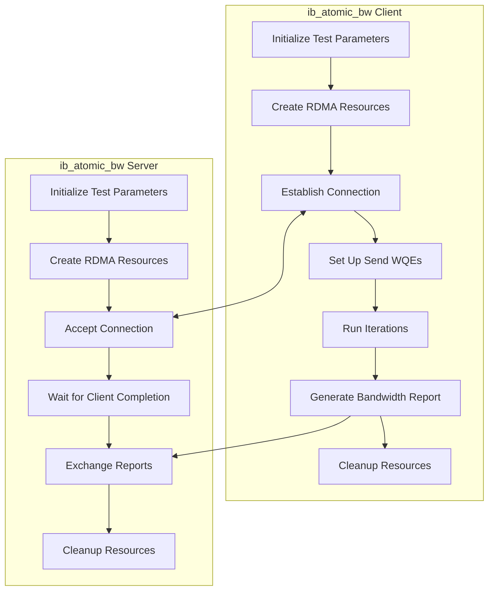
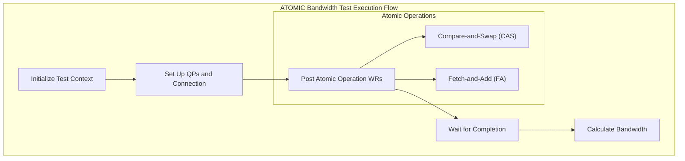
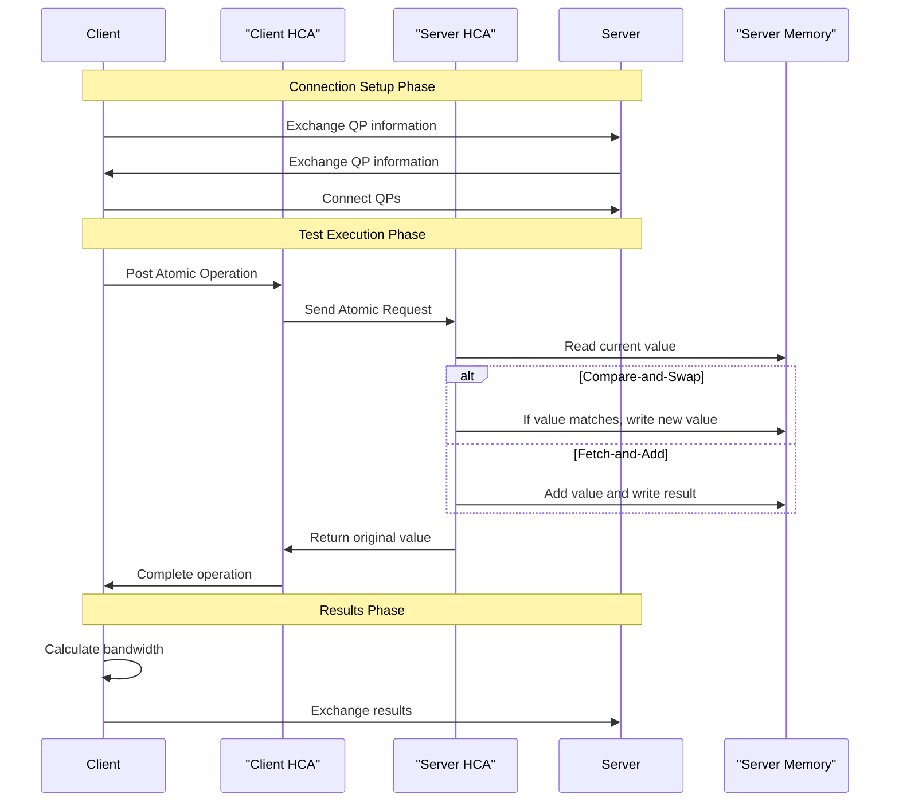
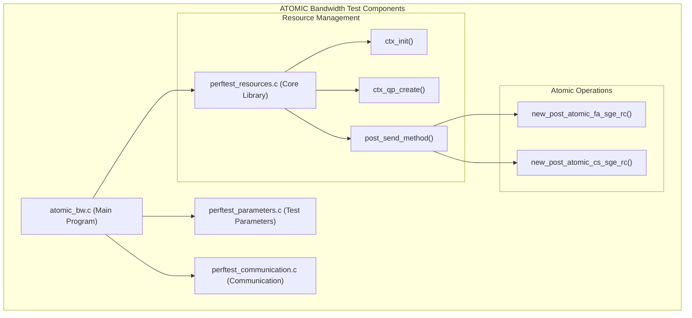

<!-- source: DeepWiki mcp.deepwiki.com · repo linux-rdma/perftest · page 3.4 ATOMIC Bandwidth Test · fetched 2026-11-11 -->

# ATOMIC Bandwidth Test

<details>
<summary>Relevant source files</summary>

The following files were used as context for generating this wiki page:

- [src/atomic_bw.c](src/atomic_bw.c)
- [src/perftest_resources.c](src/perftest_resources.c)

</details>


## Introduction

The ATOMIC Bandwidth Test (`ib_atomic_bw`) measures the bandwidth performance of RDMA atomic operations. This test focuses specifically on the throughput of RDMA atomic operations like compare-and-swap and fetch-and-add, while measuring the rate at which these operations can be performed over an RDMA connection. For information about bandwidth tests using other RDMA verbs, see [SEND Bandwidth Test](#3.1), [WRITE Bandwidth Test](#3.2), and [READ Bandwidth Test](#3.3).

Sources: [src/atomic_bw.c:1-436]()

## Supported Atomic Operations

The ATOMIC Bandwidth Test supports two types of atomic operations:

| Operation Type | Description | Opcode |
|----------------|-------------|--------|
| Compare and Swap (CAS) | Atomically compares a value at a specified remote memory location with a given value and, if they are equal, swaps it with a new value | `IBV_WR_ATOMIC_CMP_AND_SWP` |
| Fetch and Add (FA) | Atomically adds a value to a specified remote memory location and returns the original value | `IBV_WR_ATOMIC_FETCH_AND_ADD` |

By default, the test uses Compare and Swap operations. You can specify which operation to use with the `--atomic_type` parameter.

Sources: [src/perftest_resources.c:32-33](), [src/atomic_bw.c:65-68]()

## Test Architecture

The ATOMIC Bandwidth Test follows the client-server model common to all perftest tools. The test consists of a client and server component that communicate to establish an RDMA connection before performing the bandwidth measurement.



Sources: [src/atomic_bw.c:48-64](), [src/atomic_bw.c:104-228]()

## Atomic Operation Implementation Details

RDMA atomic operations are performed at the hardware level, bypassing the CPU on the remote side. The test sets up a specific work request (WR) for atomic operations and posts it to the send queue.



The atomic operations are implemented through the following functions in the perftest code:

1. For Compare and Swap: `new_post_atomic_cs_sge_rc`, `new_post_atomic_cs_sge_dc`, `new_post_atomic_cs_sge_xrc`
2. For Fetch and Add: `new_post_atomic_fa_sge_rc`, `new_post_atomic_fa_sge_dc`, `new_post_atomic_fa_sge_xrc`

These functions create and post the appropriate work requests to perform the atomic operations.

Sources: [src/perftest_resources.c:364-378](), [src/perftest_resources.c:567-576](), [src/perftest_resources.c:675-684]()

## How Atomic Operations Work in RDMA

RDMA atomic operations are remote memory operations that guarantee atomicity:



Sources: [src/perftest_resources.c:364-378](), [src/atomic_bw.c:297-319]()

## Supported Connection Types

The ATOMIC Bandwidth Test supports various RDMA connection types:

| Connection Type | Description | Support for Atomic Operations |
|-----------------|-------------|-----------------------------|
| RC (Reliable Connection) | Connection-oriented, reliable transfer | Full support |
| DC (Dynamically Connected) | Scalable, reliable one-to-many connection | Full support |
| XRC (Extended Reliable Connection) | Shared receive queues, reliable transfer | Full support |
| UC (Unreliable Connection) | Connection-oriented, unreliable transfer | Not supported |
| UD (Unreliable Datagram) | Connectionless, unreliable transfer | Not supported |

Sources: [src/perftest_resources.c:567-685]()

## Running the Test

### Basic Usage

To run the ATOMIC Bandwidth Test, you need to start a server instance on one machine and a client instance on another:

Server:
```
ib_atomic_bw
```

Client:
```
ib_atomic_bw -s <server_ip> -d <ib_device> -i <ib_port>
```

### Key Parameters

| Parameter | Description | Default |
|-----------|-------------|---------|
| `--atomic_type=<type>` | Type of atomic operation (CMP_AND_SWP or FETCH_AND_ADD) | CMP_AND_SWP |
| `-s, --server=<name>` | Server hostname or IP address | localhost |
| `-d, --ib-dev=<dev>` | InfiniBand device name | first available device |
| `-i, --ib-port=<port>` | InfiniBand port number | 1 |
| `-c, --connection=<type>` | Connection type (RC, DC, XRC) | RC |
| `-m, --mtu=<size>` | MTU size | 1024 |
| `-n, --iters=<iters>` | Number of iterations | 1000 |
| `-b, --bidirectional` | Measure bidirectional bandwidth | unidirectional |
| `-t, --tx-depth=<depth>` | Size of send queue | 100 |
| `-a, --all` | Run sizes from 8 bytes up to 2^15 bytes | 8 bytes only |
| `-D, --duration=<sec>` | Run test for specified duration | iters based |

Sources: [src/atomic_bw.c:61-67](), [src/atomic_bw.c:69]()

## Implementation Details

The ATOMIC Bandwidth Test follows this execution flow:

1. Initialize test parameters and parse command line arguments
2. Find and open the specified RDMA device
3. Create RDMA resources (Context, Protection Domain, Completion Queues, Queue Pairs)
4. Establish connection with remote peer
5. Exchange test parameters and connection information
6. Connect the Queue Pairs
7. Set up the send Work Queue Elements (WQEs) with the appropriate atomic operation
8. Run the test iterations
9. Calculate and report bandwidth results
10. Clean up resources

The main test loop posts a batch of atomic operations to the send queue and then polls for completions. The bandwidth is calculated based on the time taken to complete all operations.

Sources: [src/atomic_bw.c:48-436](), [src/perftest_resources.c:567-576](), [src/perftest_resources.c:675-684]()

## Performance Considerations

When running the ATOMIC Bandwidth Test, keep these considerations in mind:

1. Atomic operations typically have higher latency and lower bandwidth compared to other RDMA operations like WRITE or READ.
2. Different hardware may have different levels of support and performance for atomic operations.
3. The test supports measuring both unidirectional (default) and bidirectional bandwidth.
4. Memory alignment can affect atomic operation performance since hardware may require specific alignment for atomic operations.
5. The size parameter for atomic operations is fixed (8 bytes) since RDMA atomic operations operate on 64-bit values.

Sources: [src/atomic_bw.c:297-319]()

## Integration with perftest Framework

The ATOMIC Bandwidth Test is built on the perftest framework, sharing common code for resource allocation, connection establishment, and performance measurement with other tests in the suite.



Sources: [src/atomic_bw.c:37-44](), [src/perftest_resources.c:32-33](), [src/perftest_resources.c:567-576](), [src/perftest_resources.c:675-684]()

## Example Output

The ATOMIC Bandwidth Test outputs bandwidth measurements in both Mbit/sec and Message Rate (Mpps). Here's an example of the report format:

```
------------------------------------------------------------------
                    RDMA_Atomic BW Test
 Dual-port       : OFF          Device         : mlx5_0
 Number of qps   : 1            Transport type : IB/RC
 Connection type : RC           Using SRQ      : OFF
 Atomic type     : CMP_AND_SWP
------------------------------------------------------------------
 local address: LID 0x00 QPN 0x0137 PSN 0x39d41e
 remote address: LID 0x00 QPN 0x0136 PSN 0x42b3ac
------------------------------------------------------------------
 #bytes #iterations    BW peak[MB/sec]    BW average[MB/sec]   MsgRate[Mpps]
 8       1000             97.44              96.39              12.05
------------------------------------------------------------------
```

Sources: [src/atomic_bw.c:290-294](), [src/atomic_bw.c:319]()

---

