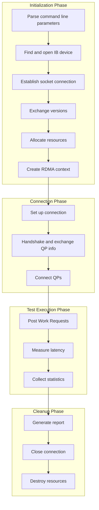
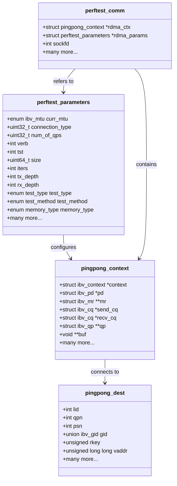
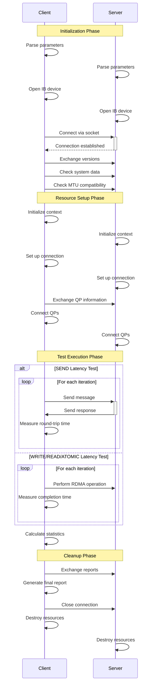
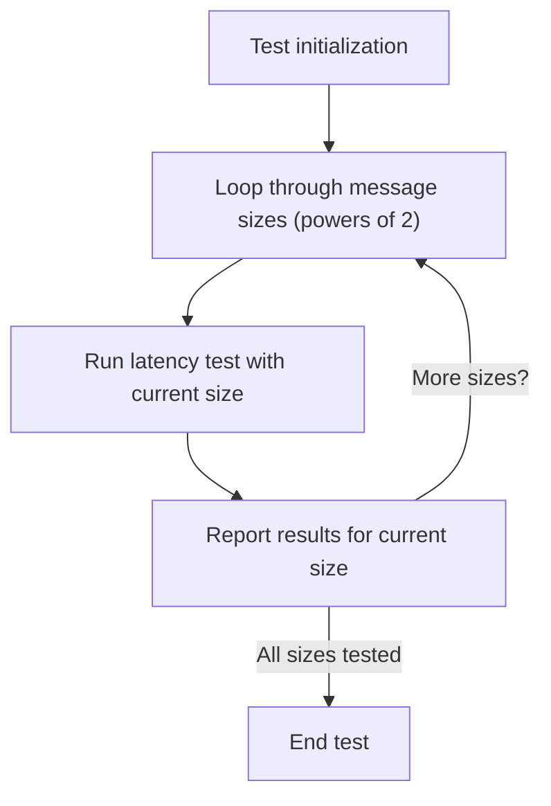

<!-- source: DeepWiki mcp.deepwiki.com · repo linux-rdma/perftest · page 4 Latency Tests · fetched 2026-11-11 -->

# Latency Tests

<details>
<summary>Relevant source files</summary>

The following files were used as context for generating this wiki page:

- [src/atomic_lat.c](src/atomic_lat.c)
- [src/read_lat.c](src/read_lat.c)
- [src/send_lat.c](src/send_lat.c)
- [src/write_lat.c](src/write_lat.c)

</details>


## Introduction

Latency tests measure the round-trip time or one-way time for RDMA operations to complete. They are a crucial component of the perftest suite, providing precise measurements of the minimum, maximum, and average latency for various RDMA verbs under different conditions. These tests complement the bandwidth tests (see [Bandwidth Tests](#3)) but focus on timing individual operations rather than measuring throughput.

The perftest suite includes several latency test programs, each focused on a specific RDMA verb:
- `ib_send_lat` - Measures latency of SEND/RECV operations
- `ib_write_lat` - Measures latency of RDMA WRITE operations
- `ib_read_lat` - Measures latency of RDMA READ operations
- `ib_atomic_lat` - Measures latency of RDMA ATOMIC operations
- `raw_ethernet_lat` - Measures latency of Raw Ethernet operations

Sources: [src/send_lat.c:1-525](), [src/write_lat.c:1-389](), [src/read_lat.c:1-387](), [src/atomic_lat.c:1-373]()

## Latency Measurement Methodology

### Measurement Principle

Latency tests operate on a client-server model where:

1. The client initiates the test operation
2. The time is measured between operation initiation and completion
3. Multiple iterations are performed to obtain statistically significant results
4. Results are processed to calculate minimum, maximum, and average latency

The exact measurement technique differs based on the RDMA verb being tested:

```mermaid
sequenceDiagram
    participant "Client" as C
    participant "Network" as N
    participant "Server" as S
    
    rect rgb(240, 240, 240)
        Note over C,S: SEND/RECV Latency Test
        C->>+N: Send message
        N->>+S: Receive message
        S->>-N: Send response
        N->>-C: Receive response
        Note over C: Measure round-trip time
    end
    
    rect rgb(240, 240, 240)
        Note over C,S: WRITE Latency Test
        C->>+N: RDMA Write
        N->>-S: Write to memory
        Note over C: Wait for completion event
        Note over C: Measure operation time
    end
    
    rect rgb(240, 240, 240)
        Note over C,S: READ Latency Test
        C->>+N: RDMA Read
        N->>S: Request data
        S->>-N: Return data
        N->>C: Data received
        Note over C: Measure operation time
    end
    
    rect rgb(240, 240, 240)
        Note over C,S: ATOMIC Latency Test
        C->>+N: RDMA Atomic Op
        N->>S: Perform atomic operation
        S->>-N: Return result
        N->>C: Result received
        Note over C: Measure operation time
    end
```

Sources: [src/send_lat.c:430-461](), [src/write_lat.c:286-326](), [src/read_lat.c:301-318](), [src/atomic_lat.c:299-304]()

### Timing Mechanism

The tests use a high-precision timing mechanism from the `get_clock.h` library. This provides microsecond or even nanosecond precision depending on platform capabilities. For each iteration:

1. Timestamp is captured before operation
2. Operation is performed (and completed)
3. Timestamp is captured after operation
4. Difference is calculated and accumulated

Sources: [src/send_lat.c:47](), [src/write_lat.c:46](), [src/read_lat.c:46](), [src/atomic_lat.c:47]()

## Common Architecture of Latency Tests

All latency tests follow a similar architecture and execution flow:



Sources: [src/send_lat.c:164-525](), [src/write_lat.c:54-389](), [src/read_lat.c:54-386](), [src/atomic_lat.c:55-372]()

### Key Data Structures

The tests use several common data structures:



Sources: [src/send_lat.c:169-177](), [src/write_lat.c:57-63](), [src/read_lat.c:56-63](), [src/atomic_lat.c:57-64]()

## Types of Latency Tests

### SEND Latency Test (ib_send_lat)

The SEND latency test measures the round-trip time for a SEND operation followed by a response. This measures the full path of data traveling from client to server and back, including hardware and software processing time.

**Process flow:**
1. Client posts a SEND request with a message
2. Server receives the message
3. Server posts a response with a SEND
4. Client receives the response
5. Latency is measured as the round-trip time

This test is useful for measuring end-to-end latency in message-passing patterns.

Sources: [src/send_lat.c:430-436]()

### WRITE Latency Test (ib_write_lat)

The WRITE latency test measures the time for an RDMA WRITE operation to complete. Since RDMA WRITE is one-sided (the remote side doesn't need to post a corresponding receive), this measures the time to transfer data directly to remote memory.

**Process flow:**
1. Client posts an RDMA WRITE request to write data to server memory
2. Operation completes when the client's NIC signals completion
3. Latency is measured as the operation completion time

For `WRITE_IMM` operations, the server also needs to post receives to get the immediate data.

This test is useful for measuring latency of direct memory access operations.

**Special consideration:** The WRITE latency test disables PCI relaxed ordering to ensure accurate results since it polls for data changes.

Sources: [src/write_lat.c:84-88](), [src/write_lat.c:287-323]()

### READ Latency Test (ib_read_lat)

The READ latency test measures the time for an RDMA READ operation to complete. This is another one-sided operation where the client reads data directly from server memory.

**Process flow:**
1. Client posts an RDMA READ request to read data from server memory
2. Operation completes when data is received at the client
3. Latency is measured as the operation completion time

This test is useful for measuring the latency of memory fetch operations.

Sources: [src/read_lat.c:313-317]()

### ATOMIC Latency Test (ib_atomic_lat)

The ATOMIC latency test measures the time for an RDMA atomic operation to complete. This includes operations like compare-and-swap (CAS) and fetch-and-add (FAA).

**Process flow:**
1. Client posts an RDMA atomic operation to modify/read server memory atomically
2. Operation completes when the result is received at the client
3. Latency is measured as the operation completion time

This test is useful for measuring the latency of distributed synchronization operations.

Sources: [src/atomic_lat.c:299-304]()

## Key Parameters Affecting Latency Tests

The latency tests are highly configurable with parameters that can significantly affect the measured latency:

| Parameter | Description | Impact on Latency |
|-----------|-------------|-------------------|
| Message Size | Size of data transferred | Larger messages typically have higher latency |
| Connection Type | RC, UC, UD, XRC, DC, SRD | Different connection types have different overhead |
| Transport Type | IB, RoCE, iWARP | Different transports have different latency characteristics |
| Number of Iterations | How many times to run the test | More iterations provide better statistical significance |
| Memory Type | Host, CUDA, ROCm, etc. | Different memory types can affect data access times |
| MTU Size | Maximum transmission unit | Can affect number of packets and processing time |
| Test Method | Fixed iterations or fixed duration | Affects statistical validity of results |
| Poll Mode | Polling or event-based | Affects CPU usage and can impact measured latency |

Sources: [src/send_lat.c:185-191](), [src/write_lat.c:71-88](), [src/read_lat.c:71-83](), [src/atomic_lat.c:71-82]()

## Test Execution Flow

The detailed execution flow of a typical latency test is as follows:



Sources: [src/send_lat.c:164-466](), [src/write_lat.c:54-330](), [src/read_lat.c:54-327](), [src/atomic_lat.c:55-313]()

## Running Multiple Sizes (RUN_ALL Option)

All latency tests support a special test method called `RUN_ALL`, which runs the test with multiple message sizes. This provides a comprehensive view of how latency changes with message size:



For SEND latency, sizes from 2¹ to 2²³ bytes are tested. For other tests, the ranges may vary slightly. This is especially useful for understanding the latency profile of a system across different data transfer sizes.

Sources: [src/send_lat.c:405-436](), [src/write_lat.c:259-294](), [src/read_lat.c:301-310]()

## Result Interpretation

Latency test results include:

- **Iterations**: Number of operations performed
- **Average Latency**: Average time for an operation to complete
- **Minimum Latency**: Shortest time observed
- **Maximum Latency**: Longest time observed
- **Message Size**: Size of the data transferred
- **CPU Utilization**: If enabled, shows CPU usage during the test

These results help users understand:
1. The baseline latency of their RDMA hardware and software stack
2. How latency scales with message size
3. The variability (jitter) in latency through min/max values
4. The system overhead through CPU utilization metrics

Sources: [src/send_lat.c:397-401](), [src/write_lat.c:253-257](), [src/read_lat.c:293-297](), [src/atomic_lat.c:293-297]()

## Conclusion

The latency tests in the perftest suite provide a comprehensive toolkit for measuring and analyzing the latency characteristics of RDMA operations. By supporting different verbs, connection types, and test parameters, they enable detailed performance characterization of RDMA hardware and software stacks. These tests are essential for applications where low latency is critical, such as high-frequency trading, distributed databases, and high-performance computing.

---

