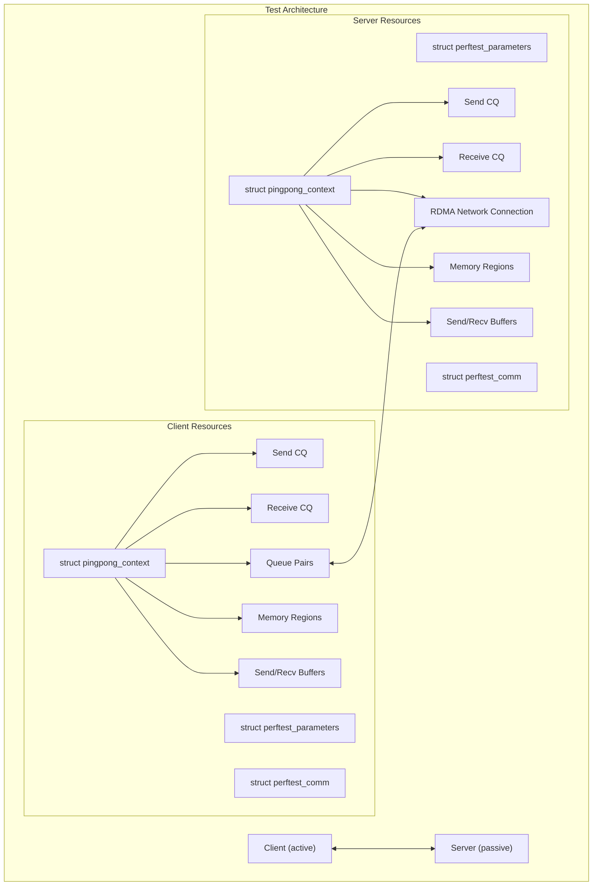
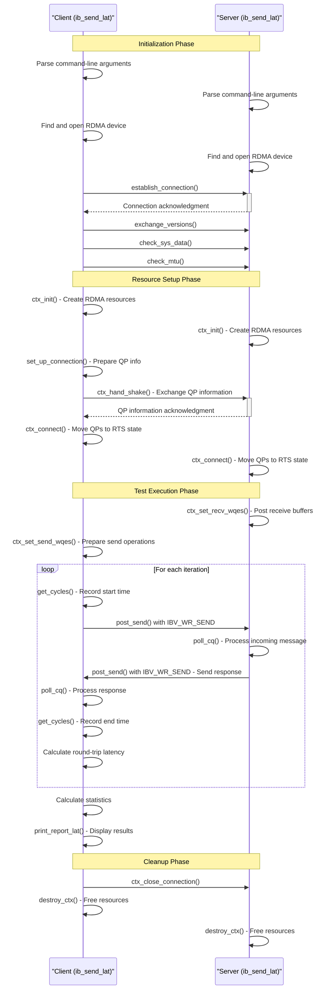

<!-- source: DeepWiki mcp.deepwiki.com · repo linux-rdma/perftest · page 4.1 SEND Latency Test · fetched 2026-11-11 -->

# SEND Latency Test

<details>
<summary>Relevant source files</summary>

The following files were used as context for generating this wiki page:

- [src/atomic_lat.c](src/atomic_lat.c)
- [src/perftest_resources.c](src/perftest_resources.c)
- [src/send_lat.c](src/send_lat.c)

</details>


The SEND Latency Test (`ib_send_lat`) is a performance benchmarking utility designed to measure the round-trip latency of RDMA SEND operations. It uses a client-server ping-pong methodology to accurately measure how long it takes for a message to travel from one endpoint to another and back. This test is an essential tool for evaluating and characterizing the latency performance of RDMA networks under different configurations.

For information about bandwidth testing using SEND operations, see [SEND Bandwidth Test](#3.1).

## Test Methodology

The SEND Latency Test employs a ping-pong methodology:

1. A client and server establish an RDMA connection
2. The client posts a SEND operation with a message to the server and starts a high-precision timer
3. The server receives the message and posts a SEND operation in response
4. The client receives the response and stops the timer
5. The round-trip time is recorded
6. Steps 2-5 are repeated for the specified number of iterations
7. Statistical analysis is performed (min, max, average, and standard deviation)

This approach provides an accurate measurement of the end-to-end latency, including hardware and software stack processing time.

Sources: [src/send_lat.c:430-460]()

## Architecture and Components

The test is structured as a client-server application with the following key components:



The primary data structures include:
- `struct perftest_parameters`: Contains test configuration settings (message size, iterations, etc.)
- `struct pingpong_context`: Contains all RDMA resources (QPs, CQs, MRs, buffers)
- `struct perftest_comm`: Manages connection establishment and coordination between client and server

Sources: [src/send_lat.c:165-184](), [src/perftest_resources.c:1030-1128]()

## Test Flow

The operational sequence of the SEND Latency test follows this pattern:



The test flow includes four main phases:
1. Initialization - Parameter parsing and device selection
2. Resource Setup - Creating RDMA resources and establishing connections
3. Test Execution - Running the actual latency test
4. Cleanup - Releasing resources

Sources: [src/send_lat.c:164-461]()

## Supported Connection Types

The SEND Latency test supports multiple RDMA connection types:

| Connection Type | Description |
|-----------------|-------------|
| RC | Reliable Connection - ordered, reliable delivery |
| UC | Unreliable Connection - unordered, unreliable delivery |
| UD | Unreliable Datagram - connectionless communication |
| XRC | eXtended Reliable Connection - shared receive queues |
| DC | Dynamically Connected - connection pooling |
| SRD | Shared Receive Queue Datagram - optimized for cloud environments |

Each connection type offers different trade-offs between reliability, performance, and resource usage.

Sources: [src/send_lat.c:198-206](), [src/perftest_resources.c:518-642]()

## Usage Examples

To run the SEND Latency test, you must start the server first, then the client:

**Server side:**
```
ib_send_lat -d mlx5_0 -i 1 -p 18515
```

**Client side:**
```
ib_send_lat -d mlx5_0 -i 1 -p 18515 -s 1024 -n 100000 server_hostname
```

The above example:
- Uses RDMA device `mlx5_0`
- Uses port 1
- Runs with 1024-byte messages 
- Performs 100,000 iterations

## Common Command-Line Options

| Option | Description | Default |
|--------|-------------|---------|
| `-d, --ib-dev` | RDMA device to use | First available device |
| `-i, --ib-port` | Port number of the RDMA device | 1 |
| `-c, --connection` | Connection type (RC/UC/UD/XRC/DC/SRD) | RC |
| `-m, --mtu` | MTU size | Active MTU from port info |
| `-s, --size` | Message size in bytes | 1 |
| `-n, --iters` | Number of iterations | 1000 |
| `-t, --tx-depth` | Size of the send queue | 1 |
| `-u, --qp-timeout` | QP timeout value | 14 |
| `-p, --port` | TCP port for socket connection | 18515 |
| `-R, --run-infinitely` | Run test until interrupted | Off |
| `-F, --cpu-freq` | CPU frequency in Hz | Measured from system |
| `-V, --version` | Display version information | N/A |
| `-H, --help` | Display usage information | N/A |

Sources: [src/send_lat.c:191-192]()

## Output Interpretation

The test outputs detailed statistics on latency measurements, formatted as:

```
#bytes #iterations    t_min[usec]    t_max[usec]  t_typical[usec]    t_avg[usec]    t_stdev[usec]   99% percentile[usec]   99.9% percentile[usec]
    64      100000         0.747         3.835         0.761         0.765         0.027         0.822         1.287
```

Explanation of output fields:
- **#bytes**: Message size tested
- **#iterations**: Number of ping-pong iterations performed
- **t_min**: Minimum round-trip latency 
- **t_max**: Maximum round-trip latency
- **t_typical**: Most common latency value (mode)
- **t_avg**: Average latency 
- **t_stdev**: Standard deviation of latency measurements
- **99% percentile**: 99th percentile latency (optional)
- **99.9% percentile**: 99.9th percentile latency (optional)

Sources: [src/send_lat.c:397-401](), [src/send_lat.c:435-460]()

## Test Modes

The SEND Latency test supports several operational modes:

1. **Single size mode**: Tests with a specific message size
2. **Multiple size mode**: Tests with multiple message sizes (powers of 2)
3. **Iterations mode**: Runs for a specific number of iterations
4. **Duration mode**: Runs for a specific time duration
5. **Infinite mode**: Runs until interrupted

These modes can be selected using command-line options, allowing for flexible testing depending on the user's requirements.

Sources: [src/send_lat.c:405-441](), [src/send_lat.c:442-460]()

## Advanced Features

The SEND Latency test also supports several advanced features:

- **Multicast**: Testing with multicast groups
- **Event-based completion**: Using completion events instead of polling
- **RDMA CM**: Using RDMA Connection Manager for setup
- **Multiple Queue Pairs**: Distributing load across multiple QPs
- **CPU utilization measurement**: Tracking CPU usage during tests

These features can be enabled through specific command-line options, providing additional flexibility for testing different scenarios.

Sources: [src/send_lat.c:56-159](), [src/send_lat.c:384-396]()

---

