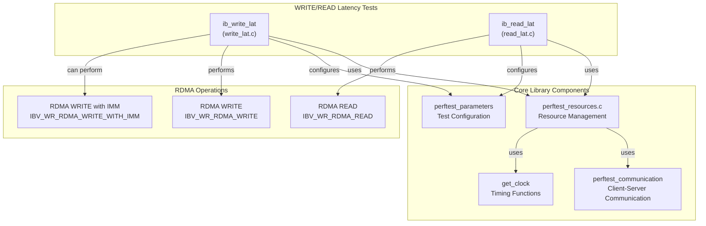
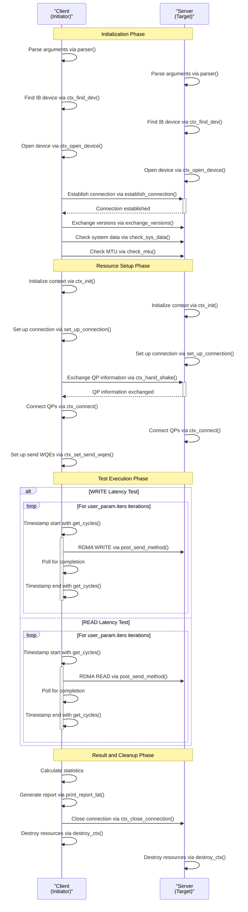
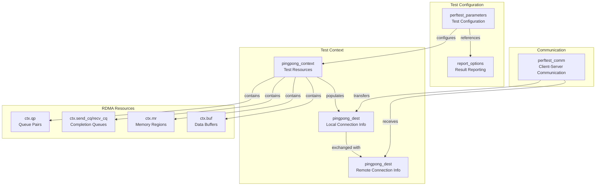

<!-- source: DeepWiki mcp.deepwiki.com · repo linux-rdma/perftest · page 4.2 WRITE/READ Latency Tests · fetched 2026-11-11 -->

# WRITE/READ Latency Tests

<details>
<summary>Relevant source files</summary>

The following files were used as context for generating this wiki page:

- [src/perftest_resources.c](src/perftest_resources.c)
- [src/read_lat.c](src/read_lat.c)
- [src/write_lat.c](src/write_lat.c)

</details>


## Purpose

This page documents the WRITE and READ latency tests in the perftest suite. These tests measure the round-trip latency of RDMA WRITE and READ operations respectively, providing insights into the performance characteristics of RDMA networks. For bandwidth tests, see [Bandwidth Tests](#3).

The `ib_write_lat` and `ib_read_lat` utilities measure the time it takes to complete individual RDMA operations, focusing on latency rather than throughput. Both tests operate in a client-server model, where one system initiates operations to or from memory on a remote system.

Sources: [src/write_lat.c:1-389](), [src/read_lat.c:1-386]()

## Architecture and Components

These tests measure one-sided RDMA operations latency. In RDMA terminology, one-sided operations allow a system to directly access memory on a remote system without involving the remote CPU.

### Component Interaction Diagram



Sources: [src/write_lat.c:71-72](), [src/read_lat.c:71-72](), [src/perftest_resources.c:32-33]()

## Test Execution Flow

The WRITE and READ latency tests follow a similar execution flow, with differences in the RDMA operations performed:

### Test Sequence Flow



Sources: [src/write_lat.c:54-389](), [src/read_lat.c:54-386](), [src/perftest_resources.c:689-714]()

## Key Differences Between WRITE and READ Tests

While the overall flow is similar, there are important differences between the two latency tests:

1. **WRITE Test (`ib_write_lat`):**
   - Client writes data to server's memory
   - PCI relaxed ordering is disabled (`user_param.disable_pcir = 1`) for accurate measurements
   - Uses `run_iter_lat_write()` or `run_iter_lat_write_imm()` for test execution
   - Both client and server are active participants

2. **READ Test (`ib_read_lat`):**
   - Client reads data from server's memory
   - Server is mostly passive after setup
   - Uses `run_iter_lat()` for test execution
   - After setup, server just waits for test completion

Sources: [src/write_lat.c:84-88](), [src/write_lat.c:287-291](), [src/read_lat.c:245-284]()

## Implementation Details

### Initialization

Both tests initialize their parameters with the appropriate verb type and test type:

- **WRITE Test:**
  ```c
  user_param.verb = WRITE;
  user_param.tst = LAT;
  ```

- **READ Test:**
  ```c
  user_param.verb = READ;
  user_param.tst = LAT;
  ```

For WRITE tests specifically, PCI relaxed ordering is disabled to ensure accurate results:
```c
user_param.disable_pcir = 1;
```
This is necessary because the WRITE test polls for data changes of the last packet, so relaxed ordering could lead to incorrect test results.

Sources: [src/write_lat.c:71-72](), [src/write_lat.c:84-88](), [src/read_lat.c:71-72]()

### Resource Setup and Management

Both tests follow a similar pattern for resource setup:

1. Allocate context and resources with `alloc_ctx()`
2. Initialize IB resources with `ctx_init()`
3. Set up connection with `set_up_connection()`
4. Exchange QP information with `ctx_hand_shake()`
5. Connect QPs with `ctx_connect()`
6. Set up send work queue elements with `ctx_set_send_wqes()`

The `pingpong_context` structure (defined in `perftest_resources.h`) holds all the resources needed for the test, including:
- Queue Pairs (QPs)
- Completion Queues (CQs)
- Memory Regions (MRs)
- Data Buffers

Sources: [src/write_lat.c:158-251](), [src/read_lat.c:150-243]()

### Test Execution

The actual test execution differs between WRITE and READ:

- **WRITE Test:** 
  - Regular WRITE operations: `run_iter_lat_write(&ctx, &user_param)`
  - WRITE with immediate data: `run_iter_lat_write_imm(&ctx, &user_param)`

- **READ Test:** 
  - `run_iter_lat(&ctx, &user_param)`

In both cases, the test performs multiple iterations of the operation and measures the time taken for each iteration using high-precision timers.

Sources: [src/write_lat.c:287-291](), [src/write_lat.c:319-322](), [src/read_lat.c:304-306](), [src/read_lat.c:312-315]()

## Data Structure Relationships



Sources: [src/write_lat.c:57-63](), [src/read_lat.c:57-63]()

## Key Parameters

The following table shows the most important parameters for configuring these tests:

| Parameter | Description | Default | Code Reference |
|-----------|-------------|---------|----------------|
| `size` | Size of message to exchange (bytes) | 1 for ping-pong, 64K for BW | Command line `-s, --size` |
| `iters` | Number of iterations | 1000 | Command line `-n, --iters` |
| `tx_depth` | Size of transmit queue | 1 | Command line `-t, --tx-depth` |
| `connection_type` | Connection type (RC/UC/UD/DC/XRC/SRD) | RC | Command line `-c, --connection` |
| `mtu` | MTU size | 0 (default per device) | Command line `-m, --mtu` |
| `inline_size` | Maximum size for inline sends | 0 | Command line `-I, --inline_size` |
| `disable_pcir` | Disable PCI relaxed ordering | 1 for WRITE tests | [src/write_lat.c:88]() |

Sources: [src/write_lat.c:77-78](), [src/read_lat.c:77-78]()

## Result Interpretation

The output of the tests includes the following columns:

| Column | Description |
|--------|-------------|
| Size | Message size in bytes |
| Iterations | Number of iterations run |
| t_avg | Average latency in microseconds |
| t_min | Minimum latency in microseconds |
| t_max | Maximum latency in microseconds |
| t_stdev | Standard deviation of latency |

Example output:
```
#       Size        Iterations    t_avg        t_min        t_max        t_stdev
1       2          1000          1.33         1.27         1.63         0.03
```

This output indicates that for messages of size 2 bytes, over 1000 iterations, the average latency was 1.33 microseconds, with a minimum of 1.27 and a maximum of 1.63 microseconds.

Sources: [src/write_lat.c:253-257](), [src/write_lat.c:293](), [src/read_lat.c:293-297](), [src/read_lat.c:309]()

## Test Method Options

These tests support different testing methodologies:

1. **Single Size Test**: Test with a single message size specified by `-s, --size`
2. **Multiple Size Test** (RUN_ALL): When using `--run_all`, the test runs with message sizes from 2 bytes to 8MB (powers of 2)

For the RUN_ALL method, the tests iterate through different message sizes and report results for each size:

```
for (i = 1; i < 24 ; ++i) {
    user_param.size = (uint64_t)1 << i;
    /* Run test and print results */
}
```

Sources: [src/write_lat.c:259-295](), [src/read_lat.c:301-318]()

## Usage Examples

### Server Side
```
ib_write_lat  # For WRITE latency test
ib_read_lat   # For READ latency test
```

### Client Side
```
ib_write_lat -s 4096 -n 10000 -c RC server_ip  # WRITE latency test with 4KB messages, 10K iterations
ib_read_lat --run_all -d mlx5_0 -i 1 server_ip  # READ latency test with all sizes on device mlx5_0, port 1
```

Sources: [src/write_lat.c:77-78](), [src/read_lat.c:77-78]()

## Conclusion

The WRITE and READ latency tests are essential tools for understanding the performance characteristics of RDMA networks. They provide detailed measurements of the time required to complete RDMA operations, which is critical for applications requiring low-latency communication.

The key differences between the tests reflect the fundamental nature of RDMA operations:
- WRITE tests measure the time to write data to a remote memory location
- READ tests measure the time to read data from a remote memory location

For complementary tests measuring bandwidth instead of latency, see [WRITE Bandwidth Test](#3.2) and [READ Bandwidth Test](#3.3).

Sources: [src/write_lat.c:1-389](), [src/read_lat.c:1-386]()

---

