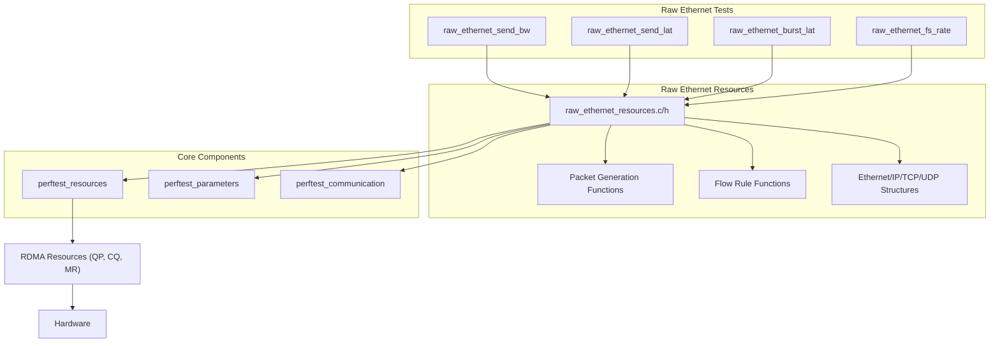
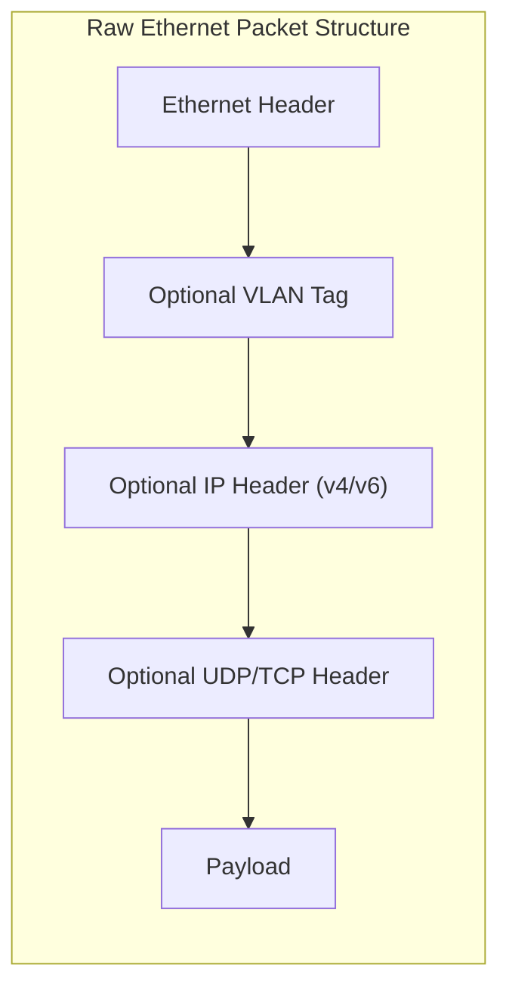
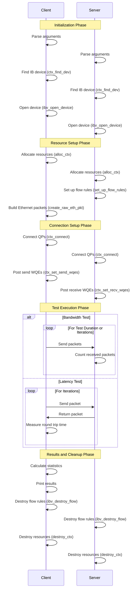

<!-- source: DeepWiki mcp.deepwiki.com · repo linux-rdma/perftest · page 5 Raw Ethernet Tests · fetched 2026-11-11 -->

# Raw Ethernet Tests

<details>
<summary>Relevant source files</summary>

The following files were used as context for generating this wiki page:

- [src/raw_ethernet_resources.c](src/raw_ethernet_resources.c)
- [src/raw_ethernet_resources.h](src/raw_ethernet_resources.h)
- [src/raw_ethernet_send_bw.c](src/raw_ethernet_send_bw.c)
- [src/raw_ethernet_send_lat.c](src/raw_ethernet_send_lat.c)

</details>


Raw Ethernet tests in the perftest suite allow performance testing of RDMA-enabled network adapters using raw Ethernet packets. Unlike the standard RDMA tests that use InfiniBand verbs, these tests operate directly with Ethernet frames, enabling the measurement of raw network performance with specific packet formats and flow steering rules.

If you're looking for information about standard RDMA tests based on verbs, see [Bandwidth Tests](#3) and [Latency Tests](#4).

## Overview

Raw Ethernet tests bypass the standard RDMA transport mechanisms and work directly at the Ethernet layer. This approach allows for:

- Testing with specific packet types and formats (IPv4, IPv6, UDP, TCP)
- Fine-grained control over packet headers and content
- Performance testing with various flow configurations
- Multicast and flow steering functionality testing

The Raw Ethernet tests include:

- **Bandwidth Test** (`raw_ethernet_send_bw`) - Measures maximum throughput
- **Latency Test** (`raw_ethernet_send_lat`) - Measures packet round-trip time
- **Burst Latency Test** (`raw_ethernet_burst_lat`) - Measures latency with bursts of packets
- **Flow Steering Rate Test** (`raw_ethernet_fs_rate`) - Tests flow rule creation/destruction rates

For more details on specific tests, see [Raw Ethernet Bandwidth Test](#5.1), [Raw Ethernet Latency Tests](#5.2), and [Flow Steering Rate Test](#5.3).

## Architecture

Raw Ethernet tests are built on a specialized set of resources for packet construction and flow rule management.



Sources: [src/raw_ethernet_resources.h:48-54](), [src/raw_ethernet_resources.c:60-92]()

## Packet Structure

Raw Ethernet tests construct packets with multiple header layers based on test configuration:



The packet construction is performed by the functions `build_pkt_on_buffer` and `create_raw_eth_pkt` in [src/raw_ethernet_resources.c:555-686]().

### Header Components

#### Ethernet Header
```c
struct ETH_header {
    uint8_t dst_mac[6];
    uint8_t src_mac[6];
    uint16_t eth_type;
}__attribute__((packed));
```

The Ethernet header is defined in [src/raw_ethernet_resources.h:69-73]() and generated by `gen_eth_header` in [src/raw_ethernet_resources.c:204-212]().

#### IP Headers
Both IPv4 and IPv6 headers are supported:
- IPv4 headers are defined in [src/raw_ethernet_resources.h:117-134]() and generated by `gen_ipv4_header` [src/raw_ethernet_resources.c:145-166]()
- IPv6 headers are defined in [src/raw_ethernet_resources.h:99-115]() and generated by `gen_ipv6_header` [src/raw_ethernet_resources.c:118-140]()

#### Transport Headers
- UDP headers are defined in [src/raw_ethernet_resources.h:141-146]() and generated by `gen_udp_header` [src/raw_ethernet_resources.c:171-184]()
- TCP headers are defined in [src/raw_ethernet_resources.h:148-159]() and generated by `gen_tcp_header` [src/raw_ethernet_resources.c:189-200]()

## Flow Rules

A key feature of Raw Ethernet tests is the ability to create flow rules that direct incoming packets to specific queue pairs. Flow rules specify packet matching criteria based on various header fields.

```mermaid
graph TD
    start["Start"] --> calc["Calculate Flow Rule Size<br>calc_flow_rules_size()"]
    calc --> alloc["Allocate Memory for Flow Rule"]
    alloc --> attr["Set Flow Attributes<br>ibv_flow_attr"]
    attr --> eth_spec["Add Ethernet Specification<br>ibv_flow_spec_eth"]
    eth_spec --> ip_check{"IP Headers<br>Required?"}
    ip_check -->|"Yes"| ip_spec["Add IP Specification<br>ibv_flow_spec_ip"]
    ip_check -->|"No"| port_check{"Port Headers<br>Required?"}
    ip_spec --> port_check
    port_check -->|"Yes"| port_spec["Add TCP/UDP Specification<br>ibv_flow_spec_tcp_udp"]
    port_check -->|"No"| create["Create Flow<br>ibv_create_flow()"]
    port_spec --> create
    create --> end["End"]
```

Flow rules are set up using the following functions:
- `calc_flow_rules_size` [src/raw_ethernet_resources.c:692-703]()
- `set_up_flow_rules` [src/raw_ethernet_resources.c:777-851]()
- `send_set_up_connection` [src/raw_ethernet_resources.c:893-958]()

Sources: [src/raw_ethernet_resources.c:692-851]()

## Test Execution Flow

Raw Ethernet tests follow a client-server model with the following execution flow:



Sources: [src/raw_ethernet_send_bw.c:60-468](), [src/raw_ethernet_send_lat.c:59-288]()

## Special Modes

Raw Ethernet tests support several special operational modes:

### MAC Forwarding Mode

In MAC forwarding mode (`--mac_fwd`), the server swaps the source and destination MAC addresses of received packets and sends them back. This mode is useful for testing the forwarding performance of network adapters.

The MAC forwarding functionality is implemented in the `run_iter_fw` function [src/raw_ethernet_resources.c:963-1146]() and uses the `switch_smac_dmac` helper function [src/raw_ethernet_resources.h:304-312]().

### Multicast Mode

Multicast mode (`--raw_mcast`) allows testing with multicast IP addresses. It transforms an IPv4 address to a multicast MAC address and sets up the appropriate flow rules:

```c
/* Transform IPv4 to Multicast MAC */
user_param.dest_mac[0] = 0x01;
user_param.dest_mac[1] = 0x00;
user_param.dest_mac[2] = 0x5e;
user_param.dest_mac[3] = (user_param.server_ip >> 8) & 0x7f;
user_param.dest_mac[4] = (user_param.server_ip >> 16) & 0xff;
user_param.dest_mac[5] = (user_param.server_ip >> 24) & 0xff;
```

This is implemented in [src/raw_ethernet_send_bw.c:110-126]().

### Promiscuous and Sniffer Modes

- **Promiscuous Mode** (`--use_promiscuous`): Receives all packets regardless of destination address
- **Sniffer Mode** (`--use_sniffer`): Receives a copy of all packets (on supported devices)

These modes are implemented in [src/raw_ethernet_send_bw.c:200-234]().

## Flow Steering Support

The raw Ethernet tests rely on hardware flow steering support. Not all devices support flow steering, and some require specific configuration. The function `check_flow_steering_support` [src/raw_ethernet_resources.c:60-92]() checks if the device supports flow steering and provides guidance if it doesn't:

```c
if (val >= 0) {
    fprintf(stderr,"flow steering is not supported.\n");
    fprintf(stderr," please run: echo options mlx4_core log_num_mgm_entry_size=-1 >> /etc/modprobe.d/mlnx.conf\n");
    if (access(openibd_path, F_OK) != -1)
        fprintf(stderr," and restart the driver: %s restart \n", openibd_path);
    else
        fprintf(stderr," and restart the driver: modprobe -r mlx4_core; modprobe mlx4_core \n");
    is_flow_steering_not_supported = 1;
}
```

Sources: [src/raw_ethernet_resources.c:60-92]()

## Conclusion

Raw Ethernet tests provide powerful tools for measuring the performance of RDMA-enabled network adapters at the raw Ethernet level. They offer flexibility in testing with different packet formats, protocols, and network configurations.

For specific usage examples and command-line options, see [Raw Ethernet Bandwidth Test](#5.1), [Raw Ethernet Latency Tests](#5.2), and [Flow Steering Rate Test](#5.3).

Sources: [src/raw_ethernet_resources.c](), [src/raw_ethernet_resources.h](), [src/raw_ethernet_send_bw.c](), [src/raw_ethernet_send_lat.c]()

---

