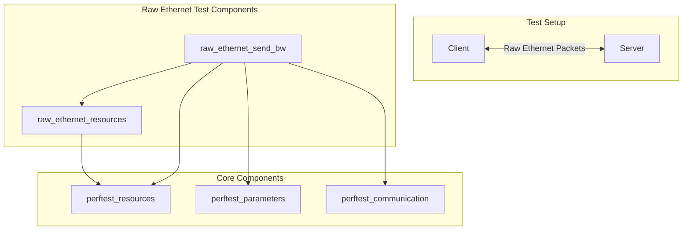
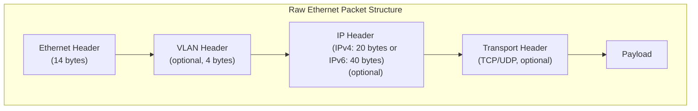
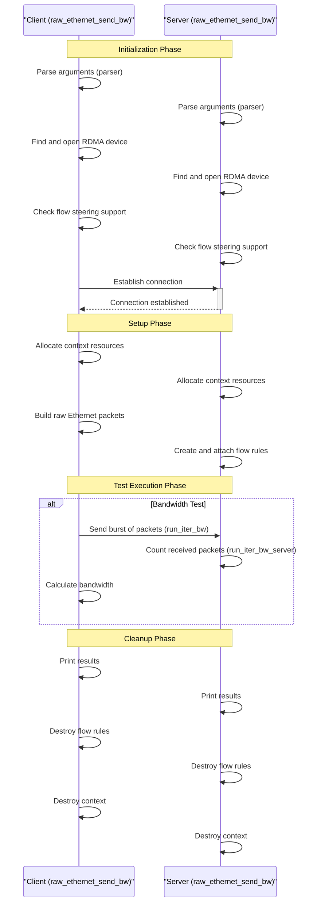
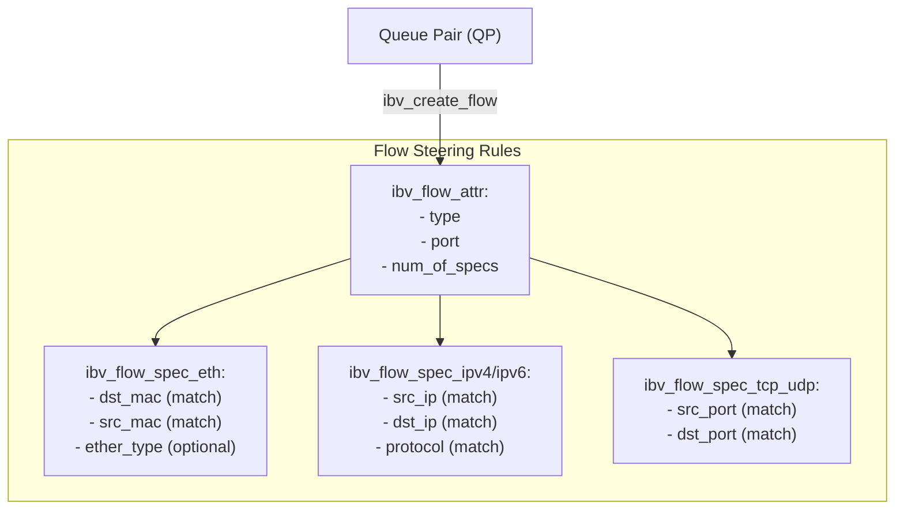
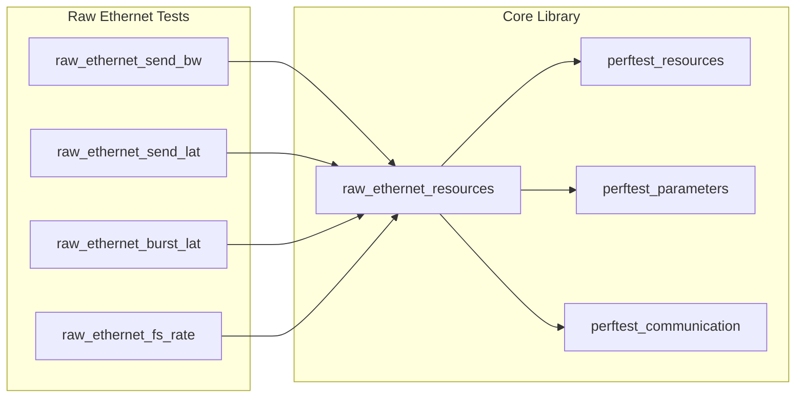

<!-- source: DeepWiki mcp.deepwiki.com · repo linux-rdma/perftest · page 5.1 Raw Ethernet Bandwidth Test · fetched 2026-11-11 -->

# Raw Ethernet Bandwidth Test

Relevant source files

The following files were used as context for generating this wiki page:

- [src/raw_ethernet_resources.c](src/raw_ethernet_resources.c)
- [src/raw_ethernet_resources.h](src/raw_ethernet_resources.h)
- [src/raw_ethernet_send_bw.c](src/raw_ethernet_send_bw.c)
- [src/raw_ethernet_send_lat.c](src/raw_ethernet_send_lat.c)

The Raw Ethernet Bandwidth Test (`raw_ethernet_send_bw`) is a performance measurement tool that evaluates the bandwidth capabilities of RDMA-capable network interfaces using raw Ethernet frames. Unlike standard RDMA tests, this test bypasses the RDMA transport layer and works directly with Ethernet frames, making it useful for evaluating the raw performance of network hardware, especially in environments where RDMA transport protocols aren't used.

For testing latency using raw Ethernet frames, see [Raw Ethernet Latency Tests](#5.2).

## Overview

The Raw Ethernet Bandwidth Test measures the maximum throughput that can be achieved by sending raw Ethernet packets between two endpoints. It utilizes flow steering capabilities in RDMA-capable network cards to direct incoming packets to specific receive queues, enabling efficient packet processing.

Sources: [src/raw_ethernet_send_bw.c:37-135](). [src/raw_ethernet_resources.c:36-92]()

## Packet Format

The Raw Ethernet Bandwidth Test builds and transmits custom Ethernet packets. The packet format is configurable and can include various header types depending on test parameters.

Sources: [src/raw_ethernet_resources.c:554-625](). [src/raw_ethernet_resources.h:69-159]()

### Packet Header Structures

The test manipulates various packet headers to create the raw Ethernet packets:

| Header Type | Structure | Size | Key Fields |
|-------------|-----------|------|------------|
| Ethernet | `ETH_header` | 14 bytes | `dst_mac`, `src_mac`, `eth_type` |
| VLAN | `ETH_vlan_header` | 18 bytes | `dst_mac`, `src_mac`, `vlan_header`, `eth_type` |
| IPv4 | `IP_V4_header` | 20 bytes | `saddr`, `daddr`, `protocol`, `ttl` |
| IPv6 | `IP_V6_header` | 40 bytes | `saddr`, `daddr`, `nexthdr`, `hop_limit` |
| UDP | `UDP_header` | 8 bytes | `uh_sport`, `uh_dport`, `uh_ulen` |
| TCP | `TCP_header` | 20 bytes | `th_sport`, `th_dport`, `th_window` |

Sources: [src/raw_ethernet_resources.h:69-159](). [src/raw_ethernet_resources.c:97-204]()

## Test Operation

The Raw Ethernet Bandwidth Test follows a client-server model:

Sources: [src/raw_ethernet_send_bw.c:60-144](). [src/raw_ethernet_send_bw.c:285-328]()

## Implementation Details

### Flow Steering

The test uses RDMA flow steering to direct packets to specific queue pairs:

The flow steering rules allow the NIC to direct incoming packets to specific QPs based on matching criteria like MAC addresses, IP addresses, and port numbers.

Sources: [src/raw_ethernet_resources.c:692-851](). [src/raw_ethernet_send_bw.c:169-249]()

### Packet Construction

Raw Ethernet packets are constructed by filling in various headers:

1. First, an Ethernet header is created with source and destination MAC addresses
2. If VLAN is enabled, a VLAN header is added
3. If IP is enabled, an IPv4 or IPv6 header is added
4. If TCP/UDP is enabled, the respective transport header is added

The function `create_raw_eth_pkt` is responsible for building these packets, and it uses helper functions like `gen_eth_header`, `gen_ipv4_header`, `gen_ipv6_header`, `gen_udp_header`, and `gen_tcp_header`.

Sources: [src/raw_ethernet_resources.c:554-625](). [src/raw_ethernet_resources.c:633-687]()

### Bandwidth Measurement

The bandwidth test works by:

1. The client sending bursts of packets at maximum rate
2. The server receiving and counting these packets
3. Measuring the total data transferred over time

The main bandwidth measurement logic is in the functions `run_iter_bw` (client side) and `run_iter_bw_server` (server side). For packet forwarding tests, the function `run_iter_fw` is used, which receives packets and swaps the source and destination MAC addresses before sending them back.

Sources: [src/raw_ethernet_resources.c:963-1146](). [src/raw_ethernet_send_bw.c:285-328]()

## Key Parameters

The Raw Ethernet Bandwidth Test supports various command-line parameters to configure the test:

| Parameter | Description |
|-----------|-------------|
| `--source_mac` | Source MAC address for Ethernet packets |
| `--dest_mac` | Destination MAC address for Ethernet packets |
| `--client_ip` | IP address of the client side (for IP packets) |
| `--server_ip` | IP address of the server side (for IP packets) |
| `--client_port` | UDP/TCP port for the client side |
| `--server_port` | UDP/TCP port for the server side |
| `--tcp` | Use TCP headers instead of UDP |
| `--raw_ipv6` | Use IPv6 headers instead of IPv4 |
| `--flow_label` | Set IPv6 flow label |
| `--hop_limit` | Set IP TTL/hop limit value |
| `--promiscuous` | Use promiscuous mode to receive all packets |
| `--flows` | Number of different flows to use |
| `--flows_burst` | Number of bursts to use in flows |
| `--vlan_pcp` | VLAN priority code point |
| `--use_rss` | Enable Receive Side Scaling |
| `--mac_fwd` | Forward received packets after MAC swap |
| `--raw_mcast` | Use raw multicast addresses |

Sources: [src/raw_ethernet_send_bw.c:82-88](). [src/raw_ethernet_send_bw.c:103-126]()

## Use Cases

The Raw Ethernet Bandwidth Test is particularly useful for:

1. Testing raw Ethernet performance without RDMA transport overhead
2. Evaluating network hardware flow steering capabilities
3. Testing MAC address-based filtering performance
4. Benchmarking IP/UDP/TCP packet processing in hardware
5. Testing VLAN performance
6. Evaluating multicast performance

## Supported Hardware Considerations

The Raw Ethernet tests require hardware that supports:

1. Flow steering capabilities
2. Raw Ethernet operations through the RDMA API
3. RDMA verbs for packet transmission and reception

If flow steering is not supported (checked by `check_flow_steering_support`), the test will fail with an error message indicating how to enable this feature on supported hardware.

Sources: [src/raw_ethernet_resources.c:60-92](). [src/raw_ethernet_send_bw.c:136-138]()

## Error Handling

The test includes comprehensive error handling:

1. Checks if flow steering is supported by the device
2. Validates that the device context can be created
3. Verifies parameters against device capabilities
4. Ensures flow rules can be created successfully
5. Handles packet creation and transmission errors
6. Properly cleans up resources on test completion or failure

This ensures that the test can be safely run on various hardware configurations and will gracefully report errors if requirements are not met.

Sources: [src/raw_ethernet_send_bw.c:90-95](). [src/raw_ethernet_send_bw.c:428-468]()

## Relationship with Other perftest Components

The Raw Ethernet Bandwidth Test is part of a family of raw Ethernet tests in the perftest suite. It shares common functionality with other raw Ethernet tests through the `raw_ethernet_resources` module, which provides packet construction, flow rule setup, and other shared utilities.

Sources: [src/raw_ethernet_send_bw.c:49-53](). [src/raw_ethernet_resources.h:18-21]()

## Summary

The Raw Ethernet Bandwidth Test provides a powerful tool for measuring the raw bandwidth capabilities of RDMA-capable network interfaces using Ethernet frames. By bypassing higher-level protocols, it enables precise performance measurements that can help identify bottlenecks and optimize network configurations. The test supports a wide range of configuration options to simulate different network environments and traffic patterns.

---

