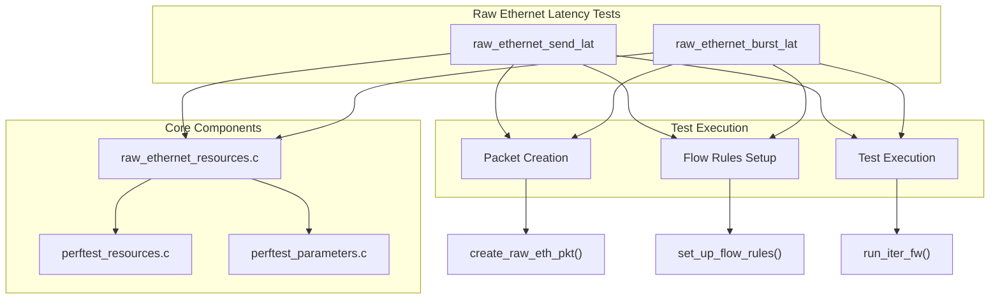
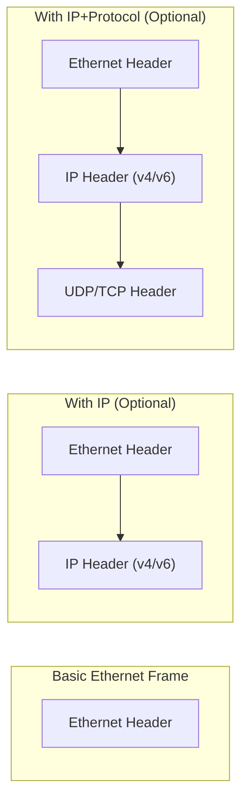
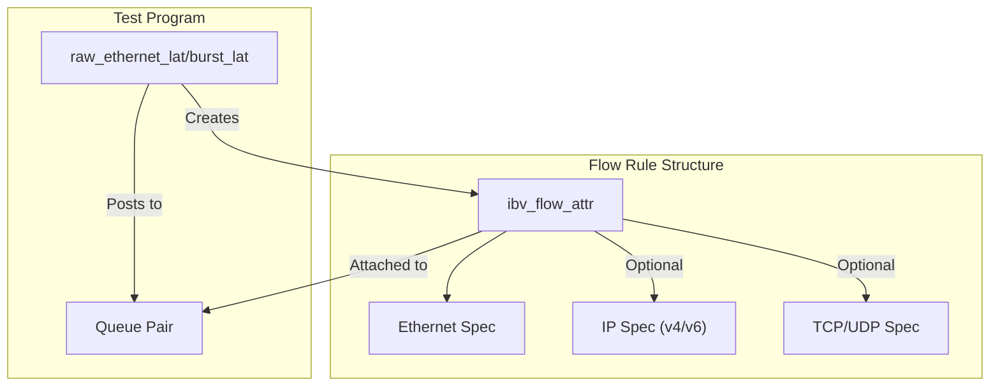
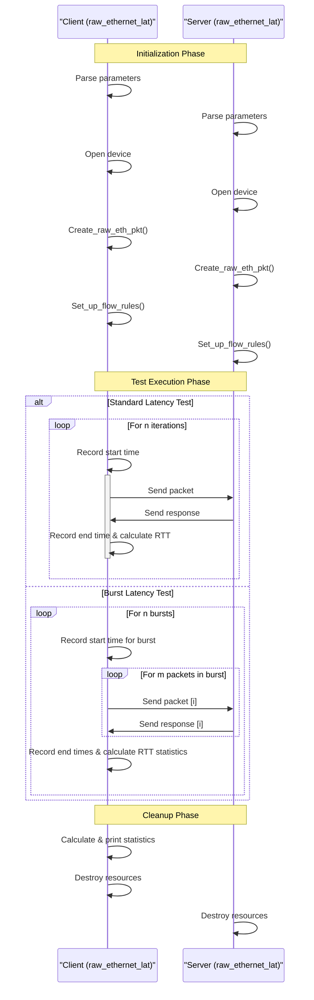

<!-- source: DeepWiki mcp.deepwiki.com · repo linux-rdma/perftest · page 5.2 Raw Ethernet Latency Tests · fetched 2026-11-11 -->

# Raw Ethernet Latency Tests

<details>
<summary>Relevant source files</summary>

The following files were used as context for generating this wiki page:

- [src/raw_ethernet_resources.c](src/raw_ethernet_resources.c)

</details>


## Purpose and Scope

This document describes the Raw Ethernet latency tests in the perftest suite, specifically `raw_ethernet_send_lat` and `raw_ethernet_burst_lat`. These tests measure network latency using raw Ethernet packets rather than RDMA verbs, providing insights into basic network performance without the RDMA protocol overhead. For information about Raw Ethernet bandwidth tests, see [Raw Ethernet Bandwidth Test](#5.1).

## Overview

Raw Ethernet latency tests bypass the RDMA transport layer and work directly with Ethernet frames. This provides a way to measure pure network latency without RDMA-specific overheads, making these tests useful for baseline network performance measurements and troubleshooting.



Sources: [src/raw_ethernet_resources.c:626-688](), [src/raw_ethernet_resources.c:777-805](), [src/raw_ethernet_resources.c:963-1146]()

## Test Types

### Raw Ethernet Send Latency (`raw_ethernet_send_lat`)

This test measures the round-trip time (RTT) of raw Ethernet packets between two endpoints. It uses a ping-pong methodology, where:

1. The client sends a packet to the server
2. The server receives the packet and immediately sends a response
3. The client measures the time from sending the packet to receiving the response
4. This process repeats for the specified number of iterations

Unlike RDMA latency tests that use RDMA verbs, this test creates raw Ethernet packets and manages them directly.

### Raw Ethernet Burst Latency (`raw_ethernet_burst_lat`)

This test extends the basic latency test by allowing multiple packets to be sent in a burst before waiting for responses. This helps measure how latency is affected when multiple packets are processed in sequence. Key characteristics:

1. The client sends multiple packets in quick succession (a burst)
2. The server processes each packet and sends responses
3. The client measures the round-trip time for each packet
4. Statistics are gathered on average, minimum, and maximum latency across the burst

## Packet Structure

Raw Ethernet tests allow various packet structures to be configured through command-line options. The basic structure consists of:



Sources: [src/raw_ethernet_resources.c:204-212](), [src/raw_ethernet_resources.c:555-625]()

The packet construction is handled by the `build_pkt_on_buffer` function which creates packets according to user-specified parameters. It supports:

1. Basic Ethernet frames with customizable MAC addresses
2. Optional IPv4 or IPv6 headers
3. Optional TCP or UDP headers
4. VLAN tagging

The most common packet structure for latency tests is a simple Ethernet frame with minimal payload, as this focuses the measurement on network latency with minimal processing overhead.

Sources: [src/raw_ethernet_resources.c:555-625]()

## Flow Rules

Raw Ethernet tests require flow rules to be set up on RDMA-capable network cards. These rules define which incoming packets should be directed to which queue pairs. For latency tests, the flow rules typically match packets based on:

1. MAC addresses (source and destination)
2. Optional IP addresses (for tests using IP headers)
3. Optional TCP/UDP ports (for tests using transport layer headers)



Sources: [src/raw_ethernet_resources.c:777-851]()

The flow rules are created using the `set_up_flow_rules` function, which constructs an appropriate `ibv_flow_attr` structure based on the user parameters and attaches it to the queue pair. This ensures that incoming packets matching the specified criteria are properly directed to the test's queue pair for processing.

## Test Execution Flow

The execution of Raw Ethernet latency tests follows this general sequence:



Sources: [src/raw_ethernet_resources.c:963-1146]()

The main test loop is implemented in the `run_iter_fw` function, which manages:
1. Sending packets from the client to the server
2. Tracking completion events for sent and received packets
3. Measuring the time between sending and receiving
4. Calculating statistics based on the measured times

The key difference between the standard and burst latency tests is in how many packets are sent before waiting for responses, and how the statistics are calculated.

## Key Parameters

Raw Ethernet latency tests support numerous command-line parameters to customize the test behavior:

| Parameter | Description | Default |
|-----------|-------------|---------|
| `-s, --size` | Size of the packet to send (in bytes) | 64 |
| `-n, --iters` | Number of iterations (packets) to send | 1000 |
| `-t, --tx-depth` | Size of the send queue | 50 |
| `-r, --rx-depth` | Size of the receive queue | 50 |
| `-F, --flow-label` | Flow label field for IPv6 packets | Not set |
| `-f, --flows` | Number of different flows | 1 |
| `-B, --burst` | Burst size (only for burst_lat) | 10 |
| `--source-mac` | Source MAC address | Random |
| `--dest-mac` | Destination MAC address | Random |

Sources: [src/raw_ethernet_resources.c:77-105](), [src/raw_ethernet_resources.c:893-958]()

Additionally, there are parameters for configuring IP headers, TCP/UDP ports, and other protocol-specific options when using more complex packet structures.

## Implementation Details

### Packet Construction

Packets for latency tests are created in the `create_raw_eth_pkt` function which:

1. Allocates buffer space for the packet
2. Builds the Ethernet header with source and destination MAC addresses
3. Optionally adds IP header (v4 or v6) based on user parameters
4. Optionally adds TCP or UDP header based on user parameters
5. Fills the remainder of the packet with a payload (typically a pattern of bytes)

For latency tests, the function creates a single packet per flow that will be reused for all iterations. This is different from bandwidth tests, which may create multiple packets.

Sources: [src/raw_ethernet_resources.c:626-688]()

### Flow Setup

Flow rules are established using the `set_up_flow_rules` function, which:

1. Calculates the size needed for the flow attribute structure
2. Allocates memory for the flow attribute
3. Sets up the Ethernet match criteria (typically MAC addresses)
4. Optionally adds IP match criteria (addresses, protocol)
5. Optionally adds TCP/UDP match criteria (ports)
6. Returns the constructed flow attribute for attaching to the queue pair

The flow rules ensure that packets sent by the client are properly received by the server's queue pair and vice versa.

Sources: [src/raw_ethernet_resources.c:693-851]()

### Test Execution

The main test execution occurs in the `run_iter_fw` function, which:

1. Posts sends for each packet according to the test parameters
2. Polls for completion of sends and receives
3. Tracks timing information for latency calculation
4. Handles flow control to ensure the send and receive queues don't overflow
5. Manages the test duration (iteration count or time-based)

For the burst latency test, multiple packets are sent in sequence before waiting for responses, and statistics are calculated across the entire burst.

Sources: [src/raw_ethernet_resources.c:963-1146]()

## Usage Examples

### Basic Raw Ethernet Latency Test

Server side:
```
./raw_ethernet_send_lat -i <interface> --server
```

Client side:
```
./raw_ethernet_send_lat -i <interface> --client --dest-mac <server_mac>
```

### Raw Ethernet Burst Latency Test

Server side:
```
./raw_ethernet_burst_lat -i <interface> --server
```

Client side:
```
./raw_ethernet_burst_lat -i <interface> --client --dest-mac <server_mac> -B 10
```

### With IP Headers

Server side:
```
./raw_ethernet_send_lat -i <interface> --server --server-ip <server_ip>
```

Client side:
```
./raw_ethernet_send_lat -i <interface> --client --dest-mac <server_mac> --client-ip <client_ip> --server-ip <server_ip>
```

## Performance Considerations

1. **Packet Size**: Smaller packets typically show lower latency but may not represent real-world traffic patterns.
2. **Flow Rules**: Complex flow rules (with IP, TCP/UDP matching) may add processing overhead.
3. **Burst Size**: Larger burst sizes help evaluate the network's ability to handle bursts of traffic.
4. **Hardware Offloads**: Some network adapters have offload capabilities that may affect latency measurements.
5. **CPU Load**: High CPU load on either endpoint can affect latency measurements.

Raw Ethernet latency tests provide valuable baseline measurements for network performance without the complexities of RDMA protocols. By comparing raw Ethernet latency with RDMA latency tests, users can isolate performance issues related to network hardware versus those related to the RDMA implementation.

---

