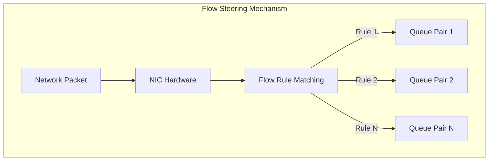
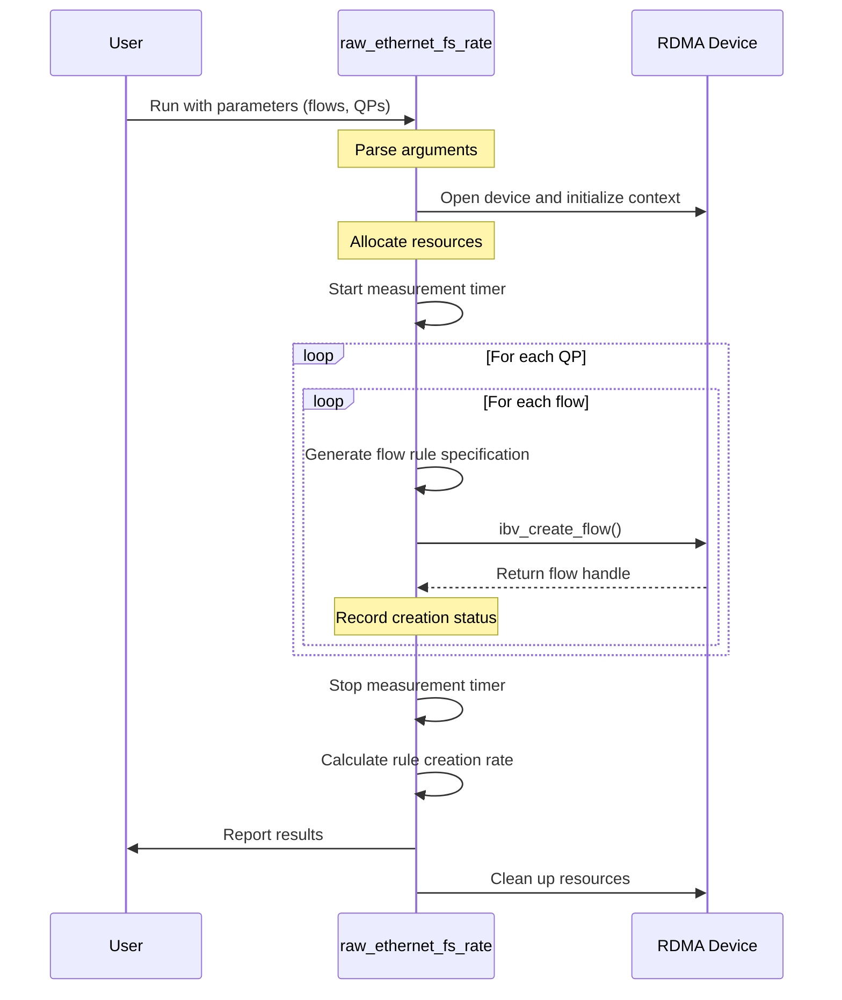
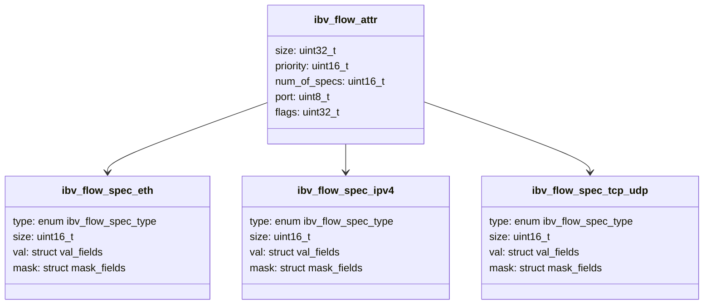
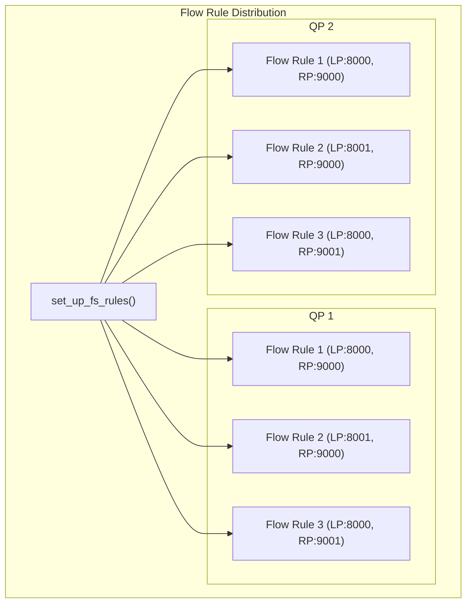

<!-- source: DeepWiki mcp.deepwiki.com · repo linux-rdma/perftest · page 5.3 Flow Steering Rate Test · fetched 2026-11-11 -->

# Flow Steering Rate Test

<details>
<summary>Relevant source files</summary>

The following files were used as context for generating this wiki page:

- [src/raw_ethernet_resources.c](src/raw_ethernet_resources.c)
- [src/raw_ethernet_resources.h](src/raw_ethernet_resources.h)
- [src/raw_ethernet_send_bw.c](src/raw_ethernet_send_bw.c)
- [src/raw_ethernet_send_lat.c](src/raw_ethernet_send_lat.c)

</details>


The Flow Steering Rate Test (`raw_ethernet_fs_rate`) is a performance test that measures how quickly a system can create and attach network flow steering rules. Flow steering is a hardware capability in RDMA-capable network interface cards (NICs) that allows packets to be directed to specific queue pairs (QPs) based on packet attributes such as MAC addresses, IP addresses, and TCP/UDP ports. This test helps users understand the scalability limits of flow rule creation, which is critical for applications that dynamically establish large numbers of network flows.

## Overview of Flow Steering

Flow steering enables hardware-based packet classification and distribution, offloading this work from the CPU. In RDMA networks, this capability allows:

1. Directing specific network flows to designated queue pairs
2. Load balancing network traffic across multiple CPU cores
3. Isolating traffic streams for better performance predictability

The test specifically measures the rate at which flow rules can be created and attached to queue pairs, rather than the performance of packet processing once flows are established.



**Diagram: Flow Steering Packet Processing**

Sources: [src/raw_ethernet_resources.c:856-888](), [src/raw_ethernet_resources.h:341-346]()

## Test Operation

The Flow Steering Rate Test operates as follows:

1. Initialize RDMA device and resources
2. Generate a specified number of flow rules with different criteria
3. Measure the time to create and attach these rules
4. Calculate and report the rule creation rate

The test creates flow rules with different combinations of ports to simulate real-world networking environments where multiple flows must be steered to different queue pairs.



**Diagram: Flow Steering Rate Test Sequence**

Sources: [src/raw_ethernet_resources.c:856-888](), [src/raw_ethernet_resources.c:856-888]()

## Flow Rule Structure and Creation

Each flow rule consists of:

1. Flow attributes (type, priority, port)
2. One or more flow specifications:
   - Ethernet header specification (required)
   - IP header specification (optional)
   - TCP/UDP header specification (optional)

The test creates these rules using the `set_up_fs_rules()` function, which generates rules with different port combinations.



**Diagram: Flow Rule Data Structure**

Sources: [src/raw_ethernet_resources.c:693-703](), [src/raw_ethernet_resources.c:777-775]()

## Distribution of Rules Across QPs

The test distributes flow rules across multiple queue pairs to simulate real-world scenarios where many traffic flows are processed in parallel. The `set_up_fs_rules()` function creates a specified number of flow rules for each QP.



**Diagram: Distribution of Flow Rules Across QPs**

Sources: [src/raw_ethernet_resources.c:870-886]()

## Flow Rule Generation

The `set_up_fs_rules()` function generates flow rules by creating different combinations of local and remote ports. It ensures a good distribution of rules to simulate realistic networking scenarios.

```
For each QP:
  For each flow:
    1. Create flow rule with specific port combination
    2. Set up Ethernet header specifications
    3. Add IP header specifications if requested
    4. Add TCP/UDP port specifications if requested
    5. Attach rule to QP
```

The test first creates rules with incremented local ports until reaching a limit, then switches to incrementing remote ports:

```
Local port increments from base to MAX_FS_PORT
Once local port limit is reached, remote port starts incrementing
```

Sources: [src/raw_ethernet_resources.c:868-886]()

## Implementation Details

The implementation of the Flow Steering Rate Test uses several key functions:

1. `check_flow_steering_support()` - Verifies that the device supports flow steering
2. `set_up_fs_rules()` - Creates flow rules for the test
3. `set_up_flow_rules()` - Sets up individual flow rule specifications

The flow steering support check is especially important as it ensures that the test will only run on compatible hardware:

```c
// Check if flow steering is supported on the device
if (check_flow_steering_support(user_param.ib_devname)) {
    fprintf(stderr, "flow steering is not supported.\n");
    return FAILURE;
}
```

Sources: [src/raw_ethernet_resources.c:60-92](), [src/raw_ethernet_resources.c:856-888](), [src/raw_ethernet_resources.c:777-851]()

## Command Line Options

The Flow Steering Rate Test accepts several specific command-line options:

| Option | Description |
|--------|-------------|
| `-F, --flows=<n>` | Number of flows to create |
| `-Q, --qps=<n>` | Number of queue pairs to use |
| `-d, --ib-dev=<dev>` | Use specified RDMA device |
| `-i, --ib-port=<port>` | Use specified RDMA port |
| `-S, --server_port=<port>` | Base UDP/TCP port for server side |
| `-C, --client_port=<port>` | Base UDP/TCP port for client side |
| `-s, --server_ip=<IP>` | IP address for server side (optional) |
| `-c, --client_ip=<IP>` | IP address for client side (optional) |
| `--source_mac=<MAC>` | Source MAC address for flow rules (required) |
| `--dest_mac=<MAC>` | Destination MAC address for flow rules (required) |

Additional generic perftest options are also supported.

## Results Interpretation

The test reports the following metrics:

1. Total number of flow rules created
2. Time taken to create all rules
3. Flow rule creation rate (rules per second)
4. Success/failure status of each rule creation

A higher rule creation rate indicates better performance. The flow rule creation rate may decrease as the number of rules increases, which can help identify the scalability limits of the hardware.

## Usage Examples

Basic usage:
```
raw_ethernet_fs_rate -F 1000 -Q 4 -d mlx5_0 --source_mac=00:11:22:33:44:55 --dest_mac=aa:bb:cc:dd:ee:ff
```

This creates 1000 flows across 4 queue pairs on device mlx5_0.

Testing with IP rules:
```
raw_ethernet_fs_rate -F 1000 -Q 4 -d mlx5_0 -s 192.168.1.1 -c 192.168.1.2 --source_mac=00:11:22:33:44:55 --dest_mac=aa:bb:cc:dd:ee:ff
```

This adds IP header specifications to the flow rules.

Testing with TCP/UDP port rules:
```
raw_ethernet_fs_rate -F 1000 -Q 4 -d mlx5_0 -s 192.168.1.1 -c 192.168.1.2 -S 9000 -C 8000 --source_mac=00:11:22:33:44:55 --dest_mac=aa:bb:cc:dd:ee:ff
```

This creates flow rules with TCP/UDP port specifications, starting with server port 9000 and client port 8000.

## Best Practices

1. Start with a small number of flows and queue pairs to establish baseline performance
2. Gradually increase the number of flows to identify scaling limitations
3. Test with different types of flow rules (MAC-only, MAC+IP, MAC+IP+Port) to understand the impact of rule complexity
4. Compare results across different devices to evaluate hardware capabilities
5. Ensure flow steering is properly supported and configured on the device before running the test

## Requirements and Limitations

- Hardware with flow steering support is required (primarily Mellanox/NVIDIA ConnectX devices)
- Flow steering functionality might be disabled by default and require configuration
- For mlx4 devices, log_num_mgm_entry_size needs to be set to -1 in the driver configuration
- The test's performance may be affected by system factors such as CPU load and memory speed

Sources: [src/raw_ethernet_resources.c:60-92]()

---

