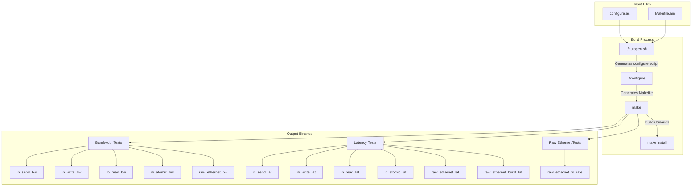
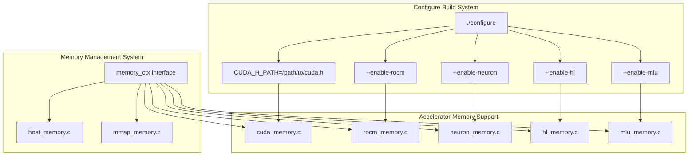

<!-- source: DeepWiki mcp.deepwiki.com · repo linux-rdma/perftest · page 6 Building and Installation · fetched 2026-11-11 -->

# Building and Installation

<details>
<summary>Relevant source files</summary>

The following files were used as context for generating this wiki page:

- [Makefile.am](Makefile.am)
- [README](README)
- [configure.ac](configure.ac)
- [debian/changelog](debian/changelog)
- [man/perftest.1](man/perftest.1)
- [perftest.spec](perftest.spec)

</details>


This page provides comprehensive instructions for building and installing the RDMA Performance Tests (perftest) suite from source. It covers basic installation methods, required dependencies, configuration options, and advanced build scenarios to support various hardware acceleration options.

For information about running the tests and their command-line options, see [Command Line Interface](#7).

## Table of Contents
- [Prerequisites](#prerequisites)
- [Basic Installation](#basic-installation)
- [Configuration Options](#configuration-options)
- [Building with Hardware Acceleration Support](#building-with-hardware-acceleration-support)
- [Package-Based Installation](#package-based-installation)
- [Troubleshooting](#troubleshooting)

## Prerequisites

Before building perftest, ensure you have the following required dependencies installed on your system:

| Dependency | Description | Required by |
|------------|-------------|-------------|
| libibverbs | RDMA verbs library | All tests |
| librdmacm | RDMA connection management | Tests using RDMA CM |
| libibumad | InfiniBand user MAD library | Performance counters |
| libmath (lm) | Math library | All tests |
| pciutils-devel | PCI utilities | Relaxed ordering feature |
| autoconf, automake, libtool | Build system tools | Build process |

For most Linux distributions, these can be installed via the package manager:

For Debian/Ubuntu:
```bash
sudo apt-get install libibverbs-dev librdmacm-dev libibumad-dev \
                     build-essential autoconf automake libtool pciutils-dev
```

For RHEL/CentOS/Fedora:
```bash
sudo yum install libibverbs-devel librdmacm-devel libibumad-devel \
                 autoconf automake libtool pciutils-devel
```

Sources: [configure.ac:62-66](), [README:126-135]()

## Basic Installation

Follow these steps to build and install perftest from source:

1. Clone the repository:
   ```bash
   git clone https://github.com/linux-rdma/perftest.git
   ```

2. Change to the perftest directory:
   ```bash
   cd perftest/
   ```

3. Generate the configure script:
   ```bash
   ./autogen.sh
   ```

4. Configure the build:
   ```bash
   ./configure
   ```
   
   To install in a specific directory, use the `--prefix` option:
   ```bash
   ./configure --prefix=/path/to/install/directory
   ```

5. Build the project:
   ```bash
   make
   ```

6. Install the binaries:
   ```bash
   make install
   ```
   
   Note: This step might require root privileges if installing to a system directory.

After installation, all test programs will be available in the installation directory (or in `/usr/bin/` by default).

Sources: [README:36-56]()

## Build Process Overview

The following diagram illustrates the build process and the generated outputs:



Sources: [Makefile.am:60-102](), [README:1-33]()

## Configuration Options

perftest's build system provides numerous configuration options to customize your build. These options are passed to the `./configure` script.

### Basic Configuration Options

| Option | Description |
|--------|-------------|
| `--prefix=DIR` | Install binaries in DIR (default: `/usr`) |
| `--disable-ibv_wr_api` | Disable new post send API |

### Feature Detection

During configuration, the build system automatically detects available features on your system, including:

- Advanced verbs features (XRC, Raw Ethernet, etc.)
- MLX5 Direct Verbs support
- Packet pacing support
- Out-of-order data placement support
- Extended reliable connection support

Sources: [configure.ac:44-143](), [configure.ac:410-426]()

## Building with Hardware Acceleration Support

perftest can be built with support for various hardware accelerators for testing RDMA operations with accelerator memory.

### CUDA Support

To build with CUDA support for GPUDirect RDMA:

```bash
./configure CUDA_H_PATH=/path/to/cuda.h
make
```

Example with a standard CUDA installation:
```bash
./configure CUDA_H_PATH=/usr/local/cuda/include/cuda.h
make
```

To use CUDA DMA-BUF features, you need:
1. CUDA Toolkit 11.7 or later
2. NVIDIA Open-Source GPU Kernel Modules version 515 or later
3. Proper environment setup:
   ```bash
   export LD_LIBRARY_PATH=/usr/local/cuda/lib64:$LD_LIBRARY_PATH
   export LIBRARY_PATH=/usr/local/cuda/lib64:$LIBRARY_PATH
   ```

Sources: [configure.ac:300-324](), [README:246-265]()

### ROCm Support

To build with ROCm support:

```bash
./configure --enable-rocm [--with-rocm=/path/to/rocm]
make
```

For ROCm DMA-BUF support:
```bash
./configure --enable-rocm --enable-rocm-dmabuf [--with-rocm=/path/to/rocm]
make
```

Sources: [configure.ac:243-290]()

### Neuron Support

To build with AWS Neuron support:

```bash
./configure --enable-neuron [--with-neuron=/path/to/nrt]
make
```

Sources: [configure.ac:326-354]()

### Habana Labs Support

To build with Habana Labs support:

```bash
./configure --enable-hl [--with-hl=/path/to/habanalabs]
make
```

Sources: [configure.ac:356-385]()

### MLU Support

To build with MLU support:

```bash
./configure --enable-mlu [--with-mlu=/path/to/mlu]
make
```

Sources: [configure.ac:387-412]()

The following diagram shows the relationship between the memory management system and hardware acceleration options:



Sources: [Makefile.am:36-58](), [configure.ac:300-412]()

## Package-Based Installation

In addition to building from source, perftest can be installed from packages on various Linux distributions.

### RPM-based Systems (RHEL, CentOS, Fedora)

For RPM-based systems, perftest is typically available through the OFED (OpenFabrics Enterprise Distribution) repositories:

```bash
sudo yum install perftest
```

If you want to build an RPM package from source:

1. Create a tarball of the source
2. Build the RPM:
   ```bash
   rpmbuild -ta perftest-<version>.tar.gz
   ```

Sources: [perftest.spec:1-39]()

### Debian-based Systems (Debian, Ubuntu)

For Debian-based systems:

```bash
sudo apt-get install perftest
```

Sources: [debian/changelog:1-6]()

## Troubleshooting

### Common Build Issues

1. **Missing dependencies**:
   - If configure fails with errors about missing headers or libraries, install the required dependencies as listed in the Prerequisites section.

2. **Compatibility with MLNX_OFED versions**:
   - With MLNX_OFED-2.1, you may need to disable experimental verbs:
     ```bash
     ./configure --disable-verbs_exp
     make
     ```

3. **GPU support issues**:
   - If you encounter "Couldn't allocate MR" errors with GPUDirect, try disabling Scatter to CQE:
     ```bash
     MLX5_SCATTER_TO_CQE=0 ./ib_write_bw -d ib_dev --use_cuda=<gpu index> -a
     ```

4. **Performance with high QP counts**:
   - When using more than 2000 QPs with message sizes larger than 8KB, performance may degrade. Consider using the `--cqe_poll` option to increase the number of CQEs polled in each iteration.

Sources: [README:342-371]()

### Version Compatibility

Be aware that different versions of perftest may not be compatible with each other. Always use the same perftest version on both client and server systems to ensure consistent benchmark results. Specifically:
- Test versions 5.3 and above are not backward compatible with previous versions
- Version 5.70 and above introduced additional compatibility changes

Sources: [README:352-356]()

---

