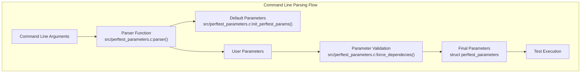
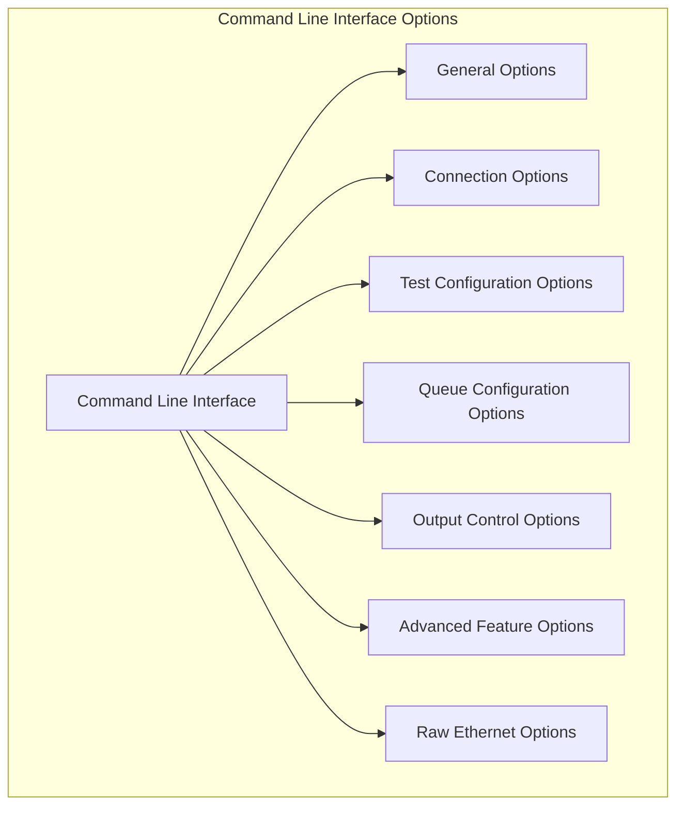
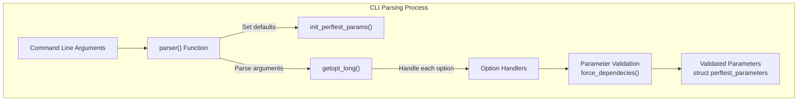

<!-- source: DeepWiki mcp.deepwiki.com · repo linux-rdma/perftest · page 7 Command Line Interface · fetched 2026-11-11 -->

# Command Line Interface

<details>
<summary>Relevant source files</summary>

The following files were used as context for generating this wiki page:

- [README](README)
- [man/perftest.1](man/perftest.1)
- [src/perftest_parameters.c](src/perftest_parameters.c)
- [src/perftest_parameters.h](src/perftest_parameters.h)

</details>


This document provides a comprehensive guide to the command-line interface (CLI) of the perftest suite, which allows users to configure and control various performance benchmarking tests. The CLI is consistent across all tools in the perftest suite, with minor variations depending on the specific test type and verb.

For information about building and installing the perftest suite, see [Building and Installation](#6).

## CLI Fundamentals

The perftest tools follow a client-server model where one system acts as a server and another as a client. All perftest commands use a consistent pattern:

```
# Server side:
<test_name> [options]

# Client side:
<test_name> [options] <server_ip_address>
```

Where `<test_name>` is one of the perftest tools such as `ib_send_bw`, `ib_read_lat`, etc., and `<server_ip_address>` can be an IPv4 or IPv6 address.

Sources: [README:137-142]()

### Symmetric vs. Asymmetric Options

One important concept in perftest is that some command-line options must match between the server and client to ensure consistent behavior. These are called "symmetric" options and are marked as such in the help output. Both server and client must use the same values for these options to avoid unpredictable results.



Sources: [src/perftest_parameters.c:741-742](), [src/perftest_parameters.c:817-966](), [src/perftest_parameters.c:1180-1416]()

## Command Line Options Categories

The perftest CLI options can be categorized into several functional groups:



Sources: [src/perftest_parameters.c:253-813]()

### General Options

These options are common across all perftest tools:

| Option | Description | Default | Symmetric |
|--------|-------------|---------|-----------|
| `-h, --help` | Display help message | N/A | No |
| `-V, --version` | Display version number | N/A | No |
| `-p, --port=<port>` | Socket port for connection | 18515 | Yes |
| `-d, --ib-dev=<dev>` | Use specific IB device | First found | No |
| `-i, --ib-port=<port>` | Use specific port on IB device | 1 | No |
| `-F, --CPU-freq` | Suppress CPU frequency warnings | Off | No |

Sources: [src/perftest_parameters.c:342-344](), [src/perftest_parameters.c:317-318](), [src/perftest_parameters.c:407-408](), [src/perftest_parameters.c:334-336]()

### Connection Options

These options control connection establishment and configuration:

| Option | Description | Default | Symmetric | Tests |
|--------|-------------|---------|-----------|-------|
| `-c, --connection=<type>` | Connection type (RC/UC/UD/XRC/DC/SRD) | RC | Yes | All non-RawEth |
| `-R, --rdma_cm` | Connect QPs with rdma_cm | Off | No | All non-RawEth |
| `-z, --comm_rdma_cm` | Communicate using rdma_cm | Off | Yes | All non-RawEth |
| `-x, --gid-index=<index>` | GID index for IB port | -1 | No | All non-RawEth |
| `-S, --sl=<sl>` | Service level | 0 | No | All |
| `-u, --qp-timeout=<timeout>` | QP timeout (4μs × 2^timeout) | 14 | No | All |
| `--ipv6` | Use IPv6 GID | Off | No | All non-RawEth |

Sources: [src/perftest_parameters.c:286-296](), [src/perftest_parameters.c:424-425](), [src/perftest_parameters.c:475-477](), [src/perftest_parameters.c:464-467](), [src/perftest_parameters.c:432-435](), [src/perftest_parameters.c:445-446](), [src/perftest_parameters.c:531-533]()

### Test Configuration Options

These options control test parameters:

| Option | Description | Default | Symmetric | Tests |
|--------|-------------|---------|-----------|-------|
| `-s, --size=<size>` | Size of messages to exchange | 65536 (BW), 2 (LAT) | Yes | All non-Atomic |
| `-n, --iters=<iters>` | Number of iterations | 1000/5000 | Yes | All |
| `-a, --all` | Run sizes from 2 to 2^23 | Off | Yes | All non-Atomic, non-RawEth |
| `-D, --duration` | Run for specified seconds | Off | Yes | All |
| `-b, --bidirectional` | Measure bidirectional BW | Off | Yes | BW tests |
| `-m, --mtu=<mtu>` | Set MTU size | Port MTU | Yes | All non-FS_RATE |
| `-A, --atomic_type=<type>` | Type of atomic operation | FETCH_AND_ADD | Yes | Atomic tests |
| `-O, --dualport` | Run test in dual-port mode | Off | Yes | BW tests |
| `--reversed` | Reverse traffic direction | Off | Yes | All |

Sources: [src/perftest_parameters.c:427-430](), [src/perftest_parameters.c:389-390](), [src/perftest_parameters.c:269-272](), [src/perftest_parameters.c:320-321](), [src/perftest_parameters.c:279-282](), [src/perftest_parameters.c:370-376](), [src/perftest_parameters.c:274-277](), [src/perftest_parameters.c:402-405](), [src/perftest_parameters.c:600-602]()

### Queue Configuration Options

These options control queue depth and posting behavior:

| Option | Description | Default | Tests |
|--------|-------------|---------|-------|
| `-t, --tx-depth=<dep>` | Size of send queue | 128 (BW), 1 (LAT) | BW, LAT_BY_BW |
| `-r, --rx-depth=<dep>` | Size of receive queue | 512 | SEND, WRITE_IMM |
| `-Q, --cq-mod` | CQ moderation value | 100 | BW tests |
| `-l, --post_list=<list size>` | Post list of send WQEs | 1 | BW, LAT_BY_BW |
| `--recv_post_list=<list size>` | Post list of receive WQEs | 1 | BW, LAT_BY_BW |
| `--use-srq` | Use Shared Receive Queue | Off | SEND verb |
| `-e, --events` | Sleep on CQ events (vs poll) | Off | Non-WRITE, non-RawEth |

Sources: [src/perftest_parameters.c:436-439](), [src/perftest_parameters.c:416-420](), [src/perftest_parameters.c:412-414](), [src/perftest_parameters.c:359-363](), [src/perftest_parameters.c:362-363](), [src/perftest_parameters.c:515-517](), [src/perftest_parameters.c:323-326]()

### Output Control Options

These options control results reporting:

| Option | Description | Default | Tests |
|--------|-------------|---------|-------|
| `-H, --report-histogram` | Print all results (vs summary) | Off | LAT, LAT_BY_BW, FS_RATE |
| `-U, --report-unsorted` | Print unsorted results | Off | LAT, LAT_BY_BW, FS_RATE |
| `-C, --report-cycles` | Report times in CPU cycles | Off | LAT tests |
| `--output=<units>` | Set verbosity level | -1 (full) | All |
| `--out_json` | Save report in JSON file | Off | All |
| `--out_json_file=<file>` | Name of JSON report file | "perftest_out.json" | All |
| `--report_gbits` | Report in Gbit/sec (vs MiB/sec) | Off | BW tests |
| `--report-both` | Report RX & TX results separately | Off | Bidirectional BW |
| `-W, --report-counters=<list>` | Report performance counter changes | None | All |

Sources: [src/perftest_parameters.c:347-349](), [src/perftest_parameters.c:449-451](), [src/perftest_parameters.c:312-314](), [src/perftest_parameters.c:566-567](), [src/perftest_parameters.c:482-484](), [src/perftest_parameters.c:485-486](), [src/perftest_parameters.c:590-594](), [src/perftest_parameters.c:587-589](), [src/perftest_parameters.c:461-462]()

### Advanced Feature Options

These options control specialized features:

| Option | Description | Default | Tests |
|--------|-------------|---------|-------|
| `--use_cuda=<device id>` | Use CUDA for GPU-Direct RDMA | Off | All non-FS_RATE |
| `--use_rocm=<device id>` | Use ROCm for GPU-Direct RDMA | Off | All non-FS_RATE |
| `--odp` | Use On-Demand Paging | Off | All |
| `--aes_xts` | Use AES-XTS encryption | Off | Non-RawEth, non-WRITE LAT |
| `--perform_warm_up` | Perform warm-up iterations | Off | Non-FS_RATE |
| `--rate_limit=<rate>` | Set max send rate | Off | BW, LAT_BY_BW |
| `--rate_units=<units>` | Set rate units (M/g/p) | g (Gbps) | BW, LAT_BY_BW |
| `--rate_limit_type=<type>` | Rate limit type (HW/SW/PP) | None | BW, LAT_BY_BW |
| `--use_ooo` | Use out-of-order data placement | Off | System support required |

Sources: [src/perftest_parameters.c:622-627](), [src/perftest_parameters.c:638-646](), [src/perftest_parameters.c:561-563](), [src/perftest_parameters.c:300-309](), [src/perftest_parameters.c:580-582](), [src/perftest_parameters.c:692-694](), [src/perftest_parameters.c:695-699](), [src/perftest_parameters.c:700-702](), [src/perftest_parameters.c:704-708]()

### Raw Ethernet Options

These options are specific to Raw Ethernet tests:

| Option | Description | Required | Tests |
|--------|-------------|----------|-------|
| `-B, --source_mac` | Source MAC address (XX:XX:XX:XX:XX:XX) | Yes | RawEth |
| `-E, --dest_mac` | Destination MAC address | Yes | RawEth |
| `-J, --dest_ip` | Destination IP address | No | RawEth |
| `-j, --source_ip` | Source IP address | No | RawEth |
| `-K, --dest_port` | Destination UDP/TCP port | No | RawEth |
| `-k, --source_port` | Source UDP/TCP port | No | RawEth |
| `-Y, --ethertype` | Ethertype value (0xXXXX) | No | RawEth |
| `-Z, --server` | Choose server side | Yes | RawEth |
| `-P, --client` | Choose client side | Yes | RawEth non-FS_RATE |
| `--tcp` | Send TCP packets | No | RawEth |
| `--raw_ipv6` | Send IPv6 packets | No | RawEth |

Sources: [src/perftest_parameters.c:728-730](), [src/perftest_parameters.c:731-733](), [src/perftest_parameters.c:737-742](), [src/perftest_parameters.c:744-749](), [src/perftest_parameters.c:751-752](), [src/perftest_parameters.c:754-755](), [src/perftest_parameters.c:757-758](), [src/perftest_parameters.c:760-761](), [src/perftest_parameters.c:770-772](), [src/perftest_parameters.c:798-799](), [src/perftest_parameters.c:802-803]()

## Command Line Parsing Architecture

The command line interface is implemented primarily in `src/perftest_parameters.c`, with structures defined in `src/perftest_parameters.h`. The architecture follows this pattern:



The `perftest_parameters` structure contains all parameters that can be configured through the command line. This structure is initialized with default values in `init_perftest_params()` and then updated based on user-provided command line arguments in the `parser()` function.

Sources: [src/perftest_parameters.c:253-813](), [src/perftest_parameters.c:817-966](), [src/perftest_parameters.h:449-651]()

## Common Usage Examples

Here are some common usage patterns for perftest tools:

### Basic Bandwidth Test

```
# Server:
ib_write_bw

# Client:
ib_write_bw 192.168.1.2
```

### Configuring Message Size and Iterations

```
# Server:
ib_read_bw -s 1048576 -n 1000

# Client:
ib_read_bw -s 1048576 -n 1000 192.168.1.2
```

### Running a Latency Test with Histogram

```
# Server:
ib_send_lat -H

# Client:
ib_send_lat -H 192.168.1.2
```

### Bidirectional Bandwidth Test with Duration

```
# Server:
ib_write_bw -b -D 30

# Client:
ib_write_bw -b -D 30 192.168.1.2
```

### Multiple Queue Pairs with Post List

```
# Server:
ib_send_bw -q 4 -l 10

# Client:
ib_send_bw -q 4 -l 10 192.168.1.2
```

### Using RDMA CM for Connection Establishment

```
# Server:
ib_read_bw -R

# Client:
ib_read_bw -R 192.168.1.2
```

### Raw Ethernet Bandwidth Test

```
# Server:
raw_ethernet_bw -Z -E 00:11:22:33:44:55 -B 66:77:88:99:AA:BB

# Client:
raw_ethernet_bw -P -E 66:77:88:99:AA:BB -B 00:11:22:33:44:55
```

Sources: [README:137-142](), [man/perftest.1:20-28]()

## Special Considerations

### Symmetric Options

Remember that symmetric options must match between server and client. These include:
- Message size (`-s/--size`)
- Test duration or iterations (`-D/--duration` or `-n/--iters`)
- Connection type (`-c/--connection`)
- MTU size (`-m/--mtu`)
- Bidirectional mode (`-b/--bidirectional`)
- Socket port (`-p/--port`)

### Hardware-Specific Features

Some features require specific hardware support:
- GPU-Direct RDMA with `--use_cuda` or `--use_rocm`
- AES-XTS encryption with `--aes_xts`
- On-Demand Paging with `--odp`

Sources: [src/perftest_parameters.c:264-265](), [README:144-146]()

## Parameter Validation and Dependencies

The perftest suite performs extensive validation of command-line parameters to ensure consistency and correct operation. This includes:

1. Validating numeric ranges for parameters
2. Enforcing dependencies between parameters
3. Setting appropriate defaults based on the test type and verb
4. Adjusting parameters to ensure compatibility

This validation is primarily performed in the `force_dependecies()` function.

Sources: [src/perftest_parameters.c:1180-1416]()

## Conclusion

The command line interface for perftest provides a flexible and powerful mechanism for configuring and controlling performance tests. Understanding the available options and their effects is essential for accurately measuring RDMA performance across different scenarios and configurations.

For details about specific tests and their output, refer to the individual test documentation pages in this wiki.