# Page: Overview

# Overview

<details>
<summary>Relevant source files</summary>

The following files were used as context for generating this wiki page:

- [Makefile.am](Makefile.am)
- [README](README)
- [configure.ac](configure.ac)
- [debian/changelog](debian/changelog)
- [man/perftest.1](man/perftest.1)
- [perftest.spec](perftest.spec)

</details>


The perftest suite is a comprehensive collection of micro-benchmarks designed to measure and analyze the performance of RDMA (Remote Direct Memory Access) operations and related technologies. This toolkit enables precise performance testing of InfiniBand, RoCE (RDMA over Converged Ethernet), and other RDMA-capable networks, providing insights into bandwidth, latency, and message rates under various conditions.

This page introduces the overall architecture and components of the perftest suite. For specific test types and their usage, see [Test Types](#1.1). For details on supported connection types, see [Connection Types](#1.2).

## Purpose and Scope

The perftest suite generates synthetic workloads that exercise specific RDMA verbs and operations, allowing users to:

- Measure raw performance metrics like bandwidth, latency, and message rates
- Compare different RDMA verbs (Send, RDMA Write, RDMA Read, Atomics)
- Test various connection types (RC, UC, UD, XRC, DC, SRD)
- Evaluate performance across different message sizes
- Benchmark with various memory types (host memory, GPUs, accelerators)

These tools are primarily meant for hardware and software benchmarking and analysis, not for emulating real application traffic.

Sources: [README:13-21](), [README:102-110]()

## System Architecture

The perftest architecture consists of four main components:

1. **Core Library Components**: Provide foundational functionality for all tests
2. **Memory Subsystem**: Abstracts different memory types (host, GPU, etc.)
3. **Test Programs**: Implement various benchmark types (bandwidth, latency)
4. **Communication Layer**: Enables client-server interaction for testing

The following diagram illustrates these components and their relationships:

```mermaid
graph TD
    subgraph "Core Library Components"
        resources["perftest_resources.c
        Manages RDMA resources"]
        parameters["perftest_parameters.c
        Handles test configuration"]
        communication["perftest_communication.c
        Client-server communication"]
        clock["get_clock.c
        Timing facilities"]
        counters["perftest_counters.c
        Performance metrics"]
    end
    
    subgraph "Memory Subsystem"
        memory["memory.h
        Memory interface"]
        host_memory["host_memory.c
        System memory"]
        mmap_memory["mmap_memory.c
        Memory-mapped files"]
        
        subgraph "Accelerator Memory"
            cuda_memory["cuda_memory.c
            NVIDIA GPU memory"]
            rocm_memory["rocm_memory.c
            AMD GPU memory"]
            neuron_memory["neuron_memory.c
            AWS Neuron"]
            hl_memory["hl_memory.c
            Habana Labs"]
            mlu_memory["mlu_memory.c
            MLU accelerators"]
        end
        
        memory --> host_memory & mmap_memory
        memory -.-> cuda_memory & rocm_memory & neuron_memory & hl_memory & mlu_memory
    end
    
    subgraph "Test Programs"
        bw_tests["Bandwidth Tests"]
        lat_tests["Latency Tests"]
        raw_ethernet["Raw Ethernet Tests"]
        
        bw_tests --> send_bw["ib_send_bw.c"]
        bw_tests --> write_bw["ib_write_bw.c"]
        bw_tests --> read_bw["ib_read_bw.c"]
        bw_tests --> atomic_bw["ib_atomic_bw.c"]
        bw_tests --> raw_eth_bw["raw_ethernet_bw.c"]
        
        lat_tests --> send_lat["ib_send_lat.c"]
        lat_tests --> write_lat["ib_write_lat.c"]
        lat_tests --> read_lat["ib_read_lat.c"]
        lat_tests --> atomic_lat["ib_atomic_lat.c"]
        lat_tests --> raw_eth_lat["raw_ethernet_lat.c"]
        lat_tests --> raw_eth_burst["raw_ethernet_burst_lat.c"]
        
        raw_ethernet --> raw_eth_fs["raw_ethernet_fs_rate.c"]
    end
    
    resources --> memory
    parameters --> resources
    communication --> resources
    clock --> resources
    counters --> resources
    
    resources --> bw_tests & lat_tests & raw_ethernet
```

Sources: [Makefile.am:36-58](), [Makefile.am:60-146]()

## Core Components

The perftest suite's core library provides the foundation for all test programs, implemented as a static library (`libperftest.a`). This library contains the following key components:

1. **perftest_resources**: Manages RDMA resources such as queue pairs (QPs), completion queues (CQs), and memory regions (MRs).

2. **perftest_parameters**: Handles command-line parameters and test configuration, providing a unified interface for all test programs.

3. **perftest_communication**: Implements the client-server communication protocol used for test coordination.

4. **get_clock**: Provides high-resolution timing facilities for accurate performance measurements.

5. **perftest_counters**: Collects and reports performance metrics.

The following diagram shows how these components interact:

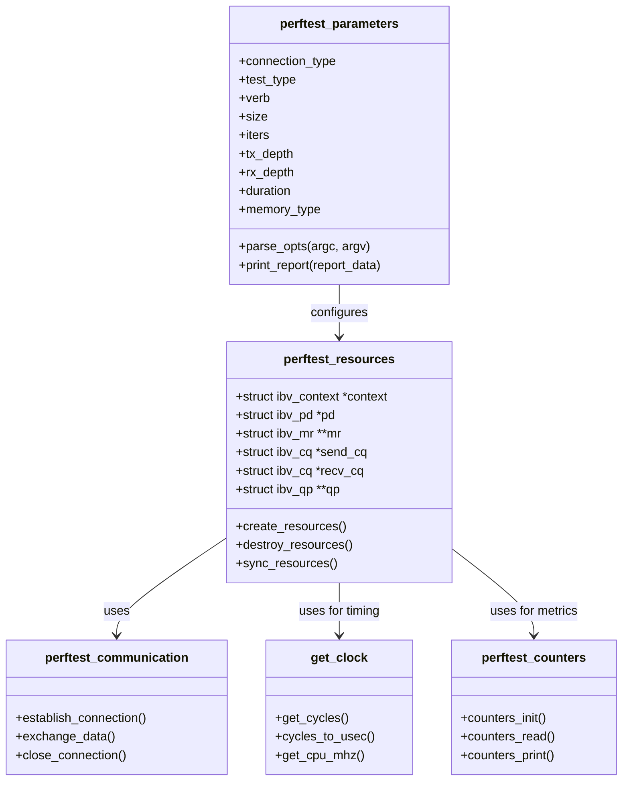

Sources: [Makefile.am:36-38]()

## Memory Subsystem

The memory subsystem provides a unified interface for different memory types, allowing tests to work with various memory sources without changing the test code. This abstraction is critical for testing specialized hardware like GPUs and accelerators.

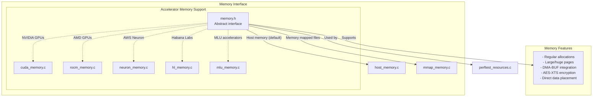

The memory abstraction layer is implemented through a common interface defined in `memory.h`, with specialized implementations for each memory type:

| Memory Type | Implementation | Description | Conditional Compilation |
|-------------|----------------|-------------|--------------------------|
| Host memory | host_memory.c | Standard system memory allocations | Always included |
| Memory-mapped | mmap_memory.c | Memory-mapped file access | Always included |
| CUDA | cuda_memory.c | NVIDIA GPU memory | Requires CUDA headers |
| ROCm | rocm_memory.c | AMD GPU memory | Requires --enable-rocm |
| Neuron | neuron_memory.c | AWS Neuron accelerators | Requires --enable-neuron |
| Habana Labs | hl_memory.c | Habana Labs accelerators | Requires --enable-hl |
| MLU | mlu_memory.c | MLU accelerators | Requires --enable-mlu |

Sources: [Makefile.am:36-58](), [configure.ac:243-412]()

## Test Programs

The perftest suite includes multiple test programs, each targeting a specific RDMA operation or scenario:

### Bandwidth Tests
- **ib_send_bw**: Measures bandwidth using RDMA Send operations
- **ib_write_bw**: Measures bandwidth using RDMA Write operations
- **ib_read_bw**: Measures bandwidth using RDMA Read operations
- **ib_atomic_bw**: Measures bandwidth using RDMA Atomic operations
- **raw_ethernet_bw**: Measures bandwidth using raw Ethernet

### Latency Tests
- **ib_send_lat**: Measures latency using RDMA Send operations
- **ib_write_lat**: Measures latency using RDMA Write operations
- **ib_read_lat**: Measures latency using RDMA Read operations
- **ib_atomic_lat**: Measures latency using RDMA Atomic operations
- **raw_ethernet_lat**: Measures latency using raw Ethernet
- **raw_ethernet_burst_lat**: Measures latency for bursts of raw Ethernet packets

### Flow Steering Rate Tests
- **raw_ethernet_fs_rate**: Measures flow steering rules creation rate

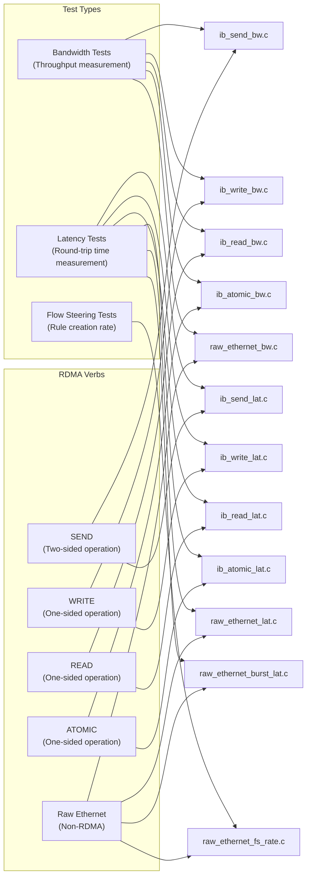

Sources: [Makefile.am:60-146](), [README:23-29](), [README:112-124]()

## Test Execution Flow

Perftest operates in a client-server model, where one instance acts as a server waiting for connections, and the other acts as a client initiating the test. The test execution follows a standardized flow:

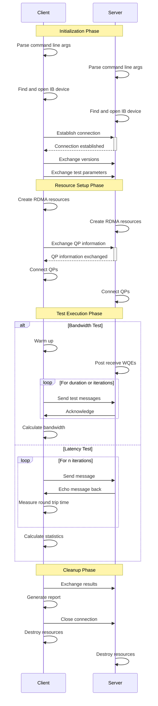

Sources: [README:57-85](), [README:137-146]()

## Supported Connection and Memory Types

The perftest suite supports various RDMA connection types and memory options, providing flexibility for different testing scenarios:

### Connection Types

| Connection Type | Description | Support in Tests |
|-----------------|-------------|------------------|
| RC (Reliable Connection) | Point-to-point reliable connection | All tests |
| UC (Unreliable Connection) | Point-to-point connection without reliability guarantees | Send, Write tests |
| UD (Unreliable Datagram) | Multicast-capable connection without reliability guarantees | Send tests only |
| XRC (Extended Reliable Connection) | Shared receive queues across multiple QPs | All tests (requires hardware support) |
| DC (Dynamically Connected) | On-demand connection establishment | All tests (requires hardware support) |
| SRD (Shared Receive Queue Datagram) | Unreliable datagram with shared receive queues | Send, Read, Write tests |
| Raw Ethernet | Non-RDMA Ethernet packets | Raw Ethernet tests only |

### Memory Types

| Memory Type | Description | Flag |
|-------------|-------------|------|
| Host Memory | Standard system memory | Default |
| Memory-mapped Files | File-backed memory | --mmap |
| CUDA Memory | NVIDIA GPU memory | --use_cuda |
| ROCm Memory | AMD GPU memory | --use_rocm |
| Neuron Memory | AWS Neuron accelerator memory | --use_neuron |
| Habana Labs Memory | Habana Labs accelerator memory | --use_hl |
| MLU Memory | MLU accelerator memory | --use_mlu |
| Huge Pages | Large page allocations | --use_hugepages |

Sources: [man/perftest.1:52-57](), [configure.ac:243-412](), [man/perftest.1:347-389]()

## Version and Compatibility

The perftest suite is actively maintained, with the current version being 6.24 as indicated in the configure script. Different versions of perftest may not be compatible with each other, so it's important to use the same version on both the client and server sides when conducting tests.

The suite is available under dual licensing: GPL v2 and OpenIB.org BSD license.

Sources: [configure.ac:32](), [README:352-355](), [configure.ac:1-29]()

---

# Page: Test Types

# Test Types

<details>
<summary>Relevant source files</summary>

The following files were used as context for generating this wiki page:

- [README](README)
- [man/perftest.1](man/perftest.1)
- [src/perftest_parameters.h](src/perftest_parameters.h)

</details>


This page documents the different test types available in the perftest suite and their purposes. Understanding these test types is essential for effectively benchmarking RDMA (Remote Direct Memory Access) performance. For information about connection types (RC, UC, UD, etc.), see [Connection Types](#1.2).

## Overview of Test Types

The perftest suite provides three primary test types:

1. **Bandwidth Tests** - Measure the maximum data throughput
2. **Latency Tests** - Measure the round-trip time for operations
3. **Flow Steering Rate Tests** - Measure flow creation rate in Raw Ethernet mode

Each test type serves a specific purpose in evaluating different aspects of RDMA performance.

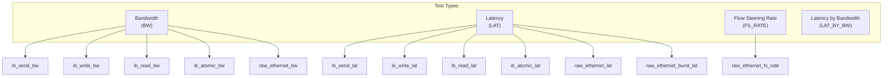

Sources: [src/perftest_parameters.h:330](), [README:23-30]()

## Bandwidth Tests

Bandwidth tests measure the maximum throughput (in terms of Megabytes per second or Gigabits per second) that can be achieved for a specific operation type.

### Available Bandwidth Tests

| Test Name | Operation Type | Description |
|-----------|----------------|-------------|
| `ib_send_bw` | Send | Measures bandwidth using standard SEND operations |
| `ib_write_bw` | RDMA Write | Measures bandwidth using RDMA WRITE operations |
| `ib_read_bw` | RDMA Read | Measures bandwidth using RDMA READ operations |
| `ib_atomic_bw` | RDMA Atomic | Measures bandwidth using RDMA ATOMIC operations |
| `raw_ethernet_bw` | Raw Ethernet | Measures bandwidth using Raw Ethernet operations |

### Key Characteristics

- **Default message size**: 65536 bytes (configurable with `-s` option)
- **Default iterations**: 5000 for write, 1000 for others (configurable with `-n` option)
- **Measurement method**: Client measures the bandwidth in unidirectional mode
- **Bidirectional option**: Both client and server measure bandwidth of traffic they initiate
- **Multiple QPs**: Can run with multiple Queue Pairs to increase parallelism
- **Duration-based**: Can run for a fixed duration instead of iterations using `-D` option
- **Default transmit depth**: 128 (configurable with `-t` option)

### Bandwidth Test Flow

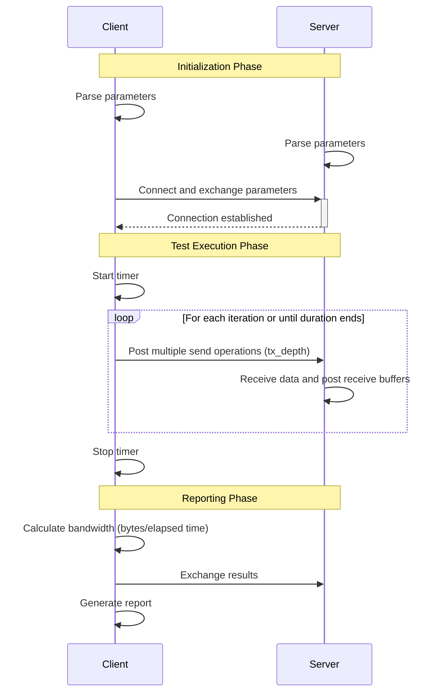

Sources: [README:67-70](), [src/perftest_parameters.h:102-104](), [README:127-147]()

### When to Use Bandwidth Tests

- To measure maximum achievable throughput of a system
- To evaluate performance of different RDMA operations under high-load conditions
- To benchmark network equipment capabilities
- To test scaling across multiple connections/QPs
- When optimizing for throughput rather than latency

## Latency Tests

Latency tests measure the time it takes for an operation to complete a round trip. They report minimum, median, and maximum latency results.

### Available Latency Tests

| Test Name | Operation Type | Description |
|-----------|----------------|-------------|
| `ib_send_lat` | Send | Measures latency using standard SEND operations |
| `ib_write_lat` | RDMA Write | Measures latency using RDMA WRITE operations |
| `ib_read_lat` | RDMA Read | Measures latency using RDMA READ operations |
| `ib_atomic_lat` | RDMA Atomic | Measures latency using RDMA ATOMIC operations |
| `raw_ethernet_lat` | Raw Ethernet | Measures latency using Raw Ethernet operations |
| `raw_ethernet_burst_lat` | Raw Ethernet Burst | Measures latency for bursts of Raw Ethernet operations |

### Key Characteristics

- **Default message size**: 2 bytes (configurable with `-s` option)
- **Default iterations**: 1000 (configurable with `-n` option)
- **Measurement method**: Reports half of the round-trip time as one-way latency
- **Statistics**: Reports minimum, median, and maximum latency values
- **Histogram**: Can produce histogram of latency results with `-H` option
- **Default transmit depth**: 1 (operations are serialized)

### Latency Test Flow

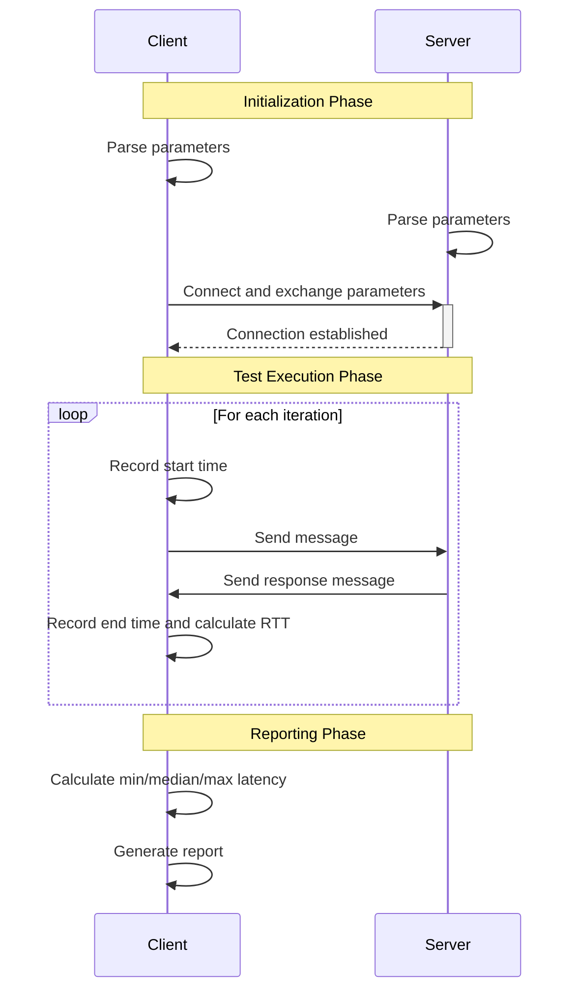

Sources: [README:64-66](), [src/perftest_parameters.h:102-103](), [README:72-76]()

### When to Use Latency Tests

- To measure responsiveness of a system
- To evaluate performance of different RDMA operations for time-sensitive applications
- When optimizing for response time rather than throughput
- To analyze the distribution of response times (using histogram option)
- To identify inconsistencies in network performance

## Flow Steering Rate Tests

Flow Steering Rate tests measure how quickly flow steering rules can be created in Raw Ethernet mode.

### Available Flow Steering Rate Tests

| Test Name | Description |
|-----------|-------------|
| `raw_ethernet_fs_rate` | Measures the rate at which flow steering rules can be created |

### Key Characteristics

- Specific to Raw Ethernet mode
- Evaluates a different aspect of performance than bandwidth or latency
- Measures flow creation performance rather than data transfer performance

### When to Use Flow Steering Rate Tests

- When evaluating the performance of flow rule creation mechanisms
- To benchmark network interface capabilities for rapidly changing traffic patterns
- When using advanced flow steering features
- To test the limitations of your networking hardware's flow table capacity

Sources: [src/perftest_parameters.h:330](), [man/perftest.1:125-126]()

## Relationship Between Test Types and Verbs

The following diagram illustrates the relationship between the test types, verbs (operation types), and connection types available in the perftest suite:

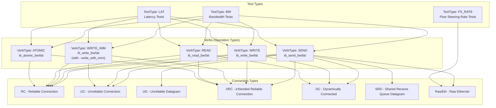

Sources: [src/perftest_parameters.h:72-78](), [src/perftest_parameters.h:327-330]()

## Common Test Parameters

All test types share a set of common parameters, though some parameters are only applicable to specific test types. Here are some key parameters:

| Parameter | Description | Default | Applicable To |
|-----------|-------------|---------|--------------|
| `-s, --size` | Message size in bytes | 65536 (BW), 2 (LAT) | All tests |
| `-n, --iters` | Number of iterations | 1000 (5000 for write BW) | All tests |
| `-t, --tx-depth` | Size of transmit queue | 128 (BW), 1 (LAT) | BW tests |
| `-c, --connection` | Connection type (RC/UC/UD/XRC/DC/SRD) | RC | All except RAW |
| `-b, --bidirectional` | Measure bidirectional bandwidth | Off | BW tests |
| `-D, --duration` | Run test for specified duration | Off | All tests |
| `-H, --report-histogram` | Print histogram of results | Off | LAT tests |
| `-q, --qp` | Number of QPs to use | 1 | BW tests |
| `-I, --inline_size` | Max size for inline sends | Off | All except READ, ATOMIC |
| `-a, --all` | Run sizes from 2 to 2^23 | Off | All except ATOMIC, RawEth |

Sources: [README:147-190](), [man/perftest.1:35-210]()

## Test Method Enumeration

The test method enumeration in the code determines how tests run in terms of iterations:

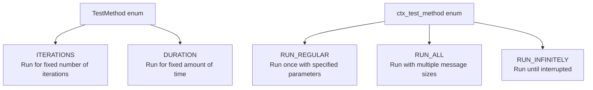

Sources: [src/perftest_parameters.h:341-342](), [src/perftest_parameters.h:350-351]()

## Test Type Implementation Details

The `TestType` is defined as an enumeration in the perftest_parameters.h file:

```
typedef enum { LAT , BW , LAT_BY_BW, FS_RATE } TestType;
```

This enumeration is stored in the `tst` field of the `perftest_parameters` structure, which holds all the test configuration parameters. The test type, along with the verb type and connection type, determines which specific test is being run.

Sources: [src/perftest_parameters.h:330](), [src/perftest_parameters.h:550]()

---

# Page: Connection Types

# Connection Types

<details>
<summary>Relevant source files</summary>

The following files were used as context for generating this wiki page:

- [README](README)
- [man/perftest.1](man/perftest.1)
- [src/perftest_parameters.c](src/perftest_parameters.c)
- [src/perftest_parameters.h](src/perftest_parameters.h)

</details>


## Purpose and Scope
This page describes the different connection types supported in the perftest suite, their characteristics, and how they are used for RDMA (Remote Direct Memory Access) performance testing. For information about different test categories (bandwidth, latency, etc.), see [Test Types](#1.1).

## Connection Type Overview

Connection types define how RDMA communications are established and maintained between endpoints. The perftest suite supports multiple connection types, each with different reliability guarantees, performance characteristics, and operation support.

### Connection Type Hierarchy

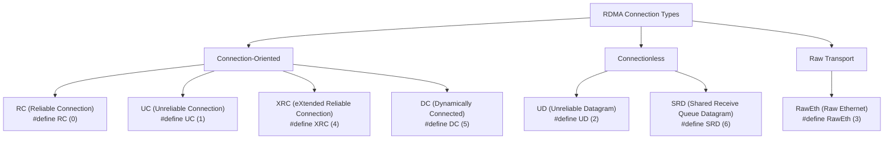

Sources: [src/perftest_parameters.h:71-78](), [src/perftest_parameters.c:32]()

## Connection Types in Detail

### RC (Reliable Connection)
- **Description**: Connection-oriented transport that guarantees reliable, in-order delivery of messages
- **Features**: 
  - Supports all RDMA verbs (Send, Write, Read, Atomic)
  - Default connection type for all tests
  - Provides highest reliability but with some overhead for reliability guarantees
- **Use Cases**: Most general-purpose applications where reliability is important

### UC (Unreliable Connection)
- **Description**: Connection-oriented transport that does not guarantee reliable delivery
- **Features**: 
  - Messages may be dropped if there are errors
  - Supports Send and Write verbs, but not Read or Atomic
  - Often provides better performance than RC for applications that can handle occasional packet loss
- **Use Cases**: Applications that prioritize performance over reliability

### UD (Unreliable Datagram)
- **Description**: Connectionless transport that allows sending messages to multiple destinations
- **Features**: 
  - No guarantee of delivery or ordering
  - Supports only Send verb
  - Has a message size limitation and adds a 40-byte header to each message
  - Provides the lowest latency but with limited features
- **Use Cases**: Low-latency applications with simple messaging needs

### RawEth (Raw Ethernet)
- **Description**: Allows sending raw Ethernet packets without using RDMA verbs
- **Features**: 
  - Bypasses the RDMA stack entirely
  - Useful for testing the raw networking capabilities of the hardware
  - Requires specifying source and destination MAC addresses
- **Use Cases**: Network protocol development, baseline performance testing

### XRC (eXtended Reliable Connection)
- **Description**: Extension of RC that allows a single Receive Queue to be shared by multiple Queue Pairs
- **Features**: 
  - Reduces memory consumption for applications with many connections
  - Requires hardware support for XRC feature
  - Forces the use of Shared Receive Queues (SRQ)
- **Use Cases**: Applications with many connections where memory efficiency is important

### DC (Dynamically Connected)
- **Description**: Hybrid between connection-oriented and connectionless transports
- **Features**: 
  - Allows a single QP to communicate with multiple remote QPs
  - Requires hardware support for DC feature
  - Can use stream channels with the `--log_dci_streams` option
- **Use Cases**: High-scale applications with many connections

### SRD (Shared Receive Queue Datagram)
- **Description**: Variant of UD that uses Shared Receive Queues
- **Features**: 
  - Requires hardware support for SRD feature
  - More efficient resource usage compared to regular UD
- **Use Cases**: High-scale messaging applications

## Compatibility with Verbs

Not all connection types can be used with all RDMA verbs. The following diagram and table show the compatibility between connection types and verbs:

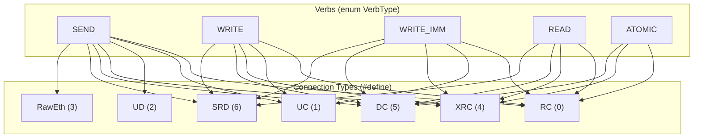

| Connection Type | Send | RDMA Write | RDMA Write with IMM | RDMA Read | Atomic |
|----------------|------|------------|---------------------|-----------|---------|
| RC             | ✓    | ✓          | ✓                   | ✓         | ✓       |
| UC             | ✓    | ✓          | ✓                   | ✗         | ✗       |
| UD             | ✓    | ✗          | ✗                   | ✗         | ✗       |
| RawEth         | ✓*   | ✗          | ✗                   | ✗         | ✗       |
| XRC            | ✓    | ✓          | ✓                   | ✓         | ✓       |
| DC             | ✓    | ✓          | ✓                   | ✓         | ✓       |
| SRD            | ✓    | ✓          | ✓                   | ✓         | ✗       |

\* RawEth uses its own sending mechanism, not standard RDMA Send

Sources: [src/perftest_parameters.c:1009-1062]()

These compatibility restrictions are enforced in the code. If you try to use an incompatible combination (like UD with RDMA Write), the program will exit with an error message.

## Connection Establishment

The connection establishment process differs between connection types:

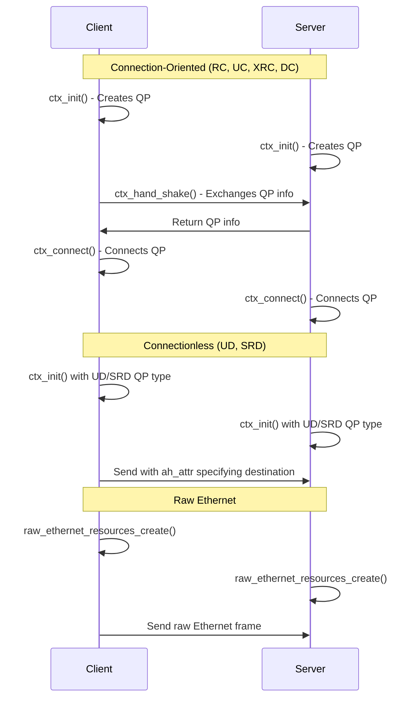

### Connection-Oriented Types (RC, UC, XRC, DC)
1. Both client and server create their QPs using `ctx_init()`
2. They exchange QP attributes using `ctx_hand_shake()`
3. They connect their QPs using `ctx_connect()`
4. The connection is now established and ready for data transfer

### Connectionless Types (UD, SRD)
1. Both client and server create their QPs using `ctx_init()`
2. No explicit connection establishment is needed
3. When sending, the sender specifies the destination in the address handle (`ah_attr`)

### Raw Ethernet
1. Both client and server create their resources using `raw_ethernet_resources_create()`
2. No RDMA connection is established
3. Data is sent as raw Ethernet frames

## Performance Characteristics

The choice of connection type can significantly impact performance:

| Connection Type | Reliability | Latency | Bandwidth | Resource Usage | Features |
|-----------------|-------------|---------|-----------|----------------|----------|
| RC              | High        | Good    | High      | Moderate       | All verbs supported |
| UC              | Medium      | Better  | High      | Moderate       | No Read/Atomic |
| UD              | Low         | Best    | Limited   | Low            | Send only, small messages |
| RawEth          | None        | Best    | Varies    | Low            | Raw packet access |
| XRC             | High        | Good    | High      | Efficient      | All verbs, shared RQ |
| DC              | High        | Good    | High      | Efficient      | Dynamic connections |
| SRD             | Low         | Good    | Limited   | Efficient      | Shared RQ |

For maximum bandwidth, RC is generally preferred due to its support for RDMA operations. For minimum latency, UD or RawEth might be better options, but with feature limitations.

## Usage in perftest

To specify a connection type in perftest, use the `-c` or `--connection` option followed by the connection type name:

```
./ib_send_bw -c RC <server_ip>  # Use RC connection type
./ib_send_bw -c UC <server_ip>  # Use UC connection type
./ib_send_bw -c UD <server_ip>  # Use UD connection type
./ib_send_bw -c XRC <server_ip> # Use XRC connection type
./ib_send_bw -c DC <server_ip>  # Use DC connection type
./ib_send_bw -c SRD <server_ip> # Use SRD connection type
```

Sources: [src/perftest_parameters.c:1009-1062](), [src/perftest_parameters.h:509]()

### Special Considerations

When using certain connection types, there are additional considerations:

#### XRC (eXtended Reliable Connection)
- Forces the use of Shared Receive Queues (SRQ) as set in [src/perftest_parameters.c:1279-1280]()
- Requires hardware support for XRCD
- Provides better memory efficiency for applications with many connections

#### UD (Unreliable Datagram)
- Adds a 40-byte header to each message as defined in [src/perftest_parameters.h:93]()
- Has a maximum message size limitation
- Can be used with multicast groups using the `-g` and `-M` options

#### DC (Dynamically Connected)
- Requires hardware support for DC
- Can use stream channels with the `--log_dci_streams` option
- Good for scenarios with many connections

#### SRD (Shared Receive Queue Datagram)
- Requires hardware support for SRD
- Combines the advantages of UD and SRQ

#### RawEth (Raw Ethernet)
- Requires specifying source and destination MAC addresses using the `-B` and `-E` options
- Can be used with or without IP/TCP/UDP headers
- Special commands like `raw_ethernet_bw` and `raw_ethernet_lat` are provided for raw Ethernet testing

### Hardware and Software Requirements

Some connection types require specific hardware and software support:

- **XRC**: Requires XRCD support in the hardware and driver, checked in [src/perftest_parameters.c:1034-1039]()
- **DC**: Requires MLX5DV support in the driver, checked in [src/perftest_parameters.c:1041-1046]()
- **SRD**: Requires SRD support in the hardware and driver, checked in [src/perftest_parameters.c:1048-1057]()

If your hardware or software doesn't support a specific connection type, perftest will exit with an appropriate error message.

## Selecting the Right Connection Type

Guidelines for choosing the appropriate connection type:

1. For general-purpose testing with maximum feature support, use **RC**
2. For higher performance with slightly lower reliability, use **UC**
3. For minimum latency but limited features, use **UD**
4. For testing raw network capabilities without RDMA, use **RawEth**
5. For testing with many connections with memory efficiency, use **XRC** or **DC**
6. For specific shared receive queue testing, use **SRD**

Always ensure the connection type is compatible with the verb you want to test, as shown in the compatibility table above.

Sources: [README:154-155](), [man/perftest.1:52-57]()

---

# Page: Architecture

# Architecture

<details>
<summary>Relevant source files</summary>

The following files were used as context for generating this wiki page:

- [src/perftest_communication.c](src/perftest_communication.c)
- [src/perftest_communication.h](src/perftest_communication.h)
- [src/perftest_parameters.c](src/perftest_parameters.c)
- [src/perftest_resources.c](src/perftest_resources.c)

</details>


This document describes the overall system architecture of perftest, a comprehensive toolkit for measuring and benchmarking RDMA (Remote Direct Memory Access) performance. The architecture is designed to support multiple RDMA verbs, connection types, and memory backends while maintaining a clean separation of concerns.

For information about specific test types, see [Test Types](#1.1). For details on building and installing perftest, see [Building and Installation](#6).

## Core Components Overview

The perftest toolkit is built around a modular architecture with several key components that work together to provide flexible and comprehensive RDMA performance measurement capabilities.

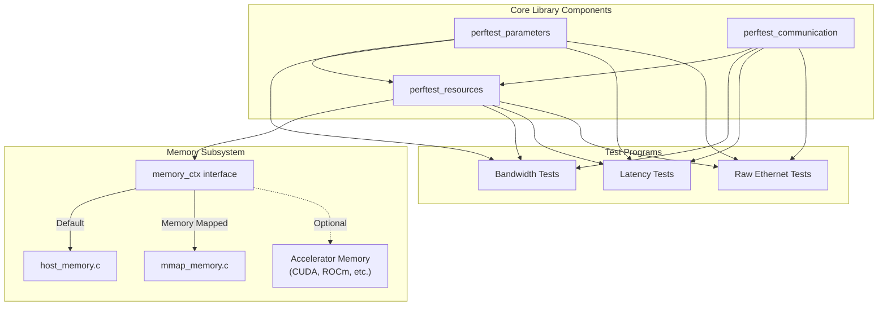

Sources: 
- [src/perftest_resources.c:1-45]()
- [src/perftest_parameters.c:1-22]()
- [src/perftest_communication.c:1-25]()

### Parameters System

The parameters system handles configuration of all test aspects, including RDMA operations, connection types, test duration, message sizes, and more. It's implemented primarily in `perftest_parameters.c` with the central data structure `struct perftest_parameters`.

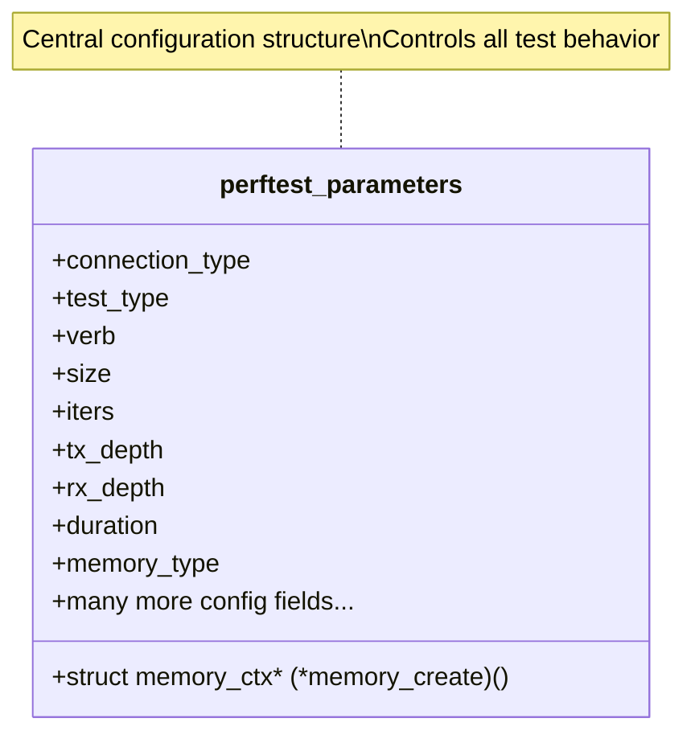

Key aspects of the parameters system:
- Provides command-line argument parsing
- Sets default values for all test parameters
- Validates parameter combinations for compatibility
- Forces dependencies between related parameters

Sources:
- [src/perftest_parameters.c:817-966]() - `init_perftest_params` function initializes default values
- [src/perftest_parameters.c:1181-1403]() - `force_dependecies` function ensures parameter compatibility

### Resources Management

The resources management component handles creation, configuration, and destruction of all RDMA resources needed for testing. It's implemented in `perftest_resources.c` and organized around the `struct pingpong_context` structure.

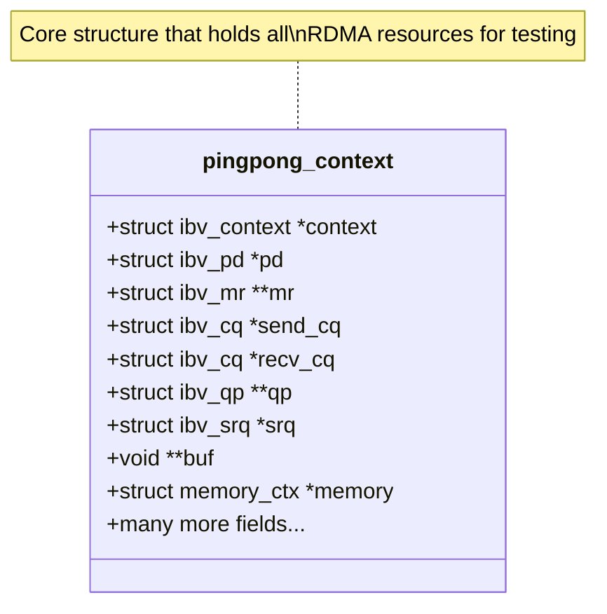

Key aspects of the resources management:
- Allocating and deallocating RDMA resources (QPs, CQs, MRs)
- Device discovery and configuration
- Memory management for send/receive buffers
- Support for different QP types (RC, UC, UD, etc.)
- Handling special resources (XRC domains, address handles, etc.)

Sources:
- [src/perftest_resources.c:942-979]() - `ctx_find_dev` function discovers RDMA devices
- [src/perftest_resources.c:1030-1128]() - `alloc_ctx` function allocates context resources
- [src/perftest_resources.c:1132-1222]() - `dealloc_ctx` function deallocates context resources
- [src/perftest_resources.c:1228-1451]() - `destroy_ctx` function destroys RDMA resources

### Communication System

The communication system manages the connection establishment and data exchange between test nodes. It's implemented in `perftest_communication.c` and supports both socket-based (Ethernet) and RDMA-CM based connection methods.

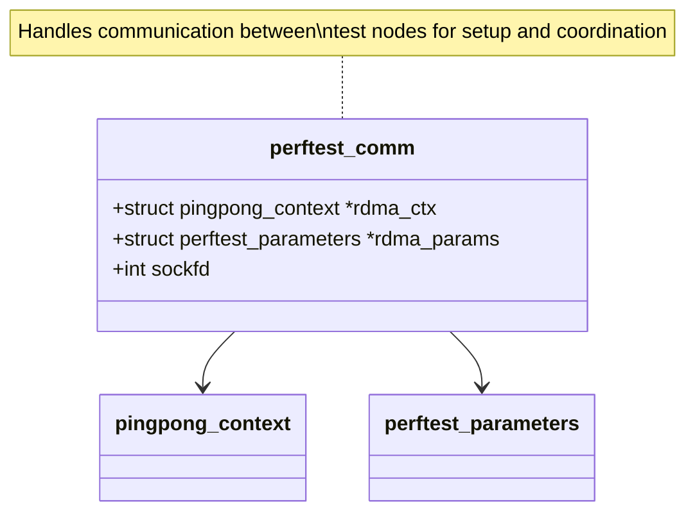

Key aspects of the communication system:
- Connection establishment (socket or RDMA CM)
- QP handshaking and address exchange
- Test parameter synchronization
- Version compatibility checking
- MTU negotiation

Sources:
- [src/perftest_communication.c:827-865]() - `set_up_connection` function prepares connection info
- [src/perftest_communication.c:958-1156]() - `rdma_client_connect` function implements RDMA CM client connection
- [src/perftest_communication.c:1189-1315]() - `rdma_server_connect` function implements RDMA CM server connection
- [src/perftest_communication.c:1455-1480]() - `establish_connection` function creates connection
- [src/perftest_communication.c:1487-1527]() - `ctx_hand_shake` function exchanges QP information

## Memory Subsystem

The memory subsystem provides an abstraction layer for different memory allocation mechanisms, supporting host memory, memory-mapped files, and various accelerator memories (CUDA, ROCm, etc.). This modular design allows tests to use different memory types without changing the test code.

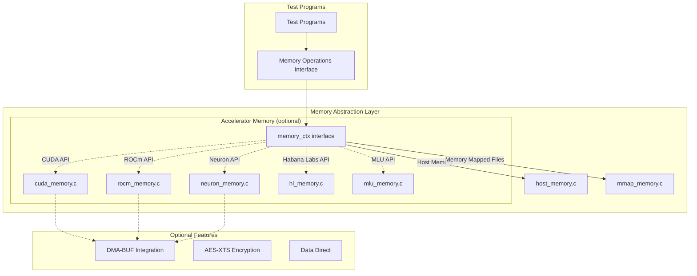

The memory subsystem utilizes a common interface defined by `struct memory_ctx` that all memory implementations must implement. This interface includes the following key operations:

- `init()`: Initialize the memory subsystem
- `destroy()`: Clean up the memory subsystem
- `allocate_buffer()`: Allocate memory of a specified size
- `free_buffer()`: Free previously allocated memory
- `copy_buffer_to_host()`: Copy from device/accelerator memory to host memory
- `copy_host_to_buffer()`: Copy from host memory to device/accelerator memory
- `copy_buffer_to_buffer()`: Copy between two device/accelerator memory locations

Sources:
- [src/perftest_resources.c:1108-1128]() - Memory allocation in context creation
- [src/perftest_parameters.c:886-896]() - Memory type initialization
- [src/perftest_communication.c:1368-1370]() - Memory context creation for communication

## Test Execution Flow

The following diagram illustrates the execution flow of a typical perftest run, from initialization through test execution to cleanup.

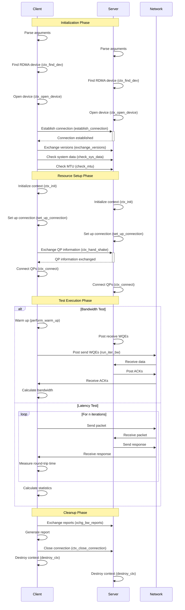

Sources:
- [src/perftest_resources.c:897-921]() - `create_rdma_resources` function
- [src/perftest_resources.c:926-937]() - `destroy_rdma_resources` function
- [src/perftest_resources.c:1228-1451]() - `destroy_ctx` function for cleanup
- [src/perftest_communication.c:1455-1480]() - `establish_connection` function
- [src/perftest_communication.c:1487-1527]() - `ctx_hand_shake` function

## Test Types

Perftest includes three primary test types, each designed to measure different aspects of RDMA performance.

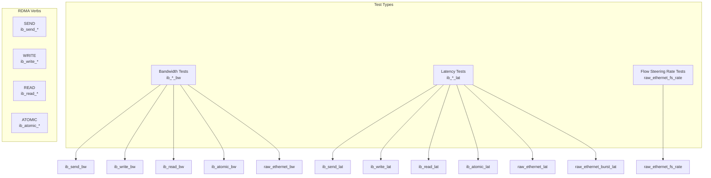

### Bandwidth Tests

Bandwidth tests measure the throughput of RDMA operations, expressed in terms of gigabits per second (Gbps) or bytes per second. These tests focus on maximum transfer rates achievable with different RDMA operations.

Key features of bandwidth tests:
- Support for all RDMA verbs (SEND, WRITE, READ, ATOMIC)
- Support for multiple outstanding operations (controlled by tx_depth)
- Bidirectional bandwidth measurement
- Post lists for efficient work request submission
- Support for various connection types (RC, UC, UD, etc.)

Sources:
- [src/perftest_parameters.c:849-850]() - Bandwidth test default settings
- [src/perftest_parameters.c:1359-1386]() - Post list configuration for bandwidth tests

### Latency Tests

Latency tests measure the round-trip time of RDMA operations, typically expressed in microseconds. These tests focus on the time it takes for a single operation to complete.

Key features of latency tests:
- Support for all RDMA verbs (SEND, WRITE, READ, ATOMIC)
- Histogram generation for detailed latency distribution analysis
- Cycle-based timing for high-precision measurement
- Support for various connection types (RC, UC, UD, etc.)

Sources:
- [src/perftest_parameters.c:312-315]() - Latency test command-line options
- [src/perftest_parameters.c:345-349]() - Latency histogram options

### Raw Ethernet Tests

Raw Ethernet tests operate at the Ethernet layer, bypassing the traditional IB/RDMA stack. These tests are useful for measuring raw network performance and special features like flow steering.

Key features of Raw Ethernet tests:
- Raw Ethernet bandwidth and latency measurements
- Flow steering rate testing
- Support for multi-flow traffic patterns
- MAC forwarding capabilities
- VLAN and QoS support

Sources:
- [src/perftest_parameters.c:725-813]() - Raw Ethernet command-line options
- [src/perftest_parameters.c:1145-1176]() - Flow rule dependencies

## Connection Types and Transport Modes

Perftest supports multiple connection types, allowing it to test various aspects of RDMA performance across different transport mechanisms.

```mermaid
graph LR
    subgraph "Connection Types"
        RC["RC<br>Reliable Connection"]
        UC["UC<br>Unreliable Connection"]
        UD["UD<br>Unreliable Datagram"]
        XRC["XRC<br>eXtended Reliable Connection"]
        DC["DC<br>Dynamically Connected"]
        SRD["SRD<br>Shared Receive Queue Datagram"]
        RawEth["Raw Ethernet"]
    end
    
    subgraph "Verbs Compatibility"
        SEND["SEND Verb"]
        WRITE["WRITE Verb"]
        READ["READ Verb"]
        ATOMIC["ATOMIC Verb"]
    end
    
    RC --> SEND & WRITE & READ & ATOMIC
    UC --> SEND & WRITE
    UD --> SEND
    XRC --> SEND & WRITE & READ & ATOMIC
    DC --> SEND & WRITE & READ & ATOMIC
    SRD --> SEND & WRITE & READ
    RawEth --> SEND
```

### Connection Types

- **RC (Reliable Connection)**: A connected transport providing reliable, in-order delivery with error checking. Supports all RDMA verbs.
- **UC (Unreliable Connection)**: A connected transport without guarantees of reliable delivery. Supports SEND and WRITE verbs.
- **UD (Unreliable Datagram)**: A connectionless transport allowing communication with multiple peers. Only supports SEND verb.
- **XRC (eXtended Reliable Connection)**: Similar to RC but with shared receive queues, optimized for many-to-one communication patterns.
- **DC (Dynamically Connected)**: Combines aspects of connected and connectionless transports, allowing dynamic connections to multiple peers.
- **SRD (Shared Receive Queue Datagram)**: Similar to UD but with shared receive queues.
- **Raw Ethernet**: Bypasses the RDMA stack entirely, operating directly at the Ethernet layer.

Sources:
- [src/perftest_parameters.c:1014-1061]() - Connection type selection and validation
- [src/perftest_parameters.c:1272-1285]() - XRC-specific configuration
- [src/perftest_parameters.c:1283-1285]() - DC-specific configuration

### RDMA Operations (Verbs)

- **SEND/RECV**: Requires coordination between sender and receiver, with explicit receive buffers posted by the receiver.
- **WRITE**: One-sided operation where the initiator writes data directly to a remote memory region.
- **READ**: One-sided operation where the initiator reads data directly from a remote memory region.
- **ATOMIC**: One-sided operation performing atomic operations (compare-and-swap, fetch-and-add) on remote memory.

The compatibility between verbs and connection types is enforced by validation checks in the parameters system.

Sources:
- [src/perftest_parameters.c:1014-1061]() - Validation of verb and connection type compatibility
- [src/perftest_parameters.c:1245-1246]() - READ and ATOMIC-specific handling

## Integration Points

Perftest includes several integration points with other systems and features:

1. **RDMA CM**: Support for RDMA Connection Manager for connection establishment instead of using sockets.
2. **Accelerator Memory**: Integration with GPU and other accelerator memory through the memory abstraction layer.
3. **DMA-BUF**: Support for sharing memory between devices using Linux DMA-BUF.
4. **Performance Counters**: Integration with IB performance counters for detailed performance analysis.
5. **Hardware Rate Limiting**: Support for QoS and rate limiting features of RDMA hardware.
6. **AES-XTS Encryption**: Support for hardware-accelerated encryption of RDMA traffic.

These integration points make perftest a comprehensive tool for testing RDMA performance in various environments and configurations.

Sources:
- [src/perftest_parameters.c:423-443]() - RDMA CM options
- [src/perftest_parameters.c:622-666]() - Accelerator memory options
- [src/perftest_communication.c:1381-1396]() - Performance counter setup

---

# Page: Core Parameters System

# Core Parameters System

<details>
<summary>Relevant source files</summary>

The following files were used as context for generating this wiki page:

- [src/perftest_parameters.c](src/perftest_parameters.c)
- [src/perftest_parameters.h](src/perftest_parameters.h)

</details>


The Core Parameters System is responsible for managing and validating all test parameters within the perftest suite. It provides the infrastructure for defining default values, parsing command-line arguments, validating parameter combinations, and enforcing dependencies between parameters. This system is the foundation upon which all test programs operate, ensuring consistent behavior across the entire test suite.

For information about how these parameters are used in the context of RDMA resources, see [RDMA Resources Management](#2.2).

## Overview

The parameters system plays a central role in the perftest architecture, providing a unified way to configure all test programs. It handles everything from network configuration (ports, devices, MTU) to test properties (iterations, data size) to operational modes (connection types, verbs).

```mermaid
flowchart TD
    subgraph "User Interface"
        CLI["Command Line Arguments"]
    end
    
    subgraph "Parameters System"
        Parser["parser()"]
        Init["init_perftest_params()"]
        Validation["force_dependecies()"]
        CheckLink["check_link_and_mtu()"]
    end
    
    subgraph "Test Execution"
        BW["Bandwidth Tests"]
        LAT["Latency Tests"]
        FS["Flow Steering Tests"]
    end
    
    CLI --> Parser
    Parser --> Init
    Parser --> Validation
    Parser --> CheckLink
    
    Parameters["perftest_parameters struct"] <--> Parser
    Parameters <--> Validation
    Parameters <--> CheckLink
    
    Parameters --> BW
    Parameters --> LAT
    Parameters --> FS
```

Sources: [src/perftest_parameters.c:373-1942](), [src/perftest_parameters.h:449-651]()

## Parameter Structure

The core of the parameter system is the `struct perftest_parameters` defined in [src/perftest_parameters.h:449-651](). This comprehensive structure contains over 200 fields that control all aspects of test execution. The structure includes:

```mermaid
classDiagram
    class perftest_parameters {
        +Network Configuration
        int port
        char* ib_devname
        char* servername
        uint8_t ib_port
        int mtu
        enum ibv_mtu curr_mtu
        
        +Test Configuration
        uint64_t size
        uint64_t iters
        int duration
        int tx_depth
        int rx_depth
        TestType tst
        VerbType verb
        
        +Connection Configuration
        int connection_type
        MachineType machine
        int use_rdma_cm
        uint8_t sl
        
        +Memory Configuration
        enum memory_type memory_type
        struct memory_ctx* (*memory_create)()
        
        +Rate Limiting
        double rate_limit
        enum rate_limiter_types rate_limit_type
        
        +Output Control
        enum verbosity_level output
        int out_json
        char* out_json_file_name
    }
```

Sources: [src/perftest_parameters.h:449-651]()

## Parameter Types

The parameters system defines several enumerations to represent different types of tests, connection methods, and operational modes:

### Connection Types
Available connection types (defined in [src/perftest_parameters.h:72-79]()):
- RC (Reliable Connection)
- UC (Unreliable Connection)
- UD (Unreliable Datagram)
- RawEth (Raw Ethernet)
- XRC (eXtended Reliable Connection)
- DC (Dynamically Connected)
- SRD (Shared Receive Queue Datagram)

### Test Types
Available test types (defined in [src/perftest_parameters.h:330]()):
- LAT (Latency)
- BW (Bandwidth)
- LAT_BY_BW (Latency under load)
- FS_RATE (Flow Steering Rate)

### Verb Types
Available RDMA operations (defined in [src/perftest_parameters.h:327]()):
- SEND
- WRITE
- WRITE_IMM (Write with immediate data)
- READ
- ATOMIC

### Memory Types
Available memory types (defined in [src/perftest_parameters.h:439-447]()):
- MEMORY_HOST (Standard host memory)
- MEMORY_MMAP (Memory-mapped files)
- MEMORY_CUDA (NVIDIA CUDA memory)
- MEMORY_ROCM (AMD ROCm memory)
- MEMORY_NEURON (AWS Neuron memory)
- MEMORY_HL (Habana Labs memory)
- MEMORY_MLU (MLU memory)

```mermaid
flowchart LR
    subgraph "Parameter Types"
        direction TB
        subgraph "Connection Types"
            RC["RC - Reliable Connection"]
            UC["UC - Unreliable Connection"]
            UD["UD - Unreliable Datagram"]
            RawEth["RawEth - Raw Ethernet"]
            XRC["XRC - eXtended Reliable Connection"]
            DC["DC - Dynamically Connected"]
            SRD["SRD - Shared Receive Queue Datagram"]
        end
        
        subgraph "Test Types"
            LAT["LAT - Latency"]
            BW["BW - Bandwidth"]
            LAT_BY_BW["LAT_BY_BW - Latency under load"]
            FS_RATE["FS_RATE - Flow Steering Rate"]
        end
        
        subgraph "Verb Types"
            SEND["SEND"]
            WRITE["WRITE"]
            WRITE_IMM["WRITE_IMM - Write with immediate"]
            READ["READ"]
            ATOMIC["ATOMIC"]
        end
        
        subgraph "Memory Types"
            HOST["MEMORY_HOST - Host memory"]
            MMAP["MEMORY_MMAP - Memory-mapped files"]
            CUDA["MEMORY_CUDA - NVIDIA GPU memory"]
            ROCM["MEMORY_ROCM - AMD GPU memory"]
            NEURON["MEMORY_NEURON - AWS Neuron memory"]
            HL["MEMORY_HL - Habana Labs memory"]
            MLU["MEMORY_MLU - MLU memory"]
        end
    end
```

Sources: [src/perftest_parameters.h:72-79](), [src/perftest_parameters.h:327-330](), [src/perftest_parameters.h:439-447]()

## Parameter Initialization

The `init_perftest_params()` function (defined in [src/perftest_parameters.c:817-965]()) sets default values for all parameters. This ensures that all tests have a consistent baseline configuration. Key defaults include:

| Parameter | Default Value | Description |
|-----------|---------------|-------------|
| port | 18515 | TCP port for communication |
| ib_port | 1 | InfiniBand port number |
| size | 65536 (BW) / 2 (LAT) | Message size in bytes |
| iters | 1000 (most tests) / 5000 (WRITE BW) | Number of iterations |
| tx_depth | 128 (BW) / 1 (LAT) | Send queue depth |
| rx_depth | 512 (SEND) / 1 (RDMA) | Receive queue depth |
| connection_type | RC | Default connection type |
| qp_timeout | 14 | QP timeout (4 μs * 2^timeout) |
| sl | 0 | Service level |
| gid_index | -1 | GID index (-1 means not used) |
| inline_size | -1 | Max inline size (-1 means auto-detect) |
| cq_mod | 100 | CQ moderation |

Sources: [src/perftest_parameters.c:817-965]()

## Parameter Parsing Flow

The parameter parsing system uses the standard getopt_long() function to process command-line arguments. The function `parser()` in [src/perftest_parameters.c:2373-7153]() is the entry point for parameter processing.

```mermaid
flowchart TD
    START["Program Start"] --> INIT["init_perftest_params() - Set defaults"]
    INIT --> PARSER["parser() - Process command-line args"]
    PARSER --> CHECK_DUPLICATES["Check for duplicate args"]
    PARSER --> PROCESS_ARGS["Process each argument"]
    PROCESS_ARGS --> |"For each arg"| SWITCH["Switch on arg type"]
    SWITCH --> |"After all args"| FORCE_DEP["force_dependecies() - Validate dependencies"]
    FORCE_DEP --> SET_MTU["set_mtu() - Configure MTU"]
    SET_MTU --> SET_INLINE["ctx_set_max_inline() - Configure inline size"]
    SET_INLINE --> END["Return parameters to test program"]
```

Sources: [src/perftest_parameters.c:2373-7153](), [src/perftest_parameters.c:817-965](), [src/perftest_parameters.c:1181-1941]()

## Command-Line Options

The parameters system supports a comprehensive set of command-line options that control all aspects of test execution. These options are documented in the `usage()` function in [src/perftest_parameters.c:253-720]().

Key option categories include:

1. **Test Configuration**
   - `-n, --iters=<iters>`: Number of iterations
   - `-s, --size=<size>`: Message size
   - `-D, --duration`: Run test for specified time period
   - `-a, --all`: Run with multiple message sizes

2. **Connection Configuration**
   - `-c, --connection=<type>`: Connection type (RC/UC/UD/RawEth/XRC/DC/SRD)
   - `-R, --rdma_cm`: Use RDMA CM for connection
   - `-z, --comm_rdma_cm`: Use RDMA CM for data exchange

3. **Device Configuration**
   - `-d, --ib-dev=<dev>`: InfiniBand device to use
   - `-i, --ib-port=<port>`: Port number to use
   - `-m, --mtu=<mtu>`: MTU size

4. **Performance Options**
   - `-t, --tx-depth=<dep>`: Send queue depth
   - `-r, --rx-depth=<dep>`: Receive queue depth
   - `-Q, --cq-mod`: Completion queue moderation
   - `-l, --post_list=<list size>`: Number of WQEs to post at once

5. **Memory Options**
   - `--use_cuda=<dev_id>`: Use CUDA memory
   - `--use_rocm=<dev_id>`: Use ROCm memory
   - `--mmap=<file>`: Use memory-mapped file

Sources: [src/perftest_parameters.c:253-720]()

## Parameter Validation and Dependencies

The `force_dependecies()` function in [src/perftest_parameters.c:1181-1941]() enforces relationships between parameters and validates parameter combinations. This function ensures that:

1. Parameters are compatible with each other
2. Invalid combinations are rejected
3. Dependent parameters are automatically adjusted

Key dependency types include:

### Test Type Dependencies
```mermaid
flowchart TD
    TEST_TYPE{Test Type}
    TEST_TYPE -->|BW| BW["- Default size: 65536\n- Default tx_depth: 128\n- Supports post_list"]
    TEST_TYPE -->|LAT| LAT["- Default size: 2\n- Default tx_depth: A\n- No post_list support"]
    TEST_TYPE -->|FS_RATE| FS["- Special Raw Ethernet\n  configuration\n- Limited options"]
    TEST_TYPE -->|LAT_BY_BW| LATBW["- Latency under load\n- Forces SW rate limiting\n- Limited to iteration mode"]
```

### Connection Type Dependencies
```mermaid
flowchart TD
    CONN_TYPE{Connection Type}
    CONN_TYPE -->|RC| RC["- Supports all verbs\n- Default type"]
    CONN_TYPE -->|UC| UC["- No READ/ATOMIC support\n- Different RX depth limits"]
    CONN_TYPE -->|UD| UD["- SEND only\n- Special MTU handling"]
    CONN_TYPE -->|RawEth| RAW["- Special addressing\n- MAC/IP configuration required\n- Different MTU range"]
    CONN_TYPE -->|XRC| XRC["- Forces SRQ usage\n- No RDMA_CM support"]
    CONN_TYPE -->|DC| DC["- Forces SRQ usage\n- No old post send API\n- No RDMA_CM support"]
    CONN_TYPE -->|SRD| SRD["- No RDMA_CM support\n- CQ moderation = 1"]
```

### Verb Type Dependencies
```mermaid
flowchart TD
    VERB_TYPE{Verb Type}
    VERB_TYPE -->|SEND| SEND["- Works with all conn types\n- Requires rx_depth config"]
    VERB_TYPE -->|WRITE/WRITE_IMM| WRITE["- No UD support\n- Different default iters"]
    VERB_TYPE -->|READ| READ["- RC/XRC/DC only\n- Special out_reads handling"]
    VERB_TYPE -->|ATOMIC| ATOMIC["- RC/XRC/DC only\n- Fixed message size (8 bytes)"]
```

Common validation and adjustments include:

1. Limiting tx_depth to the number of iterations
2. Adjusting rx_depth based on connection type
3. Disabling CQ moderation for large messages
4. Enforcing verb availability for connection types
5. Adjusting parameters for Raw Ethernet tests
6. Configuring MTU to valid values for the device

Sources: [src/perftest_parameters.c:1181-1941]()

## Resource Configuration

After parameter parsing, additional configuration is applied to match the parameters to available hardware capabilities:

### MTU Configuration

The `set_mtu()` function in [src/perftest_parameters.c:2121-2162]() configures MTU based on:
1. User-specified value (if provided)
2. Device capabilities
3. Hardware-specific limitations

For Raw Ethernet tests, `set_eth_mtu()` in [src/perftest_parameters.c:1085-1102]() is used instead, with a different valid range (64-9600 bytes).

### Link Layer Configuration

The `set_link_layer()` function in [src/perftest_parameters.c:2173-2224]() determines and validates the link layer (InfiniBand or Ethernet) based on the device port configuration.

### Inline Size Configuration

The `ctx_set_max_inline()` function in [src/perftest_parameters.c:2288-2338]() sets the maximum inline data size based on:
1. User-specified value (if provided)
2. Test type (latency tests use inline, bandwidth tests don't)
3. Device and connection type-specific limitations

```mermaid
flowchart TD
    START["Parameter Parsing Complete"] --> CHECK_LINK["check_link_and_mtu()"]
    CHECK_LINK --> SET_MTU["set_mtu()"]
    SET_MTU --> SET_LINK["set_link_layer()"]
    SET_LINK --> SET_INLINE["ctx_set_max_inline()"]
    SET_INLINE --> CONFIG_DEV["Device-specific configuration"]
    CONFIG_DEV --> END["Ready for test execution"]
```

Sources: [src/perftest_parameters.c:2121-2162](), [src/perftest_parameters.c:2173-2224](), [src/perftest_parameters.c:2288-2338]()

## Memory Type Management

The parameters system includes support for different memory types through a memory abstraction layer:

```mermaid
flowchart TD
    MEM_PARAM{memory_type}
    MEM_CREATE["memory_create function pointer"]
    
    MEM_PARAM -->|MEMORY_HOST| HOST["host_memory_create()"]
    MEM_PARAM -->|MEMORY_MMAP| MMAP["mmap_memory_create()"]
    MEM_PARAM -->|MEMORY_CUDA| CUDA["cuda_memory_create()"]
    MEM_PARAM -->|MEMORY_ROCM| ROCM["rocm_memory_create()"]
    MEM_PARAM -->|MEMORY_NEURON| NEURON["neuron_memory_create()"]
    MEM_PARAM -->|MEMORY_HL| HL["hl_memory_create()"]
    MEM_PARAM -->|MEMORY_MLU| MLU["mlu_memory_create()"]
    
    HOST --> MEM_CREATE
    MMAP --> MEM_CREATE
    CUDA --> MEM_CREATE
    ROCM --> MEM_CREATE
    NEURON --> MEM_CREATE
    HL --> MEM_CREATE
    MLU --> MEM_CREATE
    
    MEM_CREATE --> TEST["Test programs use memory_create to\nallocate appropriate memory type"]
```

The `memory_type` parameter and `memory_create` function pointer in `struct perftest_parameters` allow tests to abstract memory allocation, supporting regular host memory, memory-mapped files, and various accelerator memories (CUDA, ROCm, etc.).

Sources: [src/perftest_parameters.h:440-447](), [src/perftest_parameters.h:571-572](), [src/perftest_parameters.c:887-895]()

## Parameter System Integration

The parameters system integrates with the rest of the perftest suite through a standard flow:

```mermaid
sequenceDiagram
    participant Test as Test Program
    participant Parser as Parameter Parser
    participant Resources as RDMA Resources
    participant Memory as Memory System
    participant Execution as Test Execution
    
    Test->>Parser: Call parser() with argc/argv
    Parser->>Parser: init_perftest_params()
    Parser->>Parser: Process command-line args
    Parser->>Parser: force_dependecies()
    Parser-->>Test: Return filled parameters
    
    Test->>Resources: Create RDMA resources with parameters
    Test->>Memory: Allocate memory via parameters.memory_create
    Test->>Execution: Run test with configured parameters
    Execution->>Test: Return test results
    Test->>Test: Generate reports based on parameters
```

This standardized flow ensures consistent behavior across all test programs, with the parameters system providing the configuration foundation for the entire test execution process.

Sources: [src/perftest_parameters.c:373-1942](), [src/perftest_parameters.c:2373-7153]()

## Summary

The Core Parameters System is a fundamental component of the perftest suite, providing:

1. A unified way to configure all test programs
2. Comprehensive parameter validation and dependency management
3. Adaptation to hardware capabilities and limitations
4. Support for a wide range of test configurations and memory types

This system enables the perftest suite to maintain consistent behavior across a diverse range of hardware, connection types, and test scenarios, while providing users with fine-grained control over test execution.

---

# Page: RDMA Resources Management

# RDMA Resources Management

<details>
<summary>Relevant source files</summary>

The following files were used as context for generating this wiki page:

- [src/perftest_resources.c](src/perftest_resources.c)
- [src/perftest_resources.h](src/perftest_resources.h)

</details>


This document explains how RDMA resources are created, managed, and destroyed during test execution in the perftest suite. It covers the lifecycle of RDMA resources such as Queue Pairs (QPs), Memory Regions (MRs), Completion Queues (CQs), and how they are initialized, configured, and cleaned up.

For information on the parameters that configure these resources, see [Core Parameters System](#2.1). For details on how memory is allocated and managed, see [Memory Management](#2.4).

## Resource Overview

The main structure for managing RDMA resources is the `pingpong_context` defined in [src/perftest_resources.h:171-237](), which contains all the RDMA resources needed during tests.

### RDMA Resource Hierarchy

```mermaid
graph TD
    CTX["pingpong_context"] --> CONTEXT["ibv_context: Device Context"]
    CTX --> PD["ibv_pd: Protection Domain"]
    CTX --> SCQ["ibv_cq: send_cq"]
    CTX --> RCQ["ibv_cq: recv_cq"]
    CTX --> SRQ["ibv_srq: Shared Receive Queue (optional)"]
    CTX --> QPA["ibv_qp[]: Queue Pairs Array"]
    CTX --> MRA["ibv_mr[]: Memory Regions Array"]
    CTX --> BUFA["void*[]: Data Buffers Array"]
    
    PD -.-> MRA
    PD -.-> QPA
    QPA -.-> SCQ
    QPA -.-> RCQ
    QPA -.-> SRQ
    MRA -.-> BUFA
```

Sources:
- [src/perftest_resources.h:171-237]()

The `pingpong_dest` structure is used to exchange QP connection information between endpoints:

```mermaid
classDiagram
    class pingpong_dest {
        int lid
        int qpn
        int psn
        unsigned rkey
        unsigned long long vaddr
        union ibv_gid gid
        int gid_index
    }
```

Sources:
- [src/perftest_resources.h:239-249]()

## Resource Lifecycle

The lifecycle of RDMA resources follows this sequence:

```mermaid
graph TD
    A["Test Start"] --> B["alloc_ctx()"]
    B --> C["ctx_init()"]
    C --> D["create_mr()"]
    C --> E["create_cqs()"]
    C --> F["create_qp_main()"]
    F --> G["modify_qp_to_init()"]
    G --> H["ctx_connect()"]
    H --> I["Test Execution"]
    I --> J["destroy_ctx()"]
    J --> K["dealloc_ctx()"]
    K --> L["Test End"]
```

Sources:
- [src/perftest_resources.c:1030-1128]() - alloc_ctx
- [src/perftest_resources.c:1992-2258]() - ctx_init
- [src/perftest_resources.c:1227-1451]() - destroy_ctx
- [src/perftest_resources.c:1132-1222]() - dealloc_ctx

## Resource Allocation

Resource allocation begins with the `alloc_ctx` function, which allocates memory for various RDMA resources based on test parameters.

Key allocations include:
- Arrays for timing data (`user_param->tposted`, `user_param->tcompleted`)
- Arrays for QPs (`ctx->qp`)
- Arrays for Memory Regions (`ctx->mr`)
- Arrays for data buffers (`ctx->buf`)
- Work requests and scatter-gather elements
- Test-specific counters and data structures

The buffer size is calculated based on the message size, cycle buffer size, and other parameters:

```c
ctx->buff_size = INC(BUFF_SIZE(ctx->size, ctx->cycle_buffer),
             ctx->cache_line_size) * 2 * num_of_qps_factor * user_param->flows;
```

Sources:
- [src/perftest_resources.c:1030-1128]()

## Resource Initialization

The `ctx_init` function initializes all RDMA resources in the following sequence:

### 1. Device Context and Event Channels

First, if event-based completion is requested, event channels are created:

```c
if (user_param->use_event) {
    ctx->send_channel = ibv_create_comp_channel(ctx->context);
    ctx->recv_channel = ibv_create_comp_channel(ctx->context);
}
```

### 2. Protection Domain

A Protection Domain (PD) is created to isolate and secure RDMA resources:

```c
ctx->pd = ibv_alloc_pd(ctx->context);
```

### 3. Memory Registration

Memory regions are registered for data transfer:

```mermaid
graph TD
    A["ctx_init() calls create_mr()"] --> B["create_mr() loops through QPs"]
    B --> C{"mr_per_qp?"}
    C -->|"Yes"| D["Register MR per QP\ncreate_single_mr()"]
    C -->|"No"| E["Register single MR\ncreate_single_mr()"]
    E --> F["Share MR across QPs"]
    D --> G["Set access flags based on verb"]
    F --> G
    G --> H["Initialize buffer with test data"]
```

The `create_single_mr` function:
1. Allocates memory buffer
2. Sets access flags based on the verb (SEND, WRITE, READ, ATOMIC)
3. Registers the buffer with the PD
4. Initializes the buffer with test data

Access flags are determined by the operation:
```c
if (user_param->verb == WRITE || user_param->verb == WRITE_IMM) {
    flags |= IBV_ACCESS_REMOTE_WRITE;
} else if (user_param->verb == READ) {
    flags |= IBV_ACCESS_REMOTE_READ;
} else if (user_param->verb == ATOMIC) {
    flags |= IBV_ACCESS_REMOTE_ATOMIC;
}
```

### 4. Completion Queues

Completion Queues (CQs) are created for completion notification:

```c
int create_cqs(struct pingpong_context *ctx, struct perftest_parameters *user_param)
{
    // Determine depths based on test type
    tx_buffer_depth = user_param->tx_depth;
    
    // Create send CQ
    ctx->send_cq = ibv_create_cq(ctx->context, tx_buffer_depth *
                    user_param->num_of_qps, NULL, ctx->send_channel, user_param->eq_num);
    
    // Create receive CQ if needed
    if (need_recv_cq) {
        ctx->recv_cq = ibv_create_cq(ctx->context, user_param->rx_depth *
                        user_param->num_of_qps, NULL, ctx->recv_channel, user_param->eq_num);
    }
}
```

### 5. Shared Receive Queue (Optional)

If specified, a Shared Receive Queue (SRQ) is created:

```c
if (user_param->use_srq && !user_param->use_xrc) {
    struct ibv_srq_init_attr attr = {
        .attr = {
            .max_wr  = user_param->rx_depth,
            .max_sge = 1
        }
    };
    ctx->srq = ibv_create_srq(ctx->pd, &attr);
}
```

### 6. Queue Pairs

Queue Pairs (QPs) are created based on test parameters:

```mermaid
graph TD
    A["ctx_init() loops through QPs"] --> B["create_qp_main() for each QP"]
    B --> C["create_reg_qp_main()"]
    C --> D["ctx_qp_create()"]
    D --> E["Configure QP attributes\nbased on connection type"]
    E --> F["ibv_create_qp() or specialized creation"]
    F --> G["modify_qp_to_init()"]
    G --> H["ctx_modify_qp_to_init()"]
```

Sources:
- [src/perftest_resources.c:1992-2258]() - ctx_init
- [src/perftest_resources.c:1860-1900]() - create_mr
- [src/perftest_resources.c:1654-1774]() - create_single_mr
- [src/perftest_resources.c:1630-1649]() - create_cqs

## Queue Pair Management

### QP Creation

The `ctx_qp_create` function creates QPs with attributes set based on:
- Connection type (RC, UC, UD, DC, XRC, etc.)
- Test verb (SEND, WRITE, READ, ATOMIC)
- Other test parameters (inline size, tx_depth, rx_depth)

```c
struct ibv_qp* ctx_qp_create(struct pingpong_context *ctx,
        struct perftest_parameters *user_param, int qp_index)
{
    // Set up QP attributes
    attr.send_cq = ctx->send_cq;
    attr.recv_cq = ctx->recv_cq;
    attr.qp_type = <based on connection_type>;
    attr.cap.max_send_wr = user_param->tx_depth;
    attr.cap.max_send_sge = MAX_SEND_SGE;
    attr.cap.max_inline_data = user_param->inline_size;
    
    // Create QP using appropriate method
    qp = ibv_create_qp(ctx->pd, &attr);
    
    return qp;
}
```

### QP State Transitions

QPs go through several state transitions:

```mermaid
stateDiagram-v2
    RESET --> INIT: ctx_modify_qp_to_init
    INIT --> RTR: ctx_modify_qp_to_rtr
    RTR --> RTS: ctx_modify_qp_to_rts
```

1. **RESET to INIT**: The `ctx_modify_qp_to_init` function transitions QPs to INIT state:

```c
int ctx_modify_qp_to_init(struct ibv_qp *qp, struct perftest_parameters *user_param, int qp_index)
{
    struct ibv_qp_attr attr;
    int flags = IBV_QP_STATE | IBV_QP_PKEY_INDEX | IBV_QP_PORT;
    
    attr.qp_state = IBV_QPS_INIT;
    attr.pkey_index = user_param->pkey_index;
    attr.port_num = user_param->ib_port;
    
    // Set access flags based on verb
    if (user_param->verb != SEND) {
        attr.qp_access_flags = <appropriate flags>;
        flags |= IBV_QP_ACCESS_FLAGS;
    }
    
    return ibv_modify_qp(qp, &attr, flags);
}
```

2. **INIT to RTR to RTS**: The `ctx_connect` function establishes connections:

```c
int ctx_connect(struct pingpong_context *ctx, struct pingpong_dest *dest,
        struct perftest_parameters *user_param, struct pingpong_dest *my_dest)
{
    for (i=0; i < user_param->num_of_qps; i++) {
        // Modify QP to RTR
        ctx_modify_qp_to_rtr(ctx->qp[i], &attr, user_param, &dest[i], &my_dest[i], i);
        
        // Modify QP to RTS
        ctx_modify_qp_to_rts(ctx->qp[i], &attr, user_param, &dest[i], &my_dest[i]);
        
        // Create Address Handle for UD/DC
        if (user_param->connection_type == UD || user_param->connection_type == DC) {
            ctx->ah[i] = ibv_create_ah(ctx->pd, &(attr.ah_attr));
        }
    }
}
```

### Connection Establishment Sequence

```mermaid
sequenceDiagram
    participant C as Client
    participant S as Server
    
    C->>C: ctx_qp_create()
    S->>S: ctx_qp_create()
    
    C->>C: ctx_modify_qp_to_init()
    S->>S: ctx_modify_qp_to_init()
    
    C->>S: Exchange QP info
    S->>C: Exchange QP info
    
    C->>C: ctx_modify_qp_to_rtr()
    C->>C: ctx_modify_qp_to_rts()
    
    S->>S: ctx_modify_qp_to_rtr()
    S->>S: ctx_modify_qp_to_rts()
    
    Note over C,S: For UD/DC Connection Types
    C->>C: Create Address Handle
    S->>S: Create Address Handle
```

Sources:
- [src/perftest_resources.c:2319-2583]() - ctx_qp_create
- [src/perftest_resources.c:2588-2653]() - ctx_modify_qp_to_init
- [src/perftest_resources.c:2799-2896]() - ctx_connect
- [src/perftest_resources.c:2658-2754]() - ctx_modify_qp_to_rtr
- [src/perftest_resources.c:2759-2794]() - ctx_modify_qp_to_rts

## Work Request Setup

After QPs are connected, the test sets up work requests for sending and receiving data:

### Send Work Requests

The `ctx_set_send_wqes` function prepares send work requests based on the test parameters:

```c
void ctx_set_send_wqes(struct pingpong_context *ctx,
        struct perftest_parameters *user_param,
        struct pingpong_dest *rem_dest)
{
    // For each QP
    for (i = 0; i < user_param->num_of_qps; i++) {
        // For each post_list (batch size)
        for (j = 0; j < user_param->post_list; j++) {
            // Set up send work request
            wr = &ctx->wr[i*user_param->post_list + j];
            wr->wr_id = PINGPONG_SEND_WRID;
            wr->sg_list = &ctx->sge_list[i*user_param->post_list + j];
            wr->num_sge = 1;
            
            // Set operation type
            if (user_param->verb == SEND)
                wr->opcode = IBV_WR_SEND;
            else if (user_param->verb == WRITE)
                wr->opcode = IBV_WR_RDMA_WRITE;
            // ...etc for other operations
            
            // Set remote information for RDMA operations
            if (user_param->verb != SEND) {
                wr->wr.rdma.remote_addr = rem_dest[i].vaddr;
                wr->wr.rdma.rkey = rem_dest[i].rkey;
            }
        }
    }
}
```

### Receive Work Requests

For tests that require receives (SEND, WRITE_IMM), the `ctx_set_recv_wqes` function posts receive work requests:

```c
int ctx_set_recv_wqes(struct pingpong_context *ctx, struct perftest_parameters *user_param)
{
    // For each QP
    for (i = 0; i < user_param->num_of_qps; i++) {
        // For each receive depth
        for (j = 0; j < user_param->rx_depth; j++) {
            // Set up receive work request
            rwr = &ctx->rwr[i*user_param->rx_depth + j];
            rwr->wr_id = i;
            rwr->sg_list = &ctx->recv_sge_list[i*user_param->rx_depth + j];
            rwr->num_sge = 1;
            
            // Post receive work request
            if (user_param->use_srq)
                ret = ibv_post_srq_recv(ctx->srq, rwr, &bad_wr);
            else
                ret = ibv_post_recv(ctx->qp[i], rwr, &bad_wr);
        }
    }
}
```

Sources:
- [src/perftest_resources.c:2901-2906]() - ctx_set_send_wqes

## Resource Cleanup

Resource cleanup is handled by the `destroy_ctx` function. The cleanup process follows this sequence:

```mermaid
graph TD
    A["destroy_ctx() called"] --> B["Wait if wait_destroy specified"]
    B --> C["Disconnect RDMA CM nodes (if used)"]
    C --> D["Destroy Address Handles (for UD/DC QPs)"]
    D --> E["Destroy Queue Pairs"]
    E --> F["Destroy Shared Receive Queue (if used)"]
    F --> G["Destroy XRC resources (if used)"]
    G --> H["Destroy Completion Queues"]
    H --> I["Deregister Memory Regions"]
    I --> J["Deallocate Protection Domain"]
    J --> K["Destroy event channels"]
    K --> L["Close device context"]
    L --> M["Free memory buffers"]
```

The `dealloc_ctx` function deallocates the arrays allocated in `alloc_ctx`.

Sources:
- [src/perftest_resources.c:1227-1451]() - destroy_ctx
- [src/perftest_resources.c:1132-1222]() - dealloc_ctx

## Special Resource Types

### XRC (Extended Reliable Connection)

For XRC tests, additional resources are created:

```mermaid
graph TD
    A["ctx_xrcd_create()"] --> B["Create XRC Domain\nibv_open_xrcd()"]
    B --> C["ctx_xrc_srq_create()"]
    C --> D["Create XRC SRQ\nibv_create_srq_ex()"]
    D --> E["ctx_xrc_qp_create()"]
    E --> F["Create XRC QPs\nibv_create_qp_ex()"]
    F --> G["Separate QPs for send and receive"]
```

Sources:
- [src/perftest_resources.c:720-745]() - ctx_xrcd_create
- [src/perftest_resources.c:750-776]() - ctx_xrc_srq_create
- [src/perftest_resources.c:781-848]() - ctx_xrc_qp_create

### DC (Dynamically Connected Transport)

For DC tests, the QP creation process handles:

```mermaid
graph TD
    A["Connection Type = DC"] --> B{"Server or Client?"}
    B -->|"Server\n(or receiver in duplex)"| C["Create DCT (Target)"]
    B -->|"Client\n(or sender in duplex)"| D["Create DCI (Initiator)"]
    C --> E["Set DCT-specific attributes"]
    D --> F["Set DCI-specific attributes"]
    E --> G["ctx_modify_qp_to_rtr with DC flags"]
    F --> H["ctx_modify_qp_to_rtr/rts with DC flags"]
    H --> I["Create DC Address Handle"]
```

### ODP (On-Demand Paging)

When ODP is enabled (`use_odp`):
- Memory registration includes the `IBV_ACCESS_ON_DEMAND` flag
- The system checks for ODP support using `check_odp_support`, which verifies device capabilities and transport compatibility

```c
if (user_param->use_odp) {
    if (!check_odp_support(ctx, user_param))
        return FAILURE;
    flags |= IBV_ACCESS_ON_DEMAND;
}
```

Sources:
- [src/perftest_resources.c:1457-1554]() - check_odp_support

### AES-XTS Encryption

When AES-XTS encryption is enabled (`aes_xts`):

```mermaid
graph TD
    A["aes_xts enabled"] --> B["Create Data Encryption Keys (DEK)"]
    B --> C["set_valid_dek() retrieves key"]
    C --> D["mlx5dv_dek_create() for each QP"]
    D --> E["Create Memory Keys (MKEY)"]
    E --> F["mlx5dv_create_mkey() for each QP"]
    F --> G["Configure special QP attributes"]
    G --> H["Modify QP for encryption operations"]
```

Sources:
- [src/perftest_resources.c:47-116]() - set_valid_dek/set_valid_cred for AES-XTS
- [src/perftest_resources.c:2057-2099]() - AES-XTS resource creation in ctx_init

## Conclusion

The RDMA resources management in perftest follows a systematic approach:

1. **Allocation**: Memory is allocated for various RDMA resources
2. **Initialization**: Resources are created and initialized (PD, MR, CQ, QP, etc.)  
3. **Configuration**: QPs are configured and moved through state transitions
4. **Connection**: QPs are connected between endpoints
5. **Work Setup**: Work requests are prepared for data transfer
6. **Cleanup**: Resources are properly destroyed and memory is deallocated

This framework supports various connection types (RC, UC, UD, DC, XRC) and operations (SEND, WRITE, READ, ATOMIC), as well as advanced features like ODP and AES-XTS encryption.

Sources:
- [src/perftest_resources.h]()
- [src/perftest_resources.c]()

---

# Page: Communication System

# Communication System

<details>
<summary>Relevant source files</summary>

The following files were used as context for generating this wiki page:

- [src/perftest_communication.c](src/perftest_communication.c)
- [src/perftest_communication.h](src/perftest_communication.h)

</details>


## Purpose and Scope

The Communication System in perftest is responsible for establishing, managing, and terminating connections between test endpoints. It provides a unified interface for both socket-based (Ethernet) and RDMA CM-based communication, allowing the various performance tests to exchange control information and coordinate test operations. This module is a foundational component used by all test programs to establish the necessary connections before performance measurements begin.

For information about the actual RDMA resources management, see [RDMA Resources Management](#2.2). For information about memory transfers during tests, see [Memory Management](#2.4).

## Architecture Overview

The Communication System serves as a bridge between test endpoints, providing mechanisms for both connection setup and data exchange during test execution.

```mermaid
graph TD
    subgraph "Communication System"
        comm["perftest_comm Structure"]
        socket_conn["Socket-based Communication"]
        rdma_cm_conn["RDMA CM-based Communication"]
        handshake["Queue Pair Exchange"]
        data_xchg["Data Exchange"]
    end
    
    subgraph "Client Side"
        client_test["Test Program"]
        client_params["Test Parameters"]
        client_resources["RDMA Resources"]
    end
    
    subgraph "Server Side"
        server_test["Test Program"]
        server_params["Test Parameters"]
        server_resources["RDMA Resources"]
    end
    
    client_test --> client_params
    client_test --> client_resources
    server_test --> server_params
    server_test --> server_resources
    
    client_test --> |"establish_connection()"| comm
    server_test --> |"establish_connection()"| comm
    
    comm --> socket_conn
    comm --> rdma_cm_conn
    comm --> handshake
    comm --> data_xchg
    
    socket_conn -.-> |"ethernet_client_connect()"| server_side
    rdma_cm_conn -.-> |"rdma_client_connect()"| server_side
    
    handshake -.-> |"ctx_hand_shake()"| server_resources
    data_xchg -.-> |"ctx_xchg_data()"| server_resources
    
    client_resources <-.-> |"Exchange QP Info"| server_resources
```

Sources: [src/perftest_communication.c:1454-1480](), [src/perftest_communication.h:104-108](), [src/perftest_communication.h:132-145]()

## Communication Structures

The Communication System is built around a few key structures that manage the connection state and data exchange.

### The `perftest_comm` Structure

This is the central structure that encapsulates all communication-related resources:

```mermaid
classDiagram
    class perftest_comm {
        +struct pingpong_context* rdma_ctx
        +struct counter_context* counter_ctx
        +struct perftest_parameters* rdma_params
    }
    
    class pingpong_context {
        +struct ibv_context* context
        +struct ibv_pd* pd
        +struct ibv_mr** mr
        +struct ibv_cq* send_cq
        +struct ibv_cq* recv_cq
        +struct ibv_qp** qp
        +void** buf
        +struct ibv_srq* srq
        +many more fields...
    }
    
    class perftest_parameters {
        +int port
        +int sockfd
        +char* servername
        +enum ibv_mtu curr_mtu
        +int use_rdma_cm
        +int retry_count
        +int connection_type
        +many more fields...
    }
    
    perftest_comm --> pingpong_context: rdma_ctx
    perftest_comm --> perftest_parameters: rdma_params
```

Sources: [src/perftest_communication.h:104-108](), [src/perftest_communication.c:1320-1423]()

### The `pingpong_dest` Structure

This structure is used to exchange Queue Pair information between endpoints:

```mermaid
classDiagram
    class pingpong_dest {
        +int lid
        +int out_reads
        +int qpn
        +int psn
        +int gid_index
        +int srqn
        +unsigned rkey
        +unsigned long long vaddr
        +union ibv_gid gid
    }
```

Sources: [src/perftest_communication.c:827-953](), [src/perftest_communication.c:1485-1527]()

## Connection Establishment Flow

The system supports two connection methods:
1. Socket-based (Ethernet) connections
2. RDMA CM-based connections

The connection establishment follows a specific sequence of operations:

```mermaid
sequenceDiagram
    participant Client as "Client Test"
    participant ClientComm as "Client Communication"
    participant ServerComm as "Server Communication"
    participant Server as "Server Test"
    
    Note over Client,Server: Initialize Communication Structure
    Client->>ClientComm: create_comm_struct()
    Server->>ServerComm: create_comm_struct()
    
    Note over Client,Server: Establish Connection
    Client->>ClientComm: establish_connection()
    alt RDMA CM
        ClientComm->>ServerComm: rdma_client_connect()
        ServerComm->>ClientComm: rdma_server_connect()
    else Ethernet (Socket)
        ClientComm->>ServerComm: ethernet_client_connect()
        ServerComm->>ClientComm: ethernet_server_connect()
    end
    
    Note over Client,Server: Exchange Queue Pair Information
    Client->>ServerComm: ctx_hand_shake() - Write my_dest
    ServerComm->>ClientComm: ctx_hand_shake() - Write my_dest
    Client->>ClientComm: ctx_hand_shake() - Read rem_dest
    Server->>ServerComm: ctx_hand_shake() - Read rem_dest
    
    Note over Client,Server: Exchange Other Data
    Client->>ServerComm: ctx_xchg_data() - Write data
    ServerComm->>ClientComm: ctx_xchg_data() - Write data
    Client->>ClientComm: ctx_xchg_data() - Read data
    Server->>ServerComm: ctx_xchg_data() - Read data
    
    Note over Client,Server: Exchange Versions and System Data
    Client->>Server: exchange_versions()
    Client->>Server: check_sys_data()
    Client->>Server: check_mtu()
    
    Note over Client,Server: Test Execution Begins
```

Sources: [src/perftest_communication.c:1454-1480](), [src/perftest_communication.c:1485-1527](), [src/perftest_communication.c:1886-1903](), [src/perftest_communication.c:1911-1946](), [src/perftest_communication.c:1952-2082]()

## Socket-Based Communication

When `use_rdma_cm` is set to OFF, the system uses traditional socket-based communication for control operations.

### Client-Server Connection

```mermaid
graph TD
    subgraph "Client Side"
        client_start["Start Client"]
        client_socket["Create Socket"]
        client_connect["Connect to Server"]
        client_exchange["Exchange Data"]
    end
    
    subgraph "Server Side"
        server_start["Start Server"]
        server_socket["Create Socket"]
        server_bind["Bind Socket"]
        server_listen["Listen for Connection"]
        server_accept["Accept Connection"]
        server_exchange["Exchange Data"]
    end
    
    client_start --> client_socket
    client_socket --> client_connect
    client_connect --> client_exchange
    
    server_start --> server_socket
    server_socket --> server_bind
    server_bind --> server_listen
    server_listen --> server_accept
    server_accept --> server_exchange
    
    client_connect -.-> server_accept
    client_exchange <-.-> server_exchange
```

Sources: [src/perftest_communication.c:698-763](), [src/perftest_communication.c:768-822](), [src/perftest_communication.c:1676-1698]()

### Key Functions for Socket Communication

- `ethernet_client_connect()`: Establishes a socket connection from the client side.
- `ethernet_server_connect()`: Sets up a listening socket and accepts client connections.
- `ethernet_write_data()`: Sends data over an established socket connection.
- `ethernet_read_data()`: Receives data from an established socket connection.
- `ctx_xchg_data_ethernet()`: Coordinates data exchange over socket connections.

Sources: [src/perftest_communication.c:698-822](), [src/perftest_communication.c:1676-1698](), [src/perftest_communication.c:1536-1565]()

## RDMA CM-Based Communication

When `use_rdma_cm` is set to ON, the system uses the RDMA Connection Manager for control operations.

### RDMA CM Connection Flow

```mermaid
sequenceDiagram
    participant Client as "Client"
    participant Server as "Server"
    
    Note over Client,Server: RDMA CM Connection
    
    Server->>Server: rdma_create_event_channel()
    Server->>Server: rdma_create_id()
    Server->>Server: rdma_bind_addr()
    Server->>Server: rdma_listen()
    
    Client->>Client: rdma_create_event_channel()
    Client->>Client: rdma_create_id()
    Client->>Client: rdma_resolve_addr()
    
    Client->>+Server: RDMA_CM_EVENT_CONNECT_REQUEST
    Server->>Server: ctx_init()
    Server->>Server: create_qp_main()
    Server->>-Client: rdma_accept()
    
    Client->>Client: RDMA_CM_EVENT_ESTABLISHED
    Server->>Server: RDMA_CM_EVENT_ESTABLISHED
    
    Note over Client,Server: Connection Established
    
    Client->>Server: rdma_write_data() / rdma_read_data()
    Server->>Client: rdma_write_data() / rdma_read_data()
    
    Note over Client,Server: Disconnect
    
    Client->>Server: rdma_disconnect()
    Server->>Client: RDMA_CM_EVENT_DISCONNECTED
    Client->>Server: RDMA_CM_EVENT_DISCONNECTED
```

Sources: [src/perftest_communication.c:958-1156](), [src/perftest_communication.c:1185-1314](), [src/perftest_communication.c:1570-1717](), [src/perftest_communication.c:2611-2957]()

### Key Functions for RDMA CM Communication

- `rdma_client_connect()`: Establishes an RDMA CM connection from the client side.
- `rdma_server_connect()`: Sets up a listening RDMA CM endpoint and accepts client connections.
- `rdma_write_data()`: Sends data over an established RDMA CM connection using RDMA Send operations.
- `rdma_read_data()`: Receives data from an established RDMA CM connection.
- `ctx_xchg_data_rdma()`: Coordinates data exchange over RDMA CM connections.

Sources: [src/perftest_communication.c:958-1156](), [src/perftest_communication.c:1185-1314](), [src/perftest_communication.c:1603-1671](), [src/perftest_communication.c:1570-1599]()

## Queue Pair Exchange Protocol

An essential step in RDMA communication is exchanging Queue Pair (QP) information between endpoints. This is done through the `ctx_hand_shake()` function.

```mermaid
graph TD
    subgraph "Client Side"
        create_qp_client["Create QP"]
        setup_qp_client["set_up_connection()"]
        send_qp_info_client["ctx_hand_shake() - Write"]
        recv_qp_info_client["ctx_hand_shake() - Read"]
        connect_qp_client["ctx_connect()"]
    end
    
    subgraph "Server Side"
        create_qp_server["Create QP"]
        setup_qp_server["set_up_connection()"]
        recv_qp_info_server["ctx_hand_shake() - Read"]
        send_qp_info_server["ctx_hand_shake() - Write"]
        connect_qp_server["ctx_connect()"]
    end
    
    create_qp_client --> setup_qp_client
    setup_qp_client --> send_qp_info_client
    send_qp_info_client --> recv_qp_info_client
    recv_qp_info_client --> connect_qp_client
    
    create_qp_server --> setup_qp_server
    setup_qp_server --> recv_qp_info_server
    recv_qp_info_server --> send_qp_info_server
    send_qp_info_server --> connect_qp_server
    
    send_qp_info_client -.-> recv_qp_info_server
    send_qp_info_server -.-> recv_qp_info_client
    
    subgraph "pingpong_dest Information"
        lid["Local ID (LID)"]
        qpn["Queue Pair Number (QPN)"]
        psn["Packet Sequence Number (PSN)"]
        gid["Global ID (GID)"]
        rkey["Remote Key (RKEY)"]
        vaddr["Virtual Address (VADDR)"]
        srqn["Shared Receive Queue Number (SRQN)"]
    end
```

Sources: [src/perftest_communication.c:1485-1527](), [src/perftest_communication.c:827-953](), [src/perftest_communication.c:436-494](), [src/perftest_communication.c:499-538]()

## Data Exchange Methods

The Communication System provides several methods for exchanging data between endpoints:

### Basic Data Exchange Flow

```mermaid
sequenceDiagram
    participant Sender
    participant Receiver
    
    alt Socket-based Exchange
        Sender->>Receiver: ethernet_write_data()
        Receiver->>Sender: ethernet_write_data()
    else RDMA CM-based Exchange
        Sender->>Sender: memcpy to buffer
        Sender->>Receiver: rdma_write_data() [RDMA Send]
        Receiver->>Receiver: memcpy from buffer
        Receiver->>Sender: rdma_write_data() [RDMA Send]
    end
```

Sources: [src/perftest_communication.c:1704-1717](), [src/perftest_communication.c:1536-1599](), [src/perftest_communication.c:1603-1671](), [src/perftest_communication.c:1676-1698]()

### Exchanging Test Reports

For bandwidth tests, the communication system facilitates the exchange of performance reports between endpoints using the `xchg_bw_reports()` function.

```mermaid
graph TD
    subgraph "Bandwidth Report Exchange"
        report_local["Local BW Report"]
        convert_local["Convert to Network Byte Order"]
        send_data["Exchange Data Fields"]
        receive_data["Receive Remote Data"]
        convert_remote["Convert from Network Byte Order"]
        report_remote["Remote BW Report"]
    end
    
    report_local --> convert_local
    convert_local --> send_data
    send_data --> receive_data
    receive_data --> convert_remote
    convert_remote --> report_remote
    
    subgraph "BW Report Fields"
        size["Message Size"]
        iters["Iterations"]
        bw_peak["Peak Bandwidth"]
        bw_avg["Average Bandwidth"]
        msgRate_avg["Average Message Rate"]
        port_specific["Per-Port Statistics"]
    end
```

Sources: [src/perftest_communication.c:1722-1812]()

## Version and System Data Exchange

Before test execution, the endpoints exchange version information and system characteristics to ensure compatibility:

```mermaid
sequenceDiagram
    participant Client
    participant Server
    
    Client->>Server: exchange_versions()
    Server->>Client: Remote Version
    
    Note over Client,Server: Check compatibility
    
    Client->>Server: check_sys_data()
    Client->>Server: Cycle Buffer Size
    Server->>Client: Cycle Buffer Size
    Client->>Server: Cache Line Size
    Server->>Client: Cache Line Size
    
    Note over Client,Server: Take maximum values
    
    Client->>Server: check_mtu()
    Client->>Server: Current MTU
    Server->>Client: Current MTU
    
    Note over Client,Server: Set appropriate MTU
```

Sources: [src/perftest_communication.c:1886-1903](), [src/perftest_communication.c:1911-1946](), [src/perftest_communication.c:1952-2082]()

## Connection Closure

When a test completes, the Communication System provides methods to properly close connections:

```mermaid
graph TD
    start["Test Completion"]
    handshake["ctx_hand_shake() Final Handshake"]
    
    subgraph "Socket Connection"
        close_socket["close(sockfd)"]
    end
    
    subgraph "RDMA CM Connection"
        rdma_disconnect["rdma_disconnect()"]
        process_events["Process RDMA_CM_EVENT_DISCONNECTED"]
        destroy_id["rdma_destroy_id()"]
    end
    
    start --> handshake
    
    handshake --> |"use_rdma_cm == OFF"| close_socket
    handshake --> |"use_rdma_cm == ON"| rdma_disconnect
    rdma_disconnect --> process_events
    process_events --> destroy_id
```

Sources: [src/perftest_communication.c:1863-1881](), [src/perftest_communication.c:2614-2751]()

## Advanced Features

### Source IP Binding

The Communication System supports binding to a specific source IP address for both socket-based and RDMA CM-based communication:

```mermaid
graph TD
    subgraph "Socket Connection with Source IP"
        create_socket["Create Socket"]
        bind_source["bind() to source_ip"]
        connect_socket["connect() to server"]
    end
    
    subgraph "RDMA CM with Source IP"
        resolve_addr["rdma_resolve_addr() with source_addr"]
    end
    
    has_source_ip{Has source_ip?}
    
    has_source_ip -->|Yes| bind_source
    has_source_ip -->|No| connect_socket
    
    create_socket --> has_source_ip
    bind_source --> connect_socket
```

Sources: [src/perftest_communication.c:663-694](), [src/perftest_communication.c:698-763](), [src/perftest_communication.c:991-1008]()

### GID Index Selection

For RoCE (RDMA over Converged Ethernet) environments, the Communication System includes logic to select the optimal GID (Global ID) index based on IP version and RoCE version:

```mermaid
graph TD
    start["get_best_gid_index()"]
    iterate["Iterate GID Table"]
    query["Query GID"]
    check_ipv4["Check if IPv4-mapped"]
    check_roce["Check RoCE Version"]
    
    compare{Compare with Current Best}
    update["Update Best GID Index"]
    return["Return Best GID Index"]
    
    start --> iterate
    iterate --> query
    query --> check_ipv4
    check_ipv4 --> check_roce
    check_roce --> compare
    
    compare -->|Better| update
    compare -->|Not Better| iterate
    
    update --> iterate
    iterate -->|End of Table| return
```

Sources: [src/perftest_communication.c:601-658](), [src/perftest_communication.c:874-879]()

## Integration with Test Programs

The Communication System integrates with the test programs through a standard initialization and usage pattern:

```mermaid
sequenceDiagram
    participant Test as "Test Program"
    participant Params as "perftest_parameters"
    participant Comm as "perftest_comm"
    participant Context as "pingpong_context"
    
    Test->>Params: Parse arguments
    Test->>Comm: create_comm_struct(params)
    Test->>Context: ctx_init(ctx, params)
    Test->>Comm: establish_connection()
    
    Test->>Context: set_up_connection(ctx, params, my_dest)
    Test->>Comm: ctx_hand_shake(comm, my_dest, rem_dest)
    
    Test->>Comm: exchange_versions()
    Test->>Comm: check_sys_data()
    Test->>Comm: check_mtu()
    
    Note over Test,Context: Test Execution
    
    Test->>Comm: ctx_close_connection()
    Test->>Comm: dealloc_comm_struct()
```

Sources: [src/perftest_communication.c:1320-1423](), [src/perftest_communication.c:1427-1450](), [src/perftest_communication.c:1454-1480](), [src/perftest_communication.c:1485-1527]()

## Summary

The Communication System in perftest provides a flexible and robust infrastructure for establishing connections and exchanging data between test endpoints. It supports both socket-based and RDMA CM-based communication methods, allowing tests to run in various network environments. The system handles:

1. Connection establishment and teardown
2. Exchange of Queue Pair information
3. General data exchange between endpoints
4. Version compatibility checks
5. System parameters negotiation

These capabilities enable the various performance tests to focus on their core measurement tasks, rather than on the details of endpoint communication and coordination.

---

# Page: Memory Management

# Memory Management

<details>
<summary>Relevant source files</summary>

The following files were used as context for generating this wiki page:

- [src/cuda_memory.c](src/cuda_memory.c)
- [src/cuda_memory.h](src/cuda_memory.h)
- [src/perftest_parameters.c](src/perftest_parameters.c)
- [src/perftest_resources.c](src/perftest_resources.c)

</details>


This document describes the memory subsystem of the perftest toolkit which provides a unified interface for allocating, accessing, and managing memory for RDMA performance tests. It abstracts away the details of different memory types (host memory, GPU memory, etc.) to allow tests to work with various memory types without changing the test code.

## Architecture Overview

The memory management system in perftest is built as an abstraction layer that provides a common interface for working with different types of memory. This enables test programs to work with various memory types like host memory, memory-mapped files, and accelerator memory (CUDA, ROCm, etc.) through a consistent API.

```mermaid
graph TB
    subgraph "Memory Abstraction Layer"
        memory["memory_ctx interface"]
        memory --> |"Host Memory"| host_memory["host_memory.c"]
        memory --> |"Memory Mapped Files"| mmap_memory["mmap_memory.c"]
        
        subgraph "Accelerator Memory (conditional)"
            memory -.-> |"CUDA API"| cuda_memory["cuda_memory.c"]
            memory -.-> |"ROCm API"| rocm_memory["rocm_memory.c"]
            memory -.-> |"Neuron API"| neuron_memory["neuron_memory.c"]
            memory -.-> |"Habana Labs API"| hl_memory["hl_memory.c"]
            memory -.-> |"MLU API"| mlu_memory["mlu_memory.c"]
        end
    end
    
    memory_ops["Memory Operations"] --> memory
    
    subgraph "Test Programs"
        tests["Test Programs"]
        tests --> memory_ops
    end
    
    resources["perftest_resources.c"] --> memory
```

Sources: [src/perftest_resources.c:1125-1127](), [src/perftest_parameters.c:886-896]()

## Memory Context Interface

The foundation of the memory subsystem is the `memory_ctx` structure, which defines a common interface that all memory implementations must provide. This interface allows the rest of the system to work with different memory types through a consistent set of operations.

```mermaid
classDiagram
    class memory_ctx {
        +init() 
        +destroy()
        +allocate_buffer()
        +free_buffer()
        +copy_buffer_to_host()
        +copy_host_to_buffer()
        +copy_buffer_to_buffer()
    }
    
    class cuda_memory_ctx {
        +memory_ctx base
        +device_id
        +device_bus_id
        +cuDevice
        +cuContext
        +use_dmabuf
        +use_data_direct
        +driver_version
    }
    
    memory_ctx <|-- cuda_memory_ctx
    memory_ctx <|-- host_memory_ctx
    memory_ctx <|-- mmap_memory_ctx
    memory_ctx <|-- rocm_memory_ctx
    memory_ctx <|-- neuron_memory_ctx
    memory_ctx <|-- hl_memory_ctx
    memory_ctx <|-- mlu_memory_ctx
```

Sources: [src/cuda_memory.h:9-21](), [src/cuda_memory.c:22-31]()

### Core Interface Functions

The `memory_ctx` interface defines the following key operations:

| Function | Description |
|----------|-------------|
| `init` | Initialize the memory context |
| `destroy` | Clean up the memory context and release resources |
| `allocate_buffer` | Allocate a memory buffer of specified size |
| `free_buffer` | Free a previously allocated memory buffer |
| `copy_buffer_to_host` | Copy data from device memory to host memory |
| `copy_host_to_buffer` | Copy data from host memory to device memory |
| `copy_buffer_to_buffer` | Copy data between device memory buffers |

Sources: [src/cuda_memory.c:294-307]()

## Memory Types

The perftest toolkit supports several types of memory, each implemented through the common `memory_ctx` interface:

1. **Host Memory** - Regular system memory allocated through standard mechanisms like `malloc` or `memalign`. This is the default memory type.

2. **Memory-Mapped Files** - Memory mapped from files using the `mmap` system call. This is useful for testing P2P transfers or providing shared memory access.

3. **Accelerator Memory Types**:
   - **CUDA Memory** - Memory on NVIDIA GPUs, for testing GPUDirect RDMA
   - **ROCm Memory** - Memory on AMD GPUs
   - **Neuron Memory** - Memory on AWS Neuron devices
   - **Habana Labs Memory** - Memory on Habana Labs AI accelerators
   - **MLU Memory** - Memory on Cambricon MLU AI accelerators

Sources: [src/perftest_parameters.c:15-21](), [src/perftest_parameters.c:886-896]()

## Memory Lifecycle

The sequence diagram below illustrates how memory is managed throughout the lifecycle of a test:

```mermaid
sequenceDiagram
    participant TestProgram as "Test Program"
    participant Resources as "perftest_resources.c"
    participant Parameters as "perftest_parameters.c"
    participant MemoryImpl as "Specific Memory Implementation"
    
    TestProgram->>Parameters: Parse command-line parameters
    Parameters->>Parameters: Determine memory type
    TestProgram->>Resources: alloc_ctx()
    Resources->>Resources: Calculate buffer size
    Note over Resources: ctx->buff_size = INC(BUFF_SIZE(ctx->size, ctx->cycle_buffer), ctx->cache_line_size) * 2 * num_of_qps_factor * user_param->flows
    Resources->>MemoryImpl: memory_create()
    MemoryImpl-->>Resources: Return memory_ctx
    
    TestProgram->>Resources: ctx_init()
    Resources->>MemoryImpl: allocate_buffer()
    MemoryImpl-->>Resources: Return buffer pointers
    Resources->>Resources: Register memory with RDMA (ibv_reg_mr)
    
    TestProgram->>Resources: Run test with allocated memory
    
    TestProgram->>Resources: destroy_ctx()
    Resources->>MemoryImpl: free_buffer()
    Resources->>Resources: Deregister memory (ibv_dereg_mr)
    Resources->>MemoryImpl: destroy()
    MemoryImpl-->>Resources: Memory cleanup complete
```

Sources: [src/perftest_resources.c:1030-1128](), [src/perftest_resources.c:1132-1222](), [src/perftest_resources.c:1228-1450]()

## Buffer Size Calculation

The memory subsystem calculates the size of memory buffers based on several factors:

1. **Message Size** - The size of each message to be sent
2. **Cycle Buffer** - Buffer size for cyclic operations
3. **Cache Line Size** - For proper memory alignment
4. **Number of QPs** - Quality of Service Pairs used in the test
5. **Number of Flows** - For multi-flow tests

The buffer size calculation occurs in the `alloc_ctx` function:

```
ctx->buff_size = INC(BUFF_SIZE(ctx->size, ctx->cycle_buffer),
             ctx->cache_line_size) * 2 * num_of_qps_factor * user_param->flows;
ctx->send_qp_buff_size = ctx->buff_size / num_of_qps_factor / 2;
ctx->flow_buff_size = ctx->send_qp_buff_size / user_param->flows;
```

Sources: [src/perftest_resources.c:1117-1121]()

## CUDA Memory Implementation

The CUDA memory implementation (`cuda_memory.c`) provides a concrete example of how a specific memory type is implemented. It uses the CUDA API to allocate and manage memory on NVIDIA GPUs.

### Initialization

The CUDA memory context is initialized by:
1. Selecting a CUDA device
2. Creating a CUDA context
3. Setting up device properties

```c
int cuda_memory_init(struct memory_ctx *ctx) {
    struct cuda_memory_ctx *cuda_ctx = container_of(ctx, struct cuda_memory_ctx, base);
    // Initialize CUDA device and context
    // Check for DMA-BUF support if needed
    return SUCCESS;
}
```

Sources: [src/cuda_memory.c:107-149]()

### Buffer Allocation

Buffer allocation in CUDA memory depends on whether the GPU is discrete or integrated:

- For integrated GPUs, it uses `cuMemAllocHost` to allocate pinned host memory
- For discrete GPUs, it uses `cuMemAlloc` to allocate device memory

```c
int cuda_memory_allocate_buffer(struct memory_ctx *ctx, int alignment, uint64_t size, int *dmabuf_fd,
                              uint64_t *dmabuf_offset, void **addr, bool *can_init) {
    // Check if integrated or discrete GPU
    // Allocate appropriate memory
    // Set up DMA-BUF if needed
    return SUCCESS;
}
```

Sources: [src/cuda_memory.c:159-241]()

### DMA-BUF Support

For GPUDirect RDMA applications, the CUDA memory implementation supports DMA-BUF, which allows sharing memory between the GPU and other devices without copying:

```c
if (cuda_ctx->use_dmabuf) {
    // Create DMA-BUF from GPU memory
    error = cuMemGetHandleForAddressRange((void *)dmabuf_fd, aligned_ptr, aligned_size, 
                                         cuda_handle_type, cu_flags);
    *dmabuf_offset = offset;
}
```

Sources: [src/cuda_memory.c:197-236]()

## Memory Registration with RDMA

After memory buffers are allocated, they must be registered with RDMA to be used in RDMA operations. This occurs in the `ctx_init` function:

```c
ctx->mr[i] = ibv_reg_mr(ctx->pd, ctx->buf[i], ctx->buff_size,
                        (use_odp ? IBV_ACCESS_ON_DEMAND : 0) |
                        IBV_ACCESS_LOCAL_WRITE | IBV_ACCESS_REMOTE_WRITE | 
                        IBV_ACCESS_REMOTE_READ);
```

This creates an `ibv_mr` (memory region) object that is used in RDMA operations. The permissions specified (LOCAL_WRITE, REMOTE_WRITE, REMOTE_READ) enable various RDMA operations on the buffer.

## Advanced Features

### AES-XTS Encryption

The memory management system supports AES-XTS encryption for secure data transfers. This is implemented in `perftest_resources.c` with functions like `set_valid_dek` and `set_valid_cred` for key management.

Sources: [src/perftest_resources.c:47-153]()

### Data Direct

The CUDA memory implementation supports Data Direct, which provides optimized data paths for specific hardware combinations. This is enabled through the `use_data_direct` flag in the CUDA memory context.

```c
if (cuda_ctx->use_data_direct) {
    #ifdef HAVE_DMABUF_MAPPING_TYPE_PCIE
    cu_flags = CU_MEM_RANGE_FLAG_DMA_BUF_MAPPING_TYPE_PCIE;
    // Check driver version compatibility
    #else
    // Error if not supported
    #endif
}
```

Sources: [src/cuda_memory.c:213-226]()

## Memory Cleanup

When a test completes, the memory resources are cleaned up in the `destroy_ctx` function:

1. Memory buffers are deregistered with RDMA using `ibv_dereg_mr`
2. Memory buffers are freed using the memory context's `free_buffer` function
3. The memory context is destroyed using its `destroy` function

Sources: [src/perftest_resources.c:1319-1323](), [src/perftest_resources.c:1390-1392](), [src/perftest_resources.c:1445-1448]()

## Integration with Test Programs

The memory management system integrates with the rest of the perftest toolkit through the following key components:

1. **perftest_parameters** - Defines memory type and parameters
2. **perftest_resources** - Creates and manages memory resources
3. **Test Programs** - Use the allocated memory for RDMA operations

The memory type to use is selected based on user parameters when a test is initiated:

```c
if (cuda_memory_supported() && params->cuda_device_id) {
    params->memory_type = MEMORY_CUDA;
    params->memory_create = cuda_memory_create;
}
```

Sources: [src/perftest_parameters.c:886-896]()

## Conclusion

The memory management subsystem in perftest provides a flexible abstraction layer that enables RDMA performance testing with different memory types. By defining a common interface and implementing it for various memory types, the system allows tests to work with host memory, memory-mapped files, and various accelerator memories through a consistent API.

---

# Page: Timing and Measurement

# Timing and Measurement

<details>
<summary>Relevant source files</summary>

The following files were used as context for generating this wiki page:

- [README_sparc](README_sparc)
- [src/clock_test.c](src/clock_test.c)
- [src/get_clock.c](src/get_clock.c)
- [src/get_clock.h](src/get_clock.h)
- [src/perftest_resources.c](src/perftest_resources.c)

</details>


This page documents the timing and measurement subsystems used in the perftest suite to accurately measure RDMA network performance metrics. It explains how the perftest suite measures time at high precision, converts cycles to human-readable time units, and calculates performance statistics like bandwidth, latency, and message rates.

For information about specific test implementations that use these measurement facilities, see [Bandwidth Tests](#3) and [Latency Tests](#4).

## Core Timing Mechanism

The perftest suite uses CPU cycle counting for high-precision timing measurements. This approach provides much finer granularity than using standard system calls like `gettimeofday()`.

### Architecture-Specific Cycle Counting

The perftest suite implements cycle counting in an architecture-agnostic way by providing different implementations for various CPU architectures:

```mermaid
graph TD
    get_cycles["get_cycles() function"]
    x86["x86/x86_64: rdtsc instruction"]
    ppc["PPC/PPC64: mftb instruction"]
    ia64["IA64: ar.itc register"]
    arm7["ARMv7: Performance Monitor"]
    s390["s390/s390x: stck instruction"]
    sparc["SPARC64: %tick register"]
    aarch64["AArch64: cntvct_el0 register"]
    loongarch["LoongArch: rdtime.d instruction"]
    riscv["RISC-V: perf_event subsystem"]
    hppa["HPPA: cr16 register"]
    
    get_cycles --> x86
    get_cycles --> ppc
    get_cycles --> ia64
    get_cycles --> arm7
    get_cycles --> s390
    get_cycles --> sparc
    get_cycles --> aarch64
    get_cycles --> loongarch
    get_cycles --> riscv
    get_cycles --> hppa
```

Sources: [src/get_clock.h:40-138]()

The `get_cycles()` function is defined in `get_clock.h` and provides an architecture-specific implementation for retrieving the current CPU cycle count. Each implementation uses the most precise and efficient method available for that architecture, typically using processor-specific instructions or registers.

### CPU Frequency Calibration

To convert cycle counts to actual time (in seconds or microseconds), the system needs to know the CPU frequency. The perftest suite uses a two-fold approach to determine the CPU frequency:

1. **Sampling Method**: Measures the relationship between elapsed time and CPU cycles using linear regression
2. **System Information Method**: Reads the CPU frequency from system information (e.g., `/proc/cpuinfo`)

```mermaid
sequenceDiagram
    participant Test as "Test Program"
    participant Clock as "get_clock Module"
    participant System as "System Information"
    
    Test->>Clock: Call get_cpu_mhz()
    Clock->>Clock: sample_get_cpu_mhz()
    Note over Clock: Take multiple measurements<br>using gettimeofday() and<br>get_cycles()
    Clock->>Clock: Perform linear regression
    Clock->>System: Read /proc/cpuinfo
    Note over Clock: Compare sample vs proc values
    Clock->>Test: Return calibrated MHz value
```

Sources: [src/get_clock.c:65-132](), [src/get_clock.c:135-211](), [src/get_clock.c:214-240]()

The CPU frequency calibration happens at the beginning of a test run. The `sample_get_cpu_mhz()` function performs multiple measurements, calling both `gettimeofday()` and `get_cycles()` to establish a relationship between elapsed real time and CPU cycles. It then uses linear regression to calculate the CPU frequency in MHz.

Most architectures also check this calculated value against the advertised CPU frequency from system information. If the values differ significantly, the test issues a warning about potential frequency scaling effects.

## Performance Measurement

The perftest suite uses the timing mechanism to measure various performance metrics, including bandwidth, latency, and message rates.

### Timing Data Structures

For each test operation, the perftest suite records timestamps at specific points:

```mermaid
graph TD
    subgraph "Timing Data Structures"
        tposted["tposted[] array<br>Timestamps when operations are posted"]
        tcompleted["tcompleted[] array<br>Timestamps when operations complete"]
    end
    
    subgraph "Test Execution"
        start_operation["Start test operation"]
        post_operation["Post operation to QP"]
        poll_completion["Poll for completion"]
    end
    
    start_operation -->|"get_cycles()"| post_operation
    post_operation -->|"Record in tposted[]"| poll_completion
    poll_completion -->|"Record in tcompleted[]"| calculate
    
    subgraph "Performance Calculation"
        calculate["Calculate metrics<br>(bandwidth, latency, etc.)"]
    end
```

Sources: [src/perftest_resources.c:1039-1045](), [src/perftest_resources.c:1065-1067](), [src/perftest_resources.c:1079-1083]()

The key data structures for timing measurements are:

- `tposted`: Array that stores the timestamp (in cycles) when operations are posted to the queue pair
- `tcompleted`: Array that stores the timestamp (in cycles) when operations complete

These arrays are allocated based on the test parameters:
- For peak performance tests (`noPeak == 0`), the size is `iters * num_of_qps`
- For average performance tests (`noPeak == 1`), only a single timestamp is needed

## Bandwidth and Latency Calculation

The perftest suite calculates bandwidth and latency using the recorded timing information:

```mermaid
graph TD
    subgraph "Timing Data"
        tposted["tposted[] array"]
        tcompleted["tcompleted[] array"]
    end
    
    subgraph "Test Parameters"
        size["Message Size"]
        iters["Number of Iterations"]
        mhz["CPU MHz"]
    end
    
    subgraph "Calculations"
        duration["Duration = tcompleted[last] - tposted[first]"]
        cycles_to_usec["Convert cycles to microseconds<br>using CPU MHz"]
        bw["Bandwidth = (size * iters) / duration"]
        lat["Latency = duration / iters"]
    end
    
    tposted --> duration
    tcompleted --> duration
    duration --> cycles_to_usec
    mhz --> cycles_to_usec
    cycles_to_usec --> bw
    cycles_to_usec --> lat
    size --> bw
    iters --> bw
    iters --> lat
```

Sources: [src/get_clock.c:214-240]()

### Bandwidth Calculation

Bandwidth is calculated as:

```
Bandwidth = (bytes transferred) / (time elapsed)
```

Where:
- Bytes transferred = message size × number of iterations
- Time elapsed = (tcompleted[last] - tposted[first]) converted to seconds

### Latency Calculation

Latency is calculated as:

```
Latency = (time elapsed) / (number of iterations)
```

Where:
- Time elapsed = (tcompleted[last] - tposted[first]) converted to microseconds or nanoseconds
- Number of iterations = the number of round-trip message exchanges

## CPU Utilization Measurement

The perftest suite can also measure CPU utilization during tests to provide a more comprehensive performance analysis:

```mermaid
graph TB
    subgraph "CPU Utilization Measurement"
        direction LR
        read_stats1["Read /proc/stat<br>before test"]
        run_test["Run performance test"]
        read_stats2["Read /proc/stat<br>after test"]
        calculate["Calculate CPU utilization"]
    end
    
    read_stats1 -->|"Record user and idle time"| run_test
    run_test --> read_stats2
    read_stats2 -->|"Record user and idle time"| calculate
    
    calculate -->|"(user_time_after - user_time_before) /<br>(total_time_after - total_time_before)"| result["CPU Utilization %"]
```

Sources: [src/perftest_resources.c:223-244]()

CPU utilization is measured by:

1. Reading CPU statistics from `/proc/stat` before the test begins
2. Reading CPU statistics again after the test completes 
3. Calculating the percentage of CPU time spent in user mode versus idle mode

This information helps users understand the computational overhead of different RDMA operations and identify potential bottlenecks.

## Test Duration Control

The perftest suite supports two types of test duration control:

1. **Iteration-based**: Runs a fixed number of operations
2. **Time-based**: Runs operations for a specified duration

For time-based tests, a separate monitoring mechanism is used:

```mermaid
sequenceDiagram
    participant Main as "Main Test Thread"
    participant Duration as "Duration Thread"
    participant Timer as "System Timer"
    
    Main->>Main: Initialize test
    Main->>Duration: Create duration thread
    Main->>Main: Start test operations
    
    loop Run test operations
        Main->>Main: Post operations
        Main->>Main: Poll completions
    end
    
    Duration->>Timer: Sleep for specified duration
    Timer-->>Duration: Timeout elapsed
    Duration->>Main: Signal test completion
    Main->>Main: Finish test
    Main->>Main: Calculate final statistics
```

Sources: [src/perftest_resources.c:38-39]()

For time-based tests, a global variable `duration_param` and a data structure `check_alive_data` are used to coordinate between the main test thread and the duration control thread.

## Measurement Precision and Reliability

The precision of performance measurements depends on several factors:

1. **Cycle Counter Precision**: Modern CPUs provide high-resolution cycle counters (typically sub-nanosecond precision)
2. **CPU Frequency Stability**: Frequency scaling can affect measurement accuracy
3. **System Noise**: Other system activities can introduce jitter

The perftest suite includes mechanisms to detect potential measurement issues:

- Warning when detected CPU frequency differs from the expected frequency
- Coefficient of determination (r²) check during calibration to ensure reliability
- Option to perform multiple iterations and report statistics (min/max/average)

These features help ensure that the reported performance metrics accurately reflect the true performance of the RDMA subsystem.

---

# Page: Bandwidth Tests

# Bandwidth Tests

<details>
<summary>Relevant source files</summary>

The following files were used as context for generating this wiki page:

- [src/atomic_bw.c](src/atomic_bw.c)
- [src/read_bw.c](src/read_bw.c)
- [src/send_bw.c](src/send_bw.c)
- [src/write_bw.c](src/write_bw.c)

</details>


## Purpose and Overview

The bandwidth tests within the perftest suite measure the maximum throughput achievable over RDMA connections. These tests are essential for evaluating network performance, particularly for high-performance computing and datacenter applications where data transfer rates are critical.

This page documents the bandwidth test components in the perftest toolkit, covering their functionality, execution flow, and configuration options. For information about latency tests, see [Latency Tests](#4).

Sources: [src/write_bw.c:64-65](), [src/send_bw.c:177-178](), [src/read_bw.c:65-66](), [src/atomic_bw.c:65-66]()

## Available Bandwidth Tests

The perftest suite provides four bandwidth test programs, each measuring throughput for a different RDMA operation:

| Test Program | RDMA Operation | Description |
| ------------ | -------------- | ----------- |
| `ib_send_bw` | SEND | Measures bandwidth using SEND/RECV operations |
| `ib_write_bw` | WRITE | Measures bandwidth using RDMA WRITE operations |
| `ib_read_bw` | READ | Measures bandwidth using RDMA READ operations |
| `ib_atomic_bw` | ATOMIC | Measures bandwidth using atomic operations (CMP&SWP or FETCH&ADD) |

All bandwidth tests follow a similar structure and share core functionality, with each specializing in a particular RDMA operation.

Sources: [src/write_bw.c:64-65](), [src/send_bw.c:177-178](), [src/read_bw.c:65-66](), [src/atomic_bw.c:65-66]()

## Bandwidth Test Architecture

### Client-Server Model

Bandwidth tests operate using a client-server model where:

1. The server starts first and listens for incoming connections
2. The client initiates connection to the server
3. Both sides exchange setup parameters
4. The client initiates the test sequence
5. Both sides report results

This model allows for accurate measurement of one-way and bidirectional bandwidth.

#### Bandwidth Test Architecture Diagram

```mermaid
flowchart TB
    subgraph "Server Node"
        server_init["Initialize Parameters"]
        server_ctx["Create RDMA Context"]
        server_listen["Listen for Client"]
        server_handshake["Exchange Parameters"]
        server_setup["Set up QPs & Memory"]
        server_test["Run Test Loop"]
        server_report["Generate Report"]
        server_cleanup["Clean up Resources"]
        
        server_init --> server_ctx --> server_listen --> server_handshake --> server_setup --> server_test --> server_report --> server_cleanup
    end
    
    subgraph "Client Node"
        client_init["Initialize Parameters"]
        client_ctx["Create RDMA Context"]
        client_connect["Connect to Server"]
        client_handshake["Exchange Parameters"]
        client_setup["Set up QPs & Memory"]
        client_test["Run Test Loop"]
        client_report["Generate Report"]
        client_cleanup["Clean up Resources"]
        
        client_init --> client_ctx --> client_connect --> client_handshake --> client_setup --> client_test --> client_report --> client_cleanup
    end
    
    server_listen --- client_connect
    server_handshake --- client_handshake
    server_test --- client_test
    server_report --- client_report
```

Sources: [src/write_bw.c:114-122](), [src/send_bw.c:231-244](), [src/read_bw.c:109-121](), [src/atomic_bw.c:111-123]()

### Core Components

The bandwidth tests rely on several core components in the perftest suite:

```mermaid
classDiagram
    class perftest_parameters {
        +verb
        +tst
        +connection_type
        +test_method
        +tx_depth
        +rx_depth
        +iters
        +size
        +duplex
        +use_mcg
        +perform_warm_up
        +test_type
        +output
        +cpu_util_data
    }
    
    class pingpong_context {
        +struct ibv_context *context
        +struct ibv_pd *pd
        +struct ibv_mr **mr
        +struct ibv_cq *send_cq
        +struct ibv_cq *recv_cq
        +struct ibv_qp **qp
        +void **buf
    }
    
    class perftest_comm {
        +struct pingpong_context* rdma_ctx
        +struct perftest_parameters* rdma_params
        +int sockfd
    }
    
    class bw_report_data {
        +cycles_t start_time
        +cycles_t end_time
        +uint64_t bytes
        +int iters
        +double bw_peak
        +double bw_avg
        +double msg_rate_avg
        +double cpu_util
    }
    
    perftest_parameters --> pingpong_context : configures
    pingpong_context --> bw_report_data : generates
    perftest_comm --> pingpong_context : contains
    perftest_comm --> perftest_parameters : references
```

Sources: [src/write_bw.c:52-56](), [src/send_bw.c:159-165](), [src/read_bw.c:52-57](), [src/atomic_bw.c:51-57]()

## Test Execution Flow

### Test Initialization

The test initialization follows these steps:

1. Parse command-line arguments to configure test parameters
2. Find and open the specified InfiniBand device
3. Create communication structures for socket/RDMA CM connection
4. Establish connection between client and server
5. Exchange version information and system parameters
6. Allocate resources for the test (buffers, queue pairs, etc.)
7. Create RDMA resources (PD, MR, CQ, QP)
8. Set up the connection (post receive buffers, etc.)
9. Exchange connection parameters (QP numbers, etc.)
10. Move QPs to Ready-to-Send (RTS) state

Sources: [src/write_bw.c:69-97](), [src/send_bw.c:182-210](), [src/read_bw.c:69-101](), [src/atomic_bw.c:69-103]()

### Test Execution Flow Diagram

```mermaid
sequenceDiagram
    participant Client
    participant Server
    
    Note over Client,Server: Initialization Phase
    Client->>Client: Parse parameters
    Server->>Server: Parse parameters
    Client->>Client: Open IB device
    Server->>Server: Open IB device
    
    Client->>+Server: Establish connection
    Server-->>-Client: Connection ACK
    
    Client->>Server: Exchange versions
    Client->>Server: Exchange system data
    
    Note over Client,Server: Resource Setup Phase
    Client->>Client: ctx_init()
    Server->>Server: ctx_init()
    
    Client->>Client: set_up_connection()
    Server->>Server: set_up_connection()
    
    Client->>+Server: ctx_hand_shake()
    Server-->>-Client: Exchange QP information
    
    Client->>Client: ctx_connect()
    Server->>Server: ctx_connect()
    
    Note over Client,Server: Test Execution Phase
    
    alt Warm-up
        Client->>Client: perform_warm_up()
    end
    
    alt Run Regular Test
        Client->>Client: run_iter_bw()
        Server->>Server: Optional: run_iter_bw_server()
    else Run All Sizes
        loop For each message size
            Client->>Client: run_iter_bw()
            Server->>Server: Optional: run_iter_bw_server()
        end
    else Run Infinitely
        Client->>Client: run_iter_bw_infinitely()
        Server->>Server: Optional: run_iter_bw_infinitely_server()
    end
    
    Note over Client,Server: Results Phase
    Client->>Client: print_report_bw()
    
    alt Duplex Mode
        Client->>Server: xchg_bw_reports()
        Client->>Client: print_full_bw_report()
    end
    
    Note over Client,Server: Cleanup Phase
    Client->>+Server: ctx_close_connection()
    Server-->>-Client: Connection closed
    
    Client->>Client: destroy_ctx()
    Server->>Server: destroy_ctx()
```

Sources: [src/write_bw.c:296-476](), [src/send_bw.c:414-569](), [src/read_bw.c:302-395](), [src/atomic_bw.c:296-346]()

## Test Methods

The bandwidth tests support three test methods:

| Test Method | Description |
| ----------- | ----------- |
| `RUN_REGULAR` | Performs a single test with the specified message size |
| `RUN_ALL` | Runs tests with message sizes from 2^1 to 2^23 bytes |
| `RUN_INFINITELY` | Runs the test continuously until manually stopped |

Sources: [src/write_bw.c:302-447](), [src/send_bw.c:414-568](), [src/read_bw.c:302-394](), [src/atomic_bw.c:298-346]()

### Test Execution Process

The actual bandwidth measurement process follows these steps:

1. **Optional warm-up phase**: Performs initial operations to warm up the connection
2. **Test execution**: Performs the actual bandwidth measurement
   - For client: `run_iter_bw()` or `run_iter_bw_infinitely()`
   - For server (in some modes): `run_iter_bw_server()` or `run_iter_bw_infinitely_server()`
3. **Result calculation**: Calculates bandwidth based on the amount of data transferred and elapsed time
4. **Result reporting**: Generates and exchanges bandwidth reports

For duplex tests, both sides perform data transfers simultaneously.

Sources: [src/write_bw.c:319-357](), [src/send_bw.c:439-462](), [src/read_bw.c:346-365](), [src/atomic_bw.c:300-323]()

## Operation Types and Connection Modes

### RDMA Operations

Each bandwidth test focuses on a specific RDMA operation:

```mermaid
graph TD
    subgraph "RDMA Operation Types"
        send["SEND/RECV<br>(ib_send_bw)"]
        write["WRITE<br>(ib_write_bw)"]
        read["READ<br>(ib_read_bw)"]
        atomic["ATOMIC<br>(ib_atomic_bw)"]
    end
    
    subgraph "Transfer Direction"
        uni["Unidirectional<br>(default)"]
        bi["Duplex<br>(--bidirectional)"]
    end
    
    subgraph "Connection Types"
        rc["RC - Reliable Connection"]
        uc["UC - Unreliable Connection"]
        ud["UD - Unreliable Datagram"]
        xrc["XRC - eXtended Reliable Connection"]
        dc["DC - Dynamically Connected"]
    end
    
    send --> uni & bi
    write --> uni & bi
    read --> uni & bi
    atomic --> uni & bi
    
    uni & bi --> rc & uc & ud & xrc & dc
```

Sources: [src/write_bw.c:64](), [src/send_bw.c:177](), [src/read_bw.c:65](), [src/atomic_bw.c:65]()

### Connection Types

Bandwidth tests support multiple connection types with different characteristics:

| Connection Type | Description | Supported Operations |
| --------------- | ----------- | ------------------- |
| RC (Reliable Connection) | Provides reliable, connection-oriented transport | SEND, WRITE, READ, ATOMIC |
| UC (Unreliable Connection) | Connection-oriented but without reliability guarantees | SEND, WRITE |
| UD (Unreliable Datagram) | Connectionless, datagram-based transport | SEND only |
| XRC (eXtended Reliable Connection) | Allows sharing receive resources among connections | SEND, WRITE, READ, ATOMIC |
| DC (Dynamically Connected) | Provides dynamic connections to multiple destinations | SEND, WRITE, READ, ATOMIC |

Sources: [src/write_bw.c:76-78](), [src/send_bw.c:188-190](), [src/read_bw.c:76-78](), [src/atomic_bw.c:76-78]()

## Performance Measurement Details

### Bandwidth Calculation

Bandwidth is calculated using the following formula:

```
Bandwidth = (Total bytes transferred) / (Elapsed time)
```

The test reports multiple metrics:

1. **Bandwidth (MB/s or GB/s)**: Data transfer rate
2. **Message Rate (Msg/s)**: Number of messages per second
3. **CPU Utilization (%)**: Optional CPU usage measurement during the test

Sources: [src/write_bw.c:365-366](), [src/send_bw.c:464-516](), [src/read_bw.c:335-365](), [src/atomic_bw.c:319]()

### Result Reporting

Results are reported in a structured format:

```
------------------------------------------------------------------
                    RDMA_Write BW Test
 Dual-port       : OFF		Device         : mlx5_0
 Number of qps   : 1		Transport type : IB
 Connection type : RC		Using SRQ      : OFF
 TX depth        : 128
 CQ Moderation   : 100
 Mtu             : 4096[B]
 Link type       : IB
 GID index       : 3
 Max inline data : 0[B]
 rdma_cm QPs	 : OFF
 Data ex. method : Ethernet
------------------------------------------------------------------
 local address: LID 0x00 QPN 0x0137 PSN 0x3b5c1d RKey 0x00370f VAddr 0x007fe8286ed000
 remote address: LID 0x00 QPN 0x0136 PSN 0x475031 RKey 0x002c23 VAddr 0x007f146e7a5000
------------------------------------------------------------------
 #bytes     #iterations    BW peak[MB/s]    BW average[MB/s]   MsgRate[Mpps]
 65536      5000           6481.10          6477.45            0.103639      
------------------------------------------------------------------
```

For duplex tests, results from both sides are reported.

Sources: [src/write_bw.c:231-242](), [src/send_bw.c:402-412](), [src/read_bw.c:226-236](), [src/atomic_bw.c:291-294]()

## Special Considerations

### Warm-Up Phase

Bandwidth tests can include an optional warm-up phase to eliminate initialization effects from measurements. This helps obtain more accurate and consistent results.

Sources: [src/write_bw.c:319-328](), [src/send_bw.c:387-393](), [src/read_bw.c:346-351](), [src/atomic_bw.c:300-304]()

### Multicast Support

The `ib_send_bw` test supports multicast operations (`--use_mcg`) for testing group communication performance.

Sources: [src/send_bw.c:99-120]()

### RDMA CM Support

All bandwidth tests can use RDMA Connection Manager (RDMA CM) instead of the traditional IB verbs connection setup, which is useful for environments like RoCE.

Sources: [src/write_bw.c:150-166](), [src/send_bw.c:272-288](), [src/read_bw.c:145-161](), [src/atomic_bw.c:146-162]()

## Relationship to Other Components

Bandwidth tests utilize several core components from the perftest suite:

```mermaid
graph TD
    subgraph "Bandwidth Tests"
        ib_write_bw["ib_write_bw"]
        ib_send_bw["ib_send_bw"]
        ib_read_bw["ib_read_bw"]
        ib_atomic_bw["ib_atomic_bw"]
    end
    
    subgraph "Core Library"
        resources["perftest_resources.c"]
        parameters["perftest_parameters.c"]
        communication["perftest_communication.c"]
        clock["get_clock.c"]
    end
    
    subgraph "Memory Subsystem"
        memory["Memory Interface"]
    end
    
    ib_write_bw & ib_send_bw & ib_read_bw & ib_atomic_bw --> resources
    ib_write_bw & ib_send_bw & ib_read_bw & ib_atomic_bw --> parameters
    ib_write_bw & ib_send_bw & ib_read_bw & ib_atomic_bw --> communication
    resources --> memory
    resources --> clock
    parameters --> resources
```

Sources: [src/write_bw.c:41-44](), [src/send_bw.c:41-44](), [src/read_bw.c:41-43](), [src/atomic_bw.c:41-43]()

## Summary

Bandwidth tests in the perftest suite provide a comprehensive way to measure RDMA performance across different operation types and connection modes. They offer flexible configuration options and detailed performance metrics to help users evaluate and optimize their RDMA networks.

For specific test options and usage examples, refer to the [Command Line Interface](#7) page.

---

# Page: SEND Bandwidth Test

# SEND Bandwidth Test

<details>
<summary>Relevant source files</summary>

The following files were used as context for generating this wiki page:

- [src/perftest_resources.c](src/perftest_resources.c)
- [src/send_bw.c](src/send_bw.c)

</details>


## Introduction

The SEND Bandwidth Test (`ib_send_bw`) is a performance benchmarking tool that measures the maximum bandwidth achievable using RDMA SEND operations. This test provides reliable measurements of an RDMA device's bandwidth capabilities using the SEND verb across different message sizes, QP types, and transport protocols.

For other bandwidth tests using different RDMA verbs, see [WRITE Bandwidth Test](#3.2), [READ Bandwidth Test](#3.3), and [ATOMIC Bandwidth Test](#3.4).

## Overview

The SEND Bandwidth Test operates in a client-server model where:

- The server posts receive work requests (WRs) to its receive queue
- The client posts send work requests to its send queue
- The client measures the time taken to transfer a specific amount of data
- Bandwidth is calculated based on the total data transferred and elapsed time

The test supports multiple connection types (RC, UC, UD, DC, XRC), various QP configurations, and can operate in different test modes including iterations-based, duration-based, or message size sweep.

```mermaid
graph TB
    subgraph "SEND Bandwidth Test Architecture"
        Client["Client Side"]
        Server["Server Side"]
        
        subgraph "Client Components"
            ClientParams["Test Parameters"]
            ClientCtx["Context & Resources"]
            ClientTimer["Timing Measurement"]
            ClientSendWQs["Send Work Queues"]
        end
        
        subgraph "Server Components"
            ServerParams["Test Parameters"]
            ServerCtx["Context & Resources"]
            ServerRecvWQs["Receive Work Queues"]
        end
        
        Client --> |"Sends data"| Server
        Server --> |"ACKs & results"| Client
        
        ClientParams --> ClientCtx
        ClientCtx --> ClientSendWQs
        ClientTimer --> |"Measures"| ClientSendWQs
        
        ServerParams --> ServerCtx
        ServerCtx --> ServerRecvWQs
    end
```

Sources: [src/send_bw.c:156-649]()

## Test Execution Flow

The SEND Bandwidth Test follows a structured execution flow from initialization to completion:

```mermaid
sequenceDiagram
    participant Client
    participant Server
    
    Note over Client,Server: Initialization Phase
    Client->>Client: Parse command line args
    Server->>Server: Parse command line args
    
    Client->>Client: Find IB device
    Server->>Server: Find IB device
    
    Client->>Client: Open device context
    Server->>Server: Open device context
    
    Client->>+Server: Establish connection
    Server-->>-Client: Connection established
    
    Note over Client,Server: Resource Setup Phase
    Client->>Client: Initialize context (ctx_init)
    Server->>Server: Initialize context (ctx_init)
    
    Client->>Client: Set up connection
    Server->>Server: Set up connection
    
    Client->>Client: Set up send WQEs
    Server->>Server: Post receive WQEs
    
    Client->>+Server: Exchange QP info
    Server-->>-Client: QP info exchanged
    
    Note over Client,Server: Bandwidth Test Phase
    alt Duplex Test (Bidirectional)
        Client->>Client: Start run_iter_bi
        Server->>Server: Start run_iter_bi
        Client->>Server: Send data
        Server->>Client: Send data simultaneously
    else Client-only (Unidirectional)
        Client->>Client: Start run_iter_bw
        Client->>Server: Post send operations
        Server->>Server: Process incoming data 
    end
    
    Note over Client,Server: Results Phase
    Client->>Client: Calculate bandwidth
    
    alt Duplex Test
        Client->>Server: Exchange bandwidth reports
        Server->>Client: Return bandwidth report
        Client->>Client: Print full report
    else Client-only
        Client->>Client: Print bandwidth report
    end
    
    Note over Client,Server: Cleanup Phase
    Client->>Server: Close connection
    Client->>Client: Destroy context
    Server->>Server: Destroy context
```

Sources: [src/send_bw.c:156-649](), [src/perftest_resources.c:42-2897]()

## Command Line Interface

The SEND Bandwidth Test supports numerous command-line parameters to configure test behavior:

| Parameter | Description | Default |
|-----------|-------------|---------|
| -d, --ib-dev | RDMA device to use | First available device |
| -i, --ib-port | Port number of the RDMA device | 1 |
| -c, --connection | Connection type (RC/UC/UD/XRC/DC) | RC |
| -m, --mtu | MTU size | 1024 |
| -s, --size | Message size in bytes | 65536 |
| -a, --all | Run for all message sizes | Off |
| -t, --tx-depth | Size of the send queue | 128 |
| -r, --rx-depth | Size of the receive queue | 600 |
| -n, --iters | Number of iterations | 1000 |
| -D, --duration | Test duration in seconds | N/A |
| -F, --CPU-freq | Do not show CPU frequency | Off |
| -l, --inline_size | Max size of message to be sent inline | 0 |

Sources: [src/perftest_parameters.c](), [src/send_bw.c:156-183]()

## Key Data Structures

The test uses several key data structures to manage its operation:

### Pingpong Context

The `pingpong_context` structure holds all RDMA resources needed for the test:

```
struct pingpong_context {
    struct ibv_context *context;  // Device context
    struct ibv_pd *pd;            // Protection domain
    struct ibv_mr **mr;           // Memory regions
    struct ibv_cq *send_cq;       // Send completion queue
    struct ibv_cq *recv_cq;       // Receive completion queue
    struct ibv_qp **qp;           // Queue pairs
    void **buf;                   // Data buffers
    /* Plus many more fields */
}
```

### Performance Test Parameters

The `perftest_parameters` structure holds all test configuration parameters:

```
struct perftest_parameters {
    int connection_type;          // RC, UC, UD, etc.
    int verb;                     // SEND, WRITE, READ, ATOMIC
    uint64_t size;                // Message size
    int tx_depth;                 // Send queue depth
    int rx_depth;                 // Receive queue depth
    int port;                     // IB port number
    int iters;                    // Number of iterations
    int num_of_qps;               // Number of QPs to use
    int inline_size;              // Max inline data size
    int machine;                  // CLIENT or SERVER
    int duplex;                   // Bidirectional test
    enum test_type tst;           // BW or LAT test
    /* Plus many more fields */
}
```

Sources: [src/perftest_resources.c:30-1122]()

## Implementation Details

### Setting Up Send WQEs

Before running the bandwidth test, the client sets up send work queue elements (WQEs):

```
ctx_set_send_wqes(&ctx, &user_param, rem_dest);
```

This function prepares the send side for the test by configuring work requests based on test parameters:

1. It sets up send work request parameters (opcode, flags, etc.)
2. Configures inline data if requested
3. Sets up SGEs (Scatter/Gather Elements) for data buffers
4. Prepares multiple work requests if post_list > 1

Sources: [src/perftest_resources.c:2902-2906](), [src/send_bw.c:425-425](), [src/send_bw.c:484-485]()

### Posting Receive WQEs

The server posts receive WQEs to its receive queue:

```
ctx_set_recv_wqes(&ctx, &user_param);
```

This function prepares the receive side by:

1. Setting up receive work requests
2. Configuring SGEs for receive buffers
3. Posting the work requests to the receive queue

Sources: [src/send_bw.c:427-431](), [src/send_bw.c:486-490]()

### Bandwidth Measurement

The bandwidth test is performed through one of three main test methods:

1. `run_iter_bw` - Client-side function that posts send operations and measures time
2. `run_iter_bw_server` - Server-side function that processes incoming data
3. `run_iter_bi` - Function for bidirectional (duplex) tests

The client measures the total time taken to complete all iterations and calculates:

- Message Rate (messages per second)
- Bandwidth (bytes per second)
- Total bytes transferred

Sources: [src/send_bw.c:446-497]()

## Test Modes

The SEND Bandwidth Test supports three main test methods:

### 1. RUN_REGULAR

Runs the test once with a fixed message size specified by the user.

Sources: [src/send_bw.c:483-537]()

### 2. RUN_ALL

Runs the test for multiple message sizes, starting from 2 bytes and doubling until reaching the maximum size.

Sources: [src/send_bw.c:415-480]()

### 3. RUN_INFINITELY

Runs the test indefinitely until manually stopped. Useful for stability testing.

Sources: [src/send_bw.c:538-569]()

## Performance Report

After the test completes, a performance report is generated showing:

- Message size used
- Number of iterations
- Total bytes transferred
- Bandwidth in MB/s or GB/s
- Message rate in messages/second
- CPU utilization (if enabled)

For duplex tests, both local and remote results are shown.

Sources: [src/send_bw.c:516-521](), [src/send_bw.c:523-536]()

## RDMA Connection Management

The test can establish connections between endpoints in two ways:

### Socket-Based Connection

Uses TCP sockets to exchange QP information between client and server.

### RDMA CM-Based Connection

Uses the RDMA Connection Manager (RDMA CM) to establish connections, which is useful for RoCE networks.

```mermaid
graph TD
    subgraph "Connection Establishment"
        socket["Socket Connection"]
        rdma_cm["RDMA CM Connection"]
        
        subgraph "Socket Flow"
            socket --> socketComm["Exchange versions & parameters"]
            socketComm --> socketQP["Exchange QP information"]
        end
        
        subgraph "RDMA CM Flow"
            rdma_cm --> resolve["Resolve address & route"]
            resolve --> connect["Connect QPs"]
        end
        
        socket --> |"work_rdma_cm=OFF"| modify["ctx_modify_qp_to_init/rtr/rts"]
        rdma_cm --> |"work_rdma_cm=ON"| cmConnect["rdma_connect/accept"]
    end
```

Sources: [src/send_bw.c:222-248](), [src/send_bw.c:272-288]()

## Multicast Support

The SEND Bandwidth Test also supports IP multicast:

1. The server creates a multicast group
2. The client joins the multicast group
3. The server sends data to the multicast group
4. Multiple clients can receive the same data

Sources: [src/send_bw.c:49-82](), [src/send_bw.c:328-345]()

## Example Usage

Basic client usage:
```
ib_send_bw -d mlx5_0 -i 1 -s 65536 -n 5000 --CPU-freq
```

Basic server usage:
```
ib_send_bw -d mlx5_0 -i 1
```

Run with different connection type:
```
ib_send_bw -d mlx5_0 -i 1 -c RC
```

Run for all message sizes:
```
ib_send_bw -d mlx5_0 -i 1 -a
```

## Conclusion

The SEND Bandwidth Test is a comprehensive benchmarking tool for measuring RDMA SEND performance across various configurations. It provides detailed performance metrics that help users understand the capabilities of their RDMA hardware and optimize application settings for maximum bandwidth.

---

# Page: WRITE Bandwidth Test

# WRITE Bandwidth Test

<details>
<summary>Relevant source files</summary>

The following files were used as context for generating this wiki page:

- [src/perftest_resources.c](src/perftest_resources.c)
- [src/write_bw.c](src/write_bw.c)

</details>


## Overview

The WRITE Bandwidth Test (`ib_write_bw`) measures the bandwidth of RDMA WRITE operations between a client and server over an RDMA fabric. This test is part of the perftest suite, which provides performance benchmarking tools for RDMA verbs. Unlike other bandwidth tests in the suite, such as SEND Bandwidth Test ([SEND Bandwidth Test](#3.1)) or READ Bandwidth Test ([READ Bandwidth Test](#3.3)), this test specifically uses RDMA WRITE operations to transfer data.

Sources: [src/write_bw.c:64-65]()

## Architecture and Operation

The WRITE Bandwidth Test follows the client-server model where the client initiates RDMA WRITE operations to a memory region on the server. The server allocates and registers memory regions that the client can access remotely. The client then performs RDMA WRITE operations to this remote memory and measures the achieved bandwidth.

### Test Flow Diagram

```mermaid
sequenceDiagram
    participant Client
    participant Server
    
    Note over Client,Server: Initialization Phase
    Client->>Server: Connect and establish RDMA connection
    Client->>Server: Exchange version information
    Client->>Server: Exchange test parameters
    
    Note over Client,Server: Setup Phase
    Client->>Client: Allocate memory buffers
    Server->>Server: Allocate memory buffers
    Client->>Server: Exchange QP information
    Client->>Server: Connect QPs
    
    Note over Client,Server: Test Execution
    opt Warm-up Phase
        Client->>Server: Perform warm-up iterations
    end
    
    alt Half-Duplex Mode
        loop For n iterations or test duration
            Client->>Server: RDMA WRITE to server memory
            Client->>Client: Record timing information
        end
        Client->>Client: Calculate bandwidth
        Client->>Server: Send bandwidth report
        Server->>Server: Wait for client to finish

    else Duplex Mode
        loop For n iterations or test duration
            Client->>Server: RDMA WRITE to server memory
            Server->>Client: RDMA WRITE to client memory
            Client->>Client: Record timing information
            Server->>Server: Record timing information
        end
        Client->>Client: Calculate bandwidth
        Server->>Server: Calculate bandwidth
        Client->>Server: Exchange bandwidth reports
    end
    
    Note over Client,Server: Cleanup Phase
    Client->>Server: Close connection
    Client->>Client: Destroy resources
    Server->>Server: Destroy resources
```

Sources: [src/write_bw.c:49-567](), [src/perftest_resources.c:3047-3052]()

### Data Flow in RDMA WRITE Operation

```mermaid
graph TD
    subgraph "Client"
        client_buf["Local Source Buffer"]
        qp["QP - Queue Pair"]
        client_cq["CQ - Completion Queue"]
    end
    
    subgraph "Server"
        server_buf["Remote Destination Buffer"]
        server_qp["QP - Queue Pair"]
        server_cq["CQ - Completion Queue"]
    end
    
    client_buf -->|"1. Data"| qp
    qp -->|"2. RDMA WRITE WR"| network["RDMA Network"]
    network -->|"3. Direct write to memory"| server_buf
    network -.->|"4. Optional completion"| server_qp
    server_qp -.->|"5. Optional completion event"| server_cq
    network -->|"6. RDMA ACK"| qp
    qp -->|"7. Completion event"| client_cq
    client_cq -->|"8. Signal test completion"| client_test["Test Measurement Logic"]
```

Sources: [src/perftest_resources.c:347-352](), [src/perftest_resources.c:536-552]()

## Implementation Details

The WRITE Bandwidth Test is implemented in `write_bw.c` and uses the common infrastructure provided by `perftest_resources.c`, `perftest_parameters.c`, and `perftest_communication.c`.

### Core Components

| Component | Description |
|-----------|-------------|
| `main()` function | Entry point that initializes parameters, sets up connections, runs the test, and cleans up resources |
| `run_iter_bw()` | Executes the main test loop for client/active side, posting WRITE work requests |
| `run_iter_bw_server()` | Executes the main test loop for server/passive side, receiving WRITE operations |
| `run_iter_bi()` | Executes the bidirectional test loop when in duplex mode |
| `ctx_set_send_wqes()` | Sets up the send work queue elements with the WRITE operation |
| `print_report_bw()` | Calculates and prints the bandwidth results |

Sources: [src/write_bw.c:48-568]()

### Key Data Structures

The test uses several key data structures:

1. **Test Parameters**: `struct perftest_parameters` contains all configuration parameters for the test.
2. **Connection Context**: `struct pingpong_context` holds the RDMA resources like queue pairs, completion queues, and memory regions.
3. **Endpoint Information**: `struct pingpong_dest` contains information about the remote endpoint, including QP number, LID, GID, and memory keys.

Sources: [src/perftest_resources.c:53-54](), [src/write_bw.c:53-54]()

## Test Methods

The WRITE Bandwidth Test supports three main test methods:

### 1. RUN_REGULAR

Runs the test once with the specified message size and parameters.

```
$ ib_write_bw -s 65536 -n 1000
```

Sources: [src/write_bw.c:374-431]()

### 2. RUN_ALL

Runs the test multiple times with different message sizes (powers of 2, from 2 bytes to 8MB).

```
$ ib_write_bw -a
```

Sources: [src/write_bw.c:302-372]()

### 3. RUN_INFINITELY

Runs the test continuously until manually stopped. This is useful for observing long-term performance or for catching timing-related issues.

```
$ ib_write_bw -D 0
```

Sources: [src/write_bw.c:447-477]()

## WRITE-Specific Operations

The WRITE Bandwidth Test specifically uses RDMA WRITE operations, which have unique characteristics:

1. **One-sided operation**: RDMA WRITE operations transfer data directly to the remote node's memory without involving the remote CPU.
2. **Remote Memory Registration**: The server must register its memory with appropriate remote write permissions.
3. **Memory Keys**: The client must know the remote memory key (rkey) to perform WRITE operations.
4. **Completion Notifications**: By default, only the initiator (client) receives completion notifications.

Sources: [src/perftest_resources.c:347-352](), [src/perftest_resources.c:536-552]()

## Test Parameters

The WRITE Bandwidth Test supports numerous parameters to configure the test behavior:

### Essential Parameters

| Parameter | Description | Default |
|-----------|-------------|---------|
| `-s, --size=<size>` | Size of the message in bytes | 65536 |
| `-n, --iters=<iters>` | Number of iterations | 1000 |
| `-t, --tx-depth=<dep>` | Size of send queue | 128 |
| `-c, --connection=<type>` | Connection type: RC, UC, DC, XRC | RC |
| `-d, --ib-dev=<dev>` | RDMA device to use | First available |
| `-i, --ib-port=<port>` | Port number of the RDMA device | 1 |
| `-D, --duration=<sec>` | Duration of test in seconds (0 = infinite) | 0 for infinite |
| `--dualport` | Use two ports for the test | Disabled |
| `--CPU-freq` | Show results in CPU cycle frequency | Disabled |

### Advanced Parameters

| Parameter | Description | Default |
|-----------|-------------|---------|
| `-I, --inline_size=<size>` | Max size of message to inline | 0 |
| `-u, --qp-timeout=<timeout>` | QP timeout | 14 |
| `-R, --rdma_cm` | Use RDMA CM for connection setup | Disabled |
| `-m, --mtu=<mtu>` | MTU size | 1024 |
| `--report_gbits` | Report in Gbit/sec instead of MB/sec | Disabled |
| `--duplex` | Run test in duplex mode | Disabled |

Sources: [src/write_bw.c:69-70]()

## Running Different Modes

### Half-Duplex Mode (Default)

In half-duplex mode, only the client performs RDMA WRITE operations to the server. The server allocates a memory region and waits for the client to complete the test.

```
Server: $ ib_write_bw
Client: $ ib_write_bw <server_ip>
```

Sources: [src/write_bw.c:245-299](), [src/write_bw.c:487-494]()

### Full-Duplex Mode

In full-duplex mode, both client and server perform RDMA WRITE operations simultaneously. This measures the bidirectional bandwidth capability of the connection.

```
Server: $ ib_write_bw --duplex
Client: $ ib_write_bw <server_ip> --duplex
```

Sources: [src/write_bw.c:337-343](), [src/write_bw.c:367-371](), [src/write_bw.c:403-408](), [src/write_bw.c:427-430]()

## Performance Considerations

1. **Inline Data**: Using inline data (`-I` option) can improve performance for small messages by embedding data in the work request instead of using a separate DMA operation.
2. **Queue Depth**: A larger send queue depth (`-t` option) can improve performance by allowing more operations to be in flight.
3. **Connection Type**: Different connection types (RC, UC, DC, XRC) have different performance characteristics.
4. **Message Size**: The optimal message size depends on the specific network and hardware.

Sources: [src/perftest_resources.c:2577-2580](), [src/perftest_resources.c:2358-2359]()

## Relationship to Other Tests

The WRITE Bandwidth Test is one of several bandwidth tests in the perftest suite:

```mermaid
graph TD
    subgraph "Bandwidth Tests"
        bw_tests["Bandwidth Test Family"]
        send_bw["ib_send_bw"]
        write_bw["ib_write_bw (This Document)"]
        read_bw["ib_read_bw"]
        atomic_bw["ib_atomic_bw"]
        raw_eth_bw["raw_ethernet_bw"]
    end
    
    bw_tests --> send_bw
    bw_tests --> write_bw
    bw_tests --> read_bw
    bw_tests --> atomic_bw
    bw_tests --> raw_eth_bw
    
    subgraph "Related Tests"
        lat_tests["Latency Test Family"]
        write_lat["ib_write_lat"]
    end
    
    write_bw -.-> write_lat["Related latency test"]
    
    subgraph "Common Infrastructure"
        resources["perftest_resources.c"]
        parameters["perftest_parameters.c"]
        communication["perftest_communication.c"]
    end
    
    resources --> write_bw
    parameters --> write_bw
    communication --> write_bw
```

Sources: [src/write_bw.c:37-45]()

## Conclusion

The WRITE Bandwidth Test is a powerful tool for measuring the bandwidth of RDMA WRITE operations across various configurations. By understanding and utilizing the different options, users can benchmark their RDMA network's performance for this specific operation type and optimize their applications accordingly.

---

# Page: READ Bandwidth Test

# READ Bandwidth Test

<details>
<summary>Relevant source files</summary>

The following files were used as context for generating this wiki page:

- [src/perftest_resources.c](src/perftest_resources.c)
- [src/read_bw.c](src/read_bw.c)

</details>


## Purpose and Scope

The READ Bandwidth Test (ib_read_bw) is a performance measurement tool that evaluates the bandwidth of RDMA READ operations across a network fabric. RDMA READ operations allow a system to directly read data from the memory of a remote system without involving the remote CPU, making them particularly efficient for certain workloads. This test measures how quickly data can be retrieved from a remote node's memory using these one-sided operations.

For information about WRITE bandwidth testing, see [WRITE Bandwidth Test](#3.2). For information about SEND bandwidth testing, see [SEND Bandwidth Test](#3.1).

Sources: [src/read_bw.c:45-67]()

## Test Overview

The READ Bandwidth Test operates in a client-server model where:

1. The server registers memory and makes it accessible for remote reads
2. The client performs RDMA READ operations to access the server's memory
3. The test measures the total throughput (bandwidth) achieved during these operations

Unlike two-sided operations (such as SEND/RECEIVE), READ operations do not require the remote side to post receive work requests, as they directly access the remote memory. This makes them particularly useful for scenarios where minimizing remote CPU involvement is important.

```mermaid
graph LR
    subgraph "Client"
        C["Client Application"]
        CQP["QP (Queue Pair)"]
    end
    
    subgraph "Server"
        S["Server Application"]
        SQP["QP (Queue Pair)"]
        MR["Memory Region"]
    end
    
    C -->|"1. Posts READ WRs"| CQP
    CQP -->|"2. RDMA READ requests"| SQP
    SQP -.->|"3. Data returned"| CQP
    MR -.->|"Accessed directly"| SQP
    
    C -->|"4. Measures bandwidth"| C
```

Sources: [src/read_bw.c:45-67](), [src/perftest_resources.c:1690-1691]()

## Implementation Architecture

The READ Bandwidth Test is implemented using several key components of the perftest suite:

```mermaid
classDiagram
    class main{
        +Initialize parameters
        +Set up connections
        +Run bandwidth test
        +Report results
    }
    
    class perftest_parameters{
        +verb = READ
        +tst = BW
        +size
        +iters
        +tx_depth
        +connection_type
    }
    
    class pingpong_context{
        +struct ibv_qp **qp
        +struct ibv_mr **mr
        +struct ibv_cq *send_cq
        +buffer data
    }
    
    class run_iter_bw{
        +Perform test iterations
        +Calculate bandwidth
    }
    
    class ctx_set_send_wqes{
        +Set up work requests
        +Configure RDMA READ operations
    }
    
    main --> perftest_parameters: "Initializes"
    main --> pingpong_context: "Creates"
    main --> run_iter_bw: "Calls"
    run_iter_bw --> ctx_set_send_wqes: "Uses"
    ctx_set_send_wqes --> pingpong_context: "Configures"
```

The test uses a specific opcode (`IBV_WR_RDMA_READ`) for the READ operation, which is defined in `perftest_resources.c`. The access flags for READ operations include `IBV_ACCESS_REMOTE_READ` to enable remote reading of registered memory.

Sources: [src/read_bw.c:48-429](), [src/perftest_resources.c:356-364]()

## Execution Flow

The READ Bandwidth Test follows this general execution flow:

```mermaid
sequenceDiagram
    participant Client
    participant Server
    
    Note over Client,Server: Initialization Phase
    Server->>Server: Initialize context
    Server->>Server: Create memory regions
    Client->>Client: Initialize context
    Client->>Client: Create memory regions
    
    Client->>Server: Connect and exchange QP information
    
    Note over Client,Server: Test Setup
    Server->>Server: Register memory for remote access
    Client->>Client: Set up READ work requests (ctx_set_send_wqes)
    
    Note over Client,Server: Optional Warm-up
    Client->>Server: Perform warm-up iterations
    
    Note over Client,Server: Bandwidth Measurement
    Client->>Client: Start measurement (get_cpu_mhz)
    loop For each iteration
        Client->>Client: Post READ work requests (post_send_method)
        Client->>Server: RDMA READ operations
        Server-->>Client: Data returned directly to client buffer
        Client->>Client: Poll for completions
    end
    Client->>Client: End measurement
    Client->>Client: Calculate bandwidth
    
    Note over Client,Server: Cleanup
    Client->>Server: Exchange test results
    Client->>Server: Close connection
    Client->>Client: Destroy resources
    Server->>Server: Destroy resources
```

For half-duplex tests (default), only the client performs READ operations on the server's memory. In duplex mode, both sides perform READ operations simultaneously.

Sources: [src/read_bw.c:295-422](), [src/perftest_resources.c:703-714]()

## RDMA READ Operation

The RDMA READ operation is performed by posting work requests to the QP (Queue Pair) with the specific READ opcode:

```mermaid
graph TD
    subgraph "Application"
        IBW["ib_read_bw"]
    end
    
    subgraph "perftest Framework"
        RP["run_iter_bw function"]
        PSM["post_send_method"]
        NPSWR["new_post_send_work_request_func_pointer"]
    end
    
    subgraph "RDMA Operations"
        NPRS["new_post_read_sge_rc/dc/xrc"]
        NPS["_new_post_send"]
        IBV["ibv_wr_rdma_read"]
    end
    
    IBW -->|"Calls"| RP
    RP -->|"Posts WRs"| PSM
    PSM -->|"Uses"| NPSWR
    NPSWR -->|"Calls"| NPRS
    NPRS -->|"Calls"| NPS
    NPS -->|"Uses"| IBV
    
    IBV -->|"RDMA READ"| REMOTE["Remote Memory"]
```

The key structures and functions involved in this operation are:

1. `ctx_set_send_wqes` - Sets up work requests (WRs) for the test
2. `post_send_method` - Posts send work requests to the queue pair
3. `_new_post_send` - Low-level function to post the READ operation
4. `ibv_wr_rdma_read` - Actual RDMA READ operation (when using the new API)

Each READ operation contains the remote memory address and key (rkey) needed to access the remote memory region.

Sources: [src/perftest_resources.c:356-364](), [src/perftest_resources.c:703-714]()

## Test Methods

The READ Bandwidth Test supports three test methods:

| Test Method | Description | Implementation |
|-------------|-------------|----------------|
| RUN_REGULAR | Measures bandwidth using a single message size | Runs the test once with the configured message size |
| RUN_ALL | Tests with multiple message sizes (powers of 2) | Runs the test 23 times with message sizes from 2¹ to 2²³ |
| RUN_INFINITELY | Runs continuously until interrupted | Continues testing without stopping |

The test method can be specified via command-line parameters, with RUN_REGULAR being the default.

Sources: [src/read_bw.c:302-394]()

## Connection Types

The READ Bandwidth Test supports various connection types:

| Connection Type | Description |
|-----------------|-------------|
| RC (Reliable Connection) | Default connection type, provides reliable delivery |
| XRC (Extended Reliable Connection) | Shared receive queues for multiple connections |
| DC (Dynamic Connected) | Combines aspects of connected and unconnected transport |
| UC (Unreliable Connection) | Connected transport without reliability guarantees |

READ operations are primarily used with RC connections as they require the reliable delivery semantics.

Sources: [src/perftest_resources.c:1690-1691](), [src/perftest_resources.c:2383-2398]()

## Configuration Options

The READ Bandwidth Test includes numerous configuration options, including:

| Parameter | Description | Default |
|-----------|-------------|---------|
| --size, -s | Size of messages in bytes | 65536 |
| --iters, -n | Number of iterations | 1000 |
| --tx-depth | Size of send queue | 128 |
| --qp, -q | Number of queue pairs | 1 |
| --connection | Connection type (RC/XRC/DC/UC) | RC |
| --inline_size | Max size for inline send | 0 |
| --duration | Test duration in seconds | 0 (use iterations) |
| --cpu-freq | CPU frequency in MHz (for CPU util) | 0 (auto-detect) |
| --dualport | Use two ports | Off |
| --use-event | Use event-based completion | Off |

For a complete list of options, run the program with the `--help` parameter.

Sources: [src/read_bw.c:61-75]()

## Bandwidth Calculation

The bandwidth is calculated based on the total amount of data transferred and the time taken:

```
Bandwidth (Bytes/sec) = (message_size * iterations) / time_in_seconds
```

For reporting purposes, this can be converted to different units:

- Mb/s (Megabits per second) = Bandwidth * 8 / 10^6
- GB/s (Gigabytes per second) = Bandwidth / 10^9

The test can also report message rate (messages per second) which is calculated as:

```
Message Rate = iterations / time_in_seconds
```

Sources: [src/perftest_resources.c:1056-1073]()

## Client-Server Interaction

The communication between client and server follows this pattern:

```mermaid
graph TD
    subgraph "Server Side"
        SI["Initialize parameters"]
        SC["Create RDMA resources"]
        SR["Register memory regions"]
        SL["Listen for connection"]
        SW["Wait for client to complete"]
        SD["Destroy resources"]
    end
    
    subgraph "Client Side"
        CI["Initialize parameters"]
        CC["Create RDMA resources"]
        CR["Register memory regions"]
        CE["Establish connection"]
        CSW["Set up work requests"]
        CPW["Perform warm-up (optional)"]
        CRU["Run test iterations"]
        CCB["Calculate bandwidth"]
        CRP["Report results"]
        CD["Destroy resources"]
    end
    
    SI --> SC
    SC --> SR
    SR --> SL
    SL --> SW
    SW --> SD
    
    CI --> CC
    CC --> CR
    CR --> CE
    CE -- "Exchange QP info" --> SL
    CE --> CSW
    CSW --> CPW
    CPW --> CRU
    CRU --> CCB
    CCB --> CRP
    CRP --> CD
    CD -- "Sync before exit" --> SW
```

The key aspect of this interaction is that after the connection setup, the server primarily waits while the client performs the READ operations and measures the bandwidth.

Sources: [src/read_bw.c:109-221](), [src/read_bw.c:238-292]()

## Example Output

The test outputs bandwidth results in a tabular format. For the RUN_REGULAR method with a single message size:

```
------------------------------------------------------------------
                    RDMA_Read BW Test
 Dual-port       : OFF
 Number of qps   : 1
 Connection type : RC
 TX depth        : 128
 Connection type : RC
 Size            : 65536 Bytes
 Transport type  : IB
 Using SRQ       : OFF
 Machine         : Client
------------------------------------------------------------------
 local address: LID 0x01 QPN 0x0100 PSN 0x277d25
 remote address: LID 0x02 QPN 0x0101 PSN 0x872f77
------------------------------------------------------------------
 #bytes     #iterations    BW peak[MB/sec]    BW average[MB/sec]   MsgRate[Mpps]
 65536      1000           3231.88            3231.29              0.051700
------------------------------------------------------------------
```

For the RUN_ALL method with multiple message sizes, each size is reported on a separate line.

Sources: [src/read_bw.c:226-236](), [src/read_bw.c:366-370]()

## Duplex Mode

When running in duplex mode (`--bidirectional` flag), both sides perform READ operations simultaneously:

```mermaid
graph LR
    subgraph "Node A"
        AApp["Application"]
        AQP["QP"]
        AMR["Memory Region"]
    end
    
    subgraph "Node B"
        BApp["Application"]
        BQP["QP"]
        BMR["Memory Region"]
    end
    
    AApp -->|"READ requests"| AQP
    AQP -->|"READ"| BMR
    
    BApp -->|"READ requests"| BQP
    BQP -->|"READ"| AMR
    
    BMR -.->|"Data"| AQP
    AMR -.->|"Data"| BQP
    
    AApp -->|"Calculates bandwidth"| AApp
    BApp -->|"Calculates bandwidth"| BApp
```

In duplex mode, the test reports both the local and remote bandwidth measurements, as well as the aggregate bandwidth if requested.

Sources: [src/read_bw.c:316-340](), [src/read_bw.c:367-386]()

## Performance Considerations

Several factors can affect READ bandwidth performance:

1. **Message Size**: Larger messages generally provide better bandwidth utilization.
2. **Queue Pair Depth**: A deeper queue allows more outstanding operations.
3. **Number of Queue Pairs**: Multiple QPs can improve parallelism.
4. **CPU Frequency**: Higher CPU frequencies can improve performance.
5. **Network Configuration**: MTU size, link speed, and congestion settings affect performance.
6. **Memory Registration**: Different memory types may have different performance characteristics.

The test includes options to control many of these parameters to help optimize performance for specific scenarios.

Sources: [src/perftest_resources.c:1128-1128](), [src/perftest_resources.c:2358-2360]()

## Summary

The READ Bandwidth Test (ib_read_bw) is a comprehensive tool for measuring the performance of RDMA READ operations. It provides flexible configuration options to test various scenarios and produces detailed performance measurements. By understanding the results of this test, users can optimize their RDMA applications for maximum performance when using READ operations to access remote memory.

---

# Page: ATOMIC Bandwidth Test

# ATOMIC Bandwidth Test

<details>
<summary>Relevant source files</summary>

The following files were used as context for generating this wiki page:

- [src/atomic_bw.c](src/atomic_bw.c)
- [src/perftest_resources.c](src/perftest_resources.c)

</details>


## Introduction

The ATOMIC Bandwidth Test (`ib_atomic_bw`) measures the bandwidth performance of RDMA atomic operations. This test focuses specifically on the throughput of RDMA atomic operations like compare-and-swap and fetch-and-add, while measuring the rate at which these operations can be performed over an RDMA connection. For information about bandwidth tests using other RDMA verbs, see [SEND Bandwidth Test](#3.1), [WRITE Bandwidth Test](#3.2), and [READ Bandwidth Test](#3.3).

Sources: [src/atomic_bw.c:1-436]()

## Supported Atomic Operations

The ATOMIC Bandwidth Test supports two types of atomic operations:

| Operation Type | Description | Opcode |
|----------------|-------------|--------|
| Compare and Swap (CAS) | Atomically compares a value at a specified remote memory location with a given value and, if they are equal, swaps it with a new value | `IBV_WR_ATOMIC_CMP_AND_SWP` |
| Fetch and Add (FA) | Atomically adds a value to a specified remote memory location and returns the original value | `IBV_WR_ATOMIC_FETCH_AND_ADD` |

By default, the test uses Compare and Swap operations. You can specify which operation to use with the `--atomic_type` parameter.

Sources: [src/perftest_resources.c:32-33](), [src/atomic_bw.c:65-68]()

## Test Architecture

The ATOMIC Bandwidth Test follows the client-server model common to all perftest tools. The test consists of a client and server component that communicate to establish an RDMA connection before performing the bandwidth measurement.

```mermaid
graph TD
    subgraph "ib_atomic_bw Client"
        client_init["Initialize Test Parameters"]
        client_resources["Create RDMA Resources"]
        client_connect["Establish Connection"]
        client_setup["Set Up Send WQEs"]
        client_run["Run Iterations"]
        client_report["Generate Bandwidth Report"]
        client_cleanup["Cleanup Resources"]
        
        client_init --> client_resources
        client_resources --> client_connect
        client_connect --> client_setup
        client_setup --> client_run
        client_run --> client_report
        client_report --> client_cleanup
    end
    
    subgraph "ib_atomic_bw Server"
        server_init["Initialize Test Parameters"]
        server_resources["Create RDMA Resources"]
        server_connect["Accept Connection"]
        server_wait["Wait for Client Completion"]
        server_report["Exchange Reports"]
        server_cleanup["Cleanup Resources"]
        
        server_init --> server_resources
        server_resources --> server_connect
        server_connect --> server_wait
        server_wait --> server_report
        server_report --> server_cleanup
    end
    
    client_connect <--> server_connect
    client_report --> server_report
```

Sources: [src/atomic_bw.c:48-64](), [src/atomic_bw.c:104-228]()

## Atomic Operation Implementation Details

RDMA atomic operations are performed at the hardware level, bypassing the CPU on the remote side. The test sets up a specific work request (WR) for atomic operations and posts it to the send queue.

```mermaid
graph TD
    subgraph "ATOMIC Bandwidth Test Execution Flow"
        init["Initialize Test Context"]
        setup["Set Up QPs and Connection"]
        post["Post Atomic Operation WRs"]
        wait["Wait for Completion"]
        calc["Calculate Bandwidth"]
        
        init --> setup
        setup --> post
        post --> wait
        wait --> calc
        
        subgraph "Atomic Operations"
            cas["Compare-and-Swap (CAS)"]
            fa["Fetch-and-Add (FA)"]
            
            post --> cas
            post --> fa
        end
    end
```

The atomic operations are implemented through the following functions in the perftest code:

1. For Compare and Swap: `new_post_atomic_cs_sge_rc`, `new_post_atomic_cs_sge_dc`, `new_post_atomic_cs_sge_xrc`
2. For Fetch and Add: `new_post_atomic_fa_sge_rc`, `new_post_atomic_fa_sge_dc`, `new_post_atomic_fa_sge_xrc`

These functions create and post the appropriate work requests to perform the atomic operations.

Sources: [src/perftest_resources.c:364-378](), [src/perftest_resources.c:567-576](), [src/perftest_resources.c:675-684]()

## How Atomic Operations Work in RDMA

RDMA atomic operations are remote memory operations that guarantee atomicity:

```mermaid
sequenceDiagram
    participant Client
    participant HCA1 as "Client HCA"
    participant HCA2 as "Server HCA"
    participant Server
    participant Memory as "Server Memory"
    
    Note over Client,Server: Connection Setup Phase
    Client->>Server: Exchange QP information
    Server->>Client: Exchange QP information
    Client->>Server: Connect QPs
    
    Note over Client,Server: Test Execution Phase
    Client->>HCA1: Post Atomic Operation
    HCA1->>HCA2: Send Atomic Request
    HCA2->>Memory: Read current value
    
    alt Compare-and-Swap
        HCA2->>Memory: If value matches, write new value
    else Fetch-and-Add
        HCA2->>Memory: Add value and write result
    end
    
    HCA2->>HCA1: Return original value
    HCA1->>Client: Complete operation
    
    Note over Client,Server: Results Phase
    Client->>Client: Calculate bandwidth
    Client->>Server: Exchange results
```

Sources: [src/perftest_resources.c:364-378](), [src/atomic_bw.c:297-319]()

## Supported Connection Types

The ATOMIC Bandwidth Test supports various RDMA connection types:

| Connection Type | Description | Support for Atomic Operations |
|-----------------|-------------|-----------------------------|
| RC (Reliable Connection) | Connection-oriented, reliable transfer | Full support |
| DC (Dynamically Connected) | Scalable, reliable one-to-many connection | Full support |
| XRC (Extended Reliable Connection) | Shared receive queues, reliable transfer | Full support |
| UC (Unreliable Connection) | Connection-oriented, unreliable transfer | Not supported |
| UD (Unreliable Datagram) | Connectionless, unreliable transfer | Not supported |

Sources: [src/perftest_resources.c:567-685]()

## Running the Test

### Basic Usage

To run the ATOMIC Bandwidth Test, you need to start a server instance on one machine and a client instance on another:

Server:
```
ib_atomic_bw
```

Client:
```
ib_atomic_bw -s <server_ip> -d <ib_device> -i <ib_port>
```

### Key Parameters

| Parameter | Description | Default |
|-----------|-------------|---------|
| `--atomic_type=<type>` | Type of atomic operation (CMP_AND_SWP or FETCH_AND_ADD) | CMP_AND_SWP |
| `-s, --server=<name>` | Server hostname or IP address | localhost |
| `-d, --ib-dev=<dev>` | InfiniBand device name | first available device |
| `-i, --ib-port=<port>` | InfiniBand port number | 1 |
| `-c, --connection=<type>` | Connection type (RC, DC, XRC) | RC |
| `-m, --mtu=<size>` | MTU size | 1024 |
| `-n, --iters=<iters>` | Number of iterations | 1000 |
| `-b, --bidirectional` | Measure bidirectional bandwidth | unidirectional |
| `-t, --tx-depth=<depth>` | Size of send queue | 100 |
| `-a, --all` | Run sizes from 8 bytes up to 2^15 bytes | 8 bytes only |
| `-D, --duration=<sec>` | Run test for specified duration | iters based |

Sources: [src/atomic_bw.c:61-67](), [src/atomic_bw.c:69]()

## Implementation Details

The ATOMIC Bandwidth Test follows this execution flow:

1. Initialize test parameters and parse command line arguments
2. Find and open the specified RDMA device
3. Create RDMA resources (Context, Protection Domain, Completion Queues, Queue Pairs)
4. Establish connection with remote peer
5. Exchange test parameters and connection information
6. Connect the Queue Pairs
7. Set up the send Work Queue Elements (WQEs) with the appropriate atomic operation
8. Run the test iterations
9. Calculate and report bandwidth results
10. Clean up resources

The main test loop posts a batch of atomic operations to the send queue and then polls for completions. The bandwidth is calculated based on the time taken to complete all operations.

Sources: [src/atomic_bw.c:48-436](), [src/perftest_resources.c:567-576](), [src/perftest_resources.c:675-684]()

## Performance Considerations

When running the ATOMIC Bandwidth Test, keep these considerations in mind:

1. Atomic operations typically have higher latency and lower bandwidth compared to other RDMA operations like WRITE or READ.
2. Different hardware may have different levels of support and performance for atomic operations.
3. The test supports measuring both unidirectional (default) and bidirectional bandwidth.
4. Memory alignment can affect atomic operation performance since hardware may require specific alignment for atomic operations.
5. The size parameter for atomic operations is fixed (8 bytes) since RDMA atomic operations operate on 64-bit values.

Sources: [src/atomic_bw.c:297-319]()

## Integration with perftest Framework

The ATOMIC Bandwidth Test is built on the perftest framework, sharing common code for resource allocation, connection establishment, and performance measurement with other tests in the suite.

```mermaid
graph TB
    subgraph "ATOMIC Bandwidth Test Components"
        atomic_bw["atomic_bw.c (Main Program)"]
        perf_resources["perftest_resources.c (Core Library)"]
        perf_params["perftest_parameters.c (Test Parameters)"]
        perf_comm["perftest_communication.c (Communication)"]
        
        atomic_bw --> perf_resources
        atomic_bw --> perf_params
        atomic_bw --> perf_comm
        
        subgraph "Resource Management"
            ctx_init["ctx_init()"]
            create_qp["ctx_qp_create()"]
            post_send["post_send_method()"]
            
            perf_resources --> ctx_init
            perf_resources --> create_qp
            perf_resources --> post_send
        end
        
        subgraph "Atomic Operations"
            post_atomic_fa["new_post_atomic_fa_sge_rc()"]
            post_atomic_cs["new_post_atomic_cs_sge_rc()"]
            
            post_send --> post_atomic_fa
            post_send --> post_atomic_cs
        end
    end
```

Sources: [src/atomic_bw.c:37-44](), [src/perftest_resources.c:32-33](), [src/perftest_resources.c:567-576](), [src/perftest_resources.c:675-684]()

## Example Output

The ATOMIC Bandwidth Test outputs bandwidth measurements in both Mbit/sec and Message Rate (Mpps). Here's an example of the report format:

```
------------------------------------------------------------------
                    RDMA_Atomic BW Test
 Dual-port       : OFF          Device         : mlx5_0
 Number of qps   : 1            Transport type : IB/RC
 Connection type : RC           Using SRQ      : OFF
 Atomic type     : CMP_AND_SWP
------------------------------------------------------------------
 local address: LID 0x00 QPN 0x0137 PSN 0x39d41e
 remote address: LID 0x00 QPN 0x0136 PSN 0x42b3ac
------------------------------------------------------------------
 #bytes #iterations    BW peak[MB/sec]    BW average[MB/sec]   MsgRate[Mpps]
 8       1000             97.44              96.39              12.05
------------------------------------------------------------------
```

Sources: [src/atomic_bw.c:290-294](), [src/atomic_bw.c:319]()

---

# Page: Latency Tests

# Latency Tests

<details>
<summary>Relevant source files</summary>

The following files were used as context for generating this wiki page:

- [src/atomic_lat.c](src/atomic_lat.c)
- [src/read_lat.c](src/read_lat.c)
- [src/send_lat.c](src/send_lat.c)
- [src/write_lat.c](src/write_lat.c)

</details>


## Introduction

Latency tests measure the round-trip time or one-way time for RDMA operations to complete. They are a crucial component of the perftest suite, providing precise measurements of the minimum, maximum, and average latency for various RDMA verbs under different conditions. These tests complement the bandwidth tests (see [Bandwidth Tests](#3)) but focus on timing individual operations rather than measuring throughput.

The perftest suite includes several latency test programs, each focused on a specific RDMA verb:
- `ib_send_lat` - Measures latency of SEND/RECV operations
- `ib_write_lat` - Measures latency of RDMA WRITE operations
- `ib_read_lat` - Measures latency of RDMA READ operations
- `ib_atomic_lat` - Measures latency of RDMA ATOMIC operations
- `raw_ethernet_lat` - Measures latency of Raw Ethernet operations

Sources: [src/send_lat.c:1-525](), [src/write_lat.c:1-389](), [src/read_lat.c:1-387](), [src/atomic_lat.c:1-373]()

## Latency Measurement Methodology

### Measurement Principle

Latency tests operate on a client-server model where:

1. The client initiates the test operation
2. The time is measured between operation initiation and completion
3. Multiple iterations are performed to obtain statistically significant results
4. Results are processed to calculate minimum, maximum, and average latency

The exact measurement technique differs based on the RDMA verb being tested:

```mermaid
sequenceDiagram
    participant "Client" as C
    participant "Network" as N
    participant "Server" as S
    
    rect rgb(240, 240, 240)
        Note over C,S: SEND/RECV Latency Test
        C->>+N: Send message
        N->>+S: Receive message
        S->>-N: Send response
        N->>-C: Receive response
        Note over C: Measure round-trip time
    end
    
    rect rgb(240, 240, 240)
        Note over C,S: WRITE Latency Test
        C->>+N: RDMA Write
        N->>-S: Write to memory
        Note over C: Wait for completion event
        Note over C: Measure operation time
    end
    
    rect rgb(240, 240, 240)
        Note over C,S: READ Latency Test
        C->>+N: RDMA Read
        N->>S: Request data
        S->>-N: Return data
        N->>C: Data received
        Note over C: Measure operation time
    end
    
    rect rgb(240, 240, 240)
        Note over C,S: ATOMIC Latency Test
        C->>+N: RDMA Atomic Op
        N->>S: Perform atomic operation
        S->>-N: Return result
        N->>C: Result received
        Note over C: Measure operation time
    end
```

Sources: [src/send_lat.c:430-461](), [src/write_lat.c:286-326](), [src/read_lat.c:301-318](), [src/atomic_lat.c:299-304]()

### Timing Mechanism

The tests use a high-precision timing mechanism from the `get_clock.h` library. This provides microsecond or even nanosecond precision depending on platform capabilities. For each iteration:

1. Timestamp is captured before operation
2. Operation is performed (and completed)
3. Timestamp is captured after operation
4. Difference is calculated and accumulated

Sources: [src/send_lat.c:47](), [src/write_lat.c:46](), [src/read_lat.c:46](), [src/atomic_lat.c:47]()

## Common Architecture of Latency Tests

All latency tests follow a similar architecture and execution flow:

```mermaid
graph TD
    subgraph "Initialization Phase"
        parse["Parse command line parameters"]
        device["Find and open IB device"]
        establish["Establish socket connection"]
        versions["Exchange versions"]
        allocate["Allocate resources"]
        create_ctx["Create RDMA context"]
    end
    
    subgraph "Connection Phase"
        setup["Set up connection"]
        handshake["Handshake and exchange QP info"]
        connect["Connect QPs"]
    end
    
    subgraph "Test Execution Phase"
        post["Post Work Requests"]
        measure["Measure latency"]
        collect["Collect statistics"]
    end
    
    subgraph "Cleanup Phase"
        report["Generate report"]
        close["Close connection"]
        destroy["Destroy resources"]
    end
    
    parse --> device --> establish --> versions --> allocate --> create_ctx
    create_ctx --> setup --> handshake --> connect
    connect --> post --> measure --> collect
    collect --> report --> close --> destroy
```

Sources: [src/send_lat.c:164-525](), [src/write_lat.c:54-389](), [src/read_lat.c:54-386](), [src/atomic_lat.c:55-372]()

### Key Data Structures

The tests use several common data structures:

```mermaid
classDiagram
    class perftest_parameters {
        +enum ibv_mtu curr_mtu
        +uint32_t connection_type
        +uint32_t num_of_qps
        +int verb
        +int tst
        +uint64_t size
        +int iters
        +int tx_depth
        +int rx_depth
        +enum test_type test_type
        +enum test_method test_method
        +enum memory_type memory_type
        +many more...
    }
    
    class pingpong_context {
        +struct ibv_context *context
        +struct ibv_pd *pd
        +struct ibv_mr **mr
        +struct ibv_cq *send_cq
        +struct ibv_cq *recv_cq
        +struct ibv_qp **qp
        +void **buf
        +many more...
    }
    
    class perftest_comm {
        +struct pingpong_context *rdma_ctx
        +struct perftest_parameters *rdma_params
        +int sockfd
        +many more...
    }
    
    class pingpong_dest {
        +int lid
        +int qpn
        +int psn
        +union ibv_gid gid
        +unsigned rkey
        +unsigned long long vaddr
        +many more...
    }
    
    perftest_parameters --> pingpong_context: configures
    perftest_comm --> pingpong_context: contains
    perftest_comm --> perftest_parameters: refers to
    pingpong_context --> pingpong_dest: connects to
```

Sources: [src/send_lat.c:169-177](), [src/write_lat.c:57-63](), [src/read_lat.c:56-63](), [src/atomic_lat.c:57-64]()

## Types of Latency Tests

### SEND Latency Test (ib_send_lat)

The SEND latency test measures the round-trip time for a SEND operation followed by a response. This measures the full path of data traveling from client to server and back, including hardware and software processing time.

**Process flow:**
1. Client posts a SEND request with a message
2. Server receives the message
3. Server posts a response with a SEND
4. Client receives the response
5. Latency is measured as the round-trip time

This test is useful for measuring end-to-end latency in message-passing patterns.

Sources: [src/send_lat.c:430-436]()

### WRITE Latency Test (ib_write_lat)

The WRITE latency test measures the time for an RDMA WRITE operation to complete. Since RDMA WRITE is one-sided (the remote side doesn't need to post a corresponding receive), this measures the time to transfer data directly to remote memory.

**Process flow:**
1. Client posts an RDMA WRITE request to write data to server memory
2. Operation completes when the client's NIC signals completion
3. Latency is measured as the operation completion time

For `WRITE_IMM` operations, the server also needs to post receives to get the immediate data.

This test is useful for measuring latency of direct memory access operations.

**Special consideration:** The WRITE latency test disables PCI relaxed ordering to ensure accurate results since it polls for data changes.

Sources: [src/write_lat.c:84-88](), [src/write_lat.c:287-323]()

### READ Latency Test (ib_read_lat)

The READ latency test measures the time for an RDMA READ operation to complete. This is another one-sided operation where the client reads data directly from server memory.

**Process flow:**
1. Client posts an RDMA READ request to read data from server memory
2. Operation completes when data is received at the client
3. Latency is measured as the operation completion time

This test is useful for measuring the latency of memory fetch operations.

Sources: [src/read_lat.c:313-317]()

### ATOMIC Latency Test (ib_atomic_lat)

The ATOMIC latency test measures the time for an RDMA atomic operation to complete. This includes operations like compare-and-swap (CAS) and fetch-and-add (FAA).

**Process flow:**
1. Client posts an RDMA atomic operation to modify/read server memory atomically
2. Operation completes when the result is received at the client
3. Latency is measured as the operation completion time

This test is useful for measuring the latency of distributed synchronization operations.

Sources: [src/atomic_lat.c:299-304]()

## Key Parameters Affecting Latency Tests

The latency tests are highly configurable with parameters that can significantly affect the measured latency:

| Parameter | Description | Impact on Latency |
|-----------|-------------|-------------------|
| Message Size | Size of data transferred | Larger messages typically have higher latency |
| Connection Type | RC, UC, UD, XRC, DC, SRD | Different connection types have different overhead |
| Transport Type | IB, RoCE, iWARP | Different transports have different latency characteristics |
| Number of Iterations | How many times to run the test | More iterations provide better statistical significance |
| Memory Type | Host, CUDA, ROCm, etc. | Different memory types can affect data access times |
| MTU Size | Maximum transmission unit | Can affect number of packets and processing time |
| Test Method | Fixed iterations or fixed duration | Affects statistical validity of results |
| Poll Mode | Polling or event-based | Affects CPU usage and can impact measured latency |

Sources: [src/send_lat.c:185-191](), [src/write_lat.c:71-88](), [src/read_lat.c:71-83](), [src/atomic_lat.c:71-82]()

## Test Execution Flow

The detailed execution flow of a typical latency test is as follows:

```mermaid
sequenceDiagram
    participant Client
    participant Server
    
    Note over Client,Server: Initialization Phase
    Client->>Client: Parse parameters
    Server->>Server: Parse parameters
    Client->>Client: Open IB device
    Server->>Server: Open IB device
    
    Client->>+Server: Connect via socket
    Server-->>-Client: Connection established
    
    Client->>Server: Exchange versions
    Client->>Server: Check system data
    Client->>Server: Check MTU compatibility
    
    Note over Client,Server: Resource Setup Phase
    Client->>Client: Initialize context
    Server->>Server: Initialize context
    
    Client->>Client: Set up connection
    Server->>Server: Set up connection
    
    Client->>Server: Exchange QP information
    Client->>Client: Connect QPs
    Server->>Server: Connect QPs
    
    Note over Client,Server: Test Execution Phase
    alt SEND Latency Test
        loop For each iteration
            Client->>+Server: Send message
            Server->>-Client: Send response
            Client->>Client: Measure round-trip time
        end
    else WRITE/READ/ATOMIC Latency Test
        loop For each iteration
            Client->>Server: Perform RDMA operation
            Client->>Client: Measure completion time
        end
    end
    
    Client->>Client: Calculate statistics
    
    Note over Client,Server: Cleanup Phase
    Client->>Server: Exchange reports
    Client->>Client: Generate final report
    
    Client->>Server: Close connection
    Client->>Client: Destroy resources
    Server->>Server: Destroy resources
```

Sources: [src/send_lat.c:164-466](), [src/write_lat.c:54-330](), [src/read_lat.c:54-327](), [src/atomic_lat.c:55-313]()

## Running Multiple Sizes (RUN_ALL Option)

All latency tests support a special test method called `RUN_ALL`, which runs the test with multiple message sizes. This provides a comprehensive view of how latency changes with message size:

```mermaid
graph TD
    start["Test initialization"]
    size_loop["Loop through message sizes (powers of 2)"]
    test["Run latency test with current size"]
    report["Report results for current size"]
    end_test["End test"]
    
    start --> size_loop
    size_loop --> test
    test --> report
    report --> |"More sizes?"| size_loop
    report --> |"All sizes tested"| end_test
```

For SEND latency, sizes from 2¹ to 2²³ bytes are tested. For other tests, the ranges may vary slightly. This is especially useful for understanding the latency profile of a system across different data transfer sizes.

Sources: [src/send_lat.c:405-436](), [src/write_lat.c:259-294](), [src/read_lat.c:301-310]()

## Result Interpretation

Latency test results include:

- **Iterations**: Number of operations performed
- **Average Latency**: Average time for an operation to complete
- **Minimum Latency**: Shortest time observed
- **Maximum Latency**: Longest time observed
- **Message Size**: Size of the data transferred
- **CPU Utilization**: If enabled, shows CPU usage during the test

These results help users understand:
1. The baseline latency of their RDMA hardware and software stack
2. How latency scales with message size
3. The variability (jitter) in latency through min/max values
4. The system overhead through CPU utilization metrics

Sources: [src/send_lat.c:397-401](), [src/write_lat.c:253-257](), [src/read_lat.c:293-297](), [src/atomic_lat.c:293-297]()

## Conclusion

The latency tests in the perftest suite provide a comprehensive toolkit for measuring and analyzing the latency characteristics of RDMA operations. By supporting different verbs, connection types, and test parameters, they enable detailed performance characterization of RDMA hardware and software stacks. These tests are essential for applications where low latency is critical, such as high-frequency trading, distributed databases, and high-performance computing.

---

# Page: SEND Latency Test

# SEND Latency Test

<details>
<summary>Relevant source files</summary>

The following files were used as context for generating this wiki page:

- [src/atomic_lat.c](src/atomic_lat.c)
- [src/perftest_resources.c](src/perftest_resources.c)
- [src/send_lat.c](src/send_lat.c)

</details>


The SEND Latency Test (`ib_send_lat`) is a performance benchmarking utility designed to measure the round-trip latency of RDMA SEND operations. It uses a client-server ping-pong methodology to accurately measure how long it takes for a message to travel from one endpoint to another and back. This test is an essential tool for evaluating and characterizing the latency performance of RDMA networks under different configurations.

For information about bandwidth testing using SEND operations, see [SEND Bandwidth Test](#3.1).

## Test Methodology

The SEND Latency Test employs a ping-pong methodology:

1. A client and server establish an RDMA connection
2. The client posts a SEND operation with a message to the server and starts a high-precision timer
3. The server receives the message and posts a SEND operation in response
4. The client receives the response and stops the timer
5. The round-trip time is recorded
6. Steps 2-5 are repeated for the specified number of iterations
7. Statistical analysis is performed (min, max, average, and standard deviation)

This approach provides an accurate measurement of the end-to-end latency, including hardware and software stack processing time.

Sources: [src/send_lat.c:430-460]()

## Architecture and Components

The test is structured as a client-server application with the following key components:

```mermaid
graph TD
    subgraph "Test Architecture"
        client["Client (active)"] <--> server["Server (passive)"]
        
        subgraph "Client Resources"
            user_param_client["struct perftest_parameters"]
            ctx_client["struct pingpong_context"]
            user_comm_client["struct perftest_comm"]
            
            ctx_client --> send_cq_client["Send CQ"]
            ctx_client --> recv_cq_client["Receive CQ"]
            ctx_client --> qp_client["Queue Pairs"]
            ctx_client --> mr_client["Memory Regions"]
            ctx_client --> buf_client["Send/Recv Buffers"]
        end
        
        subgraph "Server Resources"
            user_param_server["struct perftest_parameters"]
            ctx_server["struct pingpong_context"]
            user_comm_server["struct perftest_comm"]
            
            ctx_server --> send_cq_server["Send CQ"]
            ctx_server --> recv_cq_server["Receive CQ"]
            ctx_server --> qp_server["Queue Pairs"]
            ctx_server --> mr_server["Memory Regions"]
            ctx_server --> buf_server["Send/Recv Buffers"]
        end
        
        qp_client <--> qp_server["RDMA Network Connection"]
    end
```

The primary data structures include:
- `struct perftest_parameters`: Contains test configuration settings (message size, iterations, etc.)
- `struct pingpong_context`: Contains all RDMA resources (QPs, CQs, MRs, buffers)
- `struct perftest_comm`: Manages connection establishment and coordination between client and server

Sources: [src/send_lat.c:165-184](), [src/perftest_resources.c:1030-1128]()

## Test Flow

The operational sequence of the SEND Latency test follows this pattern:

```mermaid
sequenceDiagram
    participant Client as "Client (ib_send_lat)"
    participant Server as "Server (ib_send_lat)"
    
    Note over Client,Server: Initialization Phase
    Client->>Client: Parse command-line arguments
    Server->>Server: Parse command-line arguments
    
    Client->>Client: Find and open RDMA device
    Server->>Server: Find and open RDMA device
    
    Client->>+Server: establish_connection()
    Server-->>-Client: Connection acknowledgment
    
    Client->>Server: exchange_versions()
    Client->>Server: check_sys_data()
    Client->>Server: check_mtu()
    
    Note over Client,Server: Resource Setup Phase
    Client->>Client: ctx_init() - Create RDMA resources
    Server->>Server: ctx_init() - Create RDMA resources
    
    Client->>Client: set_up_connection() - Prepare QP info
    
    Client->>+Server: ctx_hand_shake() - Exchange QP information
    Server-->>-Client: QP information acknowledgment
    
    Client->>Client: ctx_connect() - Move QPs to RTS state
    Server->>Server: ctx_connect() - Move QPs to RTS state
    
    Note over Client,Server: Test Execution Phase
    Server->>Server: ctx_set_recv_wqes() - Post receive buffers
    
    Client->>Client: ctx_set_send_wqes() - Prepare send operations
    
    loop For each iteration
        Client->>Client: get_cycles() - Record start time
        Client->>Server: post_send() with IBV_WR_SEND
        Server->>Server: poll_cq() - Process incoming message
        Server->>Client: post_send() with IBV_WR_SEND - Send response
        Client->>Client: poll_cq() - Process response
        Client->>Client: get_cycles() - Record end time
        Client->>Client: Calculate round-trip latency
    end
    
    Client->>Client: Calculate statistics
    Client->>Client: print_report_lat() - Display results
    
    Note over Client,Server: Cleanup Phase
    Client->>Server: ctx_close_connection()
    Client->>Client: destroy_ctx() - Free resources
    Server->>Server: destroy_ctx() - Free resources
```

The test flow includes four main phases:
1. Initialization - Parameter parsing and device selection
2. Resource Setup - Creating RDMA resources and establishing connections
3. Test Execution - Running the actual latency test
4. Cleanup - Releasing resources

Sources: [src/send_lat.c:164-461]()

## Supported Connection Types

The SEND Latency test supports multiple RDMA connection types:

| Connection Type | Description |
|-----------------|-------------|
| RC | Reliable Connection - ordered, reliable delivery |
| UC | Unreliable Connection - unordered, unreliable delivery |
| UD | Unreliable Datagram - connectionless communication |
| XRC | eXtended Reliable Connection - shared receive queues |
| DC | Dynamically Connected - connection pooling |
| SRD | Shared Receive Queue Datagram - optimized for cloud environments |

Each connection type offers different trade-offs between reliability, performance, and resource usage.

Sources: [src/send_lat.c:198-206](), [src/perftest_resources.c:518-642]()

## Usage Examples

To run the SEND Latency test, you must start the server first, then the client:

**Server side:**
```
ib_send_lat -d mlx5_0 -i 1 -p 18515
```

**Client side:**
```
ib_send_lat -d mlx5_0 -i 1 -p 18515 -s 1024 -n 100000 server_hostname
```

The above example:
- Uses RDMA device `mlx5_0`
- Uses port 1
- Runs with 1024-byte messages 
- Performs 100,000 iterations

## Common Command-Line Options

| Option | Description | Default |
|--------|-------------|---------|
| `-d, --ib-dev` | RDMA device to use | First available device |
| `-i, --ib-port` | Port number of the RDMA device | 1 |
| `-c, --connection` | Connection type (RC/UC/UD/XRC/DC/SRD) | RC |
| `-m, --mtu` | MTU size | Active MTU from port info |
| `-s, --size` | Message size in bytes | 1 |
| `-n, --iters` | Number of iterations | 1000 |
| `-t, --tx-depth` | Size of the send queue | 1 |
| `-u, --qp-timeout` | QP timeout value | 14 |
| `-p, --port` | TCP port for socket connection | 18515 |
| `-R, --run-infinitely` | Run test until interrupted | Off |
| `-F, --cpu-freq` | CPU frequency in Hz | Measured from system |
| `-V, --version` | Display version information | N/A |
| `-H, --help` | Display usage information | N/A |

Sources: [src/send_lat.c:191-192]()

## Output Interpretation

The test outputs detailed statistics on latency measurements, formatted as:

```
#bytes #iterations    t_min[usec]    t_max[usec]  t_typical[usec]    t_avg[usec]    t_stdev[usec]   99% percentile[usec]   99.9% percentile[usec]
    64      100000         0.747         3.835         0.761         0.765         0.027         0.822         1.287
```

Explanation of output fields:
- **#bytes**: Message size tested
- **#iterations**: Number of ping-pong iterations performed
- **t_min**: Minimum round-trip latency 
- **t_max**: Maximum round-trip latency
- **t_typical**: Most common latency value (mode)
- **t_avg**: Average latency 
- **t_stdev**: Standard deviation of latency measurements
- **99% percentile**: 99th percentile latency (optional)
- **99.9% percentile**: 99.9th percentile latency (optional)

Sources: [src/send_lat.c:397-401](), [src/send_lat.c:435-460]()

## Test Modes

The SEND Latency test supports several operational modes:

1. **Single size mode**: Tests with a specific message size
2. **Multiple size mode**: Tests with multiple message sizes (powers of 2)
3. **Iterations mode**: Runs for a specific number of iterations
4. **Duration mode**: Runs for a specific time duration
5. **Infinite mode**: Runs until interrupted

These modes can be selected using command-line options, allowing for flexible testing depending on the user's requirements.

Sources: [src/send_lat.c:405-441](), [src/send_lat.c:442-460]()

## Advanced Features

The SEND Latency test also supports several advanced features:

- **Multicast**: Testing with multicast groups
- **Event-based completion**: Using completion events instead of polling
- **RDMA CM**: Using RDMA Connection Manager for setup
- **Multiple Queue Pairs**: Distributing load across multiple QPs
- **CPU utilization measurement**: Tracking CPU usage during tests

These features can be enabled through specific command-line options, providing additional flexibility for testing different scenarios.

Sources: [src/send_lat.c:56-159](), [src/send_lat.c:384-396]()

---

# Page: WRITE/READ Latency Tests

# WRITE/READ Latency Tests

<details>
<summary>Relevant source files</summary>

The following files were used as context for generating this wiki page:

- [src/perftest_resources.c](src/perftest_resources.c)
- [src/read_lat.c](src/read_lat.c)
- [src/write_lat.c](src/write_lat.c)

</details>


## Purpose

This page documents the WRITE and READ latency tests in the perftest suite. These tests measure the round-trip latency of RDMA WRITE and READ operations respectively, providing insights into the performance characteristics of RDMA networks. For bandwidth tests, see [Bandwidth Tests](#3).

The `ib_write_lat` and `ib_read_lat` utilities measure the time it takes to complete individual RDMA operations, focusing on latency rather than throughput. Both tests operate in a client-server model, where one system initiates operations to or from memory on a remote system.

Sources: [src/write_lat.c:1-389](), [src/read_lat.c:1-386]()

## Architecture and Components

These tests measure one-sided RDMA operations latency. In RDMA terminology, one-sided operations allow a system to directly access memory on a remote system without involving the remote CPU.

### Component Interaction Diagram

```mermaid
graph TD
    subgraph "WRITE/READ Latency Tests"
        write_lat["ib_write_lat<br>(write_lat.c)"]
        read_lat["ib_read_lat<br>(read_lat.c)"]
    end
    
    subgraph "Core Library Components"
        resources["perftest_resources.c<br>Resource Management"]
        parameters["perftest_parameters<br>Test Configuration"]
        communication["perftest_communication<br>Client-Server Communication"]
        clock["get_clock<br>Timing Functions"]
    end
    
    write_lat -->|"uses"| resources
    read_lat -->|"uses"| resources
    write_lat -->|"configures"| parameters
    read_lat -->|"configures"| parameters
    resources -->|"uses"| communication
    resources -->|"uses"| clock
    
    subgraph "RDMA Operations"
        write_op["RDMA WRITE<br>IBV_WR_RDMA_WRITE"]
        read_op["RDMA READ<br>IBV_WR_RDMA_READ"]
        write_imm_op["RDMA WRITE with IMM<br>IBV_WR_RDMA_WRITE_WITH_IMM"]
    end
    
    write_lat -->|"performs"| write_op
    write_lat -->|"can perform"| write_imm_op
    read_lat -->|"performs"| read_op
```

Sources: [src/write_lat.c:71-72](), [src/read_lat.c:71-72](), [src/perftest_resources.c:32-33]()

## Test Execution Flow

The WRITE and READ latency tests follow a similar execution flow, with differences in the RDMA operations performed:

### Test Sequence Flow

```mermaid
sequenceDiagram
    participant Client as "Client<br>(Initiator)"
    participant Server as "Server<br>(Target)"
    
    Note over Client,Server: Initialization Phase
    Client->>Client: Parse arguments via parser()
    Server->>Server: Parse arguments via parser()
    
    Client->>Client: Find IB device via ctx_find_dev()
    Server->>Server: Find IB device via ctx_find_dev()
    
    Client->>Client: Open device via ctx_open_device()
    Server->>Server: Open device via ctx_open_device()
    
    Client->>+Server: Establish connection via establish_connection()
    Server-->>-Client: Connection established
    
    Client->>Server: Exchange versions via exchange_versions()
    Client->>Server: Check system data via check_sys_data()
    Client->>Server: Check MTU via check_mtu()
    
    Note over Client,Server: Resource Setup Phase
    Client->>Client: Initialize context via ctx_init()
    Server->>Server: Initialize context via ctx_init()
    
    Client->>Client: Set up connection via set_up_connection()
    Server->>Server: Set up connection via set_up_connection()
    
    Client->>+Server: Exchange QP information via ctx_hand_shake()
    Server-->>-Client: QP information exchanged
    
    Client->>Client: Connect QPs via ctx_connect()
    Server->>Server: Connect QPs via ctx_connect()
    
    Client->>Client: Set up send WQEs via ctx_set_send_wqes()
    
    Note over Client,Server: Test Execution Phase
    alt WRITE Latency Test
        loop For user_param.iters iterations
            Client->>+Client: Timestamp start with get_cycles()
            Client->>Server: RDMA WRITE via post_send_method()
            Client->>Client: Poll for completion
            Client->>-Client: Timestamp end with get_cycles()
        end
    else READ Latency Test
        loop For user_param.iters iterations
            Client->>+Client: Timestamp start with get_cycles()
            Client->>Server: RDMA READ via post_send_method()
            Client->>Client: Poll for completion
            Client->>-Client: Timestamp end with get_cycles()
        end
    end
    
    Note over Client,Server: Result and Cleanup Phase
    Client->>Client: Calculate statistics
    Client->>Client: Generate report via print_report_lat()
    
    Client->>Server: Close connection via ctx_close_connection()
    Client->>Client: Destroy resources via destroy_ctx()
    Server->>Server: Destroy resources via destroy_ctx()
```

Sources: [src/write_lat.c:54-389](), [src/read_lat.c:54-386](), [src/perftest_resources.c:689-714]()

## Key Differences Between WRITE and READ Tests

While the overall flow is similar, there are important differences between the two latency tests:

1. **WRITE Test (`ib_write_lat`):**
   - Client writes data to server's memory
   - PCI relaxed ordering is disabled (`user_param.disable_pcir = 1`) for accurate measurements
   - Uses `run_iter_lat_write()` or `run_iter_lat_write_imm()` for test execution
   - Both client and server are active participants

2. **READ Test (`ib_read_lat`):**
   - Client reads data from server's memory
   - Server is mostly passive after setup
   - Uses `run_iter_lat()` for test execution
   - After setup, server just waits for test completion

Sources: [src/write_lat.c:84-88](), [src/write_lat.c:287-291](), [src/read_lat.c:245-284]()

## Implementation Details

### Initialization

Both tests initialize their parameters with the appropriate verb type and test type:

- **WRITE Test:**
  ```c
  user_param.verb = WRITE;
  user_param.tst = LAT;
  ```

- **READ Test:**
  ```c
  user_param.verb = READ;
  user_param.tst = LAT;
  ```

For WRITE tests specifically, PCI relaxed ordering is disabled to ensure accurate results:
```c
user_param.disable_pcir = 1;
```
This is necessary because the WRITE test polls for data changes of the last packet, so relaxed ordering could lead to incorrect test results.

Sources: [src/write_lat.c:71-72](), [src/write_lat.c:84-88](), [src/read_lat.c:71-72]()

### Resource Setup and Management

Both tests follow a similar pattern for resource setup:

1. Allocate context and resources with `alloc_ctx()`
2. Initialize IB resources with `ctx_init()`
3. Set up connection with `set_up_connection()`
4. Exchange QP information with `ctx_hand_shake()`
5. Connect QPs with `ctx_connect()`
6. Set up send work queue elements with `ctx_set_send_wqes()`

The `pingpong_context` structure (defined in `perftest_resources.h`) holds all the resources needed for the test, including:
- Queue Pairs (QPs)
- Completion Queues (CQs)
- Memory Regions (MRs)
- Data Buffers

Sources: [src/write_lat.c:158-251](), [src/read_lat.c:150-243]()

### Test Execution

The actual test execution differs between WRITE and READ:

- **WRITE Test:** 
  - Regular WRITE operations: `run_iter_lat_write(&ctx, &user_param)`
  - WRITE with immediate data: `run_iter_lat_write_imm(&ctx, &user_param)`

- **READ Test:** 
  - `run_iter_lat(&ctx, &user_param)`

In both cases, the test performs multiple iterations of the operation and measures the time taken for each iteration using high-precision timers.

Sources: [src/write_lat.c:287-291](), [src/write_lat.c:319-322](), [src/read_lat.c:304-306](), [src/read_lat.c:312-315]()

## Data Structure Relationships

```mermaid
graph TD
    subgraph "Test Configuration"
        user_param["perftest_parameters<br>Test Configuration"]
        report["report_options<br>Result Reporting"]
    end
    
    subgraph "Test Context"
        ctx["pingpong_context<br>Test Resources"]
        my_dest["pingpong_dest<br>Local Connection Info"]
        rem_dest["pingpong_dest<br>Remote Connection Info"]
    end
    
    subgraph "Communication"
        user_comm["perftest_comm<br>Client-Server Communication"]
    end
    
    user_param -->|"configures"| ctx
    user_param -->|"references"| report
    ctx -->|"populates"| my_dest
    my_dest -->|"exchanged with"| rem_dest
    user_comm -->|"transfers"| my_dest
    user_comm -->|"receives"| rem_dest
    
    subgraph "RDMA Resources"
        qp["ctx.qp<br>Queue Pairs"]
        cq["ctx.send_cq/recv_cq<br>Completion Queues"]
        mr["ctx.mr<br>Memory Regions"]
        buf["ctx.buf<br>Data Buffers"]
    end
    
    ctx -->|"contains"| qp
    ctx -->|"contains"| cq
    ctx -->|"contains"| mr
    ctx -->|"contains"| buf
```

Sources: [src/write_lat.c:57-63](), [src/read_lat.c:57-63]()

## Key Parameters

The following table shows the most important parameters for configuring these tests:

| Parameter | Description | Default | Code Reference |
|-----------|-------------|---------|----------------|
| `size` | Size of message to exchange (bytes) | 1 for ping-pong, 64K for BW | Command line `-s, --size` |
| `iters` | Number of iterations | 1000 | Command line `-n, --iters` |
| `tx_depth` | Size of transmit queue | 1 | Command line `-t, --tx-depth` |
| `connection_type` | Connection type (RC/UC/UD/DC/XRC/SRD) | RC | Command line `-c, --connection` |
| `mtu` | MTU size | 0 (default per device) | Command line `-m, --mtu` |
| `inline_size` | Maximum size for inline sends | 0 | Command line `-I, --inline_size` |
| `disable_pcir` | Disable PCI relaxed ordering | 1 for WRITE tests | [src/write_lat.c:88]() |

Sources: [src/write_lat.c:77-78](), [src/read_lat.c:77-78]()

## Result Interpretation

The output of the tests includes the following columns:

| Column | Description |
|--------|-------------|
| Size | Message size in bytes |
| Iterations | Number of iterations run |
| t_avg | Average latency in microseconds |
| t_min | Minimum latency in microseconds |
| t_max | Maximum latency in microseconds |
| t_stdev | Standard deviation of latency |

Example output:
```
#       Size        Iterations    t_avg        t_min        t_max        t_stdev
1       2          1000          1.33         1.27         1.63         0.03
```

This output indicates that for messages of size 2 bytes, over 1000 iterations, the average latency was 1.33 microseconds, with a minimum of 1.27 and a maximum of 1.63 microseconds.

Sources: [src/write_lat.c:253-257](), [src/write_lat.c:293](), [src/read_lat.c:293-297](), [src/read_lat.c:309]()

## Test Method Options

These tests support different testing methodologies:

1. **Single Size Test**: Test with a single message size specified by `-s, --size`
2. **Multiple Size Test** (RUN_ALL): When using `--run_all`, the test runs with message sizes from 2 bytes to 8MB (powers of 2)

For the RUN_ALL method, the tests iterate through different message sizes and report results for each size:

```
for (i = 1; i < 24 ; ++i) {
    user_param.size = (uint64_t)1 << i;
    /* Run test and print results */
}
```

Sources: [src/write_lat.c:259-295](), [src/read_lat.c:301-318]()

## Usage Examples

### Server Side
```
ib_write_lat  # For WRITE latency test
ib_read_lat   # For READ latency test
```

### Client Side
```
ib_write_lat -s 4096 -n 10000 -c RC server_ip  # WRITE latency test with 4KB messages, 10K iterations
ib_read_lat --run_all -d mlx5_0 -i 1 server_ip  # READ latency test with all sizes on device mlx5_0, port 1
```

Sources: [src/write_lat.c:77-78](), [src/read_lat.c:77-78]()

## Conclusion

The WRITE and READ latency tests are essential tools for understanding the performance characteristics of RDMA networks. They provide detailed measurements of the time required to complete RDMA operations, which is critical for applications requiring low-latency communication.

The key differences between the tests reflect the fundamental nature of RDMA operations:
- WRITE tests measure the time to write data to a remote memory location
- READ tests measure the time to read data from a remote memory location

For complementary tests measuring bandwidth instead of latency, see [WRITE Bandwidth Test](#3.2) and [READ Bandwidth Test](#3.3).

Sources: [src/write_lat.c:1-389](), [src/read_lat.c:1-386]()

---

# Page: Raw Ethernet Tests

# Raw Ethernet Tests

<details>
<summary>Relevant source files</summary>

The following files were used as context for generating this wiki page:

- [src/raw_ethernet_resources.c](src/raw_ethernet_resources.c)
- [src/raw_ethernet_resources.h](src/raw_ethernet_resources.h)
- [src/raw_ethernet_send_bw.c](src/raw_ethernet_send_bw.c)
- [src/raw_ethernet_send_lat.c](src/raw_ethernet_send_lat.c)

</details>


Raw Ethernet tests in the perftest suite allow performance testing of RDMA-enabled network adapters using raw Ethernet packets. Unlike the standard RDMA tests that use InfiniBand verbs, these tests operate directly with Ethernet frames, enabling the measurement of raw network performance with specific packet formats and flow steering rules.

If you're looking for information about standard RDMA tests based on verbs, see [Bandwidth Tests](#3) and [Latency Tests](#4).

## Overview

Raw Ethernet tests bypass the standard RDMA transport mechanisms and work directly at the Ethernet layer. This approach allows for:

- Testing with specific packet types and formats (IPv4, IPv6, UDP, TCP)
- Fine-grained control over packet headers and content
- Performance testing with various flow configurations
- Multicast and flow steering functionality testing

The Raw Ethernet tests include:

- **Bandwidth Test** (`raw_ethernet_send_bw`) - Measures maximum throughput
- **Latency Test** (`raw_ethernet_send_lat`) - Measures packet round-trip time
- **Burst Latency Test** (`raw_ethernet_burst_lat`) - Measures latency with bursts of packets
- **Flow Steering Rate Test** (`raw_ethernet_fs_rate`) - Tests flow rule creation/destruction rates

For more details on specific tests, see [Raw Ethernet Bandwidth Test](#5.1), [Raw Ethernet Latency Tests](#5.2), and [Flow Steering Rate Test](#5.3).

## Architecture

Raw Ethernet tests are built on a specialized set of resources for packet construction and flow rule management.

```mermaid
graph TD
    subgraph "Raw Ethernet Tests"
        raw_eth_bw["raw_ethernet_send_bw"]
        raw_eth_lat["raw_ethernet_send_lat"]
        raw_eth_burst["raw_ethernet_burst_lat"]
        raw_eth_fs["raw_ethernet_fs_rate"]
    end
    
    subgraph "Raw Ethernet Resources"
        raw_res["raw_ethernet_resources.c/h"]
        pkt_gen["Packet Generation Functions"]
        flow_funcs["Flow Rule Functions"]
        eth_structs["Ethernet/IP/TCP/UDP Structures"]
    end
    
    subgraph "Core Components"
        ctx["perftest_resources"]
        params["perftest_parameters"]
        comm["perftest_communication"]
    end
    
    raw_eth_bw --> raw_res
    raw_eth_lat --> raw_res
    raw_eth_burst --> raw_res
    raw_eth_fs --> raw_res
    
    raw_res --> pkt_gen
    raw_res --> flow_funcs
    raw_res --> eth_structs
    
    raw_res --> ctx
    raw_res --> params
    raw_res --> comm
    
    ctx --> ibv_res["RDMA Resources (QP, CQ, MR)"]
    ibv_res --> hw["Hardware"]
```

Sources: [src/raw_ethernet_resources.h:48-54](), [src/raw_ethernet_resources.c:60-92]()

## Packet Structure

Raw Ethernet tests construct packets with multiple header layers based on test configuration:

```mermaid
graph LR
    subgraph "Raw Ethernet Packet Structure"
        eth["Ethernet Header"] --> vlan["Optional VLAN Tag"]
        vlan --> ip["Optional IP Header (v4/v6)"]
        ip --> transport["Optional UDP/TCP Header"]
        transport --> payload["Payload"]
    end
```

The packet construction is performed by the functions `build_pkt_on_buffer` and `create_raw_eth_pkt` in [src/raw_ethernet_resources.c:555-686]().

### Header Components

#### Ethernet Header
```c
struct ETH_header {
    uint8_t dst_mac[6];
    uint8_t src_mac[6];
    uint16_t eth_type;
}__attribute__((packed));
```

The Ethernet header is defined in [src/raw_ethernet_resources.h:69-73]() and generated by `gen_eth_header` in [src/raw_ethernet_resources.c:204-212]().

#### IP Headers
Both IPv4 and IPv6 headers are supported:
- IPv4 headers are defined in [src/raw_ethernet_resources.h:117-134]() and generated by `gen_ipv4_header` [src/raw_ethernet_resources.c:145-166]()
- IPv6 headers are defined in [src/raw_ethernet_resources.h:99-115]() and generated by `gen_ipv6_header` [src/raw_ethernet_resources.c:118-140]()

#### Transport Headers
- UDP headers are defined in [src/raw_ethernet_resources.h:141-146]() and generated by `gen_udp_header` [src/raw_ethernet_resources.c:171-184]()
- TCP headers are defined in [src/raw_ethernet_resources.h:148-159]() and generated by `gen_tcp_header` [src/raw_ethernet_resources.c:189-200]()

## Flow Rules

A key feature of Raw Ethernet tests is the ability to create flow rules that direct incoming packets to specific queue pairs. Flow rules specify packet matching criteria based on various header fields.

```mermaid
graph TD
    start["Start"] --> calc["Calculate Flow Rule Size<br>calc_flow_rules_size()"]
    calc --> alloc["Allocate Memory for Flow Rule"]
    alloc --> attr["Set Flow Attributes<br>ibv_flow_attr"]
    attr --> eth_spec["Add Ethernet Specification<br>ibv_flow_spec_eth"]
    eth_spec --> ip_check{"IP Headers<br>Required?"}
    ip_check -->|"Yes"| ip_spec["Add IP Specification<br>ibv_flow_spec_ip"]
    ip_check -->|"No"| port_check{"Port Headers<br>Required?"}
    ip_spec --> port_check
    port_check -->|"Yes"| port_spec["Add TCP/UDP Specification<br>ibv_flow_spec_tcp_udp"]
    port_check -->|"No"| create["Create Flow<br>ibv_create_flow()"]
    port_spec --> create
    create --> end["End"]
```

Flow rules are set up using the following functions:
- `calc_flow_rules_size` [src/raw_ethernet_resources.c:692-703]()
- `set_up_flow_rules` [src/raw_ethernet_resources.c:777-851]()
- `send_set_up_connection` [src/raw_ethernet_resources.c:893-958]()

Sources: [src/raw_ethernet_resources.c:692-851]()

## Test Execution Flow

Raw Ethernet tests follow a client-server model with the following execution flow:

```mermaid
sequenceDiagram
    participant Client
    participant Server
    
    Note over Client,Server: Initialization Phase
    Client->>Client: Parse arguments
    Server->>Server: Parse arguments
    Client->>Client: Find IB device (ctx_find_dev)
    Server->>Server: Find IB device (ctx_find_dev)
    Client->>Client: Open device (ibv_open_device)
    Server->>Server: Open device (ibv_open_device)
    
    Note over Client,Server: Resource Setup Phase
    Client->>Client: Allocate resources (alloc_ctx)
    Server->>Server: Allocate resources (alloc_ctx)
    Server->>Server: Set up flow rules (set_up_flow_rules)
    Client->>Client: Build Ethernet packets (create_raw_eth_pkt)
    
    Note over Client,Server: Connection Setup Phase
    Client->>Client: Connect QPs (ctx_connect)
    Server->>Server: Connect QPs (ctx_connect)
    Client->>Client: Post send WQEs (ctx_set_send_wqes)
    Server->>Server: Post receive WQEs (ctx_set_recv_wqes)
    
    Note over Client,Server: Test Execution Phase
    alt Bandwidth Test
        loop For Test Duration or Iterations
            Client->>Server: Send packets
            Server->>Server: Count received packets
        end
    else Latency Test
        loop For Iterations
            Client->>Server: Send packet
            Server->>Client: Return packet
            Client->>Client: Measure round trip time
        end
    end
    
    Note over Client,Server: Results and Cleanup Phase
    Client->>Client: Calculate statistics
    Client->>Client: Print results
    Client->>Client: Destroy flow rules (ibv_destroy_flow)
    Server->>Server: Destroy flow rules (ibv_destroy_flow)
    Client->>Client: Destroy resources (destroy_ctx)
    Server->>Server: Destroy resources (destroy_ctx)
```

Sources: [src/raw_ethernet_send_bw.c:60-468](), [src/raw_ethernet_send_lat.c:59-288]()

## Special Modes

Raw Ethernet tests support several special operational modes:

### MAC Forwarding Mode

In MAC forwarding mode (`--mac_fwd`), the server swaps the source and destination MAC addresses of received packets and sends them back. This mode is useful for testing the forwarding performance of network adapters.

The MAC forwarding functionality is implemented in the `run_iter_fw` function [src/raw_ethernet_resources.c:963-1146]() and uses the `switch_smac_dmac` helper function [src/raw_ethernet_resources.h:304-312]().

### Multicast Mode

Multicast mode (`--raw_mcast`) allows testing with multicast IP addresses. It transforms an IPv4 address to a multicast MAC address and sets up the appropriate flow rules:

```c
/* Transform IPv4 to Multicast MAC */
user_param.dest_mac[0] = 0x01;
user_param.dest_mac[1] = 0x00;
user_param.dest_mac[2] = 0x5e;
user_param.dest_mac[3] = (user_param.server_ip >> 8) & 0x7f;
user_param.dest_mac[4] = (user_param.server_ip >> 16) & 0xff;
user_param.dest_mac[5] = (user_param.server_ip >> 24) & 0xff;
```

This is implemented in [src/raw_ethernet_send_bw.c:110-126]().

### Promiscuous and Sniffer Modes

- **Promiscuous Mode** (`--use_promiscuous`): Receives all packets regardless of destination address
- **Sniffer Mode** (`--use_sniffer`): Receives a copy of all packets (on supported devices)

These modes are implemented in [src/raw_ethernet_send_bw.c:200-234]().

## Flow Steering Support

The raw Ethernet tests rely on hardware flow steering support. Not all devices support flow steering, and some require specific configuration. The function `check_flow_steering_support` [src/raw_ethernet_resources.c:60-92]() checks if the device supports flow steering and provides guidance if it doesn't:

```c
if (val >= 0) {
    fprintf(stderr,"flow steering is not supported.\n");
    fprintf(stderr," please run: echo options mlx4_core log_num_mgm_entry_size=-1 >> /etc/modprobe.d/mlnx.conf\n");
    if (access(openibd_path, F_OK) != -1)
        fprintf(stderr," and restart the driver: %s restart \n", openibd_path);
    else
        fprintf(stderr," and restart the driver: modprobe -r mlx4_core; modprobe mlx4_core \n");
    is_flow_steering_not_supported = 1;
}
```

Sources: [src/raw_ethernet_resources.c:60-92]()

## Conclusion

Raw Ethernet tests provide powerful tools for measuring the performance of RDMA-enabled network adapters at the raw Ethernet level. They offer flexibility in testing with different packet formats, protocols, and network configurations.

For specific usage examples and command-line options, see [Raw Ethernet Bandwidth Test](#5.1), [Raw Ethernet Latency Tests](#5.2), and [Flow Steering Rate Test](#5.3).

Sources: [src/raw_ethernet_resources.c](), [src/raw_ethernet_resources.h](), [src/raw_ethernet_send_bw.c](), [src/raw_ethernet_send_lat.c]()

---

# Page: Raw Ethernet Bandwidth Test

# Raw Ethernet Bandwidth Test

<details>
<summary>Relevant source files</summary>

The following files were used as context for generating this wiki page:

- [src/raw_ethernet_resources.c](src/raw_ethernet_resources.c)
- [src/raw_ethernet_resources.h](src/raw_ethernet_resources.h)
- [src/raw_ethernet_send_bw.c](src/raw_ethernet_send_bw.c)
- [src/raw_ethernet_send_lat.c](src/raw_ethernet_send_lat.c)

</details>


The Raw Ethernet Bandwidth Test (`raw_ethernet_send_bw`) is a performance measurement tool that evaluates the bandwidth capabilities of RDMA-capable network interfaces using raw Ethernet frames. Unlike standard RDMA tests, this test bypasses the RDMA transport layer and works directly with Ethernet frames, making it useful for evaluating the raw performance of network hardware, especially in environments where RDMA transport protocols aren't used.

For testing latency using raw Ethernet frames, see [Raw Ethernet Latency Tests](#5.2).

## Overview

The Raw Ethernet Bandwidth Test measures the maximum throughput that can be achieved by sending raw Ethernet packets between two endpoints. It utilizes flow steering capabilities in RDMA-capable network cards to direct incoming packets to specific receive queues, enabling efficient packet processing.

```mermaid
flowchart TB
    subgraph "Test Setup"
        client["Client"]
        server["Server"]
        
        client <--> |"Raw Ethernet Packets"| server
    end
    
    subgraph "Raw Ethernet Test Components"
        raw_eth_bw["raw_ethernet_send_bw"]
        raw_eth_resources["raw_ethernet_resources"]
        
        raw_eth_bw --> raw_eth_resources
    end
    
    subgraph "Core Components"
        resources["perftest_resources"]
        parameters["perftest_parameters"]
        comm["perftest_communication"]
        
        raw_eth_resources --> resources
        raw_eth_bw --> resources
        raw_eth_bw --> parameters
        raw_eth_bw --> comm
    end
```

Sources: [src/raw_ethernet_send_bw.c:37-135](). [src/raw_ethernet_resources.c:36-92]()

## Packet Format

The Raw Ethernet Bandwidth Test builds and transmits custom Ethernet packets. The packet format is configurable and can include various header types depending on test parameters.

```mermaid
graph TD
    subgraph "Raw Ethernet Packet Structure"
        eth["Ethernet Header 
        (14 bytes)"]
        vlan["VLAN Header 
        (optional, 4 bytes)"]
        ip["IP Header 
        (IPv4: 20 bytes or IPv6: 40 bytes)
        (optional)"]
        transport["Transport Header 
        (TCP/UDP, optional)"]
        payload["Payload"]
        
        eth --> vlan
        vlan --> ip
        ip --> transport
        transport --> payload
    end
```

Sources: [src/raw_ethernet_resources.c:554-625](). [src/raw_ethernet_resources.h:69-159]()

### Packet Header Structures

The test manipulates various packet headers to create the raw Ethernet packets:

| Header Type | Structure | Size | Key Fields |
|-------------|-----------|------|------------|
| Ethernet | `ETH_header` | 14 bytes | `dst_mac`, `src_mac`, `eth_type` |
| VLAN | `ETH_vlan_header` | 18 bytes | `dst_mac`, `src_mac`, `vlan_header`, `eth_type` |
| IPv4 | `IP_V4_header` | 20 bytes | `saddr`, `daddr`, `protocol`, `ttl` |
| IPv6 | `IP_V6_header` | 40 bytes | `saddr`, `daddr`, `nexthdr`, `hop_limit` |
| UDP | `UDP_header` | 8 bytes | `uh_sport`, `uh_dport`, `uh_ulen` |
| TCP | `TCP_header` | 20 bytes | `th_sport`, `th_dport`, `th_window` |

Sources: [src/raw_ethernet_resources.h:69-159](). [src/raw_ethernet_resources.c:97-204]()

## Test Operation

The Raw Ethernet Bandwidth Test follows a client-server model:

```mermaid
sequenceDiagram
    participant Client as "Client (raw_ethernet_send_bw)"
    participant Server as "Server (raw_ethernet_send_bw)"
    
    Note over Client,Server: Initialization Phase
    Client->>Client: Parse arguments (parser)
    Server->>Server: Parse arguments (parser)
    
    Client->>Client: Find and open RDMA device
    Server->>Server: Find and open RDMA device
    
    Client->>Client: Check flow steering support
    Server->>Server: Check flow steering support
    
    Client->>+Server: Establish connection
    Server-->>-Client: Connection established
    
    Note over Client,Server: Setup Phase
    Client->>Client: Allocate context resources
    Server->>Server: Allocate context resources
    
    Client->>Client: Build raw Ethernet packets
    Server->>Server: Create and attach flow rules
    
    Note over Client,Server: Test Execution Phase
    alt Bandwidth Test
        Client->>Server: Send burst of packets (run_iter_bw)
        Server->>Server: Count received packets (run_iter_bw_server)
        Client->>Client: Calculate bandwidth
    end
    
    Note over Client,Server: Cleanup Phase
    Client->>Client: Print results
    Server->>Server: Print results
    
    Client->>Client: Destroy flow rules
    Server->>Server: Destroy flow rules
    
    Client->>Client: Destroy context
    Server->>Server: Destroy context
```

Sources: [src/raw_ethernet_send_bw.c:60-144](). [src/raw_ethernet_send_bw.c:285-328]()

## Implementation Details

### Flow Steering

The test uses RDMA flow steering to direct packets to specific queue pairs:

```mermaid
graph TD
    subgraph "Flow Steering Rules"
        flow_attr["ibv_flow_attr:
        - type
        - port
        - num_of_specs"]
        
        spec_eth["ibv_flow_spec_eth:
        - dst_mac (match)
        - src_mac (match)
        - ether_type (optional)"]
        
        spec_ip["ibv_flow_spec_ipv4/ipv6:
        - src_ip (match)
        - dst_ip (match)
        - protocol (match)"]
        
        spec_port["ibv_flow_spec_tcp_udp:
        - src_port (match)
        - dst_port (match)"]
        
        flow_attr --> spec_eth
        flow_attr --> spec_ip
        flow_attr --> spec_port
    end
    
    qp["Queue Pair (QP)"] --> |"ibv_create_flow"| flow_attr
```

The flow steering rules allow the NIC to direct incoming packets to specific QPs based on matching criteria like MAC addresses, IP addresses, and port numbers.

Sources: [src/raw_ethernet_resources.c:692-851](). [src/raw_ethernet_send_bw.c:169-249]()

### Packet Construction

Raw Ethernet packets are constructed by filling in various headers:

1. First, an Ethernet header is created with source and destination MAC addresses
2. If VLAN is enabled, a VLAN header is added
3. If IP is enabled, an IPv4 or IPv6 header is added
4. If TCP/UDP is enabled, the respective transport header is added

The function `create_raw_eth_pkt` is responsible for building these packets, and it uses helper functions like `gen_eth_header`, `gen_ipv4_header`, `gen_ipv6_header`, `gen_udp_header`, and `gen_tcp_header`.

Sources: [src/raw_ethernet_resources.c:554-625](). [src/raw_ethernet_resources.c:633-687]()

### Bandwidth Measurement

The bandwidth test works by:

1. The client sending bursts of packets at maximum rate
2. The server receiving and counting these packets
3. Measuring the total data transferred over time

The main bandwidth measurement logic is in the functions `run_iter_bw` (client side) and `run_iter_bw_server` (server side). For packet forwarding tests, the function `run_iter_fw` is used, which receives packets and swaps the source and destination MAC addresses before sending them back.

Sources: [src/raw_ethernet_resources.c:963-1146](). [src/raw_ethernet_send_bw.c:285-328]()

## Key Parameters

The Raw Ethernet Bandwidth Test supports various command-line parameters to configure the test:

| Parameter | Description |
|-----------|-------------|
| `--source_mac` | Source MAC address for Ethernet packets |
| `--dest_mac` | Destination MAC address for Ethernet packets |
| `--client_ip` | IP address of the client side (for IP packets) |
| `--server_ip` | IP address of the server side (for IP packets) |
| `--client_port` | UDP/TCP port for the client side |
| `--server_port` | UDP/TCP port for the server side |
| `--tcp` | Use TCP headers instead of UDP |
| `--raw_ipv6` | Use IPv6 headers instead of IPv4 |
| `--flow_label` | Set IPv6 flow label |
| `--hop_limit` | Set IP TTL/hop limit value |
| `--promiscuous` | Use promiscuous mode to receive all packets |
| `--flows` | Number of different flows to use |
| `--flows_burst` | Number of bursts to use in flows |
| `--vlan_pcp` | VLAN priority code point |
| `--use_rss` | Enable Receive Side Scaling |
| `--mac_fwd` | Forward received packets after MAC swap |
| `--raw_mcast` | Use raw multicast addresses |

Sources: [src/raw_ethernet_send_bw.c:82-88](). [src/raw_ethernet_send_bw.c:103-126]()

## Use Cases

The Raw Ethernet Bandwidth Test is particularly useful for:

1. Testing raw Ethernet performance without RDMA transport overhead
2. Evaluating network hardware flow steering capabilities
3. Testing MAC address-based filtering performance
4. Benchmarking IP/UDP/TCP packet processing in hardware
5. Testing VLAN performance
6. Evaluating multicast performance

## Supported Hardware Considerations

The Raw Ethernet tests require hardware that supports:

1. Flow steering capabilities
2. Raw Ethernet operations through the RDMA API
3. RDMA verbs for packet transmission and reception

If flow steering is not supported (checked by `check_flow_steering_support`), the test will fail with an error message indicating how to enable this feature on supported hardware.

Sources: [src/raw_ethernet_resources.c:60-92](). [src/raw_ethernet_send_bw.c:136-138]()

## Error Handling

The test includes comprehensive error handling:

1. Checks if flow steering is supported by the device
2. Validates that the device context can be created
3. Verifies parameters against device capabilities
4. Ensures flow rules can be created successfully
5. Handles packet creation and transmission errors
6. Properly cleans up resources on test completion or failure

This ensures that the test can be safely run on various hardware configurations and will gracefully report errors if requirements are not met.

Sources: [src/raw_ethernet_send_bw.c:90-95](). [src/raw_ethernet_send_bw.c:428-468]()

## Relationship with Other perftest Components

```mermaid
graph LR
    subgraph "Raw Ethernet Tests"
        raw_eth_bw["raw_ethernet_send_bw"]
        raw_eth_lat["raw_ethernet_send_lat"]
        raw_eth_burst_lat["raw_ethernet_burst_lat"]
        raw_eth_fs["raw_ethernet_fs_rate"]
    end
    
    subgraph "Core Library"
        raw_eth_resources["raw_ethernet_resources"]
        perf_resources["perftest_resources"]
        perf_parameters["perftest_parameters"]
        perf_communication["perftest_communication"]
    end
    
    raw_eth_bw --> raw_eth_resources
    raw_eth_lat --> raw_eth_resources
    raw_eth_burst_lat --> raw_eth_resources
    raw_eth_fs --> raw_eth_resources
    
    raw_eth_resources --> perf_resources
    raw_eth_resources --> perf_parameters
    raw_eth_resources --> perf_communication
```

The Raw Ethernet Bandwidth Test is part of a family of raw Ethernet tests in the perftest suite. It shares common functionality with other raw Ethernet tests through the `raw_ethernet_resources` module, which provides packet construction, flow rule setup, and other shared utilities.

Sources: [src/raw_ethernet_send_bw.c:49-53](). [src/raw_ethernet_resources.h:18-21]()

## Summary

The Raw Ethernet Bandwidth Test provides a powerful tool for measuring the raw bandwidth capabilities of RDMA-capable network interfaces using Ethernet frames. By bypassing higher-level protocols, it enables precise performance measurements that can help identify bottlenecks and optimize network configurations. The test supports a wide range of configuration options to simulate different network environments and traffic patterns.

---

# Page: Raw Ethernet Latency Tests

# Raw Ethernet Latency Tests

<details>
<summary>Relevant source files</summary>

The following files were used as context for generating this wiki page:

- [src/raw_ethernet_resources.c](src/raw_ethernet_resources.c)

</details>


## Purpose and Scope

This document describes the Raw Ethernet latency tests in the perftest suite, specifically `raw_ethernet_send_lat` and `raw_ethernet_burst_lat`. These tests measure network latency using raw Ethernet packets rather than RDMA verbs, providing insights into basic network performance without the RDMA protocol overhead. For information about Raw Ethernet bandwidth tests, see [Raw Ethernet Bandwidth Test](#5.1).

## Overview

Raw Ethernet latency tests bypass the RDMA transport layer and work directly with Ethernet frames. This provides a way to measure pure network latency without RDMA-specific overheads, making these tests useful for baseline network performance measurements and troubleshooting.

```mermaid
flowchart TD
    subgraph "Raw Ethernet Latency Tests"
        raw_eth_lat["raw_ethernet_send_lat"]
        raw_eth_burst["raw_ethernet_burst_lat"]
    end
    
    subgraph "Core Components"
        raw_eth_resources["raw_ethernet_resources.c"]
        perftest_resources["perftest_resources.c"]
        perftest_parameters["perftest_parameters.c"]
    end
    
    subgraph "Test Execution"
        pkt_creation["Packet Creation"]
        flow_rules["Flow Rules Setup"]
        test_execution["Test Execution"]
    end
    
    raw_eth_lat --> raw_eth_resources
    raw_eth_burst --> raw_eth_resources
    raw_eth_resources --> perftest_resources
    raw_eth_resources --> perftest_parameters
    
    raw_eth_lat --> pkt_creation
    raw_eth_lat --> flow_rules
    raw_eth_lat --> test_execution
    
    raw_eth_burst --> pkt_creation
    raw_eth_burst --> flow_rules
    raw_eth_burst --> test_execution
    
    pkt_creation --> create_raw_eth_pkt["create_raw_eth_pkt()"]
    flow_rules --> set_up_flow_rules["set_up_flow_rules()"]
    test_execution --> run_iter_fw["run_iter_fw()"]
```

Sources: [src/raw_ethernet_resources.c:626-688](), [src/raw_ethernet_resources.c:777-805](), [src/raw_ethernet_resources.c:963-1146]()

## Test Types

### Raw Ethernet Send Latency (`raw_ethernet_send_lat`)

This test measures the round-trip time (RTT) of raw Ethernet packets between two endpoints. It uses a ping-pong methodology, where:

1. The client sends a packet to the server
2. The server receives the packet and immediately sends a response
3. The client measures the time from sending the packet to receiving the response
4. This process repeats for the specified number of iterations

Unlike RDMA latency tests that use RDMA verbs, this test creates raw Ethernet packets and manages them directly.

### Raw Ethernet Burst Latency (`raw_ethernet_burst_lat`)

This test extends the basic latency test by allowing multiple packets to be sent in a burst before waiting for responses. This helps measure how latency is affected when multiple packets are processed in sequence. Key characteristics:

1. The client sends multiple packets in quick succession (a burst)
2. The server processes each packet and sends responses
3. The client measures the round-trip time for each packet
4. Statistics are gathered on average, minimum, and maximum latency across the burst

## Packet Structure

Raw Ethernet tests allow various packet structures to be configured through command-line options. The basic structure consists of:

```mermaid
graph LR
    subgraph "Basic Ethernet Frame"
        eth_header["Ethernet Header"]
    end
    
    subgraph "With IP (Optional)"
        eth_header2["Ethernet Header"] --> ip_header["IP Header (v4/v6)"]
    end
    
    subgraph "With IP+Protocol (Optional)"
        eth_header3["Ethernet Header"] --> ip_header2["IP Header (v4/v6)"] --> proto_header["UDP/TCP Header"]
    end
```

Sources: [src/raw_ethernet_resources.c:204-212](), [src/raw_ethernet_resources.c:555-625]()

The packet construction is handled by the `build_pkt_on_buffer` function which creates packets according to user-specified parameters. It supports:

1. Basic Ethernet frames with customizable MAC addresses
2. Optional IPv4 or IPv6 headers
3. Optional TCP or UDP headers
4. VLAN tagging

The most common packet structure for latency tests is a simple Ethernet frame with minimal payload, as this focuses the measurement on network latency with minimal processing overhead.

Sources: [src/raw_ethernet_resources.c:555-625]()

## Flow Rules

Raw Ethernet tests require flow rules to be set up on RDMA-capable network cards. These rules define which incoming packets should be directed to which queue pairs. For latency tests, the flow rules typically match packets based on:

1. MAC addresses (source and destination)
2. Optional IP addresses (for tests using IP headers)
3. Optional TCP/UDP ports (for tests using transport layer headers)

```mermaid
graph TD
    subgraph "Flow Rule Structure"
        flow_attr["ibv_flow_attr"] --> eth_spec["Ethernet Spec"]
        flow_attr --> |"Optional"| ip_spec["IP Spec (v4/v6)"]
        flow_attr --> |"Optional"| tcp_udp_spec["TCP/UDP Spec"]
    end
    
    subgraph "Test Program"
        test["raw_ethernet_lat/burst_lat"] --> |"Creates"| flow_attr
        test --> |"Posts to"| qp["Queue Pair"]
        flow_attr --> |"Attached to"| qp
    end
```

Sources: [src/raw_ethernet_resources.c:777-851]()

The flow rules are created using the `set_up_flow_rules` function, which constructs an appropriate `ibv_flow_attr` structure based on the user parameters and attaches it to the queue pair. This ensures that incoming packets matching the specified criteria are properly directed to the test's queue pair for processing.

## Test Execution Flow

The execution of Raw Ethernet latency tests follows this general sequence:

```mermaid
sequenceDiagram
    participant Client as "Client (raw_ethernet_lat)"
    participant Server as "Server (raw_ethernet_lat)"
    
    Note over Client,Server: Initialization Phase
    Client->>Client: Parse parameters
    Server->>Server: Parse parameters
    
    Client->>Client: Open device
    Server->>Server: Open device
    
    Client->>Client: Create_raw_eth_pkt()
    Server->>Server: Create_raw_eth_pkt()
    
    Client->>Client: Set_up_flow_rules()
    Server->>Server: Set_up_flow_rules()
    
    Note over Client,Server: Test Execution Phase
    
    alt Standard Latency Test
        loop For n iterations
            Client->>+Client: Record start time
            Client->>Server: Send packet
            Server->>Client: Send response
            Client->>-Client: Record end time & calculate RTT
        end
    else Burst Latency Test
        loop For n bursts
            Client->>Client: Record start time for burst
            loop For m packets in burst
                Client->>Server: Send packet [i]
                Server->>Client: Send response [i]
            end
            Client->>Client: Record end times & calculate RTT statistics
        end
    end
    
    Note over Client,Server: Cleanup Phase
    Client->>Client: Calculate & print statistics
    Client->>Client: Destroy resources
    Server->>Server: Destroy resources
```

Sources: [src/raw_ethernet_resources.c:963-1146]()

The main test loop is implemented in the `run_iter_fw` function, which manages:
1. Sending packets from the client to the server
2. Tracking completion events for sent and received packets
3. Measuring the time between sending and receiving
4. Calculating statistics based on the measured times

The key difference between the standard and burst latency tests is in how many packets are sent before waiting for responses, and how the statistics are calculated.

## Key Parameters

Raw Ethernet latency tests support numerous command-line parameters to customize the test behavior:

| Parameter | Description | Default |
|-----------|-------------|---------|
| `-s, --size` | Size of the packet to send (in bytes) | 64 |
| `-n, --iters` | Number of iterations (packets) to send | 1000 |
| `-t, --tx-depth` | Size of the send queue | 50 |
| `-r, --rx-depth` | Size of the receive queue | 50 |
| `-F, --flow-label` | Flow label field for IPv6 packets | Not set |
| `-f, --flows` | Number of different flows | 1 |
| `-B, --burst` | Burst size (only for burst_lat) | 10 |
| `--source-mac` | Source MAC address | Random |
| `--dest-mac` | Destination MAC address | Random |

Sources: [src/raw_ethernet_resources.c:77-105](), [src/raw_ethernet_resources.c:893-958]()

Additionally, there are parameters for configuring IP headers, TCP/UDP ports, and other protocol-specific options when using more complex packet structures.

## Implementation Details

### Packet Construction

Packets for latency tests are created in the `create_raw_eth_pkt` function which:

1. Allocates buffer space for the packet
2. Builds the Ethernet header with source and destination MAC addresses
3. Optionally adds IP header (v4 or v6) based on user parameters
4. Optionally adds TCP or UDP header based on user parameters
5. Fills the remainder of the packet with a payload (typically a pattern of bytes)

For latency tests, the function creates a single packet per flow that will be reused for all iterations. This is different from bandwidth tests, which may create multiple packets.

Sources: [src/raw_ethernet_resources.c:626-688]()

### Flow Setup

Flow rules are established using the `set_up_flow_rules` function, which:

1. Calculates the size needed for the flow attribute structure
2. Allocates memory for the flow attribute
3. Sets up the Ethernet match criteria (typically MAC addresses)
4. Optionally adds IP match criteria (addresses, protocol)
5. Optionally adds TCP/UDP match criteria (ports)
6. Returns the constructed flow attribute for attaching to the queue pair

The flow rules ensure that packets sent by the client are properly received by the server's queue pair and vice versa.

Sources: [src/raw_ethernet_resources.c:693-851]()

### Test Execution

The main test execution occurs in the `run_iter_fw` function, which:

1. Posts sends for each packet according to the test parameters
2. Polls for completion of sends and receives
3. Tracks timing information for latency calculation
4. Handles flow control to ensure the send and receive queues don't overflow
5. Manages the test duration (iteration count or time-based)

For the burst latency test, multiple packets are sent in sequence before waiting for responses, and statistics are calculated across the entire burst.

Sources: [src/raw_ethernet_resources.c:963-1146]()

## Usage Examples

### Basic Raw Ethernet Latency Test

Server side:
```
./raw_ethernet_send_lat -i <interface> --server
```

Client side:
```
./raw_ethernet_send_lat -i <interface> --client --dest-mac <server_mac>
```

### Raw Ethernet Burst Latency Test

Server side:
```
./raw_ethernet_burst_lat -i <interface> --server
```

Client side:
```
./raw_ethernet_burst_lat -i <interface> --client --dest-mac <server_mac> -B 10
```

### With IP Headers

Server side:
```
./raw_ethernet_send_lat -i <interface> --server --server-ip <server_ip>
```

Client side:
```
./raw_ethernet_send_lat -i <interface> --client --dest-mac <server_mac> --client-ip <client_ip> --server-ip <server_ip>
```

## Performance Considerations

1. **Packet Size**: Smaller packets typically show lower latency but may not represent real-world traffic patterns.
2. **Flow Rules**: Complex flow rules (with IP, TCP/UDP matching) may add processing overhead.
3. **Burst Size**: Larger burst sizes help evaluate the network's ability to handle bursts of traffic.
4. **Hardware Offloads**: Some network adapters have offload capabilities that may affect latency measurements.
5. **CPU Load**: High CPU load on either endpoint can affect latency measurements.

Raw Ethernet latency tests provide valuable baseline measurements for network performance without the complexities of RDMA protocols. By comparing raw Ethernet latency with RDMA latency tests, users can isolate performance issues related to network hardware versus those related to the RDMA implementation.

---

# Page: Flow Steering Rate Test

# Flow Steering Rate Test

<details>
<summary>Relevant source files</summary>

The following files were used as context for generating this wiki page:

- [src/raw_ethernet_resources.c](src/raw_ethernet_resources.c)
- [src/raw_ethernet_resources.h](src/raw_ethernet_resources.h)
- [src/raw_ethernet_send_bw.c](src/raw_ethernet_send_bw.c)
- [src/raw_ethernet_send_lat.c](src/raw_ethernet_send_lat.c)

</details>


The Flow Steering Rate Test (`raw_ethernet_fs_rate`) is a performance test that measures how quickly a system can create and attach network flow steering rules. Flow steering is a hardware capability in RDMA-capable network interface cards (NICs) that allows packets to be directed to specific queue pairs (QPs) based on packet attributes such as MAC addresses, IP addresses, and TCP/UDP ports. This test helps users understand the scalability limits of flow rule creation, which is critical for applications that dynamically establish large numbers of network flows.

## Overview of Flow Steering

Flow steering enables hardware-based packet classification and distribution, offloading this work from the CPU. In RDMA networks, this capability allows:

1. Directing specific network flows to designated queue pairs
2. Load balancing network traffic across multiple CPU cores
3. Isolating traffic streams for better performance predictability

The test specifically measures the rate at which flow rules can be created and attached to queue pairs, rather than the performance of packet processing once flows are established.

```mermaid
flowchart TD
    subgraph "Flow Steering Mechanism"
        A["Network Packet"] --> B["NIC Hardware"]
        B --> C["Flow Rule Matching"]
        C -->|"Rule 1"| D["Queue Pair 1"]
        C -->|"Rule 2"| E["Queue Pair 2"]
        C -->|"Rule N"| F["Queue Pair N"]
    end
```

**Diagram: Flow Steering Packet Processing**

Sources: [src/raw_ethernet_resources.c:856-888](), [src/raw_ethernet_resources.h:341-346]()

## Test Operation

The Flow Steering Rate Test operates as follows:

1. Initialize RDMA device and resources
2. Generate a specified number of flow rules with different criteria
3. Measure the time to create and attach these rules
4. Calculate and report the rule creation rate

The test creates flow rules with different combinations of ports to simulate real-world networking environments where multiple flows must be steered to different queue pairs.

```mermaid
sequenceDiagram
    participant User
    participant Test as raw_ethernet_fs_rate
    participant Device as RDMA Device
    
    User->>Test: Run with parameters (flows, QPs)
    Note over Test: Parse arguments
    Test->>Device: Open device and initialize context
    Note over Test: Allocate resources
    Test->>Test: Start measurement timer
    
    loop For each QP
        loop For each flow
            Test->>Test: Generate flow rule specification
            Test->>Device: ibv_create_flow()
            Device-->>Test: Return flow handle
            Note over Test: Record creation status
        end
    end
    
    Test->>Test: Stop measurement timer
    Test->>Test: Calculate rule creation rate
    Test->>User: Report results
    
    Test->>Device: Clean up resources
```

**Diagram: Flow Steering Rate Test Sequence**

Sources: [src/raw_ethernet_resources.c:856-888](), [src/raw_ethernet_resources.c:856-888]()

## Flow Rule Structure and Creation

Each flow rule consists of:

1. Flow attributes (type, priority, port)
2. One or more flow specifications:
   - Ethernet header specification (required)
   - IP header specification (optional)
   - TCP/UDP header specification (optional)

The test creates these rules using the `set_up_fs_rules()` function, which generates rules with different port combinations.

```mermaid
classDiagram
    class ibv_flow_attr {
        size: uint32_t
        priority: uint16_t
        num_of_specs: uint16_t
        port: uint8_t
        flags: uint32_t
    }
    
    class ibv_flow_spec_eth {
        type: enum ibv_flow_spec_type
        size: uint16_t
        val: struct val_fields
        mask: struct mask_fields
    }
    
    class ibv_flow_spec_ipv4 {
        type: enum ibv_flow_spec_type
        size: uint16_t
        val: struct val_fields
        mask: struct mask_fields
    }
    
    class ibv_flow_spec_tcp_udp {
        type: enum ibv_flow_spec_type
        size: uint16_t
        val: struct val_fields
        mask: struct mask_fields
    }
    
    ibv_flow_attr --> ibv_flow_spec_eth
    ibv_flow_attr --> ibv_flow_spec_ipv4
    ibv_flow_attr --> ibv_flow_spec_tcp_udp
```

**Diagram: Flow Rule Data Structure**

Sources: [src/raw_ethernet_resources.c:693-703](), [src/raw_ethernet_resources.c:777-775]()

## Distribution of Rules Across QPs

The test distributes flow rules across multiple queue pairs to simulate real-world scenarios where many traffic flows are processed in parallel. The `set_up_fs_rules()` function creates a specified number of flow rules for each QP.

```mermaid
flowchart TD
    subgraph "Flow Rule Distribution"
        F["set_up_fs_rules()"]
        
        subgraph "QP 1"
            Q1F1["Flow Rule 1 (LP:8000, RP:9000)"]
            Q1F2["Flow Rule 2 (LP:8001, RP:9000)"]
            Q1F3["Flow Rule 3 (LP:8000, RP:9001)"]
        end
        
        subgraph "QP 2"
            Q2F1["Flow Rule 1 (LP:8000, RP:9000)"]
            Q2F2["Flow Rule 2 (LP:8001, RP:9000)"]
            Q2F3["Flow Rule 3 (LP:8000, RP:9001)"]
        end
        
        F --> Q1F1
        F --> Q1F2
        F --> Q1F3
        F --> Q2F1
        F --> Q2F2
        F --> Q2F3
    end
```

**Diagram: Distribution of Flow Rules Across QPs**

Sources: [src/raw_ethernet_resources.c:870-886]()

## Flow Rule Generation

The `set_up_fs_rules()` function generates flow rules by creating different combinations of local and remote ports. It ensures a good distribution of rules to simulate realistic networking scenarios.

```
For each QP:
  For each flow:
    1. Create flow rule with specific port combination
    2. Set up Ethernet header specifications
    3. Add IP header specifications if requested
    4. Add TCP/UDP port specifications if requested
    5. Attach rule to QP
```

The test first creates rules with incremented local ports until reaching a limit, then switches to incrementing remote ports:

```
Local port increments from base to MAX_FS_PORT
Once local port limit is reached, remote port starts incrementing
```

Sources: [src/raw_ethernet_resources.c:868-886]()

## Implementation Details

The implementation of the Flow Steering Rate Test uses several key functions:

1. `check_flow_steering_support()` - Verifies that the device supports flow steering
2. `set_up_fs_rules()` - Creates flow rules for the test
3. `set_up_flow_rules()` - Sets up individual flow rule specifications

The flow steering support check is especially important as it ensures that the test will only run on compatible hardware:

```c
// Check if flow steering is supported on the device
if (check_flow_steering_support(user_param.ib_devname)) {
    fprintf(stderr, "flow steering is not supported.\n");
    return FAILURE;
}
```

Sources: [src/raw_ethernet_resources.c:60-92](), [src/raw_ethernet_resources.c:856-888](), [src/raw_ethernet_resources.c:777-851]()

## Command Line Options

The Flow Steering Rate Test accepts several specific command-line options:

| Option | Description |
|--------|-------------|
| `-F, --flows=<n>` | Number of flows to create |
| `-Q, --qps=<n>` | Number of queue pairs to use |
| `-d, --ib-dev=<dev>` | Use specified RDMA device |
| `-i, --ib-port=<port>` | Use specified RDMA port |
| `-S, --server_port=<port>` | Base UDP/TCP port for server side |
| `-C, --client_port=<port>` | Base UDP/TCP port for client side |
| `-s, --server_ip=<IP>` | IP address for server side (optional) |
| `-c, --client_ip=<IP>` | IP address for client side (optional) |
| `--source_mac=<MAC>` | Source MAC address for flow rules (required) |
| `--dest_mac=<MAC>` | Destination MAC address for flow rules (required) |

Additional generic perftest options are also supported.

## Results Interpretation

The test reports the following metrics:

1. Total number of flow rules created
2. Time taken to create all rules
3. Flow rule creation rate (rules per second)
4. Success/failure status of each rule creation

A higher rule creation rate indicates better performance. The flow rule creation rate may decrease as the number of rules increases, which can help identify the scalability limits of the hardware.

## Usage Examples

Basic usage:
```
raw_ethernet_fs_rate -F 1000 -Q 4 -d mlx5_0 --source_mac=00:11:22:33:44:55 --dest_mac=aa:bb:cc:dd:ee:ff
```

This creates 1000 flows across 4 queue pairs on device mlx5_0.

Testing with IP rules:
```
raw_ethernet_fs_rate -F 1000 -Q 4 -d mlx5_0 -s 192.168.1.1 -c 192.168.1.2 --source_mac=00:11:22:33:44:55 --dest_mac=aa:bb:cc:dd:ee:ff
```

This adds IP header specifications to the flow rules.

Testing with TCP/UDP port rules:
```
raw_ethernet_fs_rate -F 1000 -Q 4 -d mlx5_0 -s 192.168.1.1 -c 192.168.1.2 -S 9000 -C 8000 --source_mac=00:11:22:33:44:55 --dest_mac=aa:bb:cc:dd:ee:ff
```

This creates flow rules with TCP/UDP port specifications, starting with server port 9000 and client port 8000.

## Best Practices

1. Start with a small number of flows and queue pairs to establish baseline performance
2. Gradually increase the number of flows to identify scaling limitations
3. Test with different types of flow rules (MAC-only, MAC+IP, MAC+IP+Port) to understand the impact of rule complexity
4. Compare results across different devices to evaluate hardware capabilities
5. Ensure flow steering is properly supported and configured on the device before running the test

## Requirements and Limitations

- Hardware with flow steering support is required (primarily Mellanox/NVIDIA ConnectX devices)
- Flow steering functionality might be disabled by default and require configuration
- For mlx4 devices, log_num_mgm_entry_size needs to be set to -1 in the driver configuration
- The test's performance may be affected by system factors such as CPU load and memory speed

Sources: [src/raw_ethernet_resources.c:60-92]()

---

# Page: Building and Installation

# Building and Installation

<details>
<summary>Relevant source files</summary>

The following files were used as context for generating this wiki page:

- [Makefile.am](Makefile.am)
- [README](README)
- [configure.ac](configure.ac)
- [debian/changelog](debian/changelog)
- [man/perftest.1](man/perftest.1)
- [perftest.spec](perftest.spec)

</details>


This page provides comprehensive instructions for building and installing the RDMA Performance Tests (perftest) suite from source. It covers basic installation methods, required dependencies, configuration options, and advanced build scenarios to support various hardware acceleration options.

For information about running the tests and their command-line options, see [Command Line Interface](#7).

## Table of Contents
- [Prerequisites](#prerequisites)
- [Basic Installation](#basic-installation)
- [Configuration Options](#configuration-options)
- [Building with Hardware Acceleration Support](#building-with-hardware-acceleration-support)
- [Package-Based Installation](#package-based-installation)
- [Troubleshooting](#troubleshooting)

## Prerequisites

Before building perftest, ensure you have the following required dependencies installed on your system:

| Dependency | Description | Required by |
|------------|-------------|-------------|
| libibverbs | RDMA verbs library | All tests |
| librdmacm | RDMA connection management | Tests using RDMA CM |
| libibumad | InfiniBand user MAD library | Performance counters |
| libmath (lm) | Math library | All tests |
| pciutils-devel | PCI utilities | Relaxed ordering feature |
| autoconf, automake, libtool | Build system tools | Build process |

For most Linux distributions, these can be installed via the package manager:

For Debian/Ubuntu:
```bash
sudo apt-get install libibverbs-dev librdmacm-dev libibumad-dev \
                     build-essential autoconf automake libtool pciutils-dev
```

For RHEL/CentOS/Fedora:
```bash
sudo yum install libibverbs-devel librdmacm-devel libibumad-devel \
                 autoconf automake libtool pciutils-devel
```

Sources: [configure.ac:62-66](), [README:126-135]()

## Basic Installation

Follow these steps to build and install perftest from source:

1. Clone the repository:
   ```bash
   git clone https://github.com/linux-rdma/perftest.git
   ```

2. Change to the perftest directory:
   ```bash
   cd perftest/
   ```

3. Generate the configure script:
   ```bash
   ./autogen.sh
   ```

4. Configure the build:
   ```bash
   ./configure
   ```
   
   To install in a specific directory, use the `--prefix` option:
   ```bash
   ./configure --prefix=/path/to/install/directory
   ```

5. Build the project:
   ```bash
   make
   ```

6. Install the binaries:
   ```bash
   make install
   ```
   
   Note: This step might require root privileges if installing to a system directory.

After installation, all test programs will be available in the installation directory (or in `/usr/bin/` by default).

Sources: [README:36-56]()

## Build Process Overview

The following diagram illustrates the build process and the generated outputs:

```mermaid
flowchart TD
    subgraph "Build Process"
        autogen["./autogen.sh"]
        configure["./configure"]
        make["make"]
        install["make install"]

        autogen --> |"Generates configure script"| configure
        configure --> |"Generates Makefile"| make
        make --> |"Builds binaries"| install
    end

    subgraph "Input Files"
        configureac["configure.ac"]
        makefileam["Makefile.am"]
        
        configureac --> autogen
        makefileam --> autogen
    end

    subgraph "Output Binaries"
        bw_tests["Bandwidth Tests"]
        lat_tests["Latency Tests"]
        raw_eth["Raw Ethernet Tests"]

        bw_tests --> ib_send_bw["ib_send_bw"]
        bw_tests --> ib_write_bw["ib_write_bw"]
        bw_tests --> ib_read_bw["ib_read_bw"]
        bw_tests --> ib_atomic_bw["ib_atomic_bw"]
        bw_tests --> raw_eth_bw["raw_ethernet_bw"]
        
        lat_tests --> ib_send_lat["ib_send_lat"]
        lat_tests --> ib_write_lat["ib_write_lat"]
        lat_tests --> ib_read_lat["ib_read_lat"]
        lat_tests --> ib_atomic_lat["ib_atomic_lat"]
        lat_tests --> raw_eth_lat["raw_ethernet_lat"]
        lat_tests --> raw_eth_burst["raw_ethernet_burst_lat"]
        
        raw_eth --> raw_eth_fs["raw_ethernet_fs_rate"]
    end

    make --> bw_tests
    make --> lat_tests
    make --> raw_eth
```

Sources: [Makefile.am:60-102](), [README:1-33]()

## Configuration Options

perftest's build system provides numerous configuration options to customize your build. These options are passed to the `./configure` script.

### Basic Configuration Options

| Option | Description |
|--------|-------------|
| `--prefix=DIR` | Install binaries in DIR (default: `/usr`) |
| `--disable-ibv_wr_api` | Disable new post send API |

### Feature Detection

During configuration, the build system automatically detects available features on your system, including:

- Advanced verbs features (XRC, Raw Ethernet, etc.)
- MLX5 Direct Verbs support
- Packet pacing support
- Out-of-order data placement support
- Extended reliable connection support

Sources: [configure.ac:44-143](), [configure.ac:410-426]()

## Building with Hardware Acceleration Support

perftest can be built with support for various hardware accelerators for testing RDMA operations with accelerator memory.

### CUDA Support

To build with CUDA support for GPUDirect RDMA:

```bash
./configure CUDA_H_PATH=/path/to/cuda.h
make
```

Example with a standard CUDA installation:
```bash
./configure CUDA_H_PATH=/usr/local/cuda/include/cuda.h
make
```

To use CUDA DMA-BUF features, you need:
1. CUDA Toolkit 11.7 or later
2. NVIDIA Open-Source GPU Kernel Modules version 515 or later
3. Proper environment setup:
   ```bash
   export LD_LIBRARY_PATH=/usr/local/cuda/lib64:$LD_LIBRARY_PATH
   export LIBRARY_PATH=/usr/local/cuda/lib64:$LIBRARY_PATH
   ```

Sources: [configure.ac:300-324](), [README:246-265]()

### ROCm Support

To build with ROCm support:

```bash
./configure --enable-rocm [--with-rocm=/path/to/rocm]
make
```

For ROCm DMA-BUF support:
```bash
./configure --enable-rocm --enable-rocm-dmabuf [--with-rocm=/path/to/rocm]
make
```

Sources: [configure.ac:243-290]()

### Neuron Support

To build with AWS Neuron support:

```bash
./configure --enable-neuron [--with-neuron=/path/to/nrt]
make
```

Sources: [configure.ac:326-354]()

### Habana Labs Support

To build with Habana Labs support:

```bash
./configure --enable-hl [--with-hl=/path/to/habanalabs]
make
```

Sources: [configure.ac:356-385]()

### MLU Support

To build with MLU support:

```bash
./configure --enable-mlu [--with-mlu=/path/to/mlu]
make
```

Sources: [configure.ac:387-412]()

The following diagram shows the relationship between the memory management system and hardware acceleration options:

```mermaid
graph TD
    subgraph "Configure Build System"
        configure["./configure"]
        config_cuda["CUDA_H_PATH=/path/to/cuda.h"]
        config_rocm["--enable-rocm"]
        config_neuron["--enable-neuron"]
        config_hl["--enable-hl"]
        config_mlu["--enable-mlu"]
        
        configure --> config_cuda
        configure --> config_rocm
        configure --> config_neuron
        configure --> config_hl
        configure --> config_mlu
    end
    
    subgraph "Memory Management System"
        memory_interface["memory_ctx interface"]
        host_memory["host_memory.c"]
        mmap_memory["mmap_memory.c"]
        
        memory_interface --> host_memory
        memory_interface --> mmap_memory
    end
    
    subgraph "Accelerator Memory Support"
        cuda_memory["cuda_memory.c"]
        rocm_memory["rocm_memory.c"]
        neuron_memory["neuron_memory.c"] 
        hl_memory["hl_memory.c"]
        mlu_memory["mlu_memory.c"]
        
        memory_interface --> cuda_memory
        memory_interface --> rocm_memory
        memory_interface --> neuron_memory
        memory_interface --> hl_memory
        memory_interface --> mlu_memory
    end
    
    config_cuda --> cuda_memory
    config_rocm --> rocm_memory
    config_neuron --> neuron_memory
    config_hl --> hl_memory
    config_mlu --> mlu_memory
```

Sources: [Makefile.am:36-58](), [configure.ac:300-412]()

## Package-Based Installation

In addition to building from source, perftest can be installed from packages on various Linux distributions.

### RPM-based Systems (RHEL, CentOS, Fedora)

For RPM-based systems, perftest is typically available through the OFED (OpenFabrics Enterprise Distribution) repositories:

```bash
sudo yum install perftest
```

If you want to build an RPM package from source:

1. Create a tarball of the source
2. Build the RPM:
   ```bash
   rpmbuild -ta perftest-<version>.tar.gz
   ```

Sources: [perftest.spec:1-39]()

### Debian-based Systems (Debian, Ubuntu)

For Debian-based systems:

```bash
sudo apt-get install perftest
```

Sources: [debian/changelog:1-6]()

## Troubleshooting

### Common Build Issues

1. **Missing dependencies**:
   - If configure fails with errors about missing headers or libraries, install the required dependencies as listed in the Prerequisites section.

2. **Compatibility with MLNX_OFED versions**:
   - With MLNX_OFED-2.1, you may need to disable experimental verbs:
     ```bash
     ./configure --disable-verbs_exp
     make
     ```

3. **GPU support issues**:
   - If you encounter "Couldn't allocate MR" errors with GPUDirect, try disabling Scatter to CQE:
     ```bash
     MLX5_SCATTER_TO_CQE=0 ./ib_write_bw -d ib_dev --use_cuda=<gpu index> -a
     ```

4. **Performance with high QP counts**:
   - When using more than 2000 QPs with message sizes larger than 8KB, performance may degrade. Consider using the `--cqe_poll` option to increase the number of CQEs polled in each iteration.

Sources: [README:342-371]()

### Version Compatibility

Be aware that different versions of perftest may not be compatible with each other. Always use the same perftest version on both client and server systems to ensure consistent benchmark results. Specifically:
- Test versions 5.3 and above are not backward compatible with previous versions
- Version 5.70 and above introduced additional compatibility changes

Sources: [README:352-356]()

---

# Page: Command Line Interface

# Command Line Interface

<details>
<summary>Relevant source files</summary>

The following files were used as context for generating this wiki page:

- [README](README)
- [man/perftest.1](man/perftest.1)
- [src/perftest_parameters.c](src/perftest_parameters.c)
- [src/perftest_parameters.h](src/perftest_parameters.h)

</details>


This document provides a comprehensive guide to the command-line interface (CLI) of the perftest suite, which allows users to configure and control various performance benchmarking tests. The CLI is consistent across all tools in the perftest suite, with minor variations depending on the specific test type and verb.

For information about building and installing the perftest suite, see [Building and Installation](#6).

## CLI Fundamentals

The perftest tools follow a client-server model where one system acts as a server and another as a client. All perftest commands use a consistent pattern:

```
# Server side:
<test_name> [options]

# Client side:
<test_name> [options] <server_ip_address>
```

Where `<test_name>` is one of the perftest tools such as `ib_send_bw`, `ib_read_lat`, etc., and `<server_ip_address>` can be an IPv4 or IPv6 address.

Sources: [README:137-142]()

### Symmetric vs. Asymmetric Options

One important concept in perftest is that some command-line options must match between the server and client to ensure consistent behavior. These are called "symmetric" options and are marked as such in the help output. Both server and client must use the same values for these options to avoid unpredictable results.

```mermaid
graph TD
    subgraph "Command Line Parsing Flow"
        CLI["Command Line Arguments"] --> Parser["Parser Function\nsrc/perftest_parameters.c:parser()"]
        Parser --> DefaultParams["Default Parameters\nsrc/perftest_parameters.c:init_perftest_params()"]
        Parser --> UserParams["User Parameters"]
        UserParams --> Validation["Parameter Validation\nsrc/perftest_parameters.c:force_dependecies()"]
        Validation --> FinalParams["Final Parameters\nstruct perftest_parameters"]
        FinalParams --> TestExecution["Test Execution"]
    end
```

Sources: [src/perftest_parameters.c:741-742](), [src/perftest_parameters.c:817-966](), [src/perftest_parameters.c:1180-1416]()

## Command Line Options Categories

The perftest CLI options can be categorized into several functional groups:

```mermaid
graph TD
    subgraph "Command Line Interface Options"
        CLI["Command Line Interface"] --> GeneralOpts["General Options"]
        CLI --> ConnectionOpts["Connection Options"]
        CLI --> TestConfigOpts["Test Configuration Options"]
        CLI --> QueueOpts["Queue Configuration Options"] 
        CLI --> OutputOpts["Output Control Options"]
        CLI --> AdvancedOpts["Advanced Feature Options"]
        CLI --> RawEthOpts["Raw Ethernet Options"]
    end
```

Sources: [src/perftest_parameters.c:253-813]()

### General Options

These options are common across all perftest tools:

| Option | Description | Default | Symmetric |
|--------|-------------|---------|-----------|
| `-h, --help` | Display help message | N/A | No |
| `-V, --version` | Display version number | N/A | No |
| `-p, --port=<port>` | Socket port for connection | 18515 | Yes |
| `-d, --ib-dev=<dev>` | Use specific IB device | First found | No |
| `-i, --ib-port=<port>` | Use specific port on IB device | 1 | No |
| `-F, --CPU-freq` | Suppress CPU frequency warnings | Off | No |

Sources: [src/perftest_parameters.c:342-344](), [src/perftest_parameters.c:317-318](), [src/perftest_parameters.c:407-408](), [src/perftest_parameters.c:334-336]()

### Connection Options

These options control connection establishment and configuration:

| Option | Description | Default | Symmetric | Tests |
|--------|-------------|---------|-----------|-------|
| `-c, --connection=<type>` | Connection type (RC/UC/UD/XRC/DC/SRD) | RC | Yes | All non-RawEth |
| `-R, --rdma_cm` | Connect QPs with rdma_cm | Off | No | All non-RawEth |
| `-z, --comm_rdma_cm` | Communicate using rdma_cm | Off | Yes | All non-RawEth |
| `-x, --gid-index=<index>` | GID index for IB port | -1 | No | All non-RawEth |
| `-S, --sl=<sl>` | Service level | 0 | No | All |
| `-u, --qp-timeout=<timeout>` | QP timeout (4μs × 2^timeout) | 14 | No | All |
| `--ipv6` | Use IPv6 GID | Off | No | All non-RawEth |

Sources: [src/perftest_parameters.c:286-296](), [src/perftest_parameters.c:424-425](), [src/perftest_parameters.c:475-477](), [src/perftest_parameters.c:464-467](), [src/perftest_parameters.c:432-435](), [src/perftest_parameters.c:445-446](), [src/perftest_parameters.c:531-533]()

### Test Configuration Options

These options control test parameters:

| Option | Description | Default | Symmetric | Tests |
|--------|-------------|---------|-----------|-------|
| `-s, --size=<size>` | Size of messages to exchange | 65536 (BW), 2 (LAT) | Yes | All non-Atomic |
| `-n, --iters=<iters>` | Number of iterations | 1000/5000 | Yes | All |
| `-a, --all` | Run sizes from 2 to 2^23 | Off | Yes | All non-Atomic, non-RawEth |
| `-D, --duration` | Run for specified seconds | Off | Yes | All |
| `-b, --bidirectional` | Measure bidirectional BW | Off | Yes | BW tests |
| `-m, --mtu=<mtu>` | Set MTU size | Port MTU | Yes | All non-FS_RATE |
| `-A, --atomic_type=<type>` | Type of atomic operation | FETCH_AND_ADD | Yes | Atomic tests |
| `-O, --dualport` | Run test in dual-port mode | Off | Yes | BW tests |
| `--reversed` | Reverse traffic direction | Off | Yes | All |

Sources: [src/perftest_parameters.c:427-430](), [src/perftest_parameters.c:389-390](), [src/perftest_parameters.c:269-272](), [src/perftest_parameters.c:320-321](), [src/perftest_parameters.c:279-282](), [src/perftest_parameters.c:370-376](), [src/perftest_parameters.c:274-277](), [src/perftest_parameters.c:402-405](), [src/perftest_parameters.c:600-602]()

### Queue Configuration Options

These options control queue depth and posting behavior:

| Option | Description | Default | Tests |
|--------|-------------|---------|-------|
| `-t, --tx-depth=<dep>` | Size of send queue | 128 (BW), 1 (LAT) | BW, LAT_BY_BW |
| `-r, --rx-depth=<dep>` | Size of receive queue | 512 | SEND, WRITE_IMM |
| `-Q, --cq-mod` | CQ moderation value | 100 | BW tests |
| `-l, --post_list=<list size>` | Post list of send WQEs | 1 | BW, LAT_BY_BW |
| `--recv_post_list=<list size>` | Post list of receive WQEs | 1 | BW, LAT_BY_BW |
| `--use-srq` | Use Shared Receive Queue | Off | SEND verb |
| `-e, --events` | Sleep on CQ events (vs poll) | Off | Non-WRITE, non-RawEth |

Sources: [src/perftest_parameters.c:436-439](), [src/perftest_parameters.c:416-420](), [src/perftest_parameters.c:412-414](), [src/perftest_parameters.c:359-363](), [src/perftest_parameters.c:362-363](), [src/perftest_parameters.c:515-517](), [src/perftest_parameters.c:323-326]()

### Output Control Options

These options control results reporting:

| Option | Description | Default | Tests |
|--------|-------------|---------|-------|
| `-H, --report-histogram` | Print all results (vs summary) | Off | LAT, LAT_BY_BW, FS_RATE |
| `-U, --report-unsorted` | Print unsorted results | Off | LAT, LAT_BY_BW, FS_RATE |
| `-C, --report-cycles` | Report times in CPU cycles | Off | LAT tests |
| `--output=<units>` | Set verbosity level | -1 (full) | All |
| `--out_json` | Save report in JSON file | Off | All |
| `--out_json_file=<file>` | Name of JSON report file | "perftest_out.json" | All |
| `--report_gbits` | Report in Gbit/sec (vs MiB/sec) | Off | BW tests |
| `--report-both` | Report RX & TX results separately | Off | Bidirectional BW |
| `-W, --report-counters=<list>` | Report performance counter changes | None | All |

Sources: [src/perftest_parameters.c:347-349](), [src/perftest_parameters.c:449-451](), [src/perftest_parameters.c:312-314](), [src/perftest_parameters.c:566-567](), [src/perftest_parameters.c:482-484](), [src/perftest_parameters.c:485-486](), [src/perftest_parameters.c:590-594](), [src/perftest_parameters.c:587-589](), [src/perftest_parameters.c:461-462]()

### Advanced Feature Options

These options control specialized features:

| Option | Description | Default | Tests |
|--------|-------------|---------|-------|
| `--use_cuda=<device id>` | Use CUDA for GPU-Direct RDMA | Off | All non-FS_RATE |
| `--use_rocm=<device id>` | Use ROCm for GPU-Direct RDMA | Off | All non-FS_RATE |
| `--odp` | Use On-Demand Paging | Off | All |
| `--aes_xts` | Use AES-XTS encryption | Off | Non-RawEth, non-WRITE LAT |
| `--perform_warm_up` | Perform warm-up iterations | Off | Non-FS_RATE |
| `--rate_limit=<rate>` | Set max send rate | Off | BW, LAT_BY_BW |
| `--rate_units=<units>` | Set rate units (M/g/p) | g (Gbps) | BW, LAT_BY_BW |
| `--rate_limit_type=<type>` | Rate limit type (HW/SW/PP) | None | BW, LAT_BY_BW |
| `--use_ooo` | Use out-of-order data placement | Off | System support required |

Sources: [src/perftest_parameters.c:622-627](), [src/perftest_parameters.c:638-646](), [src/perftest_parameters.c:561-563](), [src/perftest_parameters.c:300-309](), [src/perftest_parameters.c:580-582](), [src/perftest_parameters.c:692-694](), [src/perftest_parameters.c:695-699](), [src/perftest_parameters.c:700-702](), [src/perftest_parameters.c:704-708]()

### Raw Ethernet Options

These options are specific to Raw Ethernet tests:

| Option | Description | Required | Tests |
|--------|-------------|----------|-------|
| `-B, --source_mac` | Source MAC address (XX:XX:XX:XX:XX:XX) | Yes | RawEth |
| `-E, --dest_mac` | Destination MAC address | Yes | RawEth |
| `-J, --dest_ip` | Destination IP address | No | RawEth |
| `-j, --source_ip` | Source IP address | No | RawEth |
| `-K, --dest_port` | Destination UDP/TCP port | No | RawEth |
| `-k, --source_port` | Source UDP/TCP port | No | RawEth |
| `-Y, --ethertype` | Ethertype value (0xXXXX) | No | RawEth |
| `-Z, --server` | Choose server side | Yes | RawEth |
| `-P, --client` | Choose client side | Yes | RawEth non-FS_RATE |
| `--tcp` | Send TCP packets | No | RawEth |
| `--raw_ipv6` | Send IPv6 packets | No | RawEth |

Sources: [src/perftest_parameters.c:728-730](), [src/perftest_parameters.c:731-733](), [src/perftest_parameters.c:737-742](), [src/perftest_parameters.c:744-749](), [src/perftest_parameters.c:751-752](), [src/perftest_parameters.c:754-755](), [src/perftest_parameters.c:757-758](), [src/perftest_parameters.c:760-761](), [src/perftest_parameters.c:770-772](), [src/perftest_parameters.c:798-799](), [src/perftest_parameters.c:802-803]()

## Command Line Parsing Architecture

The command line interface is implemented primarily in `src/perftest_parameters.c`, with structures defined in `src/perftest_parameters.h`. The architecture follows this pattern:

```mermaid
flowchart TD
    subgraph "CLI Parsing Process"
        Input["Command Line Arguments"] --> Parser["parser() Function"]
        Parser --> |"Set defaults"| Init["init_perftest_params()"]
        Parser --> |"Parse arguments"| Getopt["getopt_long()"]
        Getopt --> |"Handle each option"| Options["Option Handlers"]
        Options --> Validation["Parameter Validation\nforce_dependecies()"]
        Validation --> Output["Validated Parameters\nstruct perftest_parameters"]
    end
```

The `perftest_parameters` structure contains all parameters that can be configured through the command line. This structure is initialized with default values in `init_perftest_params()` and then updated based on user-provided command line arguments in the `parser()` function.

Sources: [src/perftest_parameters.c:253-813](), [src/perftest_parameters.c:817-966](), [src/perftest_parameters.h:449-651]()

## Common Usage Examples

Here are some common usage patterns for perftest tools:

### Basic Bandwidth Test

```
# Server:
ib_write_bw

# Client:
ib_write_bw 192.168.1.2
```

### Configuring Message Size and Iterations

```
# Server:
ib_read_bw -s 1048576 -n 1000

# Client:
ib_read_bw -s 1048576 -n 1000 192.168.1.2
```

### Running a Latency Test with Histogram

```
# Server:
ib_send_lat -H

# Client:
ib_send_lat -H 192.168.1.2
```

### Bidirectional Bandwidth Test with Duration

```
# Server:
ib_write_bw -b -D 30

# Client:
ib_write_bw -b -D 30 192.168.1.2
```

### Multiple Queue Pairs with Post List

```
# Server:
ib_send_bw -q 4 -l 10

# Client:
ib_send_bw -q 4 -l 10 192.168.1.2
```

### Using RDMA CM for Connection Establishment

```
# Server:
ib_read_bw -R

# Client:
ib_read_bw -R 192.168.1.2
```

### Raw Ethernet Bandwidth Test

```
# Server:
raw_ethernet_bw -Z -E 00:11:22:33:44:55 -B 66:77:88:99:AA:BB

# Client:
raw_ethernet_bw -P -E 66:77:88:99:AA:BB -B 00:11:22:33:44:55
```

Sources: [README:137-142](), [man/perftest.1:20-28]()

## Special Considerations

### Symmetric Options

Remember that symmetric options must match between server and client. These include:
- Message size (`-s/--size`)
- Test duration or iterations (`-D/--duration` or `-n/--iters`)
- Connection type (`-c/--connection`)
- MTU size (`-m/--mtu`)
- Bidirectional mode (`-b/--bidirectional`)
- Socket port (`-p/--port`)

### Hardware-Specific Features

Some features require specific hardware support:
- GPU-Direct RDMA with `--use_cuda` or `--use_rocm`
- AES-XTS encryption with `--aes_xts`
- On-Demand Paging with `--odp`

Sources: [src/perftest_parameters.c:264-265](), [README:144-146]()

## Parameter Validation and Dependencies

The perftest suite performs extensive validation of command-line parameters to ensure consistency and correct operation. This includes:

1. Validating numeric ranges for parameters
2. Enforcing dependencies between parameters
3. Setting appropriate defaults based on the test type and verb
4. Adjusting parameters to ensure compatibility

This validation is primarily performed in the `force_dependecies()` function.

Sources: [src/perftest_parameters.c:1180-1416]()

## Conclusion

The command line interface for perftest provides a flexible and powerful mechanism for configuring and controlling performance tests. Understanding the available options and their effects is essential for accurately measuring RDMA performance across different scenarios and configurations.

For details about specific tests and their output, refer to the individual test documentation pages in this wiki.