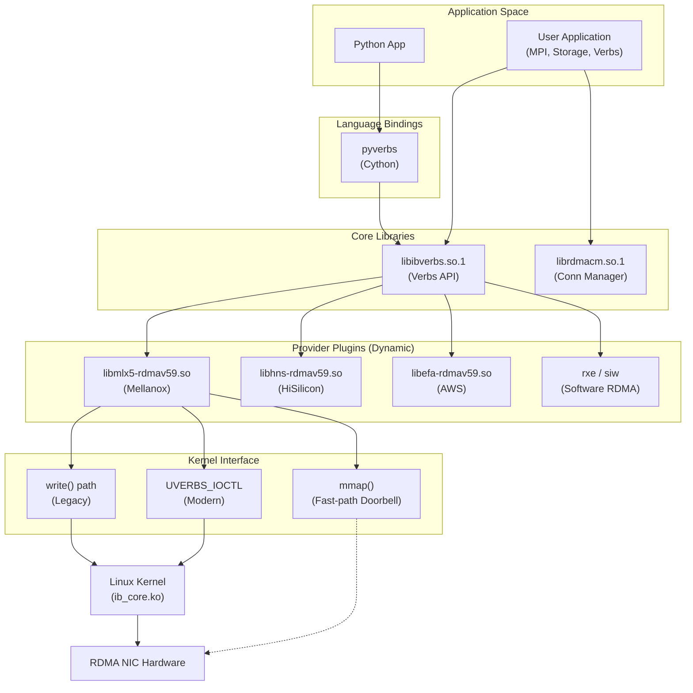
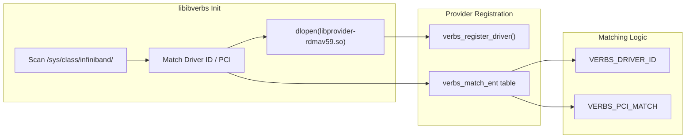

<!-- source: DeepWiki mcp.deepwiki.com · repo linux-rdma/rdma-core · page 1 Overview · fetched 2026-11-11 -->

# Overview

Relevant source files

The following files were used as context for generating this wiki page:

- [.mailmap](.mailmap)
- [CMakeLists.txt](CMakeLists.txt)
- [MAINTAINERS](MAINTAINERS)
- [README.md](README.md)
- [debian/changelog](debian/changelog)
- [debian/compat](debian/compat)
- [debian/control](debian/control)
- [debian/copyright](debian/copyright)
- [debian/libibverbs1.symbols](debian/libibverbs1.symbols)
- [debian/rules](debian/rules)
- [debian/source/format](debian/source/format)
- [kernel-headers/CMakeLists.txt](kernel-headers/CMakeLists.txt)
- [kernel-headers/rdma/bnxt_re-abi.h](kernel-headers/rdma/bnxt_re-abi.h)
- [kernel-headers/rdma/cxgb4-abi.h](kernel-headers/rdma/cxgb4-abi.h)
- [kernel-headers/rdma/erdma-abi.h](kernel-headers/rdma/erdma-abi.h)
- [kernel-headers/rdma/hfi/hfi1_user.h](kernel-headers/rdma/hfi/hfi1_user.h)
- [kernel-headers/rdma/hns-abi.h](kernel-headers/rdma/hns-abi.h)
- [kernel-headers/rdma/ib_user_ioctl_cmds.h](kernel-headers/rdma/ib_user_ioctl_cmds.h)
- [kernel-headers/rdma/ib_user_ioctl_verbs.h](kernel-headers/rdma/ib_user_ioctl_verbs.h)
- [kernel-headers/rdma/ib_user_mad.h](kernel-headers/rdma/ib_user_mad.h)
- [kernel-headers/rdma/ib_user_verbs.h](kernel-headers/rdma/ib_user_verbs.h)
- [kernel-headers/rdma/ionic-abi.h](kernel-headers/rdma/ionic-abi.h)
- [kernel-headers/rdma/mana-abi.h](kernel-headers/rdma/mana-abi.h)
- [kernel-headers/rdma/mlx4-abi.h](kernel-headers/rdma/mlx4-abi.h)
- [kernel-headers/rdma/mlx5-abi.h](kernel-headers/rdma/mlx5-abi.h)
- [kernel-headers/rdma/mthca-abi.h](kernel-headers/rdma/mthca-abi.h)
- [kernel-headers/rdma/ocrdma-abi.h](kernel-headers/rdma/ocrdma-abi.h)
- [kernel-headers/rdma/qedr-abi.h](kernel-headers/rdma/qedr-abi.h)
- [kernel-headers/rdma/rdma_user_ioctl_cmds.h](kernel-headers/rdma/rdma_user_ioctl_cmds.h)
- [kernel-headers/rdma/rdma_user_rxe.h](kernel-headers/rdma/rdma_user_rxe.h)
- [kernel-headers/rdma/siw-abi.h](kernel-headers/rdma/siw-abi.h)
- [kernel-headers/rdma/vmw_pvrdma-abi.h](kernel-headers/rdma/vmw_pvrdma-abi.h)
- [libibverbs/CMakeLists.txt](libibverbs/CMakeLists.txt)
- [libibverbs/cmd_mr.c](libibverbs/cmd_mr.c)
- [libibverbs/driver.h](libibverbs/driver.h)
- [libibverbs/dummy_ops.c](libibverbs/dummy_ops.c)
- [libibverbs/libibverbs.map.in](libibverbs/libibverbs.map.in)
- [libibverbs/man/CMakeLists.txt](libibverbs/man/CMakeLists.txt)
- [libibverbs/man/ibv_dm_export_dmabuf_fd.3.md](libibverbs/man/ibv_dm_export_dmabuf_fd.3.md)
- [libibverbs/man/ibv_reg_mr.3](libibverbs/man/ibv_reg_mr.3)
- [libibverbs/verbs.c](libibverbs/verbs.c)
- [libibverbs/verbs.h](libibverbs/verbs.h)
- [providers/siw/siw.c](providers/siw/siw.c)
- [redhat/rdma-core.spec](redhat/rdma-core.spec)
- [suse/rdma-core.spec](suse/rdma-core.spec)

## Purpose and Scope

This document provides a comprehensive overview of the **rdma-core** project, which serves as the complete userspace infrastructure for the Linux kernel RDMA (Remote Direct Memory Access) subsystem. It covers the repository structure, core libraries, hardware provider plugins, service daemons, language bindings, and the build/distribution system.

rdma-core is the consolidated userspace component for the Linux kernel's `drivers/infiniband` subsystem. It provides the libraries and daemons necessary to utilize **InfiniBand**, **iWARP**, and **RoCE** (RDMA over Converged Ethernet) protocols.

The project manages userspace access to the following kernel device nodes:
- `/dev/infiniband/uverbsX` (handled by `libibverbs`) [README.md:9]()
- `/dev/infiniband/rdma_cm` (handled by `librdmacm`) [README.md:10]()
- `/dev/infiniband/umadX` (handled by `libibumad`) [README.md:11]()

**Sources:** [README.md:1-12](), [debian/control:39-50](), [libibverbs/verbs.h:1-50]()

---

## Repository Structure and Components

The rdma-core repository is organized into distinct functional areas to support a modular plugin architecture:

| Directory | Purpose | Key Components |
|-----------|---------|----------------|
| `libibverbs/` | Core Verbs API | Device management, resource allocation, and operation dispatch [libibverbs/verbs.c:1-100]() |
| `librdmacm/` | Connection Management | Address resolution and RDMA connection setup [debian/control:197-205]() |
| `libibumad/` | Management Datagrams | Interface for sending/receiving IB Management Datagrams [README.md:11]() |
| `providers/` | Hardware Drivers | Vendor-specific plugins (e.g., `mlx5`, `hns`, `efa`) [README.md:13-34]() |
| `pyverbs/` | Python Bindings | Cython-based wrappers for the RDMA stack [redhat/rdma-core.spec:33-40]() |
| `srp_daemon/` | Storage Protocol | SCSI RDMA Protocol discovery and connection daemon [README.md:37]() |
| `ibacm/` | IB CM Assistant | Name and route resolution service [debian/control:55-61]() |
| `iwpmd/` | iWARP Port Mapper | Userspace helper for iWARP TCP port claiming [debian/control:48-50]() |

**Sources:** [README.md:1-40](), [debian/control:1-150](), [CMakeLists.txt:80-130]()

---

## System Architecture: Layered Model

The architecture follows a plugin-based design where applications use a hardware-agnostic API, while hardware-specific details are encapsulated in provider plugins.

### Architecture Data Flow

**Architecture Implementation Details**

1.  **Core Libraries**: Provide the standard API (`ibv_*` functions). They perform device discovery by scanning `/sys/class/infiniband/` [libibverbs/verbs.c:174-195]().
2.  **Provider Plugins**: Shared libraries loaded at runtime based on the device's hardware ID. They implement the `verbs_device_ops` and `verbs_context_ops` function pointer tables [libibverbs/driver.h:218-267]().
3.  **Kernel Bypass**: Performance-critical operations (Send/Receive/Poll) often bypass the kernel by writing directly to hardware-mapped memory (Doorbells) via `mmap` [libibverbs/driver.h:107-111]().
4.  **Control Path**: Resource management (creating QPs, CQs) uses either the legacy `write()` path or the modern `ioctl()` path [CMakeLists.txt:29-31]().

**Sources:** [libibverbs/verbs.h:1-150](), [libibverbs/driver.h:1-200](), [README.md:1-35](), [libibverbs/verbs.c:163-195]()

---

## Core Libraries

### libibverbs: The Foundation
`libibverbs` provides the standard "Verbs" API. It handles the lifecycle of RDMA resources.

| Entity | Code Reference | Description |
|--------|----------------|-------------|
| `ibv_context` | [libibverbs/verbs.h:171-175]() | The primary handle for an opened RDMA device. |
| `ibv_pd` | [libibverbs/verbs.h:199]() | Protection Domain; provides isolation for resources. |
| `ibv_mr` | [libibverbs/verbs.h:164-168]() | Memory Region; registered memory available for RDMA. |
| `ibv_qp` | [libibverbs/verbs.h:175-182]() | Queue Pair; the endpoint for RDMA communication. |
| `ibv_cq` | [libibverbs/verbs.h:185-190]() | Completion Queue; holds Work Completions (`ibv_wc`). |

**Sources:** [libibverbs/verbs.h:1-223](), [libibverbs/libibverbs.map.in:2-40]()

### librdmacm: Connection Management
`librdmacm` simplifies connection establishment by using IP addresses instead of GIDs/LIDs. It sits on top of `libibverbs` and handles the RDMA Connection Manager (CM) protocol [debian/control:203-205]().

---

## Hardware Provider Architecture

Providers are dynamic plugins that implement the backend for `libibverbs`. They are identified by the `IBVERBS_PROVIDER_SUFFIX` which includes the PABI version (currently 59) [CMakeLists.txt:87-88]().

### Provider Discovery and Matching

Providers use specific macros to register their hardware compatibility:
- `VERBS_DRIVER_ID`: Matches based on the kernel driver string [libibverbs/driver.h:235-238]().
- `VERBS_PCI_MATCH`: Matches based on PCI Vendor and Device IDs [libibverbs/driver.h:242-248]().

**Major Providers:**
- **mlx5**: Support for NVIDIA/Mellanox ConnectX-4 and newer [debian/control:100]().
- **hns**: Support for HiSilicon RoCE adapters [debian/control:94]().
- **efa**: Support for AWS Elastic Fabric Adapter [debian/control:91]().
- **rxe/siw**: Software implementations of RoCE and iWARP for testing [debian/control:104-105]().

**Sources:** [libibverbs/driver.h:218-267](), [README.md:13-35](), [debian/control:63-107]()

---

## Build and Distribution

rdma-core uses a **CMake** and **Ninja** based build system [CMakeLists.txt:4-5]().

### Build Configuration
The build system supports various configurations via CMake flags:
- `IN_PLACE=1`: Configures the build to run from the `build/` directory without installation [CMakeLists.txt:8-10]().
- `ENABLE_STATIC=1`: Produces static libraries in addition to shared ones [CMakeLists.txt:21-22]().
- `NO_PYVERBS=1`: Disables the compilation of Python bindings [CMakeLists.txt:45]().

### Packaging
The repository includes specifications for major Linux distributions:
- **Debian**: Metadata in `debian/` directory [debian/control:1-50]().
- **Red Hat**: Spec file at `redhat/rdma-core.spec` [redhat/rdma-core.spec:1-10]().
- **SUSE**: Spec file at `suse/rdma-core.spec` [suse/rdma-core.spec:30-35]().

On non-coherent DMA architectures (e.g., certain ARM/MIPS), specific hardware providers like `mlx5` or `hns` are automatically excluded during the build process to prevent stability issues [debian/rules:11-13](), [debian/rules:65-70]().

**Sources:** [CMakeLists.txt:1-60](), [debian/rules:1-80](), [redhat/rdma-core.spec:1-100](), [suse/rdma-core.spec:1-100]()

---

